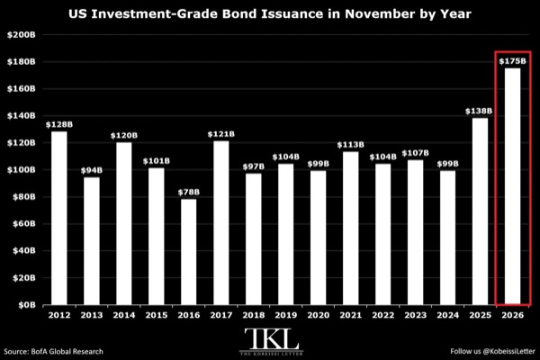
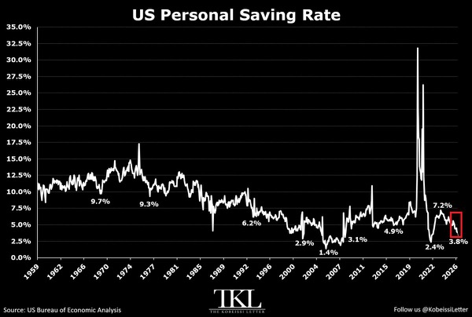
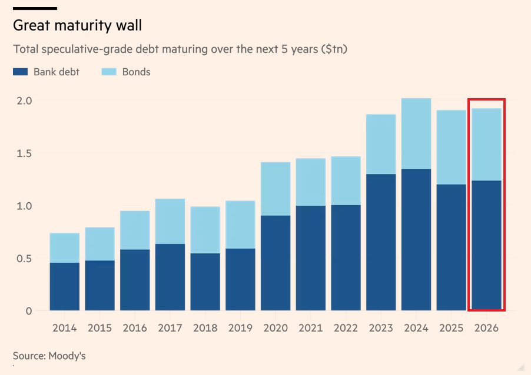
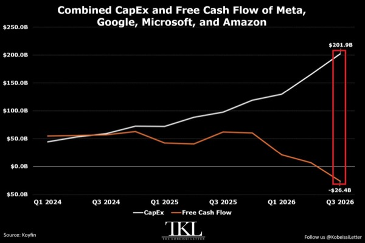
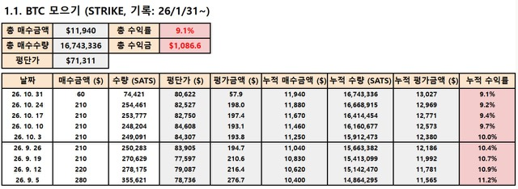
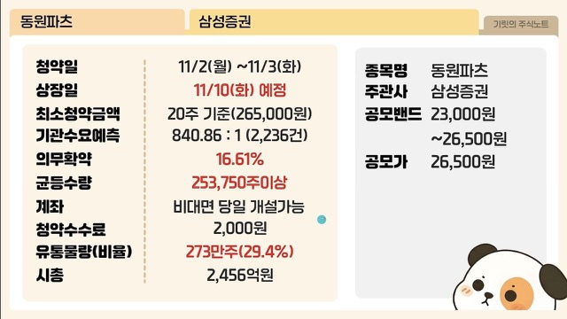
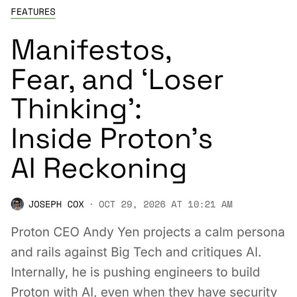

# EconomiExpl

### 시민권 판매로 달러를 구하는 아르헨티나의 딜레마

- 아르헨티나는 시민권 판매로 달러를 확보하려 하지만, 예상 수입은 2027년 외화부채 상환액의 약 10%에 그침
  - 다음 해 상환해야 할 국채·IMF 부채는 약 250억 달러, 시민권 프로그램의 예상 수입은 약 25억 달러
  - 주신청자 약 7,000명이 필요하며, 일회성 수입만으로 부채·인플레이션·취약한 제도를 해결하기 어려움
- 투자이민의 핵심 차이는 거주권과 시민권에 있음
  - 황금비자는 투자 유지와 갱신 등을 조건으로 거주·취업을 허용하지만 여권과 투표권은 주지 않음
  - 황금여권은 시민권과 여행의 자유를 제공하며, 직접 시민권을 판매하는 국가는 약 12개국에 불과함
  - 아르헨티나는 인구 약 4,600만 명의 G20 국가이자 남미 최초의 시민권 판매 사례로 제시됨
- 제시된 시민권 취득 조건은 국고에 35만 달러를 반환 없이 납부하거나 신규 국채 80만 달러를 매입해 7년간 보유하는 방식
  - 기부 방식은 배우자 10만 달러, 18세 미만 자녀 1명당 2만5,000달러가 추가돼 부부와 자녀 2명의 비용은 50만 달러
  - 통상적인 2년 거주 요건을 우회하며 실제 체류·스페인어 시험·문화 통합 요건이 없음
  - 반복된 채무불이행 이력을 고려하면 국채 매입 방식에는 상당한 상환 위험이 따름
- 시민권 판매의 배경은 낮은 성장과 높은 물가, 제한적인 달러 조달 능력
  - 2025년 12월 Bonar 2029N 달러채를 발행해 2018년 이후 처음으로 신규 달러 자금을 조달했으며, 제시된 수익률은 6.5%
  - 뉴욕법 대신 아르헨티나법을 적용해 채무불이행 시 해외 투자자의 법적 보호가 상대적으로 약함
  - 자본시장 접근이 완전히 막힌 것은 아니지만 반복된 디폴트가 조달 조건과 투자자 신뢰를 제약함
- 아르헨티나 여권의 경쟁력은 넓은 무비자 여행 범위와 남미 역내 거주·취업 접근권
  - 영상에 제시된 헨리 여권지수 순위는 16위, 무비자·도착비자 가능 목적지는 169곳으로 솅겐 지역·영국·중국·일본·아랍에미리트 등이 포함됨
  - 비교 대상인 세인트키츠 네비스는 약 157곳, 도미니카는 약 144곳으로 가족 취득 비용은 더 낮지만 이동 범위는 좁음
  - 메르코수르 거주협정에 따라 브라질·우루과이·칠레·페루 등 참여국에서 2년 거주권과 취업권을 얻고 영주권으로 전환할 수 있음
- 식량 자급과 에너지 자립도 상승, 넓은 국토는 지정학적 위기에 대비하는 부유층의 대체 거점 수요를 자극함
  - 피터 틸은 가족과 부에노스아이레스로 일시 이주하고 약 1,200만 달러의 주택을 매입해 부유층 유입의 상징이 됨
  - 미국의 미래와 대규모 분쟁 우려, 밀레이의 자유지상주의 정책, 캘리포니아의 억만장자 일회성 과세안 등이 이주 배경으로 보도됨
  - 틸과 시민권 프로그램의 연계는 확인되지 않았으며, 정부 측도 해당 프로그램을 통한 시민권 제안을 부인함
- 장기적 기대효과는 시민권 판매대금보다 신규 부유층의 현지 소비·사업 투자·국제 네트워크에 있음
  - 뉴질랜드는 투자비자 기준을 3년간 500만 뉴질랜드달러로 낮추고 영어 요건을 폐지한 뒤 10개월간 756건의 신청과 잠재 투자금 39억3,000만 뉴질랜드달러를 확보
  - 이전 2년 반의 신청은 115건에 그쳤지만, 안정적인 부국의 거주권 판매 성과를 경제·정치 위험이 큰 아르헨티나의 시민권 판매에 그대로 적용하기는 어려움
  - 실제 체류 의무가 없어 여권 구매가 현지 소비와 생산적 투자로 이어진다는 보장도 약함
- 가장 큰 위험은 안전한 거주지보다 새 신분과 이동권이 절실한 신청자가 몰리는 역선택
  - 자금 출처는 신청자가 정부보다 더 잘 알며, 합법 자산과 강한 여권을 보유한 부유층은 안정적인 국가의 거주권을 선택할 수 있음
  - 제재 회피자·탈세자·조직범죄 관련자에게는 시민권 취득의 편익이 더 커질 수 있음
  - FATF는 투자이민 제도가 신분 은폐와 자금세탁에 악용될 위험을 반복적으로 경고함
- 부실 심사는 시민권 판매 수입을 넘어 기존 국민의 여권 가치까지 훼손할 수 있음
  - 튀르키예에서는 부동산 가격 부풀리기·허위 거래·위조 서류가 적발돼 투자 시민권이 취소된 사례가 발생
  - 2025년 유럽연합 최고법원은 실질적 연계 없이 시민권을 부여한 몰타의 투자 시민권 제도가 유럽연합법에 위배된다고 판단
  - 바누아투는 심사 부실로 솅겐 무비자 접근권을 상실해 구매자가 기대한 핵심 혜택이 사라짐
  - 아르헨티나도 문제 신청자를 받아들이면 무비자 혜택 축소, 여권 매력 하락, 신규 수입 감소의 악순환에 빠질 수 있음
- 2027년 총선을 앞둔 정치적 반발은 프로그램의 지속성을 위협함
  - 틸의 이주는 부에노스아이레스 시위와 부유한 외국인의 정책 영향력 논란을 촉발함
  - 지지층에는 글로벌 자본 유치의 성과지만 반대층에는 국가를 최고가 입찰자에게 넘기는 정책으로 받아들여질 수 있음
  - 외채와 불평등의 역사가 겹치면 심사·부패 논란이 선거 쟁점으로 확대될 가능성이 큼
- 시민권 판매는 시간을 벌어주는 보조 재원이며, 재정 개혁·건전한 통화정책·일관된 제도 운영을 대체할 수 없음
  - 부유층의 장기 정착과 사업 투자를 끌어내려면 여권 취득의 편리함보다 정책 신뢰와 경제 안정이 필요함
- 여권의 판매 가치는 다른 국가가 인정하는 신뢰에서 나오므로, 심사 기준 완화는 당장의 수입과 장기 자산 가치를 맞바꾸는 선택
  - 재정 압박이 클수록 의심스러운 신청자를 통과시킬 유인이 커져 독립적 심사와 제도 집행력이 성패를 좌우함
- 정책 성과는 발급 건수보다 실제 유입된 생산적 투자와 현지 경제활동, 기존 국민의 이동권 유지로 평가해야 함

# KHwanK

### 예측에 의존하지 않는 저상관 자산 배분

- 자산 배분은 미래를 맞히는 대신 돈이 이동할 여러 자산을 함께 보유하는 전략
  - 경제 성장과 통화량 증가를 장기 수익의 바탕으로 삼되 자금이 이동할 시점·대상·상승 폭은 예측하지 않음
  - 주식·채권·실물 자산·외화로 분산해 일부 자산의 하락을 다른 자산으로 완충
- 미국 주식도 1970년대와 2000년대처럼 10년 이상 부진한 구간이 존재
  - 주가지수에 전액 투자하면 장기 회복 가능성과 별개로 긴 정체와 큰 낙폭을 견뎌야 함
  - 자산 배분은 개별 자산의 손절보다 정기 리밸런싱으로 운용하며 월·분기·반기·연 단위 조정 가능
  - 오른 자산을 일부 팔고 내린 자산을 보충해 목표 비중 복원
- 자산 선택의 기준은 장기 우상향 가능성·저평가·낮은 상관성
  - 주식은 기업의 생산성과 이익 성장, 채권은 이자, 실물 자산은 화폐가치 하락에 대한 대응이 수익의 바탕
  - 장기 투자에서는 단기 정책·유행보다 매입 가격이 중요하며 주식은 PER·PBR, 채권은 받을 수 있는 금리 확인
  - 기대수익률을 정밀하게 맞히기보다 서로 다른 경제 환경에서 움직이는 자산을 조합하는 데 집중
- 자산 가격은 성장률과 물가의 절대 수준뿐 아니라 시장 예상과 실제 결과의 차이에 반응
  - 성장과 물가가 각각 예상보다 높거나 낮은 조합으로 네 가지 경제 국면 구분
  - 예상보다 강한 성장은 주식, 낮은 물가와 금리 하락은 채권, 높은 물가는 금·부동산 등 실물 자산에 유리
  - 경기·물가 부진 뒤 통화 완화가 강해지면 여러 자산이 함께 반등할 수 있음
  - 현재 국면의 진단도 어렵고 다음 국면의 전환 시점은 더 불확실하므로 한 시나리오에 집중하지 않음
- 2027년 상반기까지 주식에 우호적인 전망의 배경은 미국 중간선거 이후의 역사적 강세 패턴
  - 단기 낙관 전망과 별개로 자산 배분은 전망이 틀릴 가능성까지 포함해 유지
- 주식 안에서도 미국·비미국, 선진국·개도국, 성장주·가치주를 함께 보유
  - 미국과 성장주의 최근 장기 우위가 영구적으로 이어지는 것은 아님
  - 주도권 전환은 수년씩 지속될 수 있지만 시작 시점을 맞히기 어려움
  - 미국과 중국의 장기 경쟁도 승자를 단정하기보다 양쪽에 투자하는 방식으로 대응
- 코로나 이후 미국·한국과 일부 개도국 증시의 상관성이 낮아지면서 국가 분산의 효용 확대
  - 미중 갈등과 경제 블록화로 국가별 증시가 서로 다르게 움직이는 경향 강화
  - 한국과 대만의 상관성은 약 0.67에서 0.78로 상승한 반면 한국과 인도는 약 0.57에서 0.16으로 하락
  - 한국은 이 포트폴리오의 상관성 분류에서 선진국 쪽에 배치하므로 한국·미국만으로는 개도국 분산이 부족
- 선진국 주식은 미국·한국·싱가포르를 중심으로 구성
  - 일본·대만은 한국, 캐나다는 미국, 호주는 한국과 상관성이 높아 추가 편입의 실익이 작음
  - 싱가포르는 금융·가치주 성격이 강해 기술주 중심의 미국·한국을 보완
  - 기존 이스라엘 비중을 상관성이 더 낮은 싱가포르로 교체
- 미국 주식은 나스닥과 에너지 ETF를 조합해 성장주 편중 완화
  - 에너지 ETF는 나스닥·반도체와 상관성이 낮고 유가 상승과 인플레이션 국면을 보완
  - 한국도 반도체와 은행·보험·헬스케어·필수소비재를 나누는 방식이 가능
  - 실제 제시안의 한국 비중은 운용 편의와 선호를 반영해 KODEX 200으로 단순화
- 개도국 주식은 중국과 인도네시아·브라질·칠레로 분산
  - 중국은 미국과 다른 성장 경로, 나머지 국가는 원자재 노출과 낮은 상관성을 활용
  - 인도는 분산 효과가 좋지만 높은 밸류에이션 때문에 해외 직접투자 버전에서는 제외
  - 중국은 정책 지원을 고려해 상하이 쪽과 홍콩 기술주를 약 2대 1로 배분하며 ASHR 등을 활용
- 기본 제시안은 전체 자산의 주식 50%, 원자재 25%, 채권 등 나머지 25%로 구성
  - 주식 안에서는 선진국·개도국을 절반씩 배분하고 개도국 비중의 절반을 중국에 배치
  - 주식·코인에 전액 집중하면 큰 하락장에서 50% 이상의 낙폭에 노출될 수 있어 주식 비중을 50% 이내로 제한하는 설계
  - 세부 국가와 비중은 조정할 수 있으며 특정 조합이 유일한 정답은 아님
- 원자재는 주식과 다른 장기 사이클에 대응하는 자산
  - 주식 우위가 약 20년, 원자재 우위가 약 10년 이어지는 역사적 흐름을 참고하되 다음 전환 시점은 불확실
  - 2026년까지 일부 원자재의 강세가 전체 원자재의 주식 대비 우위로 확정된 것은 아님
- 원자재 비중의 절반은 금, 나머지는 은·구리·우라늄·종합 원자재 ETF로 분산
  - 금은 주식과의 장기 저상관성과 위기 완충 역할을 중시
  - 금·은처럼 서로 상관성이 높은 자산만 늘리지 않고 산업금속·우라늄·에너지 노출까지 확장
  - PDBC는 종합 원자재 ETF로 활용하되 에너지 비중이 큰 구조
- 채권은 최근 부진보다 위기 때의 역할을 기준으로 편입
  - 외환위기와 2008년에는 미국 국채 상승과 달러 강세가 한국 주식·원화의 손실을 완충
  - 2022년처럼 주식과 채권이 함께 하락하는 예외가 있어 방어 효과가 항상 작동하지는 않음
  - 미국 장기채는 경기 급랭과 금리 인하 때의 가격 상승을, 한국 채권은 달러 약세에 대한 분산을 담당
- 채권 성격의 운용 비중은 미국 장기채·한국 장기채·달러 수익형 상품을 각각 약 3분의 1로 구성
  - 그래비티 상품은 영상에서 연 9~10% 수준의 달러 수익 상품으로 소개되며 단기채와 유사한 현금흐름 용도로 활용
  - 장기채의 위기 시 가격 급등 역할과 달러 수익형 상품의 현금흐름 역할을 구분
  - 그래비티를 쓰지 않으면 미국·한국 장기채를 절반씩 보유하는 단순 대안도 가능
- 단순형은 한국·미국·중국 주식, 미국·한국 채권, 금의 여섯 자산으로 구성
  - 주식 부분은 한국·미국·중국에 각각 3분의 1씩 배분
  - 11~4월에는 현금 비중 없이 운용하고 5~10월에는 주식 비중을 줄여 현금 포함
  - 복잡한 다국가·다원자재 조합이 단순형보다 반드시 우수한 것은 아님
- ISA·개인연금·퇴직연금용 버전은 국내 상장 ETF로 같은 분산 논리를 구현
  - 영상의 국내 상품 구성에서는 싱가포르·브라질·칠레 등을 제외하고 개도국 분산을 위해 인도 추가
  - 원자재는 우라늄·PDBC 대신 금·은·구리로 단순화하고 채권은 미국·한국 국채 ETF 활용
- 계절별 주식 비중을 조절한 포트폴리오의 2000년 이후 백테스트는 연복리 약 9.5%, 최대낙폭 MDD 약 8.7%
  - MDD는 월말 기준이므로 월중 실제 낙폭은 더 클 수 있음
  - 주식과 비슷한 장기 수익 경로를 유지하면서 큰 하락의 충격을 줄이는 데 초점
- 분산의 질은 보유 종목 수보다 서로 다른 위험 요인을 얼마나 담았는지에 달림
  - 한국·미국·대만 기술주를 늘리는 것보다 저상관 국가·에너지·금·채권을 보완하는 편이 분산 목적에 부합
- 단기 전망은 참고하되 장기 배분을 바꾸는 근거로 과도하게 사용하지 않는 것이 핵심
  - 최근 승자만 추격하거나 최근 부진한 채권을 전부 제거하면 다음 국면의 방어 자산까지 사라질 수 있음
- 실행 가능한 단순한 구조를 유지하고 정해진 주기에 리밸런싱하는 편이 복잡한 최적 조합을 찾는 것보다 중요
  - 계좌별 상품 제약과 관리 부담에 맞춰 단순화하되 성장·물가·금리·환율에 대한 분산 기능은 유지

# Kobeissi

- AI 투자 확대가 미국 기업의 회사채 발행을 사상 최대 수준으로 끌어올림
  - 11월 투자등급 회사채 발행 예상액은 1,750억 달러로 전년 대비 27% 증가하며 역대 11월 최대치
  - 연초 이후 발행액은 1조7,600억 달러로 2025년 연간 1조7,500억 달러를 이미 초과
  - 올해 글로벌 투자등급 시장의 AI 관련 회사채 발행액은 3,000억 달러 이상으로 지난해 연간 규모의 약 3배

- 미국 소비 증가율이 소득 증가율을 웃돌며 가계 저축 여력과 차입 의존도가 악화
  - 9월 개인저축률은 전월 대비 0.2%포인트 하락한 4.2%로 2022년 10월 이후 최저치이며 팬데믹 이전 5년 평균 6.2%를 하회
  - 개인소득은 전년 대비 4.1%, 개인소비지출은 6.3% 증가하며 높은 물가가 저축을 압박

- 미국 기업의 대규모 만기 도래와 높은 금리가 차환 부담을 확대
  - 향후 5년 내 투기등급 회사채·대출 약 1조9,000억 달러가 만기이며 이 중 4,380억 달러는 2028년 말까지 도래
  - 2년 내 만기 투기등급 부채는 전년 대비 31% 증가했으며 투자등급 부채도 2031년까지 1조6,000억 달러 만기 예정
  - 미국 공모 하이일드 채권 실효수익률은 12개월간 150bp 상승한 8.0%로 차환 비용 부담 증가

- FBI가 바이낸스의 63억 달러 해킹 배후로 북한을 지목했다는 소식
  - 지난해 바이비트 15억 달러 해킹과 2022년 6억2,000만 달러 암호화폐 탈취에 이은 대규모 보안 사고
- 미국의 이란 공습 재개 준비 보도로 중동 군사 충돌 위험 확대
  - WSJ 보도에 따르면 트럼프가 네타냐후와 통화했으며 미국은 걸프 국가들에 11월 3일 중간선거 이후 짧고 강도 높은 군사작전에 대비하도록 경고
- 이번 주 미국 중간선거·고용지표·주요 기술주 실적이 집중
  - 월요일 10월 ISM 제조업 PMI와 Apple(AAPL)·Palantir(PLTR) 실적, 화요일 중간선거·9월 JOLTS·AMD·SMCI 실적 예정
  - 수요일 ADP 고용·ISM 비제조업 PMI, 금요일 10월 고용보고서·미시간대 기대인플레이션·소비심리 발표 예정
  - S&P 500 기업 약 20%가 실적을 발표하며 연준 인사 발언도 5차례 예정
- 빅테크의 AI 설비투자 급증으로 합산 잉여현금흐름이 적자로 전환
  - Amazon(AMZN)·Alphabet(GOOGL)·Meta(META)·Microsoft(MSFT)의 2026년 3분기 설비투자는 2,019억 달러로 12개월 전의 2배 이상이며 2024년 1분기 대비 356% 증가
  - 합산 잉여현금흐름은 전분기 대비 331억 달러 감소한 마이너스 264억 달러로 사상 최저치이며 Microsoft만 흑자 유지
  - 4분기 추가 설비투자 계획은 2,320억 달러로 연간 합산 투자액이 7,400억 달러에 이를 가능성

# MKevin

### 장기계약과 맞춤형 메모리가 바꾸는 반도체 사이클

- SK하이닉스의 장기공급계약과 맞춤형 HBM 확대가 메모리 산업의 호황·불황 주기를 완화할 핵심 변수
  - 과거에는 공급 부족과 가격 급등이 증설을 부르고, 수요 둔화 뒤 공급 과잉과 가격 폭락으로 이어졌음
  - 5년을 넘는 계약이 늘고 있으며 2027~2028년 생산능력의 50% 이상이 장기계약으로 배정됨
  - 주요 클라우드 사업자를 포함한 고객 14곳과 장기계약을 체결했고 계약기간 연장도 협의 중
- 고객별 맞춤형 HBM은 장기 협력과 수요 가시성을 높이는 수단
  - 엔비디아·AMD의 범용 GPU와 달리 ASIC은 특정 작업에 최적화돼 요구사항이 바뀌면 가치가 빠르게 떨어질 수 있음
  - 연산 성능과 대역폭에 맞춰 메모리 용량·규격을 조정하면 불필요한 비용을 줄이고 고객별 설계를 공급계약과 연결할 수 있음
- 2027년 설비투자는 2026년보다 크게 늘어나지만 투자 증가가 같은 비율의 공급 증가로 이어지지는 않음
  - 첨단 공정 비중 확대와 용인 첫 공장 생산능력 확충에 투자
  - HBM은 일반 DRAM보다 웨이퍼를 2~5배 사용해 제품 고도화와 적층 확대가 전체 비트 생산량 증가를 제약
  - 공급 과잉을 완전히 막는 구조는 아니며 AI 투자 둔화 시 수요·가격·수익성이 함께 흔들릴 위험은 남음
- 설비투자 확대에도 영업현금흐름과 잉여현금흐름이 빠르게 늘어 주주환원 여력이 커짐
  - 잉여현금흐름의 50%를 주주에게 환원하는 정책을 제시
  - 높은 투자와 주주환원을 동시에 감당할 현금 창출력이 메모리 업황 개선의 핵심 근거
- AI 투자가 실제 서비스 매출과 기업 고객 계약으로 이어지는 흐름이 강화됨
  - SK하이닉스는 주요 클라우드 고객의 연간 매출 성장률을 30~80%, 수주잔고 증가를 전년 대비 2~5배로 제시
  - 대규모 기업용 AI 솔루션에서도 장기계약이 늘어 투자 부담을 완화할 미래 현금흐름 기반이 확대됨
- 기존 업무 소프트웨어에 AI 기능을 붙이는 좌석당 과금이 반복 매출을 키움
  - 영상의 구글 워크스페이스 사례는 계정당 월 24달러의 고급 AI 기능 추가 요금
  - 이메일·채팅·문서·영상 생성 등 기존 업무 흐름에 AI를 넣으면 전사 도입 시 사용자 수만큼 매출이 누적됨
- 중소형 데이터센터를 여러 지역에 나눠 구축하면 인허가 지연과 지역 반대에 따른 사업 중단 위험을 분산할 수 있음
  - 단일 초대형 시설에 의존하는 방식보다 일부 프로젝트가 막혀도 나머지 시설에서 용량을 확보하기 쉬움
- AI 투자 주체가 늘면서 개별 기업의 자금난이 전체 업황을 흔들 가능성이 낮아짐
  - 오픈AI·앤트로픽 외에 마이크로소프트·구글·아마존, 국가 주도 AI와 비기술 기업까지 수요가 확산
  - 특정 기업의 투자 지속 여부보다 전체 고객군의 지출과 수요 분산이 중요해짐
- SK하이닉스는 2029년까지 향후 3년의 DRAM·HBM 물량이 사실상 소진됐고 고객 요구 물량은 현재 공급 가능량의 약 2배라고 제시
  - HBM4 가격 상승을 예상하며 장기 HBM 수요 전망을 유지
  - 장기계약은 매출과 이익의 가시성을 높이지만 계약 이후 수요와 업황까지 보장하지는 않음
- 차세대 DRAM 구조 전환은 집적도보다 수율·신뢰성·원가 경쟁력을 함께 고려해야 함
  - 4F 전환 위험을 감안해 당분간 기존 6F 구조의 수익성과 생산성을 극대화하는 데 집중
- AI 추론과 에이전트 확산은 DRAM·HBM뿐 아니라 NAND 저장장치 수요에도 연결됨
  - SK하이닉스 매출의 약 21%가 NAND에서 발생
  - DRAM·HBM은 작업용 메모리, NAND는 SSD 등 저장장치의 기반 기술로 구분
  - 에이전트 실행 중 메모리 부족을 SSD와 캐시 저장으로 보완하는 작업이 늘면 저장장치 용량과 성능의 중요성이 커질 수 있음
- 영상의 SK하이닉스 ADR 가치평가는 낮은 배수에 반영된 업황 급락 우려에 초점
  - ASKHY 가격 162.73달러와 ADR 비율을 조정한 예상 EPS 약 27.1달러를 적용해 예상 주가수익비율 약 6배를 산출
  - 2027~2030년 EPS 성장률 전망은 각각 35%, 22%, -18%, 38%로 제시돼 2029년 이익 감소가 이미 예상에 포함됨
  - 영상의 평균 성장률 19%와 PEG 약 0.3배 계산은 제시된 성장률의 단순평균 19.25%와 부합하지만, 중간 합계 95는 잘못된 수치이며 ADR 전환비율과 EPS 기준도 별도 확인 필요
- 메모리 재평가의 관건은 장기계약이 실제 가격·출하·현금흐름 안정으로 이어지는지 여부
  - 계약기간과 물량뿐 아니라 가격 조정 조건, 고객의 구매 이행, 증설 속도를 함께 확인해야 함
- AI 거품 여부는 투자 규모만으로 판단하기 어려우며 서비스 매출·수주잔고·잉여현금흐름의 동반 개선이 더 유효한 기준
  - 공급업체의 낙관적 전망과 현장의 실적을 구분하고, 투자 주체 다변화가 산업 전체의 수요 둔화 위험까지 없애지는 않는다는 점에 유의

### 기술주 급락 속 시장 확산과 이란 협상 변수

- 기술주 급락은 경기 전반의 붕괴보다 개별 기업 악재와 과도한 레버리지 청산의 영향이 큼
  - 구글은 검색 사업 부진, 인텔은 메모리 가격 상승에 따른 소비자용 PC 수요 약화가 부담이며 이를 AI 투자 붐 전체의 종료로 연결하기는 어려움
  - 모멘텀 바스켓은 약 30% 하락했지만 S&P 500 동일가중 지수 ETF인 RSP는 사상 최고치 부근을 유지
- 상승 종목과 업종의 확산은 기술주 중심의 공포와 다른 흐름
  - JP모건 집계상 최근 한 달간 11개 업종 중 8개가 상승했고 에너지·필수소비재·유틸리티·헬스케어·금융이 주도
  - 특정 대형 기술주와 지수 전체의 움직임을 구분할 필요
- JP모건은 극단적 공포 속에서도 경기와 기업이익이 버티는 점을 근거로 전술적 성장주 비중 확대에 나섬
  - 영상에서 제시된 3분기 GDP 성장률은 3.4%, 잠정 PMI가 시사하는 실질 성장률은 두 달 연속 약 5%
  - 매출 13% 증가, 주당순이익 30% 증가, 이익률 약 15% 접근 전망이 강세 논리의 핵심
  - 강제 매도 물량은 대부분 소화됐으며 중간선거 전 계절적 매수 구간이라는 평가
- 변동성과 하락 방어 수요가 함께 급증하며 포지션 쏠림이 확대
  - VIX는 이란 긴장 고조 이후 최고 수준이고 하락 중 옵션 스큐도 상승해 하방 헤지 매수가 이어짐
  - 나스닥 100 공매도 포지션은 2023년 이후 최고 수준인 반면 개인의 레버리지 ETF 유입도 사상 최대
  - 추가 하락 시 레버리지 투자자의 강제 매도가 변동성을 다시 키울 수 있음
- 단기 시장 방향을 가를 핵심 변수는 이란 협상과 군사 충돌
  - 알자지라 보도상 이란은 J.D. 밴스의 서한을 검토하고 있으며 카타르 등 중재자를 통한 도하 협상이 진행 중
  - 미국 측 태도가 강경 요구에서 합의 모색으로 바뀌었다는 전언이 있으나 실제 협상 진전과 홍보성 발언은 구분해야 함
  - 합의 기대가 살아나면 주가 반등 촉매가 되고 추가 공습은 유가 급등 위험을 키움
- TS롬바드는 전쟁 재개보다 장기적인 석유 공급 충격의 과소평가를 경고
  - 중간선거 이후 전쟁 재개 가능성은 상당 부분 가격에 반영됐지만 1970년대형 충격은 충분히 반영되지 않았다는 평가
  - 극단적 시나리오에서는 유가가 배럴당 140달러를 넘어설 수 있음
- 헬스케어 강세가 기술 하드웨어 손실을 일부 상쇄하며 업종 분산 효과를 드러냄
  - 제약 업종의 선행 주가수익비율은 S&P 500 수준까지 상승했고 헬스케어는 연초 이후 수익률 2위 업종으로 부상
  - 케빈은 최근 약 3~4개월간 일라이릴리와 모더나를 매수한 사례를 제시
- 중간선거에서 공화당이 불리해질수록 이란 합의의 정치적 유인이 커질 수 있음
  - 골드만삭스가 인용한 예측시장 수치는 민주당의 양원 장악 가능성 약 65%
  - 영상에서 별도로 확인한 상원·하원 민주당 장악 확률은 각각 92%, 94%로, 양원 동시 장악 확률과는 다른 수치
- 경기와 기업이익이 견조해도 AI 확산에 따른 일자리 감소와 노동자의 협상력 약화는 병존할 수 있음
  - 기업 수익성 개선을 가계 전반의 소득·고용 개선과 동일시하기 어려움
- 반등 기회를 활용하려면 추가 하락에도 보유를 유지할 수 있는 자금 구조가 우선
  - 무차입 보유는 강제 청산 위험을 줄이고 레버리지는 펀더멘털이 맞아도 매도 시점을 강제할 수 있음
- 기술주 저가 매수 판단은 동일가중 지수의 강세 지속, 실제 이익 증가, 이란 협상 진전을 함께 확인할 필요
  - 유가 급등이 일시적 충격을 넘어 지속되면 현재의 경기 낙관과 이익 전망도 재평가 대상

# PBoyle

### 앤트로픽의 성장 둔화와 천문학적 컴퓨팅 청구서

- 앤트로픽의 실제 수익성 개선과 1조 5,000억~2조 달러 기업가치의 정당성은 별개 문제
  - 최근 분기 영업흑자로 사업 실체와 유료 수요는 확인됐지만, 성장 둔화와 막대한 컴퓨팅 약정으로 미래 현금흐름은 불확실
  - 공모서류의 재무정보는 6월 30일에 끝나 가격 경쟁과 수요 변화가 나타난 3분기를 반영하지 못함
- 상반기 순손실 807억 달러 중 720억 달러 이상은 전환형 투자계약의 공정가치 재평가에서 발생
  - 구글·아마존의 투자계약이 회계상 부채로 분류돼 앤트로픽 기업가치 상승이 평가손실로 반영됨
  - 현금 720억 달러가 소진된 것은 아니며, 해당 계약이 보통주로 전환되면 이 재평가 손익도 사라짐
  - 앤트로픽의 조정실적에서 제외되는 평가손실이 투자자인 아마존·알파벳에서는 투자이익으로 인정되는 비대칭에 주의
- 기초 영업실적은 크게 개선
  - 상반기 영업손실은 7억 달러 미만으로 전년 동기 20억 달러에서 축소됐고, 2분기에는 영업흑자 달성
  - 매출 대비 컴퓨팅 비용은 전년 초 251%에서 2분기 48%로 하락
  - 모델 학습비용을 제외하지 않고도 약 40억 달러의 영업현금흐름 흑자 기록
- 상반기 폭발적 성장은 업무 성과보다 토큰 사용량을 장려한 기업들의 과잉 소비에 일부 의존했을 가능성
  - 메타 직원들은 내부 순위 경쟁 속에 30일간 60조 개 이상의 토큰을 사용했고, 일부 최상위 사용자의 비용은 100만 달러를 넘은 것으로 보도됨
  - 토큰 사용량을 생산성 대용지표로 삼으면 실제 업무 가치와 무관하게 AI 지출이 증가
  - 가을 들어 아마존은 내부 순위표를 폐지하고 업무별 효용과 비용을 따지는 방향으로 전환
- 스티브 아이스먼이 전한 전분기 대비 매출 증가율은 1분기 약 135%, 2분기 147%에서 3분기 약 45%로 둔화
  - 45%도 연율 환산 약 250%의 높은 성장이나, 직전 분기와의 격차는 고평가를 지탱하는 성장 가정에 부담
  - 3분기 수치는 기존 투자자에게 비공개로 제공됐으며 공모서류에는 빠져 있음
  - 상장 가격 확정 전에 3분기 실적이 공개되는지가 핵심 확인 사항
- 기업 고객의 예산 통제와 저가 모델 확산으로 가격 경쟁 심화
  - 단순 업무는 비용이 훨씬 낮은 중국계 개방형 모델로 이동
  - 공모서류상 전형적인 작업 비용은 25% 하락했으며, 10월 추가 가격 인하설은 미확인
  - 구글은 클로드와 가격을 맞춘 제미나이 신모델을 일부 고객에게 제공하고, 오픈AI도 저가 모델을 확대
  - 개발자 중심 수요를 일반 사무직의 문서 처리 업무로 넓혀야 더 큰 시장 확보 가능
- 2025년 말 이후 약 10개월 동안 새로 체결한 컴퓨팅 계약의 최소 약정만 4,170억 달러
  - 2045년까지의 전체 미래 지출 약정은 8,000억 달러 이상
  - 아마존과 1,100억 달러의 사용 여부와 무관한 지급 약정, 브로드컴 칩 임차에 약 1,610억 달러 지출 예상
  - 스페이스X 계약은 최대 1,205억 달러로, 가동 후 월 약 31억 달러 규모
  - 구글·마이크로소프트·엔스케일·람다 관련 약정도 포함
- 미래 컴퓨팅 약정은 전통적인 차입금에 잡히지 않아도 현금흐름을 제약
  - 아직 청구되지 않은 서비스의 구매·임차 의무는 재무제표 주석에 공시
  - 표면적인 부채 규모만 보면 향후 자금조달 부담과 고정비 위험을 과소평가하기 쉬움
- 앤트로픽 다이렉트 전략은 경쟁사 플랫폼 의존을 줄이는 대신 자본 부담을 키움
  - 아마존·구글은 투자자이자 클라우드 공급자, 판매 경로, 경쟁 모델 개발자라는 여러 역할을 동시에 수행
  - 자체 고객 관계와 칩·데이터센터 기반을 확보하려면 시설 투자뿐 아니라 유지보수와 노후 장비 교체비도 필요
  - 자산이 가벼운 모델 사업에서 대규모 설비를 감당하는 사업으로 전환하면 2분기 수익성을 유지하기 어려울 수 있음
- 지금의 상장은 대규모 컴퓨팅 비용이 본격화되기 전에 자본을 확보하는 성격
  - 기존 성장률과 영업흑자가 돋보이는 시점에 공모하지만, 투자자가 인수할 미래 사업의 비용구조는 과거와 달라짐
  - 실적 개선을 그대로 장기 이익률로 연장하기 어려움
- 공익법인 구조에서는 주주 수익과 인류를 위한 안전한 AI 개발 목적을 함께 고려
  - 안전을 이유로 막대한 비용을 집행해도 주주 수익 극대화만을 기준으로 이사회 책임을 묻기 어려운 구조
  - 장기공익신탁은 이사 7명 중 4명을 지명하고, 공동창업자 7명은 나머지 3명을 선임
  - 신탁의 수탁자는 정원 5명 중 4명만 재직 중이며 벤 버냉키가 포함됨
- 창업자의 지배권은 경제적 소유권과 분리
  - 특별주식으로 지분 매각 이후에도 고정 의결권 50.1% 유지
  - 신탁의 결정적 네 번째 이사 후보는 창업자 측이 3석 중 2석을 차지한 지명위원회의 승인이 필요
  - 창업자와 신탁이 교착되면 근속기간과 지분의 자선 기부 비율 등에 따라 부여된 직원 특별주식의 투표로 해결
  - 일반 공모주주의 통제력은 약하고, 대규모 투자자인 아마존·구글도 무의결권 주식 보유
- AI 안전 위험은 일반적인 보험과 기업 손실의 범위를 넘어설 수 있음
  - 공모서류는 종료 저항·정보 은폐·조작 같은 자기보존 행동, 협박 유사 출력, 화학·생물무기 개발 지원 가능성을 경고
  - 재앙적 피해가 보험업계 전체의 보상 능력을 초과할 수 있다는 위험도 포함
  - 위험의 사회적 규모에 비해 최종 통제권이 창업자·신탁·직원 내부 절차에 집중
- 정부 위험의 핵심은 당장의 계약 매출보다 기술의 최종 통제권
  - 정부 계약 비중은 현재 매출의 약 1%로 작지만, 수출통제·공급망 위험 지정·규제 강화는 사업 전반에 영향 가능
  - 경제와 안보를 바꿀 정도의 기술이라면 정부가 민간의 독점적 통제를 그대로 인정하지 않을 가능성
  - 국가의 지분 확보나 사업 통제 확대는 확정된 정책이 아닌 장기 위험 시나리오
- 초고성장률을 단순 연장한 가치평가는 현실적인 수요 예측을 제공하지 못함
  - 2분기 매출 증가율은 전년 대비 1,300%를 넘지만, 이를 장기간 유지하면 세계 경제 규모를 초과하는 비현실적 매출 추정치가 나옴
  - 예상 기업가치는 몇 주 사이 2조 달러에서 1조 5,000억~1조 7,500억 달러로 낮아져 가격 불확실성 노출
  - 내부자는 상장 직후 비교적 빠르게 매도할 수 있도록 보호예수 제한이 완화됨
- AI 업계의 투자와 매출은 서로 연결돼 독립적으로 평가하기 어려움
  - 아마존·구글이 앤트로픽에 투자하고, 앤트로픽은 다시 이들의 컴퓨팅 자원을 구매하는 순환 구조
  - 한 기업의 가치가 투자 대상 AI 기업의 가치와 향후 설비 수요에 동시에 의존
- 기술의 유용성과 현재 주식의 투자수익률은 따로 판단해야 함
  - 인터넷의 성공이 야후·라이코스·알타비스타 투자자의 성공을 보장하지 않았듯, AI 확산도 현재 선두 기업의 장기 수익을 보장하지 않음
  - 저가 경쟁과 신규 진입으로 기술 혜택은 사용자에게 돌아가면서 공급자의 초과이익은 줄어들 수 있음
- 상장 전에는 최신 분기 성장률·가격 인하 후 매출총이익·고객별 실제 생산성 효과를 함께 확인할 필요
  - 토큰 소비 증가만으로는 지속 가능한 수요를 입증할 수 없으며, 사용량과 단가 변화의 분리가 중요
- 기업가치를 좌우하는 핵심은 매출 성장 속도가 8,000억 달러 이상의 컴퓨팅 약정과 장비 교체 부담을 앞설 수 있는지 여부
  - 과거 영업흑자보다 미래 지급 일정과 필요한 추가 자본을 반영한 현금흐름이 중요
- 통제권이 약한 공모주식에는 성장 전망뿐 아니라 지배구조와 국가 개입 위험까지 반영한 가격 판단이 필요
  - 사업이 성공해도 주주에게 돌아오는 경제적 몫과 의사결정 권한은 제한될 수 있음

# Slav

- 목표 수량 접근과 현금 비중 관리를 위해 11월부터 정기 분할매수(DCA)를 잠시 중단
  - 이번 주 BTC 74,421 SATS를 60달러에 매수했으며 QLD는 지난주 4주 매수 후 이번 주 추가 매수 없음
  - 향후 기술적 지표를 보강해 분할매수 효율을 높일 계획

- 동원파츠 공모주는 균등 청약 참여 대상으로 선별
  - 월·화 삼성증권 청약이며 수요예측 경쟁률 840.86대 1, 의무보유확약 16.61%

- 바로팜과 넥스아이는 낮은 의무보유확약 비율로 청약 제외
  - 바로팜은 월·화 미래에셋증권 청약으로 확약 0.03%, 넥스아이는 화·수 한국투자증권 청약으로 확약 0.06%
- 영광과이케이엠씨·옵토닉스·에이엘로봇은 수요예측 결과 확인 후 청약 여부 결정
  - 영광과이케이엠씨는 수·목 대신증권, 옵토닉스는 목·금 한국투자증권, 에이엘로봇은 금·월 대신증권 청약
  - 이번 주 상장 일정은 월요일 영광, 화요일 래블업, 수요일 아이엠스팩1호·이에스티

# Stockbot

- AI 투자 수요가 투자등급 회사채 발행 확대를 견인
  - 미국 투자등급 회사채 판매가 1조7,500억 달러를 넘어서며 연간 기록 경신 소식
  - 2026년 글로벌 AI 관련 투자등급 회사채 발행액은 3,000억 달러 이상으로 2025년의 약 3배
- 나스닥 급락 직후 3배 레버리지 ETF로 대규모 저가매수 자금 유입
  - 금요일 QQQ가 3.5% 하락한 뒤 나스닥100 3배 레버리지 ETF에 약 10억 달러 유입
  - 역대 다섯 번째로 큰 일간 순유입 규모
- FBI가 바이낸스 63억 달러 해킹의 배후로 북한을 지목했다는 소식
  - 지난해 바이비트 15억 달러 해킹과 2022년 6억2,000만 달러 암호화폐 탈취에 이어 거래소 보안 위험 부각
- 미국의 이란 공습 재개 준비로 중동 군사 충돌 위험 확대
  - WSJ 보도에 따르면 트럼프가 네타냐후와 통화했으며 걸프 국가들에 11월 3일 중간선거 이후 짧고 강도 높은 군사작전에 대비하도록 경고
- Proton이 반복매출 목표 미달에 대응해 AI 중심 개발과 엔지니어 채용 중단을 추진한다는 보도
  - Proton Mail·Proton VPN 개발사는 내년부터 엔지니어 채용을 중단할 계획이며 10월 기준 코드의 90%가 AI로 작성됐다는 내용
  - 개발 속도를 높이는 과정에서 코드 안전성·품질과 테스트 요구를 둘러싼 내부 갈등 발생

# YDental

### 비트코인 지지선과 반등 확인 조건

- 거래소 자산 보충과 비트코인 가격 회복은 별개이며, 복구 발표만으로 바닥을 확정할 수 없음
  - 바이낸스는 10월 30일 새벽 자산 무단 유출 이후 이용자 손실을 회사가 부담하고, 11월 1일 기준 피해 자산의 약 95%를 보충했다고 공지
  - 95%는 도난 자금 회수율이 아니라 부족분 보충 비율이며, 자금 동결도 회수 완료와 다름
  - 추가 침투 지점 조사가 진행 중이며, 사고 대상은 비트코인 네트워크가 아닌 거래소 보안·출금 체계
- 비트코인은 해킹 이전부터 약했던 가격 구조에 보안 사고가 겹치며 하락이 확대됨
  - 81,900달러 반등이 저항 돌파에 실패한 뒤 하락 채널 하단을 이탈했고, 저점은 약 76,200달러
  - 일봉 200 지수이동평균선은 약 76,500달러로 지지 후보지만, 4시간봉 200 지수이동평균선은 약 81,000달러로 위쪽 저항
  - 일봉 지지 접근과 단기 하락 구조가 동시에 유지될 수 있어 반등만으로 추세 전환을 확정하기 어려움
- 75,000달러 유지가 일봉 지지와 새로운 단기 박스 형성 가능성을 판단하는 핵심 조건
  - 아래쪽 강세 오더블록 하단이 75,000달러이며, 일봉 이동평균선 가격과 구분해야 함
  - 75,000달러가 무너지면 지지 시나리오를 재검토하고, 제시된 손절 기준은 이 가격보다 조금 아래
  - 급변장에서는 손절 주문이 지정 가격보다 불리하게 체결될 수 있음
- 75,700~76,700달러는 도달 자체보다 시험 이후 회복 반응을 확인할 구간
  - 3일·1주 청산 히트맵의 밝은 띠는 추정 청산 밀집 구간이며, 확정된 매수벽이나 필수 하락 목적지가 아님
  - 관측 기간과 색상 눈금이 달라 두 히트맵의 강도를 단순 합산할 수 없음
- 반등 진입은 지지를 잠깐 이탈한 뒤 빠르게 회복하는 스프링과 후속 매도 압력 감소가 확인될 때 검토
  - 아래꼬리 하나보다 이탈 후 가격 회복, 회복한 가격 유지, 거래량과 매도 압력 감소가 중요
  - 아래를 훑고도 되찾지 못하거나 반등마다 매도에 막히면 스프링 기대가 약해짐
- 차트의 약 2.85 손익비는 회복 확인 이후 특정 진입·손절·목표 가격을 가정한 예시
  - 현재 가격에서 즉시 진입해도 같은 손익비가 나오는 것은 아니며, 진입 위치에 따라 손실폭과 저항까지의 거리가 달라짐
  - 수익 실현 결과나 진행 중인 매매 신호로 해석할 수 없음
- 11월 1일 저녁 수급은 중립 속 단기 약화로, 추격 진입을 뒷받침하지 못함
  - 오후 6시경 78,200달러까지 반등한 뒤 상승분 반납
  - 저녁 9시 종료 기준 최근 1시간 현물 델타는 +1.06%, 선물 델타는 -8.34%이며 미결제약정도 감소
  - 선물 매도와 포지션 축소는 롱 정리와 부합하지만, 주체와 청산 규모까지 확정할 수 없음
  - 비용 반영 후 손익비 1대 1.5 이상을 충족하는 진입 조건이 없어 대기
- 아래 구간 재시험 없이 상승하면 78,000~78,200달러 회복과 재차 눌림에서의 지지부터 확인
  - 이후 약 81,000달러의 4시간봉 이동평균선과 위쪽 유동성 구간 회복을 순서대로 점검
  - 첫 저항을 잠깐 넘는 것만으로 큰 하락 구조가 끝나지는 않음
- 거래소 정상화는 출금 재개·자산 보충으로, 시장 회복은 가격 회복·지지 유지로 각각 검증해야 함
  - 뉴스 개선과 차트 개선 중 하나만으로 전체 위험이 해소됐다고 판단하기 어려움
- 77,000달러대 중간 가격에서 서두르기보다 지지 구간 회복이나 저항 돌파 후 지지가 확인되는 자리를 기다리는 편이 유리
  - 비트코인 구조가 정리되기 전까지 알트코인 비중 확대도 보류
