# Aurum

- AI 과잉 투자에 따른 빅테크 주가 하락이 자금 조달과 인프라 투자, 소비를 위축시키면 연준의 추가 금리 인상이 멈출 수 있음
  - 메타·알파벳·아마존은 AI 지출 확대와 잉여현금흐름 악화 우려로 실적 발표 후 하락
  - 무살렘 총재는 AI·데이터센터 지출 둔화나 금융여건 급변에 따른 총수요 약화를 인상 중단 시나리오로 제시
  - 금융여건은 조여졌지만 아직 긴축적 수준은 아니라는 평가
- 기술주에 공매도가 집중되며 QQQ와 SPY의 포지션이 엇갈림
  - QQQ 공매도 잔고는 약 8,200만 주로 2023년 3월 이후 최대이며, 최근 몇 주간 1,800만 주·28% 증가하고 연초 대비 거의 두 배로 확대
  - SPY는 3월 이후 3,000만 주 감소한 약 9,200만 주로 최소 5년 내 저점에 근접
  - 2022년 약세장 정점은 QQQ 약 9,000만 주, SPY 약 1억 8,000만 주

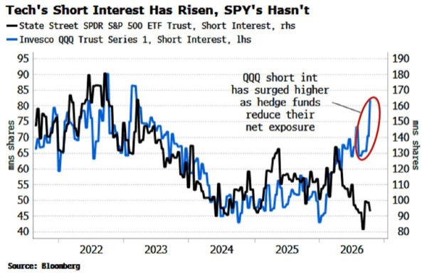

- 미국 중간선거에서 의회 분점은 정책 교착과 재정 확대 제약으로 주식·국채에 우호적인 시나리오
  - 1950년 이후 공화당 대통령·분점 의회 조합의 주식 연평균 수익률은 13.7%로 공화당 의회 8.3%, 민주당 의회 4.9%를 상회
  - 트럼프의 거부권 아래 시장은 실적과 경기에 집중할 수 있으나 관세·대외 개입은 변수
- 민주당이 상·하원을 모두 장악하면 AI 규제와 데이터센터 제한 우려가 반도체·산업재·AI 기업의 이익 전망을 압박할 수 있음
  - 대통령 거부권으로 입법은 막히더라도 조사·청문회를 통한 업계 압박은 가능
  - AI 투자 둔화는 성장과 달러의 하방 요인이지만 관세·지정학적 긴장은 국채금리 상승 요인이라 채권 방향은 혼재
- 공화당이 상·하원을 유지하면 AI 투자 환경 지속과 성장 촉진 기대가 AI·금융·산업재에 우호적일 수 있음
  - 재정 부양과 성장 기대가 국채금리·차입 비용을 올려 주식시장 상승을 제약할 가능성
  - 전후 모든 중간선거에서 S&P 500은 이후 12개월 상승했지만, 올해는 선거 전부터 연초 대비 13% 오른 상태
- 평상시 M2 증가율만으로 물가를 예측하기는 어렵고, 통화량의 이례적 급증과 유통속도를 함께 봐야 함
  - 2008~2009년에는 통화 증가에도 유통속도가 약 11% 하락해 물가가 내렸지만, 2020~2021년에는 가계로 직접 들어간 돈이 소비로 연결
  - 2020년 중반 경제성장을 초과한 통화 증가율은 연율 약 93%까지 치솟았고 이후 약 1년 만에 PCE 물가 상승률이 7%를 넘김
  - M2 급증과 유통속도 하락 중단이 겹치면 물가연동채·실물자산 등 인플레이션 대응 비중을 재검토할 조건

# EconomiExpl

### 시민권 판매로 달러를 구하는 아르헨티나의 딜레마

- 아르헨티나는 시민권 판매로 달러를 확보하려 하지만, 예상 수입은 2027년 외화부채 상환액의 약 10%에 그침
  - 다음 해 상환해야 할 국채·IMF 부채는 약 250억 달러, 시민권 프로그램의 예상 수입은 약 25억 달러
  - 주신청자 약 7,000명이 필요하며, 일회성 수입만으로 부채·인플레이션·취약한 제도를 해결하기 어려움
- 투자이민의 핵심 차이는 거주권과 시민권에 있음
  - 황금비자는 투자 유지와 갱신 등을 조건으로 거주·취업을 허용하지만 여권과 투표권은 주지 않음
  - 황금여권은 시민권과 여행의 자유를 제공하며, 직접 시민권을 판매하는 국가는 약 12개국에 불과함
  - 아르헨티나는 인구 약 4,600만 명의 G20 국가이자 남미 최초의 시민권 판매 사례로 제시됨
- 제시된 시민권 취득 조건은 국고에 35만 달러를 반환 없이 납부하거나 신규 국채 80만 달러를 매입해 7년간 보유하는 방식
  - 기부 방식은 배우자 10만 달러, 18세 미만 자녀 1명당 2만5,000달러가 추가돼 부부와 자녀 2명의 비용은 50만 달러
  - 통상적인 2년 거주 요건을 우회하며 실제 체류·스페인어 시험·문화 통합 요건이 없음
  - 반복된 채무불이행 이력을 고려하면 국채 매입 방식에는 상당한 상환 위험이 따름
- 시민권 판매의 배경은 낮은 성장과 높은 물가, 제한적인 달러 조달 능력
  - 2025년 12월 Bonar 2029N 달러채를 발행해 2018년 이후 처음으로 신규 달러 자금을 조달했으며, 제시된 수익률은 6.5%
  - 뉴욕법 대신 아르헨티나법을 적용해 채무불이행 시 해외 투자자의 법적 보호가 상대적으로 약함
  - 자본시장 접근이 완전히 막힌 것은 아니지만 반복된 디폴트가 조달 조건과 투자자 신뢰를 제약함
- 아르헨티나 여권의 경쟁력은 넓은 무비자 여행 범위와 남미 역내 거주·취업 접근권
  - 영상에 제시된 헨리 여권지수 순위는 16위, 무비자·도착비자 가능 목적지는 169곳으로 솅겐 지역·영국·중국·일본·아랍에미리트 등이 포함됨
  - 비교 대상인 세인트키츠 네비스는 약 157곳, 도미니카는 약 144곳으로 가족 취득 비용은 더 낮지만 이동 범위는 좁음
  - 메르코수르 거주협정에 따라 브라질·우루과이·칠레·페루 등 참여국에서 2년 거주권과 취업권을 얻고 영주권으로 전환할 수 있음
- 식량 자급과 에너지 자립도 상승, 넓은 국토는 지정학적 위기에 대비하는 부유층의 대체 거점 수요를 자극함
  - 피터 틸은 가족과 부에노스아이레스로 일시 이주하고 약 1,200만 달러의 주택을 매입해 부유층 유입의 상징이 됨
  - 미국의 미래와 대규모 분쟁 우려, 밀레이의 자유지상주의 정책, 캘리포니아의 억만장자 일회성 과세안 등이 이주 배경으로 보도됨
  - 틸과 시민권 프로그램의 연계는 확인되지 않았으며, 정부 측도 해당 프로그램을 통한 시민권 제안을 부인함
- 장기적 기대효과는 시민권 판매대금보다 신규 부유층의 현지 소비·사업 투자·국제 네트워크에 있음
  - 뉴질랜드는 투자비자 기준을 3년간 500만 뉴질랜드달러로 낮추고 영어 요건을 폐지한 뒤 10개월간 756건의 신청과 잠재 투자금 39억3,000만 뉴질랜드달러를 확보
  - 이전 2년 반의 신청은 115건에 그쳤지만, 안정적인 부국의 거주권 판매 성과를 경제·정치 위험이 큰 아르헨티나의 시민권 판매에 그대로 적용하기는 어려움
  - 실제 체류 의무가 없어 여권 구매가 현지 소비와 생산적 투자로 이어진다는 보장도 약함
- 가장 큰 위험은 안전한 거주지보다 새 신분과 이동권이 절실한 신청자가 몰리는 역선택
  - 자금 출처는 신청자가 정부보다 더 잘 알며, 합법 자산과 강한 여권을 보유한 부유층은 안정적인 국가의 거주권을 선택할 수 있음
  - 제재 회피자·탈세자·조직범죄 관련자에게는 시민권 취득의 편익이 더 커질 수 있음
  - FATF는 투자이민 제도가 신분 은폐와 자금세탁에 악용될 위험을 반복적으로 경고함
- 부실 심사는 시민권 판매 수입을 넘어 기존 국민의 여권 가치까지 훼손할 수 있음
  - 튀르키예에서는 부동산 가격 부풀리기·허위 거래·위조 서류가 적발돼 투자 시민권이 취소된 사례가 발생
  - 2025년 유럽연합 최고법원은 실질적 연계 없이 시민권을 부여한 몰타의 투자 시민권 제도가 유럽연합법에 위배된다고 판단
  - 바누아투는 심사 부실로 솅겐 무비자 접근권을 상실해 구매자가 기대한 핵심 혜택이 사라짐
  - 아르헨티나도 문제 신청자를 받아들이면 무비자 혜택 축소, 여권 매력 하락, 신규 수입 감소의 악순환에 빠질 수 있음
- 2027년 총선을 앞둔 정치적 반발은 프로그램의 지속성을 위협함
  - 틸의 이주는 부에노스아이레스 시위와 부유한 외국인의 정책 영향력 논란을 촉발함
  - 지지층에는 글로벌 자본 유치의 성과지만 반대층에는 국가를 최고가 입찰자에게 넘기는 정책으로 받아들여질 수 있음
  - 외채와 불평등의 역사가 겹치면 심사·부패 논란이 선거 쟁점으로 확대될 가능성이 큼
- 시민권 판매는 시간을 벌어주는 보조 재원이며, 재정 개혁·건전한 통화정책·일관된 제도 운영을 대체할 수 없음
  - 부유층의 장기 정착과 사업 투자를 끌어내려면 여권 취득의 편리함보다 정책 신뢰와 경제 안정이 필요함
- 여권의 판매 가치는 다른 국가가 인정하는 신뢰에서 나오므로, 심사 기준 완화는 당장의 수입과 장기 자산 가치를 맞바꾸는 선택
  - 재정 압박이 클수록 의심스러운 신청자를 통과시킬 유인이 커져 독립적 심사와 제도 집행력이 성패를 좌우함
- 정책 성과는 발급 건수보다 실제 유입된 생산적 투자와 현지 경제활동, 기존 국민의 이동권 유지로 평가해야 함

# Harvey

- 미국의 해외 주식자금 유입 의존과 빅테크 집중이 결합하면서 주식과 달러를 지탱하는 투자 논리가 같은 방향으로 수렴할 수 있음
  - 해외 자금은 미국 기업의 초과이익을 기대해 주식과 달러를 함께 보유하며, AI 투자 성과가 달러에도 영향을 주는 구조
- 미국 고유의 AI 이익 충격이 발생하면 대형 기술주 하락과 달러 약세가 동시에 나타날 수 있음
  - 이익 기대가 꺾이면 해외 투자자는 미국 주식과 달러를 함께 줄일 유인이 커짐
- 해외 투자자의 환헤지 확대는 주식 매도 없이도 달러 매도 압력을 만들 수 있음
  - 신규 주식자금 유입 둔화와 누적 미국 자산의 환노출 조정이 함께 충격을 증폭시킬 수 있음
- 투자 기회는 주식·달러 동반 하락을 단정하기보다 환헤지 전환과 조건부 상관관계 변화가 가격에 앞서 나타나는지 확인하는 데 있음
  - 해외 보유자의 헤지 비율과 AI 기업 이익 전망을 함께 추적할 필요

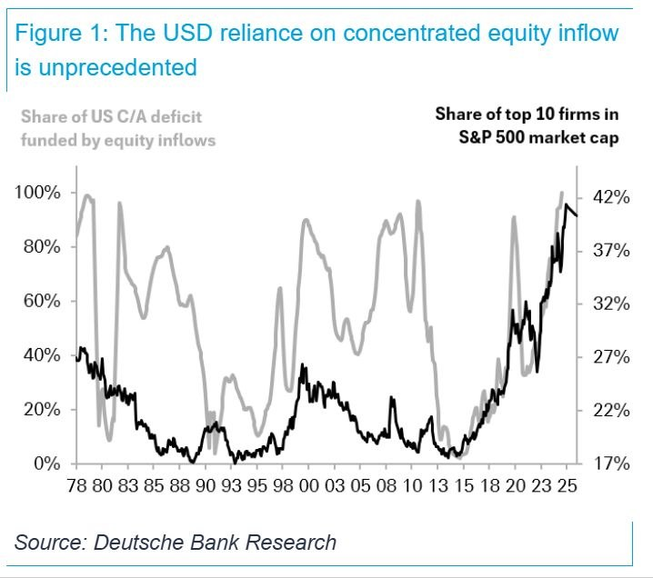

# KHwanK

### 인공지능 주도주 순환과 코인 상승기 대응 전략

- 2027년 상반기까지 미국 증시 강세에 무게
  - 중간선거 직전 10월부터 이듬해 7월까지는 대통령 임기 사이클에서 가장 강한 구간
  - 제시된 역사 통계는 1942년 이후 해당 구간 하락 사례가 없고 평균 상승률은 약 20%, 분기별 상승 확률은 4분기 90%·1분기 95%·2분기 90%
  - 과거 계절성이 이번에도 반복된다는 보장은 없지만 높은 확률에 집중하는 접근
- 금리 상승은 증시 전체 하락보다 종목 간 격차 확대로 이어질 가능성
  - 과거 금리 급등 15차례 중 11차례는 주가 상승, 4차례만 하락
  - 부채 부담과 할인율 상승으로 취약 기업의 매력은 낮아지고 현금흐름·수익성·성장성이 좋은 기업에 자금 집중
  - 지수 상승을 맞히는 것보다 지수를 이길 종목을 고르는 일이 어려워질 수 있음
- 삼성전자·SK하이닉스는 이익 전망 대비 저평가 매력이 크지만 매수는 가격 회복 확인이 우선
  - 2026~2028년 예상 순이익 합계가 현재 시가총액과 비슷한 수준이며 선행 주가수익비율은 약 3배
  - 2027~2028년 이익 전망이 과도할 위험은 있지만 AI 기업 간 경쟁이 지속되는 한 메모리 수요의 구조적 소멸 가능성은 낮음
  - 강환국은 두 종목을 손절한 상태이며 고점 대비 반토막 난 가격과 하락 추세를 저평가 판단보다 우선
- AI 투자 자금은 칩·컴퓨팅 인프라·물리 인프라·생산성 개선·플랫폼의 다섯 단계 안에서 순환
  - 1단계는 GPU·메모리 등 칩과 연산, 2단계는 서버·네트워크·데이터센터
  - 3단계는 전력·원전·구리 등 물리 인프라, 4단계는 AI 도입으로 생산성이 높아지는 기업
  - 5단계는 이용자의 시간과 지출을 장악하는 AI 플랫폼
- 현재 주도권은 인프라에서 소프트웨어·바이오의 생산성 개선으로 이동
  - 상반기 주도주였던 1~3단계는 큰 폭 상승 후 조정에 들어갔고 상대강도도 약화
  - 휴머노이드·자동화 공장보다 사무실·연구실의 생산성 향상이 먼저 실적으로 연결되는 구간
  - 인프라 투자와 생산성 개선은 서로 단절된 순서가 아니라 동시에 진행되는 두 투자 사이클
- 소프트웨어에서는 업무 자동화와 사이버보안 수요에 주목
  - AI 도입은 직원당 소프트웨어 활용을 늘리고 AI 기반 해킹·랜섬웨어 확산은 보안 지출을 자극
  - 서비스나우·아틀라시안 등을 살피되 크라우드스트라이크·팔로알토 같은 주요 보안 기업과 개별 종목의 가격 강세는 구분
  - 같은 업종 안에서도 자금이 이동하므로 업종 전망만으로 장기 보유를 결정하기 어려움
- 바이오는 AI 신약 개발과 진단 기술의 생산성 개선이 재평가 동력
  - 하사비스의 단백질 구조 연구와 노벨화학상 수상은 AI의 바이오 활용 가능성을 보여주는 사례
  - 나테라는 드러켄밀러의 주요 투자 종목으로, 초기 단계 암 진단 분야와 보험 적용 확대가 관심 요인
  - 일부 사례에 집중하기보다 상대강도가 높은 바이오 기업군에서 사업과 성장 지속성을 비교
- 반도체·데이터센터·전력 인프라의 조정이 산업 성장의 종료를 뜻하지는 않음
  - AGI 선점을 향한 기업·국가 간 경쟁은 투자 지속의 동력이며 AI 활용 확대는 연산·저장 수요를 늘림
  - 한국 반도체에서도 후공정·검사·테스트 일부 기업은 상대적으로 강하고 DI가 사례로 제시됨
  - 약한 가격을 선제 매수하기보다 가격과 상대강도 회복을 확인한 뒤 재진입하는 접근
- AI의 최종 승자는 아직 불확실하므로 상대강도와 가격을 따라 유연하게 교체
  - 상대강도는 최근 1~3개월 수익률을 종목 간 비교한 지표이며 높은 기업부터 사업·성장성을 검토
  - AI 도구로 기업의 수익 구조와 장기 수요를 조사하고 여러 답변을 비교하는 방식 활용
  - 인터넷이 보편화된 뒤에도 다수 인터넷 기업이 사라졌듯 AI 산업 성장과 개별 기업 생존은 별개
  - 현재 강한 소프트웨어·바이오도 수개월 뒤 주도권을 잃을 수 있어 가격이 무너지면 매도하고 다음 강한 종목으로 이동
- AI 플랫폼은 장기 수익의 중심이 될 수 있지만 승자 확정에는 시간이 필요
  - 기존 빅테크뿐 아니라 기존 사업의 제약이 적은 AI 전용 신규 플랫폼이 부상할 가능성
  - 플랫폼의 본격적인 주가 재평가는 당장보다 향후 수년의 경쟁 결과에 달림
- 코인은 3년 상승·1년 하락 사이클의 새로운 상승 초기 구간에 무게
  - 이번 하락은 약 9개월로 기존 약 12개월보다 짧았고 비트코인 낙폭은 약 53%, 이더리움은 약 62~65%
  - 다른 자산이 강한 동안에도 코인이 독자적으로 하락한 점은 사이클 지속을 뒷받침하는 해석
  - 인터뷰의 코인 질문 실종과 행사 참여 저조 등 대중의 무관심도 바닥권 판단의 보조 신호
  - 사이클 반복을 전제로 고점 시기는 2029년 상반기부터 4분기까지 열어 둠
- 비트코인은 시장 규모 확대에 따라 사이클별 상승 배수가 축소될 가능성
  - 과거 저점 대비 고점 상승 배수는 약 100배·20배·8배로 감소
  - 이번에는 저점 약 5만 8,000달러에서 2~3배 수준, 고점 약 15만~20만 달러를 예상 범위로 제시
  - 발언 당시 약 8만 달러에서 두 배 안팎의 상승 여력도 유효하지만 이전 사이클 같은 폭발적 수익은 기대하기 어려움
- 코인 장기 보유는 상승 초기의 선택지지만 중간 급락과 종목 선택 실패를 감수해야 함
  - 유망 코인을 2029년까지 보유해도 중간에 30~70% 하락할 수 있음
  - 매매 부담은 작지만 잘못 고른 코인을 계속 보유할 위험이 있어 추세 기반 거래를 더 선호
- 비트코인은 120일선, 알트코인은 비트코인 120일선과 자체 50일선을 함께 적용
  - 비트코인은 가격이 120일 이동평균선 위에 있을 때 보유하고 아래로 내려가면 매도
  - 알트코인은 비트코인이 120일선 위이고 해당 코인도 50일선 위일 때만 보유
  - 두 조건 중 하나라도 충족하지 못하면 알트코인을 팔고 현금 보유
  - 약 10년간 매월 시가총액 상위 20개 알트코인으로 구성 종목을 바꾸며 백테스트한 전략
  - 최대낙폭 축소와 오판 시 손실 제한이 장점이며 지속적인 가격 확인과 매매가 필요
- 코인에서는 실제 수익이 발생하는 거래소와 스테이블코인·실물자산 토큰화에 주목
  - 중앙화 거래소 계열 BNB와 탈중앙화 거래소 하이퍼리퀴드를 보유 중
  - 하이퍼리퀴드는 비트코인 하락기에도 강세를 보였지만 탈중앙화 거래소 내 선두 지위 지속 여부는 관찰 필요
  - 중소형 거래소 토큰은 거래량 대비 완전희석가치가 낮은지 검토
  - 완전희석가치인 FDV는 미발행 토큰까지 모두 발행한 것으로 계산한 시가총액
- 스테이블코인은 미국 국채 수요와 AI 에이전트 결제 수요가 성장 동력
  - 해외 정부·중앙은행의 국채 매입이 약해지는 가운데 스테이블코인 발행사의 준비자산 수요가 국채 소화에 기여
  - AI 에이전트가 검색·비교·업무 위탁을 반복하면 에이전트 간 소액 결제 수요가 커질 가능성
  - 최종 소비자 결제와 별개로 에이전트 사이에서 발생하는 다수의 거래가 새로운 결제 시장을 형성
- 실물자산 토큰화는 AI의 저축·대출·투자 자동화를 연결하는 기반
  - 현금은 스테이블코인, 투자자산은 RWA로 연결되면 금리 비교·자금 이동·자산배분 자동화가 쉬워짐
  - 이더리움은 스테이블코인과 RWA의 상당 부분이 구축된 선점 효과와 네트워크 효과가 강점
  - 에이브는 스마트계약 기반 대출·상환·청산, 온도는 주식·채권 등 실물자산의 토큰화에 주목
- 지캐시는 저점 대비 약 100배 상승과 자체 수익 창출 부재가 신규 장기 매수의 부담
  - 프라이버시 수요는 인정하되 현재 수준에서는 가치투자보다 추세 거래 관점이 적합
- 전체 자산의 80~90%는 자산배분, 10~20%는 공격적 투자로 시작
  - 약 3년간 공격적 투자가 자산배분보다 나은 성과를 냈는지 확인한 뒤 비중을 점진적으로 확대
  - 성과가 부족하면 자산배분 100%로 전환하는 선택도 가능
  - 정적·동적 자산배분을 50%씩 병행하면 분산 효과를 기대할 수 있지만 강환국은 관리 편의상 정적 배분만 운용
- 매수 전에 손절·추가 매수·이익 실현 조건을 정하고 1회 손절 손실은 총자산의 약 1%로 제한
  - 자산 1억 원이면 1회 허용 손실은 100만 원이며 2,000만 원 투자 시 5%, 1,000만 원 투자 시 10% 손절에 해당
  - 100원 매수 후 90원 이탈 시 손절, 120원에서 추가 매수, 이후 고점 대비 10% 하락 시 매도처럼 사전에 규칙 설정
  - 보유 후 감정이 개입하기 전에 매도 조건과 투자 금액을 함께 결정
- 자산배분은 정기 또는 비중 변화 기준으로 리밸런싱하며 방치는 피해야 함
  - 강환국은 4월 말·10월 말에 6개월마다 조정하며 계절에 따라 목표 비중을 변경
  - 월·분기·반기·연간 주기 간 성과 차이는 크지 않았지만 리밸런싱을 생략하면 주식 비중이 과도해질 수 있음
  - 한국 소형주 팩터 전략은 2017년 이후 초과수익이 약해졌어도 대형주와의 분산 효과는 남아 있으며 큰 최대낙폭과 관리 부담을 고려
- AI 성장에 대한 확신과 개별 종목의 매수 시점은 분리해야 함
  - 산업 수요가 견조해도 기대가 가격에 먼저 반영되면 큰 조정이 가능하므로 이익 전망과 실제 가격 회복을 함께 확인
- 코인 성장 분야를 고를 때는 서비스 사용 확대가 토큰의 수익·가치로 연결되는 구조인지 점검할 필요
  - 거래량·수익 창출·FDV·추세를 함께 보면 성장 서사만으로 투자 대상을 고르는 위험을 줄일 수 있음
- 전망보다 먼저 정한 손실 한도와 매도 규칙이 투자 결과를 좌우
  - 높은 확률의 계절성이나 사이클도 실패할 수 있으므로 자산배분으로 기반을 만들고 검증된 범위에서 공격적 비중 확대

### 인공지능 확산과 사이버 보안 투자 기회

- AI·휴머노이드의 생산성 폭발은 장기적인 물질적 풍요를 열지만, 향후 10~20년의 과도기에는 일자리 재편과 범죄 확산이 동반될 수 있음
  - 생산성 증가가 생활 수준 개선으로 이어지려면 상위 계층에 집중되는 부의 재분배가 필요함
  - 빌 게이츠는 풍요에 도달하기 전의 위험을 강조하며, 주거비·의료비 등 당장의 문제는 아직 해결되지 않은 상태
- AI는 정상적인 경제활동뿐 아니라 해킹·피싱·사기·협박의 생산성도 높임
  - 적은 비용과 시간으로 정교한 공격을 대량 실행할 수 있어 범죄 진입장벽이 낮아짐
  - 빌 게이츠의 경고로 소개된 생물테러 등 대규모 인명 피해 가능성은 극단적 위험 시나리오
- 미국과 중국의 AI 개발 속도 조절은 패권 경쟁 때문에 실현되기 어려움
  - 먼저 AGI를 확보하려는 경쟁에서는 상대국을 기다리는 동안 기술 우위를 잃을 수 있어 개발 가속 유인이 강함
- AI를 활용해 AI 공격을 막고 관리하는 소프트웨어의 수요가 커질 것
  - 공격자는 취약점 하나만 뚫으면 되지만 방어자는 전체 시스템을 지켜야 하므로 보안 자원 투입이 늘어나는 비대칭 구조
  - AI가 소프트웨어를 대체한다는 우려와 달리, 보안·관리 소프트웨어는 AI 확산의 수혜 영역
- 국세청을 사칭한 종합소득세 가산세 메일에 속을 뻔한 경험은 개인도 정교한 피싱에 취약하다는 사례
  - GPT로 발신자를 점검해 피싱을 확인하고 비밀번호 변경과 계정 보안 조치를 진행
  - 공격에 쓰이는 AI가 탐지와 피해 대응에도 활용되는 구조
- 영상에서 제시한 하반기 투자 관찰 대상은 사이버 보안 등 AI 관리 소프트웨어
  - 상반기에는 AI의 소프트웨어 대체 우려가 부담이었지만, 2분기 실적 이후 매출·이익이 증가하는 기업들이 부각됨
  - 최근 3~4개월의 부진한 시장에서도 사이버 보안 기업들의 상대강도는 상위권이며, 크라우드스트라이크가 팔로알토 네트웍스보다 강한 흐름
- 사이버 보안의 주요 비교 대상은 팔로알토 네트웍스와 크라우드스트라이크
  - 팔로알토 네트웍스는 광범위한 사업 범위, 크라우드스트라이크는 상대적으로 좁은 기반에서 영역을 확장하는 점에 주목
  - GPT는 팔로알토 네트웍스, 클로드는 크라우드스트라이크를 선호했지만 이것만으로 업계의 확실한 1위나 투자 우열을 결정할 수는 없음
- 빌 게이츠가 채널을 시청하고 댓글을 남겼다는 도입부는 AI로 만든 가짜 내용
  - 가짜 뉴스·댓글·영상의 제작 비용이 낮아지면서 확증편향과 여론 조작 위험도 커짐
- AI 투자 기회는 생산성 향상을 제공하는 기업뿐 아니라 그 부작용을 통제하는 보안 기업으로도 확장됨
  - 공격 자동화가 진행될수록 방어 자동화와 지속적인 보안 지출의 필요성도 커짐
- 사이버 보안의 산업 성장성과 개별 종목의 투자 매력은 구분해 점검할 필요
  - 두 기업의 매출·이익 성장, 사업 확장, 상대강도를 비교하고 AI의 선호 답변은 보조 자료로만 활용

# Kobeissi

- 미국 증시 주도권이 대형 기술주에서 비AI·동일가중 종목으로 이동
  - 10월 S&P 500 동일가중지수는 4.8% 상승해 0.9% 하락한 S&P 500을 5.7%포인트 앞섰으며, 2009년 4월 이후 최대 격차
  - 연초 대비 동일가중지수는 13.9%, S&P 500은 10.7%, AI 제외 지수는 14.2% 상승

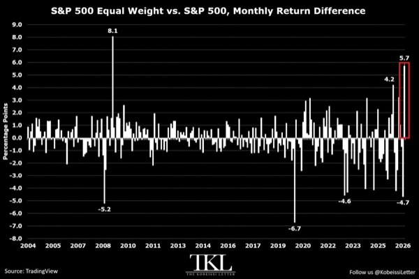

- 금 ETF 자금 흐름이 약해지며 GLD는 2023년 이후 첫 연간 순유출 가능성
  - 10월 18억 달러, 연초 이후 38억 달러 순유출로 2025년 사상 최대 230억 달러 순유입과 대조
  - 지난주 금·귀금속 펀드에서도 15억 달러 유출

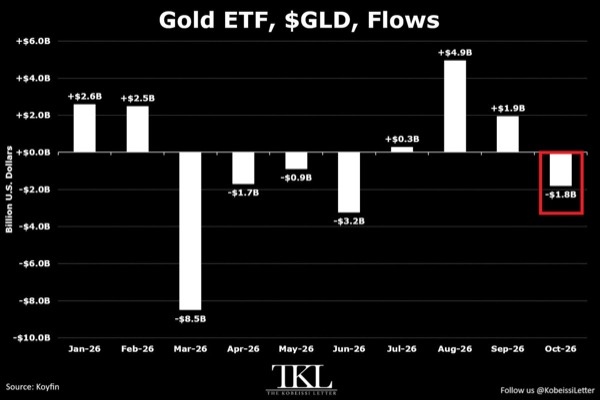

- AI 설비투자 관련 수입 확대가 미국 상품 무역적자를 다시 키움
  - 9월 적자는 전월 대비 28억 달러·2.1% 확대된 1,349억 달러로 2025년 3월 이후 최대
  - 수입은 2.4% 증가한 사상 최대 3,442억 달러이며 자본재 수입은 7.5% 증가
  - 자본재 적자의 전년 대비 증가액 543억 달러가 전체 적자 증가분을 초과했고, 수출은 2.6% 증가한 2,092억 달러

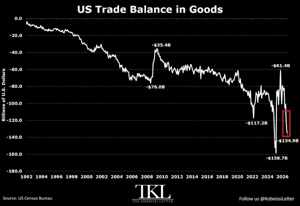

- 미국 정보처리 장비·소프트웨어 민간 고정투자가 GDP의 5.4%로 사상 최고
  - 2026년 3분기 투자 규모는 연율 7.3% 증가한 1조 7,700억 달러로 제시됐으며, 2000년 말 GDP 대비 고점 4.5%를 상회
  - 2022년 4분기 이후 투자 규모는 6,710억 달러·61% 증가

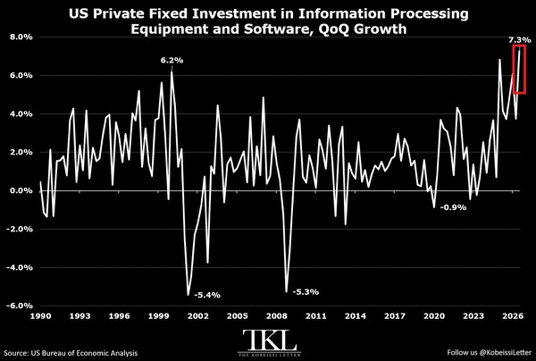

- 한국 3분기 성장률은 전분기 대비 1.0%, 전년 대비 3.4%로 각각 예상치 0.8%·3.0%를 상회
  - 반도체·기계·전기장비 수출 증가로 수출이 2.3%, 설비투자가 4.1% 확대되며 3개 분기 연속 성장
  - 2026년 연간 수출 1조 달러 돌파 가능성이 제시됨

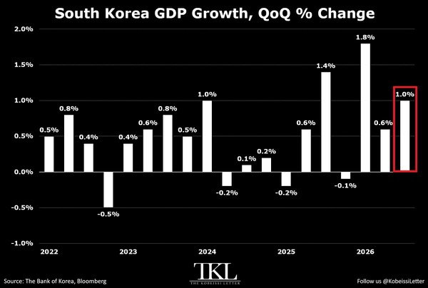

- 중국 수요와 미국 관세 대비 재고 이동이 글로벌 구리 현물 공급 부족을 심화
  - 양산항 수입 프리미엄은 톤당 200달러를 넘어 사상 최고이며, 3개월간 두 배 이상·연초 대비 700% 상승
  - LME 현물의 3개월물 대비 프리미엄은 톤당 217달러로 확대
  - 중국 재고는 통상 계절 수준을 밑도는 반면 정련동 관세 우려로 수십만 톤이 미국에 집중

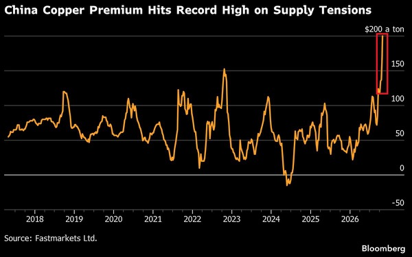

- 미국 은퇴자산이 2분기 3조 8,000억 달러·7.9% 증가해 사상 최대 51조 2,000억 달러에 도달
  - IRA는 19조 9,000억 달러, 확정기여형 연금은 15조 달러로 각각 최고치
  - 전체 은퇴자산은 2022년 이후 16조 달러·45.5% 증가

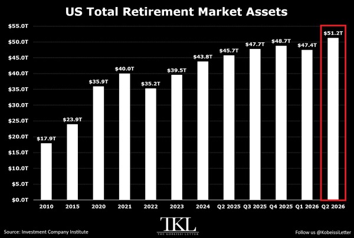

- 미국 의료비 상승이 전체 소비자물가를 크게 웃돌며 가계 부담을 확대
  - 2000년 이후 의료비는 132%, 주거비는 127%, 식료품은 112% 올라 전체 CPI 상승률 99%를 상회
  - KFF 조사에서 보험 가입 성인의 약 30%가 최근 12개월간 비용 때문에 필요한 진료를 미루거나 포기

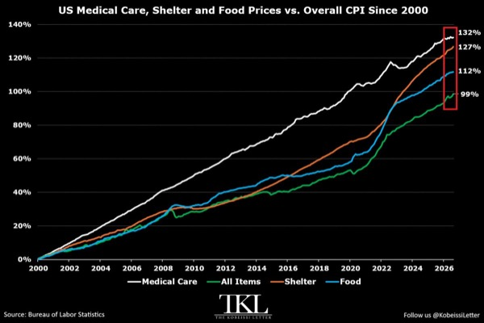

- 미·이란 외교 해결 기대가 되살아나며 미국 유가는 하루 7% 하락해 배럴당 98달러 아래로 내려가고 나스닥 100 선물은 1% 넘게 상승
  - 네타냐후의 중간선거 직후 이란 공격 압박 보도 이후, 루비오 국무장관이 트럼프의 외교적 해결 선호를 전하며 시장 방향이 전환

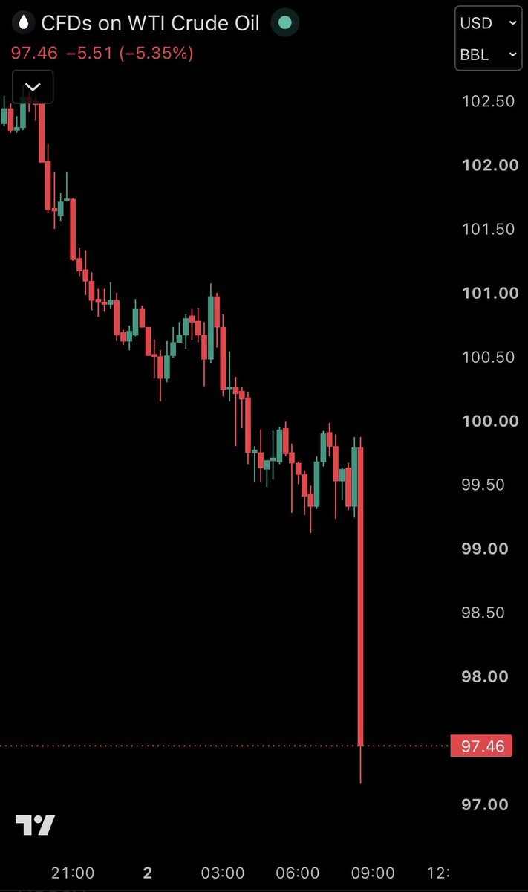

- 오라클은 AI 인프라 투자용 주식·부채 발행 200억 달러 계획 발표 후 5% 넘게 하락
  - ORCL 주가는 연중 고점 대비 54% 하락

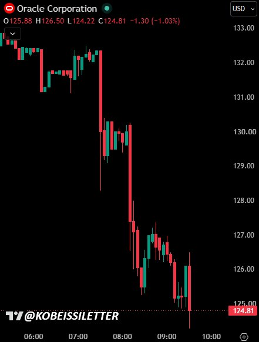

# MKevin

### 기술주 급락 속 시장 확산과 이란 협상 변수

- 기술주 급락은 경기 전반의 붕괴보다 개별 기업 악재와 과도한 레버리지 청산의 영향이 큼
  - 구글은 검색 사업 부진, 인텔은 메모리 가격 상승에 따른 소비자용 PC 수요 약화가 부담이며 이를 AI 투자 붐 전체의 종료로 연결하기는 어려움
  - 모멘텀 바스켓은 약 30% 하락했지만 S&P 500 동일가중 지수 ETF인 RSP는 사상 최고치 부근을 유지
- 상승 종목과 업종의 확산은 기술주 중심의 공포와 다른 흐름
  - JP모건 집계상 최근 한 달간 11개 업종 중 8개가 상승했고 에너지·필수소비재·유틸리티·헬스케어·금융이 주도
  - 특정 대형 기술주와 지수 전체의 움직임을 구분할 필요
- JP모건은 극단적 공포 속에서도 경기와 기업이익이 버티는 점을 근거로 전술적 성장주 비중 확대에 나섬
  - 영상에서 제시된 3분기 GDP 성장률은 3.4%, 잠정 PMI가 시사하는 실질 성장률은 두 달 연속 약 5%
  - 매출 13% 증가, 주당순이익 30% 증가, 이익률 약 15% 접근 전망이 강세 논리의 핵심
  - 강제 매도 물량은 대부분 소화됐으며 중간선거 전 계절적 매수 구간이라는 평가
- 변동성과 하락 방어 수요가 함께 급증하며 포지션 쏠림이 확대
  - VIX는 이란 긴장 고조 이후 최고 수준이고 하락 중 옵션 스큐도 상승해 하방 헤지 매수가 이어짐
  - 나스닥 100 공매도 포지션은 2023년 이후 최고 수준인 반면 개인의 레버리지 ETF 유입도 사상 최대
  - 추가 하락 시 레버리지 투자자의 강제 매도가 변동성을 다시 키울 수 있음
- 단기 시장 방향을 가를 핵심 변수는 이란 협상과 군사 충돌
  - 알자지라 보도상 이란은 J.D. 밴스의 서한을 검토하고 있으며 카타르 등 중재자를 통한 도하 협상이 진행 중
  - 미국 측 태도가 강경 요구에서 합의 모색으로 바뀌었다는 전언이 있으나 실제 협상 진전과 홍보성 발언은 구분해야 함
  - 합의 기대가 살아나면 주가 반등 촉매가 되고 추가 공습은 유가 급등 위험을 키움
- TS롬바드는 전쟁 재개보다 장기적인 석유 공급 충격의 과소평가를 경고
  - 중간선거 이후 전쟁 재개 가능성은 상당 부분 가격에 반영됐지만 1970년대형 충격은 충분히 반영되지 않았다는 평가
  - 극단적 시나리오에서는 유가가 배럴당 140달러를 넘어설 수 있음
- 헬스케어 강세가 기술 하드웨어 손실을 일부 상쇄하며 업종 분산 효과를 드러냄
  - 제약 업종의 선행 주가수익비율은 S&P 500 수준까지 상승했고 헬스케어는 연초 이후 수익률 2위 업종으로 부상
  - 케빈은 최근 약 3~4개월간 일라이릴리와 모더나를 매수한 사례를 제시
- 중간선거에서 공화당이 불리해질수록 이란 합의의 정치적 유인이 커질 수 있음
  - 골드만삭스가 인용한 예측시장 수치는 민주당의 양원 장악 가능성 약 65%
  - 영상에서 별도로 확인한 상원·하원 민주당 장악 확률은 각각 92%, 94%로, 양원 동시 장악 확률과는 다른 수치
- 경기와 기업이익이 견조해도 AI 확산에 따른 일자리 감소와 노동자의 협상력 약화는 병존할 수 있음
  - 기업 수익성 개선을 가계 전반의 소득·고용 개선과 동일시하기 어려움
- 반등 기회를 활용하려면 추가 하락에도 보유를 유지할 수 있는 자금 구조가 우선
  - 무차입 보유는 강제 청산 위험을 줄이고 레버리지는 펀더멘털이 맞아도 매도 시점을 강제할 수 있음
- 기술주 저가 매수 판단은 동일가중 지수의 강세 지속, 실제 이익 증가, 이란 협상 진전을 함께 확인할 필요
  - 유가 급등이 일시적 충격을 넘어 지속되면 현재의 경기 낙관과 이익 전망도 재평가 대상

### 뇌우 진입 뒤 급강하한 전세기와 기상 회피의 중요성

- 영상은 11월 1일 낮 12시 50분경 미국 플로리다에서 리어젯 60이 추락해 탑승자 9명이 사망한 사고를 다룸
  - 텍사스 오스틴에서 바하마로 향하던 항공편으로, 지상 피해 여부는 미확인
- 순항고도 약 41,000피트에서 35,000피트로 하강한 구간에 강한 뇌우가 분포
  - 레이더상 뇌우 구름 꼭대기는 약 40,000피트까지 발달했고 플로리다 중부에는 돌발홍수 경보도 발령
  - 하강 경로와 악천후 구역이 겹친 점이 사고 원인 분석의 핵심
- 조종사들은 중간 강도 난기류와 약 600~700피트의 고도 변동을 보고하고 더 안정적인 비행 구역을 요청
  - 관제사는 전방 공역에서 승차감이 개선될 것으로 안내
  - 이후 강수에 진입한 조종사들이 37,000피트로 상승을 요청했고 관제사가 허가
- 항공기는 약 1,500피트 상승한 뒤 급강하로 전환
  - 비상 교신에서 분당 10,000피트, 이어 20,000피트의 하강률과 과속 상태를 보고
  - 마지막 교신에는 약 60도 기울어진 자세와 극단적인 하강 상황이 등장한 뒤 응답이 끊김
- 뇌우 진입 이후 난기류·착빙·상승 중 실속이 연쇄적으로 발생했을 가능성이 제기됨
  - 착빙 여부, 실속의 형태, 기계적 고장 여부는 확정되지 않았으며 NTSB 조사 결과가 필요
  - 낮은 외기온과 강수 보고만으로 날개 착빙이나 추락 원인을 단정할 수 없음
- 영상의 ADS-B 기반 3차원 재구성은 고도 변동 이후 급강하와 큰 기울기가 발생한 흐름을 보여줌
  - 비행경로 자료를 바탕으로 만든 시각화로, 당시 조종실 상황이나 실제 조작을 직접 입증하지는 못함
- 고고도에서 자세 제어를 잃고 과속까지 겹치면 회복 여유가 급격히 줄어듦
  - 영상은 큰 기울기 상태에서 무리하게 기수를 들면 실속이나 기체 하중 문제가 악화될 수 있다고 경고
  - 구체적인 회복 가능성은 속도·자세·착빙·기체 손상 상태에 따라 달라지며 이번 사고에서의 회복 가능성은 미확인
- 기령 20년 이상인 사고기의 기상레이더 성능과 조종사에게 보였던 기상 정보는 미확인
  - 오래된 레이더나 강수에 의한 탐지 한계가 영향을 줬을 가능성은 있으나 실제 장비 사양과 상태 확인이 선행돼야 함
  - 기령 자체만으로 장비 노후나 사고 원인을 확정할 수 없음
- 영상은 해당 항공편을 Wheels Up 전세기 운항으로 소개하며 정비·기상 회피 절차의 검토 필요성을 제기
  - 2017년 매물 자료에 나온 엔진 사용시간과 검사 이력은 사고 당시 정비 상태를 입증하지 못함
  - 하강 전 기상 확인, 항로 우회 판단, 관제와의 협조, 비정상 자세 회복 훈련이 주요 점검 대상
- 악천후 회피는 상승·하강만으로 해결되지 않으며 수직으로 크게 발달한 뇌우에서는 수평 우회 판단도 중요
  - 관제 지시와 별개로 조종사가 실제 기상과 항공기 상태에 맞춰 안전한 경로를 요청하고 판단할 필요
- 사고 원인은 교신·비행자료·기상·정비 기록을 함께 검증해야 하며, 충격적인 추락 영상이나 초기 가설만으로 책임을 확정할 수 없음
  - 뇌우 진입은 중요한 조사 단서지만 착빙·실속·장비 고장으로 이어지는 구체적인 인과관계는 아직 미확인

### 민주당 양원 장악과 재정 협상의 역설

- 중간선거 이후 주식시장의 핵심 변수는 의회 구도보다 이란 협상과 전쟁 장기화 여부
  - 걸프 지역 선박 공격이 9월 15건에서 10월 28건으로 증가
  - 라보뱅크의 기본 시나리오는 선거 직후 미국·이스라엘·사우디 등의 이란·후티 대규모 공격과 2027년 1분기 말까지 이어지는 충돌
  - 확전 시 연말까지 고유가와 높은 휘발유 가격이 지속될 위험
- 이란 협상은 JD 밴스의 서한을 계기로 교착 상태에서 일부 진전
  - 이란은 미국의 협상 태도가 개선됐다며 수정안을 보냈고 미국의 응답을 기다리는 상황
  - 합의 후 호르무즈 해협 재개방 시한을 기존 7일에서 2일로 단축할 의향을 제시
  - 즉시 합의하면 선거일 해협 재개방이 가능하지만 실제 타결 여부는 불확실
  - 연준 회의 이전 합의 실패는 협상 난항의 신호였으며, 선거 전 타결 가능성 70%는 케빈의 낙관적 추정치
- 높은 주식 비중과 낮은 현금 비중만으로 시장 전체가 낙관적이라고 단정하기 어려움
  - 뱅크오브아메리카 프라이빗 고객의 주식 비중은 2021년 11월 강세장 종료 무렵 이후 최고 수준, 현금 비중은 2004년 이후 차트상 최저 수준
  - 부유층·은퇴 고객은 과도한 레버리지 투자자보다 강제 매도 압력이 작을 수 있어 고객 구성과 부채 수준을 함께 봐야 함
- 민주당의 상·하원 동시 장악이 분점 의회보다 트럼프의 재정 협상에 유리할 수 있음
  - 분점 의회는 대통령·공화당·민주당의 3자 협상으로 부채, 복지 삭감, 지출 확대를 둘러싼 교착과 셧다운 위험이 커지는 구조
  - 민주당이 양원을 장악하면 대통령과 민주당의 양자 협상으로 단순해지고, 지출 확대를 선호하는 트럼프와 민주당의 이해가 맞을 여지
  - 분점 상태에서는 트럼프가 의회를 우회해 행정명령에 의존하고 입법 진전은 제한될 가능성
- 공화당의 양원 장악도 대규모 재정 부양을 보장하지 않음
  - 공화당 내부의 부채·지출 확대 반대가 추가 감세와 부양책을 제약
  - 5,000달러 지원금은 의회 승인이 필요하며 케빈의 실현 가능성 추정은 5% 미만
- 부채한도와 정부 예산 협상이 2027년 상반기 위험 요인
  - 노던트러스트가 제시한 부채한도는 41조 1,000억 달러, 잔여 여력은 약 9,000억 달러
  - 다음 셧다운 시한은 12월 11일이며, 2027년 상반기에도 부채한도와 예산을 둘러싼 교착 가능성
- 선거 직전 예측시장은 민주당 우세를 반영하지만 이란 합의가 단기 확률을 바꿀 수 있음
  - 영상 시점 칼시의 민주당 승리 확률은 상원 약 71%, 하원 약 93%, 공화당 양원 장악은 약 7%
  - 이란 합의가 공화당 지지층의 투표 참여를 자극하면 공화당 승리 계약 가격이 반등할 여지
  - 케빈의 단기 거래 구상은 합의에 따른 확률 재평가를 노리고 선거 전에 청산하는 방식이며, 실제 공화당 승리를 전제로 한 장기 보유와는 구별
- 하원 승부처는 노스캐롤라이나 3구, 플로리다 7·13구, 버지니아 5구
  - 모건스탠리 분석상 네 지역 중 한 곳이라도 민주당으로 넘어가면 민주당 하원 장악 확률이 97%까지 상승
  - 공화당은 네 지역을 모두 지켜야 하며 각 지역의 민주당 전환 확률은 약 25%
  - 민주당 하원 장악 확률은 디시전데스크 79%, 레이먼드제임스 92%로 기관별 차이
- 이번 선거 대상은 하원 435석 전체, 상원 35석, 주지사 36곳
  - 영상에 제시된 현 의석은 하원 공화당 219석·민주당 213석, 상원 공화당 53석·민주당 47석
  - 사전투표는 4,000만 표 이상이며 민주당 성향 44%, 공화당 성향 31%로 집계됐지만 선거 당일 투표와 최종 결과를 확정하는 수치는 아님
- 중간선거 자체의 거시경제 영향은 제한적일 수 있음
  - 노던트러스트는 주요 재정정책이 이미 법제화됐고 민주당이 상원 60표나 대통령 거부권을 뒤집을 3분의 2 의석을 확보하기 어렵다는 점을 지적
  - 민주당의 SNAP·메디케이드 삭감 완화는 소비를 늘려 GDP를 약 0.2%포인트 높일 여지가 있다는 모건스탠리 분석
  - 성장 지원 효과와 함께 재정지출·부채 확대 부담도 발생
- 중간선거 이후 주가의 역사적 성과는 긍정적이지만 상승 폭을 보장하지 않음
  - JP모건 자료상 1950년 이후 모든 중간선거에서 6개월 뒤 S&P 500이 상승했고 평균 수익률은 13.8%
  - 상승 적중률 100%는 모든 사례가 13.8% 올랐다는 뜻이 아니며 과거 패턴이 미래 수익을 보장하지 않음
  - 영상에서 저비용 S&P 500 추종 상품으로 SPYM을 언급
- 선거 주간에는 정치 뉴스와 주요 경제·실적 일정이 겹쳐 변동성 확대 가능성
  - 수요일 미 재무부 국채 차환 계획, 목요일 영란은행 회의, 금요일 고용보고서 예정
  - 선거 당일 AMD 실적 발표도 예정돼 기술주 실적 반응과 개표 흐름을 함께 확인할 필요
- 데이터센터 투자에서는 정당별 인허가 태도와 지역사회 보상 조건이 중요
  - 케빈은 민주당의 건설 억제·축소, 공화당의 투자 유치 성향을 예상
  - 지방정부는 도로·학교·공원·소방 등 지역 인프라 지원을 받는 대신 인허가를 단축하는 협상 가능
  - 1기가와트 데이터센터 건설비 600억 달러를 가정하면 약 4%의 추가 부담과 2년에서 90일로의 인허가 단축을 맞바꾸는 구상
- 선거 결과를 단순한 친기업·반기업 구도로 해석하기보다 실제 지출 합의와 입법 실행 가능성을 확인할 필요
  - 민주당 양원 장악도 재정 확대 협상에는 유리할 수 있고 공화당 양원 장악도 내부 반대로 부양책이 막힐 수 있음
- 이란 합의에 따른 단기 안도와 전쟁 장기화에 따른 유가 부담을 별도 시나리오로 관리할 필요
  - 협상 분위기 개선만으로 해협 재개방과 에너지 가격 정상화를 확정하면 위험
- 중간선거 이후 상승 통계보다 현재의 레버리지, 현금 여력, 강제 매도 위험이 실제 보유 지속 능력을 좌우

### 이란 종전 협상 진전과 호르무즈 재개방 변수

- 이란 최고지도자가 정부의 대미 협상 권한을 승인하면서 종전 협상이 진전되고, 관련 소식 이후 유가 하락폭이 확대됨
  - 카타르가 미국과 이란의 메시지 교환을 중재하고 있으며, 이란은 미국의 답변을 기다리는 단계
  - 이란 대표단의 카타르 출국은 협상 결렬이 아니라 종전 초안 제출 이후 검토 절차에 따른 것
- 협상 초안의 핵심 변화는 휴전 이후 호르무즈 해협 개방 시한을 기존 7일에서 2일로 단축한 것
  - 미국의 제재 완화와 이란 동결자산 해제, 핵개발 제한 등이 협상 쟁점
  - 고농축 우라늄 450kg의 처리와 반출 목적지도 미해결 과제이며, 러시아의 수용 의사에도 트럼프는 러시아 반출에 반대
- 네타냐후는 미국 중간선거 직후 이란 공격 재개를 압박하고, 트럼프는 협상 가능성을 열어둔 상태
  - 영상에서 인용한 Axios와 파이낸셜타임스 보도는 같은 토요일 통화를 다루므로 별개의 추가 압박 사례로 중복 해석할 필요가 없음
  - 헤그세스의 공격 재개 지지와 J.D. 밴스의 확전 억제 기조가 충돌하며 미국 내부에서도 대응 방향이 갈림
- 터커 칼슨의 임박한 대이란 핵공격 경고는 확인된 공격 계획과 구분해야 함
  - 칼슨은 네타냐후의 압박과 피크액스산 지하 핵시설의 깊이를 근거로 핵공격 가능성을 제기하고, 식수 오염과 연쇄 핵전쟁 위험까지 거론
  - 영상이 인용한 CSIS 평가는 해당 시설이 건설 중이며 아직 우라늄 농축을 수행할 수 없는 상태라는 내용
  - 트럼프는 10월 16일과 앞선 4월에 핵무기 사용을 배제했으며, 네타냐후가 매일 핵공격을 요구한다는 내용도 확인되지 않음
- 깊은 지하 시설을 핵무기로 타격하더라도 방사성 낙진 위험을 지하에 완전히 가두기는 어려움
  - 중동·페르시아만에서 약 1억 명이 담수화에 의존하지만, 해당 시설 공격이 이들의 식수를 오염시킨다는 구체적 연결이나 모델링은 제시되지 않음
  - 핵공격의 물리적 가능성과 실제 사용 결정, 광범위한 오염 규모는 각각 다른 문제
- 호르무즈 해협의 선박 공격은 협상 진전과 별개로 악화되고 있음
  - 영상에 제시된 유조선 공격 건수는 9월 약 15건에서 10월 28건으로 증가했고, 이란은 10월 25일 이후 초대형 유조선 11척 공격을 발표
  - 브렌트유 선물은 4.2% 하락했지만, 해상 운송 위험이 해소된 상태는 아님
- 유가 하락과 예측시장 가격은 협상 기대를 서로 다르게 반영함
  - 영상에 제시된 Kalshi의 2027년 3월 1일까지 이란 합의 성사 확률은 약 20%로, 한 달가량 큰 변화가 없음
  - 협상 초안 제출만으로 조기 타결이나 합의 이행을 확정할 수 없음
- 이스라엘 연정 구성 난항이 네타냐후의 전쟁 재개 압박과 맞물림
  - 10월 27일 선거 결과로 제시된 의석은 네타냐후 진영 53석, 아이젠코트 진영 48석, 아랍계 정당 19석이며 과반은 61석
  - 아이젠코트 진영과 아랍계 정당의 합계는 67석이지만 실제 연정 성립 여부는 미정
  - 전쟁 확대나 계엄으로 네타냐후가 권력을 유지할 수 있다는 시나리오는 추측 수준
- 미국 중간선거 이후 공격 재개 여부와 고용지표, 국제원자력기구의 이란 핵시설 사찰 재개가 다음 변수
  - 영상은 11월 4일을 첫 잠재적 공격 시점으로 거론하며, 칼슨이 제시한 11월 7일과도 차이가 있음
  - 1년 넘게 사찰받지 않은 핵시설에 대한 접근과 검증이 재개돼야 이란 핵개발 수준의 불확실성이 줄어듦
  - 러시아는 공격 재개 위협과 미국의 봉쇄를 비판하고, 중국은 이란의 주권 방어와 정치적 해결을 지지
- 미국에서는 민주당의 중간선거 승리 이후 조사 가능성에 대비한 선제 사면 논의도 부상
  - 영상이 인용한 Axios 보도에 따르면 트럼프는 머스크와 SpaceX·Tesla, 자신과 참모진에 대한 조사 가능성을 의식하고 있음
- 원유시장의 핵심 변수는 협상 발표보다 해협의 실제 재개방과 선박 공격 감소
  - 개방 시한 단축은 긍정적 신호지만, 합의 이행 전까지는 재확전과 운송 차질 위험이 남음
- 핵공격 공포의 강도보다 확인 가능한 정책 결정과 핵시설 검증 진전을 우선 확인할 필요
  - 합의 성사 여부에 더해 핵물질 처리, 사찰 접근권, 양측의 약속 이행이 합의 지속성을 좌우

# Slav

- 미국 중간선거 개표가 시작되는 한국시간 11월 4일 오전부터 시장 변동성이 커질 수 있음
  - 피드에 제시된 일정은 11월 3일 오후 8시 투표 시작, 11월 4일 오전 9시 순차 개표·출구조사, 같은 날 오후 결과 윤곽 확인
- 민주당의 상·하원 장악 기대가 이미 증시에 반영됐다면 결과 자체보다 향후 2년의 정책과 단기 금리·유가가 중요
  - 의회 장악만으로 대통령 거부권을 뒤집기는 어렵고, 거부권 무력화에는 3분의 2 이상 의석이 필요
  - 과거 중간선거 이후 1년간 증시 상승 확률이 높았다는 점을 함께 고려
- 바이낸스 해킹을 둘러싼 북한 공작원 연애설은 입증되지 않았고 공동 CEO 허이와 ZachXBT가 부인
  - 피드에 전해진 약 63억 달러 해킹 관련 루머를 사실로 받아들이지 말아야 함
  - 별도로 엔지니어 노트북 침해 가능성과 FBI의 북한 연계 조직 TraderTraitor 지목 내용이 전해짐

# Stockbot

- AI 검색의 직접 답변 확대가 Reddit 등 검색 유입 의존 기업의 트래픽·주가를 압박
  - Reddit은 실적 발표 후 하루 30%, 2주간 44% 하락
  - Google AI Mode에서 답을 얻는 이용자가 늘면서 Reddit으로 이동하는 검색 트래픽이 줄어드는 구조

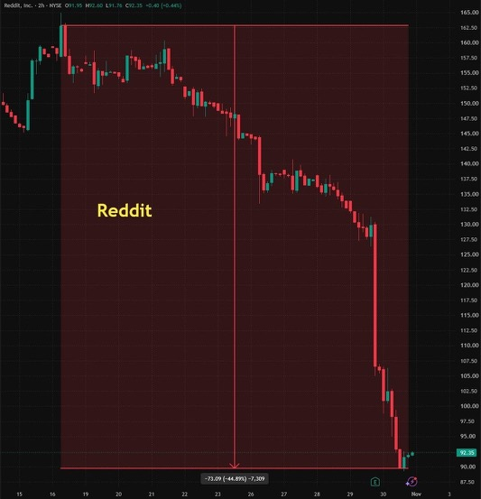

- 네타냐후가 미국 중간선거 직후 이란 공격 재개를 압박하는 반면 트럼프는 외교에 시간을 더 주려는 입장
  - Axios 보도에 따르면 이란 핵시설 한두 곳에 대한 추가 조치가 거론됨
  - 터커 칼슨의 임박한 핵공격 발언은 검증되지 않은 주장으로 구분해야 함
- 중국 증시가 12주 내 최장 연속 하락을 기록하면서 당국이 긴급회의에서 시장 안정화 조치를 논의
- 헤지펀드가 미국 기술주를 10여 년 만에 가장 빠른 속도로 매도하며 반도체에 매도 압력이 집중
  - 골드만삭스 데이터 기준 기술주 포지션 축소가 가속

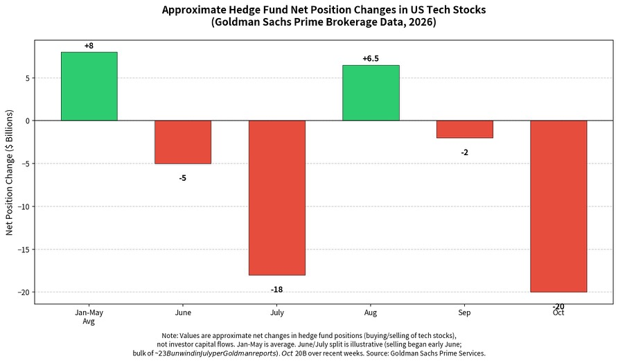

- Anthropic은 매출 급증과 손실 확대 속에 일본 투자자 대상 최대 35억 달러 IPO 주식 판매를 추진
  - 3분기 매출은 전년 대비 1,127% 증가했으나 순손실은 121억 달러에서 233억 달러로 확대
  - 공시에는 IPO 전체 규모와 기업가치가 빠져 있으며, 로이터가 전한 일부 투자자의 논의 수준은 약 1조 5,000억 달러
- 이번 주 고용·ISM·중간선거·기업 실적이 금리와 성장 기대를 재조정할 주요 변수
  - S&P 500 기업 약 20%가 실적을 발표하고 연준 인사 발언은 5차례 예정
  - 월요일 10월 ISM 제조업 PMI와 AAPL·PLTR 실적, 화요일 중간선거·9월 JOLTS와 AMD·SMCI 실적
  - 수요일 ADP 고용·ISM 서비스업 PMI, 금요일 10월 고용보고서·11월 미시간대 기대인플레이션·소비심리 발표

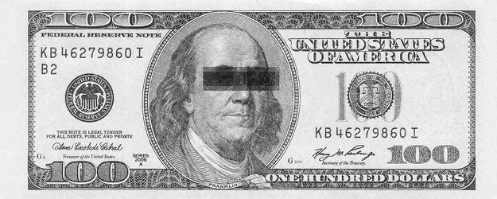

- Marvell과 Lumentum이 AI 연결 분야 통합 거래를 통해 사업 결합을 추진
  - MRVL·LITE의 AI 연결 솔루션 시장 지위 강화가 핵심
- 바이낸스 해커가 자동화된 것으로 보이는 수천 건의 거래로 탈취 자금을 이동시키며 동결을 우회
  - Chainalysis에 따르면 북한 연계 조직은 과거 사용 주소를 포함한 여러 지갑 사이에서 자금을 반복 이동
  - Tether는 17억 7,000만 USDT, Circle은 8억 2,500만 USDC를 동결
  - Aave에 6,000만 USDT를 담보로 맡기고 약 4,460만 달러 상당의 19,762 ETH를 차입해, 담보 동결에도 ETH를 반출

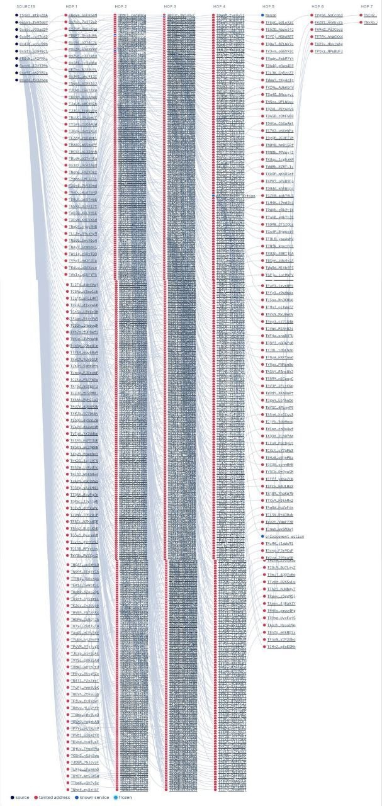

# YDental

### 비트코인 지지선과 반등 확인 조건

- 거래소 자산 보충과 비트코인 가격 회복은 별개이며, 복구 발표만으로 바닥을 확정할 수 없음
  - 바이낸스는 10월 30일 새벽 자산 무단 유출 이후 이용자 손실을 회사가 부담하고, 11월 1일 기준 피해 자산의 약 95%를 보충했다고 공지
  - 95%는 도난 자금 회수율이 아니라 부족분 보충 비율이며, 자금 동결도 회수 완료와 다름
  - 추가 침투 지점 조사가 진행 중이며, 사고 대상은 비트코인 네트워크가 아닌 거래소 보안·출금 체계
- 비트코인은 해킹 이전부터 약했던 가격 구조에 보안 사고가 겹치며 하락이 확대됨
  - 81,900달러 반등이 저항 돌파에 실패한 뒤 하락 채널 하단을 이탈했고, 저점은 약 76,200달러
  - 일봉 200 지수이동평균선은 약 76,500달러로 지지 후보지만, 4시간봉 200 지수이동평균선은 약 81,000달러로 위쪽 저항
  - 일봉 지지 접근과 단기 하락 구조가 동시에 유지될 수 있어 반등만으로 추세 전환을 확정하기 어려움
- 75,000달러 유지가 일봉 지지와 새로운 단기 박스 형성 가능성을 판단하는 핵심 조건
  - 아래쪽 강세 오더블록 하단이 75,000달러이며, 일봉 이동평균선 가격과 구분해야 함
  - 75,000달러가 무너지면 지지 시나리오를 재검토하고, 제시된 손절 기준은 이 가격보다 조금 아래
  - 급변장에서는 손절 주문이 지정 가격보다 불리하게 체결될 수 있음
- 75,700~76,700달러는 도달 자체보다 시험 이후 회복 반응을 확인할 구간
  - 3일·1주 청산 히트맵의 밝은 띠는 추정 청산 밀집 구간이며, 확정된 매수벽이나 필수 하락 목적지가 아님
  - 관측 기간과 색상 눈금이 달라 두 히트맵의 강도를 단순 합산할 수 없음
- 반등 진입은 지지를 잠깐 이탈한 뒤 빠르게 회복하는 스프링과 후속 매도 압력 감소가 확인될 때 검토
  - 아래꼬리 하나보다 이탈 후 가격 회복, 회복한 가격 유지, 거래량과 매도 압력 감소가 중요
  - 아래를 훑고도 되찾지 못하거나 반등마다 매도에 막히면 스프링 기대가 약해짐
- 차트의 약 2.85 손익비는 회복 확인 이후 특정 진입·손절·목표 가격을 가정한 예시
  - 현재 가격에서 즉시 진입해도 같은 손익비가 나오는 것은 아니며, 진입 위치에 따라 손실폭과 저항까지의 거리가 달라짐
  - 수익 실현 결과나 진행 중인 매매 신호로 해석할 수 없음
- 11월 1일 저녁 수급은 중립 속 단기 약화로, 추격 진입을 뒷받침하지 못함
  - 오후 6시경 78,200달러까지 반등한 뒤 상승분 반납
  - 저녁 9시 종료 기준 최근 1시간 현물 델타는 +1.06%, 선물 델타는 -8.34%이며 미결제약정도 감소
  - 선물 매도와 포지션 축소는 롱 정리와 부합하지만, 주체와 청산 규모까지 확정할 수 없음
  - 비용 반영 후 손익비 1대 1.5 이상을 충족하는 진입 조건이 없어 대기
- 아래 구간 재시험 없이 상승하면 78,000~78,200달러 회복과 재차 눌림에서의 지지부터 확인
  - 이후 약 81,000달러의 4시간봉 이동평균선과 위쪽 유동성 구간 회복을 순서대로 점검
  - 첫 저항을 잠깐 넘는 것만으로 큰 하락 구조가 끝나지는 않음
- 거래소 정상화는 출금 재개·자산 보충으로, 시장 회복은 가격 회복·지지 유지로 각각 검증해야 함
  - 뉴스 개선과 차트 개선 중 하나만으로 전체 위험이 해소됐다고 판단하기 어려움
- 77,000달러대 중간 가격에서 서두르기보다 지지 구간 회복이나 저항 돌파 후 지지가 확인되는 자리를 기다리는 편이 유리
  - 비트코인 구조가 정리되기 전까지 알트코인 비중 확대도 보류
