# Aurum

- 미국 제조업은 가격 압력이 낮아지고 신규주문이 늘어나는 확장 국면이지만 현장 심리는 전쟁·관세·AI 투자 의존 우려로 위축
  - 고객 재고지수 41.6으로 25개월 연속 부족 상태이며, 높은 가격과 변동성 때문에 최소 필요량만 발주하는 흐름
- 금은 7월 조정 이후 미국 금융조건과 높은 연동성을 보여 금융시장 스트레스와 유동성 변화를 반영하는 자산으로 해석 가능

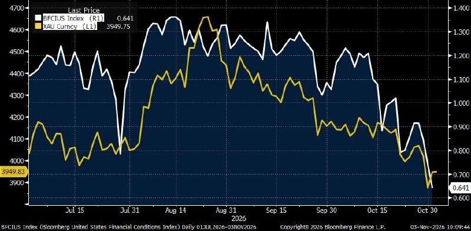

- 중국은 11월 15일부터 외화예금 지급준비율을 4%에서 6%로 인상해 달러 유동성을 흡수하고 위안화 강세를 억제
  - 위안화는 연초 이후 달러 대비 약 5% 상승
- 오라클 AI 클라우드는 장비 선투자와 매출 회수 시차가 현금흐름 악화의 핵심이며, FY2028 하반기 흑자 전환 여부가 관건
  - 1GW 계약에 장비비 370억 달러를 먼저 지출하고 완전 가동 후 연매출 160억 달러를 회수하는 구조로 FY2026 FCF는 -237억 달러
  - 벤더 금융·고객 칩 제공·선급금을 활용해 추가 조달 200억 달러, FY2029 FCF 300억 달러 이상을 제시
  - 앤트로픽 성장 둔화와 연산비 대비 매출 하락 가능성이 고객 지급능력의 확인 지점
- 미국 의회 구도가 바뀌어도 대통령 거부권을 넘기 어려워 자동차 15%·철강 50% 관세의 지속을 전제로 기업 경쟁력을 평가해야 함
  - 현대차·기아는 미국 생산 120만대 달성 시 관세비용이 7.5조원에서 4.5조원으로 감소할 전망
  - 한국산 대미 철강 수입물량은 52% 늘었지만 톤당 단가는 1,624달러에서 812달러로 하락
  - 탈중국 핵심광물 공급망은 양당 공통 의제로 미국 생산기지를 보유한 고려아연·풍산에 유리
- 반도체 증설의 다음 수혜는 후공정 물량 증가와 범용 메모리 외주 확대
  - 2025~2027년 DRAM 웨이퍼 순증 595.8만장으로 직전 사이클 411.3만장을 상회
  - 2026년 웨이퍼 +8.5%보다 Die +15.2%·Bit +21.5% 증가가 빨라 후공정 부담이 더 크게 확대
  - 메모리 3사가 자체 후공정을 HBM에 우선 배정하고 신규 거점은 대부분 2027년 하반기 이후 가동해 OSAT 수혜 가능
  - 상반기 전공정 장비주 +278.7% 대비 후공정 +71.1%로 주가 반영 격차가 큼
- 미국 기술주 급락은 시장 전체 이탈보다 강제 청산과 방어업종 순환매 가능성에 무게 — 톰 리
  - 나스닥100이 하루 3% 넘게 하락한 반면 동일가중지수는 상승하고 에너지·헬스케어·필수소비재는 사상 최고치 경신
  - 선거 이후 나스닥 반등과 인기 기술주 매도 지속 여부로 대기자금 유입과 잔여 청산 압력을 구분할 필요
- AI 설비투자의 높은 자본집약도는 호황·조정의 반복을 유발할 수 있어 급락한 우량기업의 가치와 안전마진에 집중 — 리 루 관련 해설
  - 데이터센터 투자가 GDP 대비 2.9%에 달하며, 빅테크 설비투자·회사채 발행의 둔화가 조정 신호
  - 중국은 주택시장 위축과 GDP 대비 122%인 가계 예금의 이동 방향, 주식시장 부양 정책이 투자 변수
- 한국 반도체 급락은 수요 붕괴보다 수급과 AI 고객 자금조달 우려가 핵심이라는 분석 — 김장열
  - 빅테크 내년 설비투자 약 1.4조 달러가 1.2~1.3조 달러로 줄면 속도 조절, 1조 달러 수준이면 수요 붕괴 경고로 구분
  - 주문 대기기간이 18주에서 15주로 단축되는지 확인하고 10~20회 분할매수 접근을 제시
  - 반도체 가격 60% 하락 가정의 평가 시나리오는 SK하이닉스 110만원·삼성전자 18~20만원이며 실제 주가 하한을 보장하는 수치는 아님
- 국내 증시는 AI 자금조달 우려와 외국인 매도 가속으로 급락하고 개인은 하락 종목·레버리지 ETF를 대규모 매수
  - 코스피 -3.59%·코스닥 -4.08%, 외국인 주식 순매도 1조6,062억원과 선물 순매도 3,506억원으로 현선물 동반 매도
  - 개인은 주식 1.98조원·ETF 5,827억원 등 합계 2.56조원 순매수, KODEX 레버리지 1,032억원·코스닥150레버리지 1,017억원 매수
  - SK하이닉스 외국인 매도 6,384억원에 개인 매수 5,441억원으로 대응했으며 최근 12거래일 개인 주식 누적은 여전히 2.61조원 순매도
  - 연기금은 640억원 순매수에 그쳤고 기관 공매도 대금은 평소 중앙값의 3배 이상, 선물 베이시스 -0.06%로 백워데이션
- 반도체·정유 약세 속 소비재·헬스케어·항공이 방어력을 보였으나 대기자금 감소로 추가 매수 여력 점검 필요
  - 유가 급락에 S-Oil -11.77%·SK이노베이션 -9.36%, 대한항공 +1.92%와 BGF리테일 +4.96%로 차별화
  - 10월 29일 기준 대기자금 332.6조원으로 20거래일 동안 30.4조원 감소했고 코인시장으로 이동한 뚜렷한 신호는 없음
  - 10월 30일 투자자예탁금은 88.7조원으로 1년 고점 대비 36% 감소, 코스닥 시총 대비 신용 비율 1.66%로 코스피 0.48%보다 높음
  - 코스피 PBR 1.41배, 삼성전자·SK하이닉스 등을 제외하면 1.01배, 코스닥 1.55배

# GStephan

### 미국 주택시장 양극화와 급매 협상 기회

- 미국 주택시장은 높은 가격과 금리로 구매력이 약해졌지만, 매수 경쟁 감소로 가격 협상 여지가 확대
  - 9월 주택 중간가격은 41만7,000달러로 39개월 연속 전년 대비 상승
  - 30년 주택담보대출 금리는 연초보다 약 1%포인트 높은 7.5% 수준
  - 40만 달러 주택에 계약금 20%를 내면 월 상환액이 연초보다 약 300달러 증가하며, 같은 월 부담을 유지하려면 집값이 약 11% 하락해야 함
  - Redfin의 전형적인 월 주택담보대출 상환액은 전년 대비 8.8% 증가해 사상 최고 수준
- 전국 평균보다 지역별 공급과 소득 차이가 집값 방향을 결정
  - 오스틴은 팬데믹 당시 가격이 두 배로 오른 뒤 2022년 고점 대비 약 29% 하락해 5년 전 수준으로 복귀
  - 연간 가격 하락률은 시애틀 6.5%, 새너제이 약 5%, 올랜도 3% 이상
  - 2020년 대비 마이애미는 약 57%, 뉴저지 캠던은 53%, 하트퍼드와 로체스터는 각각 51% 상승
  - 하트퍼드는 2022년 고점보다도 29% 높아 오스틴과 정반대 흐름
- 텍사스와 플로리다의 약세는 신축 공급 증가, 지역 소득을 앞선 집값, 보유비용 상승이 겹친 결과
  - 건설업체가 재고 처분을 위해 먼저 가격을 낮추면 기존 주택도 가격 압력을 받음
  - 팬데믹 당시 고소득 이주민이 끌어올린 가격을 현지 구매자의 소득만으로 지탱하기 어려워짐
  - 플로리다 주택보험료는 2019년 이후 세 배로 상승했으며, 연 보험료가 3,000달러에서 9,000달러로 오르면 매수자가 집값에 쓸 수 있는 금액이 감소
  - 북동부와 중서부는 2019년보다 매물이 적고 신축 공급도 제한적이어서 상대적으로 저렴한 주택에 수요가 유지
- Redfin 집계상 매도자가 매수자보다 63% 많아 2013년 집계 시작 이후 최대 격차
  - 약 150만 명의 매도자가 90만 명의 매수자를 두고 경쟁하며, 주요 50개 대도시권 중 41곳이 매수자 우위 시장
  - 마이애미는 매도자가 매수자보다 160% 많아 매수자 한 명당 매도자가 약 2.6명
  - 매물의 22%가 가격을 인하했고, 통상 매각 기간은 49일로 증가
  - 계약 체결 후 거래 완료를 기다리는 주택 거래는 전년 대비 12.7% 감소해 Redfin 집계상 최저 수준
- 일부 매도자는 과거 매입가보다 낮은 가격도 수용
  - 오스틴의 한 중개업체 분석에서는 2022년 매수자의 75%가 매입가보다 낮은 가격으로 주택을 내놓음
  - Lizzo는 2022년 1,500만 달러에 산 베벌리힐스 주택을 1,100만 달러에 매각해 거래비용 제외 약 400만 달러 손실
  - 연말 비수기에는 급매 동기가 강한 매도자가 남고, 12월 거래 완료 주택은 다른 달보다 가격 프리미엄이 낮은 경향
- 자금과 대출 준비가 끝난 실수요자는 낮은 가격을 반복 제시하며 협상력을 활용할 수 있음
  - 40만 달러 주택을 10% 낮게 매수하면 매입가 4만 달러, 계약금 20% 기준 초기자금 8,000달러, 월 상환액 약 300달러 절감
  - 매물에 따라 20% 이상 낮은 가격을 제시하고, 매도자에게 거래비용·수리비·대출금리 인하 비용 부담도 요청 가능
  - 호가 자체가 비싸면 할인율이 커도 좋은 거래가 아니므로 최종 매입가와 총비용으로 판단
- Graham Stephan의 2011년 매수 경험은 비관론이 강할 때 협상 기회가 커질 수 있음을 보여줌
  - 당시 집값이 50~60% 하락한 상황에서 수십 차례 낮은 가격을 제시해 약 1년 동안 세 건을 매수했고, 이후 해당 자산 가격은 네 배 상승
  - 현재는 집값과 금리가 모두 높은 수준이어서 당시와 같은 저평가나 수익률을 기대하기 어려움
- 추가 집값 하락과 예상보다 오래 지속되는 고금리를 전제로 매입가격을 정해야 함
  - 향후 수년간 최근과 같은 급격한 가격 상승을 기대하기 어려우며, 임대가 여전히 더 저렴한 선택일 수 있음
  - 충분한 할인은 추가 하락에 대한 완충 역할을 하지만 손실 가능성을 없애지는 못함
  - 금리 하락 시 재융자는 월 부담을 줄일 수 있는 추가 선택지이며, 현재 상환능력을 대신할 조건으로 삼기 어려움
- 실거주 목적과 장기 보유 여력이 있다면 금리 하락을 기다리는 동안에도 급매와 장기 미매각 주택을 선별할 가치가 있음
  - 계약금 20%와 대출 승인을 갖춘 매수자의 희소성을 활용하되, 보험료·수리비·거래비용까지 감당 가능한 가격에만 접근
- 가격이 많이 오른 지역도 매도자 급증으로 협상력이 빠르게 바뀔 수 있어, 과거 상승률과 현재 수급을 함께 확인해야 함
  - 전국 집값이나 표면 할인율보다 지역 재고, 신축 공급, 매각 기간, 실제 거래가격이 매수 기회의 질을 좌우

# Harvey

- 민주당의 양원 장악 확률 66%를 전제로 하면 AI 데이터센터의 핵심 위험은 투자 중단보다 가동 지연과 추가 비용이며, 차입 의존 개발사·네오클라우드가 더 취약
  - 재정적자 억제 기대로 장기금리가 소폭 하락할 수 있으나 실제 적자 축소는 보장되지 않고 신용스프레드 확대가 금리 하락 효과를 상쇄할 수 있음
  - 전력비·환경·정부 지원 감독 강화로 가동이 늦어지면 이자와 확보한 GPU 비용은 계속 발생해 수익률이 훼손됨
  - AI 투자 총량이 유지돼도 지연 비용을 감당하는 현금 여력에 따라 주주가치는 크게 갈릴 수 있음

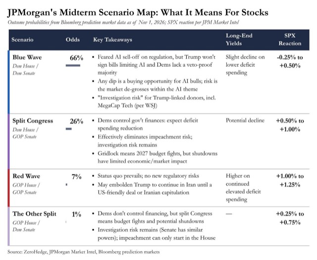

- 긴축의 충격은 부채 규모와 차환 시점·금리 재설정 구조가 함께 결정하며, 먼저 차환하는 기업과 변동금리 차입자에게 비용이 집중
  - 과거 저금리 고정금리 조달이 긴축 효과를 늦추면 총수요가 버티는 동안 연준의 고금리 유지가 길어질 수 있음
  - 정책금리 6.75%라는 모형 경로의 적중 여부보다 현재 시장 예상 금리에서도 버티기 어려운 기업을 찾는 것이 핵심
  - 금리선물뿐 아니라 이익 추정치와 신용스프레드에 차환 이후 이자비용이 반영됐는지 확인해야 함

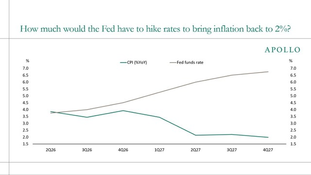

- 생활비 중심의 정치 압력은 AI 성장 비용을 가계에 전가하기 어렵게 만들어 전력·송전망 투자비를 부담하는 기업의 현금흐름을 압박할 수 있음
  - 데이터센터 증설이 전기요금·지역 주거비를 끌어올리면 정치적 마찰이 확대될 가능성
  - 실적에서 매출 성장률과 함께 추가 CAPEX·가동 시점·전력 계약 조건·현금 소진·추가 조달액을 점검해야 함

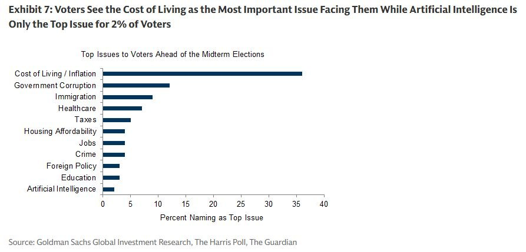

# KHwanK

### 인공지능 주도주 순환과 코인 상승기 대응 전략

- 2027년 상반기까지 미국 증시 강세에 무게
  - 중간선거 직전 10월부터 이듬해 7월까지는 대통령 임기 사이클에서 가장 강한 구간
  - 제시된 역사 통계는 1942년 이후 해당 구간 하락 사례가 없고 평균 상승률은 약 20%, 분기별 상승 확률은 4분기 90%·1분기 95%·2분기 90%
  - 과거 계절성이 이번에도 반복된다는 보장은 없지만 높은 확률에 집중하는 접근
- 금리 상승은 증시 전체 하락보다 종목 간 격차 확대로 이어질 가능성
  - 과거 금리 급등 15차례 중 11차례는 주가 상승, 4차례만 하락
  - 부채 부담과 할인율 상승으로 취약 기업의 매력은 낮아지고 현금흐름·수익성·성장성이 좋은 기업에 자금 집중
  - 지수 상승을 맞히는 것보다 지수를 이길 종목을 고르는 일이 어려워질 수 있음
- 삼성전자·SK하이닉스는 이익 전망 대비 저평가 매력이 크지만 매수는 가격 회복 확인이 우선
  - 2026~2028년 예상 순이익 합계가 현재 시가총액과 비슷한 수준이며 선행 주가수익비율은 약 3배
  - 2027~2028년 이익 전망이 과도할 위험은 있지만 AI 기업 간 경쟁이 지속되는 한 메모리 수요의 구조적 소멸 가능성은 낮음
  - 강환국은 두 종목을 손절한 상태이며 고점 대비 반토막 난 가격과 하락 추세를 저평가 판단보다 우선
- AI 투자 자금은 칩·컴퓨팅 인프라·물리 인프라·생산성 개선·플랫폼의 다섯 단계 안에서 순환
  - 1단계는 GPU·메모리 등 칩과 연산, 2단계는 서버·네트워크·데이터센터
  - 3단계는 전력·원전·구리 등 물리 인프라, 4단계는 AI 도입으로 생산성이 높아지는 기업
  - 5단계는 이용자의 시간과 지출을 장악하는 AI 플랫폼
- 현재 주도권은 인프라에서 소프트웨어·바이오의 생산성 개선으로 이동
  - 상반기 주도주였던 1~3단계는 큰 폭 상승 후 조정에 들어갔고 상대강도도 약화
  - 휴머노이드·자동화 공장보다 사무실·연구실의 생산성 향상이 먼저 실적으로 연결되는 구간
  - 인프라 투자와 생산성 개선은 서로 단절된 순서가 아니라 동시에 진행되는 두 투자 사이클
- 소프트웨어에서는 업무 자동화와 사이버보안 수요에 주목
  - AI 도입은 직원당 소프트웨어 활용을 늘리고 AI 기반 해킹·랜섬웨어 확산은 보안 지출을 자극
  - 서비스나우·아틀라시안 등을 살피되 크라우드스트라이크·팔로알토 같은 주요 보안 기업과 개별 종목의 가격 강세는 구분
  - 같은 업종 안에서도 자금이 이동하므로 업종 전망만으로 장기 보유를 결정하기 어려움
- 바이오는 AI 신약 개발과 진단 기술의 생산성 개선이 재평가 동력
  - 하사비스의 단백질 구조 연구와 노벨화학상 수상은 AI의 바이오 활용 가능성을 보여주는 사례
  - 나테라는 드러켄밀러의 주요 투자 종목으로, 초기 단계 암 진단 분야와 보험 적용 확대가 관심 요인
  - 일부 사례에 집중하기보다 상대강도가 높은 바이오 기업군에서 사업과 성장 지속성을 비교
- 반도체·데이터센터·전력 인프라의 조정이 산업 성장의 종료를 뜻하지는 않음
  - AGI 선점을 향한 기업·국가 간 경쟁은 투자 지속의 동력이며 AI 활용 확대는 연산·저장 수요를 늘림
  - 한국 반도체에서도 후공정·검사·테스트 일부 기업은 상대적으로 강하고 DI가 사례로 제시됨
  - 약한 가격을 선제 매수하기보다 가격과 상대강도 회복을 확인한 뒤 재진입하는 접근
- AI의 최종 승자는 아직 불확실하므로 상대강도와 가격을 따라 유연하게 교체
  - 상대강도는 최근 1~3개월 수익률을 종목 간 비교한 지표이며 높은 기업부터 사업·성장성을 검토
  - AI 도구로 기업의 수익 구조와 장기 수요를 조사하고 여러 답변을 비교하는 방식 활용
  - 인터넷이 보편화된 뒤에도 다수 인터넷 기업이 사라졌듯 AI 산업 성장과 개별 기업 생존은 별개
  - 현재 강한 소프트웨어·바이오도 수개월 뒤 주도권을 잃을 수 있어 가격이 무너지면 매도하고 다음 강한 종목으로 이동
- AI 플랫폼은 장기 수익의 중심이 될 수 있지만 승자 확정에는 시간이 필요
  - 기존 빅테크뿐 아니라 기존 사업의 제약이 적은 AI 전용 신규 플랫폼이 부상할 가능성
  - 플랫폼의 본격적인 주가 재평가는 당장보다 향후 수년의 경쟁 결과에 달림
- 코인은 3년 상승·1년 하락 사이클의 새로운 상승 초기 구간에 무게
  - 이번 하락은 약 9개월로 기존 약 12개월보다 짧았고 비트코인 낙폭은 약 53%, 이더리움은 약 62~65%
  - 다른 자산이 강한 동안에도 코인이 독자적으로 하락한 점은 사이클 지속을 뒷받침하는 해석
  - 인터뷰의 코인 질문 실종과 행사 참여 저조 등 대중의 무관심도 바닥권 판단의 보조 신호
  - 사이클 반복을 전제로 고점 시기는 2029년 상반기부터 4분기까지 열어 둠
- 비트코인은 시장 규모 확대에 따라 사이클별 상승 배수가 축소될 가능성
  - 과거 저점 대비 고점 상승 배수는 약 100배·20배·8배로 감소
  - 이번에는 저점 약 5만 8,000달러에서 2~3배 수준, 고점 약 15만~20만 달러를 예상 범위로 제시
  - 발언 당시 약 8만 달러에서 두 배 안팎의 상승 여력도 유효하지만 이전 사이클 같은 폭발적 수익은 기대하기 어려움
- 코인 장기 보유는 상승 초기의 선택지지만 중간 급락과 종목 선택 실패를 감수해야 함
  - 유망 코인을 2029년까지 보유해도 중간에 30~70% 하락할 수 있음
  - 매매 부담은 작지만 잘못 고른 코인을 계속 보유할 위험이 있어 추세 기반 거래를 더 선호
- 비트코인은 120일선, 알트코인은 비트코인 120일선과 자체 50일선을 함께 적용
  - 비트코인은 가격이 120일 이동평균선 위에 있을 때 보유하고 아래로 내려가면 매도
  - 알트코인은 비트코인이 120일선 위이고 해당 코인도 50일선 위일 때만 보유
  - 두 조건 중 하나라도 충족하지 못하면 알트코인을 팔고 현금 보유
  - 약 10년간 매월 시가총액 상위 20개 알트코인으로 구성 종목을 바꾸며 백테스트한 전략
  - 최대낙폭 축소와 오판 시 손실 제한이 장점이며 지속적인 가격 확인과 매매가 필요
- 코인에서는 실제 수익이 발생하는 거래소와 스테이블코인·실물자산 토큰화에 주목
  - 중앙화 거래소 계열 BNB와 탈중앙화 거래소 하이퍼리퀴드를 보유 중
  - 하이퍼리퀴드는 비트코인 하락기에도 강세를 보였지만 탈중앙화 거래소 내 선두 지위 지속 여부는 관찰 필요
  - 중소형 거래소 토큰은 거래량 대비 완전희석가치가 낮은지 검토
  - 완전희석가치인 FDV는 미발행 토큰까지 모두 발행한 것으로 계산한 시가총액
- 스테이블코인은 미국 국채 수요와 AI 에이전트 결제 수요가 성장 동력
  - 해외 정부·중앙은행의 국채 매입이 약해지는 가운데 스테이블코인 발행사의 준비자산 수요가 국채 소화에 기여
  - AI 에이전트가 검색·비교·업무 위탁을 반복하면 에이전트 간 소액 결제 수요가 커질 가능성
  - 최종 소비자 결제와 별개로 에이전트 사이에서 발생하는 다수의 거래가 새로운 결제 시장을 형성
- 실물자산 토큰화는 AI의 저축·대출·투자 자동화를 연결하는 기반
  - 현금은 스테이블코인, 투자자산은 RWA로 연결되면 금리 비교·자금 이동·자산배분 자동화가 쉬워짐
  - 이더리움은 스테이블코인과 RWA의 상당 부분이 구축된 선점 효과와 네트워크 효과가 강점
  - 에이브는 스마트계약 기반 대출·상환·청산, 온도는 주식·채권 등 실물자산의 토큰화에 주목
- 지캐시는 저점 대비 약 100배 상승과 자체 수익 창출 부재가 신규 장기 매수의 부담
  - 프라이버시 수요는 인정하되 현재 수준에서는 가치투자보다 추세 거래 관점이 적합
- 전체 자산의 80~90%는 자산배분, 10~20%는 공격적 투자로 시작
  - 약 3년간 공격적 투자가 자산배분보다 나은 성과를 냈는지 확인한 뒤 비중을 점진적으로 확대
  - 성과가 부족하면 자산배분 100%로 전환하는 선택도 가능
  - 정적·동적 자산배분을 50%씩 병행하면 분산 효과를 기대할 수 있지만 강환국은 관리 편의상 정적 배분만 운용
- 매수 전에 손절·추가 매수·이익 실현 조건을 정하고 1회 손절 손실은 총자산의 약 1%로 제한
  - 자산 1억 원이면 1회 허용 손실은 100만 원이며 2,000만 원 투자 시 5%, 1,000만 원 투자 시 10% 손절에 해당
  - 100원 매수 후 90원 이탈 시 손절, 120원에서 추가 매수, 이후 고점 대비 10% 하락 시 매도처럼 사전에 규칙 설정
  - 보유 후 감정이 개입하기 전에 매도 조건과 투자 금액을 함께 결정
- 자산배분은 정기 또는 비중 변화 기준으로 리밸런싱하며 방치는 피해야 함
  - 강환국은 4월 말·10월 말에 6개월마다 조정하며 계절에 따라 목표 비중을 변경
  - 월·분기·반기·연간 주기 간 성과 차이는 크지 않았지만 리밸런싱을 생략하면 주식 비중이 과도해질 수 있음
  - 한국 소형주 팩터 전략은 2017년 이후 초과수익이 약해졌어도 대형주와의 분산 효과는 남아 있으며 큰 최대낙폭과 관리 부담을 고려
- AI 성장에 대한 확신과 개별 종목의 매수 시점은 분리해야 함
  - 산업 수요가 견조해도 기대가 가격에 먼저 반영되면 큰 조정이 가능하므로 이익 전망과 실제 가격 회복을 함께 확인
- 코인 성장 분야를 고를 때는 서비스 사용 확대가 토큰의 수익·가치로 연결되는 구조인지 점검할 필요
  - 거래량·수익 창출·FDV·추세를 함께 보면 성장 서사만으로 투자 대상을 고르는 위험을 줄일 수 있음
- 전망보다 먼저 정한 손실 한도와 매도 규칙이 투자 결과를 좌우
  - 높은 확률의 계절성이나 사이클도 실패할 수 있으므로 자산배분으로 기반을 만들고 검증된 범위에서 공격적 비중 확대

### 인공지능 확산과 사이버 보안 투자 기회

- AI·휴머노이드의 생산성 폭발은 장기적인 물질적 풍요를 열지만, 향후 10~20년의 과도기에는 일자리 재편과 범죄 확산이 동반될 수 있음
  - 생산성 증가가 생활 수준 개선으로 이어지려면 상위 계층에 집중되는 부의 재분배가 필요함
  - 빌 게이츠는 풍요에 도달하기 전의 위험을 강조하며, 주거비·의료비 등 당장의 문제는 아직 해결되지 않은 상태
- AI는 정상적인 경제활동뿐 아니라 해킹·피싱·사기·협박의 생산성도 높임
  - 적은 비용과 시간으로 정교한 공격을 대량 실행할 수 있어 범죄 진입장벽이 낮아짐
  - 빌 게이츠의 경고로 소개된 생물테러 등 대규모 인명 피해 가능성은 극단적 위험 시나리오
- 미국과 중국의 AI 개발 속도 조절은 패권 경쟁 때문에 실현되기 어려움
  - 먼저 AGI를 확보하려는 경쟁에서는 상대국을 기다리는 동안 기술 우위를 잃을 수 있어 개발 가속 유인이 강함
- AI를 활용해 AI 공격을 막고 관리하는 소프트웨어의 수요가 커질 것
  - 공격자는 취약점 하나만 뚫으면 되지만 방어자는 전체 시스템을 지켜야 하므로 보안 자원 투입이 늘어나는 비대칭 구조
  - AI가 소프트웨어를 대체한다는 우려와 달리, 보안·관리 소프트웨어는 AI 확산의 수혜 영역
- 국세청을 사칭한 종합소득세 가산세 메일에 속을 뻔한 경험은 개인도 정교한 피싱에 취약하다는 사례
  - GPT로 발신자를 점검해 피싱을 확인하고 비밀번호 변경과 계정 보안 조치를 진행
  - 공격에 쓰이는 AI가 탐지와 피해 대응에도 활용되는 구조
- 영상에서 제시한 하반기 투자 관찰 대상은 사이버 보안 등 AI 관리 소프트웨어
  - 상반기에는 AI의 소프트웨어 대체 우려가 부담이었지만, 2분기 실적 이후 매출·이익이 증가하는 기업들이 부각됨
  - 최근 3~4개월의 부진한 시장에서도 사이버 보안 기업들의 상대강도는 상위권이며, 크라우드스트라이크가 팔로알토 네트웍스보다 강한 흐름
- 사이버 보안의 주요 비교 대상은 팔로알토 네트웍스와 크라우드스트라이크
  - 팔로알토 네트웍스는 광범위한 사업 범위, 크라우드스트라이크는 상대적으로 좁은 기반에서 영역을 확장하는 점에 주목
  - GPT는 팔로알토 네트웍스, 클로드는 크라우드스트라이크를 선호했지만 이것만으로 업계의 확실한 1위나 투자 우열을 결정할 수는 없음
- 빌 게이츠가 채널을 시청하고 댓글을 남겼다는 도입부는 AI로 만든 가짜 내용
  - 가짜 뉴스·댓글·영상의 제작 비용이 낮아지면서 확증편향과 여론 조작 위험도 커짐
- AI 투자 기회는 생산성 향상을 제공하는 기업뿐 아니라 그 부작용을 통제하는 보안 기업으로도 확장됨
  - 공격 자동화가 진행될수록 방어 자동화와 지속적인 보안 지출의 필요성도 커짐
- 사이버 보안의 산업 성장성과 개별 종목의 투자 매력은 구분해 점검할 필요
  - 두 기업의 매출·이익 성장, 사업 확장, 상대강도를 비교하고 AI의 선호 답변은 보조 자료로만 활용

# Kobeissi

- 미국 기술주 저가매수로 시작한 반등이 장중 되돌려지며 나스닥100은 상승분을 모두 반납하고 하락 전환
  - 초반 S&P500 +1.0%·나스닥100 +1.3%·다우 +1.1%였으나 나스닥100은 미 동부시간 10시 30분 이후 약 3% 하락, 장중 고점 대비 시가총액 약 1.1조 달러 감소

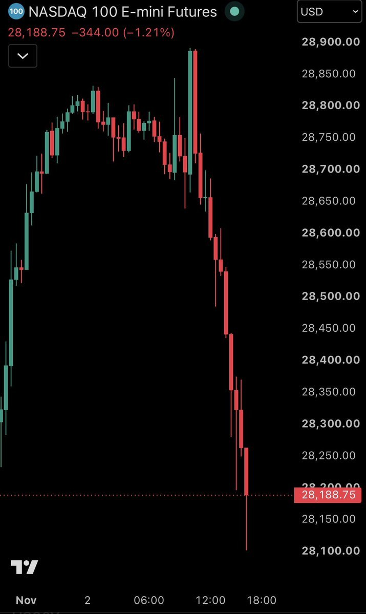

- 미·이란 합의 기대가 유가 하락을 이끌었고 이스라엘 지원 중단 발언도 장중 원유 약세 요인으로 작용
  - 초반 WTI -6.5%·브렌트 -7.0%·금 +2.0%, 트럼프는 이란이 합의를 원하며 전쟁이 없을 것이라는 기대가 유가에 반영됐다고 발언
  - 트럼프는 연간 40억 달러인 이스라엘 지원금을 2026년 말 중단하기로 합의했다고 밝혔으며 해당 소식 뒤 미국 유가는 상승분 반납
- 인텔은 급격한 차익반납, 애플은 실적 호조에도 약세, 쇼피파이는 실적 부진으로 급락
  - INTC는 금요일 -29%에 이어 당일 낙폭이 약 10%까지 확대돼 3거래일 -37%, 고점 대비 시가총액 약 4,500억 달러 감소
  - AAPL은 예상보다 강한 3분기 매출 1,145억 달러에도 하락, SHOP은 예상 하회 실적 발표 후 15% 넘게 하락

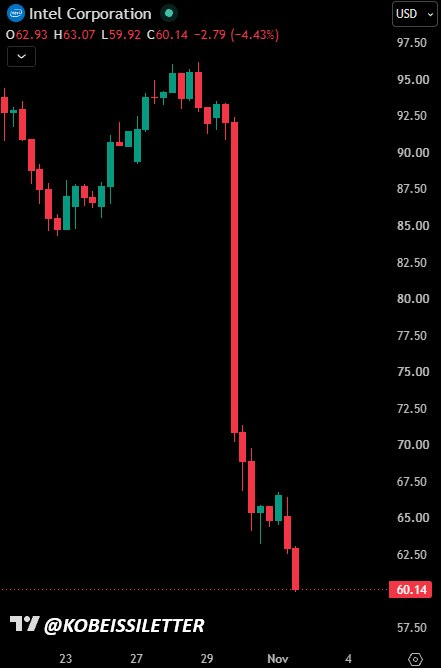

- 중간선거의 민주당 양원 장악 가능성 확대가 AI 수익성 우려와 함께 정치적 교착 위험을 주가에 반영
  - 원문이 인용한 시장 확률은 약 80%로 최근 45일 동안 30%p 상승
  - 대통령 거부권 행사 예고로 향후 2년간 입법 불확실성이 커질 가능성
- 11월은 역사적으로 미국 주식의 강한 계절성을 보인 달
  - 1980년 이후 S&P500 평균 수익률 +2.1%·상승 빈도 74%, 1950년 이후 중간선거 연도의 11월은 평균 +2.7%·상승 빈도 78.9%

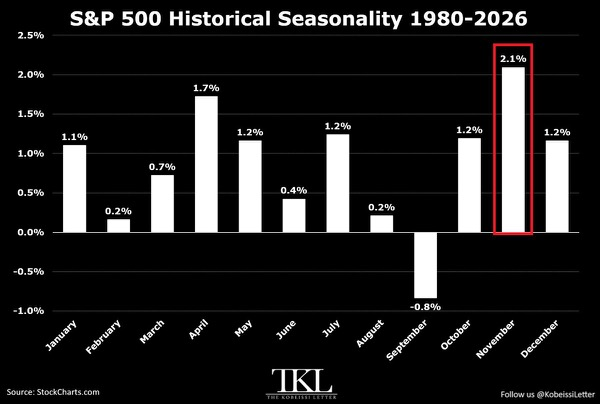

- 글로벌 주식 자금은 미국에서 아시아·유럽으로 순환하는 흐름
  - 10월 28일 종료 주간 미국 주식펀드에서 67억 달러 순유출, 직전 두 주는 각각 51억·130억 달러 순유입
  - 글로벌 주식펀드는 102억 달러로 6주 연속 순유입했지만 직전 251억·198억 달러보다 둔화, 아시아 99억·유럽 45억 달러 유입

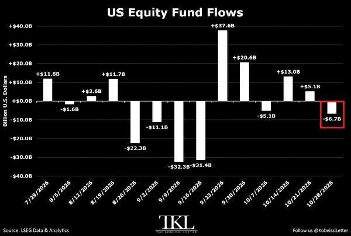

- 개인의 기술주 레버리지 매수가 급증해 미국 레버리지 ETF의 최근 한 달 순유입이 최소 2년 내 최대인 150억 달러 기록
  - 10월 초 20억 달러 순유출에서 반전했으며 2025년 4월 반등기의 최대 유입 120억 달러를 상회
  - 반도체 3배 롱 ETF SOXL에만 10월 73억 달러가 유입돼 월간 사상 최대

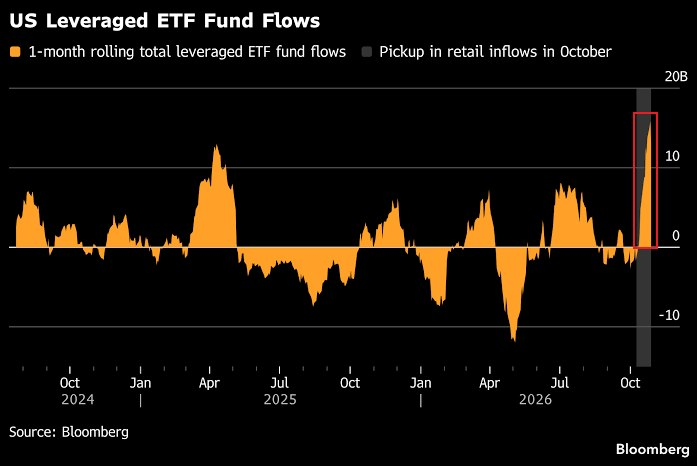

- 빅테크의 AI 인프라 확대로 장부 외 미래 지출 약정이 3.3조 달러까지 확대
  - GOOGL 1.06조 달러·META 8,660억 달러·MSFT 5,930억 달러·AMZN 4,530억 달러·ORCL 3,220억 달러
  - 알파벳 약정은 1년 새 약 700% 증가, 메타는 절반 가까이가 미개시 데이터센터 임대이며 지급기간은 최장 30년

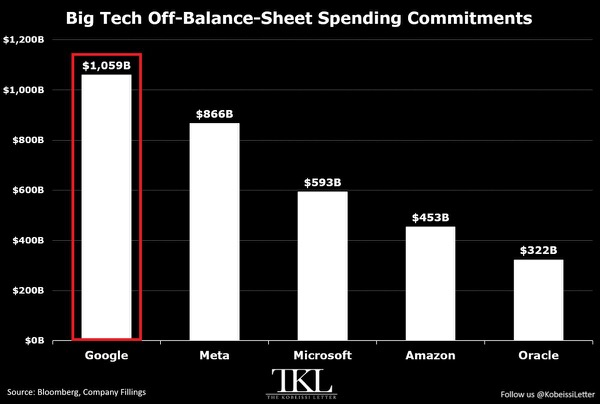

- AI 데이터센터 투자가 은행 차입 확대를 견인하며 인프라 건설의 부채 의존도가 상승
  - 미국 대형은행의 10월 상공업대출은 전년 대비 11.4% 늘어난 1.6조 달러로 2020년 6월 이후 최대
  - 상위 25개 은행의 3분기 증가율은 약 10%로 2025년 4분기 -8%에서 반전, 지역은행도 관련 건설업체에 신용 공급

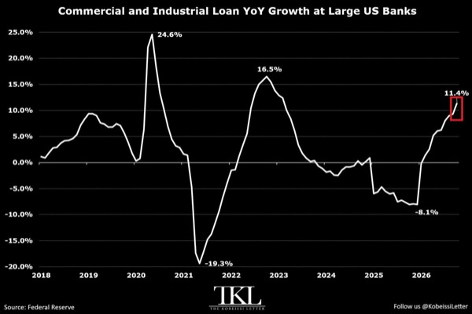

- 토큰화 주식 유통 규모는 38억 달러로 10주 연속 사상 최고치를 경신하며 연초 대비 590% 성장
  - 솔라나 기반 Jupiter는 토큰화 자산 거래의 70%가 정규시장 밖에서 발생한다고 집계
  - 24시간 거래 수요 확대 속 NYSE도 토큰화 주식·무기한 선물 인프라를 개발

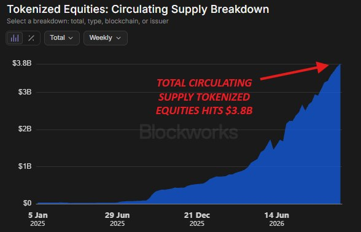

# MKevin

### 리어젯 추락의 결빙과 기상레이더 사각지대

- 플로리다에서 프리포트로 향하던 리어젯 60 N722BD가 추락해 탑승자 9명 전원 사망
  - 약 22년 된 기체로, 고도 약 35,000~35,400피트에서 뇌우를 통과하던 중 급강하
  - 사고 원인은 미확정이며 기상레이더 한계, 결빙, 실속, 자동조종, 과속에 따른 기체 손상 등이 검토 대상
- 구형 기상레이더의 전파 감쇠가 뇌우 뒤 위험 구역을 빈 공간처럼 표시했을 가능성
  - 과거 매물 자료에는 Collins WXR840이 장착돼 있으나 사고 당시 장비와 개량 여부는 확인되지 않음
  - 강한 강수대가 레이더 에너지를 흡수하면 뒤쪽 강수대나 폭풍의 전체 깊이를 탐지하지 못하는 레이더 음영 발생
  - 해당 장비 매뉴얼도 강한 비 뒤쪽이 검게 표시되거나 경고 표시가 없다는 이유로 맑은 구역으로 판단하지 말 것을 경고
- 외부 시야가 구름에 가려진 상태에서는 육안, 기상 데이터, 기상레이더를 함께 확인해야 위험 판단 가능
  - 외부에서 수신하는 기상 데이터에도 지연이 있어 단독 의존은 위험
  - 사고기가 실제로 어떤 화면을 보고 있었는지는 확인되지 않음
- 프리포트 직항을 요청한 뒤 관제사의 악천후 경고로 우회했지만, 이후 폭풍 주변 강수 구역을 통과하며 상황 악화
  - 목적지에 빨리 도착하려는 압박이 판단에 영향을 줬을 가능성은 있으나 확인되지 않음
  - 인근 공항 착륙, 출발 지연, 폭풍 전체 우회가 대안이었으며 추가 착륙·급유에는 상당한 시간 소요
- 결빙 비행 인증과 방빙 장치가 있어도 강한 대류성 폭풍 속 결빙 위험까지 제거되지는 않음
  - 교신상 외기온은 영하 47도로 보고됐으며, 영상은 뇌우 속 과냉각 물방울을 급격한 결빙의 가능한 원인으로 제시
  - 실제 결빙 형태와 방빙 장치 작동 상태는 조사 필요
- 가열된 날개 앞전에서 녹은 물이 뒤로 흘러 비가열 구역에서 다시 어는 런백 결빙이 양력 저하를 일으켰을 가능성
  - 가열 구역 뒤에 얼음 턱이 생기면 날개 위 공기 흐름이 흐트러지고 실속 속도가 상승할 수 있음
  - 난기류를 피하려는 상승 과정에서 속도가 줄고 결빙으로 실속 속도까지 높아졌다면 비행 여유가 빠르게 축소
  - 결빙과 상승이 겹쳐 실속 후 급강하로 이어졌다는 경로는 영상의 가설이며 확정된 사고 경위는 아님
- 자동조종 사용 여부와 해제 당시 트림 상태가 회복 가능성을 판단할 핵심 조사 항목
  - 자동조종이 결빙에 따른 조종감 변화를 가렸거나, 해제 후 남은 트림이 조종사의 회복 조작을 어렵게 했을 가능성
  - 기체에는 스틱 셰이커가 있었지만 스틱 푸셔는 없었으며, 결빙이 실속 경고의 유효성에 미친 영향도 확인 필요
- 급강하 중 과속으로 기체 일부가 분리됐을 가능성은 있으나 꼬리날개 분리 여부와 발생 순서는 미확정
  - 영상에서 인용한 NTSB 설명에는 하강 중 일부 부품이 떨어졌을 가능성을 뒷받침하는 정황이 포함됨
  - 빠르게 움직이는 기체를 촬영한 흐릿한 영상이나 보정 이미지만으로 날개·안정판 유무를 확정하기 어려움
- 리어젯 60 매뉴얼의 과속 회복 절차에는 스포일러 전개 금지와 착륙장치 전개가 포함됨
  - 스포일러는 기수를 더 숙이게 할 수 있으며, 착륙장치는 항력을 늘리는 수단
  - 사고 당시 착륙장치를 내렸는지, 전개 후 분리됐는지는 확인되지 않음
- 격추설을 뒷받침할 폭발 교신이나 GPS 이상 증거는 제시되지 않음
  - 교신은 기상·결빙·강수 문제에 집중됐으며, 영상에서 거론된 근거리 방공체계의 도달 범위도 사고기 고도와 맞지 않는다는 분석
  - 확정 결론에는 잔해 조사와 조종실 음성·비행기록장치 분석 필요
- 사고 예방에서는 장비 존재보다 탐지 한계와 기상 회피 판단이 중요
  - 방빙 인증과 레이더가 있어도 강한 대류성 폭풍을 통과할 안전 여유가 보장되지는 않음
- 원인 규명에는 기상 진입 판단, 결빙, 실속, 자동조종 해제, 과속과 구조 손상의 시간 순서를 연결해야 함
  - 단일 장비 고장이나 흐릿한 추락 장면만으로 결론 내리면 여러 위험이 겹친 경로를 놓칠 수 있음

### 이란 종전 협상 진전과 호르무즈 재개방 변수

- 이란 최고지도자가 정부의 대미 협상 권한을 승인하면서 종전 협상이 진전되고, 관련 소식 이후 유가 하락폭이 확대됨
  - 카타르가 미국과 이란의 메시지 교환을 중재하고 있으며, 이란은 미국의 답변을 기다리는 단계
  - 이란 대표단의 카타르 출국은 협상 결렬이 아니라 종전 초안 제출 이후 검토 절차에 따른 것
- 협상 초안의 핵심 변화는 휴전 이후 호르무즈 해협 개방 시한을 기존 7일에서 2일로 단축한 것
  - 미국의 제재 완화와 이란 동결자산 해제, 핵개발 제한 등이 협상 쟁점
  - 고농축 우라늄 450kg의 처리와 반출 목적지도 미해결 과제이며, 러시아의 수용 의사에도 트럼프는 러시아 반출에 반대
- 네타냐후는 미국 중간선거 직후 이란 공격 재개를 압박하고, 트럼프는 협상 가능성을 열어둔 상태
  - 영상에서 인용한 Axios와 파이낸셜타임스 보도는 같은 토요일 통화를 다루므로 별개의 추가 압박 사례로 중복 해석할 필요가 없음
  - 헤그세스의 공격 재개 지지와 J.D. 밴스의 확전 억제 기조가 충돌하며 미국 내부에서도 대응 방향이 갈림
- 터커 칼슨의 임박한 대이란 핵공격 경고는 확인된 공격 계획과 구분해야 함
  - 칼슨은 네타냐후의 압박과 피크액스산 지하 핵시설의 깊이를 근거로 핵공격 가능성을 제기하고, 식수 오염과 연쇄 핵전쟁 위험까지 거론
  - 영상이 인용한 CSIS 평가는 해당 시설이 건설 중이며 아직 우라늄 농축을 수행할 수 없는 상태라는 내용
  - 트럼프는 10월 16일과 앞선 4월에 핵무기 사용을 배제했으며, 네타냐후가 매일 핵공격을 요구한다는 내용도 확인되지 않음
- 깊은 지하 시설을 핵무기로 타격하더라도 방사성 낙진 위험을 지하에 완전히 가두기는 어려움
  - 중동·페르시아만에서 약 1억 명이 담수화에 의존하지만, 해당 시설 공격이 이들의 식수를 오염시킨다는 구체적 연결이나 모델링은 제시되지 않음
  - 핵공격의 물리적 가능성과 실제 사용 결정, 광범위한 오염 규모는 각각 다른 문제
- 호르무즈 해협의 선박 공격은 협상 진전과 별개로 악화되고 있음
  - 영상에 제시된 유조선 공격 건수는 9월 약 15건에서 10월 28건으로 증가했고, 이란은 10월 25일 이후 초대형 유조선 11척 공격을 발표
  - 브렌트유 선물은 4.2% 하락했지만, 해상 운송 위험이 해소된 상태는 아님
- 유가 하락과 예측시장 가격은 협상 기대를 서로 다르게 반영함
  - 영상에 제시된 Kalshi의 2027년 3월 1일까지 이란 합의 성사 확률은 약 20%로, 한 달가량 큰 변화가 없음
  - 협상 초안 제출만으로 조기 타결이나 합의 이행을 확정할 수 없음
- 이스라엘 연정 구성 난항이 네타냐후의 전쟁 재개 압박과 맞물림
  - 10월 27일 선거 결과로 제시된 의석은 네타냐후 진영 53석, 아이젠코트 진영 48석, 아랍계 정당 19석이며 과반은 61석
  - 아이젠코트 진영과 아랍계 정당의 합계는 67석이지만 실제 연정 성립 여부는 미정
  - 전쟁 확대나 계엄으로 네타냐후가 권력을 유지할 수 있다는 시나리오는 추측 수준
- 미국 중간선거 이후 공격 재개 여부와 고용지표, 국제원자력기구의 이란 핵시설 사찰 재개가 다음 변수
  - 영상은 11월 4일을 첫 잠재적 공격 시점으로 거론하며, 칼슨이 제시한 11월 7일과도 차이가 있음
  - 1년 넘게 사찰받지 않은 핵시설에 대한 접근과 검증이 재개돼야 이란 핵개발 수준의 불확실성이 줄어듦
  - 러시아는 공격 재개 위협과 미국의 봉쇄를 비판하고, 중국은 이란의 주권 방어와 정치적 해결을 지지
- 미국에서는 민주당의 중간선거 승리 이후 조사 가능성에 대비한 선제 사면 논의도 부상
  - 영상이 인용한 Axios 보도에 따르면 트럼프는 머스크와 SpaceX·Tesla, 자신과 참모진에 대한 조사 가능성을 의식하고 있음
- 원유시장의 핵심 변수는 협상 발표보다 해협의 실제 재개방과 선박 공격 감소
  - 개방 시한 단축은 긍정적 신호지만, 합의 이행 전까지는 재확전과 운송 차질 위험이 남음
- 핵공격 공포의 강도보다 확인 가능한 정책 결정과 핵시설 검증 진전을 우선 확인할 필요
  - 합의 성사 여부에 더해 핵물질 처리, 사찰 접근권, 양측의 약속 이행이 합의 지속성을 좌우

### 반도체 급락 속 실적 괴리와 고용 위험

- 미국의 이란 양해각서 초안 수용 보도로 중동 긴장 완화 기대 확대
  - 카타르 중재안에 미국이 동의했고 이란이 핵 문제와 동결자산에서 양보했다는 중재 관계자발 보도
  - 세부 조건과 최종 서명은 미확인으로 합의 확정과는 구분 필요
  - 트럼프는 네타냐후와 연말 이스라엘 원조 종료에 합의했으며 이후 무기 구매는 가능하다고 언급
- 유가는 합의 기대 속 최근 5일간 배럴당 117달러에서 102달러로 하락
  - 전일 약 7% 급락에 이어 방송 시점에도 약 2.4% 하락
- 기술주 급락과 실제 기업 실적 사이의 괴리 확대
  - 나스닥100은 250거래일 만에 처음으로 하루 수익률이 마이너스 1.5표준편차에 해당하는 하락 기록
  - QQQ는 이틀 연속 700선을 지키지 못하며 저항선 형성
  - 영상에서 거론한 종목군의 평균 선행 주가수익비율은 약 13배로 닷컴 붕괴 이후 시스코의 10~20배 구간과 유사
- 10월 조정은 메모리·반도체·광통신에 집중됐으며 레버리지 청산이 낙폭 확대
  - 골드만삭스 메모리 바스켓 22%, 반도체 18.6%, 광통신 관련 종목군 약 29% 하락
  - 레버리지 상장지수펀드가 하루 동안 마이크론 주식 약 19억 달러를 매도
  - 삼성전자도 5월 말 고점 대비 약 35% 하락하며 글로벌 반도체 약세 확산
- 마이크론의 낮은 성장 대비 주가는 메모리 업황의 지속성을 둘러싼 불신 반영
  - 월드 밸류 상장지수펀드의 마이크론 비중은 약 14%, 마이크론의 주가수익성장비율은 약 0.33배
  - 경기순환 할인을 적용해도 저평가 폭이 크다는 투자 논리지만 적정 배수와 이익 지속성에 민감
- 골드만삭스의 9월 반도체 데이터는 업황 강세 지속을 시사
  - 전년 대비 산업 매출 151%, 평균판매가격 128%, 판매 수량 10% 증가
  - 디램 매출 368%, 낸드 매출 510% 증가하며 메모리가 성장 주도
  - 고대역폭 메모리처럼 제품당 메모리 탑재량이 늘어 단순 판매 수량만으로 수요를 평가하기 어려움
- SK하이닉스 장기계약은 메모리 수요의 가시성을 높이지만 중국 증설은 중장기 위험
  - 장기계약 14건이 2027~2028년 생산능력의 절반 이상을 포괄하며 공급 부족은 2030년까지, 수요 가시성은 2031년까지 제시
  - 중국 CXMT는 매출 613% 증가와 약 89.5%의 마진을 기록했으며 전년 마진은 약 35%
  - 번스타인은 CXMT의 웨이퍼 생산능력이 2028년 말 마이크론을 넘어설 가능성 제시
- GPU 임대료 상승은 인공지능 연산 수요가 여전히 강하다는 신호
  - 구형 A100과 H100부터 H200·B200·B300까지 임대료 상승 흐름
  - B300 임대료는 7월 이후 106% 상승했으며 같은 기간 평균 토큰 가격은 58% 하락
- 단기 시장 촉매는 이란 협상, 선거 결과, 고용지표에 집중
  - 방송 시점 칼시의 민주당 상원 장악 확률은 약 77%
  - 영상에서 인용한 1950년 이후 선거 후 6개월 수익률은 상승 빈도 100%, 평균 상승률 13%지만 이번 상승을 보장하지 않음
  - 수요일 미국 재무부 차환 계획 발표도 국채시장 변동성 요인
- 고용 둔화가 실제 경기침체로 번지는지가 가장 중요한 하방 위험
  - 수요일 ADP 고용 예상치는 6만6천 명으로 직전 9만 명보다 감소
  - 금요일 비농업 고용 예상치는 6만5천 명이며 직전 발표는 예상 9만 명에 못 미친 2만9천 명
  - 고용지표가 다시 기대를 밑돌면 기술주 조정을 넘어 경기침체 우려가 확대될 수 있음
- 실직자의 재취업 임금 악화는 노동시장 균열의 초기 신호
  - 골드만삭스는 2023년 이후 인공지능 관련 감원을 약 20만7천 명으로 집계
  - 동등하거나 더 높은 임금으로 재취업한 비율은 2년 전 62%에서 올해 49%로 13%포인트 하락
  - 가계조사 고용은 8월 56만9천 명, 9월 4만6천 명 증가했지만 변동성이 커 3개월 평균 확인 필요
- 기술주 포지셔닝과 이익 성장의 격차는 반등 여지를 제공하지만 투매 종료 신호는 부족
  - 기술주 포지셔닝은 40백분위 수준이며 영상에서는 이익 성장률 10%를 반영하는 수준으로 해석
  - 실제 3분기 주당순이익 성장률은 47%, 최근 다섯 차례 기술주 재유입 국면의 평균 상승률은 38%
  - 도이체방크는 아직 투매의 최종 국면에 도달하지 않은 것으로 평가
- 인공지능 수요 확대가 모든 기업의 현금흐름 개선으로 이어지는 것은 아님
  - 인텔은 칩 평균판매가격이 54% 올랐지만 개인용 컴퓨터 판매 둔화 우려로 실적 발표 전후 주가가 29% 하락
  - 메타는 2028년까지 현금흐름 흑자 전환이 어려울 수 있으며 그록은 가격 인상과 사용 한도 축소로 유료 전환 유도
  - 연산 수요 증가와 개별 기업의 투자비 회수 능력을 별도로 점검할 필요
- 지수 하락의 중심은 인공지능 대형주이며 시장 전체의 폭넓은 붕괴 신호는 제한적
  - S&P500 구성 종목의 80% 이상이 상승했는데 지수는 하락한 사례가 약 40년 만에 발생
  - 동일가중 S&P500 상장지수펀드 RSP는 사상 최고치 부근으로 대형 기술주 밖의 시장 흐름은 상대적으로 견조
- 반도체 매수 판단은 낮아진 주가수익비율과 함께 장기계약, 메모리 가격, 중국 공급 확대를 종합해야 함
  - 현재 이익이 경기순환의 고점이면 낮은 배수가 저평가를 보장하지 않으며 레버리지는 강제 매도 위험을 키움
- 이란 합의와 선거 불확실성 해소는 반등 촉매지만 지속성은 고용과 기업 이익이 결정
  - 유가 하락과 견조한 고용이 함께 나타나면 회복 여건이 개선되고 고용 급랭은 저평가 논리보다 우선하는 위험

# Slav

- 미국 중간선거는 민주당 양원 장악이 기본 시나리오지만 AI 규제 입법은 대통령 거부권 때문에 제한될 가능성
  - 11월 1일 Bloomberg 예측시장·JPM 기준 블루웨이브 66%, 민주 하원·공화 상원 26%, 레드웨이브 7%, 공화 하원·민주 상원 1%
  - 시나리오별 S&P500 예상 반응은 각각 -0.25~+0.5%, +0.5~+1%, +1~+1.25%, +0.25~+0.75%
  - 민주당 승리는 적자 축소 기대와 장기금리 하락 요인이나 AI 테마에서는 반등을 비중 축소에 활용할 위험도 존재
  - 주요 예측시장은 민주당 하원 우세와 상원 우위를 반영하지만 실제 결과와의 차이를 고려해야 함
- 중간선거 이후 미국 증시 계절성은 역사적으로 우호적
  - 1950년 이후 중간선거 후 12개월 평균 수익률 약 14.7%, 3개월 +5.4%·6개월 +11.4%·9개월 +12.5%
  - 1990년 이후 6·9·12개월 구간은 모두 상승했으나 과거 승률이 향후 수익을 보장하지는 않음
- KAST는 토큰 발행을 취소하고 포인트를 수익 공유 권리 KPU 또는 리워드 바우처로 전환해 토큰 상장 기대에 기반한 보상 구조가 변경
  - 포인트 적립은 11월 30일 종료, 12월 첫째 주 자격에 따라 전환하며 캐시백·리저브 리워드는 유지
  - KPU는 주식이 아니며 양도·판매 불가, 가치 보장 없이 향후 주기적 현금화 기회만 예정
  - 기한 내 인앱 동의를 하지 않으면 KPU가 소멸하며, 바우처는 결제용으로 현금 인출·KPU 교환 불가
  - CEO는 SPV를 통한 발행과 현금화 기회를 언급했지만 구체적인 회수 조건은 미확정
- 크립토 결제 시장은 누적 거래액 139.1억 달러·10월 거래액 13.7억 달러로 성장하며 사업자별 보상 비용과 수수료 구조에 차이
  - 10월 점유율은 리닷페이 31%·이더파이 12%·KAST 9%·플라즈마 원 2%
  - KAST의 높은 카드 비용과 토큰 발행 취소는 보상 기대에 의존한 고객 유치 모델의 불확실성을 드러냄

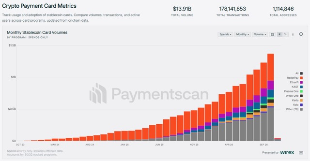

- 영광과이케이엠씨 공모주는 기관 수요예측과 신청가격 분포가 양호해 균등 청약 접근 가능
  - 기관 경쟁률 1,163.35대 1인 반면 의무보유확약은 7.21%로 낮아 상장 후 매물 부담을 함께 고려
- 국내 증시 급락 이후 11월 반등을 기대하는 근거는 코스피의 상대적으로 강한 11월 계절성
  - 계절성 외 추가적인 실적·수급 회복 근거는 제시되지 않음

# Stockbot

- 앤트로픽은 수정 S-1에서 연산자원 지출 약정이 8,950억 달러로 증가한 반면 조정 영업이익률은 2분기 19%에서 15%로 하락
- 미·이란 평화협상 기대가 유가 급락과 귀금속 상승을 견인했지만 중동 긴장 재확대 위험은 지속
  - 이란 최고지도자가 대미 평화협상을 승인했고 이란은 신속 휴전안을 이틀 내 실행할 수 있다고 발표
  - 브렌트유는 장중 최대 11% 하락, 금은 2.5% 오른 3,957달러·은은 3.3% 오른 50.73달러
  - 트럼프의 중간선거 이후 추가 타격 위협과 케슘섬 폭발 보도가 공존하며 미군 공격 여부는 공식 확인되지 않음
- 트럼프는 네타냐후와의 합의에 따라 연간 40억 달러인 이스라엘 지원금을 2026년 말 중단하겠다고 발표
  - 해당 소식에 미국 유가는 장중 상승분을 반납하고 하락 전환
- 애플 AAPL의 회계연도 4분기 매출은 1,144.8억 달러로 예상 1,133.9억 달러를 상회
  - 아이폰 매출도 예상을 웃돌았고 관세 환급이 주당 0.05달러의 이익 개선에 기여
- CFTC가 미국 개별 주식 연계 무기한 선물의 첫 계약을 허용해 미국 규제 거래소에서 해당 상품 거래가 가능해짐

# WUncle

### 미국 중간선거와 부채한도 장기금리의 향방

- 미국 중간선거의 시장 영향은 승리 정당보다 예산·부채한도·인사 권한의 이동과 실제 정책 변화에 달려 있음
  - 민주당 하원 장악은 공화당의 일방적 재정정책을 제약하고, 상원 장악은 연준 등 주요 인사 인준을 제약
  - 선거 뒤 증시 상승이나 분점정부의 호재를 기계적으로 적용하기보다 시장에 반영된 기대와 실제 결과의 차이를 확인해야 함
- 10월 FOMC는 기준금리를 3.75~4.00%로 동결했지만 추가 인상 가능성은 유지
  - 경기 평가는 견조한 성장에서 강한 성장으로 상향하고, 기존 긴축의 효과와 추가 지표를 확인한 뒤 다음 정책을 결정
  - 워시 의장은 비상시 외에는 선제적 금리 경로를 제시하지 않으며 12월 결정도 미리 정하지 않겠다는 입장
  - 금융 여건이 조여졌지만 아직 긴축적이지 않다는 평가는 추가 인상 여지를 남김
- 12월 8~9일 FOMC의 핵심 변수는 고용·물가와 새 점도표
  - 영상 시점 페드워치의 인상 확률은 72.6%, 9월 점도표에서는 18명 중 16명이 연말 금리를 현 수준보다 한 차례 이상 높게 제시
  - 9월 근원 PCE 물가는 전년 대비 3.1%, 3분기 GDP는 전기 대비 연율 3.4%로 물가와 성장 모두 긴축 압력을 유지
  - 10월 고용·CPI·PCE와 11월 고용을 확인해야 하며, 로건 댈러스 연은 총재는 최소 두 차례 추가 인상 뒤 관망을 선호
- 선거 결과는 재정적자와 국채 공급을 거쳐 연준의 판단에도 간접적으로 영향
  - 감세·지출 확대로 차입 수요가 늘면 투자자의 요구수익률이 높아져 연준의 추가 조치 없이도 장기금리가 상승할 수 있음
  - 10년물 금리 상승은 주택담보대출과 회사채 조달 비용을 높여 가계·기업의 금융 여건을 조임
- 영상 시점 칼시의 민주당 다수당 확률은 하원 93%, 상원 72%로 하원 교체가 기본 시나리오
  - 상원은 공화당 53석, 민주당 계열 47석이며 50대 50에서는 부통령의 결정표로 공화당이 우위
  - 민주당은 기존 의석을 지키면서 4석을 추가 확보해야 하며, 노스캐롤라이나와 메인·텍사스·오하이오·알래스카가 주요 승부처
  - 이란전 장기화와 생활물가 부담으로 공화당 강세 지역까지 경합으로 이동
- 개표 지연은 하루짜리 선거 충격을 수주간의 불확실성으로 바꿀 수 있음
  - 맨그룹의 10월 22일 분석에서 S&P 500 옵션은 선거 다음 날 변동성을 평소보다 약 20% 높게 반영했지만 결과 확정 지연은 충분히 반영하지 못했을 가능성
  - 알래스카 순위선택투표 집계는 현지 11월 18일, 조지아 결선이 필요하면 12월 1일까지 상원 다수당 확정이 지연될 수 있음
  - 트럼프의 조건부 승복 발언까지 겹치면 접전 지역의 개표 지연이 정치 공방과 자산가격 변동성을 키울 수 있음
- 개표 당일에는 국채 2년물·10년물과 회사채 신용스프레드를 함께 확인
  - 2년물은 가까운 연준 정책 경로, 10년물은 성장·물가 전망과 기간 프리미엄·장기 국채 수급을 반영
  - 2년물이 안정적인데 10년물만 오르면 재정적자·장기물 공급 우려나 성장·물가 전망 변화를 구분해야 함
  - 주가와 국채금리가 함께 하락하고 회사채 스프레드가 확대되면 안전자산으로 자금이 이동하는 위험회피 신호
- AI 투자 확대에 따른 조달 부담은 선거 이후 금리 상승에 대한 기술주의 취약성을 키움
  - 알파벳·아마존·메타·마이크로소프트의 연간 설비투자 계획은 합계 7,400억 달러 이상으로 투자금 회수와 현금흐름 부담이 부각
  - 오라클까지 포함한 5개사의 연간 차입은 3,260억 달러로 전년의 약 3배이며, 마이크로소프트도 거의 10년 만에 회사채 시장에 복귀
  - 선거발 국채금리 상승과 신용스프레드 확대가 겹치면 AI 투자 수익성 우려가 더 커질 수 있음
- 한국시간 11월 4일 밤 재무부 리펀딩 발표는 선거 결과와 함께 장기금리를 움직일 변수
  - 2년 이상 만기 국채 입찰 규모를 향후 몇 분기 유지한다는 문구가 삭제되면 장기물 공급 확대 가능성에 주목
  - 단기채 비중 확대가 장기물 발행을 대체하는 조치인지, 전체 차입 증가에 따른 추가 공급인지 이틀 앞서 발표되는 차입 추정치와 대조
- 민주당이 의회를 장악해도 관세 철회와 이란전 중단을 곧바로 실현하기는 어려움
  - 관세는 행정부 권한과 기한 없는 법적 근거에 기대고 있어 의회 다수당 교체만으로 되돌리기 어려움
  - 대통령 거부권을 뒤집으려면 양원 각각 3분의 2 찬성이 필요하며, 1월 10일 미중 관세 휴전 만료도 행정부와 중국의 협상에 달려 있음
  - 군사작전 역시 행정부 관할이어서 의회의 직접적인 통제 수단이 제한적
- 상원 다수당 확보만으로 일반 법안과 연간 예산을 자유롭게 처리할 수는 없음
  - 일반 법안은 필리버스터 종결에 통상 60표가 필요해 어느 당이 이겨도 상대당 협조가 중요
  - 예산조정법은 세금·의무지출·부채한도 등을 과반으로 처리할 수 있지만 예산과 직접 관련 없는 조항은 버드 규칙의 제한을 받음
  - 조정법도 하원을 통과해야 하므로 민주당이 하원을 차지하면 공화당 단독 감세·지출 확대가 막힘
  - 연간 세출법안은 조정법으로 우회하지 않아 공화당이 양원을 지켜도 셧다운 위험은 남음
- 연말의 기본 경로는 임시예산 연장이며, 셧다운 가능성도 유지
  - 현 임시예산 만료는 미국시간 12월 11일, 한국시간 12월 12일 오후이며 새 의회 출범 전 현 의회가 처리해야 함
  - 선거 뒤 입법 가능한 회기가 약 5주에 불과해 본예산보다 2027년 1월 또는 3월까지 임시예산을 연장할 가능성이 큼
  - 2018년에도 공화당이 하원을 잃은 뒤 레임덕 예산 협상이 결렬돼 35일간 셧다운이 이어짐
- 공화당은 연말 부채한도 선제 인상의 유인이 크지만 당내 이견과 의석 여유 축소가 장애물
  - 10월 28일 기준 한도 여유는 약 7,500억 달러로, 현 추세에서는 2027년 상반기 한도 도달 가능성
  - 트럼프는 약 5조 달러를 올려 2029년까지 문제를 넘기려 하지만 재정 보수파는 지출 감축 없는 인상에 반대
  - 오하이오 보궐선거에서 민주당이 승리해 12월 중순 취임하면 공화당이 감당할 수 있는 상원 이탈표가 3표에서 2표로 감소
  - 부채한도 인상은 이미 승인된 지출을 위한 차입 허용이며, 그 자체가 신규 지출 승인이나 즉각적인 국채 발행 증가를 뜻하지 않음
- 민주당 하원에서는 의료정책 입법보다 조사·소환과 예산 협상이 당장의 핵심 수단
  - 2027년 1월 3일 새 의회 출범 뒤 위원회 의제와 소환권을 확보해 트럼프 일가의 사업·암호화폐 거래·사면 등을 조사할 수 있음
  - 크립토·예측시장과 전기요금 부담을 키우는 AI 데이터센터, 생활물가와 밀접한 에너지·헬스케어·식품 업종에 조사 압력이 커질 수 있음
  - 탄핵소추를 정치적 압박 수단으로 활용할 수 있지만 실제 파면에는 상원 3분의 2 찬성이 필요
  - 정쟁이 격화돼도 필수 합의는 가능하며, 2019년에도 부채한도·예산 합의와 탄핵소추 다음 날 USMCA 이행법안 처리가 병행
- 민주당은 부채한도 협상에서 오바마케어 보험료 세액공제 복원과 메디케이드 삭감 환원을 요구할 가능성이 큼
  - 연말에 한도를 올리지 못하면 2027년 한도 도달 뒤 재무부 특별조치로 시간을 벌다가 지급 여력이 소진되는 X데이트 직전 협상이 격화될 수 있음
  - X데이트 전후 만기 단기국채는 상환 지연 우려로 기피돼 특정 만기의 금리가 급등할 수 있음
  - 2023년에는 1개월물 금리가 2개월물보다 높아졌으며, 단기국채 수익률곡선의 왜곡이 협상 위험을 드러내는 지표
- 민주당 하원 장악은 국방비 추가 지출에도 제약
  - 정부의 2027회계연도 국방예산 요구액 1조 5,000억 달러 중 3,500억 달러는 조정법으로 별도 마련하려는 몫
  - 조정법 처리가 막히면 민주당과 협상해야 하며, 추가분 확보 실패에 대비한 약 1조 1,000억 달러 예산안도 준비 중
- 민주당이 상원까지 확보하면 가장 뚜렷한 추가 변화는 연준 등 주요 인사 인준의 지연·차단
  - 쿡 이사 해임 관련 법적 절차와 후임 인준, 2027년 9월 만료되는 제퍼슨 부의장 직책의 후임 선정이 주요 변수
  - 제퍼슨은 부의장 임기 종료 뒤에도 이사로 남을 수 있어 부의장 교체가 곧 이사 공석을 뜻하지는 않음
  - 공화당 상원에서는 트럼프 지명자 인준이 상대적으로 수월하고, 민주당 상원에서는 인준권이 협상 카드가 될 수 있음
- 공화당의 양원 수성은 낮은 확률만큼 시장의 되돌림이 커질 수 있는 시나리오
  - 공화당 패배에 취약한 종목을 묶은 UBS 바스켓이 8월 말부터 시장을 하회해 민주당 승리 기대가 이미 상당 부분 반영됐을 가능성
  - 양원 수성 시 조정법을 통한 감세·지출 확대와 부채한도 인상이 가능하지만 당내 반대는 여전히 변수
  - 재정 확대가 국채 공급과 10년물 금리를 끌어올리면 채권·주택대출·기업 조달 비용에 부담이며, 기대인플레이션 상승은 연준의 추가 긴축 압력을 높임
  - 방산은 국방지출 확대 수혜가 가능하지만 은행 규제 완화는 감독기관 인사와 집행 변화까지 확인해야 함
- 선거 이후에는 정당별 수혜주 묶음보다 법안 통과 경로·예산 확보·조사 대상 여부를 종목별로 확인할 필요
  - 헬스케어는 민주당 승리 기대만으로 정책 수혜가 확정되지 않으며, 부채한도 협상에서 실제 양보를 얻는지가 중요
- 주가 반등과 금융 여건 개선을 동일시하기 어려움
  - 선거 불확실성이 줄어도 재정 확대에 따른 장기금리 상승과 AI 기업의 차입 부담이 겹치면 주식시장 내부의 차별화가 커질 수 있음
- 위험의 시간축을 개표 확정·연말 예산·새 의회 조사·부채한도 협상으로 나눠 대응할 필요
  - 개표 직후에는 상원 확정 시점과 리펀딩, 연말에는 임시예산과 부채한도 선제 인상, 2027년에는 소환장·인사 인준·단기국채 만기별 금리 왜곡을 점검
