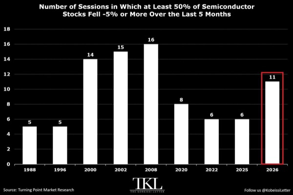
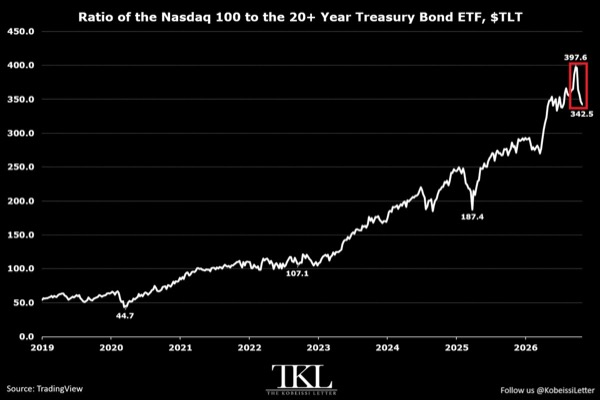
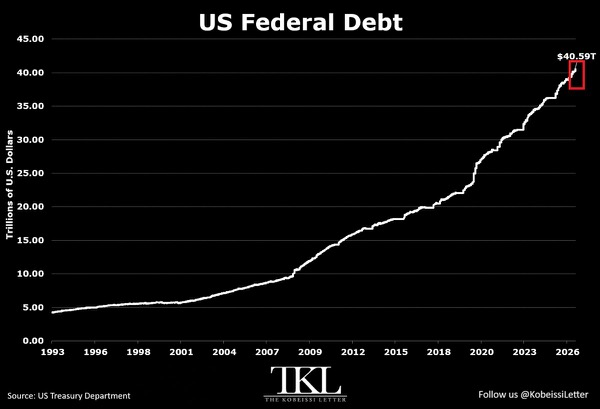
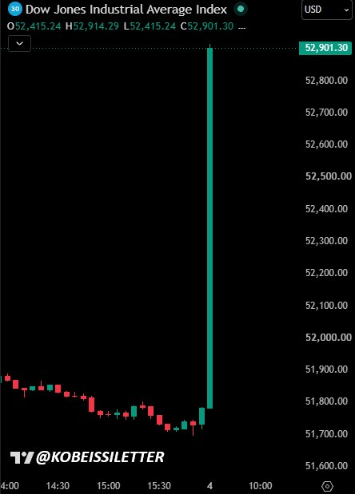
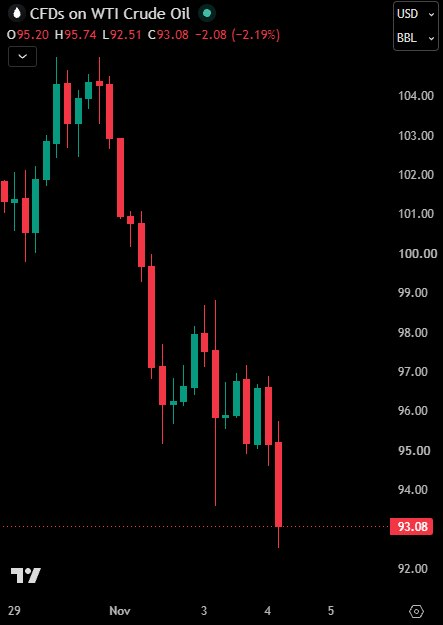
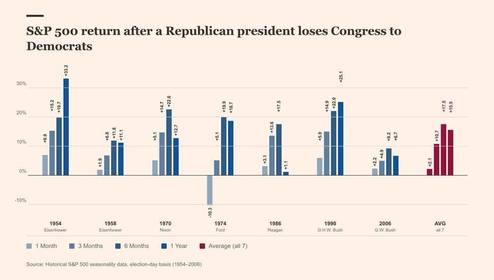
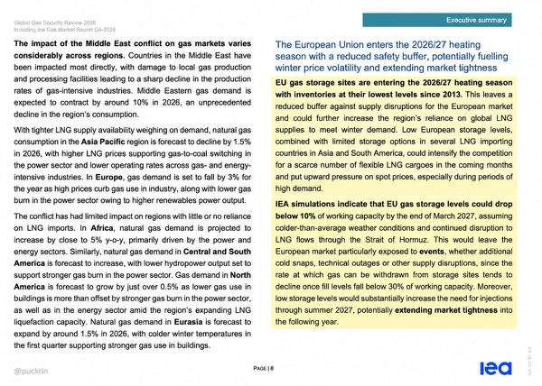

# AJikh

### 미군 90일 자립 계획과 위기 공포의 경제학

- 미군의 90일 독립운영 준비와 각국의 비상물자 권고가 겹치며 전쟁·정전 공포가 확산
  - 유럽 여러 국가와 미군 기지 식료품점에서 냉장·냉동 설비 이상으로 식품이 폐기됐다는 사례가 출발점
  - 사이버공격 여부와 배후는 확인되지 않았으며 국가 식량망 공격의 사전 실험이라는 해석도 추정에 그침
- 포트리스는 미국 내 주요 군사기지 약 200곳을 외부 전력·보급 없이 90일간 운영하려는 장기 계획
  - 마이크로그리드, 배터리 저장장치, 이동식 원자로와 탄약·연료·의약품 비축에 수십억 달러 투입 구상
  - 완성까지 수년이 필요하고 공식 완료일도 없으며 이란뿐 아니라 중국 관련 위협에도 대비
  - 계획의 존재만으로 임박한 공격이나 전국 정전을 확정할 수 없음
- 대규모 전쟁 대비 움직임에는 전사자 임시 매장 훈련과 군용 진통제 긴급사용 절차가 포함
  - 10월 20~21일 드래곤 커버넌트 2단계 훈련에서 전장에 전사자를 임시 매장한 뒤 수습·송환하는 절차 연습
  - 2월 싱가포르 기업에 약 4,100만 달러 규모의 혀 밑에서 녹는 케타민 제형 개발 계약 발주
  - 7월 군사 비상사태 선언을 바탕으로 정식 FDA 승인 전 군 공급을 위한 긴급사용 경로 추진
  - 마러라고 인근 어벤저 방공체계 배치에는 위협 고조 외에 마이애미 G20 정상회의 경호라는 설명도 가능
- 33개국의 비상물자 권고를 하나의 임박한 사건과 연결할 증거는 없음
  - 미국 FEMA의 3일분 비축 권고는 수십 년 된 지침이며 일본은 지진, 북유럽·발트 국가는 러시아 위협이 주요 배경
  - 영국은 10월 22일 3년짜리 비 레디 캠페인을 시작해 3일분 식량·물, 라디오, 보조배터리, 현금, 의약품 준비 권고
  - 독일은 최대 10일분 비축 권고로 소개되지만 국가별 권고의 시점과 목적은 서로 다름
- 공포는 선거 동원, 광고 수익, 비상용품 판매를 동시에 늘리는 경제적 유인
  - 11월 3일 중간선거를 앞두고 정치 성향별 알고리즘이 서로 다른 위협을 부각하며 공통된 현실 인식을 약화
  - 영국의 대비 권고 이후 한 소매업체의 손전등 판매가 284%, 일부 슈퍼마켓의 통조림 판매가 한 주말 동안 40% 늘었다는 사례 제시
  - 2017년 북한 위기 당시 미국 비상식량 업체 매출이 두 배로 늘었고 1961년 베를린 위기에는 방공호 산업이 급성장한 뒤 위기 완화와 함께 위축
- 전쟁 준비의 더 큰 수익원은 일회성 생필품 구매보다 장기 방산·에너지·의약품 계약
  - 기지 200곳의 전력 자립, 비축물자 확보, 수의계약은 실제 전쟁 발발과 별개로 관련 기업에 매출 창출
  - 공포를 증폭할 상업적 유인은 분명하지만 실제 군사 준비 전체를 알고리즘만으로 설명할 수는 없음
- 위기는 정부 권한을 늘리고 비상조치가 끝난 뒤에도 일부 권한을 남기는 경향
  - 로버트 힉스의 『위기와 리바이어던』에 나오는 래칫 효과로, 전시 소득세 원천징수와 9·11 이후 장기화된 비상권한을 사례로 제시
  - 군 의약품 긴급사용과 장기간의 대비 체계도 일시적 예외가 상시 제도로 굳어질 위험
- 디지털 신원·프로그래밍 가능한 화폐·비상권한의 확대가 통제력 집중으로 이어질 가능성에 주목
  - 유엔 의제 2030, 유럽 디지털 신원 지갑, 영국 취업 자격 확인용 디지털 신원, CBDC·스테이블코인을 연결하는 해석
  - 이 제도들이 단일 세계정부 수립을 위해 조율됐다는 구체적 증거는 제시되지 않음
- 중간선거 이후 이란과의 군사적 충돌 재개가 핵심 지정학적 위험으로 제시됨
  - 영상이 인용한 파이낸셜타임스 보도에서는 네타냐후가 준비한 10월 10일 주말 공격을 트럼프가 선거를 고려해 제지한 것으로 소개
  - 선거 이후 공격 재개 가능성과 핵무기 사용 가능성은 구분해야 하며 핵공격이 임박했다는 확정적 근거는 없음
  - 터커 칼슨의 11월 1일 핵공격 경고는 과거에도 반복됐지만 실현되지 않은 전력이 있음
  - 이란 피크액스산 시설이 잠재 표적으로 거론되지만 해당 시설에 대한 공격 경고가 핵무기 사용을 뜻하지는 않음
- 이란의 보복 대상으로 해저 인터넷 케이블·데이터센터·인공지능 시설 등 걸프 지역 기반시설이 거론됨
  - 7월 군사 비상사태 선언의 화학·생물·방사능·핵 위협 문구를 이란 핵공격 시나리오와 연결하지만 인과관계는 확인되지 않음
  - 우크라이나 공습 경보 앱의 허위 방사능·화학공격 알림과 식료품점 설비 이상도 동일한 배후나 작전으로 연결할 증거가 없음
- 11월 17일 대정전설처럼 특정 날짜를 제시하는 공포성 정보는 실제 일정과 추측을 분리해 판단
  - 확산된 심슨 영상은 2023년 추수감사절 에피소드이며 해당 날짜의 정전을 입증하지 못함
  - 영상에서 언급한 FEMA·FCC 비상경보 시험도 TV·라디오 대상 약 1분짜리 시험으로, 실제 전력망 중단과는 별개
- 날짜별 위기설에 맞춰 투자자산을 전량 매도하거나 현금으로 급히 전환할 필요는 없음
  - 가정에서는 며칠분의 물·식량·필수품과 은행 밖 소액 현금을 확보하는 정도가 저비용 대비책
  - 소량의 금·은 보유도 언급되지만 공포에 따른 대규모 자산 재편은 피하는 방향
- 대비 체계의 존재와 위기 발생 확률을 구분해야 정보 과잉에 따른 투자 실수를 줄일 수 있음
  - 다년간의 조달 계획, 정기 훈련, 오래된 생활 지침을 한데 묶어 임박한 재난으로 해석하면 위험을 과대평가하기 쉬움
- 위기 관련 사업을 볼 때 실제 계약 규모·집행 기간·수익 귀속을 확인하는 편이 자극적인 전쟁 날짜보다 유용
  - 가정의 비상물자 확보는 생활 위험 관리로, 투자 판단은 별도의 근거와 자산배분 원칙으로 접근

# Aurum

- 민주당의 상·하원 장악으로 추가 감세·재정 확대가 제약되고 2027년 부채한도 협상 위험이 커짐
  - 개표 중간 집계는 하원 민주 223석·공화 138석, 상원 민주 54석·공화 44석으로 민주당 양원 과반 확보
  - 대통령 거부권과 필리버스터로 신규 입법은 교착될 가능성이 높고, 핵심 재정 고비는 2027년 2~7월 부채한도 협상
- 예상보다 큰 민주당 승리로 데이터센터 규제 우려가 확대되며 아시아 증시와 나스닥 선물이 동반 급락
  - 장중 코스피 -3%대·코스닥 -2%대·닛케이 -4%대·나스닥 선물 -2%대까지 하락
  - 전력·환경 규제와 자금조달 부담이 AI 인프라 투자 지연, 반도체 수요 가시성 약화로 연결될 위험
  - 실제 규제 강화 여부와 미국 본장 반응을 확인하며 관망하는 접근이 우선
- 분점정부 전환은 중기적으로 재정 부담과 장기금리 하락에 우호적이나 AI 주도주의 정책 위험은 별도 점검 필요
  - 과거 여당이 양원을 모두 잃은 4개 사례에서 선거 후 12개월 S&P 500은 평균 약 18% 상승
  - 통합정부에서 분점정부로 바뀐 사례의 미국 10년물 금리는 12개월 평균 약 50bp 하락했으며, 하락은 대체로 3~4개월 뒤 본격화
- 미국 재무부는 이표채 발행 규모를 유지하면서 2027년 1분기 차입의 약 3분의 2를 단기국채로 조달할 계획
  - 4분기 순차입 6,180억 달러, 2027년 1분기 8,000억 달러이며 1분기 티빌 5,320억 달러·이표채 3,480억 달러·바이백 800억 달러
  - 발행 유지 가이던스에서 ‘최소한’이 빠져 향후 이표채 증액 시점을 앞당길 여지를 남김
  - 7년물은 2027년 3월부터 분기 신규 발행과 2회 재발행으로 전환하며, 연말 TGA 목표는 8,500억 달러
- TBAC은 단기국채 의존의 한계를 지적하며 2027회계연도 후반 이표채 증액 필요성을 제시
  - MMF 자산 증가세가 멈추고 티빌의 가격 민감도가 나타나기 시작했으며, 증액 속도와 장기물 규모는 이견이 남음
  - AI 회사채가 국채 수요를 구축한다는 입찰 증거는 없고, 바이백은 장기물 공급 축소보다 시장 유동성 개선 수단에 가까움
- 국내 메모리 주식은 외국인 매도를 개인·기관이 받아내는 수급 구도가 지속
  - 삼성전자·SK하이닉스 합산 최근일 외국인 순매도 1.9조 원, 개인 순매수 1.2조 원, 기관 순매수 4,428억 원
  - 10월 26일~11월 4일 외국인은 SK하이닉스 2.1조 원·삼성전자 8,524억 원을 순매도하고 SK 4,821억 원·삼성E&A 1,609억 원을 순매수
  - 코스피 PBR 1.42배, 삼성전자·삼성전자우·SK하이닉스 제외 1.03배, 코스닥 1.57배
- 에너지 가격 급등이 유로존 물가를 끌어올리는 반면 미국은 저렴한 자국 가스로 제조업과 LNG 수출의 원가 우위를 확보
  - 유로존 10월 CPI는 전년 대비 4.0%·전월 대비 0.4%, 에너지는 전년 대비 20.8% 상승
  - 유럽·아시아 가스는 백만 BTU당 30달러 이상, 미국은 약 3달러로 격차가 확대돼 LNG 수입국의 비용 부담이 큼
  - 미국 LNG 수출사와 화학·전력 다소비 산업의 수혜 강도는 헨리허브와 TTF·JKM 가격 차에 달림
- 미국 생산성은 2015년 이후 반등했지만 AI가 순수 기술 효율을 높였다는 증거는 아직 부족
  - 시간당 생산 증가세는 2025년까지 개선됐으나 총요소생산성 추세는 2024년 무렵 정체
  - 설비투자 증가가 섞이는 시간당 생산보다 총요소생산성의 재상승 여부가 AI 효과를 가르는 지표
- 미국 3분기 성장률 연율 3.4%는 AI 투자와 자산효과에 집중됐으며 실질소득 정체로 소비 지속성이 약함
  - 민간 비주거용 투자 12.7%·데이터센터 건설 127%·컴퓨터 장비 67% 증가
  - 2025년 1월 이후 임금 5.5% 상승을 물가 5.4% 상승이 대부분 상쇄했고, 저축률은 5.1%에서 3.8%로 하락
  - 9월 실질 소비는 전월 대비 정체했으며 주가 하락 시 소비도 약해질 위험
- AI 전력 수요 확대의 수혜는 장비를 선점하고 대규모로 발전소를 건설하는 사업자에 집중될 가능성
  - 넥스트에라는 2032년까지 연 600억 달러를 투자하고 데이터센터 직접 운영보다 전력·부지 공급에 집중
  - 가스터빈·변압기 공급 부족과 24시간 전력 수요로 가스·기존 원전 재가동의 중요성이 커짐
  - 듀안 아널드 원전은 구글과 25년 전력 구매계약을 체결했으며, SMR 상용화는 2030년대 중후반 이후로 예상

# Kobeissi

- 미국 반도체주는 역사적 수준의 변동성을 보이며 6월 고점 대비 32% 하락
  - 최근 5개월간 구성종목 절반 이상이 하루 5% 이상 하락한 거래일이 11회로 역대 네 번째 수준이며, 반도체 지수 자체의 5% 이상 하락도 12회 발생

- AI 주식 조정에 대비한 장기국채 매수로 나스닥100 대비 TLT의 상대 강세가 뚜렷해짐
  - 나스닥100/TLT 비율은 342.5로 7월 31일 이후 최저이며 10월 7일 고점 대비 15.4% 하락
  - 같은 기간 TLT는 7.1% 상승하고 나스닥100은 10.2% 하락했으며, 비율은 2022년 이후 최장인 5주 연속 하락 경로

- AI 기업의 자금조달·신용 위험으로 대형 IPO 가치평가 기대가 낮아짐
  - Anthropic이 2026년 최대 시가총액 IPO가 될 예측시장 확률은 62%에서 28%로 하락하며 SpaceX에 뒤처짐
  - Anthropic의 투기등급 신용평가 가능성 보도와 OpenAI의 조달 목표 기업가치 1,500억 달러 하향이 부담
- AMD와 Super Micro Computer는 AI 수요에 힘입은 예상 상회 실적으로 시간외 주가가 각각 6% 이상 상승
  - AMD는 시간외 시가총액이 약 500억 달러 증가하며 AI 주식 전반의 조정 속에서도 실적 성장 확인
- 미국 연방부채가 10월에 4,220억 달러 늘어 사상 최대 40.6조 달러에 도달
  - 7월 1일 이후 1.2조 달러 증가해 월평균 3,000억 달러·하루 약 100억 달러씩 확대
  - 총공공부채/GDP는 123%로 팬데믹 정점 이후 최고이며, 전주 국채 입찰 조달은 차환 중심으로 사상 최대 8,390억 달러

- 민주당 양원 장악 전망에 급락했던 미국 주식은 선거 불확실성 해소와 함께 낙폭을 모두 회복하고 급반등
  - 개표 중 나스닥100 선물은 2% 넘게 하락하고 S&P 500은 7,500 하회 출발이 예상됐으나 이후 선물이 상승 전환
  - 개장 후 다우는 1,100포인트 이상 상승했고, 이후 S&P 500 +1.7%·다우 +2.4%·나스닥100 +2.0%로 주식 시가총액 1.3조 달러 증가
  - 1980년 이후 중간선거 다음 12개월 S&P 500은 매번 상승했으며 평균 수익률 14%, 분점정부 15%·단일정당 통제 12%

- 생활비·에너지 부담이 민주당의 대규모 의석 탈환과 정책 교착 가능성을 키움
  - 민주당은 상원 7석·하원 25석을 탈환했고 텍사스 상원의원·주지사 선거도 민주당 전환이 예상됨
  - 미국 유가가 연중 46일 동안 배럴당 100달러를 웃돌며 물가·금리·계층별 경기 격차를 압박
  - 트럼프는 민주당 양원 장악 뒤 거부권 행사를 시사
- 선거 결과 이후 금·은·비트코인이 동반 상승하고 유가는 급락하며 자산별 반응이 갈림
  - 은 +5%·금 +3%·비트코인 +3%·WTI -3.5%로 집계됐으며 금·은 합산 시가총액은 약 1조 달러 증가
  - 미국 유가는 배럴당 93달러 아래로 내려가 최근 4일간 12% 하락

- 중동 군사 긴장은 남아 있지만 트럼프는 이란을 즉시 타격할 계획이 없다고 밝힘
  - 이스라엘의 이란 화학무기 사용 검토 첩보에는 미국·걸프 당국의 의구심이 병존
  - 미 중부사령부의 타격 계획은 아직 승인되지 않은 상태로 보도돼 계획과 실제 실행을 구분할 필요

# MKevin

### 리어젯 공중 분해 정황과 뇌우 속 착빙 위험

- 플로리다에서 추락한 리어젯 60 N722BD의 수평안정판 추정 부품이 충돌 지점에서 수 마일 떨어진 곳에서 발견돼 공중 분해 가능성이 커짐
  - 영상에서 소개된 NTSB의 초기 판단과 충돌 직전 꼬리 부분이 사라진 듯한 영상도 공중 분해 정황과 부합
  - 수평안정판이 먼저 떨어져 급강하했는지, 자세 상실 뒤 과속이나 회복 과정의 하중으로 떨어졌는지는 미확정
- 사고기는 약 35,000피트에서 난기류를 만난 뒤 상승했지만, 상승 목적이 난기류 회피였는지 착빙 탈출이었는지는 불명확
  - ADS-B 자료에서 확인된 상승폭은 약 1,500피트로, 강한 상승기류에 의한 급격한 고도 변화는 가능한 시나리오일 뿐 확인된 경과는 아님
  - 부기장은 사고 약 10분 전 남자친구에게 난기류와 얼음을 겪고 있다는 문자를 보낸 것으로 소개됨
- 영상에서 인용한 리어젯 60 매뉴얼은 30,000피트 이상에서 충분한 여유를 두고 넘을 수 있다는 확신 없이 난기류 구역 위로 상승하는 것을 권하지 않음
  - 같은 강도의 난기류라면 낮은 고도에서 권장 속도를 유지할 때 실속까지의 여유가 더 커짐
  - 권장 난기류 통과 속도와 안정적인 추력을 유지하고, 고도를 고정하려 무리하기보다 고도 변화를 허용하는 절차가 핵심
  - 착빙 구역 탈출을 위한 상승은 별도 판단이 필요하며, 실제 조종사의 의도와 당시 조건이 확인돼야 절차 적절성을 평가할 수 있음
- 구형 기상레이더의 강수 감쇠가 강한 뇌우 뒤편을 빈 공간처럼 보이게 했을 가능성도 조사 쟁점
  - 사고기가 마지막 매각 당시 장착했던 WXR840의 매뉴얼에는 강한 기상 구역에서 탐지에 한계가 생길 수 있다는 내용이 있음
  - 사고 당시에도 같은 장비였는지, 조종사 화면에 무엇이 표시됐는지, 이를 보고 진입했는지는 미확인
- 고고도의 낮은 온도만으로 뇌우 속 착빙 위험을 배제할 수 없음
  - 영상에서 인용한 NASA의 2001년 관측에는 약 영하 40도에서도 강한 대류 속 슬러시 형태의 큰 얼음 입자와 탐침 입구 막힘이 등장
  - 가능한 고장 경로는 날개 가열부 뒤에서 녹은 물이 다시 얼어 양력을 떨어뜨리는 현상, 승강타 결빙에 따른 조종 제한, 피토·정압 계통 막힘에 따른 계기 오류
  - 이번 사고에서 어떤 착빙이나 센서 이상이 실제로 발생했는지는 아직 확인되지 않음
- 2008년 제트스트림 41 사고 사례에서는 부적절한 제빙·방빙 뒤 상승 중 승강타가 얼어붙었지만, 추력 조절과 조종력으로 하강해 따뜻한 공기에서 결빙을 해소함
  - 다른 기종의 사례로, 승강타 결빙 가능성을 보여주지만 이번 리어젯의 사고 원인을 입증하지는 않음
- 조종실음성기록장치와 비행자료기록장치 확보 여부가 사고 순서와 회복 조작을 밝힐 핵심
  - 사고기는 매각 당시 음성기록장치가 있었던 것으로 소개되지만 실제 회수·사용 가능 여부와 비행자료기록장치 탑재 여부는 미확인
  - 실속 경고, 센서 이상, 조종 입력, 추력 변화와 부품 이탈 시점을 연결해야 난기류·착빙·과속의 기여도를 구분할 수 있음
- 탑승자 9명에는 조종사 2명과 어린 자녀를 동반한 가족, 보모, 친구 커플이 포함됨
  - 기장 Jeffrey Gregory는 55세로 배우자와 자녀 3명을 두었으며, 항공운송용 조종사 자격과 리어젯 형식한정·비행교관 자격을 보유
  - 부기장은 브라질계 가족 출신의 20세 조종사로, 가족이 전한 총 비행시간은 약 1,100~1,300시간이며 항공사 조종사를 목표로 했음
  - Adam Robinson은 약 44세의 Retention.com 창업자이며, 배우자 Helen은 40세의 홍보업 창업자, 자녀 Emma와 Charlie는 각각 4세와 2세
  - 콜롬비아 보고타 출신의 23세 보모와 온두라스 호텔을 공동 운영하던 약혼 커플 Rachel Reed·Charmmy Far도 함께 탑승한 것으로 소개됨
- Adam Robinson은 리먼브러더스 신용부도스와프 거래와 바클레이스 근무를 거쳐 이메일 마케팅 사업을 창업했으며, 외부 투자보다 자체 자금으로 소프트웨어 사업을 키우는 방식을 강조
  - 영상에서 소개된 2024년 인터뷰 기준 Retention.com 매출은 2,380만 달러, 예상 연간 이익은 약 1,100만 달러
  - 여러 사업의 합산 연간 반복매출은 약 3,200만~3,500만 달러로 거론되지만 정확한 수치는 불명확
- 잔해의 발견 위치와 파단면 분석으로 부품 이탈과 자세 상실의 선후관계를 밝혀야 예방 가능한 단계가 드러남
  - 착빙의 기여도나 조종사의 판단 오류를 현재 정황만으로 확정할 수 없음
- 재발 방지의 주요 검토 대상은 뇌우 우회 판단, 구형 기상레이더의 탐지 한계, 비정상 자세 회복 훈련과 기록장치 확충
  - 장비 교체나 의무화의 필요성은 실제 장비 구성과 사고 경로를 확인한 조사 결과에 따라 평가해야 함

### 반도체 급락 속 실적 괴리와 고용 위험

- 미국의 이란 양해각서 초안 수용 보도로 중동 긴장 완화 기대 확대
  - 카타르 중재안에 미국이 동의했고 이란이 핵 문제와 동결자산에서 양보했다는 중재 관계자발 보도
  - 세부 조건과 최종 서명은 미확인으로 합의 확정과는 구분 필요
  - 트럼프는 네타냐후와 연말 이스라엘 원조 종료에 합의했으며 이후 무기 구매는 가능하다고 언급
- 유가는 합의 기대 속 최근 5일간 배럴당 117달러에서 102달러로 하락
  - 전일 약 7% 급락에 이어 방송 시점에도 약 2.4% 하락
- 기술주 급락과 실제 기업 실적 사이의 괴리 확대
  - 나스닥100은 250거래일 만에 처음으로 하루 수익률이 마이너스 1.5표준편차에 해당하는 하락 기록
  - QQQ는 이틀 연속 700선을 지키지 못하며 저항선 형성
  - 영상에서 거론한 종목군의 평균 선행 주가수익비율은 약 13배로 닷컴 붕괴 이후 시스코의 10~20배 구간과 유사
- 10월 조정은 메모리·반도체·광통신에 집중됐으며 레버리지 청산이 낙폭 확대
  - 골드만삭스 메모리 바스켓 22%, 반도체 18.6%, 광통신 관련 종목군 약 29% 하락
  - 레버리지 상장지수펀드가 하루 동안 마이크론 주식 약 19억 달러를 매도
  - 삼성전자도 5월 말 고점 대비 약 35% 하락하며 글로벌 반도체 약세 확산
- 마이크론의 낮은 성장 대비 주가는 메모리 업황의 지속성을 둘러싼 불신 반영
  - 월드 밸류 상장지수펀드의 마이크론 비중은 약 14%, 마이크론의 주가수익성장비율은 약 0.33배
  - 경기순환 할인을 적용해도 저평가 폭이 크다는 투자 논리지만 적정 배수와 이익 지속성에 민감
- 골드만삭스의 9월 반도체 데이터는 업황 강세 지속을 시사
  - 전년 대비 산업 매출 151%, 평균판매가격 128%, 판매 수량 10% 증가
  - 디램 매출 368%, 낸드 매출 510% 증가하며 메모리가 성장 주도
  - 고대역폭 메모리처럼 제품당 메모리 탑재량이 늘어 단순 판매 수량만으로 수요를 평가하기 어려움
- SK하이닉스 장기계약은 메모리 수요의 가시성을 높이지만 중국 증설은 중장기 위험
  - 장기계약 14건이 2027~2028년 생산능력의 절반 이상을 포괄하며 공급 부족은 2030년까지, 수요 가시성은 2031년까지 제시
  - 중국 CXMT는 매출 613% 증가와 약 89.5%의 마진을 기록했으며 전년 마진은 약 35%
  - 번스타인은 CXMT의 웨이퍼 생산능력이 2028년 말 마이크론을 넘어설 가능성 제시
- GPU 임대료 상승은 인공지능 연산 수요가 여전히 강하다는 신호
  - 구형 A100과 H100부터 H200·B200·B300까지 임대료 상승 흐름
  - B300 임대료는 7월 이후 106% 상승했으며 같은 기간 평균 토큰 가격은 58% 하락
- 단기 시장 촉매는 이란 협상, 선거 결과, 고용지표에 집중
  - 방송 시점 칼시의 민주당 상원 장악 확률은 약 77%
  - 영상에서 인용한 1950년 이후 선거 후 6개월 수익률은 상승 빈도 100%, 평균 상승률 13%지만 이번 상승을 보장하지 않음
  - 수요일 미국 재무부 차환 계획 발표도 국채시장 변동성 요인
- 고용 둔화가 실제 경기침체로 번지는지가 가장 중요한 하방 위험
  - 수요일 ADP 고용 예상치는 6만6천 명으로 직전 9만 명보다 감소
  - 금요일 비농업 고용 예상치는 6만5천 명이며 직전 발표는 예상 9만 명에 못 미친 2만9천 명
  - 고용지표가 다시 기대를 밑돌면 기술주 조정을 넘어 경기침체 우려가 확대될 수 있음
- 실직자의 재취업 임금 악화는 노동시장 균열의 초기 신호
  - 골드만삭스는 2023년 이후 인공지능 관련 감원을 약 20만7천 명으로 집계
  - 동등하거나 더 높은 임금으로 재취업한 비율은 2년 전 62%에서 올해 49%로 13%포인트 하락
  - 가계조사 고용은 8월 56만9천 명, 9월 4만6천 명 증가했지만 변동성이 커 3개월 평균 확인 필요
- 기술주 포지셔닝과 이익 성장의 격차는 반등 여지를 제공하지만 투매 종료 신호는 부족
  - 기술주 포지셔닝은 40백분위 수준이며 영상에서는 이익 성장률 10%를 반영하는 수준으로 해석
  - 실제 3분기 주당순이익 성장률은 47%, 최근 다섯 차례 기술주 재유입 국면의 평균 상승률은 38%
  - 도이체방크는 아직 투매의 최종 국면에 도달하지 않은 것으로 평가
- 인공지능 수요 확대가 모든 기업의 현금흐름 개선으로 이어지는 것은 아님
  - 인텔은 칩 평균판매가격이 54% 올랐지만 개인용 컴퓨터 판매 둔화 우려로 실적 발표 전후 주가가 29% 하락
  - 메타는 2028년까지 현금흐름 흑자 전환이 어려울 수 있으며 그록은 가격 인상과 사용 한도 축소로 유료 전환 유도
  - 연산 수요 증가와 개별 기업의 투자비 회수 능력을 별도로 점검할 필요
- 지수 하락의 중심은 인공지능 대형주이며 시장 전체의 폭넓은 붕괴 신호는 제한적
  - S&P500 구성 종목의 80% 이상이 상승했는데 지수는 하락한 사례가 약 40년 만에 발생
  - 동일가중 S&P500 상장지수펀드 RSP는 사상 최고치 부근으로 대형 기술주 밖의 시장 흐름은 상대적으로 견조
- 반도체 매수 판단은 낮아진 주가수익비율과 함께 장기계약, 메모리 가격, 중국 공급 확대를 종합해야 함
  - 현재 이익이 경기순환의 고점이면 낮은 배수가 저평가를 보장하지 않으며 레버리지는 강제 매도 위험을 키움
- 이란 합의와 선거 불확실성 해소는 반등 촉매지만 지속성은 고용과 기업 이익이 결정
  - 유가 하락과 견조한 고용이 함께 나타나면 회복 여건이 개선되고 고용 급랭은 저평가 논리보다 우선하는 위험

### 투자 4조 달러와 하드웨어 성장의 자금조달 부담

- 미국 경제의 두 축은 고용과 AI 투자이며, 한쪽의 침체가 다른 쪽으로 번질 경우 경기 하강이 급격해질 위험
  - 9월 JOLTS 구인 건수 약 752만 건으로 예상 710만 건을 웃돌고, 전월 수치도 1.5% 상향 조정
  - 자발적 퇴사율은 1.9%에서 2.1%로 상승했지만, 이직 후 임금이 오른 사람은 절반 미만으로 코로나 이후의 과열과는 차이
- 빅테크의 장부 외 AI 투자 약정은 6월 1.8조 달러, 8월 3.1조 달러에서 현재 4.11조 달러로 5개월 만에 두 배 이상 확대
  - 약정 집계에는 할인 전 보증금액 전액이 포함되므로 실제 집행액과 차이가 날 수 있음
  - Amazon의 AI 구매 주문도 8월 이후 두 배로 증가하며 투자 축소보다 추가 확장에 무게
- 토큰 가격 하락과 GPU 임대료 상승이 동시에 나타나며 AI 활용 비용과 연산 인프라의 수익성이 갈라지는 국면
  - 토큰 가격은 전년 대비 약 50% 하락했고, 제시된 지수도 약 2달러에서 0.9달러 수준으로 하락
  - H100 시간당 임대료는 1달러 미만에서 약 1.3달러로 상승했으며 5월 31일 대비 6.2% 상승
  - B200과 B300의 임대료 상승 기울기는 더 가파르고, 구형 GPU까지 임대료가 오르는 점은 연산 수요의 강도를 뒷받침
- AI의 수익 중심은 토큰 판매에서 하드웨어와 기업 업무에 깊이 통합되는 플랫폼으로 이동할 가능성
  - 토큰 가격 하락은 AI를 활용하는 기업의 비용을 낮추지만 범용 모델 제공업체의 단순 사용량 과금에는 압박
  - 데이터 통제와 자체 장비 운영 수요가 커지면 모델·소프트웨어를 라이선스로 제공하는 SaaS 2.0이 확산될 가능성
  - AMD·Nvidia·Apple, ASIC 설계업체 Marvell·Broadcom, 제조업체 TSMC·Intel, 장비업체 ASML까지 인프라 수혜가 연결
- Palantir는 기업 현장에 엔지니어를 투입해 플랫폼을 통합하는 역량과 기존 고객 지출 약 95% 증가가 강점
  - 현금흐름 수익률은 약 1.3%로 낮고, Anthropic 등 모델 제공업체의 기업용 플랫폼 진출이 경쟁 위험
  - Kevin 추정 Anthropic 기업가치는 최대 1.5조 달러, 연간 반복매출은 약 800억 달러이나 Palantir와 달리 아직 적자
  - Anthropic의 자체 칩 설계 추진은 연산 비용 통제와 토큰 판매 이후 사업모델 확보 필요성을 시사
- Apple은 메모리 가격 급등에도 제품 매출총이익률을 전년 36.8%에서 39.3%로 높였고 서비스 이익률도 개선
  - 자체 장비에서 AI를 실행하려는 수요와 Mac Studio 판매 확대가 추가 성장 동력
  - 월가 성장률 예상은 9%지만 Kevin은 16~20%를 예상하며, 이 가정에서는 PEG가 약 2배 수준
- AMD는 AI 데이터센터 성장과 수익성 개선이 PC 부진을 상쇄
  - 매출총이익률은 전년 51.7%에서 54%로 상승하고 영업이익은 2.22배 증가
  - 데이터센터 매출은 약 두 배로 늘었지만 클라이언트·게이밍 매출은 전년 대비 8% 감소
  - 전분기 대비 매출 증가율 15.9%에서 다음 분기 약 27%로 가속을 예고했으며 가이던스는 시장 기대를 약 4.5% 상회
  - Intel의 실적 부진도 PC 수요 약화와 연결되므로 이를 AI 수요 둔화로 바로 해석하기 어려움
- AMD의 잉여현금흐름은 5억 5,400만 달러로 Nvidia보다 작아 고객 투자에 현금보다 주식·워런트를 활용할 유인
  - OpenAI 등에 주당 1센트 행사가의 워런트를 제공하는 방식은 현금 부담을 줄이지만 주주 희석으로 연결
  - 추가 차입은 47억 달러이며, AI 확장을 위한 자금 확보가 주주환원보다 우선하는 흐름
- Kevin의 성장률 가정에 따른 PEG는 Nvidia 약 0.67배, Broadcom 0.63배, Micron 0.33배로 AMD 약 1.2~1.25배와 Palantir 약 2.1배보다 낮음
  - AMD의 선행 EPS 성장률 가정은 56%이며, 작은 사업 규모에 따른 추가 성장 여력이 더 높은 평가의 근거
  - AMD 520달러 미만을 매수 구간으로 선호하지만 이는 Kevin의 가격 판단
  - 메모리 종목의 급등락은 레버리지 청산 영향도 크며, 향후 공급 확대가 예상되는 DRAM보다 NAND·스토리지의 투자 확대 가능성에 주목
- Goldman Sachs 집계상 5대 하이퍼스케일러는 3분기 설비투자 2,300억 달러, 전년 대비 118% 증가와 함께 잉여현금흐름 314억 달러 적자 기록
  - 기존 사업의 현금 창출력을 AI에 재투자하는 규모가 커지며 자사주 매입 여력이 줄어드는 구조
  - Morgan Stanley는 리스 설비투자를 2027년 1,950억 달러, 2028년 2,460억 달러로 전망
  - 리스 구조는 일반 설비투자와 현금흐름 표시가 달라 Microsoft 등 기업의 투자 부담을 비교할 때 함께 살펴야 함
- AI 인프라의 핵심 위험은 수요 자체보다 급증하는 투자비를 감당할 자금조달 능력
  - Bank of America의 Hartnett 전망은 총 설비투자 2024년 2,400억 달러에서 2027년 1.2조 달러로 확대, 잉여현금흐름은 2,400억 달러 흑자에서 1,800억 달러 적자로 전환
  - OpenAI의 조달 계획은 9월 기업가치 1.4조 달러에 300억 달러에서 기업가치 1.25조 달러에 200억 달러로 축소
  - SpaceX에도 약 1조 달러 차입이 필요할 수 있다는 추정이 제기되며 인프라 경쟁의 자본 부담 확대
- 신용시장은 AI 기업의 자금조달 비용 상승을 반영하지만 CoreWeave의 CDS는 최근 반등에도 과거 고점에 미달
  - Oracle의 40년 만기 채권 수익률은 8.43%, Microsoft는 6.08%로 제시
  - 데이터센터는 대형 프로젝트 착공의 29%를 차지해 LNG의 23%를 넘어섰으며, 지역 수용성과 정치적 반발이 추가 변수
- Kevin은 주가 조정과 AI 실적 개선이 공존하는 하드웨어 업종의 투자 매력을 높게 평가
  - 매그니피센트 7 중 4개가 약세장에 진입했고 S&P 500 종목의 60% 이상이 사상 최고가 대비 20% 넘게 하락
  - Deutsche Bank는 이란 관련 불확실성 등으로 추가 약 5% 하락 가능성을 제시
  - 단일 네오클라우드나 종목 집중보다 칩 설계·메모리·제조·플랫폼 등 AI 가치사슬 전반으로 분산하는 접근을 선호
- 토큰 가격 하락만으로 AI 산업 전체의 수익성 악화를 판단하기 어려우며, 실제 연산 수요와 하드웨어 임대료·매출총이익률을 함께 확인할 필요
- 투자 약정 확대가 실적 성장으로 이어져도 잉여현금흐름 악화와 차입·주식 희석이 주주 수익을 깎을 수 있어 성장률과 자금조달 비용의 동시 점검이 중요
- 기업용 AI 플랫폼의 경쟁이 심해질수록 단순 모델 접근권보다 고객 업무 통합·데이터 통제·전환 비용이 지속적인 수익의 기반

### 민주당 압승과 데이터센터 저가 매수론

- 민주당의 상·하원 동시 장악을 전제로, 선거 직후 기술주 급락을 장기 매수 기회로 해석
  - 영상에 제시된 개표 상황은 민주당의 조지아·뉴햄프셔·노스캐롤라이나·오하이오 승리와 텍사스·캔자스의 이례적 약진
  - 메인·미시간과 일부 하원 선거구는 개표가 끝나지 않은 상태이며, 인명·지역·날짜가 혼재된 전사 내용은 별도 확인 필요
  - 뉴욕타임스 집계로 소개된 전국 하원 득표 격차는 민주당 우위 12%포인트로, 1982년 이후 최대
- 공화당 패배의 핵심 배경은 관세·이민 단속·이란 갈등 등 트럼프 정책에 대한 반발
  - 선거 전 이란 합의가 성사되지 않아 외교적 성과를 확보하지 못한 점도 부담
  - 텍사스에서는 Talarico의 상원 승리와 Gina Hinojosa의 주지사 승리가 부각되며, 공화당의 대규모 선거자금 우위도 결과를 바꾸지 못함
- 선거 직후 나스닥100은 야간 거래에서 2.3% 이상 하락하고 Enphase는 약 4% 상승
  - 민주당 우세에 따른 데이터센터 규제 우려와 친환경 에너지 정책 회복 기대가 업종별 주가를 갈라놓음
- 민주당 승리 자체는 선거 전부터 상당 부분 가격에 반영된 변수
  - Kalshi의 선거 전 민주당 상원 장악 확률은 약 60~73%, 공화당은 약 26%로 소개됨
  - Rabobank도 민주당 승리를 이미 반영된 재료로 평가
  - Hartnett의 민주당 양원 장악 시 증시 10% 하락 시나리오와 달리, 추가 충격의 상당 부분이 이미 반영됐다는 낙관론에 무게
- 중간선거 이후의 역사적 상승 패턴을 저가 매수 근거로 제시
  - JP모건 자료로 소개된 1990년대 이후 선거 후 12개월 평균 수익률은 나스닥100 37.6%, S&P500 14.7%
  - 1950년대 이후 자료에서는 6개월 평균 상승률 13.8%, 선거 후 6~12개월 구간 S&P500 상승 기록 19회 중 19회
  - 과거 통계와 이번 선거 이후의 실제 수익률은 구분할 필요
- 민주당의 양원 장악은 트럼프와 의회의 협상 구조를 단순화할 가능성
  - 상·하원을 양당이 나눠 갖는 경우보다 협상 상대가 하나로 줄어 예산 합의와 입법이 쉬워질 수 있음
  - 트럼프가 일부 성과를 얻는 대가로 민주당 정책을 수용하면 입법 진전과 정부 셧다운 위험 완화로 연결될 여지
  - 트럼프의 민주당 협력 발언과 거부권 행사 발언이 엇갈려 실제 정책 방향은 불확실
- 텍사스에서 잠재적 데이터센터 용량 13.2GW가 위험에 노출됐다는 우려가 부각
  - Talarico는 데이터센터 판단을 지방정부에 맡기는 입장으로 소개됨
  - 주지사·상원의원 교체만으로 산업 전체가 중단되지는 않으며, 기존에도 사업성이 낮거나 인허가가 어려웠던 프로젝트가 걸러질 가능성
- AI·데이터센터·관련 장비의 장기 성장 논리는 중간선거 결과로 바뀌지 않음
  - Kevin은 9월 11일부터 관련 노출을 확대했으며, 이번 하락에서도 매수할 계획
  - 신용거래 없이 충분한 시간을 확보하는 전략을 전제로 단기 변동성을 감수
- 단기 변동성의 다음 촉매는 ADP 고용보고서와 금요일 고용보고서
  - 고용지표 발표 전까지 추가 매도와 변동성 확대 가능성
  - Kevin의 목표는 블랙프라이데이까지 사상 최고치 회복, 연말까지 QQQ 800 돌파이며 실현이 확인된 결과는 아님
- 관세 완화의 본격적 시점은 다음 대선 이후인 2029년으로 예상
  - 2028년 Gavin Newsom 대 JD Vance 또는 Marco Rubio 구도를 상정
  - 차기 행정부의 관세 완화가 성장과 기업 실적에 추가 자극을 줄 수 있으나, 그전까지 관세 부담이 이어지는 시나리오
- 이란 갈등은 즉각적인 전면전보다 협상 지속에 무게
  - 영상이 인용한 파이낸셜타임스 인터뷰에서 트럼프는 당장 이란을 공격할 계획이 없으며 필요시 군사행동에 나설 준비는 유지
  - 고농축 우라늄 협상과 제한적 군사 충돌이 병행돼 합의 지연과 재확전 위험이 공존
- 데이터센터 투자에서는 전국 정치 구도보다 지역별 인허가·전력 확보·주민 반대가 실제 사업 진행을 좌우
  - 선거 충격으로 함께 하락한 종목도 프로젝트별 실행 가능성과 자금조달 여건에 따라 구분할 필요
- 저가 매수 논리의 핵심은 정치 충격이 AI 수요와 기업 이익 전망을 얼마나 바꾸는지에 달림
  - 선거 후 평균 수익률이나 낙관적 지수 목표만으로 매수하기보다 실적·고용·정책 변화가 장기 성장 가정을 훼손하는지 확인할 필요

### 소액 벤처투자의 기회와 유동성 제약

- USVC는 비적격 일반 투자자도 최소 500달러로 비상장 벤처기업에 간접 투자할 수 있는 1940년 투자회사법 적용 펀드
  - Mercury, Ramp, SpaceX 등에 대한 투자 노출을 제공하며 일부 투자처는 비공개
  - 직접 지분 확보가 어려운 비상장기업에 접근할 수 있지만 개별 기업 선택과 투자 구조는 운용사에 맡겨야 함
- Kevin은 경기 낙관도를 10점 중 9점으로 평가하며 성장 기술기업에 대한 투자 확대에 관심
  - 본인 스타트업 Reinvest가 사용하는 Mercury와 기업 재무 플랫폼 Ramp를 선호하지만 Mercury 지분을 직접 확보하기는 어려웠음
  - 영상 시점에는 USVC에 투자하지 않았으며 개인 투자를 검토 중
- USVC는 순자산가치인 NAV를 기준으로 가입·환매 가격을 산정
  - 거래소 상장 펀드처럼 시장에서 형성된 프리미엄을 지불하는 구조와 차이가 있음
  - 비상장기업 가치는 기업공개나 매각 전까지 추정치인 경우가 많아 NAV가 실제 회수 가능한 가격을 보장하지는 않음
- 분기별 환매는 펀드 지분의 최대 5%까지 선택적으로 제공될 수 있으며 보장되지 않음
  - 최초 두 차례 환매 신청은 각각 펀드의 1% 미만이었고 모두 처리됐지만 5% 한도에 몰리는 상황은 검증되지 않음
  - 시장 급락으로 환매 수요가 집중되면 원하는 시점에 현금화하기 어려울 수 있음
- 직접 가입 시 판매수수료는 없지만 다른 경로로 가입하면 최대 3%가 붙을 수 있음
  - 1년 미만 보유 후 환매하면 2% 조기 환매수수료가 적용될 수 있음
  - 이사회가 조기 환매수수료를 면제할 재량은 있지만 면제 지속은 보장되지 않음
- 연 운용보수는 1%이며 비용 감면 계약에 따라 2027년 11월까지 총비용을 연 2.5%로 제한
  - 2.5%에는 운용보수와 기타 펀드 비용이 포함되며 감면 전 총비용률은 약 4.55%
  - 주주 서비스 비용 0.25%, 감사·관리·법률·수탁 등 기타 비용 2.35% 외에 피투자 펀드 비용도 존재
  - 규모 확대에 따른 비용률 하락은 기대일 뿐 확정된 조건이 아님
- USVC 자체에는 성과보수가 없지만 피투자 펀드나 특수목적기구에는 별도 성과보수가 붙을 수 있음
  - 다른 펀드나 특수목적기구를 거쳐 기업 지분을 확보하면 해당 구조의 비용이 최종 수익률에 영향을 줌
  - 영상에 나온 10%·20%·30% 성과보수는 가능한 구조의 예시이며 실제 개별 투자 조건으로 확인된 수치는 아님
- 주요 보유자산 중 하나는 비중 약 19.2%의 다른 펀드로, 일부 초기 Mercury 투자 노출이 이 경로에 포함
  - 직접 기업 지분 투자와 재간접 투자를 구분하고 기초 투자기구의 추가 비용까지 확인할 필요
- 비상장 벤처투자는 장기 자금 묶임과 원금 손실을 감수할 수 있는 자금으로 접근
  - 기업공개·매각 시점과 회수 수익은 불확실하며 과거 성과가 미래 수익을 보장하지 않음
  - 가입 전 투자설명서에서 환매 재량, 비용 감면 만료, 기초 투자기구 조건을 확인해야 함
- 이 영상은 USVC가 Reinvest에 1만 달러를 지급한 유료 홍보이며 향후 추가 후원 가능성도 공개
  - Kevin의 상품 선호와 투자 검토에는 후원 관계가 존재하므로 상품 조건과 별도로 평가할 필요
- 최소 투자금 500달러는 접근 문턱을 낮추지만 자산의 위험과 현금화 제약까지 낮추지는 않음
  - 생활비나 가까운 시일 내 사용할 자금과 분리하고 장기 보유 가능한 범위에서 투자 규모를 정해야 함
- 실질 투자 매력은 유명 비상장기업 보유 여부보다 비용 차감 후 회수 수익에 달려 있음
  - 2027년 11월 이후 비용 부담과 재간접 구조의 추가 보수까지 반영해야 장기 기대수익을 비교할 수 있음

### 중간선거 이후 주택시장과 투자 낙관론

- 중간선거 이후 주식과 부동산의 조정 매수 기회가 확대됐다는 낙관론
  - 영상에서 제시한 1950년 이후 통계상 중간선거 6개월·12개월 뒤 주가는 모두 상승했고, S&P 500의 6개월 평균 수익률은 13.9%, 나스닥 100의 1년 평균 수익률은 30% 이상
  - 선거 직후 3개월은 변동성이 남을 수 있으며, 선거 전 불확실성에 따른 매도가 이후 반등의 배경
- 민주당의 의회 장악은 주택 지원과 소비 지출 확대 기대를 자극
  - 영상 시점 홈디포 약 3%, 레나 약 6.4%, 엔페이즈 약 9%, 로켓 모기지 약 6%, 론디포 약 11% 상승
  - 트럼프와 민주당 모두 재정 지출에 우호적이어서, 재정 보수파 공화당과의 협상보다 합의가 쉬워질 가능성
- 주택 구매 지원이 수요를 늘리고 건설·임대 규제가 일반 주택 공급을 제약하면 기존 주택 가격과 임대료에 상승 압력
  - 저렴한 주택 공급 정책이 오히려 일반 주택의 희소성을 높인다는 투자 논리이며, 공급 규제가 강한 캘리포니아 해안 지역을 선호
  - 지원 주택은 재판매·임대 제한을 확인해야 하며, 같은 조건의 일반 주택보다 20~30% 낮게 거래되는 사례도 존재
- 영상에서 소개한 주별 부동산 정책은 세금 부담 완화와 구매력 확대에 초점
  - 플로리다 발의안 3은 실거주 주택 과세가액 공제를 5만 달러에서 2027년 15만 달러, 2028년 25만 달러로 확대하는 내용이며 투자용 주택에는 미적용
  - 캘리포니아 발의안 1은 보훈·저렴한 주택 건설에 250억 달러 지원, 발의안 37은 구매자 자기자금 3%에 최대 17%를 보태는 계약금 지원으로 소개
  - 계약금 지원 대상 주택은 최대 150만 달러, 가구소득은 중위소득의 최대 2배이며 가구원 수에 따라 조정되고 생애 최초 구매자로 한정되지 않음
  - 노스캐롤라이나는 재산세 제한의 세부 설계를 입법부에 넘기고, 테네시는 주정부 차원의 부동산 재산세 부과를 금지하는 개헌안을 통과시킨 것으로 소개
- 서비스업과 고용 지표는 경기침체보다 확장 지속을 뒷받침
  - 서비스업 PMI는 전월보다 낮아졌지만 확장 국면을 유지했고 고용지수는 2개월 연속 확장
  - 신규 주문과 일감이 늘어 일부 기업은 처리 능력이 부족하며, 가격은 계속 상승하되 상승 속도는 둔화
  - 애틀랜타 연은 GDPNow 성장률 추정치는 3.7%로 상승
- ADP 민간고용은 8만 6,000명 증가해 예상치 6만 7,000명을 1만 9,000명 상회
  - 전월 수치는 4,000명 하향됐지만 수정 후에도 8만 6,000명으로, 월간 고용 증가세가 유지
  - 정보서비스와 전문·사업서비스는 약세이며, 디즈니 감원과 마이크로소프트 희망퇴직 등은 업종별 고용 부담을 시사
  - ADP는 이직에 따른 임금·보너스·근로시간 증가를 포착했지만, 다른 조사에서는 이직자의 절반 미만만 임금이 올라 자료 간 차이가 존재
  - JOLTS 자발적 퇴사율 상승은 노동시장 회복력을 뒷받침
- 경기 확장의 혜택은 저소득 임차인에게 고르게 전달되지 않음
  - 영상이 인용한 이코노미스트 자료에서는 저소득 임차인의 미납과 단기차입 의존이 증가
  - 2025년 가구 중위소득은 임차인 5만 7,000달러, 자가 소유자 10만 3,000달러로 큰 격차
  - 주택 보유와 자산 축적의 상관관계는 크지만 소득·연령 등 집단 차이도 함께 고려할 필요
- 데이터센터 규제 우려는 투자 취소보다 지역 이동으로 이어질 가능성에 무게
  - 텍사스의 규제가 강화되더라도 루이지애나 등 다른 지역으로 건설이 옮겨갈 수 있어 AI 설비투자 둔화를 단정하기 어려움
  - 슈퍼마이크로는 유럽·아시아·중동의 정부와 기업이 AI 데이터센터 투자를 확대하고 있다고 언급
  - 한 대형 고객이 분기 매출의 44%를 차지해 글로벌 성장 기대와 별개로 고객 집중 위험이 큼
- 테슬라와 스페이스엑스의 결합 가능성은 확정되지 않은 투자 변수
  - 테슬라 단독 가치는 비싸지만 두 기업의 결합 가치는 매력적이라는 평가이며, 스페이스엑스가 인수 프리미엄을 지급하면 테슬라가 상대적으로 유리할 수 있음
  - 거래 성사 여부와 데이터센터 건설에 필요한 대규모 차입이 핵심 불확실성
- 메디케이드·SNAP 등 복지 예산 삭감 가능성이 낮아지면 소비와 GDP에 우호적
  - 영상 시점 펠로톤 약 5%, 엣시 약 8%, 데이브 앤드 버스터스 약 9%, 치즈케이크 팩토리 약 4% 상승
  - 소비주 반등에는 가계 구매력 유지와 재정 지출 확대 기대가 반영
- 이란 합의 기대는 장기적으로 강화됐지만 단기 타결 동력은 약화
  - 민주당이 차기 의회에서 합의를 압박할 수 있지만 선거 종료로 트럼프의 즉각적인 타결 유인은 감소
  - 예측시장에서는 2028~2029년 이전 합의 가능성이 상승한 반면 2027년 3월 1일 이전 확률은 정체 또는 하락
  - 브렌트유는 약 열흘 전 고점보다 16달러가량 내려 배럴당 100달러에 접근했으며, 추가 하락은 물가와 주택시장에 우호적
- 리인베스트는 주택담보대출 취급 자격을 확보해 향후 대출 중개 사업의 선택지를 확대
  - 장기 금리 하락기에 자기자본 대출보다 중개 수수료 사업의 기회를 기대
  - 당장 활용 계획이 없어도 자격과 면허를 미리 확보하면 사업 기회에 대응할 여지가 커짐
- 주택 지원책의 수혜는 실거주자·일반 주택 소유자·제한부 주택 구매자 사이에서 다르게 나타날 수 있음
  - 공제 적용 대상과 재판매·임대 제한을 확인해야 지원 규모를 실제 투자 수익으로 연결할 수 있음
- AI 설비투자 총량이 유지돼도 개별 하드웨어 기업의 수익과 주가 상승이 보장되지는 않음
  - 고객 집중도, 자금 조달 부담, 지역별 프로젝트 진행 속도를 함께 점검할 필요
- 선거 이후 강세 통계는 매수 시점을 판단하는 참고 자료이며, 실제 상승 지속 여부는 고용·소비·유가와 기업 실적이 좌우

# Slav

- AMD는 2027년 매출이 전년 대비 80% 이상 성장하고 데이터센터 비중이 80%를 넘을 것으로 전망
  - 3분기 데이터센터 매출 비중 64%에서 확대되며, 서버 CPU 매출 성장 전망은 70% 이상에서 두 배로 상향
  - EPYC·Instinct 도입 확대에 필요한 추가 물량을 확보했고 차세대 MI500은 수 GW급 프런티어 AI 인프라에 맞춰 최적화
- 민주당 우세 개표와 양원 장악 전망에 미국 지수 선물이 하락하고 국내 변동성이 확대
  - 코스피는 3% 넘는 상승폭을 축소했고 VKOSPI는 전일 대비 2.39% 오른 55.37 기록
  - AI 기업 정치후원금 약 3억 3,686만 달러가 대부분 공화당으로 향해 민주당 승리가 AI 관련주의 단기 조정 재료로 작용
- 중간선거 종료 자체는 불확실성 해소 요인이지만 역사적 수익률을 단기 반등 보장으로 해석할 수는 없음
  - 대통령이 양원을 잃은 과거 7개 사례에서 S&P는 1개월 평균 2.1%·3개월 10.7%·6개월 17.5%·1년 15.5% 상승
  - 별도 중간선거 통계에서는 12개월 평균 14.4%와 달리 1개월 평균은 0.5%에 그쳐 실적·금리·물가 확인이 필요

- 민주당 양원 장악은 AI 수요 붕괴보다 데이터센터 공급 지연과 사업자 비용 증가로 이어질 가능성이 큼
  - AI 주도권 유지에는 양당 공감대가 있고 상원 60석 미달·대통령 거부권으로 연방 차원의 건설 중단 입법 문턱이 높음
  - 주민 전기·수도요금 보호와 사업자 전력망 비용 부담 확대가 핵심이며, 친건설 세제 혜택은 2028년까지 유지
  - 비용 부담 의무와 인허가·송전 개혁을 결합한 초당적 타협 가능성
- 텍사스 데이터센터 위험 물량은 확정 취소가 아니며 영향은 2027~2028년 신규 착공 시점에 집중
  - 제프리스 추산 13.1~13.3GW는 미국 계획 용량의 약 26%이며, 지역 승인·용수·노동 조건과 세제 축소가 변수
  - 대체 부지도 전력망 연결에 4년 이상 걸려 공급 지연을 즉시 메우기 어려움
- AI 공급 지연 우려로 GPU·HBM·메모리·광학·네트워크를 일괄 할인하는 것은 과도할 가능성
  - 미국 도입 지연 시 유럽·중동·아시아 소버린 AI 수요가 일부 흡수할 수 있고 기존 가동·계약 데이터센터는 희소성 상승 가능
  - 전력망 병목이 심해지면 블룸에너지 등 현장발전 기업이 수혜
- 옵토닉스와 에이엘로봇은 높은 기관경쟁률에도 낮은 의무보유확약을 감안해 균등 청약으로 접근
  - 옵토닉스 경쟁률 1,202대 1·확약 5.62%, 에이엘로봇 경쟁률 871.74대 1·확약 1.13%
- KAST는 예정했던 TGE 대신 KPU 보상 프로그램을 도입하며 현금화·환매·유동성을 보장하지 않음
  - 6,250포인트당 1KPU로 전환하고 본사 스톡옵션 12만 개를 별도 SPV에 배정해 프로그램을 지원
  - KPU 보유자는 주식·옵션을 직접 소유하지 않으며 옵션 바이백 등 조건 충족 시에만 지급 가능
  - 2026년 12월부터 적격 국가에 단계 도입하며 국가별 법규·계정 자격에 따라 참여 여부 결정

# Stockbot

- 민주당이 미국 상·하원을 모두 장악할 것으로 전망되며 트럼프는 거부권 행사를 시사
  - 민주당은 공화당 상원 7석·하원 25석을 탈환해 각각 2008년·2018년 이후 최대 의석 증가
  - 텍사스·노스캐롤라이나·사우스캐롤라이나 등 공화당 상원 의석이 민주당으로 전환되는 흐름
- 이란 휴전 협상과 군사 긴장이 병존하며 즉각적인 미국 타격 여부는 미확정
  - 이란은 미국 휴전안을 불충분하다고 평가했고 케슘섬 공습이 보도됐으나 트럼프는 즉시 타격 계획이 없다고 밝힘
  - 이스라엘의 이란 화학무기 사용 검토 첩보에 미국·걸프 당국의 의구심이 병존하며 미 중부사령부의 추가 타격 계획도 미승인
  - 트럼프는 2027년부터 연 40억 달러 규모 이스라엘 원조 중단을 언급했으나 무기 판매와 필요시 지원은 지속할 방침
- 유럽 가스 재고 부족과 호르무즈 LNG 운송 차질이 2027년까지 에너지 가격 부담을 이어갈 위험
  - IEA에 따르면 EU 가스 저장량은 13년여 만의 최저 수준
  - 추위와 LNG 차질이 겹치면 2027년 3월 재고가 10% 아래로 떨어지고 여름 재충전 과정에서도 한정된 LNG 확보 경쟁이 심화될 수 있음

- AMD 매출이 133억 8,000만 달러로 시장 예상 130억 8,000만 달러를 상회
- Circle(CRCL)은 3분기 매출과 USDC 발행 지표가 모두 예상 상회
  - 매출 8억 6,490만 달러로 예상 7억 7,670만 달러를 웃돌고, USDC 발행은 1,040억 달러로 예상 824억 5,000만 달러 상회
- Anthropic은 영국·일본·캐나다·호주 개인투자자에게 IPO 참여를 개방할 계획
  - 일본 배정 규모는 최대 35억 달러이며 Nasdaq 상장 티커 ANT를 신청
  - 로드쇼는 11월 9일이 속한 주에 시작할 예정
- Revolut은 신규 투자 유치를 마치고 기업가치 1,150억 달러 확보
- 주식 무기한 선물의 감독권을 둘러싸고 CFTC와 SEC 관할 논쟁이 확대
  - Citadel Securities와 Cboe는 해당 상품이 SEC 관할이라며 CFTC를 상대로 한 출시 저지 소송을 지지
- 프랑스 Crédit Mutuel Arkéa의 공격 사고로 일부 앱 이체가 보안 점검 종료까지 중단
  - 보도상 1억 3,300만 달러 이상이 위험에 노출됐으나 은행은 사고를 통제했고 고객 손실은 없다고 확인
- Google과 OpenAI가 AI 기능을 검색·소프트웨어 인프라에 결합하며 플랫폼 경쟁을 확대
  - Google(GOOGL)은 AI 기능을 거부하는 학교의 검색 접근을 차단할 방침이며 학교가 AI Overviews·AI Mode를 개별 해제할 수 없는 구조
  - OpenAI는 Pierre Computer를 인수해 이미 Codex에 통합된 코드 저장 기술을 추가 내재화하고 GitHub와 경쟁하는 소프트웨어 인프라 영역으로 확장

# WUncle

### 미국 중간선거와 부채한도 장기금리의 향방

- 미국 중간선거의 시장 영향은 승리 정당보다 예산·부채한도·인사 권한의 이동과 실제 정책 변화에 달려 있음
  - 민주당 하원 장악은 공화당의 일방적 재정정책을 제약하고, 상원 장악은 연준 등 주요 인사 인준을 제약
  - 선거 뒤 증시 상승이나 분점정부의 호재를 기계적으로 적용하기보다 시장에 반영된 기대와 실제 결과의 차이를 확인해야 함
- 10월 FOMC는 기준금리를 3.75~4.00%로 동결했지만 추가 인상 가능성은 유지
  - 경기 평가는 견조한 성장에서 강한 성장으로 상향하고, 기존 긴축의 효과와 추가 지표를 확인한 뒤 다음 정책을 결정
  - 워시 의장은 비상시 외에는 선제적 금리 경로를 제시하지 않으며 12월 결정도 미리 정하지 않겠다는 입장
  - 금융 여건이 조여졌지만 아직 긴축적이지 않다는 평가는 추가 인상 여지를 남김
- 12월 8~9일 FOMC의 핵심 변수는 고용·물가와 새 점도표
  - 영상 시점 페드워치의 인상 확률은 72.6%, 9월 점도표에서는 18명 중 16명이 연말 금리를 현 수준보다 한 차례 이상 높게 제시
  - 9월 근원 PCE 물가는 전년 대비 3.1%, 3분기 GDP는 전기 대비 연율 3.4%로 물가와 성장 모두 긴축 압력을 유지
  - 10월 고용·CPI·PCE와 11월 고용을 확인해야 하며, 로건 댈러스 연은 총재는 최소 두 차례 추가 인상 뒤 관망을 선호
- 선거 결과는 재정적자와 국채 공급을 거쳐 연준의 판단에도 간접적으로 영향
  - 감세·지출 확대로 차입 수요가 늘면 투자자의 요구수익률이 높아져 연준의 추가 조치 없이도 장기금리가 상승할 수 있음
  - 10년물 금리 상승은 주택담보대출과 회사채 조달 비용을 높여 가계·기업의 금융 여건을 조임
- 영상 시점 칼시의 민주당 다수당 확률은 하원 93%, 상원 72%로 하원 교체가 기본 시나리오
  - 상원은 공화당 53석, 민주당 계열 47석이며 50대 50에서는 부통령의 결정표로 공화당이 우위
  - 민주당은 기존 의석을 지키면서 4석을 추가 확보해야 하며, 노스캐롤라이나와 메인·텍사스·오하이오·알래스카가 주요 승부처
  - 이란전 장기화와 생활물가 부담으로 공화당 강세 지역까지 경합으로 이동
- 개표 지연은 하루짜리 선거 충격을 수주간의 불확실성으로 바꿀 수 있음
  - 맨그룹의 10월 22일 분석에서 S&P 500 옵션은 선거 다음 날 변동성을 평소보다 약 20% 높게 반영했지만 결과 확정 지연은 충분히 반영하지 못했을 가능성
  - 알래스카 순위선택투표 집계는 현지 11월 18일, 조지아 결선이 필요하면 12월 1일까지 상원 다수당 확정이 지연될 수 있음
  - 트럼프의 조건부 승복 발언까지 겹치면 접전 지역의 개표 지연이 정치 공방과 자산가격 변동성을 키울 수 있음
- 개표 당일에는 국채 2년물·10년물과 회사채 신용스프레드를 함께 확인
  - 2년물은 가까운 연준 정책 경로, 10년물은 성장·물가 전망과 기간 프리미엄·장기 국채 수급을 반영
  - 2년물이 안정적인데 10년물만 오르면 재정적자·장기물 공급 우려나 성장·물가 전망 변화를 구분해야 함
  - 주가와 국채금리가 함께 하락하고 회사채 스프레드가 확대되면 안전자산으로 자금이 이동하는 위험회피 신호
- AI 투자 확대에 따른 조달 부담은 선거 이후 금리 상승에 대한 기술주의 취약성을 키움
  - 알파벳·아마존·메타·마이크로소프트의 연간 설비투자 계획은 합계 7,400억 달러 이상으로 투자금 회수와 현금흐름 부담이 부각
  - 오라클까지 포함한 5개사의 연간 차입은 3,260억 달러로 전년의 약 3배이며, 마이크로소프트도 거의 10년 만에 회사채 시장에 복귀
  - 선거발 국채금리 상승과 신용스프레드 확대가 겹치면 AI 투자 수익성 우려가 더 커질 수 있음
- 한국시간 11월 4일 밤 재무부 리펀딩 발표는 선거 결과와 함께 장기금리를 움직일 변수
  - 2년 이상 만기 국채 입찰 규모를 향후 몇 분기 유지한다는 문구가 삭제되면 장기물 공급 확대 가능성에 주목
  - 단기채 비중 확대가 장기물 발행을 대체하는 조치인지, 전체 차입 증가에 따른 추가 공급인지 이틀 앞서 발표되는 차입 추정치와 대조
- 민주당이 의회를 장악해도 관세 철회와 이란전 중단을 곧바로 실현하기는 어려움
  - 관세는 행정부 권한과 기한 없는 법적 근거에 기대고 있어 의회 다수당 교체만으로 되돌리기 어려움
  - 대통령 거부권을 뒤집으려면 양원 각각 3분의 2 찬성이 필요하며, 1월 10일 미중 관세 휴전 만료도 행정부와 중국의 협상에 달려 있음
  - 군사작전 역시 행정부 관할이어서 의회의 직접적인 통제 수단이 제한적
- 상원 다수당 확보만으로 일반 법안과 연간 예산을 자유롭게 처리할 수는 없음
  - 일반 법안은 필리버스터 종결에 통상 60표가 필요해 어느 당이 이겨도 상대당 협조가 중요
  - 예산조정법은 세금·의무지출·부채한도 등을 과반으로 처리할 수 있지만 예산과 직접 관련 없는 조항은 버드 규칙의 제한을 받음
  - 조정법도 하원을 통과해야 하므로 민주당이 하원을 차지하면 공화당 단독 감세·지출 확대가 막힘
  - 연간 세출법안은 조정법으로 우회하지 않아 공화당이 양원을 지켜도 셧다운 위험은 남음
- 연말의 기본 경로는 임시예산 연장이며, 셧다운 가능성도 유지
  - 현 임시예산 만료는 미국시간 12월 11일, 한국시간 12월 12일 오후이며 새 의회 출범 전 현 의회가 처리해야 함
  - 선거 뒤 입법 가능한 회기가 약 5주에 불과해 본예산보다 2027년 1월 또는 3월까지 임시예산을 연장할 가능성이 큼
  - 2018년에도 공화당이 하원을 잃은 뒤 레임덕 예산 협상이 결렬돼 35일간 셧다운이 이어짐
- 공화당은 연말 부채한도 선제 인상의 유인이 크지만 당내 이견과 의석 여유 축소가 장애물
  - 10월 28일 기준 한도 여유는 약 7,500억 달러로, 현 추세에서는 2027년 상반기 한도 도달 가능성
  - 트럼프는 약 5조 달러를 올려 2029년까지 문제를 넘기려 하지만 재정 보수파는 지출 감축 없는 인상에 반대
  - 오하이오 보궐선거에서 민주당이 승리해 12월 중순 취임하면 공화당이 감당할 수 있는 상원 이탈표가 3표에서 2표로 감소
  - 부채한도 인상은 이미 승인된 지출을 위한 차입 허용이며, 그 자체가 신규 지출 승인이나 즉각적인 국채 발행 증가를 뜻하지 않음
- 민주당 하원에서는 의료정책 입법보다 조사·소환과 예산 협상이 당장의 핵심 수단
  - 2027년 1월 3일 새 의회 출범 뒤 위원회 의제와 소환권을 확보해 트럼프 일가의 사업·암호화폐 거래·사면 등을 조사할 수 있음
  - 크립토·예측시장과 전기요금 부담을 키우는 AI 데이터센터, 생활물가와 밀접한 에너지·헬스케어·식품 업종에 조사 압력이 커질 수 있음
  - 탄핵소추를 정치적 압박 수단으로 활용할 수 있지만 실제 파면에는 상원 3분의 2 찬성이 필요
  - 정쟁이 격화돼도 필수 합의는 가능하며, 2019년에도 부채한도·예산 합의와 탄핵소추 다음 날 USMCA 이행법안 처리가 병행
- 민주당은 부채한도 협상에서 오바마케어 보험료 세액공제 복원과 메디케이드 삭감 환원을 요구할 가능성이 큼
  - 연말에 한도를 올리지 못하면 2027년 한도 도달 뒤 재무부 특별조치로 시간을 벌다가 지급 여력이 소진되는 X데이트 직전 협상이 격화될 수 있음
  - X데이트 전후 만기 단기국채는 상환 지연 우려로 기피돼 특정 만기의 금리가 급등할 수 있음
  - 2023년에는 1개월물 금리가 2개월물보다 높아졌으며, 단기국채 수익률곡선의 왜곡이 협상 위험을 드러내는 지표
- 민주당 하원 장악은 국방비 추가 지출에도 제약
  - 정부의 2027회계연도 국방예산 요구액 1조 5,000억 달러 중 3,500억 달러는 조정법으로 별도 마련하려는 몫
  - 조정법 처리가 막히면 민주당과 협상해야 하며, 추가분 확보 실패에 대비한 약 1조 1,000억 달러 예산안도 준비 중
- 민주당이 상원까지 확보하면 가장 뚜렷한 추가 변화는 연준 등 주요 인사 인준의 지연·차단
  - 쿡 이사 해임 관련 법적 절차와 후임 인준, 2027년 9월 만료되는 제퍼슨 부의장 직책의 후임 선정이 주요 변수
  - 제퍼슨은 부의장 임기 종료 뒤에도 이사로 남을 수 있어 부의장 교체가 곧 이사 공석을 뜻하지는 않음
  - 공화당 상원에서는 트럼프 지명자 인준이 상대적으로 수월하고, 민주당 상원에서는 인준권이 협상 카드가 될 수 있음
- 공화당의 양원 수성은 낮은 확률만큼 시장의 되돌림이 커질 수 있는 시나리오
  - 공화당 패배에 취약한 종목을 묶은 UBS 바스켓이 8월 말부터 시장을 하회해 민주당 승리 기대가 이미 상당 부분 반영됐을 가능성
  - 양원 수성 시 조정법을 통한 감세·지출 확대와 부채한도 인상이 가능하지만 당내 반대는 여전히 변수
  - 재정 확대가 국채 공급과 10년물 금리를 끌어올리면 채권·주택대출·기업 조달 비용에 부담이며, 기대인플레이션 상승은 연준의 추가 긴축 압력을 높임
  - 방산은 국방지출 확대 수혜가 가능하지만 은행 규제 완화는 감독기관 인사와 집행 변화까지 확인해야 함
- 선거 이후에는 정당별 수혜주 묶음보다 법안 통과 경로·예산 확보·조사 대상 여부를 종목별로 확인할 필요
  - 헬스케어는 민주당 승리 기대만으로 정책 수혜가 확정되지 않으며, 부채한도 협상에서 실제 양보를 얻는지가 중요
- 주가 반등과 금융 여건 개선을 동일시하기 어려움
  - 선거 불확실성이 줄어도 재정 확대에 따른 장기금리 상승과 AI 기업의 차입 부담이 겹치면 주식시장 내부의 차별화가 커질 수 있음
- 위험의 시간축을 개표 확정·연말 예산·새 의회 조사·부채한도 협상으로 나눠 대응할 필요
  - 개표 직후에는 상원 확정 시점과 리펀딩, 연말에는 임시예산과 부채한도 선제 인상, 2027년에는 소환장·인사 인준·단기국채 만기별 금리 왜곡을 점검

# YDental

### 비트코인 반등의 관문과 손절 기준

- 비트코인은 75,690달러 저점에서 반등했지만 추세 전환은 미확인
  - 사전 관심 구간인 75,700~76,700달러 아래를 찌른 뒤 긴 아래꼬리와 함께 회복
  - 저점 아래 매도를 흡수하고 가격을 되찾은 와이코프 스프링 후보이며, 매집 완료를 확정할 단계는 아님
- 반등에는 현물 매수와 숏 포지션 청산이 함께 작용
  - 오후 3시 45분 분석표의 최근 1시간 현물 델타는 +10.53%로 매수 우위
  - 미결제약정 감소와 숏 청산도 동반돼 신규 수요만으로 상승 추세가 시작됐다고 단정하기 어려움
  - 저항 도달 이후에도 현물 매수가 이어지는지 확인 필요
- 78,164달러의 상단 매물과 78,900달러의 월요일 고점을 차례로 통과해야 반등 연장 가능
  - 78,164달러에서 긴 윗꼬리가 발생해 상단 공급 확인
  - 78,900달러 돌파에는 거래량 증가와 지속적인 현물 매수가 필요하며 일시적인 가격 돌파만으로는 부족
  - 돌파 조건 충족 시 가격 공백 구간을 거쳐 4시간봉 200이동평균선이 걸친 80,300~80,500달러가 다음 저항
- 거래량 없이 저항에서 밀리고 윗꼬리만 남으면 상단 매물 소화 실패에 무게
  - 하단 매수자는 저항에서 일부 익절과 위험 축소를 고려
  - 미진입자는 추격 진입 시 저점 매수보다 손익비가 악화된다는 점을 반영
- 차트의 수익 상자는 실제 수익이 아니라 특정 진입가와 손절가를 전제로 한 매매 계획
  - 진입가를 높이거나 손절을 늦추면 최초 손익비가 달라짐
  - 브리핑의 1~2R 기준은 손실 한도를 먼저 정한다는 의미이며 반등 기대만으로 허용 손실을 늘리지 않아야 함
- 단기 반등 무효화와 일봉 강세 구조 훼손은 별도 기준으로 관리
  - 첨부 분석표의 단기 무효화 기준은 4시간봉 종가 76,270달러
  - 일봉 기준 74,900달러 부근은 강세 구조를 만든 저점으로, 이탈 확인 시 반등 기대를 재검토
  - 일봉 구조 기준을 모든 단기 거래의 손절선으로 적용하면 시간대별 위험 관리가 흐려짐
- 선거 불안과 불확실성 해소가 급락·반등의 배경으로 거론됐지만 단일 뉴스로 가격 흐름을 설명하기는 어려움
  - 원문상 11월 6일 금요일 미국 고용보고서가 예정돼 있어 추가 변동성에 대비
  - 뉴스 직후 첫 반응보다 저항에서의 수요 지속과 되돌림 지지 여부가 중요
- 하단 매수세 확인과 상단 저항 돌파 확인은 별개이므로 반등 속도보다 거래량·현물 수요·매물 소화 여부를 우선 점검
- 진입 가격과 보유 여부에 따라 대응을 달리하고, 단기 무효화선과 일봉 구조 기준을 구분해야 반등 기대가 손실 한도 확대로 이어지는 것을 막을 수 있음
