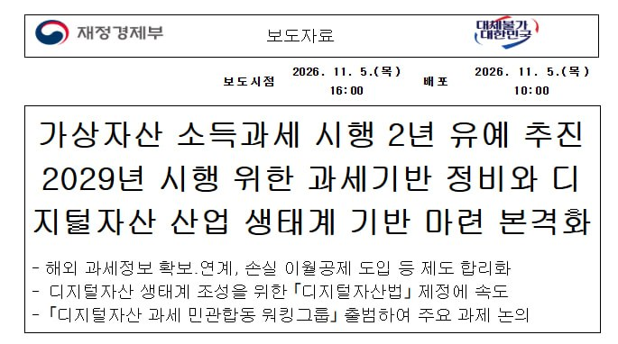
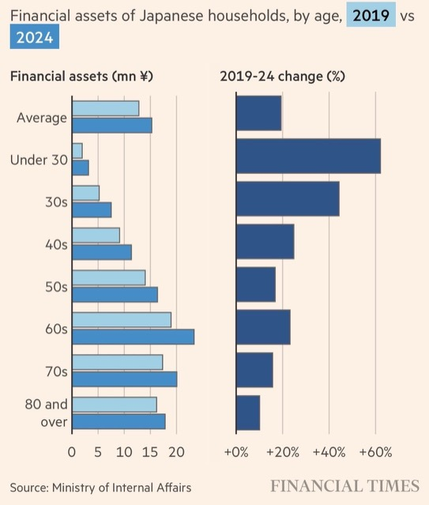
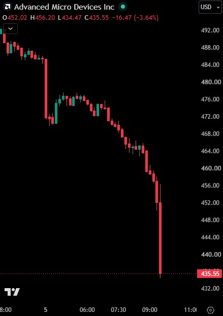
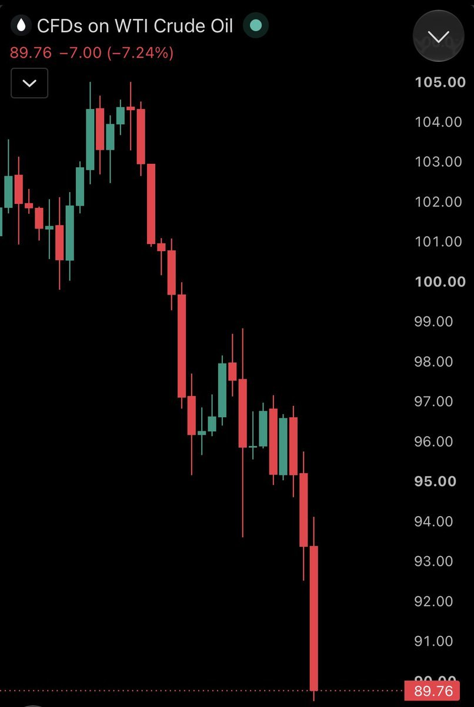
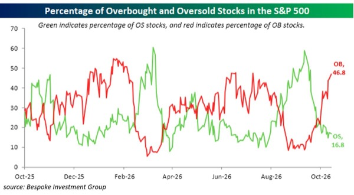
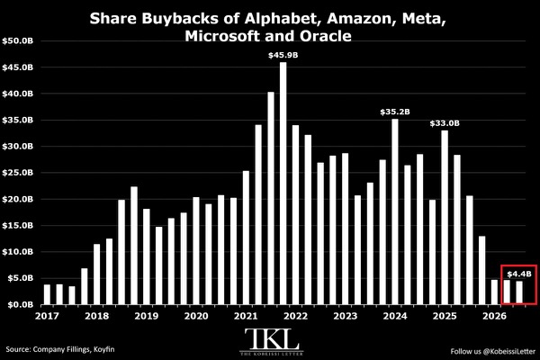
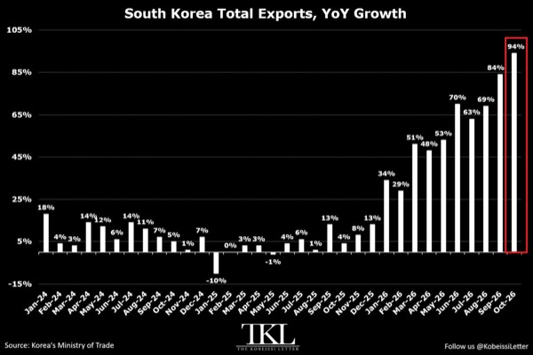
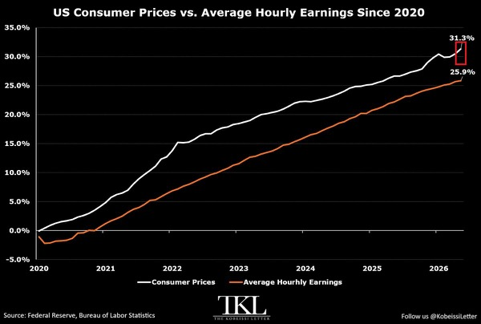

# Aurum

- AI 메모리 공급 부족이 소비자 전자제품 가격까지 밀어 올리는 칩플레이션으로 확산
  - 10월 컴퓨터 가격은 전년 대비 26.2%, 휴대전화는 10.8% 상승했고 외장 SSD는 최근 40%대 상승률 기록
  - HBM·서버 D램에 생산능력이 우선 배분되면서 일반 PC·스마트폰용 D램과 낸드 공급이 축소
- 경기 남부 반도체 벨트의 소형 아파트에 매수세 집중
  - 수원·용인·안성 등이 속한 경부2권의 전용 60㎡ 이하 아파트값은 3분기 5.30% 상승해 5년 만에 최대 상승률 기록
  - 대출 규제로 상대적으로 저렴한 소형 수요가 늘고 삼성전자의 전용 85㎡ 이하 주택 사내대출도 매수를 뒷받침
- 민주당의 미국 상·하원 장악과 트럼프의 결과 수용으로 정치 불확실성이 줄고 종전 기대가 확대
  - 다우 +3.03%, S&P500 +1.58%, 나스닥 +1.44%로 마감했으며 WTI는 8.3% 내린 88.12달러, 브렌트는 8.7% 내린 94.62달러 기록
  - 에너지 업종은 약 4.8% 하락했고 데이터센터 규제 우려로 반도체·관련 인프라주는 약세
  - 밴스가 선거 패배 원인으로 이란 전쟁을 지목하면서 종전 압박도 강화
- 데이터센터 규제는 단기 AI 공급망 수요와 투자심리를 압박하지만 장기 컴퓨트 수요의 훼손 여부는 별도 확인 필요
  - 계획 용량의 45%가 승인 중단 영향을 받을 수 있고 2028년 신규 용량의 90% 이상이 아직 착공 전
  - 텍사스 신규 승인 중단 가능성은 건설 지연·입지 변경 요인이며 모건스탠리는 AI 설비투자 성장과 글로벌 주식 비중확대 유지
  - 빌 애크먼은 컴퓨트 수요 확대에 긍정적이며 AWS의 2027·2028년 매출 각각 40% 이상 성장 전망과 14초당 AI 가속기 1대 설치를 근거로 제시
  - 공급 확대가 어려운 칩·메모리·전력·데이터센터 자원의 협상력에 주목
- 한국 반도체는 강한 수출·메모리 공급 부족과 미국 규제·외국인 매도가 충돌
  - 10월 한국 수출은 전년 대비 94%, 반도체는 259% 증가했고 신규 공급 여력 부족으로 2027년 메모리 부족 심화 가능성
  - 미국의 SK하이닉스 다롄 공장 장비 반입 승인 보류와 데이터센터 지연 우려가 부담
  - 10월 27일~11월 5일 외국인은 SK하이닉스 3.2조원, 삼성전자 1.8조원 순매도한 반면 기관은 삼성전자 1.2조원, SK하이닉스 4,879억원 순매수
  - 최근일 두 메모리 종목에서 외국인 2.7조원 순매도와 개인 2.1조원 순매수가 맞섰고 코스피 PBR은 1.34배, 두 회사 등을 제외하면 1.01배
- 분점정부는 미국 재정 확대와 국채 차입 증가 위험을 낮추지만 강한 성장·고용은 금리 하락을 제약
  - 과거 분점정부에서 10년물 금리는 이후 12개월 평균 50bp 하락했으나 12월 금리 인상 확률은 81%, 4분기 성장률 추정은 연율 3.4%
  - 모건스탠리는 복지 지출 삭감 완화가 소비를 지지하고 2~7년물 발행을 늘릴 수 있어도 공화당 예산조정법안에 따른 추가 차입 위험은 줄어든다고 평가
  - 국내에서는 은행채 공급 부담 완화와 외국인의 3년 국채선물 1.4조원 순매수가 우호적이나 추가 기준금리 인상 가능성은 단기물에 부담
- 금은 달러 약세와 중앙은행 매입이 지지하지만 ETF 자금 유출은 부담
  - 3분기 중앙은행 금 매입은 2024년 이후 가장 빠른 속도였고 10월 GLD에서는 20억 달러 유출
  - 달러지수는 5주 만에 최저로 내려 원화에 우호적이나 한·미 금리차 1%p의 추가 확대 가능성은 원화 강세를 제약
- 원유는 공급 회복·종전 기대가 하방 압력을 주지만 이란 재공습은 급등 위험
  - 10월 세계 원유 시장은 하루 140만 배럴 공급 과잉으로 전환했고 중동 수출은 하루 약 2,070만 배럴로 회복
  - 호르무즈 유조선 기뢰 피해와 2003년 이후 최저 미국 경유 재고는 공급 불안 요인
  - 로버트 페이프는 선거 후 새 의회 출범 전 이란 집중 공습과 러시아의 우크라이나 전력망 공격이 유가·물가·금리 부담을 함께 키울 위험을 경고
- 중국은 증시 공급 억제로 방어에 나섰지만 소비·부동산 부진이 지속
  - CSRC가 IPO와 대규모 지분 매각의 잠정 중단을 비공식 지시했다는 보도이며 CSI300은 10월 8.5%, 연초 이후 15% 하락
  - 자사주 매입용 재대출 금리 1% 인하와 홍콩 인터넷주 순환매는 우호적이나 10월 승용차 소매판매는 전년 대비 25% 감소
  - 구리는 중국 제련소 감산과 카모아-카쿨라의 2027년 생산 전망 하향이 지지하나 미국 추가 관세 가능성 약화로 재고가 해외에 풀릴 위험
- 국내 가상자산 과세는 2년 유예와 3년 손실 이월공제 추진으로 세부담 연기 기대 확대
  - 여야 대표와 정부의 동의가 제시됐지만 세법 개정은 연말 표결 절차가 남아 있음

- 비트코인의 지속 상승에는 8만 달러 회복과 현물 매수 유입이 필요
  - 선거 개표 중 7만6천 달러선까지 하락한 뒤 7만8천 달러대로 반등했으며 하단 확인 기준은 7만5천 달러
  - 상승 옵션 베팅 4.2억 달러에도 현물 자금은 유출 중이고 코인베이스 프리미엄도 음수라 ETF 순유입 전환을 함께 확인
- 민주당의 의회 장악은 미국 코인 입법 지연과 트럼프 관련 코인 조사 위험을 확대
  - 금융 관련 위원회 지도부 교체와 WLFI·자오창펑 사면 조사 가능성이 TRUMP·WLFI에 부담
  - CFTC의 개별 주식 무기한 선물 승인과 ICE 제휴는 하이퍼리퀴드의 시장 확대 요인
  - 바이낸스 해킹 사례는 내부 권한·환경 분리·다중서명 검증의 취약성을 드러내며 급락 시 레버리지 청산 손실도 확대
- 아서 헤이즈는 대형 AI 상장주의 유통물량 증가가 AI 신용과 달러 유동성을 압박할 위험을 경고
  - 2027년 6월까지 스페이스X 약 50% 추가 희석, 앤트로픽 공모 투자자 지분 83% 희석을 추정하며 물량 소화 전 매수에 부정적
  - 앤트로픽의 공모가 하회가 회사채 가산금리 확대와 AI 공급망 조달비용 상승으로 이어질 가능성
  - 미국 은행 자산 감소가 이어지면 크립토에도 부담이며 은행 자산 재확대나 중앙은행 유동성 공급을 비트코인 매수 전환 신호로 제시

# Harvey

- 일본 내수 회복의 핵심은 고령층의 자산 잔액보다 청년층의 추가 구매력이 어디서 늘어나는지에 있음
  - 고령층에 자산이 집중된 가운데 청년층 자산은 낮은 기저에서 높은 증가율을 보이므로 가계 자산 증가를 일괄적인 소비 호재로 해석하기 어려움

- 일본 소비 회복은 추가 가처분소득의 사용처와 세대·지역별 차이로 확인할 필요
  - BOJ 지역경제 보고서는 고용·소득 개선과 물가 부담이 함께 작용해 지역별 소비 회복 양상이 다르다고 평가
- 청년층의 미래 소득 확신이 소비·주거·가족 형성으로 이어질 때 내수의 지속적 전환 가능
  - 금융자산 증가는 소비 여력 확대일 수도 있지만 불안에 대비한 저축일 수도 있어 자산 축적과 소비 증가가 함께 나타나는지 확인

# KHwanK

### 미국 주식 고평가와 폭락에 대비하는 자산배분

- 미국 주식의 극단적 고평가는 향후 10년 실질수익률 부진과 대규모 하락 위험을 높이지만 폭락 시점까지 알려주지는 않음
  - CAPE는 장기 평균 17~18을 크게 웃도는 40 이상으로 닷컴버블 당시 다음으로 높은 수준
  - 미국 시가총액을 GDP로 나눈 버핏 지표도 역대 최고 수준이며 장기 추세선을 크게 상회
  - AI 기대와 빅테크 이익 전망이 높은 가격을 지탱하지만 미래 이익을 미리 반영할수록 추가 수익 여력은 줄어듦
- 과거 CAPE가 낮을수록 이후 10년 실질수익률이 높았고 35 이상에서는 연평균 실질수익률이 약 -2.6%였음
  - 이를 바탕으로 2026~2036년 미국 주식의 실질수익률이 매우 낮거나 마이너스에 머물 가능성에 무게
  - 장기 기대수익률 부진과 당장 발생할 하락은 별개의 문제
- 고평가 국면은 수년 이상 지속될 수 있으며 하락에는 금리 인상이나 경기 침체 같은 촉발 요인이 필요
  - 1925년부터 비싸진 시장은 4년 뒤인 1929년에 붕괴
  - 1988년부터 비싸진 시장은 CAPE가 1992년 20, 1995년 25, 1997년 30을 넘은 뒤 2000년에 붕괴
  - 2017년 CAPE가 30을 넘은 이후에도 9년간 미국 주식 상승세가 이어짐
- 고평가 상태에서 시작되는 약세장은 낙폭이 커질 위험이 높음
  - 1929년 대공황 국면의 미국 주식 낙폭은 약 86%, 2000년 닷컴버블 붕괴 당시 S&P 500은 약 49%, 나스닥은 약 80% 하락
  - 현재 밸류에이션은 1929년보다 높고 2000년보다 조금 낮아 향후 10년 내 큰 폭의 조정 위험을 경계
- 비싸다는 이유만으로 전량 매도하면 장기간 추가 상승을 놓칠 수 있음
  - 1995년에 매도했다면 2000년 붕괴까지 약 5년을 기다려야 했음
  - 1988년부터 2002년 저점까지는 닷컴버블 붕괴를 거치고도 주가가 약 3배 상승
  - 현재 가격에서 추가로 크게 오를 가능성도 있어 고평가만으로 매도 시점을 정하기 어려움
- 중간선거 전 10월부터 이듬해 7월까지의 강세 계절성을 근거로 2027년 상반기까지 상승 지속에 무게
  - 영상에서 제시한 1950년 이후 해당 구간은 매번 상승했으며 수익률도 통상적인 연간 평균보다 높았음
  - 중간선거 이후 트럼프의 정책 추진력 약화와 정치적 교착이 정책 불확실성을 줄이는 상승 요인
  - 과거의 전승 기록이 이번 상승까지 보장하는 것은 아님
- 현재를 1998년과 유사한 국면으로 보고 약 1년 반의 추가 상승과 2028년 조정 가능성을 염두
  - 2028년 폭락에 확신은 없으며 2029년·2030년·2032년 등으로 늦어질 가능성도 열어둠
  - 구체적인 폭락 연도보다 고평가에 따른 장기 위험 관리가 핵심
- 주식 투자를 유지하면서 국채·금·실물자산·외화로 충격을 분산
  - 예시 비중은 주식 약 50%, 나머지는 채권·실물자산·외화로 구성
  - 미국 국채는 주식 하락 국면 10번 중 약 7~8번, 금은 약 8번 방어 역할을 했다는 경험칙을 제시
  - 한국 투자자는 위기 때 미국 국채 가격 상승과 달러 강세가 함께 나타나면 원화 기준 손실 완충 효과가 커짐
- 하락 원인에 따라 방어 자산의 효과가 달라짐
  - 경기 침체형 폭락에는 장기 국채, 인플레이션형 폭락에는 금·원자재가 유리
  - 2022년처럼 주식과 국채가 동반 하락할 수 있어 국채만으로 방어를 끝내기 어려움
- 저평가된 한국·신흥국 주식은 미국 중심 포트폴리오를 보완할 선택지
  - 미국 주식 급락 시 함께 하락할 수 있지만 출발 밸류에이션이 낮아 이후 회복 수익률이 더 높을 가능성
  - 국가 분산은 초기 동반 하락을 막기보다 장기 회복 경로와 기대수익률을 분산하는 역할
- 2027년 하반기부터 S&P 500의 200일 이동평균선 이탈 시 주식 비중을 축소하거나 청산하는 전략 적용을 검토
  - 대폭락이 진행되는 중간에 위험 노출을 줄여 손실을 제한하는 추세 필터
  - 미국 주식에는 200일선, 비트코인에는 120일선을 선호
- 밸류에이션은 장기 기대수익률과 위험 수준을 판단하는 데 쓰고 실제 비중 조절은 추세와 자산배분 규칙으로 연결할 필요
  - 장기 저수익 전망만으로 조기 전량 매도하거나 단기 상승 기대만으로 고평가 위험을 무시하는 선택을 피할 수 있음
- 방어 전략은 폭락 연도를 맞히기보다 하락 원인별 분산과 실행 가능한 매매 규칙을 미리 정하는 데 초점
  - 200일선 전략도 횡보장에서 잦은 매매와 재진입 부담이 생길 수 있으므로 이탈·재진입 기준을 함께 정해야 함

# Kobeissi

- 미국 중간선거 직후 첫 거래일에는 시가총액이 1.2조 달러 증가했지만 이후 기술주 개장 급락으로 변동성이 재확대
  - 앞선 상승 국면에서 MSFT는 7% 올라 시총 4.1조 달러, AAPL은 7% 상승해 시총 5.1조 달러로 사상 최고 기록
  - 이후 개장 30분 만에 기술주 시총 1.3조 달러가 사라지고 나스닥100은 장중 4% 하락
  - SNDK -15%, WDC·NBIS -13%, AMD·STX -12%, MU·QCOM 등 -10%로 반도체·AI 공급망에 매도 집중
  - AMD는 10월 6일 고점 대비 약 35% 하락하며 한 달간 시총 3,800억 달러 감소

- 밴스의 이란 전쟁 책임론에 미국 유가가 배럴당 90달러 아래로 급락했지만 재확전 위험은 지속
  - 공화당 패배 요인으로 전쟁·생활비·인플레이션·이스라엘 관계를 지목해 종전 압박 확대
  - 악시오스는 미국이 중동 자산 추가 배치 등 대규모 전투 재개 준비를 마무리 중이라고 보도
  - 트럼프의 국방장관 경질 검토 보도도 나와 선거 후 군사정책 변화에 주목

- 민주당 의회의 조사·규제 강화가 트럼프 관련 크립토와 에너지·AI 기업에 새 부담
  - FT 보도상 트럼프의 코인 사업·기부자 사면 등에 대한 적극적 조사 준비
  - 러시아 경유 비축분 방출 합의와 관련한 미국 석유기업 조사 가능성, AI 안전사고 발견 후 48시간 내 보고 요구가 제시됨
- S&P500 지수의 약세보다 내부 종목 흐름은 견조해 업종·종목 간 괴리 확대
  - 지수는 50일 이동평균보다 2표준편차 이상 낮아 4월 이후 처음으로 극단적 과매도 영역 진입
  - 구성 종목 중 과매도 비중은 약 17%에 그친 반면 과매수 비중은 약 47%로 2월 초 이후 최고

- AI 설비투자가 빅테크의 자사주 매입 여력을 잠식
  - Alphabet·Amazon·Microsoft·Meta·Oracle의 2026년 3분기 합산 매입은 44억 달러로 2017년 3분기 이후 최저
  - 2021년 4분기 약 459억 달러 정점 대비 90% 감소했고 3개 분기 연속 50억 달러 미만
  - 자료 내 2026년 1분기 합계 330억 달러 표기는 3개 분기 연속 50억 달러 미만 및 일부 기업의 연중 미매입 설명과 상충해 기간 수치 해석에 주의

- 한국 수출은 AI 서버·반도체 수요에 힘입어 기록적 성장 지속
  - 10월 수출은 전년 대비 94% 증가한 1,150억 달러로 역대 두 번째 규모이자 1974년 1월 이후 최고 증가율
  - 5개월 연속 전년 대비 60% 이상 늘었고 1~10월 누적 수출은 사상 최대 9,300억 달러
  - 반도체 수출은 259% 증가한 사상 최대 560억 달러, 컴퓨터 수출은 497% 증가

- 미국 물가 상승이 팬데믹 이후 임금 증가를 웃돌며 소비 구매력을 잠식
  - 2020년 4월 이후 소비자물가는 31.3%, 평균 시간당 임금은 25.9% 상승
  - CPI 상승률이 연준 목표 2%를 67개월 연속 웃돌아 최근 100년 중 세 번째로 긴 초과 기간 기록

# MKevin

### 민주당 압승과 데이터센터 저가 매수론

- 민주당의 상·하원 동시 장악을 전제로, 선거 직후 기술주 급락을 장기 매수 기회로 해석
  - 영상에 제시된 개표 상황은 민주당의 조지아·뉴햄프셔·노스캐롤라이나·오하이오 승리와 텍사스·캔자스의 이례적 약진
  - 메인·미시간과 일부 하원 선거구는 개표가 끝나지 않은 상태이며, 인명·지역·날짜가 혼재된 전사 내용은 별도 확인 필요
  - 뉴욕타임스 집계로 소개된 전국 하원 득표 격차는 민주당 우위 12%포인트로, 1982년 이후 최대
- 공화당 패배의 핵심 배경은 관세·이민 단속·이란 갈등 등 트럼프 정책에 대한 반발
  - 선거 전 이란 합의가 성사되지 않아 외교적 성과를 확보하지 못한 점도 부담
  - 텍사스에서는 Talarico의 상원 승리와 Gina Hinojosa의 주지사 승리가 부각되며, 공화당의 대규모 선거자금 우위도 결과를 바꾸지 못함
- 선거 직후 나스닥100은 야간 거래에서 2.3% 이상 하락하고 Enphase는 약 4% 상승
  - 민주당 우세에 따른 데이터센터 규제 우려와 친환경 에너지 정책 회복 기대가 업종별 주가를 갈라놓음
- 민주당 승리 자체는 선거 전부터 상당 부분 가격에 반영된 변수
  - Kalshi의 선거 전 민주당 상원 장악 확률은 약 60~73%, 공화당은 약 26%로 소개됨
  - Rabobank도 민주당 승리를 이미 반영된 재료로 평가
  - Hartnett의 민주당 양원 장악 시 증시 10% 하락 시나리오와 달리, 추가 충격의 상당 부분이 이미 반영됐다는 낙관론에 무게
- 중간선거 이후의 역사적 상승 패턴을 저가 매수 근거로 제시
  - JP모건 자료로 소개된 1990년대 이후 선거 후 12개월 평균 수익률은 나스닥100 37.6%, S&P500 14.7%
  - 1950년대 이후 자료에서는 6개월 평균 상승률 13.8%, 선거 후 6~12개월 구간 S&P500 상승 기록 19회 중 19회
  - 과거 통계와 이번 선거 이후의 실제 수익률은 구분할 필요
- 민주당의 양원 장악은 트럼프와 의회의 협상 구조를 단순화할 가능성
  - 상·하원을 양당이 나눠 갖는 경우보다 협상 상대가 하나로 줄어 예산 합의와 입법이 쉬워질 수 있음
  - 트럼프가 일부 성과를 얻는 대가로 민주당 정책을 수용하면 입법 진전과 정부 셧다운 위험 완화로 연결될 여지
  - 트럼프의 민주당 협력 발언과 거부권 행사 발언이 엇갈려 실제 정책 방향은 불확실
- 텍사스에서 잠재적 데이터센터 용량 13.2GW가 위험에 노출됐다는 우려가 부각
  - Talarico는 데이터센터 판단을 지방정부에 맡기는 입장으로 소개됨
  - 주지사·상원의원 교체만으로 산업 전체가 중단되지는 않으며, 기존에도 사업성이 낮거나 인허가가 어려웠던 프로젝트가 걸러질 가능성
- AI·데이터센터·관련 장비의 장기 성장 논리는 중간선거 결과로 바뀌지 않음
  - Kevin은 9월 11일부터 관련 노출을 확대했으며, 이번 하락에서도 매수할 계획
  - 신용거래 없이 충분한 시간을 확보하는 전략을 전제로 단기 변동성을 감수
- 단기 변동성의 다음 촉매는 ADP 고용보고서와 금요일 고용보고서
  - 고용지표 발표 전까지 추가 매도와 변동성 확대 가능성
  - Kevin의 목표는 블랙프라이데이까지 사상 최고치 회복, 연말까지 QQQ 800 돌파이며 실현이 확인된 결과는 아님
- 관세 완화의 본격적 시점은 다음 대선 이후인 2029년으로 예상
  - 2028년 Gavin Newsom 대 JD Vance 또는 Marco Rubio 구도를 상정
  - 차기 행정부의 관세 완화가 성장과 기업 실적에 추가 자극을 줄 수 있으나, 그전까지 관세 부담이 이어지는 시나리오
- 이란 갈등은 즉각적인 전면전보다 협상 지속에 무게
  - 영상이 인용한 파이낸셜타임스 인터뷰에서 트럼프는 당장 이란을 공격할 계획이 없으며 필요시 군사행동에 나설 준비는 유지
  - 고농축 우라늄 협상과 제한적 군사 충돌이 병행돼 합의 지연과 재확전 위험이 공존
- 데이터센터 투자에서는 전국 정치 구도보다 지역별 인허가·전력 확보·주민 반대가 실제 사업 진행을 좌우
  - 선거 충격으로 함께 하락한 종목도 프로젝트별 실행 가능성과 자금조달 여건에 따라 구분할 필요
- 저가 매수 논리의 핵심은 정치 충격이 AI 수요와 기업 이익 전망을 얼마나 바꾸는지에 달림
  - 선거 후 평균 수익률이나 낙관적 지수 목표만으로 매수하기보다 실적·고용·정책 변화가 장기 성장 가정을 훼손하는지 확인할 필요

### 소액 벤처투자의 기회와 유동성 제약

- USVC는 비적격 일반 투자자도 최소 500달러로 비상장 벤처기업에 간접 투자할 수 있는 1940년 투자회사법 적용 펀드
  - Mercury, Ramp, SpaceX 등에 대한 투자 노출을 제공하며 일부 투자처는 비공개
  - 직접 지분 확보가 어려운 비상장기업에 접근할 수 있지만 개별 기업 선택과 투자 구조는 운용사에 맡겨야 함
- Kevin은 경기 낙관도를 10점 중 9점으로 평가하며 성장 기술기업에 대한 투자 확대에 관심
  - 본인 스타트업 Reinvest가 사용하는 Mercury와 기업 재무 플랫폼 Ramp를 선호하지만 Mercury 지분을 직접 확보하기는 어려웠음
  - 영상 시점에는 USVC에 투자하지 않았으며 개인 투자를 검토 중
- USVC는 순자산가치인 NAV를 기준으로 가입·환매 가격을 산정
  - 거래소 상장 펀드처럼 시장에서 형성된 프리미엄을 지불하는 구조와 차이가 있음
  - 비상장기업 가치는 기업공개나 매각 전까지 추정치인 경우가 많아 NAV가 실제 회수 가능한 가격을 보장하지는 않음
- 분기별 환매는 펀드 지분의 최대 5%까지 선택적으로 제공될 수 있으며 보장되지 않음
  - 최초 두 차례 환매 신청은 각각 펀드의 1% 미만이었고 모두 처리됐지만 5% 한도에 몰리는 상황은 검증되지 않음
  - 시장 급락으로 환매 수요가 집중되면 원하는 시점에 현금화하기 어려울 수 있음
- 직접 가입 시 판매수수료는 없지만 다른 경로로 가입하면 최대 3%가 붙을 수 있음
  - 1년 미만 보유 후 환매하면 2% 조기 환매수수료가 적용될 수 있음
  - 이사회가 조기 환매수수료를 면제할 재량은 있지만 면제 지속은 보장되지 않음
- 연 운용보수는 1%이며 비용 감면 계약에 따라 2027년 11월까지 총비용을 연 2.5%로 제한
  - 2.5%에는 운용보수와 기타 펀드 비용이 포함되며 감면 전 총비용률은 약 4.55%
  - 주주 서비스 비용 0.25%, 감사·관리·법률·수탁 등 기타 비용 2.35% 외에 피투자 펀드 비용도 존재
  - 규모 확대에 따른 비용률 하락은 기대일 뿐 확정된 조건이 아님
- USVC 자체에는 성과보수가 없지만 피투자 펀드나 특수목적기구에는 별도 성과보수가 붙을 수 있음
  - 다른 펀드나 특수목적기구를 거쳐 기업 지분을 확보하면 해당 구조의 비용이 최종 수익률에 영향을 줌
  - 영상에 나온 10%·20%·30% 성과보수는 가능한 구조의 예시이며 실제 개별 투자 조건으로 확인된 수치는 아님
- 주요 보유자산 중 하나는 비중 약 19.2%의 다른 펀드로, 일부 초기 Mercury 투자 노출이 이 경로에 포함
  - 직접 기업 지분 투자와 재간접 투자를 구분하고 기초 투자기구의 추가 비용까지 확인할 필요
- 비상장 벤처투자는 장기 자금 묶임과 원금 손실을 감수할 수 있는 자금으로 접근
  - 기업공개·매각 시점과 회수 수익은 불확실하며 과거 성과가 미래 수익을 보장하지 않음
  - 가입 전 투자설명서에서 환매 재량, 비용 감면 만료, 기초 투자기구 조건을 확인해야 함
- 이 영상은 USVC가 Reinvest에 1만 달러를 지급한 유료 홍보이며 향후 추가 후원 가능성도 공개
  - Kevin의 상품 선호와 투자 검토에는 후원 관계가 존재하므로 상품 조건과 별도로 평가할 필요
- 최소 투자금 500달러는 접근 문턱을 낮추지만 자산의 위험과 현금화 제약까지 낮추지는 않음
  - 생활비나 가까운 시일 내 사용할 자금과 분리하고 장기 보유 가능한 범위에서 투자 규모를 정해야 함
- 실질 투자 매력은 유명 비상장기업 보유 여부보다 비용 차감 후 회수 수익에 달려 있음
  - 2027년 11월 이후 비용 부담과 재간접 구조의 추가 보수까지 반영해야 장기 기대수익을 비교할 수 있음

### 중간선거 이후 주택시장과 투자 낙관론

- 중간선거 이후 주식과 부동산의 조정 매수 기회가 확대됐다는 낙관론
  - 영상에서 제시한 1950년 이후 통계상 중간선거 6개월·12개월 뒤 주가는 모두 상승했고, S&P 500의 6개월 평균 수익률은 13.9%, 나스닥 100의 1년 평균 수익률은 30% 이상
  - 선거 직후 3개월은 변동성이 남을 수 있으며, 선거 전 불확실성에 따른 매도가 이후 반등의 배경
- 민주당의 의회 장악은 주택 지원과 소비 지출 확대 기대를 자극
  - 영상 시점 홈디포 약 3%, 레나 약 6.4%, 엔페이즈 약 9%, 로켓 모기지 약 6%, 론디포 약 11% 상승
  - 트럼프와 민주당 모두 재정 지출에 우호적이어서, 재정 보수파 공화당과의 협상보다 합의가 쉬워질 가능성
- 주택 구매 지원이 수요를 늘리고 건설·임대 규제가 일반 주택 공급을 제약하면 기존 주택 가격과 임대료에 상승 압력
  - 저렴한 주택 공급 정책이 오히려 일반 주택의 희소성을 높인다는 투자 논리이며, 공급 규제가 강한 캘리포니아 해안 지역을 선호
  - 지원 주택은 재판매·임대 제한을 확인해야 하며, 같은 조건의 일반 주택보다 20~30% 낮게 거래되는 사례도 존재
- 영상에서 소개한 주별 부동산 정책은 세금 부담 완화와 구매력 확대에 초점
  - 플로리다 발의안 3은 실거주 주택 과세가액 공제를 5만 달러에서 2027년 15만 달러, 2028년 25만 달러로 확대하는 내용이며 투자용 주택에는 미적용
  - 캘리포니아 발의안 1은 보훈·저렴한 주택 건설에 250억 달러 지원, 발의안 37은 구매자 자기자금 3%에 최대 17%를 보태는 계약금 지원으로 소개
  - 계약금 지원 대상 주택은 최대 150만 달러, 가구소득은 중위소득의 최대 2배이며 가구원 수에 따라 조정되고 생애 최초 구매자로 한정되지 않음
  - 노스캐롤라이나는 재산세 제한의 세부 설계를 입법부에 넘기고, 테네시는 주정부 차원의 부동산 재산세 부과를 금지하는 개헌안을 통과시킨 것으로 소개
- 서비스업과 고용 지표는 경기침체보다 확장 지속을 뒷받침
  - 서비스업 PMI는 전월보다 낮아졌지만 확장 국면을 유지했고 고용지수는 2개월 연속 확장
  - 신규 주문과 일감이 늘어 일부 기업은 처리 능력이 부족하며, 가격은 계속 상승하되 상승 속도는 둔화
  - 애틀랜타 연은 GDPNow 성장률 추정치는 3.7%로 상승
- ADP 민간고용은 8만 6,000명 증가해 예상치 6만 7,000명을 1만 9,000명 상회
  - 전월 수치는 4,000명 하향됐지만 수정 후에도 8만 6,000명으로, 월간 고용 증가세가 유지
  - 정보서비스와 전문·사업서비스는 약세이며, 디즈니 감원과 마이크로소프트 희망퇴직 등은 업종별 고용 부담을 시사
  - ADP는 이직에 따른 임금·보너스·근로시간 증가를 포착했지만, 다른 조사에서는 이직자의 절반 미만만 임금이 올라 자료 간 차이가 존재
  - JOLTS 자발적 퇴사율 상승은 노동시장 회복력을 뒷받침
- 경기 확장의 혜택은 저소득 임차인에게 고르게 전달되지 않음
  - 영상이 인용한 이코노미스트 자료에서는 저소득 임차인의 미납과 단기차입 의존이 증가
  - 2025년 가구 중위소득은 임차인 5만 7,000달러, 자가 소유자 10만 3,000달러로 큰 격차
  - 주택 보유와 자산 축적의 상관관계는 크지만 소득·연령 등 집단 차이도 함께 고려할 필요
- 데이터센터 규제 우려는 투자 취소보다 지역 이동으로 이어질 가능성에 무게
  - 텍사스의 규제가 강화되더라도 루이지애나 등 다른 지역으로 건설이 옮겨갈 수 있어 AI 설비투자 둔화를 단정하기 어려움
  - 슈퍼마이크로는 유럽·아시아·중동의 정부와 기업이 AI 데이터센터 투자를 확대하고 있다고 언급
  - 한 대형 고객이 분기 매출의 44%를 차지해 글로벌 성장 기대와 별개로 고객 집중 위험이 큼
- 테슬라와 스페이스엑스의 결합 가능성은 확정되지 않은 투자 변수
  - 테슬라 단독 가치는 비싸지만 두 기업의 결합 가치는 매력적이라는 평가이며, 스페이스엑스가 인수 프리미엄을 지급하면 테슬라가 상대적으로 유리할 수 있음
  - 거래 성사 여부와 데이터센터 건설에 필요한 대규모 차입이 핵심 불확실성
- 메디케이드·SNAP 등 복지 예산 삭감 가능성이 낮아지면 소비와 GDP에 우호적
  - 영상 시점 펠로톤 약 5%, 엣시 약 8%, 데이브 앤드 버스터스 약 9%, 치즈케이크 팩토리 약 4% 상승
  - 소비주 반등에는 가계 구매력 유지와 재정 지출 확대 기대가 반영
- 이란 합의 기대는 장기적으로 강화됐지만 단기 타결 동력은 약화
  - 민주당이 차기 의회에서 합의를 압박할 수 있지만 선거 종료로 트럼프의 즉각적인 타결 유인은 감소
  - 예측시장에서는 2028~2029년 이전 합의 가능성이 상승한 반면 2027년 3월 1일 이전 확률은 정체 또는 하락
  - 브렌트유는 약 열흘 전 고점보다 16달러가량 내려 배럴당 100달러에 접근했으며, 추가 하락은 물가와 주택시장에 우호적
- 리인베스트는 주택담보대출 취급 자격을 확보해 향후 대출 중개 사업의 선택지를 확대
  - 장기 금리 하락기에 자기자본 대출보다 중개 수수료 사업의 기회를 기대
  - 당장 활용 계획이 없어도 자격과 면허를 미리 확보하면 사업 기회에 대응할 여지가 커짐
- 주택 지원책의 수혜는 실거주자·일반 주택 소유자·제한부 주택 구매자 사이에서 다르게 나타날 수 있음
  - 공제 적용 대상과 재판매·임대 제한을 확인해야 지원 규모를 실제 투자 수익으로 연결할 수 있음
- AI 설비투자 총량이 유지돼도 개별 하드웨어 기업의 수익과 주가 상승이 보장되지는 않음
  - 고객 집중도, 자금 조달 부담, 지역별 프로젝트 진행 속도를 함께 점검할 필요
- 선거 이후 강세 통계는 매수 시점을 판단하는 참고 자료이며, 실제 상승 지속 여부는 고용·소비·유가와 기업 실적이 좌우

### 실행과 고객 가치로 키우는 시대 사업 경쟁력

- 완벽한 준비를 기다리기보다 고객에게 가치를 제공하고 실패에서 배워야 사업이 성장함
  - 알렉스 호르모지는 성장 한계에 부딪히면 기초부터 다시 쌓는 접근을 제시하지만, 케빈은 실패 경험 자체가 다음 사업의 기초가 된다는 입장
  - AI로 고용계약·공급계약·보험 관련 기초 준비를 보완하되, 준비만 하느라 실행을 미루지 않는 것이 핵심
  - 법인 설립 자체는 사업 성과가 아니며, 실제 고객에게 유료 서비스를 제공하는 단계까지 나아가야 함
- 매출 확장보다 마진과 고정비 구조를 먼저 점검해야 함
  - 케빈은 2017년 부동산 중개에 건설 서비스를 결합했지만, 낮은 시공 마진과 상시 인력 부담을 경험한 뒤 철수
  - 필요한 시점에 외부 전문업체를 활용하는 방식으로 전환해 유휴 인건비와 직접 관리 부담을 줄임
  - 연매출 500만 달러 자동차 튜닝업도 마진 20~30%라면 수익 규모가 크게 달라지므로 매출 숫자만으로 사업을 평가할 수 없음
- 주문 순서와 제시 방식이 같은 지출로 얻는 가치를 바꿀 수 있음
  - 치폴레에서 처음부터 고기 두 배를 주문하기보다 기본량을 담은 뒤 추가 주문하면 더 넉넉한 양을 받을 여지가 있음
  - 케빈이 정정한 닭고기 추가 1회분 수치는 단백질 32g·180칼로리
- 고객이 구매를 결정하면 설득을 멈추고 즉시 계약과 결제를 마무리해야 함
  - 계약서와 결제 수단을 미리 준비하고, 합의 뒤 새로운 조건이나 불필요한 설명을 꺼내 재고할 이유를 만들지 말 것
  - 새 잠재고객이 나타나도 진행 중인 거래를 먼저 완료해야 양쪽 고객의 신뢰를 지킬 수 있음
- 여행과 휴식이 목적이라면 사업 매각 전에 부재 중에도 수익이 나는 운영 구조를 먼저 검토할 것
  - 매각하면 업무 부담과 함께 팀·성취감·소득원도 사라지고, 경업금지 약정으로 기존 사업이나 인력을 되찾기 어려울 수 있음
  - 대체 담당자·원격 업무·분기별 휴가를 설계하면 사업을 유지하면서도 이동의 자유를 확보할 수 있음
  - 휴가와 개인 일정을 먼저 확보하면 남은 시간에 업무를 압축하도록 운영 방식을 바꾸게 됨
- 거절형 질문으로 동의를 유도하는 영업은 상대에 따라 역효과가 날 수 있음
  - 호르모지는 “진행하는 데 반대하시나요”처럼 부정 답변이 동의가 되는 질문을 활용
  - 영업 기법에 익숙한 고객은 말로 몰아붙인다고 느낄 수 있어, 실제 가치와 자율적인 결정이 더 중요함
  - 신분증을 먼저 받아 결제 카드 제시를 유도하는 방식도 고객을 붙잡는 압박으로 받아들여질 수 있음
- 상품권은 사업자에게 선결제와 미사용 잔액의 이점이 있지만 소비자에게는 잔액 소진과 추가 지출 부담이 생김
  - 영상에서는 판매된 상품권의 10~20%가 사용되지 않는 수치를 제시
  - 소액 잔액을 쓰려고 더 큰 금액을 결제하면 소비자의 실제 지출이 늘어남
- 온라인 서비스의 낮은 진입비용은 전 세계 경쟁자를 상대해야 한다는 뜻이기도 함
  - 케빈은 자격·면허와 지역 고객 관계를 갖춘 대면 서비스에 AI를 결합하는 경로를 선호
  - 회계사·변호사·중개인 등이 반복 업무를 AI로 처리하면 고객 관계를 유지하면서 처리 효율을 높일 수 있음
  - 고객이 원하는 것은 신뢰할 수 있는 전문가가 AI를 활용해 더 나은 서비스를 제공하는 것
- 직원 피드백은 성격 평가 대신 바꿔야 할 행동과 대체 행동을 구체적으로 제시해야 함
  - “태도를 고쳐라”보다 회의 중 말 끊기, 다른 부서의 전문성 무시하기처럼 문제 행동을 명시하고 다음 상황에서 할 행동을 정할 것
  - 외부 피드백은 스스로 인식하지 못한 습관을 드러내므로, 불편하더라도 유효한 지적을 골라 반영해야 함
- 개인화된 예상 밖의 작은 혜택은 호혜성을 높여 구매와 추천으로 이어질 수 있음
  - 영상에 소개된 식당 실험에서는 사탕 1개 제공 시 팁 3%, 2개 제공 시 14%, 1개를 준 뒤 돌아와 하나 더 제공했을 때 23% 증가
  - 부동산 잠재고객에게 최근 인근 거래와 권리관계 자료를 꾸준히 제공하면 계약 요구 전에 신뢰를 쌓을 수 있음
  - 고객에게 더 적합한 경쟁사 상품을 추천하더라도 장기적으로 재방문과 소개 가능성을 높일 수 있음
- 서비스업 인력 유지에는 승진 단계와 보상뿐 아니라 지속적인 신규 고객 유입이 중요함
  - 호르모지는 승진·급여·근무시간 혜택을 6~12단계로 세분화하고 시장보다 20~25% 높은 보상으로 우수 인력을 확보하는 방식을 제시
  - 케빈은 작은 임금 인상을 여러 단계로 나누는 방식에 회의적이며, 입지·시설·평판·검색 및 AI 검색 최적화로 고객을 공급하는 가치를 강조
  - 독립하면 잃게 되는 신규 고객 흐름이 클수록 직원과 계약자가 남을 유인이 강해짐
- 문의에 대한 즉각적인 응답은 서비스업의 핵심 경쟁력임
  - 영상 속 복구업체는 하루 2~3건의 문의에 즉시 전화하는 전담자에게 연 6만 달러를 지급하며 문의 대비 55% 전환율을 달성
  - AI 메시지로 접수 확인과 방문 일정 조율을 즉시 시작하고, 가능한 경우 사람이 바로 전화하는 구조를 활용할 수 있음
  - 케빈은 AI 음성 통화의 전면 도입에는 신중하지만 즉각적인 문자 응대에는 긍정적
- 이미 수요가 검증된 서비스를 더 빠르고 편리하게 제공하고 고객 위험을 줄이면 높은 가격을 받을 여지가 생김
  - 업계 고수익 사업자의 방식을 학습하고, 신규 사업자의 여유 시간을 빠른 회신과 실행에 투입할 것
  - 소개 요청은 “필요한 사람을 아시나요”보다 “이 서비스가 필요한 분이 누구인가요”처럼 구체적인 사람을 떠올리게 할 것
  - 수익이 나는 일이 지루해졌다는 이유만으로 덜 검증된 사업에 분산하지 말 것
- 유료 광고 중심의 성장에는 한계가 있으며 브랜드와 콘텐츠가 고객 유입 자산이 될 수 있음
  - 호르모지는 카일리 제너·코너 맥그리거·더 록의 사업에서 브랜드의 힘을 확인한 뒤 영상 제작에 투자
  - 매출과 광고비 차감 후 순이익을 구분해야 실제 사업 성과를 판단할 수 있음
  - 주변 사람과의 끊임없는 비교보다 훨씬 앞선 사례에서 배울 요소를 찾는 편이 동기 유지에 유리함
- 집중력은 의지뿐 아니라 작업 환경으로 관리해야 함
  - 소음 차단과 방해 요소 축소가 중요하며, 흑백 화면은 불필요한 휴대전화 사용을 줄이는 데 도움이 될 수 있음
  - 호르모지의 흑백 화면 사용 후 휴대전화 이용 30% 감소는 개인 경험이며, 케빈은 AI 에이전트 상태를 색상으로 구분해야 해 흑백 설정을 중단
  - 자극을 줄이는 설정도 실제 업무에 필요한 정보와 균형을 맞춰야 함
- 상품을 여러 개 무료로 얹는 표현과 하나의 통합 상품으로 묶는 방식은 고객에게 서로 다른 가치를 전달함
  - 호르모지는 무료 증정 표현의 구매 유도 효과를 강조하고, 케빈은 여러 서비스를 한 요금제로 통합하는 구독 방식을 선호
  - 핵심은 무료 수량 자체보다 고객이 이해하기 쉬운 구성과 총가치를 설계하는 것
- AI 도입의 우선순위는 고객 응답 지연과 반복 업무처럼 매출·처리량에 직접 연결되는 병목부터 정할 수 있음
  - 전문성·지역 평판·고객 관계에 AI 효율을 더하면 낮은 진입장벽의 온라인 서비스와 다른 경쟁 기반을 만들 수 있음
- 고객과 인력이 계속 남을 이유는 제공하는 가치에서 만들어야 함
  - 고객에게는 빠른 해결과 유용한 정보, 인력에게는 경쟁력 있는 보상과 신규 고객 흐름을 제공하는 구조가 반복 거래를 강화함
- 사업 확장과 매각은 매출뿐 아니라 순이익·고정비·대표 부재 시 운영 가능성을 함께 기준으로 삼아야 함
  - 검증된 수익원을 유지하면서 위임과 자동화로 자유 시간을 확보하면 성급한 확장이나 매각의 필요성을 줄일 수 있음

# Slav

- 호남 반도체 지원금 6조원 심의의 전문성과 의사결정 구조에 의문 제기
  - 카페 대표·의사 등이 심의에 참여한다는 보도를 통해 대규모 산업 지원금 배분의 판단 체계를 점검할 필요 제시
- 사적연금·ISA·배당 소득자 등에 건강보험료를 부과하는 체계 개편 추진 보도
  - 해당 투자소득의 건보료 부과 여부와 적용 범위는 추진 단계로 확인 필요

# Stockbot

- 미국 중간선거 이후 AAPL은 7% 상승해 사상 최고가와 시총 5.1조 달러를 기록한 반면 DJT는 하락
  - AAPL은 세계 시가총액 1위로 올라섰고 트럼프 관련주는 선거 결과 이후 약세
- 민주당의 조사 강화가 트럼프 관련 크립토와 미국 석유·AI 기업의 정책 부담을 확대
  - FT 보도상 트럼프 코인 사업·로펌 거래·기부자 사면 조사 준비
  - 러시아 경유 비축분 방출 합의와 관련해 석유기업에 경고하고 AI 기업에는 안전사고 48시간 내 보고 요구
- 이란 전쟁에 대한 미국 지도부의 시각 차이가 종전 경로의 불확실성을 드러냄
  - 밴스는 공화당 중간선거 패배를 이란 전쟁 탓으로 돌렸고 트럼프는 전쟁으로 휘발유 가격이 올랐지만 후회하지 않는다고 언급
  - 트럼프는 선거 패배 이후 피트 헤그세스 국방장관 교체도 검토
- ORCL은 Tencent와의 70억 달러 AI 칩 임대 계약을 취소해 장전 2.3% 하락
  - FT 보도상 미국 당국은 Oracle에 우려를 전달했고 광둥성 당국은 Tencent에 중국산 칩 지원을 촉구
- 데이터센터 규제 우려에 한국 반도체주가 하락하며 코스닥 급락과 거래 중단 소식 발생
  - 원문은 5% 넘는 하락과 서킷브레이커 발동을 함께 전했으나 정확한 발동 시점·낙폭은 제시하지 않음
- Anthropic은 RIOT와 280억 달러 데이터센터 임대 계약 체결
  - Riot Platforms는 AI 데이터센터 전환 자금 조달을 위해 1~9월 BTC 20,264개를 약 15억 달러에 매각
- 영란은행은 기준금리를 25bp 올려 4%로 인상
  - 동결 찬성 위원은 예상 2명과 달리 0명으로 긴축에 대한 위원회 지지가 강하게 나타남
- Canva는 전체 인력의 22%인 1,271명을 감원
  - 6개월 급여와 1만 달러 창업 지원금, 최대 12개월 의료보험, 주식 보상 조기 귀속 등을 퇴직 지원에 포함
- 미국 재무부는 북한 IT 인력 네트워크 관련 개인 10명과 단체 1곳을 제재
  - SlowMist는 제재 대상 간 온체인 연결을 추적했으며 두 사람 명의에 함께 기재된 Ethereum 주소로 약 988만 달러가 송금된 정황 제시

# WUncle

### 인공지능이 생활비를 낮추지 못하는 병목

- AI 성능 향상만으로 생활비가 급락하지는 않음
  - 노동을 대체해 재화·서비스 가격을 낮춘다는 낙관론과 달리, 지출 비중이 큰 의료·교육·보육·주택에는 규제와 현장 도입의 병목이 남음
  - 알고리즘·데이터·연산·전력의 공급 제약이 풀려도 실제 서비스의 인력과 비용을 줄일 수 있는지는 별개
  - AI 공급 단계에서는 전력망 연결 승인 지연이 여전히 중요한 제약
- 기술로 싸진 상품보다 사람 손이 많이 드는 서비스가 생활비에서 훨씬 큰 비중을 차지
  - 2000년 1월부터 2025년 12월까지 미국 전체 물가는 92.6%, 평균 시급은 131% 상승
  - TV·장난감·소프트웨어·휴대전화 요금은 하락했지만 병원 서비스는 약 280% 상승하고 대학 학비는 약 3배로 증가
  - 같은 기간 전국 집값은 3배 이상, 실제 월세는 약 2.4배로 올라 시급 상승률을 웃돎
  - 미국 소비자물가에서 주거 35.6%, 의료 8.4%, 학비·보육 2.6%를 합치면 46.6%로 거의 절반
- 보몰의 비용병은 생산성 향상이 느린 서비스의 상대가격을 끌어올림
  - 공장은 기술 발전으로 노동자 한 명의 생산량을 늘릴 수 있지만 사중주 연주에 필요한 인원과 시간은 거의 그대로
  - 생산성이 정체된 직종도 인력을 유지하려면 경제 전체의 임금 상승을 따라가야 하므로 서비스 가격에 상승 압력이 생김
  - 간호·교육·보육도 한 사람이 돌볼 수 있는 환자·학생·아이 수를 크게 늘리기 어려운 구조
  - 시설 개선과 서비스 내용, 지불 제도도 비용 상승에 영향을 주므로 인건비만으로 모든 상승을 설명할 수는 없음
- AI가 업무 시간을 줄이는 것과 필요한 인력 수를 줄이는 것은 다름
  - 기록·서류·연락 업무를 자동화해도 면허 요건과 법정 담당 인원, 최종 확인 의무가 남으면 인력 대체는 제한적
  - 규제 외에도 노사 계약과 라이선스가 자동화 범위를 제한할 수 있음
- 보육은 법정 교사 배치 기준이 인력 절감의 직접적인 병목
  - 미국 50개 주와 워싱턴 DC 중 33곳은 영아 4명당 교사 1명을 요구
  - AI로 행정 업무를 줄여도 배치 기준이 유지되면 필요한 교사 수는 줄어들지 않음
- 초중등 교육은 AI 튜터의 성능보다 학생의 실제 이용과 학습 지속이 제약
  - 테네시주 중학교 18곳의 2년 실험에서 칸미고의 성적 개선은 기존 비AI 연습 프로그램과 비슷한 수준
  - 스탠퍼드 초등학생 연구에서도 사람이 옆에서 도와야 이용이 늘어나는 양상
  - AI 사용을 이끄는 교사가 계속 필요하면 교사 한 명의 담당 학생 수를 대폭 늘리기 어려움
- 대학에서 AI의 학습 효과가 확인돼도 교수 대체로 바로 이어지지는 않음
  - 하버드 물리학 수업 연구에서는 잘 설계한 AI 튜터의 시험 점수 개선 폭이 교실 수업의 2배를 넘음
  - 기초 개념은 AI로 미리 익히고 대면 수업은 심화 문제·프로젝트·협업에 쓰는 방식이며, 복합적인 사고 전반의 우위를 입증한 결과는 아님
  - 일리노이주는 2026년 1월부터 커뮤니티칼리지에서 AI가 자격을 갖춘 교원 대신 독자적으로 강좌를 가르치는 것을 금지
- 의료 AI는 인력 보조 도입이 앞서고 독자적인 진료 대체는 더딤
  - 멘로벤처스의 2025년 조사에서 의료 조직의 22%가 의료 전용 AI를 도입했으며 진료 기록 작성이 대표적인 활용처
  - 2026년 3월 말 기준 FDA 허가 AI 의료기기는 1,500개 이상이지만 허가 수와 실제 활용 규모는 별개
  - 2023년 보험 청구 분석에서는 허가 기기가 500개를 넘었어도 별도 청구 가능한 AI 진료 항목은 16개뿐
  - 2015년부터 2023년 중반까지 청구 1,000건을 넘은 항목은 4개였으며 사용은 고소득 대도시에 집중
  - 별도로 청구하지 않는 AI 활용은 이 통계에 잡히지 않는 한계
- 자율 망막 판독 AI는 허가와 보험 보상이 있어도 현장 수지가 맞아야 확산
  - 2018년 FDA가 의사 판독 없이 결과를 내는 기기를 허가했고 2021년부터 메디케어가 별도 보상
  - 2025년 평균 지급액은 건당 약 44달러지만 카메라 도입·직원 교육·진료 기록 연동·안과 의뢰 비용이 발생
  - 2021~2023년 연구 대상 당뇨 환자의 이용률은 0.09%로 낮았고 3년 동안 거의 늘지 않음
  - 미국 전체나 현재의 이용률을 뜻하지는 않지만 승인만으로 보급이 보장되지 않는 사례
- AI 처방과 독자 진료는 면허·책임·이해관계의 제약이 큼
  - 주정부 허용과 FDA 승인을 받은 AI에 처방 자격을 주려는 연방 법안은 아직 법제화되지 않았고 유타주의 처방 갱신 실험도 제한적 범위
  - 일리노이주는 AI의 독자적인 심리치료 판단·치료 대화를 제한하고 위반 시 건당 최대 1만 달러 부과
  - 델라웨어주는 AI의 의사·간호사 면허 취득과 직함 사용을 금지했고 캘리포니아주도 면허가 필요한 임상 업무의 독자 수행을 제한
  - 오판 책임이 불분명하고 의료에 걸린 일자리와 지출 규모가 커 인력 대체에 대한 사회적 합의도 어려움
- 주택은 토지 희소성과 가구 수 제한 때문에 AI만으로 공급을 늘리기 어려움
  - AI가 설계·서류 처리를 개선해도 용도지역과 허용 가구 수가 그대로면 추가 주택을 지을 수 없음
  - 호놀룰루의 AI 설계도 사전 검토 도입 후 심사 횟수는 3.4회에서 1.4회로 감소
  - 업계 조사에서 신축 단독주택 가격의 26.4%가 규제 관련 비용이지만 허가 신청·대기 비용은 집값의 2% 남짓에 그침
  - 부담금·설계 기준·검수 비용은 남으므로 서류 처리 단축만으로 집값을 크게 낮추기는 어려움
- 주택 규제를 풀어도 금리·공사비·수요가 맞아야 실제 공급으로 연결
  - 미니애폴리스는 단독주택 부지의 2~3가구 건축을 허용한 뒤 실질 임대료가 비교 도시보다 하락
  - 최근에는 공동주택 허가가 감소하고 신규 계약 임대료가 비교 도시보다 빠르게 상승
  - 높은 조달금리와 공사비, 잔존 규제, 약한 수요가 개발을 제약하며 AI의 건설비 절감도 아직 가정에 가까움
- AI 투자금 회수 시점은 데이터센터 증설 속도뿐 아니라 실제 시장 진입과 비용 절감 속도에 달림
  - 의료·교육·주택에서 기술 성능 개선이 인력 대체와 소비자 가격 하락으로 이어지려면 허가·도입·운영 수익성을 차례로 통과해야 함
  - 이 과정이 더디면 생산성 향상에 따른 물가 안정·성장·재정 부담 완화도 늦어질 수 있음
- 자동화가 쉬운 단계의 가격이 내려갈수록 끝까지 남는 병목의 경제적 비중과 가격 결정력이 커질 수 있음
  - 공급 단계의 칩·메모리 다음에는 면허·토지 이용 권한·노사 계약처럼 활용 단계의 제약이 중요해질 가능성
  - 병목을 가진 주체가 상장기업이 아닐 수 있어 AI 성장의 수혜를 주식 투자로 그대로 확보하기는 어려움
- AI 투자에서는 성능·칩 실적과 함께 법률·조례·보험 보상·실제 이용률을 추적할 필요
  - 업무 보조 도입률과 실제 인력 절감, 서비스 가격 하락을 구분해야 시장 규모와 수익화 속도를 과대평가하지 않을 수 있음

# YDental

### 비트코인 반등의 관문과 손절 기준

- 비트코인은 75,690달러 저점에서 반등했지만 추세 전환은 미확인
  - 사전 관심 구간인 75,700~76,700달러 아래를 찌른 뒤 긴 아래꼬리와 함께 회복
  - 저점 아래 매도를 흡수하고 가격을 되찾은 와이코프 스프링 후보이며, 매집 완료를 확정할 단계는 아님
- 반등에는 현물 매수와 숏 포지션 청산이 함께 작용
  - 오후 3시 45분 분석표의 최근 1시간 현물 델타는 +10.53%로 매수 우위
  - 미결제약정 감소와 숏 청산도 동반돼 신규 수요만으로 상승 추세가 시작됐다고 단정하기 어려움
  - 저항 도달 이후에도 현물 매수가 이어지는지 확인 필요
- 78,164달러의 상단 매물과 78,900달러의 월요일 고점을 차례로 통과해야 반등 연장 가능
  - 78,164달러에서 긴 윗꼬리가 발생해 상단 공급 확인
  - 78,900달러 돌파에는 거래량 증가와 지속적인 현물 매수가 필요하며 일시적인 가격 돌파만으로는 부족
  - 돌파 조건 충족 시 가격 공백 구간을 거쳐 4시간봉 200이동평균선이 걸친 80,300~80,500달러가 다음 저항
- 거래량 없이 저항에서 밀리고 윗꼬리만 남으면 상단 매물 소화 실패에 무게
  - 하단 매수자는 저항에서 일부 익절과 위험 축소를 고려
  - 미진입자는 추격 진입 시 저점 매수보다 손익비가 악화된다는 점을 반영
- 차트의 수익 상자는 실제 수익이 아니라 특정 진입가와 손절가를 전제로 한 매매 계획
  - 진입가를 높이거나 손절을 늦추면 최초 손익비가 달라짐
  - 브리핑의 1~2R 기준은 손실 한도를 먼저 정한다는 의미이며 반등 기대만으로 허용 손실을 늘리지 않아야 함
- 단기 반등 무효화와 일봉 강세 구조 훼손은 별도 기준으로 관리
  - 첨부 분석표의 단기 무효화 기준은 4시간봉 종가 76,270달러
  - 일봉 기준 74,900달러 부근은 강세 구조를 만든 저점으로, 이탈 확인 시 반등 기대를 재검토
  - 일봉 구조 기준을 모든 단기 거래의 손절선으로 적용하면 시간대별 위험 관리가 흐려짐
- 선거 불안과 불확실성 해소가 급락·반등의 배경으로 거론됐지만 단일 뉴스로 가격 흐름을 설명하기는 어려움
  - 원문상 11월 6일 금요일 미국 고용보고서가 예정돼 있어 추가 변동성에 대비
  - 뉴스 직후 첫 반응보다 저항에서의 수요 지속과 되돌림 지지 여부가 중요
- 하단 매수세 확인과 상단 저항 돌파 확인은 별개이므로 반등 속도보다 거래량·현물 수요·매물 소화 여부를 우선 점검
- 진입 가격과 보유 여부에 따라 대응을 달리하고, 단기 무효화선과 일봉 구조 기준을 구분해야 반등 기대가 손실 한도 확대로 이어지는 것을 막을 수 있음

### 민주당 의회 장악과 정책 교착 속 섹터 재편

- 영상은 미국 중간선거에서 민주당이 하원 과반과 상원 최소 51석을 확보한 블루웨이브를 전제로 시장 영향을 분석
  - 트럼프 임기 후반 2년은 민주당 의회와 대통령 거부권이 충돌하는 정책 교착 국면
- 선거 전 포지션에 민주당 양원 장악이 충분히 반영되지 않았다면 단기 매도와 변동성 확대 가능
  - 영상에 제시된 선거 전 확률은 분할 의회 40%, 민주당 양원 장악 50%
  - AI는 규제 우려와 지난주 실적 충격이 겹쳐 조정 압력이 커지는 구도
- 중간선거 이후에는 단기 충격과 중기 주가 흐름을 구분할 필요
  - 영상은 2019년 S&P 500 약 30% 상승과 1980년대 이후 중간선거 1년 뒤 높은 상승 빈도를 근거로 중기 반등 가능성을 제시
  - 과거 수익률만으로 이번 선거 이후 상승을 확정할 수는 없음
- AI·빅테크와 제약은 규제·입법 위험, 재생에너지와 인프라는 정책 기대가 부각되는 섹터 재편 구도
  - AI·빅테크는 의회 규제 공청회와 입법 추진으로 단기 하락 압력 확대 가능
  - 제약은 규제 강화 부담, 재생에너지는 화석연료 확대 정책 제동에 따른 반등 가능
  - 인프라·건설은 투자 확대 기대, 방산은 예산 통제로 중립에서 약세 가능
  - 금융은 규제 입법 위험과 대통령 거부권의 완충 효과가 공존
- 비트코인은 규제 입법 우려에 따른 단기 하방 압력과 친크립토 행정부의 방어가 맞서는 구도
  - 엘리자베스 워런 등 민주당 규제파의 영향력 확대 가능
  - 트럼프의 친크립토 기조와 거부권이 유지되면 중기 환경은 현상 유지에 가까워질 가능성
- 민주당의 양원 장악만으로 정책 전환이 확정되지는 않음
  - 대통령 거부권을 뒤집으려면 상하원 각각 3분의 2 찬성이 필요해 신규 입법의 실현에 제약
  - 재정적자 확대 입법이 막히면 국채금리 안정 요인이 될 수 있지만, 2027년 부채한도 협상 격화는 별도 위험
- 지수 방향에 대한 일괄 베팅보다 섹터별 정책 민감도와 실적을 기준으로 비중 재점검
  - AI 비중은 규제 위험과 실적 부담을 함께 반영하고, 재생에너지·인프라는 정책 기대의 실제 투자 전환 여부 확인
- 입법안 발의보다 통과 가능성·대통령 거부권·예산 집행을 확인하는 것이 중요
  - 규제 우려로 급락한 섹터와 정책 기대만으로 급등한 섹터 모두 실제 정책 변화와 가격 반영 정도를 비교할 필요
