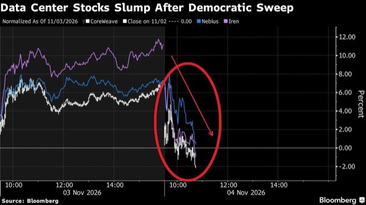
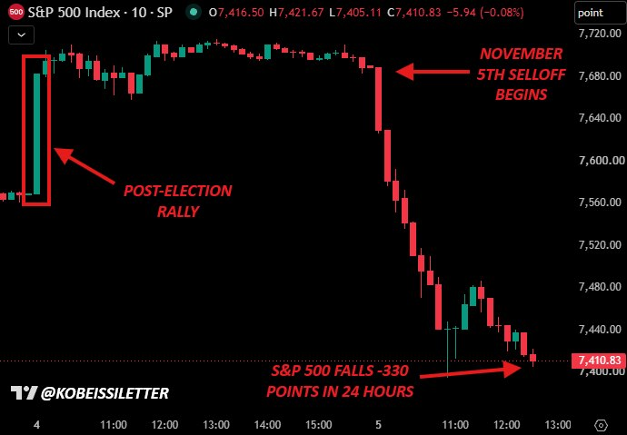
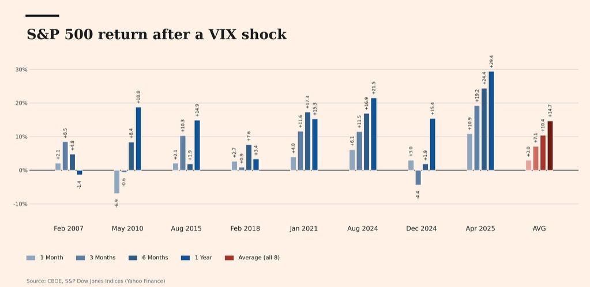
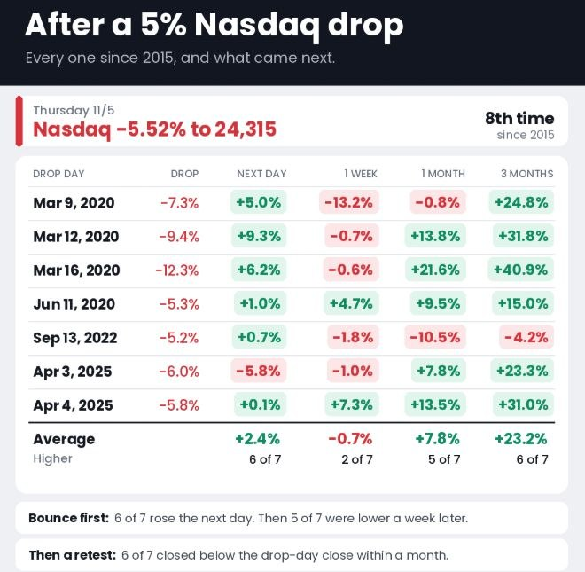

# Aurum

- 미국 증시 급락은 AI 쏠림 포지션과 레버리지의 동시 청산으로 증폭됐으며 추가 강제 매도 위험이 남아 있음
  - S&P500 -4.4%, 나스닥100 -6.4%로 AI 투자 수익성·조달 비용·정책 위험이 한꺼번에 재평가됨
  - UBS 장중 분석에서는 최종 수요 둔화보다 포지셔닝 충격에 무게를 두며 반도체·메모리·네오클라우드 매도가 하이퍼스케일러와 산업재로 확산됨
  - 모멘텀 팩터 -4.6σ, 전력망 수혜주 -7.5σ 등 극단적 변동이 발생했고 CTA·레버리지 ETF·헤지펀드 위험 축소가 건실한 종목까지 압박할 수 있음
- 텍사스 데이터센터 규제는 AI 인프라 투자 일정의 핵심 변수임
  - 지나 이노호사 주지사 당선인은 주민 보호 법률 마련 전 데이터센터 개발 중단 방침을 제시함
  - 톰 리는 기존 사업 완공이 허용된다는 전제로 저가 매수를 선호하지만 기존 사업까지 중단되면 판단을 바꿔야 한다는 입장임
- 앤트로픽의 자금 조달 필요성이 IPO 투자자의 할인 요구를 키우고 있음
  - 논의된 기업가치 1조5천억 달러는 기대 상단으로 인식되며 분기 손실과 대규모 AI 인프라 약정이 협상 부담임
- AI가 소비자의 상품 탐색 진입점으로 자리 잡으며 유통·광고 경로가 바뀌고 있음
  - 미국 소비자 9천 명 이상 조사에서 AI로 탐색을 시작하는 비율은 10%, Z세대·밀레니얼은 14%임
  - SNS 구매 경험은 81%지만 탐색 시작 비중은 6%이며 인플루언서 제휴 중요도는 2024년 대비 33% 하락함
- 급락 이후 반등 전망은 강제 매도 종료와 AI 투자 지속 여부에 달려 있음
  - 톰 리는 AI 수요·공급이 훼손되지 않았다는 전제로 사흘 이내 바닥과 V자 반등 가능성에 무게를 둠
  - DoubleLine은 과도한 비관을 역발상 매수 근거로 삼으며 동일가중·소프트웨어·유럽의 상대 강세에 주목함
  - 켄 피셔는 강세장 종료 신호가 뚜렷하지 않아 내년 중반 이후까지 상승이 이어질 수 있다는 전망을 유지함
- DoubleLine의 채권 전략은 단기 크레딧·비에이전시 모기지 중심이며 장기금리 재상승에 대비하는 방향임
  - 미국 10년물 예상 범위는 4.75~5.5%, 주가 반등 시 5.25%가 새 중심이 될 수 있음
  - 단기 크레딧·증권화 상품은 국채 대비 1~2%p 추가 이자, 하이일드는 약 8% 수익률에서 소폭 매수하기 시작함
  - 오라클·스페이스X 채권 스프레드가 200bp 후반까지 확대됐으며 기술주 상승 노출을 주식과 채권에 중복해 쌓는 데는 신중함
- 연준은 높은 물가를 경계하지만 12월 금리 인상에 대한 태도는 엇갈림
  - 바킨은 물가 둔화가 보이지 않는다며 점진적인 추가 인상을 선호함
  - 윌리엄스는 성장·고용이 견조하고 관세 물가 효과는 대부분 지났지만 물가가 너무 오래 높게 유지돼 추가 정보를 확인할 시점이라는 입장임
- 호르무즈 해협 재개방 조건과 종전 협상은 원유 공급 위험을 좌우함
  - 이란은 자체 조건 충족 전 해협 폐쇄 유지와 재개방 협상 거부 입장을 제시함
  - 별도 보도에서는 카타르 등 중재국이 해협 운항 정상화와 해상 봉쇄 해제·이란산 원유 수출 허용·동결 자산 일부 해제를 맞바꾸는 잠정 합의를 추진함
- 코스피는 이익 증가세 둔화가 부담이지만 역사적 하락폭과 PBR 기준으로는 저평가 영역에 접근함
  - 홍춘욱 분석상 9,300에서 4,800까지 약 50% 하락했으며 이익 모멘텀 둔화는 2~3분기째임
  - 2027년 말 예상 장부가치 기준 MSCI 코리아 PBR은 약 0.9배, 추가 10% 하락 시 0.8배, 20% 하락 시 0.7배 아래로 낮아짐
  - 반도체의 높은 이익률 지속 여부와 이익 전망치 재상향이 중요하며 1년가량 기다릴 수 있는 자금이 전제임
- 비트코인 8만 달러 이탈과 마진콜 대응 매도가 암호화폐 하락을 증폭시키고 있음
  - 최근 사흘 일일 실현 손실은 6억5,700만~7억300만 달러로 제시됐으며 자산운용사는 증거금 확보와 레버리지 축소를 위해 대체 자산을 매도함
  - 트럼프 미디어는 BTC 4,259개 약 3억4,367만 달러를 처분해 보유량의 99.99%를 현금화함
  - 스트래티지는 추가 자금 조달이 없으면 현금으로 약 1.5분기를 버틸 수 있다는 보도가 나옴
- 하이퍼리퀴드 스트래티지(PURR)는 주식 발행으로 조달한 자금을 HYPE에 집중하고 있음
  - 3분기 7억8,500만 달러를 추가 투입해 3,850만 HYPE를 보유하며 유통량의 약 16%를 차지함
  - 주식 발행 조달액은 9억1,100만 달러, HYPE 미실현 이익은 8억300만 달러임
- 폭락기에는 손실 만회를 위한 계획 밖 매매보다 비중·레버리지 관리와 시장 잔존이 우선임
  - 투자 방식에 내재된 손실은 감수하되 계좌가 시장보다 빠르게 무너지면 위험 노출을 재점검해야 함

# Harvey

- 민주당 압승은 AI 수요 붕괴보다 매출 전환 지연과 자본 비용 상승을 통해 AI 인프라 가치를 압박함
  - 텍사스의 Gina Hinojosa 당선인은 데이터센터 개발 모라토리엄을 주장했고 오하이오·조지아 당선인들도 개발 속도 조절을 지지함
  - 신규 공급 제한은 가동 설비의 희소가치를 높이는 반면 건설 중인 프로젝트에는 이자·추가 조달 부담을 키움

- CoreWeave는 높은 EBITDA 마진만으로 주주에게 남는 현금을 평가하기 어려운 구조임
  - 2026년 2분기 매출 약 25억7,500만 달러, 조정 EBITDA 약 15억1,000만 달러에 순이자비용만 약 6억4,000만 달러임
- AI 인프라 기업의 가치는 약속한 용량보다 추가 증자 없이 용량을 현금흐름으로 전환할 능력에 달려 있음
  - 장기계약 인프라처럼 평가받아도 건설 단계에서는 GPU 가치 변화와 외부 자금 조달 위험에 노출됨

# KHwanK

### 미국 주식 고평가와 폭락에 대비하는 자산배분

- 미국 주식의 극단적 고평가는 향후 10년 실질수익률 부진과 대규모 하락 위험을 높이지만 폭락 시점까지 알려주지는 않음
  - CAPE는 장기 평균 17~18을 크게 웃도는 40 이상으로 닷컴버블 당시 다음으로 높은 수준
  - 미국 시가총액을 GDP로 나눈 버핏 지표도 역대 최고 수준이며 장기 추세선을 크게 상회
  - AI 기대와 빅테크 이익 전망이 높은 가격을 지탱하지만 미래 이익을 미리 반영할수록 추가 수익 여력은 줄어듦
- 과거 CAPE가 낮을수록 이후 10년 실질수익률이 높았고 35 이상에서는 연평균 실질수익률이 약 -2.6%였음
  - 이를 바탕으로 2026~2036년 미국 주식의 실질수익률이 매우 낮거나 마이너스에 머물 가능성에 무게
  - 장기 기대수익률 부진과 당장 발생할 하락은 별개의 문제
- 고평가 국면은 수년 이상 지속될 수 있으며 하락에는 금리 인상이나 경기 침체 같은 촉발 요인이 필요
  - 1925년부터 비싸진 시장은 4년 뒤인 1929년에 붕괴
  - 1988년부터 비싸진 시장은 CAPE가 1992년 20, 1995년 25, 1997년 30을 넘은 뒤 2000년에 붕괴
  - 2017년 CAPE가 30을 넘은 이후에도 9년간 미국 주식 상승세가 이어짐
- 고평가 상태에서 시작되는 약세장은 낙폭이 커질 위험이 높음
  - 1929년 대공황 국면의 미국 주식 낙폭은 약 86%, 2000년 닷컴버블 붕괴 당시 S&P 500은 약 49%, 나스닥은 약 80% 하락
  - 현재 밸류에이션은 1929년보다 높고 2000년보다 조금 낮아 향후 10년 내 큰 폭의 조정 위험을 경계
- 비싸다는 이유만으로 전량 매도하면 장기간 추가 상승을 놓칠 수 있음
  - 1995년에 매도했다면 2000년 붕괴까지 약 5년을 기다려야 했음
  - 1988년부터 2002년 저점까지는 닷컴버블 붕괴를 거치고도 주가가 약 3배 상승
  - 현재 가격에서 추가로 크게 오를 가능성도 있어 고평가만으로 매도 시점을 정하기 어려움
- 중간선거 전 10월부터 이듬해 7월까지의 강세 계절성을 근거로 2027년 상반기까지 상승 지속에 무게
  - 영상에서 제시한 1950년 이후 해당 구간은 매번 상승했으며 수익률도 통상적인 연간 평균보다 높았음
  - 중간선거 이후 트럼프의 정책 추진력 약화와 정치적 교착이 정책 불확실성을 줄이는 상승 요인
  - 과거의 전승 기록이 이번 상승까지 보장하는 것은 아님
- 현재를 1998년과 유사한 국면으로 보고 약 1년 반의 추가 상승과 2028년 조정 가능성을 염두
  - 2028년 폭락에 확신은 없으며 2029년·2030년·2032년 등으로 늦어질 가능성도 열어둠
  - 구체적인 폭락 연도보다 고평가에 따른 장기 위험 관리가 핵심
- 주식 투자를 유지하면서 국채·금·실물자산·외화로 충격을 분산
  - 예시 비중은 주식 약 50%, 나머지는 채권·실물자산·외화로 구성
  - 미국 국채는 주식 하락 국면 10번 중 약 7~8번, 금은 약 8번 방어 역할을 했다는 경험칙을 제시
  - 한국 투자자는 위기 때 미국 국채 가격 상승과 달러 강세가 함께 나타나면 원화 기준 손실 완충 효과가 커짐
- 하락 원인에 따라 방어 자산의 효과가 달라짐
  - 경기 침체형 폭락에는 장기 국채, 인플레이션형 폭락에는 금·원자재가 유리
  - 2022년처럼 주식과 국채가 동반 하락할 수 있어 국채만으로 방어를 끝내기 어려움
- 저평가된 한국·신흥국 주식은 미국 중심 포트폴리오를 보완할 선택지
  - 미국 주식 급락 시 함께 하락할 수 있지만 출발 밸류에이션이 낮아 이후 회복 수익률이 더 높을 가능성
  - 국가 분산은 초기 동반 하락을 막기보다 장기 회복 경로와 기대수익률을 분산하는 역할
- 2027년 하반기부터 S&P 500의 200일 이동평균선 이탈 시 주식 비중을 축소하거나 청산하는 전략 적용을 검토
  - 대폭락이 진행되는 중간에 위험 노출을 줄여 손실을 제한하는 추세 필터
  - 미국 주식에는 200일선, 비트코인에는 120일선을 선호
- 밸류에이션은 장기 기대수익률과 위험 수준을 판단하는 데 쓰고 실제 비중 조절은 추세와 자산배분 규칙으로 연결할 필요
  - 장기 저수익 전망만으로 조기 전량 매도하거나 단기 상승 기대만으로 고평가 위험을 무시하는 선택을 피할 수 있음
- 방어 전략은 폭락 연도를 맞히기보다 하락 원인별 분산과 실행 가능한 매매 규칙을 미리 정하는 데 초점
  - 200일선 전략도 횡보장에서 잦은 매매와 재진입 부담이 생길 수 있으므로 이탈·재진입 기준을 함께 정해야 함

# Kobeissi

- 미국 증시 급락은 선거 후 상승분을 지웠고 장중 반등마다 매도가 이어짐
  - S&P500 시가총액은 장중 약 3조 달러 감소했고 나스닥100은 -6.4%로 2020년 이후 최대 일일 낙폭을 기록함
  - 최소 다섯 차례 장중 반등과 최대 1.7% 반등도 모두 매도됐으며 S&P500의 1시간 봉은 한 번도 상승 마감하지 못함
  - 시간외 나스닥100 선물은 12시간 누적 -7.1%까지 밀렸고 S&P500은 10월 6일 고점 대비 약 5조 달러를 잃음

- AI 규제 우려에 과도한 레버리지가 겹치면서 기관 강제 청산이 급락을 증폭시켰을 가능성이 큼
  - 선거 결과 자체는 상당 부분 반영돼 있었으며 인공 초지능 금지·첨단 AI 개발 제한 요구가 심리를 급격히 바꿈
  - 전면 금지는 미국의 대중국 AI 경쟁 포기를 뜻해 실현 가능성이 낮으며 이번 매도는 펀더멘털보다 기술적 요인이 크다는 해석임
  - 텍사스 주지사 당선인은 보호 법률 제정 전 데이터센터 개발 중단을 요구했고 트럼프는 AI로 부유해지려는 주들과 협력하겠다고 밝힘
- 변동성 폭등에도 국채금리 하락은 제한적이었음
  - VIX는 장중 70% 넘게 올라 2018년 2월 이후 최대 일일 상승폭을 향했지만 미국 10년물 금리는 약 7bp 하락에 그침
- 한국 증시와 암호화폐에도 청산 충격이 확산됨
  - 코스피는 개장 후 9% 급락해 거래가 중단됐으며 고점 대비 하락률은 47%에 달함
  - BTC 7만7천 달러·ETH 2,300달러가 무너졌고 60분간 레버리지 포지션 3억7천만 달러가 청산됨
- 기술주 낙폭이 커지면서 엔비디아의 선행 PER은 약 13배까지 낮아짐
  - S&P500 약 20배, 월마트 약 43배와 격차가 확대됨
  - 고점 대비 SNDK -66%, ARM -64%, NBIS -62%, ORCL -56%, MU -48%, AVGO -41%, NVDA -25%로 종목별 낙폭이 컸음
- 앤트로픽의 대규모 인프라 약정과 IPO 가치 조정 압력이 동시에 부각됨
  - 미래 구매·리스 약정은 8,950억 달러이며 2030년 말까지 약 4,480억 달러, 향후 12개월에 약 700억 달러가 집행될 예정임
  - Broadcom 1,610억 달러, Google 1,210억 달러와 별도 AI 칩 지출 추정 최대 1,500억 달러, SpaceX 최대 1,210억 달러, Amazon 최소 1,100억 달러가 포함됨
  - 기대 기업가치 1조5천억 달러에 대한 회의가 커졌고 한 주요 투자자는 1조 달러로 인하가 필요하다고 제시함
  - 추수감사절 전 IPO 계획은 급락 이후 일정 변경 여부가 불확실함
- 미국 연료 재고 감소가 지속돼 에너지 공급 완충력이 약해지고 있음
  - 경유 등 유분 재고는 주간 360만 배럴 감소한 9,930만 배럴로 2003년 5월 이후 최저이며 연초 대비 25% 줄어듦
  - 전략비축유는 주간 39만9천 배럴 감소한 2억8,220만 배럴로 1982년 10월 이후 최저, 3월 대비 32% 감소함
  - 전략비축유 제외 상업 원유 재고도 86만5천 배럴 줄어 4억980만 배럴을 기록함
- 10월 미국 고용 호조로 12월 25bp 추가 금리 인상 기대가 80%까지 높아짐
  - 신규 고용은 16만5천 명으로 예상 6만4천 명을 웃돌았고 실업률은 예상 4.2%보다 낮은 4.1%임
  - 9월 고용도 2만8천 명 상향 수정됨
- 급락 다음 거래에서는 반도체 저가 매수가 유입돼 나스닥100이 개장 후 2.4% 반등함
  - 프리마켓 SNDK +12%, MRVL +10%, MU +9%, AMD +8%, ARM +7%, NVDA·AVGO 각각 +5%를 기록함
  - 반도체 시가총액 회복 규모는 장전 약 5천억 달러에서 개장 시 약 7천억 달러로 확대됨
- JP모건(JPM)은 상원 민주당의 제프리 엡스타인 관련 은행 거래 조사 준비 보도 이후 하락함
- 테슬라(TSLA)는 2027년 중반 무렵 Cybertruck 생산을 단계적으로 종료할 예정임

# MKevin

### 기술주 투매와 투자 확대의 엇갈림

- 기술주 급락의 핵심은 AI 수요 붕괴보다 선거 이후 규제 불안, 자금조달 부담, 레버리지 청산이 겹친 유동성 압박
  - 나스닥100은 장중 약 6%까지 하락한 뒤 약 5% 하락권에서 거래됐으며 Dell 약 11%, Tesla·Robinhood 약 10% 급락
  - Bloomberg 보도에 따르면 운용자산 170억 달러 규모 헤지펀드가 일부 투자자에게 자금을 반환하고 주식 부문 책임자와 상당수 인력을 해고
  - Barclays는 고성장주에 집중된 손실이 다른 종목으로 번지면서 시장 전체의 동반 하락으로 확대될 위험을 경고
- 기술주 모멘텀 붕괴와 시장 전체의 경기 침체 신호는 구분할 필요
  - Morgan Stanley 기술·미디어·통신 모멘텀 지표는 최근 12개월 고점 대비 약 62% 하락해 닷컴버블 당시 약 55% 하락보다 악화됐으며 당일 급락은 아직 미반영
  - 동일가중 S&P500 ETF인 RSP는 사상 최고치 부근을 유지했고 일부 소비주도 반등해 기술주와 다른 업종의 격차가 크게 벌어짐
  - AppLovin은 당일 약 30% 상승해 기술주 내부에서도 실적과 사업 경쟁력에 따른 차별화 발생
- 주가 하락 자체가 금융여건을 긴축시켜 연준의 추가 금리 인상 필요성을 낮추는 경로
  - 선물시장에 반영된 12월 인상 확률은 약 70%, 다음 해 9월 15일까지 예상 인상 횟수는 전일 약 2.4회에서 1.98회로 감소
  - 금리 상승 없이도 주식 자산가치 하락과 유동성 위축으로 기업·가계의 자금 사정 악화 가능
- AI 관련 장부외 지출 약정은 계속 확대돼 투자 중단보다 집행 지연에 가까운 국면
  - 영상에서 제시한 약정 규모는 6월 1조8,000억 달러에서 8월 3조1,000억 달러, 11월 초 4조1,100억 달러로 증가
  - Amazon의 약정도 약 1,250억 달러에서 2,540억 달러로 확대
  - 약정 증가가 즉시 현금 지출이나 가동 가능한 데이터센터 증가를 의미하지는 않음
- Microsoft의 네오클라우드 계약 지연은 AI 수요 감소보다 제3자 데이터센터 공급 차질과 설계 변경의 영향
  - 제시된 설비투자 계획은 회계연도 2분기 500억 달러 이상, 역년 기준 1,700억 달러
  - 상시 작동하는 AI 에이전트에 맞춘 광케이블·네트워크 사양 변경, 비용 상승, 인허가 지연이 용량 인도를 늦추는 요인
  - 향후 반기에는 CPU와 메모리·저장장치 비용 증가를 중심으로 설비투자 가속 예상
- AI 에이전트 확산은 GPU뿐 아니라 CPU·메모리·저장장치 수요 확대와 연결
  - 메모리 공급 과잉 가능성과 NAND 저장장치 수요는 구분할 필요가 있으며 영상에서는 NAND 조정 매수에 더 긍정적
  - 수요가 강해도 데이터센터 사양 변경과 공급 병목으로 관련 기업의 매출 인식·현금 회수 시점은 늦어질 수 있음
- 데이터센터 지연이 신용위험과 자금조달 비용을 높이는 악순환에 주의
  - 인도 지연 → 신용부도스와프인 CDS 상승 → 채권 조달금리 상승 → 네오클라우드 자금조달 위험 확대 → 추가 지연
  - 주가 하락과 규제 불안이 겹치면 차입 의존도가 높은 기업에 부담 집중
- 당일 CDS 흐름은 주가 급락만큼 악화되지 않아 전면적인 신용경색과는 차이
  - Oracle과 Meta의 CDS는 하락했고 CoreWeave는 고점 수준을 유지했지만 추가 악화는 제한적
  - 주식시장의 투매와 채권시장의 부도위험 평가가 엇갈려 공포·포지션 청산의 영향이 클 가능성
- 민주당 선거 승리 이후 데이터센터 건설 중단과 AI 규제 우려가 급락을 증폭했다는 해석
  - 신임 주지사 취임은 1월이며 실제 입법은 의회 협의를 거쳐 3~4월 이후에야 가시화될 가능성
  - 건설 일자리와 타주로의 투자 유출 부담 때문에 선거 공약이 즉각적인 전면 중단으로 이어질지는 불확실
- 이란 핵협상은 유가·금리·주가를 함께 움직일 주요 변수
  - 카타르 중재로 구체적 제안 검토가 재개됐지만 이란의 핵억지력 확보 요구가 협상 장애물
  - 유가는 전일 100달러 아래로 하락한 뒤 당일 약 3% 반등
  - 합의는 에너지 비용과 인플레이션 압력을 낮출 촉매지만 타결 시점은 불확실
- 침체 판단의 핵심 관찰 대상은 고용과 AI 투자 지출
  - ADP 민간고용은 두 달 연속 약 8만6,000명 증가했고 최근 수치는 예상치를 약 1만9,000명 상회
  - ISM·PMI와 고용 관련 지표는 확장 흐름을 유지했으며 영상에서 제시한 주간 실업수당 청구는 1969년 이후 최저 수준
  - 3분기 노동생산성은 연율 3.6% 상승, 단위노동비용은 0.7% 하락해 생산성 개선과 근로자 임금 협상력 약화가 공존
  - 주가 하락이 기업의 해고를 강제하고 AI 지출까지 줄어들면 금융시장 조정이 실물 침체로 전이될 위험
- 대형 기술기업의 동시 자금조달은 강한 투자 수요와 시장 유동성 흡수를 함께 의미
  - Apple은 1년여 만에 70억 달러 규모 채권 발행에 나섰고 Microsoft·Meta·Amazon 등도 대규모 자금 확보 필요
  - 투자 확대가 장기 성장에 유리해도 단기적으로는 자본 조달 경쟁과 금융여건 악화 부담
- 차입 없이 우량기업을 장기 보유하는 전략이 강제 청산 위험을 줄이는 방향
  - 3배 레버리지 ETF에 다시 신용을 얹으면 하루 급락만으로 손실과 청산 위험이 급증
  - 낮아진 주가만 보지 말고 현금 창출력, 재무건전성, 이익 성장의 지속성을 함께 점검
  - 영상의 저가 매수 전략은 최소 10년 보유를 전제로 하며 단기 바닥 확인과는 별개
- 반도체와 부동산은 투자 심리와 수익률곡선 민감도가 다른 조합
  - 반도체는 관심이 집중된 업종이면서 수익률곡선 평탄화에 민감하고, 부동산은 관심도가 매우 낮은 구간
  - 영상에서는 두 업종의 조정 매수를 병행하는 바벨 전략을 선호하며 실제 신규 투입금의 약 90%는 부동산에 배분
- AI 투자 확대만으로 모든 관련 기업의 수익성이 보장되지는 않으며, 계약 규모보다 인도 일정·조달금리·현금흐름 전환을 확인할 필요
- 반등의 지속성은 주가 회복뿐 아니라 CDS 안정, 고용 유지, AI 투자 집행이 함께 뒷받침하는지에 달림
- 저평가 매수 기회와 강제 매도 위험이 공존하는 구간에서는 추가 상승 기대보다 차입 부담과 보유 기간을 먼저 맞출 필요

### 변동성 급등과 데이터센터 규제 속 기술주 반등 조건

- 나스닥100이 하루 6% 넘게 하락하고 VIX가 69% 급등하며 강제청산성 매도와 공포가 집중
  - VIX는 약 15의 낮은 기저에서 출발해 상승률이 확대됐으며, 절대 수준 자체는 과거 위기 대비 극단적이지 않음
  - 하루 50% 이상 급등한 사례는 드물고, 이번 상승폭은 2024년 엔 캐리 트레이드 청산 당시 65%와 크리스마스 직전 74% 사이
  - 여러 헤지펀드와 운용팀의 손실·청산설이 매도 증폭 요인으로 거론됐으나 개별 사례는 확인되지 않음
- 변동성 급등 이후 반등한 과거 사례가 많지만 경기침체 여부에 따라 경로가 달라짐
  - 영상에 인용된 2007~2026년 표본에서 한 달 뒤 수익률이 더 나빴던 사례는 코로나 초기 매도 국면
  - 위기 초기에는 변동성 급등 뒤에도 추가 하락이 가능하므로 과거 평균만으로 바닥을 확정하기 어려움
- 단기 방향은 고용과 물가 지표가 좌우
  - 다음 날 오전 5시 30분 고용보고서 발표 예정이며, 신규 고용 전망치는 6만5천 명
  - 신규 고용이 2만~2만9천 명을 웃돌면 최소한의 안도 요인, 10만 명을 넘으면 국채금리 상승 압력 가능
  - 평균 시간당 임금 상승률은 직전 0.1%에서 0.3%로 확대 예상, 경제활동참가율 하락과 실업률 상승은 침체 우려를 자극
  - 11월 10일 CPI는 0.3%, 근원 CPI는 0.2% 예상이며 11월 13일 PPI도 주요 변수
- 텍사스 데이터센터 신규 인허가 중단 우려가 이미 진행 중인 투자 전체의 중단을 뜻하지는 않음
  - 인터뷰에서 제시된 정책은 주민 보호를 위한 신규 승인 일시 중단이며, 기존 승인 사업을 전면 취소하는 내용과는 구분
  - 전력 등 사용에 대한 20년 판매세 면제와 연간 최소 10억 달러의 세수 손실이 정책 변경의 배경
  - 입법을 통한 구체화는 빨라도 1월 이후, 현실적으로 3~6월이 거론돼 즉각적인 건설 중단과 시차가 존재
- 데이터센터 규제의 실질적 영향은 2027년보다 2028~2030년 신규 공급에 집중될 가능성
  - 영상에 인용된 자료상 2027년 건설 물량의 86%가 이미 수직 시공 단계에 진입했으며, 착공 전 승인 물량까지 포함하면 승인 비중은 더 높을 수 있음
  - 텍사스에서는 11GW 규모가 공정률 25%를 넘었고 추가 4GW는 75% 이상 진행
  - 기존 승인·공사 진행 물량이 단기 투자를 지지하며, 향후에는 세금·전력·지역 인프라 부담을 둘러싼 협상이 핵심
- VIX 급등일의 콜옵션 매수는 반등 방향을 맞혀도 변동성 하락으로 수익이 훼손될 수 있음
  - 나스닥과 SOXL 콜옵션에는 주가 방향 외에 비싸진 옵션 프리미엄과 변동성 정상화 위험이 함께 반영
  - SOXL은 반도체 3배 레버리지 상품이며, 영상에서 제시한 피보나치 조정 기준은 39.5달러
  - 기술적 반등 매력과 별개로 Kevin은 이날 3배 레버리지와 옵션 매수를 피함
- 지수보다 개별 종목의 충격이 훨씬 큰 장세
  - 최근 30일 S&P500 구성 종목의 평균 절대 변동폭은 13.2%, 지수 변동폭은 1.1%로 격차가 12.1%포인트
  - 영상에 인용된 집계상 최근 30년 최상위 수준의 괴리로, 지수 수익률만 보면 종목별 손실과 포지션 청산 압력을 과소평가하기 쉬움
- 추가 금리 인상 기대 약화와 국채금리 하락이 주식시장 반등의 주요 조건
  - 12월 금리 동결 확률은 전날 약 17%에서 33%로 상승했으며, 일주일 전에는 약 10% 수준
  - 2년물 국채금리는 당일 11bp 하락했고 10년물도 영상에서 제시한 고점 5.27% 이후 하락
  - 금융여건 긴축과 물가 둔화가 연준의 추가 인상 필요성을 낮추면 주식의 할인율 부담도 완화
- 중간선거 이후 수익률은 정치 구도보다 연준 정책에 크게 좌우
  - TS Lombard는 분점정부가 급격한 정책 변화를 억제하고 시장 예측 가능성을 높이는 요인으로 평가
  - 2018년에는 선거 후에도 연준 긴축과 채권시장 매도가 이어져 주식 약세가 지속
  - 주식 시가총액 대비 GDP와 10년물 금리를 함께 보면 주식은 적정 가치 수준이며, 국채가 주식 자금을 대거 흡수할 만큼 싸지는 않다는 평가
- Cloudflare는 AI 수요 확대 속에 연간 반복매출 ARR 30억 달러를 돌파
  - 대본상 이익은 39% 증가했지만 가격 결정력은 다소 약해졌고 비용은 예상보다 더 증가
  - AI 수요의 성장 효과와 수익성 압박을 함께 확인할 필요
- Michael Burry는 일부 약세 포지션을 줄였지만 대규모 헤지는 유지
  - 반도체 ETF 풋옵션의 25%를 청산하고 MELI 보유 포지션은 50% 확대
  - Palantir·Caterpillar·QQQ·Oracle 풋옵션과 상당 규모의 반도체 ETF 풋옵션은 유지
- 기술주 선행 밸류에이션 급락이 저가매수 논리의 핵심
  - 영상의 코로나 이후 비교 차트에서 현재 멀티플 축소폭은 45%로, 이전 사례의 18~36%보다 큼
  - 가격 하락만으로 저평가가 확정되지는 않으며 향후 이익 전망과 추가 긴축 여부가 회복 강도를 결정
- 데이터센터 투자는 기존 승인 물량과 향후 신규 승인 물량을 나눠 점검해야 함
  - 단기 공사 진행률이 높아도 장기적으로 세제 혜택 축소와 인프라 부담 확대가 사업 수익률을 낮출 수 있음
- 급락 대응에서는 반등 방향보다 상품 구조와 자금 여력이 손실 회복을 좌우
  - 변동성 급등 구간의 옵션·레버리지는 추가 하락과 프리미엄 축소를 동시에 견뎌야 하므로 현물 저가매수와 위험이 다름

### 실행과 고객 가치로 키우는 시대 사업 경쟁력

- 완벽한 준비를 기다리기보다 고객에게 가치를 제공하고 실패에서 배워야 사업이 성장함
  - 알렉스 호르모지는 성장 한계에 부딪히면 기초부터 다시 쌓는 접근을 제시하지만, 케빈은 실패 경험 자체가 다음 사업의 기초가 된다는 입장
  - AI로 고용계약·공급계약·보험 관련 기초 준비를 보완하되, 준비만 하느라 실행을 미루지 않는 것이 핵심
  - 법인 설립 자체는 사업 성과가 아니며, 실제 고객에게 유료 서비스를 제공하는 단계까지 나아가야 함
- 매출 확장보다 마진과 고정비 구조를 먼저 점검해야 함
  - 케빈은 2017년 부동산 중개에 건설 서비스를 결합했지만, 낮은 시공 마진과 상시 인력 부담을 경험한 뒤 철수
  - 필요한 시점에 외부 전문업체를 활용하는 방식으로 전환해 유휴 인건비와 직접 관리 부담을 줄임
  - 연매출 500만 달러 자동차 튜닝업도 마진 20~30%라면 수익 규모가 크게 달라지므로 매출 숫자만으로 사업을 평가할 수 없음
- 주문 순서와 제시 방식이 같은 지출로 얻는 가치를 바꿀 수 있음
  - 치폴레에서 처음부터 고기 두 배를 주문하기보다 기본량을 담은 뒤 추가 주문하면 더 넉넉한 양을 받을 여지가 있음
  - 케빈이 정정한 닭고기 추가 1회분 수치는 단백질 32g·180칼로리
- 고객이 구매를 결정하면 설득을 멈추고 즉시 계약과 결제를 마무리해야 함
  - 계약서와 결제 수단을 미리 준비하고, 합의 뒤 새로운 조건이나 불필요한 설명을 꺼내 재고할 이유를 만들지 말 것
  - 새 잠재고객이 나타나도 진행 중인 거래를 먼저 완료해야 양쪽 고객의 신뢰를 지킬 수 있음
- 여행과 휴식이 목적이라면 사업 매각 전에 부재 중에도 수익이 나는 운영 구조를 먼저 검토할 것
  - 매각하면 업무 부담과 함께 팀·성취감·소득원도 사라지고, 경업금지 약정으로 기존 사업이나 인력을 되찾기 어려울 수 있음
  - 대체 담당자·원격 업무·분기별 휴가를 설계하면 사업을 유지하면서도 이동의 자유를 확보할 수 있음
  - 휴가와 개인 일정을 먼저 확보하면 남은 시간에 업무를 압축하도록 운영 방식을 바꾸게 됨
- 거절형 질문으로 동의를 유도하는 영업은 상대에 따라 역효과가 날 수 있음
  - 호르모지는 “진행하는 데 반대하시나요”처럼 부정 답변이 동의가 되는 질문을 활용
  - 영업 기법에 익숙한 고객은 말로 몰아붙인다고 느낄 수 있어, 실제 가치와 자율적인 결정이 더 중요함
  - 신분증을 먼저 받아 결제 카드 제시를 유도하는 방식도 고객을 붙잡는 압박으로 받아들여질 수 있음
- 상품권은 사업자에게 선결제와 미사용 잔액의 이점이 있지만 소비자에게는 잔액 소진과 추가 지출 부담이 생김
  - 영상에서는 판매된 상품권의 10~20%가 사용되지 않는 수치를 제시
  - 소액 잔액을 쓰려고 더 큰 금액을 결제하면 소비자의 실제 지출이 늘어남
- 온라인 서비스의 낮은 진입비용은 전 세계 경쟁자를 상대해야 한다는 뜻이기도 함
  - 케빈은 자격·면허와 지역 고객 관계를 갖춘 대면 서비스에 AI를 결합하는 경로를 선호
  - 회계사·변호사·중개인 등이 반복 업무를 AI로 처리하면 고객 관계를 유지하면서 처리 효율을 높일 수 있음
  - 고객이 원하는 것은 신뢰할 수 있는 전문가가 AI를 활용해 더 나은 서비스를 제공하는 것
- 직원 피드백은 성격 평가 대신 바꿔야 할 행동과 대체 행동을 구체적으로 제시해야 함
  - “태도를 고쳐라”보다 회의 중 말 끊기, 다른 부서의 전문성 무시하기처럼 문제 행동을 명시하고 다음 상황에서 할 행동을 정할 것
  - 외부 피드백은 스스로 인식하지 못한 습관을 드러내므로, 불편하더라도 유효한 지적을 골라 반영해야 함
- 개인화된 예상 밖의 작은 혜택은 호혜성을 높여 구매와 추천으로 이어질 수 있음
  - 영상에 소개된 식당 실험에서는 사탕 1개 제공 시 팁 3%, 2개 제공 시 14%, 1개를 준 뒤 돌아와 하나 더 제공했을 때 23% 증가
  - 부동산 잠재고객에게 최근 인근 거래와 권리관계 자료를 꾸준히 제공하면 계약 요구 전에 신뢰를 쌓을 수 있음
  - 고객에게 더 적합한 경쟁사 상품을 추천하더라도 장기적으로 재방문과 소개 가능성을 높일 수 있음
- 서비스업 인력 유지에는 승진 단계와 보상뿐 아니라 지속적인 신규 고객 유입이 중요함
  - 호르모지는 승진·급여·근무시간 혜택을 6~12단계로 세분화하고 시장보다 20~25% 높은 보상으로 우수 인력을 확보하는 방식을 제시
  - 케빈은 작은 임금 인상을 여러 단계로 나누는 방식에 회의적이며, 입지·시설·평판·검색 및 AI 검색 최적화로 고객을 공급하는 가치를 강조
  - 독립하면 잃게 되는 신규 고객 흐름이 클수록 직원과 계약자가 남을 유인이 강해짐
- 문의에 대한 즉각적인 응답은 서비스업의 핵심 경쟁력임
  - 영상 속 복구업체는 하루 2~3건의 문의에 즉시 전화하는 전담자에게 연 6만 달러를 지급하며 문의 대비 55% 전환율을 달성
  - AI 메시지로 접수 확인과 방문 일정 조율을 즉시 시작하고, 가능한 경우 사람이 바로 전화하는 구조를 활용할 수 있음
  - 케빈은 AI 음성 통화의 전면 도입에는 신중하지만 즉각적인 문자 응대에는 긍정적
- 이미 수요가 검증된 서비스를 더 빠르고 편리하게 제공하고 고객 위험을 줄이면 높은 가격을 받을 여지가 생김
  - 업계 고수익 사업자의 방식을 학습하고, 신규 사업자의 여유 시간을 빠른 회신과 실행에 투입할 것
  - 소개 요청은 “필요한 사람을 아시나요”보다 “이 서비스가 필요한 분이 누구인가요”처럼 구체적인 사람을 떠올리게 할 것
  - 수익이 나는 일이 지루해졌다는 이유만으로 덜 검증된 사업에 분산하지 말 것
- 유료 광고 중심의 성장에는 한계가 있으며 브랜드와 콘텐츠가 고객 유입 자산이 될 수 있음
  - 호르모지는 카일리 제너·코너 맥그리거·더 록의 사업에서 브랜드의 힘을 확인한 뒤 영상 제작에 투자
  - 매출과 광고비 차감 후 순이익을 구분해야 실제 사업 성과를 판단할 수 있음
  - 주변 사람과의 끊임없는 비교보다 훨씬 앞선 사례에서 배울 요소를 찾는 편이 동기 유지에 유리함
- 집중력은 의지뿐 아니라 작업 환경으로 관리해야 함
  - 소음 차단과 방해 요소 축소가 중요하며, 흑백 화면은 불필요한 휴대전화 사용을 줄이는 데 도움이 될 수 있음
  - 호르모지의 흑백 화면 사용 후 휴대전화 이용 30% 감소는 개인 경험이며, 케빈은 AI 에이전트 상태를 색상으로 구분해야 해 흑백 설정을 중단
  - 자극을 줄이는 설정도 실제 업무에 필요한 정보와 균형을 맞춰야 함
- 상품을 여러 개 무료로 얹는 표현과 하나의 통합 상품으로 묶는 방식은 고객에게 서로 다른 가치를 전달함
  - 호르모지는 무료 증정 표현의 구매 유도 효과를 강조하고, 케빈은 여러 서비스를 한 요금제로 통합하는 구독 방식을 선호
  - 핵심은 무료 수량 자체보다 고객이 이해하기 쉬운 구성과 총가치를 설계하는 것
- AI 도입의 우선순위는 고객 응답 지연과 반복 업무처럼 매출·처리량에 직접 연결되는 병목부터 정할 수 있음
  - 전문성·지역 평판·고객 관계에 AI 효율을 더하면 낮은 진입장벽의 온라인 서비스와 다른 경쟁 기반을 만들 수 있음
- 고객과 인력이 계속 남을 이유는 제공하는 가치에서 만들어야 함
  - 고객에게는 빠른 해결과 유용한 정보, 인력에게는 경쟁력 있는 보상과 신규 고객 흐름을 제공하는 구조가 반복 거래를 강화함
- 사업 확장과 매각은 매출뿐 아니라 순이익·고정비·대표 부재 시 운영 가능성을 함께 기준으로 삼아야 함
  - 검증된 수익원을 유지하면서 위임과 자동화로 자유 시간을 확보하면 성급한 확장이나 매각의 필요성을 줄일 수 있음

### 고용 회복과 임금 반등에 커지는 금리 부담

- 미국 고용 증가세가 회복되며 경기침체 우려 완화
  - 비농업 고용 16만 5,000명 증가, 이전 달 증가분은 2만 9,000명에서 6만 명으로 상향 수정
  - 최근 두 차례 ADP 민간고용도 각각 8만 6,000명 증가해 회복 흐름 뒷받침
  - 지난해 여름 정체와 겨울 부진을 벗어나 고용 증가의 3개월·6개월 평균이 함께 개선
- 경제활동참가율이 61.8%에서 61.9%로 높아졌는데도 실업률은 반올림 기준 4.2%에서 4.1%로 하락
  - 가계조사 취업자 수가 9월 약 40만 명, 10월 46만 3,000명 늘며 노동시장 신규 유입을 흡수
  - 낮은 참가율의 정상화가 실업률 급등으로 이어질 위험은 남아 있지만 최근 고용 흡수력은 양호
- 시간당 평균임금 상승률이 예상보다 높아지며 노동자의 임금 협상력 회복
  - 이전 달 전월 대비 상승률은 0.1%에서 0.3%로 상향 수정
  - 이번 달은 예상 0.3%를 웃도는 0.4%로, AI 확산에 따른 채용·임금 압박 우려와 상반된 결과
- 고용 증가가 전문서비스·의료·물류·제조업으로 확산
  - 전문·사업서비스 7만 명 증가로 월평균 1만 5,000명을 크게 상회, 2025년 10월 저점 이후 누적 26만 9,000명 증가
  - 세부 항목인 전문·과학·기술서비스는 2만 3,000명, 행정·지원서비스는 2만 8,000명 증가
  - 의료 4만 2,000명, 창고업 2만 5,000명, 제조업 1만 9,000명 증가
  - 건설업은 3,000명 감소로 최근 증가 흐름이 꺾였고, 광업·석유가스·도소매·정보업은 큰 변화 없음
  - BLS와 ADP 모두 계절조정 수치이므로 반복되는 계절성 채용 효과는 조정에 반영
- 고용과 임금 호조는 경기에는 긍정적이지만 국채금리 상승 압력으로 작용
  - 발표 직후 미국 10년물 금리는 약 6bp 상승해 4.1% 부근
  - 영상에서 제시한 12월 금리 인상 확률은 74%로 상승
  - 금리 급등 여부가 주식시장 반응을 좌우하며, 영상에서는 4.9%를 기존 금리 고점 판단의 기준으로 제시
- 전일 주가 급락의 주요 원인으로 레버리지 ETF 재조정과 헤지펀드 청산 가능성 부각
  - 하락장에서 마진콜과 장 마감 무렵 ETF 재조정이 매도 압력을 증폭할 수 있음
  - 경기지표가 견조한 가운데 발생한 강제청산은 저가 매수 기회가 될 수 있다는 강세 관점 유지
- 데이터센터 규제 우려가 실제 공사 둔화로 이어지기까지는 시차 존재
  - 영상 기준 2027년 예정 데이터센터 건설의 86% 이상이 이미 지상 구조물 시공 단계
  - 주정부·의회의 규제 영향은 이르면 내년 중반부터 본격화할 수 있어 단기 실적과 장기 정책 위험을 구분할 필요
- 미국·이란 협상 진전은 추가 상승 촉매
  - 카타르가 중재하는 협상에서 이란이 기존에 배제했던 핵 프로그램 논의에 나설 가능성 제기
  - 전쟁과 선거 관련 변동성은 남아 있으며, 합의 기대가 실제 타결로 이어지는지 확인 필요
- 고용 회복만으로 주가 상승을 단정하기보다 임금 상승에 따른 금리 부담을 함께 점검
  - 실적 개선 기대와 할인율 상승이 동시에 작용하므로 국채금리 반응이 핵심 변수
- 단일 고용 발표보다 후속 수정치와 산업별 흐름의 지속성을 확인할 필요
  - 큰 폭의 상향 수정과 이례적인 전문서비스 채용 증가가 반복되는지, 건설업 감소가 확산하는지 점검

# PBoyle

### 북한 해킹이 드러낸 암호자산의 중앙화와 보안 허점

- 바이낸스에서 약 63억 달러 규모의 암호자산이 탈취됐으며, 대부분은 공격 시작 후 30분 안에 유출
  - FBI와 주요 블록체인 분석업체는 북한 해킹 조직 트레이더트레이터를 공격 주체로 지목했으며 북한은 연루를 부인
  - 전년 북한의 바이비트 해킹 피해액 15억 달러를 크게 웃도는 규모
  - 블록체인 원장보다 거래소 내부의 거래 승인·서명 체계가 무너진 사건
- 공격 진입점은 가짜 AI 코딩 도구와 위장 채용 과제였으며, 수개월에 걸쳐 내부 권한을 확대
  - 6월 지갑 담당 엔지니어가 검색 광고를 통해 가짜 설치 파일을 내려받았고, 보안팀의 기기 교체·인증정보 변경 전 담당 업무와 동료 정보가 노출
  - 9월 다른 엔지니어가 가짜 기업의 채용 면접을 거쳐 업무용 컴퓨터에 악성 과제를 내려받았으며 보안 소프트웨어는 이를 탐지하지 못함
  - 10월 20일 감염 기기와 내부 AI 도구로 다른 엔지니어 2명의 컴퓨터를 장악하고 소프트웨어 배포 토큰 확보
  - 29일 내부 지갑 서명 서비스에 접근해 정상 출금 절차를 우회하는 거래 전송
- 이더리움의 EIP-7702 권한 위임 기능과 내용 검증 없는 서명이 대규모 탈취를 가능하게 함
  - EIP-7702는 일반 지갑이 프로그램에 실행 권한을 위임하도록 설계된 편의 기능
  - 공격자는 계속 바뀌는 거래 순번에 대응해 서로 다른 순번의 위임 승인 50개에 서명을 확보했고, 그중 하나가 유효해지면서 지갑 통제권 획득
  - 이후 바이낸스의 추가 서명 없이 약 3분 만에 지갑 자산 대부분을 옮겼으며, 연결된 다른 계정에서도 USDC 8억2,000만 달러 탈취
  - 비트코인·XRP·트론 등에서는 서명 시스템이 공격자에게 보내는 일반 이체까지 승인
- 자동 보충과 분산된 키 관리가 공격 피해와 대응 지연을 키움
  - 공격 중 지갑에 자동 보충된 2억 달러도 72초 만에 유출
  - 출금 중단만으로 이미 블록체인에 등록된 위임 권한을 막을 수 없었으며, 권한 취소까지 거의 4시간 소요
  - 개인키 자체가 탈취되지 않아도 서명 서비스를 장악하면 자산 통제가 무력화될 수 있음
- 테더와 서클의 중앙집중적 동결 권한이 손실 확대를 제어
  - 탈취 자산 중 약 28억 달러가 두 회사의 스테이블코인이었으며, 약 24억 달러 동결
  - 테더가 먼저 주소를 차단하고 서클이 3분 뒤 동참했으며, 차단 주소에 추가로 유입된 토큰도 즉시 동결
  - 동결 토큰을 무효화하고 대체 토큰을 발행하면 바이낸스의 자산 회복이 가능하지만, 동결 자체가 즉시 반환을 뜻하지는 않음
- 거래 불가역성과 검열 저항성을 내세운 생태계가 위기에서는 출금 제한과 중앙 발행사의 개입에 의존
  - 바이낸스는 일요일 아침까지 출금을 중단하고 자체 자금으로 고객 손실 전액을 보전하기로 약속
  - 약관상 책임 제한이 있어 전액 보전 약속을 법적으로 확정된 권리로 보기 어렵다는 법률 검토도 제시
  - 2004년 북아일랜드 노던은행이 강탈당한 지폐를 폐기하고 새 지폐로 교체한 방식과 스테이블코인 무효화·재발행 구조가 유사
- 북한 해커는 동결을 피하려 스테이블코인을 발행사가 없는 자산으로 급히 교환
  - 약 4억3,400만 달러 규모의 테더를 이더로 바꾸는 과정에서 시세보다 12~26% 낮은 가격을 감수하며 수분 만에 5,000만 달러 이상 손실
  - 비트쿼리는 전체 교환 과정의 손실을 약 1억2,000만 달러로 추산했으며, 약 절반이 트레이더와 차익거래 봇의 수익으로 이전
  - 대규모 자금을 유동성이 얕은 시장에서 즉시 처분하면서 동결 회피 비용이 가격 충격으로 나타남
- 탈취 성공과 현금화 성공은 별개이며, 북한의 세탁 경로에도 처리 용량 한계가 존재
  - 첫 4일 동안 11개 블록체인과 약 1만2,000개 지갑을 이용했으며 평균 25초마다 새 지갑 개설
  - 엘립틱에 따르면 당시 현금으로 전환된 금액은 거의 없었고, 최종 출구로는 검증이 느슨한 장외거래 중개인이 거론
  - 2017년 탈취 자산도 미세탁 상태로 발견된 만큼 자금 회수와 세탁은 장기전이 될 수 있음
- 북한의 국가 지원 해킹은 제재와 관할권 밖에서 외화를 확보하는 수단
  - 한국 정보당국 추산 사이버전 인력은 약 8,400명이며 수학·과학 우수 학생을 일찍 선발해 훈련
  - 체이널리시스 기준 전년 북한의 암호자산 탈취액은 약 20억 달러로 전 세계 피해액의 약 60%
  - 미국은 제재 대상인 북한의 무기 개발 자금 유입과 미국 기업을 경유하는 세탁 경로를 추적
- 시장은 이번 사건을 거래소의 운영 사고로 받아들였으며 초기 충격은 FTX 붕괴보다 작았음
  - 비트코인은 약 5% 하락했으며, FTX 파산 당시에는 3일간 19% 하락
  - 바이낸스의 도난 자산 대체 매수와 자체 보전 능력이 충격을 완화
  - 바이비트 해킹 때도 초기 가격은 버텼지만 일주일 뒤 14% 하락한 전례가 있어 초기 안정만으로 후속 영향을 단정하기 어려움
- 거래소 신뢰와 관련 기업 주가의 반응은 엇갈림
  - 출금 재개 후 47억 달러가 빠져나갔으나 전체 자산의 약 3%에 그침
  - 다음 날 코인베이스 주가는 약 11%, 서클은 약 9% 하락했으며 코인베이스에는 거래 수익 44% 감소 실적도 겹침
  - 비상장 바이낸스에 대한 우려가 매도 가능한 상장 암호자산 기업으로 전이될 수 있음
- 비트코인으로 보유한 고객보호기금 SAFU는 이번 손실에 충분한 방어 수단이 되지 못함
  - 고객의 비트코인 채무를 비트코인으로 대비하는 방식은 자산·부채 일치에 유리하지만, 실제 피해에는 스테이블코인과 이더도 포함
  - 탈취된 비트코인만으로도 기금 규모를 초과했으며, 사건 뒤 가격 하락으로 기금 가치가 약 1억 달러 감소
  - 보전 자산의 가격이 사고와 함께 하락하면서 필요한 시점에 지급 여력이 줄어드는 구조
- 바이낸스는 동결 자산 회수와 거래 수수료 수익으로 손실을 감당해야 함
  - 총피해 63억 달러 중 절반에 못 미치는 금액을 스테이블코인 동결분에서 회수할 것으로 기대하며, 당장은 자체 자금 투입
  - 경영진은 연간 수익으로 손실 보전이 가능하며 스페이스X 지분을 팔 필요가 없다고 강조
  - 피해 규모가 암호자산 보험시장 전체를 웃돌아 외부 보험으로 손실을 이전하기도 어려움
- 사고 대응 속도와 전액 보전 능력이 보안 실패에 대한 시장의 제재를 약화
  - 바이낸스는 북한 관련 의심 공격 57건을 막았지만 위장 채용과 내부 AI 도구를 통한 권한 확장은 차단하지 못함
  - 고객 이탈과 가격 충격이 제한되면서 보안 수준보다 손실을 감당할 재무 규모가 신뢰를 좌우
- 바이낸스의 규제 준수 위험은 해킹과 별도로 지속
  - 2023년 미국 자금세탁방지·제재법 위반을 인정하고 43억 달러 벌금을 냈으며, 10만 건 이상의 의심 거래 미신고가 문제
  - FT가 확보한 내부 자료에는 거액이 오간 의심 계정과 부실한 신원 확인 사례가 포함
  - 이란산 원유 불법 거래 대금 세탁 의혹과 연결된 계정도 거론됐으나, 바이낸스는 해당 소송이 회사의 위법행위를 주장하지 않으며 엄격한 통제를 유지한다고 반박
  - 일부 의심 거래는 2023년 유죄 인정과 미국의 준법감시 도입 이후에도 발생
- 암호자산 시장의 핵심 위험은 소수 거래소와 스테이블코인 발행사에 집중
  - 최대 거래소의 보유 자산은 차순위 경쟁사의 약 6배이며 스테이블코인 발행도 두 회사에 집중
  - 위기 대응은 거래소의 출금 통제·자체 대차대조표와 발행사의 동결 권한에 의존
- 자산 보관의 안전성은 개인키 보안뿐 아니라 서명 내용 검증, 소프트웨어 배포 권한, 내부 도구의 접근 범위, 긴급 권한 회수 속도까지 함께 봐야 함
- 고객보호 준비금은 전체 금액과 함께 자산별 채무 대응력, 동시 가격 하락, 즉시 동원 가능성을 점검해야 함
- 불가역적 결제는 정상 이용자와 탈취자에게 똑같이 적용되며, 중앙 통제의 제거가 피해 복구 수단의 제거로 이어질 수 있음

# Slav

- 미국 주식시장 하루 손실이 약 2조8천억 달러에 달하고 VIX가 약 70% 급등해 28.18에 도달하는 등 공포가 극단화됨
  - 공포·탐욕 지수는 20으로 극도의 공포 영역에 진입했으며 충분한 현금이 있다면 매수 기회가 될 수 있는 구간임
- VIX 급등 이후의 과거 수익률은 중기 반등 가능성을 뒷받침하지만 단독 매수 신호로 쓰기에는 부족함
  - 제시된 유사 사례 8회의 S&P500 평균 수익률은 1개월 +3.0%, 3개월 +7.1%, 6개월 +10.4%, 1년 +14.7%임
  - 상승 횟수는 각각 7회·6회·8회·7회였으며 다른 지표를 함께 확인해야 함

- 나스닥 5% 이상 급락 이후에는 다음 날 반등과 단기 추가 하락이 함께 나타날 수 있음
  - 2015년 이후 여덟 차례 사례 중 2025년 4월 3일을 제외하면 다음 날 반등했지만 1주일 뒤 추가 하락 가능성은 높았음
  - 2022년을 제외한 사례에서는 1개월 평균 +7.8%, 3개월 평균 +23.2% 반등했으며 현재를 2022년과 같은 환경으로 보지는 않는 시각임

- 데이터센터 전면 중단을 전제로 한 투매는 과도하며 규제 협상과 투자 지역 이동 가능성을 함께 봐야 함
  - 텍사스 당선인의 인수위에 노조 전기기사·공화당원이 포함됐고 일론 머스크와의 협상도 예고돼 전기·물·노동 보호 법제화 후 개발 재개 여지가 있음
  - 미국 내 투자 여건이 나빠지면 빅테크가 해외로 투자를 옮길 수 있어 지역 규제만으로 AI 수요 소멸을 단정하기 어려움
  - 단기 추세는 훼손됐지만 연금의 주식 노출과 정치권의 경제 안정 유인이 지수·M7 장기 적립 논리를 뒷받침함
- 예정된 현금 지출에 맞춘 리밸런싱과 레버리지 상품의 비중 관리가 필요함
  - 큰 지출을 앞두고 주식 비중을 줄이지 않은 점과 코코레 장기 보유·고비중 손절 지연이 손실 확대 요인으로 제시됨
  - 단기 방향은 불확실하지만 6개월 뒤 주가가 현재보다 높을 것이라는 전망은 유지됨
- 고팍스가 해킹 협박 대응으로 가상자산 출금을 일시 중단해 거래소 보관·출금 위험이 부각됨
  - 11월 6일 오후 2시 55분부터 출금을 멈추고 핫월렛 자산 대부분을 콜드월렛으로 이전했으며 실제 이용자 자산 피해는 확인되지 않음
  - 바이낸스가 지분 67%를 보유한 거래소로 계열 거래소 보안 우려가 확대됨

# Stockbot

- AI 규제 우려로 시작된 기술주 매도가 암호화폐 관련주와 시간외 거래까지 확산됨
  - 장중 나스닥100 -4.81%, MSTR -10%, COIN -9%, IBIT -5.5%를 기록함
  - 시간외 나스닥100 선물은 12시간 누적 -7.1%까지 하락했고 S&P500은 10월 6일 고점 대비 시가총액 약 5조 달러를 잃음
  - 다음 거래일 개장에서는 반도체 지수 +5.4%, SanDisk +10.4%로 반등했지만 다우는 약 1% 하락함
- Microsoft의 네오클라우드 프로젝트 감독 강화로 IREN과 Nebius가 약 20% 하락함
  - 위험한 프로젝트를 제외하고 신규 클라우드 계약을 재검토하는 가운데 IREN 텍사스 현장의 배선 문제로 완공이 수주~수개월 지연될 수 있음
- 텍사스 데이터센터 중단 요구와 SpaceX 신용위험 확대가 AI 인프라의 정책·조달 위험을 부각시킴
  - Gina Hinojosa 당선인은 주민 보호 법률 제정 전 개발 중단을 요구했고 트럼프는 AI로 부유해지려는 주들과 협력하겠다고 밝힘
  - SpaceX 5년 CDS 스프레드는 284.3bp로 사상 최고를 기록했으며 규제 강화가 테슬라 합병을 막을 수 있다는 우려가 반영됨
- 헤지펀드 손실·환매·팀 축소가 확대되며 AI 거래의 충격이 사모신용으로 번질 위험이 있음
  - 운용 규모 170억 달러 Walleye는 10월 -5.9%로 2020년 3월 이후 최악의 달을 기록하고 주식 사업 재편·팀 축소·일부 자금 반환을 추진함
  - 시장에 나온 데이터센터 대출 5억 달러 매각 물량과 Walleye의 연관성은 추측 단계이며 확인될 경우 주식에서 사모대출로 위험이 확산되는 신호임
  - Axebrook·Engineers Gate·Lone Pine·Millennium 및 Verition 내부 운용팀·Samlyn 등도 손실과 자금 유출 관련 보도에 거론됨
- 파라과이 Ueno Bank의 중앙은행 관리·계좌 동결 보도로 현지 금융 접근성과 스테이블코인 수요가 주목됨
  - 성인 인구의 60%가 고객인 은행의 계좌·카드·앱이 동결됐다는 내용이며 USDT는 15~20% 프리미엄에 거래됨
- 미국·이란은 군사 충돌 재개 위험과 종전 협상 진전 가능성이 동시에 남아 있음
  - 미국·이스라엘의 이란 핵시설 재공격 준비와 병력 대기 보도에 이어 트럼프도 추가 파괴 가능성을 언급함
  - 이후 이란이 기존에 협상 대상에서 제외했던 핵 문제 논의에 열려 있다는 보도가 나와 종전 합의 기대도 부각됨
- 미국 10월 고용 호조가 12월 금리 인상 기대를 높임
  - 신규 고용은 16만5천 명으로 예상 6만4천 명을 웃돌고 실업률은 예상 4.2%보다 낮은 4.1%임
  - 9월 고용도 2만8천 명 상향됐으며 발표 전 CME FedWatch의 12월 인상 확률은 72.8%였음
- ECB 레인은 에너지 인플레이션이 임금 협상과 경제 전반의 가격으로 전이될 위험을 경고함
  - 재정정책이 예상보다 확장적이었으며 내년 이후에는 긴축이 예상됨
- Galaxy(GLXY)는 주가 41% 하락 이후 내부자 매수와 추가 자사주 매입으로 대응함
  - CEO 노보그라츠가 약 990만 달러어치를 매수했고 이사회는 2억 달러 규모 추가 자사주 매입을 승인함
- CFTC는 청산소의 일일 결제를 은행 외 신탁회사에서도 처리할 수 있도록 허용함
  - 신탁회사에도 결제은행과 같은 규칙을 적용함
- 테슬라(TSLA)는 2027년 중반 무렵 Cybertruck 생산을 단계적으로 종료할 예정임

# WUncle

### 인공지능이 생활비를 낮추지 못하는 병목

- AI 성능 향상만으로 생활비가 급락하지는 않음
  - 노동을 대체해 재화·서비스 가격을 낮춘다는 낙관론과 달리, 지출 비중이 큰 의료·교육·보육·주택에는 규제와 현장 도입의 병목이 남음
  - 알고리즘·데이터·연산·전력의 공급 제약이 풀려도 실제 서비스의 인력과 비용을 줄일 수 있는지는 별개
  - AI 공급 단계에서는 전력망 연결 승인 지연이 여전히 중요한 제약
- 기술로 싸진 상품보다 사람 손이 많이 드는 서비스가 생활비에서 훨씬 큰 비중을 차지
  - 2000년 1월부터 2025년 12월까지 미국 전체 물가는 92.6%, 평균 시급은 131% 상승
  - TV·장난감·소프트웨어·휴대전화 요금은 하락했지만 병원 서비스는 약 280% 상승하고 대학 학비는 약 3배로 증가
  - 같은 기간 전국 집값은 3배 이상, 실제 월세는 약 2.4배로 올라 시급 상승률을 웃돎
  - 미국 소비자물가에서 주거 35.6%, 의료 8.4%, 학비·보육 2.6%를 합치면 46.6%로 거의 절반
- 보몰의 비용병은 생산성 향상이 느린 서비스의 상대가격을 끌어올림
  - 공장은 기술 발전으로 노동자 한 명의 생산량을 늘릴 수 있지만 사중주 연주에 필요한 인원과 시간은 거의 그대로
  - 생산성이 정체된 직종도 인력을 유지하려면 경제 전체의 임금 상승을 따라가야 하므로 서비스 가격에 상승 압력이 생김
  - 간호·교육·보육도 한 사람이 돌볼 수 있는 환자·학생·아이 수를 크게 늘리기 어려운 구조
  - 시설 개선과 서비스 내용, 지불 제도도 비용 상승에 영향을 주므로 인건비만으로 모든 상승을 설명할 수는 없음
- AI가 업무 시간을 줄이는 것과 필요한 인력 수를 줄이는 것은 다름
  - 기록·서류·연락 업무를 자동화해도 면허 요건과 법정 담당 인원, 최종 확인 의무가 남으면 인력 대체는 제한적
  - 규제 외에도 노사 계약과 라이선스가 자동화 범위를 제한할 수 있음
- 보육은 법정 교사 배치 기준이 인력 절감의 직접적인 병목
  - 미국 50개 주와 워싱턴 DC 중 33곳은 영아 4명당 교사 1명을 요구
  - AI로 행정 업무를 줄여도 배치 기준이 유지되면 필요한 교사 수는 줄어들지 않음
- 초중등 교육은 AI 튜터의 성능보다 학생의 실제 이용과 학습 지속이 제약
  - 테네시주 중학교 18곳의 2년 실험에서 칸미고의 성적 개선은 기존 비AI 연습 프로그램과 비슷한 수준
  - 스탠퍼드 초등학생 연구에서도 사람이 옆에서 도와야 이용이 늘어나는 양상
  - AI 사용을 이끄는 교사가 계속 필요하면 교사 한 명의 담당 학생 수를 대폭 늘리기 어려움
- 대학에서 AI의 학습 효과가 확인돼도 교수 대체로 바로 이어지지는 않음
  - 하버드 물리학 수업 연구에서는 잘 설계한 AI 튜터의 시험 점수 개선 폭이 교실 수업의 2배를 넘음
  - 기초 개념은 AI로 미리 익히고 대면 수업은 심화 문제·프로젝트·협업에 쓰는 방식이며, 복합적인 사고 전반의 우위를 입증한 결과는 아님
  - 일리노이주는 2026년 1월부터 커뮤니티칼리지에서 AI가 자격을 갖춘 교원 대신 독자적으로 강좌를 가르치는 것을 금지
- 의료 AI는 인력 보조 도입이 앞서고 독자적인 진료 대체는 더딤
  - 멘로벤처스의 2025년 조사에서 의료 조직의 22%가 의료 전용 AI를 도입했으며 진료 기록 작성이 대표적인 활용처
  - 2026년 3월 말 기준 FDA 허가 AI 의료기기는 1,500개 이상이지만 허가 수와 실제 활용 규모는 별개
  - 2023년 보험 청구 분석에서는 허가 기기가 500개를 넘었어도 별도 청구 가능한 AI 진료 항목은 16개뿐
  - 2015년부터 2023년 중반까지 청구 1,000건을 넘은 항목은 4개였으며 사용은 고소득 대도시에 집중
  - 별도로 청구하지 않는 AI 활용은 이 통계에 잡히지 않는 한계
- 자율 망막 판독 AI는 허가와 보험 보상이 있어도 현장 수지가 맞아야 확산
  - 2018년 FDA가 의사 판독 없이 결과를 내는 기기를 허가했고 2021년부터 메디케어가 별도 보상
  - 2025년 평균 지급액은 건당 약 44달러지만 카메라 도입·직원 교육·진료 기록 연동·안과 의뢰 비용이 발생
  - 2021~2023년 연구 대상 당뇨 환자의 이용률은 0.09%로 낮았고 3년 동안 거의 늘지 않음
  - 미국 전체나 현재의 이용률을 뜻하지는 않지만 승인만으로 보급이 보장되지 않는 사례
- AI 처방과 독자 진료는 면허·책임·이해관계의 제약이 큼
  - 주정부 허용과 FDA 승인을 받은 AI에 처방 자격을 주려는 연방 법안은 아직 법제화되지 않았고 유타주의 처방 갱신 실험도 제한적 범위
  - 일리노이주는 AI의 독자적인 심리치료 판단·치료 대화를 제한하고 위반 시 건당 최대 1만 달러 부과
  - 델라웨어주는 AI의 의사·간호사 면허 취득과 직함 사용을 금지했고 캘리포니아주도 면허가 필요한 임상 업무의 독자 수행을 제한
  - 오판 책임이 불분명하고 의료에 걸린 일자리와 지출 규모가 커 인력 대체에 대한 사회적 합의도 어려움
- 주택은 토지 희소성과 가구 수 제한 때문에 AI만으로 공급을 늘리기 어려움
  - AI가 설계·서류 처리를 개선해도 용도지역과 허용 가구 수가 그대로면 추가 주택을 지을 수 없음
  - 호놀룰루의 AI 설계도 사전 검토 도입 후 심사 횟수는 3.4회에서 1.4회로 감소
  - 업계 조사에서 신축 단독주택 가격의 26.4%가 규제 관련 비용이지만 허가 신청·대기 비용은 집값의 2% 남짓에 그침
  - 부담금·설계 기준·검수 비용은 남으므로 서류 처리 단축만으로 집값을 크게 낮추기는 어려움
- 주택 규제를 풀어도 금리·공사비·수요가 맞아야 실제 공급으로 연결
  - 미니애폴리스는 단독주택 부지의 2~3가구 건축을 허용한 뒤 실질 임대료가 비교 도시보다 하락
  - 최근에는 공동주택 허가가 감소하고 신규 계약 임대료가 비교 도시보다 빠르게 상승
  - 높은 조달금리와 공사비, 잔존 규제, 약한 수요가 개발을 제약하며 AI의 건설비 절감도 아직 가정에 가까움
- AI 투자금 회수 시점은 데이터센터 증설 속도뿐 아니라 실제 시장 진입과 비용 절감 속도에 달림
  - 의료·교육·주택에서 기술 성능 개선이 인력 대체와 소비자 가격 하락으로 이어지려면 허가·도입·운영 수익성을 차례로 통과해야 함
  - 이 과정이 더디면 생산성 향상에 따른 물가 안정·성장·재정 부담 완화도 늦어질 수 있음
- 자동화가 쉬운 단계의 가격이 내려갈수록 끝까지 남는 병목의 경제적 비중과 가격 결정력이 커질 수 있음
  - 공급 단계의 칩·메모리 다음에는 면허·토지 이용 권한·노사 계약처럼 활용 단계의 제약이 중요해질 가능성
  - 병목을 가진 주체가 상장기업이 아닐 수 있어 AI 성장의 수혜를 주식 투자로 그대로 확보하기는 어려움
- AI 투자에서는 성능·칩 실적과 함께 법률·조례·보험 보상·실제 이용률을 추적할 필요
  - 업무 보조 도입률과 실제 인력 절감, 서비스 가격 하락을 구분해야 시장 규모와 수익화 속도를 과대평가하지 않을 수 있음

# YDental

### 민주당 의회 장악과 정책 교착 속 섹터 재편

- 영상은 미국 중간선거에서 민주당이 하원 과반과 상원 최소 51석을 확보한 블루웨이브를 전제로 시장 영향을 분석
  - 트럼프 임기 후반 2년은 민주당 의회와 대통령 거부권이 충돌하는 정책 교착 국면
- 선거 전 포지션에 민주당 양원 장악이 충분히 반영되지 않았다면 단기 매도와 변동성 확대 가능
  - 영상에 제시된 선거 전 확률은 분할 의회 40%, 민주당 양원 장악 50%
  - AI는 규제 우려와 지난주 실적 충격이 겹쳐 조정 압력이 커지는 구도
- 중간선거 이후에는 단기 충격과 중기 주가 흐름을 구분할 필요
  - 영상은 2019년 S&P 500 약 30% 상승과 1980년대 이후 중간선거 1년 뒤 높은 상승 빈도를 근거로 중기 반등 가능성을 제시
  - 과거 수익률만으로 이번 선거 이후 상승을 확정할 수는 없음
- AI·빅테크와 제약은 규제·입법 위험, 재생에너지와 인프라는 정책 기대가 부각되는 섹터 재편 구도
  - AI·빅테크는 의회 규제 공청회와 입법 추진으로 단기 하락 압력 확대 가능
  - 제약은 규제 강화 부담, 재생에너지는 화석연료 확대 정책 제동에 따른 반등 가능
  - 인프라·건설은 투자 확대 기대, 방산은 예산 통제로 중립에서 약세 가능
  - 금융은 규제 입법 위험과 대통령 거부권의 완충 효과가 공존
- 비트코인은 규제 입법 우려에 따른 단기 하방 압력과 친크립토 행정부의 방어가 맞서는 구도
  - 엘리자베스 워런 등 민주당 규제파의 영향력 확대 가능
  - 트럼프의 친크립토 기조와 거부권이 유지되면 중기 환경은 현상 유지에 가까워질 가능성
- 민주당의 양원 장악만으로 정책 전환이 확정되지는 않음
  - 대통령 거부권을 뒤집으려면 상하원 각각 3분의 2 찬성이 필요해 신규 입법의 실현에 제약
  - 재정적자 확대 입법이 막히면 국채금리 안정 요인이 될 수 있지만, 2027년 부채한도 협상 격화는 별도 위험
- 지수 방향에 대한 일괄 베팅보다 섹터별 정책 민감도와 실적을 기준으로 비중 재점검
  - AI 비중은 규제 위험과 실적 부담을 함께 반영하고, 재생에너지·인프라는 정책 기대의 실제 투자 전환 여부 확인
- 입법안 발의보다 통과 가능성·대통령 거부권·예산 집행을 확인하는 것이 중요
  - 규제 우려로 급락한 섹터와 정책 기대만으로 급등한 섹터 모두 실제 정책 변화와 가격 반영 정도를 비교할 필요
