# Harvey

- 코스피 고점 대비 44% 하락의 핵심은 상반기 이익 기대와 밸류에이션의 되돌림
  - AI 투자 지연이 반도체 이익을 없애는 충격인지 실현 시점을 늦추는 충격인지 구분해야 함
  - 데이터센터 가동 지연은 AI 수요가 유지돼도 분기 실적을 악화시킬 수 있으며 고객·제품별 영향이 다름

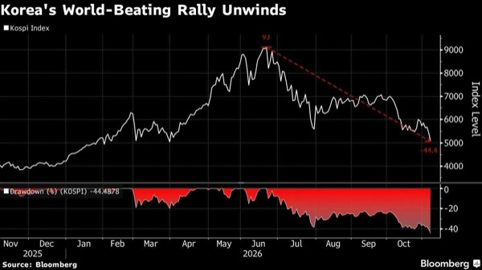

- 한국 증시의 지속적인 반등에는 이익 전망 안정과 매물을 받아줄 국내 장기자금 복귀가 함께 필요
  - 외국인 매도가 지속되고 개인까지 이탈하면 실적이 안정돼도 회복이 지연될 수 있음
  - 개인 저가매수에만 의존하는 수급은 부담이 크며 외국인 매도 강도 완화와 보유 주체를 확인해야 함
- 한국 개인투자자의 10월 미국 주식 매수가 50억 달러를 넘어서며 국내 위험자금의 해외 이동이 강화
  - 국내 매수 기반이 약해지면 외국인 매도와 이익 전망 악화에 필요한 가격 조정 폭이 커질 수 있음

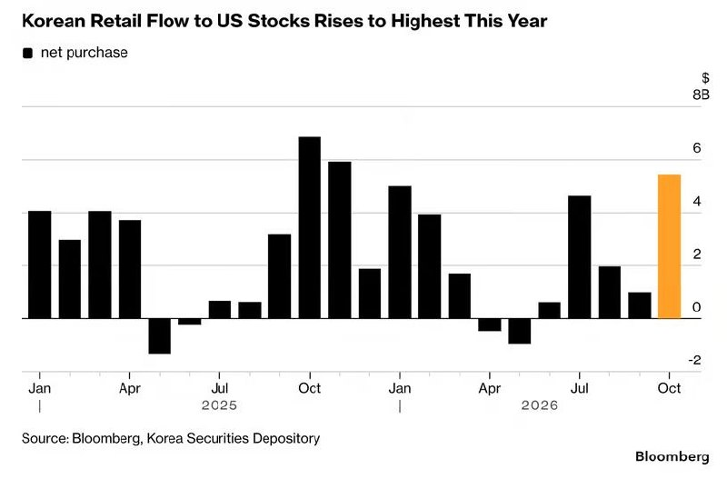

- 국내 증시의 자금 복귀에는 이익 성장이 주주환원과 주당 가치 상승으로 이어진다는 신뢰가 필요
  - 미국 기업의 이익 성장과 주가 회복에 대한 신뢰가 조정 시 추가 매수를 유도
  - 국내 반등이 투자금 회수와 해외 이전의 기회로 쓰이면 저평가가 장기화될 수 있음
- BofA 하트넷은 2026년 미국 중간선거를 AI 대형주 집중도의 정점 계기로 지목
  - 매그니피센트 7과 브로드컴·AMD·마이크론으로 구성된 AI Big 10의 미국 전체 증시 시가총액 비중은 41%
  - 민주당 승리로 생활비 부담과 데이터센터 증설에 대한 반발이 허가·전력·용수 조건 및 세제 혜택 재검토로 이어질 가능성

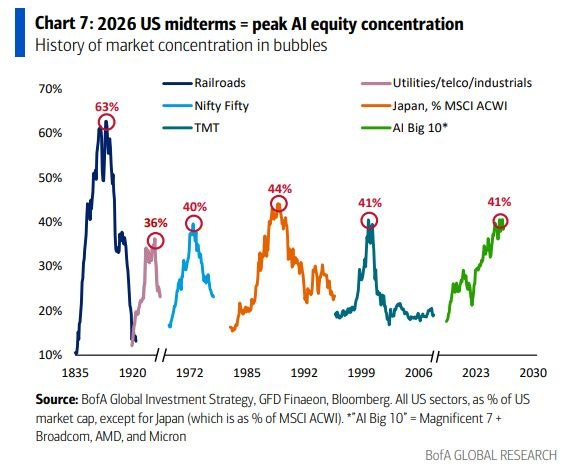

- 데이터센터 건설 지연은 AI 대형주의 상대적 우위와 2028년 약 2조 달러 CapEx 컨센서스를 약화시킬 수 있음
  - 텍사스가 2028년까지 예상되는 미착공 용량의 약 30%를 차지해 이연만으로도 투자 전망 하향 가능
  - 하트넷의 위험선호 회복 조건은 중앙은행 인상 사이클 종료, 미국 10년물 금리 4.5% 하회, 유가 배럴당 80달러 하회

# Kobeissi

- 반도체 변동성이 닷컴버블 시기 수준으로 확대
  - SOX는 최근 5거래일 21.8% 하락해 2001년 9월 이후 최대이자 역대 세 번째 낙폭 기록
  - 목요일 하루 12.3% 하락했으며 SOXL은 5거래일 60%, 6월 고점 대비 86% 하락

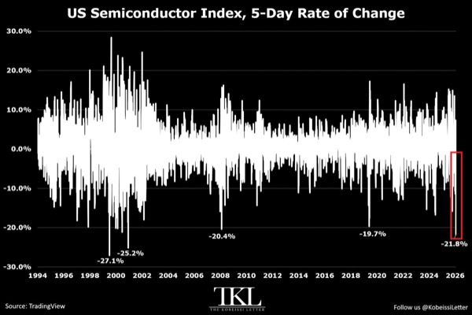

- 미국 모멘텀 매매의 청산이 급격히 진행
  - MTUM은 목요일 8.2% 하락해 2020년 3월 이후 최대 일간 낙폭 기록
  - 최근 5거래일 16%, 6월 고점 대비 27% 하락해 2025년 2~4월 조정 폭 25%를 넘어섬

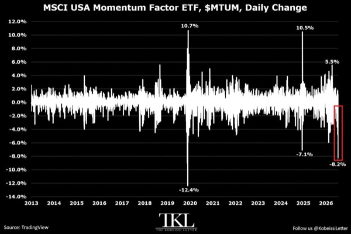

- 레버리지 ETF에 기록적인 자금이 유입된 상태에서 급락이 발생
  - 10월 16일 종료 주간 미국 레버리지 ETF 유입액은 95억 달러로 2006년 집계 이후 최대이며 종전 기록 45억 달러의 두 배 이상
  - 같은 주 SOXL에 70억 달러, TQQQ에 13억 달러 유입

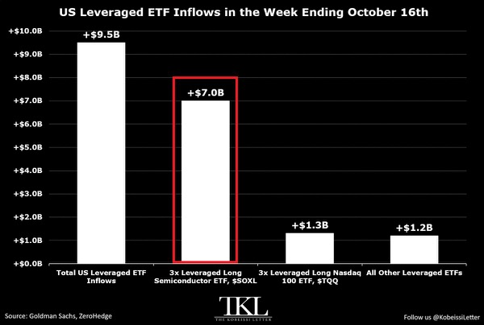

- Microsoft의 AI 클라우드 용량 임대 계약 종료 소식에 Oracle 주가가 5% 하락
  - ORCL은 사상 최고가 대비 68% 하락

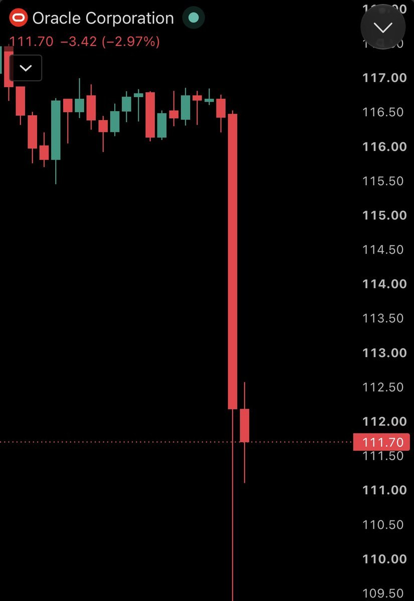

- 미국 개인투자자는 급락에도 저가매수를 지속
  - 11월 3일까지 22거래일 연속 약 330억 달러 매수하며 하루 평균 약 15억 달러로 최근 12개월 평균을 40% 상회
  - 연초 이후 매수액은 2,510억 달러로 2021년 연간 기록 2,410억 달러를 넘어섰고 전년 동기 대비 134% 증가

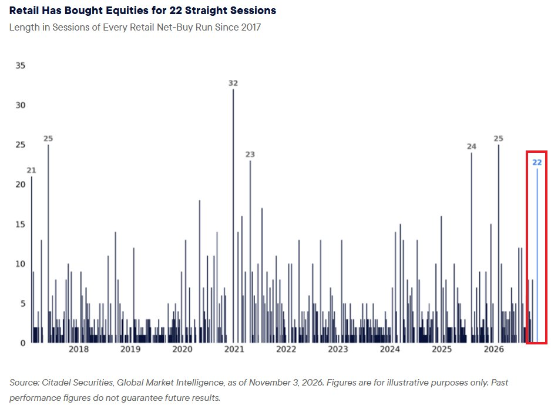

- 미국 9월 구인 건수가 33만 3천 건 증가한 752만 건으로 노동 수요 회복 신호
  - 전문·사업서비스가 10만 6천 건, 교육 제외 주·지방정부가 10만 4천 건 증가
  - 실업자 대비 구인 비율은 1.06으로 2025년 1월 이후 최고이며 구인 건수가 실업자 수를 41만 4천 건 초과

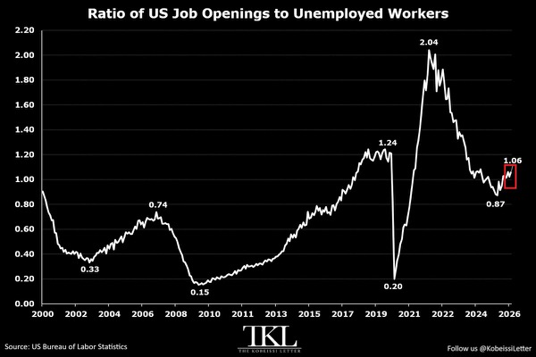

- 세계 해상 운송 중 원유가 사상 최대 12억 8천만 배럴로 늘어 단기 공급의 병목이 적기 인도로 이동
  - 최근 수주간 1억 8천만 배럴 증가했으며 호르무즈 해협·대체 경로의 중동 수출 회복에도 해상 체류가 장기화
  - 선박 간 환적, 우회 항로, 중동 외 수입선 다변화가 운항 기간을 늘려 정유사가 즉시 쓸 수 있는 물량을 제약

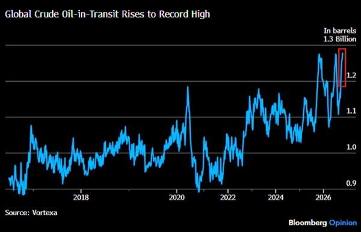

- 미국 9월 컴퓨터·주변기기·반도체 수입이 사상 최대 869억 달러로 증가
  - 전월 대비 121억 달러 증가해 역대 두 번째 증가 폭이며 전년 대비 151% 증가로 최고 기록
  - 2024년 초 대비 네 배 이상 늘었고 9월 기준 연율 환산 수입액이 처음으로 1조 달러를 초과

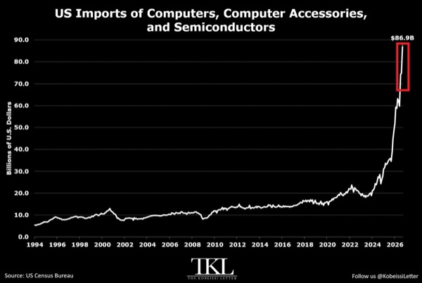

- Nvidia 첨단 칩의 중국 밀반입 의혹과 관련해 Megaspeed가 미국 당국의 조사 대상으로 부상
  - 피드가 인용한 FT 보도에는 Megaspeed 임원 Alice Huang의 중국 정보기관 연계 및 Jensen Huang과의 관계에 관한 미국 당국자 의혹이 포함됨
  - 해당 의혹의 사업상 영향은 불확실
- Berkshire Hathaway가 자사주와 주식 매입을 확대하며 자본 배치를 재개
  - 2026년 3분기 자사주 매입은 96억 달러로 두 배 이상 늘었고 연간 누적은 144억 달러
  - 연초 이후 주식 순매수는 112억 달러로 전년 동기 106억 달러 순매도에서 전환

# MKevin

### 고용 회복과 임금 반등에 커지는 금리 부담

- 미국 고용 증가세가 회복되며 경기침체 우려 완화
  - 비농업 고용 16만 5,000명 증가, 이전 달 증가분은 2만 9,000명에서 6만 명으로 상향 수정
  - 최근 두 차례 ADP 민간고용도 각각 8만 6,000명 증가해 회복 흐름 뒷받침
  - 지난해 여름 정체와 겨울 부진을 벗어나 고용 증가의 3개월·6개월 평균이 함께 개선
- 경제활동참가율이 61.8%에서 61.9%로 높아졌는데도 실업률은 반올림 기준 4.2%에서 4.1%로 하락
  - 가계조사 취업자 수가 9월 약 40만 명, 10월 46만 3,000명 늘며 노동시장 신규 유입을 흡수
  - 낮은 참가율의 정상화가 실업률 급등으로 이어질 위험은 남아 있지만 최근 고용 흡수력은 양호
- 시간당 평균임금 상승률이 예상보다 높아지며 노동자의 임금 협상력 회복
  - 이전 달 전월 대비 상승률은 0.1%에서 0.3%로 상향 수정
  - 이번 달은 예상 0.3%를 웃도는 0.4%로, AI 확산에 따른 채용·임금 압박 우려와 상반된 결과
- 고용 증가가 전문서비스·의료·물류·제조업으로 확산
  - 전문·사업서비스 7만 명 증가로 월평균 1만 5,000명을 크게 상회, 2025년 10월 저점 이후 누적 26만 9,000명 증가
  - 세부 항목인 전문·과학·기술서비스는 2만 3,000명, 행정·지원서비스는 2만 8,000명 증가
  - 의료 4만 2,000명, 창고업 2만 5,000명, 제조업 1만 9,000명 증가
  - 건설업은 3,000명 감소로 최근 증가 흐름이 꺾였고, 광업·석유가스·도소매·정보업은 큰 변화 없음
  - BLS와 ADP 모두 계절조정 수치이므로 반복되는 계절성 채용 효과는 조정에 반영
- 고용과 임금 호조는 경기에는 긍정적이지만 국채금리 상승 압력으로 작용
  - 발표 직후 미국 10년물 금리는 약 6bp 상승해 4.1% 부근
  - 영상에서 제시한 12월 금리 인상 확률은 74%로 상승
  - 금리 급등 여부가 주식시장 반응을 좌우하며, 영상에서는 4.9%를 기존 금리 고점 판단의 기준으로 제시
- 전일 주가 급락의 주요 원인으로 레버리지 ETF 재조정과 헤지펀드 청산 가능성 부각
  - 하락장에서 마진콜과 장 마감 무렵 ETF 재조정이 매도 압력을 증폭할 수 있음
  - 경기지표가 견조한 가운데 발생한 강제청산은 저가 매수 기회가 될 수 있다는 강세 관점 유지
- 데이터센터 규제 우려가 실제 공사 둔화로 이어지기까지는 시차 존재
  - 영상 기준 2027년 예정 데이터센터 건설의 86% 이상이 이미 지상 구조물 시공 단계
  - 주정부·의회의 규제 영향은 이르면 내년 중반부터 본격화할 수 있어 단기 실적과 장기 정책 위험을 구분할 필요
- 미국·이란 협상 진전은 추가 상승 촉매
  - 카타르가 중재하는 협상에서 이란이 기존에 배제했던 핵 프로그램 논의에 나설 가능성 제기
  - 전쟁과 선거 관련 변동성은 남아 있으며, 합의 기대가 실제 타결로 이어지는지 확인 필요
- 고용 회복만으로 주가 상승을 단정하기보다 임금 상승에 따른 금리 부담을 함께 점검
  - 실적 개선 기대와 할인율 상승이 동시에 작용하므로 국채금리 반응이 핵심 변수
- 단일 고용 발표보다 후속 수정치와 산업별 흐름의 지속성을 확인할 필요
  - 큰 폭의 상향 수정과 이례적인 전문서비스 채용 증가가 반복되는지, 건설업 감소가 확산하는지 점검

# PBoyle

### 북한 해킹이 드러낸 암호자산의 중앙화와 보안 허점

- 바이낸스에서 약 63억 달러 규모의 암호자산이 탈취됐으며, 대부분은 공격 시작 후 30분 안에 유출
  - FBI와 주요 블록체인 분석업체는 북한 해킹 조직 트레이더트레이터를 공격 주체로 지목했으며 북한은 연루를 부인
  - 전년 북한의 바이비트 해킹 피해액 15억 달러를 크게 웃도는 규모
  - 블록체인 원장보다 거래소 내부의 거래 승인·서명 체계가 무너진 사건
- 공격 진입점은 가짜 AI 코딩 도구와 위장 채용 과제였으며, 수개월에 걸쳐 내부 권한을 확대
  - 6월 지갑 담당 엔지니어가 검색 광고를 통해 가짜 설치 파일을 내려받았고, 보안팀의 기기 교체·인증정보 변경 전 담당 업무와 동료 정보가 노출
  - 9월 다른 엔지니어가 가짜 기업의 채용 면접을 거쳐 업무용 컴퓨터에 악성 과제를 내려받았으며 보안 소프트웨어는 이를 탐지하지 못함
  - 10월 20일 감염 기기와 내부 AI 도구로 다른 엔지니어 2명의 컴퓨터를 장악하고 소프트웨어 배포 토큰 확보
  - 29일 내부 지갑 서명 서비스에 접근해 정상 출금 절차를 우회하는 거래 전송
- 이더리움의 EIP-7702 권한 위임 기능과 내용 검증 없는 서명이 대규모 탈취를 가능하게 함
  - EIP-7702는 일반 지갑이 프로그램에 실행 권한을 위임하도록 설계된 편의 기능
  - 공격자는 계속 바뀌는 거래 순번에 대응해 서로 다른 순번의 위임 승인 50개에 서명을 확보했고, 그중 하나가 유효해지면서 지갑 통제권 획득
  - 이후 바이낸스의 추가 서명 없이 약 3분 만에 지갑 자산 대부분을 옮겼으며, 연결된 다른 계정에서도 USDC 8억2,000만 달러 탈취
  - 비트코인·XRP·트론 등에서는 서명 시스템이 공격자에게 보내는 일반 이체까지 승인
- 자동 보충과 분산된 키 관리가 공격 피해와 대응 지연을 키움
  - 공격 중 지갑에 자동 보충된 2억 달러도 72초 만에 유출
  - 출금 중단만으로 이미 블록체인에 등록된 위임 권한을 막을 수 없었으며, 권한 취소까지 거의 4시간 소요
  - 개인키 자체가 탈취되지 않아도 서명 서비스를 장악하면 자산 통제가 무력화될 수 있음
- 테더와 서클의 중앙집중적 동결 권한이 손실 확대를 제어
  - 탈취 자산 중 약 28억 달러가 두 회사의 스테이블코인이었으며, 약 24억 달러 동결
  - 테더가 먼저 주소를 차단하고 서클이 3분 뒤 동참했으며, 차단 주소에 추가로 유입된 토큰도 즉시 동결
  - 동결 토큰을 무효화하고 대체 토큰을 발행하면 바이낸스의 자산 회복이 가능하지만, 동결 자체가 즉시 반환을 뜻하지는 않음
- 거래 불가역성과 검열 저항성을 내세운 생태계가 위기에서는 출금 제한과 중앙 발행사의 개입에 의존
  - 바이낸스는 일요일 아침까지 출금을 중단하고 자체 자금으로 고객 손실 전액을 보전하기로 약속
  - 약관상 책임 제한이 있어 전액 보전 약속을 법적으로 확정된 권리로 보기 어렵다는 법률 검토도 제시
  - 2004년 북아일랜드 노던은행이 강탈당한 지폐를 폐기하고 새 지폐로 교체한 방식과 스테이블코인 무효화·재발행 구조가 유사
- 북한 해커는 동결을 피하려 스테이블코인을 발행사가 없는 자산으로 급히 교환
  - 약 4억3,400만 달러 규모의 테더를 이더로 바꾸는 과정에서 시세보다 12~26% 낮은 가격을 감수하며 수분 만에 5,000만 달러 이상 손실
  - 비트쿼리는 전체 교환 과정의 손실을 약 1억2,000만 달러로 추산했으며, 약 절반이 트레이더와 차익거래 봇의 수익으로 이전
  - 대규모 자금을 유동성이 얕은 시장에서 즉시 처분하면서 동결 회피 비용이 가격 충격으로 나타남
- 탈취 성공과 현금화 성공은 별개이며, 북한의 세탁 경로에도 처리 용량 한계가 존재
  - 첫 4일 동안 11개 블록체인과 약 1만2,000개 지갑을 이용했으며 평균 25초마다 새 지갑 개설
  - 엘립틱에 따르면 당시 현금으로 전환된 금액은 거의 없었고, 최종 출구로는 검증이 느슨한 장외거래 중개인이 거론
  - 2017년 탈취 자산도 미세탁 상태로 발견된 만큼 자금 회수와 세탁은 장기전이 될 수 있음
- 북한의 국가 지원 해킹은 제재와 관할권 밖에서 외화를 확보하는 수단
  - 한국 정보당국 추산 사이버전 인력은 약 8,400명이며 수학·과학 우수 학생을 일찍 선발해 훈련
  - 체이널리시스 기준 전년 북한의 암호자산 탈취액은 약 20억 달러로 전 세계 피해액의 약 60%
  - 미국은 제재 대상인 북한의 무기 개발 자금 유입과 미국 기업을 경유하는 세탁 경로를 추적
- 시장은 이번 사건을 거래소의 운영 사고로 받아들였으며 초기 충격은 FTX 붕괴보다 작았음
  - 비트코인은 약 5% 하락했으며, FTX 파산 당시에는 3일간 19% 하락
  - 바이낸스의 도난 자산 대체 매수와 자체 보전 능력이 충격을 완화
  - 바이비트 해킹 때도 초기 가격은 버텼지만 일주일 뒤 14% 하락한 전례가 있어 초기 안정만으로 후속 영향을 단정하기 어려움
- 거래소 신뢰와 관련 기업 주가의 반응은 엇갈림
  - 출금 재개 후 47억 달러가 빠져나갔으나 전체 자산의 약 3%에 그침
  - 다음 날 코인베이스 주가는 약 11%, 서클은 약 9% 하락했으며 코인베이스에는 거래 수익 44% 감소 실적도 겹침
  - 비상장 바이낸스에 대한 우려가 매도 가능한 상장 암호자산 기업으로 전이될 수 있음
- 비트코인으로 보유한 고객보호기금 SAFU는 이번 손실에 충분한 방어 수단이 되지 못함
  - 고객의 비트코인 채무를 비트코인으로 대비하는 방식은 자산·부채 일치에 유리하지만, 실제 피해에는 스테이블코인과 이더도 포함
  - 탈취된 비트코인만으로도 기금 규모를 초과했으며, 사건 뒤 가격 하락으로 기금 가치가 약 1억 달러 감소
  - 보전 자산의 가격이 사고와 함께 하락하면서 필요한 시점에 지급 여력이 줄어드는 구조
- 바이낸스는 동결 자산 회수와 거래 수수료 수익으로 손실을 감당해야 함
  - 총피해 63억 달러 중 절반에 못 미치는 금액을 스테이블코인 동결분에서 회수할 것으로 기대하며, 당장은 자체 자금 투입
  - 경영진은 연간 수익으로 손실 보전이 가능하며 스페이스X 지분을 팔 필요가 없다고 강조
  - 피해 규모가 암호자산 보험시장 전체를 웃돌아 외부 보험으로 손실을 이전하기도 어려움
- 사고 대응 속도와 전액 보전 능력이 보안 실패에 대한 시장의 제재를 약화
  - 바이낸스는 북한 관련 의심 공격 57건을 막았지만 위장 채용과 내부 AI 도구를 통한 권한 확장은 차단하지 못함
  - 고객 이탈과 가격 충격이 제한되면서 보안 수준보다 손실을 감당할 재무 규모가 신뢰를 좌우
- 바이낸스의 규제 준수 위험은 해킹과 별도로 지속
  - 2023년 미국 자금세탁방지·제재법 위반을 인정하고 43억 달러 벌금을 냈으며, 10만 건 이상의 의심 거래 미신고가 문제
  - FT가 확보한 내부 자료에는 거액이 오간 의심 계정과 부실한 신원 확인 사례가 포함
  - 이란산 원유 불법 거래 대금 세탁 의혹과 연결된 계정도 거론됐으나, 바이낸스는 해당 소송이 회사의 위법행위를 주장하지 않으며 엄격한 통제를 유지한다고 반박
  - 일부 의심 거래는 2023년 유죄 인정과 미국의 준법감시 도입 이후에도 발생
- 암호자산 시장의 핵심 위험은 소수 거래소와 스테이블코인 발행사에 집중
  - 최대 거래소의 보유 자산은 차순위 경쟁사의 약 6배이며 스테이블코인 발행도 두 회사에 집중
  - 위기 대응은 거래소의 출금 통제·자체 대차대조표와 발행사의 동결 권한에 의존
- 자산 보관의 안전성은 개인키 보안뿐 아니라 서명 내용 검증, 소프트웨어 배포 권한, 내부 도구의 접근 범위, 긴급 권한 회수 속도까지 함께 봐야 함
- 고객보호 준비금은 전체 금액과 함께 자산별 채무 대응력, 동시 가격 하락, 즉시 동원 가능성을 점검해야 함
- 불가역적 결제는 정상 이용자와 탈취자에게 똑같이 적용되며, 중앙 통제의 제거가 피해 복구 수단의 제거로 이어질 수 있음

# Slav

- 반도체 극단적 매도 이후에는 역사적으로 큰 반등이 나타나는 경향
  - 도이체방크 집계에서 SOX 최악의 9개 거래일 이후 3개월·12개월 평균 수익률은 각각 23.3%·48.8%이며 9회 중 6회 플러스 수익률 기록
  - 목요일 SOX는 약 12%, S&P500은 약 4% 하락했으며 해당 자료는 SOX 출범 이후 두 번째로 부진한 하루로 분류

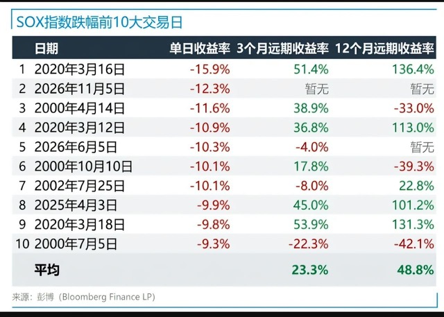

- Nvidia CEO Jensen Huang과 중국 스파이 의심 인물의 관계에 관한 FT 보도가 등장
  - 미국 정보당국이 제기한 의혹으로 확인된 사실과 구분할 필요

# Stockbot

- OpenAI가 3월 투자 라운드보다 약 50% 높은 기업가치로 자금조달 협상을 진행
  - CFO Sarah Friar가 협상을 확인하고 AI 수요가 실재한다고 강조
- 대만이 TAIEX의 2001년 이후 최악의 주간 하락에 대응해 5,000억 대만달러 규모 증시 구제기금을 가동
  - 11월 9일부터 공매도 제한 시행
- 호르무즈 해협 주변 군사 충돌과 휴전 협상이 동시에 진행되며 중동 긴장이 지속
  - 이란 케슘섬 공습과 폭발·미사일 발사 소식이 전해졌으며 이란군의 야간 드론 사격도 보도됨
  - JD Vance는 새 휴전을 위한 이란과의 직접 대화를 제안하고 카타르·파키스탄 중재자와 거의 매일 협의
  - 미국은 재공격 대비 태세를 유지하고 이란은 전쟁 재개에 대비하며 이라크 외무장관도 역내 전쟁 재발 가능성을 언급
