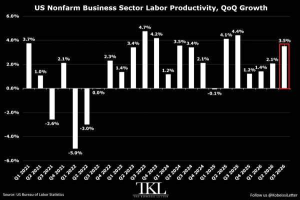
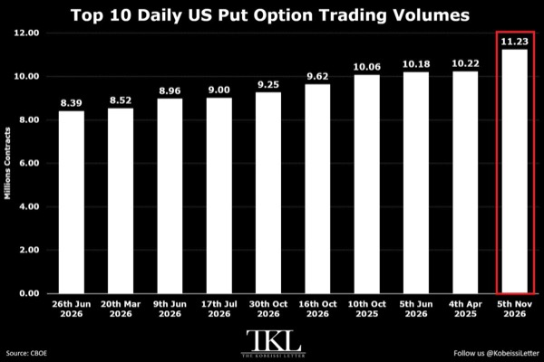
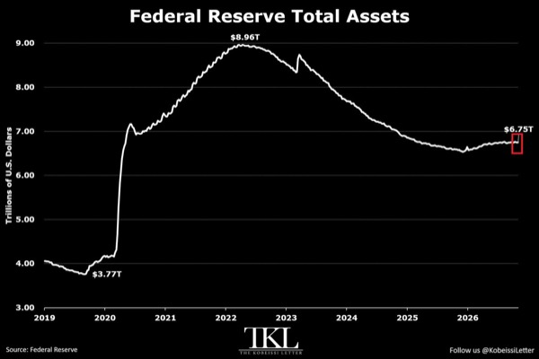
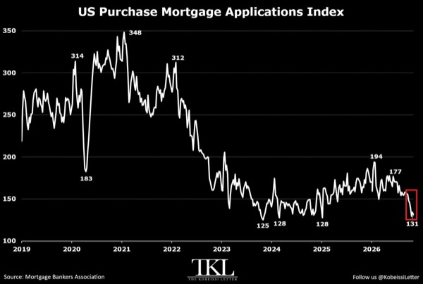
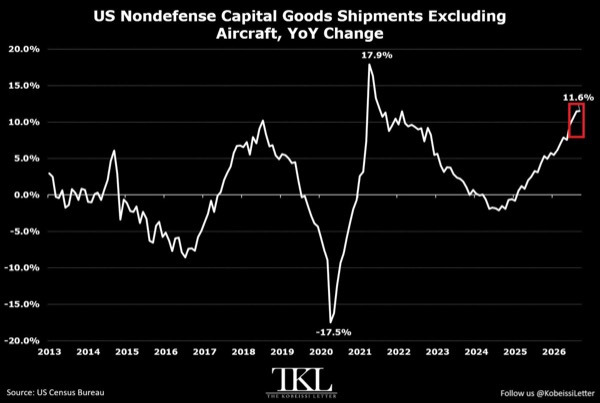
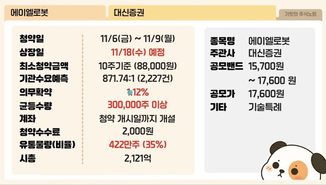
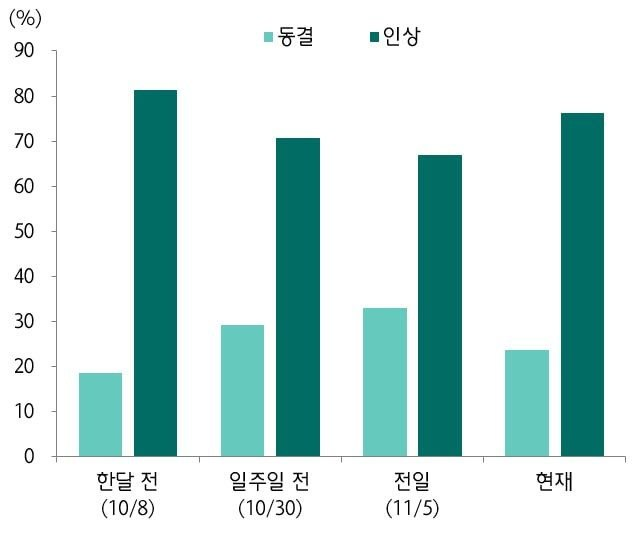

# Kobeissi

- AI·소프트웨어·설비 투자가 미국 생산성을 끌어올리며 단위노동비용을 낮추는 흐름
  - 2026년 3분기 비농업 노동생산성은 연율 3.5% 증가하며 3분기 연속 개선, 비농업 기업 산출은 3.7% 증가
  - 시간당 보상 증가율은 2.9%로 생산성 증가율을 밑돌았고, 단위노동비용은 0.7% 하락해 2025년 2분기 이후 첫 감소

- 미국 풋옵션 거래가 사상 최대 수준으로 확대
  - 목요일 CBOE 풋옵션 거래량은 1,123만 계약으로 종전 최고치인 2025년 4월 4일의 1,022만 계약을 상회
  - 20일 평균은 약 700만 계약으로 2022년의 약 400만 계약보다 높고, 역대 일간 거래량 상위 10회 중 8회가 2026년에 발생

- 연준 대차대조표가 다시 확대되며 국채 보유 증가와 MBS 축소가 동시에 진행
  - 11월 4일 종료 주간 총자산은 30억 달러 늘어난 6조7,500억 달러로, 2025년 12월 저점 대비 2,120억 달러 증가
  - 같은 기간 국채는 3,900억 달러 늘어난 4조5,800억 달러, MBS는 1,700억 달러 줄어든 1조8,800억 달러
  - 총자산은 팬데믹 이전보다 2조9,900억 달러, 80% 높은 수준

- 7%대 모기지 금리가 미국 주택 매수 수요를 압박
  - 주택구입 모기지 신청지수는 전주 대비 2% 하락한 131로, 1995년 이후 여섯 번째로 낮고 1월 대비 32% 감소
  - 신청 수준은 2019년보다 50% 낮으며, 30년 고정 모기지 금리는 2월보다 120bp 오른 7.18%로 7주 연속 7% 상회

- AI 인프라 투자가 미국 핵심 자본재 출하와 컴퓨터 관련 주문 급증을 견인
  - 9월 항공기 제외 비국방 자본재 출하는 전년 대비 11.6% 증가한 사상 최대 860억 달러로, 2021년 7월 이후 가장 빠른 증가율
  - 최근 3개월 연율 증가율은 16.5%로 팬데믹 회복기를 제외하면 2011년 이후 최고, 2024년 10월 대비 출하액은 120억 달러 증가
  - 컴퓨터·서버·저장장치 및 관련 장비 주문은 전년 대비 27% 늘어 1997년 1월 이후 최대 증가율

- 중간선거 결과 이후 11월 5일 미국 증시 시가총액 3조 달러 감소가 정치적 쟁점으로 부각
  - 트럼프는 선거 결과를 미국의 역사적 후퇴로 평가하며 증시 손실을 언급
- 이번 주 미국 물가지표와 연준 발언이 변동성을 키울 가능성
  - 화요일 10월 CPI, 수요일 OPEC 월간 보고서, 목요일 신규 실업수당 청구와 10월 기존주택 판매, 금요일 10월 PPI 발표 예정
  - 주간 연준 인사 발언 일정은 총 17건

# Slav

- 월요일 에이엘로봇 공모주 청약은 균등배정 수준으로 참여
  - 주관사는 대신증권
- 하나에어로다이내믹스·씨엔엠·엠비디·제이앤티지는 수요예측 결과 확인 후 청약 여부 결정
  - 하나에어로다이내믹스는 화~수요일 IBK, 씨엔엠은 목~금요일 한국투자증권에서 청약
  - 엠비디는 목~금요일 하나증권, 제이앤티지는 목~금요일 대신증권·NH투자증권에서 청약
- 이번 주 신규 상장은 화요일 동원파츠, 수요일 바로팜, 목요일 넥스아이 일정 확인

- 고용보고서 확인 후 12월 FOMC 금리인상 확률이 76.3%로 반등
  - CME FedWatch 기준 11월 5일 목요일보다 약 10%p 상승
  - 11월 10일 미국 10월 CPI 발표가 다음 주요 확인 지표
  - 12월 FOMC는 12월 8~9일 개최되며, 결과는 한국시간 12월 10일 새벽 확인 예정

# Stockbot

- 미국·이란 충돌이 호르무즈 해협과 아라비아해로 확대됐다는 보도
  - 트럼프가 선거 이후 첫 군사행동으로 이란에 소규모 공습을 명령했다는 보도에 이어, 호르무즈 해협에서 양국 군의 교전과 이란 남부 폭발 소식이 발생
  - 이란이 아라비아해 미 해군 함정에 대함 탄도미사일을 발사했다는 보도가 나왔으나, 타스님은 케슘섬 폭발이 미사일 공격과 무관하다고 전함
- Berkshire Hathaway가 분기 자사주 매입을 두 배인 96억 달러로 확대했지만 영업이익은 감소
  - 영업이익은 5.8% 감소한 127억 달러, 보험 인수이익은 43% 감소
- Anthropic이 AI 데이터센터용 전력을 직접 생산할 수 있는 34억 달러 규모 가스발전 계약 체결
- 중간선거 결과 이후 11월 5일 미국 증시 시가총액 3조 달러 감소에 트럼프가 정치적 비판 제기
  - 선거 결과로 미국이 역사적으로 크게 후퇴했다고 평가
- 목표가 도달을 확신하면 추가 수익을 놓칠 두려움 때문에 사전에 정한 청산 규칙을 어길 위험
  - 정해진 보유 시간이 끝나면 청산하고 당시 감정과 청산 지연 여부를 기록하는 시간 제한 훈련으로 행동 점검
  - 손실 제한은 계속 유지하며, 시간 만료를 기다리기 위해 추가 손실을 감수하지 않음
  - 수익 창출 전략이 아닌 행동 훈련이며, 청산 뒤 목표가에 도달해도 사전에 그 결과를 알 수 있었던 것은 아님

# YDental

### 비트코인 7만5천 달러 지지와 반등 확인 조건

- 비트코인 반등의 핵심은 7만5,000달러 회복과 유지 여부
  - 7만4,600~7만4,900달러를 일시 이탈해도 7만5,000달러를 되찾고 재차 눌릴 때 지키면 반등 가능성 유지
  - 회복에 실패하고 반등마다 이전 가격대에 막히면 기존 지지 전제를 재검토하고 더 낮은 가격대의 박스권 형성에 대비
- 11월 4일 밤 7만8,900달러 돌파 이후 안착에 실패했고, 기술주 급락과 함께 7만6,000달러 아래로 후퇴
  - 11월 5일 나스닥은 AI 데이터센터 투자 우려로 5.5% 하락
  - 뒤이어 발표된 강한 미국 고용과 임금 상승은 금리 부담을 유지하는 요인
  - 이미 나온 악재만으로 추가 하락을 확정할 수는 없음
- 미국 비트코인 현물 ETF의 자금 이탈이 반등 지속성을 제약
  - 11월 5일 약 4억3,000만 달러, 한 주 합계 약 12억8,000만 달러 순유출
  - 가격 반등만으로 현물 수요 회복을 판단하기 어려우며, 순유출 둔화가 동반되는지 확인 필요
- 11월 8일 가격은 7만5,700달러대로 일봉 200일 이동평균선 약 7만6,500달러 아래
  - 이동평균선은 반등 강도, 기존 저점인 7만4,900달러는 강세 구조 유지 여부를 판단하는 기준
  - 이동평균선의 일시 회복과 추세 전환을 구분해야 함
- 7만4,600~7만4,900달러는 청산 유동성과 일봉 저점이 겹치는 핵심 관찰 구간
  - 청산 히트맵은 잠재 청산 위치의 추정치이며 실제 현물 매수 주문이나 반등 보장을 의미하지 않음
  - 포지션 변화에 따라 지도가 바뀌고 기간별 색상 기준도 달라 밝기나 먼 유동성 띠만으로 방향을 단정할 수 없음
- 11월 7일 새벽 7만4,800달러 부근까지 하락한 뒤 7만5,000달러를 회복했지만 바닥 확정은 이른 단계
  - 이후 반등이 주말 고점을 넘지 못해 회복 가격의 유지와 후속 저점·고점 변화 확인 필요
- 단기 회복은 7만6,000달러 부근과 주말 고점인 7만6,200달러 돌파 여부가 관건
  - 저항을 넘지 못한 채 저점을 재시험하면 단기 분배 가능성 확대
  - 저항과 주말 고점을 되찾으면 약한 반등만 반복된다는 가정도 재검토
  - 5분봉의 분배 가능성만으로 일봉 하락을 확정할 수 없음
- 하단 지지 이후에도 중기 하락 종료까지는 추가 확인 단계가 필요
  - 가까운 저항과 일봉 200일 이동평균선을 회복한 뒤 급락으로 생긴 가격 공백인 FVG 진입 여부를 관찰
  - 4시간봉 200일 이동평균선은 약 7만9,800달러이며, 가격 공백을 반드시 전부 채우는 것은 아님
- 다음 변동성 요인은 원문 기준 한국시간 11월 10일 오후 10시 30분 CPI와 13일 같은 시각 PPI 발표
  - 강한 고용 이후 물가와 금리 해석이 충돌할 수 있어 발표 직후 첫 방향보다 가격 안착 여부가 중요
- 지지 구간 매매는 가격 도달보다 이탈 후 회복과 재시험 통과 여부를 중심으로 판단
  - 급변 시 손절 주문의 체결 가격이 달라질 수 있으며, 짧은 시간봉 사용이 작은 손실을 보장하지 않음
- 반등의 신뢰도는 7만5,000달러 유지, 가까운 저항 회복, 현물 ETF 유출 둔화가 함께 나타날수록 높아짐
- 단기 지지 성공과 중기 추세 전환을 구분하고, 회복 조건이 불분명하면 관망
