# Harvey

- 주요국의 12월 금리 인상 기대가 겹치며, 2027년 시장의 핵심 변수는 인상 이후 고금리 유지 기간
  - 연준은 25bp 인상 약 두 차례를 반영하며 첫 인상은 2026년 12월, 추가 인상은 2027년 상반기로 예상
  - 12월 인상 확률은 ECB OIS 78.6%, 뉴질랜드 60.4%, 영란은행 54.7%, 일본은행 52.5%
  - 임금·서비스 물가가 둔화하면 실제 연준 인하 전에 2027년 말 예상 금리부터 하락할 여지
  - 포지션 확대 계기는 인상 발표보다 이후 물가 지표에서 나올 가능성

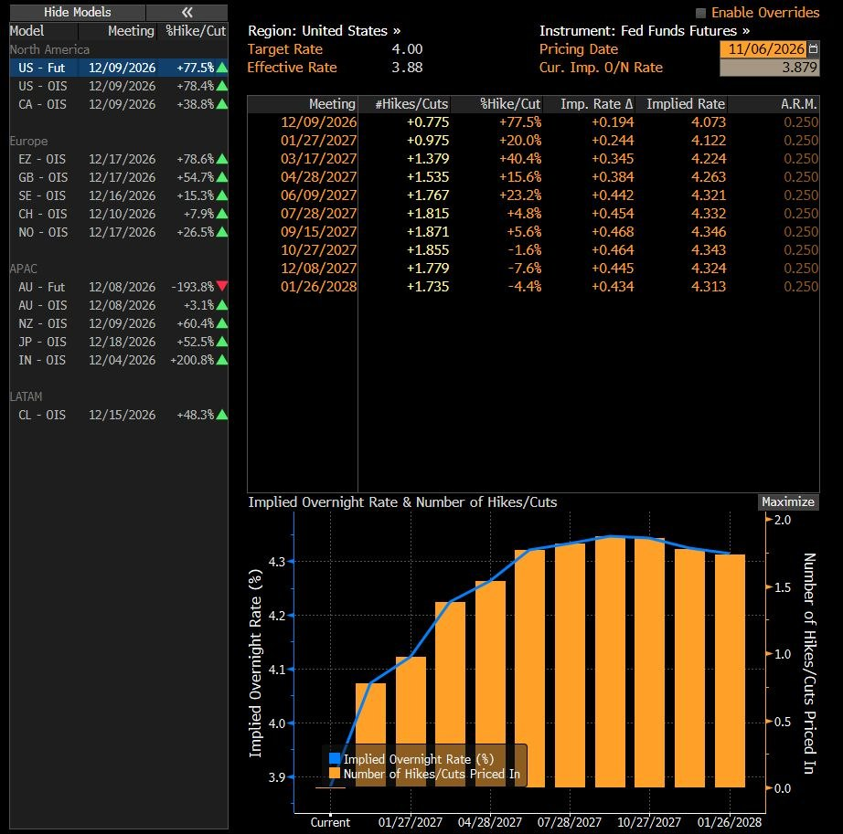

- 버크셔의 올해 두 번째 엔화채 발행 추진은 일본 기업 장기 투자와 엔화 자금 조달 경로에 대한 신뢰를 뒷받침
  - 미즈호 등을 대표주관사로 선정했으며, 높아진 조달비용과 현재 주가에도 추가 투자할 일본 기업이 있다는 긍정적 신호
  - 2025년 말 일본 5대 종합상사 투자원금은 153억8,200만 달러, 지분 시가는 353억6,800만 달러, 2025년 수취 배당은 8억6,200만 달러
  - 장기물까지 안정적으로 소화되면 일본 시장의 대규모 장기 자금 공급 능력에 대한 신뢰가 강화될 것

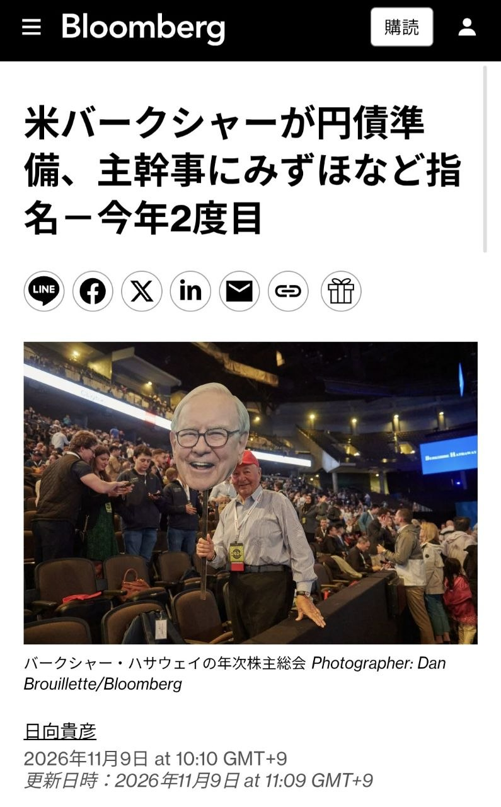

# KHwanK

### 급락한 한미 증시의 반등 조건과 경기 침체 변수

- 11월 첫째 주 코스피는 11.7%, S&P 500은 2.7%, 나스닥은 3.4% 하락
  - 미국 민주당의 양원 장악 이후 데이터센터 규제 강화 우려가 반도체·AI주 하락으로 연결
  - 반도체 비중이 높은 한국의 낙폭이 미국보다 크게 확대됐으며, 코스피는 1980년 이후 최악의 11월 첫 주 기록
  - AI는 미국 성장과 대중국 기술 경쟁의 핵심이므로 규제로 경쟁력을 포기할 유인은 작음
- 코스피의 이번 낙폭은 과거 사례와 직접 비교하기 어려운 극단값이며, 미국 시장의 계절성이 간접적인 판단 기준
  - 1987년에는 11월 첫 주 약 5% 하락 후 1987~1988년 상승했고, 2025년에도 11월 약세 이후 반등
  - 이번에는 하락 폭이 훨씬 커 과거 반등 경로를 그대로 적용하기 어려움
- 미국 증시는 11월 첫 주 급락 후 남은 11월에도 약세가 이어질 가능성이 높음
  - S&P 500의 11월 둘째~넷째 주 상승 확률은 평소 69%에서 첫 주 급락 시 40%로 하락
  - 12월에는 S&P 500의 반등 사례가 많았지만, 나스닥은 약세가 이어진 사례가 상대적으로 많음
- 다음 해 4월 말까지의 회복을 가르는 핵심 변수는 경기 침체 발생 여부
  - S&P 500의 11월 첫 주 수익률이 음수였던 26개 사례 중 이후 침체가 발생한 경우는 6개
  - 침체가 발생하면 다음 해 4월 말까지 추가 하락하는 경향이 있었고, 침체가 없으면 반등 확률은 약 70%
  - 침체가 없었던 사례는 하락하더라도 손실 폭이 작았음
- 시장의 침체 확률 25~30%와 과거 침체 발생 빈도 사이에 큰 차이 존재
  - 영상에 제시된 미국 침체 발생 빈도는 1945년 이후 약 13.6%, 1983년 이후 약 7%
  - 이를 바탕으로 한 영상의 침체 확률 추정치는 약 10%이며, 2027년 침체 없이 주가가 반등하는 경로에 무게
  - 장기 평균 발생 빈도만으로 현재의 경기 조건을 반영한 침체 확률을 확정할 수는 없음
- 경제학자 컨센서스의 침체 예측력에는 한계가 큼
  - 영상이 인용한 IMF 연구에서 63개국의 1992~2014년 침체 153건 중 전년 예측에 성공한 사례는 5건
  - 침체가 진행 중인 해의 10월에도 118건만 포착해 35건을 놓침
  - 전년에 강하게 침체를 예상한 13건 중에서도 62%가 빗나가, 침체 경고와 실제 발생을 구분할 필요
- 미국이 침체를 피하고 반등하면 한국 증시도 동반 회복할 가능성이 높음
  - 영상에 제시된 한미 증시 상관계수는 약 0.85
  - 1997년 외환위기 이후 코스피가 홀수해마다 상승했다는 계절성도 2027년 회복 기대를 뒷받침하는 보조 근거
- 남은 11월의 약세 가능성과 다음 해 4월 말까지의 회복 가능성을 구분해 투자 기간을 판단할 필요
  - 12월에는 S&P 500과 나스닥의 흐름이 달라질 수 있어 미국 지수 전체의 동반 반등을 전제하기 어려움
- 침체 예측의 낮은 적중률은 낙관 전망의 확실성을 보장하지 않으며, 실제 경기와 기업 실적의 악화 여부를 함께 점검할 필요
- 한국의 홀수해 상승 기록과 한미 증시 상관관계는 보조 지표이며, 반도체 집중도와 AI 규제 변화에 따른 추가 변동성도 고려할 필요

# Kobeissi

- 미국 상업용 부동산의 CMBS 연체율 상승세가 지속
  - 10월 다가구 주택 CMBS 연체율은 전월 대비 5bp 오른 8.1%로 2016년 이후 최고이며 2024년 대비 4배 이상
  - 오피스 CMBS 연체율은 17bp 오른 12.3%로 2026년 1월 사상 최고치와 같고, 금융위기 이후 2012년 고점 약 10.8%를 상회

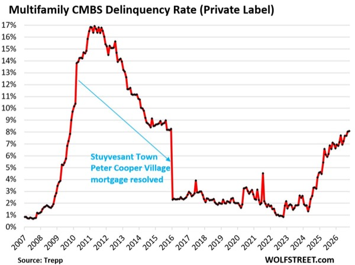

- S&P 500 급락 이후 반등 통계와 기술주 저가 매수세가 회복 기대를 뒷받침
  - 지난 목요일 4.4% 하락은 2025년 4월 이후 최대 낙폭
  - 1952년 이후 앞선 56차례의 4% 이상 일간 하락 뒤 평균 수익률은 1주 1.0%, 1개월 2.0%, 3개월 6.7%로 전체 기간 평균 0.2%, 0.8%, 2.2%를 상회
  - 당일 선물은 초기 변동성을 회복해 S&P 500 +0.7%, Nasdaq 100 +0.5%, 다우 +1.1%를 기록했고, 이후 S&P 500은 100포인트 이상 상승
  - WTI·브렌트유는 약 3% 하락하고 유가는 배럴당 90달러 아래로 내려갔으며 금은 1.1% 상승

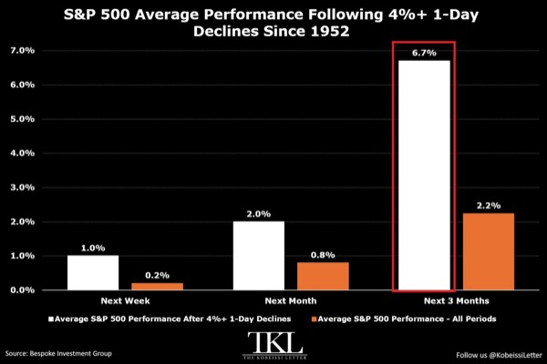

- 미국 고용은 낮은 실업률과 제조업 일자리 회복으로 견조한 흐름
  - 실업률 5% 미만이 62개월 이어져 역대 두 번째로 길며, 최장 기록인 64개월에 근접
  - 10월 제조업 고용은 1만9,000명 증가했고 5개월 연속 증가분은 8만6,000명
  - 제조업 총고용은 1,268만 명으로 2024년 12월 이후 최고지만 2023년 1월보다 22만2,000명 적음

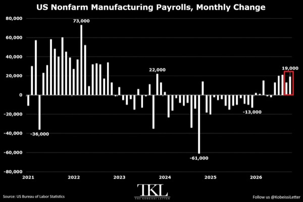

- 글로벌 금리 인상 사이클이 다시 가속
  - 최근 3개월간 중앙은행 약 45%가 금리를 올려 3년 만에 최고 비중이며, 3월보다 약 40%포인트 상승
  - 최근 6개월 인상 횟수는 42회로 2023년 말 이후 최다이며, 7개월 전의 약 4배

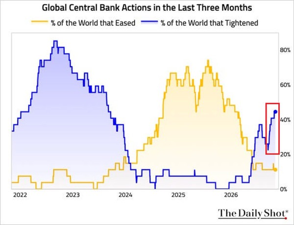

- 미국 M2 증가 속도가 빨라지며 통화 공급이 사상 최고치 경신
  - 8월 M2는 전월 대비 1,130억 달러 늘어난 23조4,100억 달러
  - 전년 대비 증가율은 5.7%로 2022년 5월 이후 최고이며 3개월 연속 가속
  - 2026년 월평균 증가액은 1,360억 달러로 2025년 720억 달러보다 89% 큼

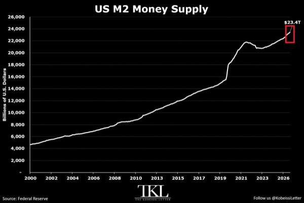

- Nvidia 경영진 관련 의혹 보도가 NVDA와 미국 지수 선물의 단기 변동성을 확대
  - 원문은 Jensen Huang과 중국 정보요원 간 관계 의혹 및 이사회 독립 조사를 전했으며, 중국은 정보기관 연루 의혹을 부인
  - Nasdaq 100 선물은 초기 1% 이상 하락했다가 약 7분 만에 상승 전환
  - NVDA는 프리마켓 개장 후 5% 이상 하락하며 시가총액 약 2,250억 달러 감소

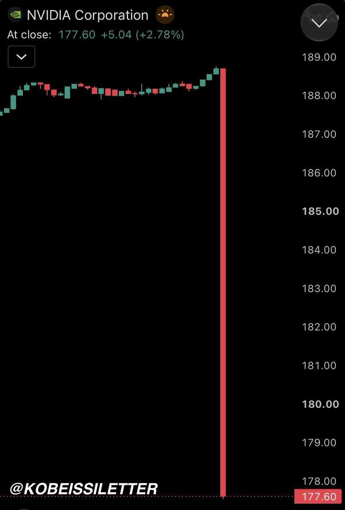

- AI 데이터센터 투자와 일반 오피스 건설의 격차가 사상 최대
  - 9월 데이터센터 건설 지출은 전년 대비 90% 늘어난 연율 965억 달러로 사상 최고이며, 2024년 초 대비 약 4배
  - 일반 오피스 건설 지출은 전년 대비 8% 감소한 460억 달러로 두 부문 격차가 505억 달러까지 확대
  - 미국 전체 건설 지출은 전월 대비 1.9% 감소해 2020년 4월 이후 최대 낙폭

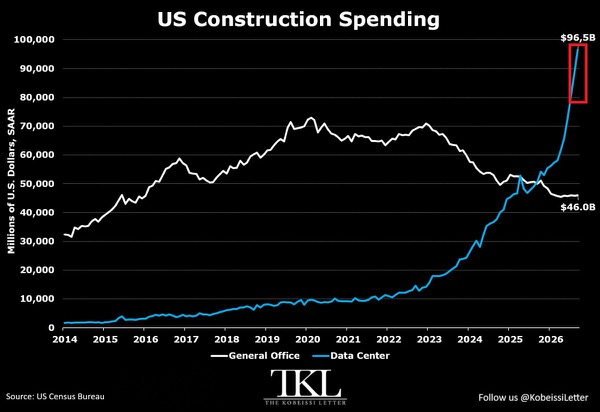

- 미국 트럭 운송업은 비용 상승과 매출 부진으로 파산 압박 심화
  - 2026년 현재 221개 업체가 파산 신청해 연간 기준 23년 만에 최대 수준으로 향하고 있으며, 3년 연속 220개 이상
  - 소형 운송업체 약 66%는 매출이 전년 대비 정체 또는 감소했고, 약 40%는 향후 6개월 내 업계 이탈을 예상하거나 사업 지속 여부가 불확실
  - 경유 가격·보험료·금리 상승이 소형 업체의 수익성을 압박

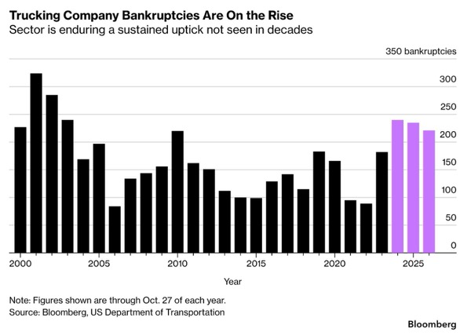

- 구리 광산주가 장기 연속 하락하며 여름 상승분을 반납
  - COPX는 2010년 상장 이후 최장인 11주 연속 하락했고, 이 기간 24.7% 떨어져 12월 중순 이후 저점 부근
  - 연초 대비 수익률은 8월의 +34.8%에서 -0.4%로 반전
  - 구리 선물은 최근 4주간 6.7% 하락한 파운드당 6.28달러로 7월 중순 이후 최저

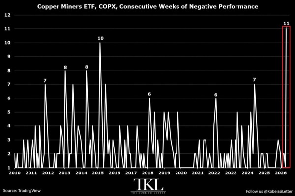

# MKevin

### 이란 봉쇄 확대와 핵합의 기대 후퇴

- 미국의 대이란 압박이 해상 봉쇄·경제 제재·육상 물류 차단으로 확대되며 조기 핵합의 기대 약화
  - 새 태스크포스 아이언게이트는 약 20명 규모로 미 중부사령부와 정부 기관의 제재 집행을 연계
  - 이란 육상 국경과 카스피해를 통한 첨단 무기·이중용도 기술·제재 대상 물자·불법 수익 이동 차단이 목표
- 카스피해는 이란과 러시아의 무기·드론 공급망을 압박할 새로운 전선
  - 러시아 내륙 수로와 연결돼 이란이 러시아 내 생산시설과 운송망을 활용할 수 있는 경로
  - 러시아 영토의 생산시설을 직접 공격하면 미·러 충돌 위험이 커져 운송 차단과 제재 집행의 중요성 확대
- 호르무즈해협에서는 이란의 유조선 공격과 기뢰 설치가 이어져 에너지 운송 불안 지속
  - 미국의 봉쇄를 통과할 수 있는 우방국 선박도 이란의 고속정과 선체 부착형 기뢰 위협에 노출
  - 미국의 봉쇄 강화와 이란의 선박 공격이 맞물려 상호 압박이 확대되는 구도
- 카타르 중재 협상은 계속되지만 핵심 장애물은 합의 이행 순서와 상호 불신
  - 미국은 호르무즈해협 개방·국제원자력기구 사찰·고농축 우라늄 농축도 하향을 동시에 추진하고 동결 자금은 일부만 반환하려는 입장
  - 이란은 해협 개방과 핵물질 양도로 협상력을 잃은 뒤 재공격받을 위험을 우려해 단계적 이행 요구
  - 미군의 역내 주둔과 재공격 가능성이 이란의 안전보장 요구와 충돌
- 새 중재안은 미국의 봉쇄 해제 후 이란의 선박 공격·기뢰 설치 중단 시한을 기존 7일에서 2일로 단축하는 방향
  - 이행 시차 축소는 진전이지만 누가 먼저 양보하고 상대의 이행을 어떻게 보장할지가 관건
- 미국은 11월 5일 이란 핵제안을 검토 중이며 이란도 11월 6일 카타르 중재안을 검토한다고 발표
  - 트럼프와 카타르 군주도 11월 6일 통화하며 협상 지속
  - 이란 최고지도자의 협상 승인과 정부에 대한 권한 위임은 합의가 내부에서 뒤집힐 위험을 낮추는 긍정적 신호
- 협상 지속과 별개로 제한적 군사행동이 재개돼 긴장 완화 신호는 약함
  - 미국은 케슘섬 공격을 이란의 공격 준비에 대응한 방어적 타격으로 규정
  - 11월 7일에는 이란을 떠나던 화물선 MV Huda의 선미에 미군 항공기가 사격
  - 이란 일부 세력은 국제원자력기구를 적의 협력자로 규정해 사찰 재개에도 마찰 가능성
- 11월 9~10일 공격 가능성은 어두운 달빛이 작전에 유리하다는 관측에 기반하며 확정된 일정은 아님
  - 이란은 미·이스라엘의 공격 준비를 포착하면 역내 기지를 선제 타격할 가능성도 거론
  - 선제공격과 보복이 이어지면 제한적 충돌이 전면전으로 확대될 위험
- 영상은 공화당의 상·하원 패배를 전제로 연말까지 약 6~7주를 트럼프의 군사행동 집중 가능 구간으로 제시
  - 2027년 1월 새 의회 출범 이후에는 민주당의 전쟁 견제 압력이 커질 수 있음
  - 선거 전 합의를 유도하던 정치적 유인은 사라졌고 새 의회 출범 전 압박 강화 유인은 남은 상태
- 유라시아그룹은 2026년 내 합의 가능성을 약 10%, 합의 전 추가 타격·분쟁 확대 가능성을 약 60%로 평가
  - 영상에서 확인한 예측시장 핵합의 확률은 2027년 3월 이전 약 17%, 2027년 10월 이전 약 25%
  - 2028년 1월 이전 합의 확률도 하락 추세로 단기뿐 아니라 장기 협상 전망도 악화
- 유가는 여름철 고점권에 머물며 협상 실패와 공급 차질 위험을 반영
  - 민주당의 합의 압박 기대가 최근 유가 하락을 도왔지만 군사 충돌과 해협 운송 불안은 계속 부담
  - 핵합의가 임박했다는 기대가 약해지면 합의 타결을 촉매로 한 증시 급등 기대도 축소
- 협상 진전 여부는 낙관적 발언보다 봉쇄 해제·선박 공격 중단·사찰 허용의 실제 이행으로 판단할 필요
  - 압박 수단 신설과 군사행동 재개는 협상이 진행돼도 위험이 낮아졌다고 보기 어려운 신호
- 에너지 공급 위험과 핵합의 기대를 분리해 시장을 점검할 필요
  - 유가 하락만으로 합의 임박을 단정하기 어렵고 카스피해·육상 운송 차단까지 확대되면 갈등 장기화 가능성도 반영해야 함

### 엔비디아 경영진 의혹과 반도체 투자 판단

- 젠슨 황의 사생활·중국 정보기관 연계 의혹이 엔비디아의 경영진 신뢰와 수출통제 위험으로 확산되는 구도
  - 영상은 황의 외도 인정 서한, 이사회 독립 조사, 중국 정보요원으로 지목된 앨리스 황과의 관계를 제시하지만 자막만으로 진위와 기밀 유출 여부는 확인할 수 없음
  - 중국 측은 근거 없는 비방이라고 부인한 것으로 소개됨
- 공매도 업체 컬퍼 리서치는 싱가포르 메가스피드가 알리바바 자금으로 엔비디아 GPU를 구매하는 우회 경로라는 의혹을 제기
  - 알리바바와 관련 업체 재무제표의 유사한 자금 규모, 메가스피드와 황의 면담에 알리바바 임원이 동석한 정황을 근거로 제시
  - 컬퍼 리서치는 5월부터 엔비디아 공매도 포지션을 보유한 이해관계자
- 메가스피드의 급격한 사업 전환과 소유구조가 중국 연계 의혹의 핵심
  - 영상에서는 세븐로드 인터내셔널이 2023년 3월 메가스피드로 이름을 바꾸고 대규모 GPU 구매자로 부상한 과정을 소개
  - 앨리스 황의 중국 이름은 황리이며, 메가스피드 경영진으로 활동한 뒤 이사회에서 물러난 것으로 제시됨
  - 중국 게임업체와 정부 지분 연결, 대만·싱가포르 조사 보도도 거론되지만 해당 당국은 조사를 공개적으로 부인한 것으로 소개됨
- 사생활 문제보다 미국의 대중국 첨단기술 통제와 기업 보안 문제가 주가에 더 직접적인 위험
  - 영상에 제시된 11월 4일자 의회 서한은 황에게 외국 정보기관의 침투를 막는 보안 체계와 관련 인물 접촉에 대한 비공개 브리핑을 요구
  - 기밀 유출, 수출통제 위반, 이사회 대응 여부에 따라 파장이 달라질 수 있음
- 중국 시장 접근을 원하는 엔비디아의 사업 동기는 개인적 관계 의혹과 별개로 존재
  - 중국에 칩을 공급하면 자체 반도체 개발 유인을 낮추고 엔비디아의 기술 우위를 유지할 수 있다는 논리
  - 중국 메모리 업체의 구형 DUV 기반 DRAM 개발 사례는 수출 제한이 현지 기술 자립을 자극할 수 있음을 보여주는 사례로 제시됨
- 영상 내 수치 기준 엔비디아는 AMD보다 높은 수익성과 낮은 성장 대비 밸류에이션을 보유
  - PEG는 엔비디아 약 0.6, AMD 약 1로 제시되며 성장 전망 대비 엔비디아의 가격 매력이 더 큼
  - 엔비디아 매출총이익 721억 달러와 매출 962억 달러를 기준으로 계산한 매출총이익률은 약 75%, AMD는 약 54%
  - 데이터센터 매출 비중도 엔비디아 약 90%, AMD 약 62.8%로 제시되며 고수익 사업 구성의 차이가 존재
- AMD는 데이터센터 확대에 따른 수익성 개선 여지가 있지만 가격 결정력과 현금 창출력은 추가 확인 필요
  - 영상에서 제시한 잉여현금흐름은 약 5억 5,400만 달러
  - OpenAI의 칩 도입을 확보하기 위해 주식 인센티브를 제공하는 구조는 고객 확보 비용과 주주 희석을 함께 평가해야 함
- RTX 5090의 품귀와 재판매 가격 상승은 GPU 수요 강세를 보여주는 보조 지표
  - 영상에서 확인한 매물 가격은 약 7,800~9,400달러이며 일부 가격은 최근 30일간 약 8% 상승
  - Qwen 등 AI 모델 구동 수요를 배경으로 제시하지만 단일 소비자용 GPU의 매물 가격을 데이터센터 전체 수요로 일반화하기는 어려움
- 이혼에 따른 잠재 매물은 전량 즉시 매도라는 가정에 크게 좌우됨
  - 영상은 혼전계약이 없고 보유 지분 절반이 배우자에게 이전되는 경우 약 4억 3,500만 주, 전체 발행주식의 약 1.25~1.35%가 영향을 받을 수 있다고 추산
  - 혼전계약 유무, 이혼 여부, 실제 재산분할 조건은 확정되지 않았으며 지분 이전 자체가 즉각적인 시장 매도를 뜻하지는 않음
  - 매켄지 스콧의 아마존 지분 분할·점진적 매각 사례처럼 처분 시점과 방식에 따라 충격이 달라질 수 있음
- 황의 창업자 지위와 사업 기여도를 고려하면 즉각적인 퇴진 가능성은 낮다는 것이 영상의 투자 판단
  - 2018년 인텔 CEO의 사내 관계 문제에 따른 퇴진과 비교하지만 창업자 여부와 회사 내 영향력에 차이가 존재
  - 평판 훼손과 경영진 신뢰 약화는 남더라도 GPU 경쟁력과 이익 창출력이 곧바로 사라지는 것은 아님
- 영상 시점 야간 거래에서 엔비디아는 약 3.5% 하락했지만 나스닥100은 약 0.07% 하락에 그침
  - AMD도 동반 하락해 엔비디아 개별 악재가 AI 종목의 단기 투자심리로 번지는 모습
  - 영상의 투자 결론은 공포에 따른 전량 매도보다 하락 시 분할 매수와 엔비디아·AMD를 포함한 분산 보유
- 투자 판단의 핵심은 의혹의 진위와 실제 사업 영향을 구분하는 것
  - 공식 조사 결과, 수출 허가 변화, 고객 주문, 경영 공백이 확인되기 전에는 평판 충격을 곧바로 실적 훼손으로 환산하기 어려움
- 낮은 PEG와 높은 마진만으로 규제 위험까지 상쇄되지는 않음
  - 성장률 추정의 신뢰도와 대중국 매출 접근성, AMD의 고객 확보 비용을 함께 점검해야 하락이 매수 기회인지 판단할 수 있음

# Slav

- 엔비디아 경영진 관련 국가안보 의혹으로 이사회 독립 조사 진행 소식
  - 원문에 실린 Jensen Huang 명의 임직원 메시지는 조사 협조와 회사 경영에 대한 지속적 헌신을 표명
- 하나에어로디이내믹스 공모주는 균등 청약으로 접근
  - 기관 수요예측 경쟁률은 1,051.38대 1이며 수요예측 분포는 양호하지만 의무보유확약은 4.16%
  - 청약을 위한 IBK 계좌는 11월 9일 안에 개설 필요
- 이란이 호르무즈 해협 통제권과 통과 선박 통행료 요구를 철회했다는 보도
  - 이스라엘 하욤을 인용한 소식으로, 요구 철회 여부는 확정되지 않은 상태

# Stockbot

- 미국 민주당이 트럼프의 1조5,000억 달러 군사예산 저지에 나서며 국방비 확대를 둘러싼 재정 갈등 부각
- 민주당이 중간선거 승리 후 캐나다 대상 관세를 포함한 트럼프 관세체계 철폐를 추진
  - 대통령 거부권과 상원 60표 요건이 실제 관세 철폐의 장애물
- 미국·이란 협상과 호르무즈 해협 재개방 논의가 유가 하락 재료로 작용
  - 카타르 중재안은 미국의 해상 봉쇄 해제, 이란 농축 수준 3.67% 제한, 동결자산 60억~100억 달러 해제를 포함한다는 보도
  - 이란은 IAEA 사찰단 입국 후 해협을 개방하는 조건을 제시한 것으로 전해짐
  - 트럼프는 협상 진전 시 재공격 가능성이 낮다고 밝혔으며, 이라크 총리에게 종전 중재를 요청했다는 보도 이후 유가가 추가 하락
  - 이란은 모든 전선의 전쟁 종식을 포함한 요구 충족을 협상 조건으로 제시하며 군사적 위협도 병행
- NVDA는 Jensen Huang 관련 중국 정보기관 연루 의혹 보도로 프리마켓에서 최대 5.9% 하락
  - 5% 이상 하락 시점의 시가총액 감소액은 약 2,250억 달러
  - 원문은 엔비디아 이사회가 독립 조사를 시작했으며, 기밀·국가안보 침해를 믿을 이유가 없다는 입장과 Huang에 대한 신임을 유지했다고 전함
  - 중국은 정보기관 연루 의혹을 부인했으며 관련 의혹은 조사 중
- 중국이 미국산 수입품에 대한 24% 관세 부과 유예와 미국 선박 항만 수수료 부과 중단을 2027년 1월 10일까지 연장
  - 기존 10% 관세는 유지
- 이번 주 미국 CPI·PPI와 연준 발언이 금리 기대 및 시장 변동성의 핵심 촉매
  - 원문 일정상 화요일 10월 CPI, 수요일 OPEC 월간 보고서, 목요일 신규 실업수당 청구·10월 기존주택 판매, 금요일 10월 PPI 예정
  - 주중 연준 인사 발언은 총 17회이며, 물가·고용·주택 지표의 예상 이탈이 국채금리와 정책 기대를 바꿀 가능성
- Hut 8(HUT)이 자사주 매입을 위해 BTC 약 3,100개 매각
  - 자사주 매입 승인 한도는 10억 달러
  - Beacon Point AI 캠퍼스의 두 번째 352MW 임대계약으로 예상 AI 계약가치가 약 266억 달러로 확대
- 미국 증시는 상승폭을 확대하며 Nasdaq 100 +2%, S&P 500 +1.5% 기록

# YDental

### 비트코인 7만5천 달러 지지와 반등 확인 조건

- 비트코인 반등의 핵심은 7만5,000달러 회복과 유지 여부
  - 7만4,600~7만4,900달러를 일시 이탈해도 7만5,000달러를 되찾고 재차 눌릴 때 지키면 반등 가능성 유지
  - 회복에 실패하고 반등마다 이전 가격대에 막히면 기존 지지 전제를 재검토하고 더 낮은 가격대의 박스권 형성에 대비
- 11월 4일 밤 7만8,900달러 돌파 이후 안착에 실패했고, 기술주 급락과 함께 7만6,000달러 아래로 후퇴
  - 11월 5일 나스닥은 AI 데이터센터 투자 우려로 5.5% 하락
  - 뒤이어 발표된 강한 미국 고용과 임금 상승은 금리 부담을 유지하는 요인
  - 이미 나온 악재만으로 추가 하락을 확정할 수는 없음
- 미국 비트코인 현물 ETF의 자금 이탈이 반등 지속성을 제약
  - 11월 5일 약 4억3,000만 달러, 한 주 합계 약 12억8,000만 달러 순유출
  - 가격 반등만으로 현물 수요 회복을 판단하기 어려우며, 순유출 둔화가 동반되는지 확인 필요
- 11월 8일 가격은 7만5,700달러대로 일봉 200일 이동평균선 약 7만6,500달러 아래
  - 이동평균선은 반등 강도, 기존 저점인 7만4,900달러는 강세 구조 유지 여부를 판단하는 기준
  - 이동평균선의 일시 회복과 추세 전환을 구분해야 함
- 7만4,600~7만4,900달러는 청산 유동성과 일봉 저점이 겹치는 핵심 관찰 구간
  - 청산 히트맵은 잠재 청산 위치의 추정치이며 실제 현물 매수 주문이나 반등 보장을 의미하지 않음
  - 포지션 변화에 따라 지도가 바뀌고 기간별 색상 기준도 달라 밝기나 먼 유동성 띠만으로 방향을 단정할 수 없음
- 11월 7일 새벽 7만4,800달러 부근까지 하락한 뒤 7만5,000달러를 회복했지만 바닥 확정은 이른 단계
  - 이후 반등이 주말 고점을 넘지 못해 회복 가격의 유지와 후속 저점·고점 변화 확인 필요
- 단기 회복은 7만6,000달러 부근과 주말 고점인 7만6,200달러 돌파 여부가 관건
  - 저항을 넘지 못한 채 저점을 재시험하면 단기 분배 가능성 확대
  - 저항과 주말 고점을 되찾으면 약한 반등만 반복된다는 가정도 재검토
  - 5분봉의 분배 가능성만으로 일봉 하락을 확정할 수 없음
- 하단 지지 이후에도 중기 하락 종료까지는 추가 확인 단계가 필요
  - 가까운 저항과 일봉 200일 이동평균선을 회복한 뒤 급락으로 생긴 가격 공백인 FVG 진입 여부를 관찰
  - 4시간봉 200일 이동평균선은 약 7만9,800달러이며, 가격 공백을 반드시 전부 채우는 것은 아님
- 다음 변동성 요인은 원문 기준 한국시간 11월 10일 오후 10시 30분 CPI와 13일 같은 시각 PPI 발표
  - 강한 고용 이후 물가와 금리 해석이 충돌할 수 있어 발표 직후 첫 방향보다 가격 안착 여부가 중요
- 지지 구간 매매는 가격 도달보다 이탈 후 회복과 재시험 통과 여부를 중심으로 판단
  - 급변 시 손절 주문의 체결 가격이 달라질 수 있으며, 짧은 시간봉 사용이 작은 손실을 보장하지 않음
- 반등의 신뢰도는 7만5,000달러 유지, 가까운 저항 회복, 현물 ETF 유출 둔화가 함께 나타날수록 높아짐
- 단기 지지 성공과 중기 추세 전환을 구분하고, 회복 조건이 불분명하면 관망
