# EconomiExpl

### 기대와 신뢰가 좌우하는 물가와 경기

- 경제정책의 효과는 현재 소득과 금리뿐 아니라 가계·기업이 예상하는 미래 소득, 물가, 정책 방향에 좌우됨
  - 같은 2만 달러라도 반복될 가능성이 높은 성과급은 소비를 늘리기 쉽고, 일회성 소송 합의금은 저축으로 남기기 쉬움
  - 개별 경제주체의 기대와 선택을 합산하면 총량 지표만으로 예상한 정책 효과와 다른 결과가 나타남
- 로버트 홀과 마이클 우드퍼드의 핵심 기여는 기대와 소비 결정을 검증 가능한 미시경제 모형으로 만들고 거시경제 안정화에 적용한 것
  - 프리드먼의 1957년 항상소득가설, 모딜리아니의 생애주기가설, 루커스·펠프스의 기대 연구를 정책 도구로 구체화
  - 홀은 1978년 연구에서 항상소득가설을 실제 자료로 검증할 수 있게 발전시켰고, 우드퍼드는 금리 결정과 미래 정책에 관한 중앙은행 소통을 체계화
- 1970년대 스태그플레이션은 공급 충격에 정책 불신과 인플레이션 기대가 결합하면서 장기화
  - 1973년 OPEC 금수조치와 1979년 이란혁명이 원유 공급을 흔들었고, 첫 충격 당시 유가는 몇 달 사이 거의 3배로 상승
  - 물가 상승은 이미 1960년대 중반부터 시작됐으며, 석유 충격은 비용 상승과 성장 둔화·실업 증가를 동시에 유발
- 아서 번스 시기 연준의 반복적인 긴축 후 완화가 물가 안정 의지에 대한 신뢰를 훼손
  - 1974년 금리를 약 13%까지 올렸지만 1년 안에 약 5%로 낮추면서 기대를 바꿀 만큼 긴축을 유지하지 못함
  - 닉슨 행정부의 1972년 대선 전 저금리 압력도 통화정책의 일관성을 약화
- 지속적인 물가 상승 예상이 임금 인상 요구와 기업의 가격 인상을 연결하며 인플레이션을 재생산
  - 생활비 연동 임금조항이 악순환을 자동화했고, 1981년에는 노조 기본협약의 절반 이상에 관련 조항이 포함
  - 일회성 에너지 가격 상승이 장기 인플레이션으로 이어지는 핵심 경로는 추가 물가 상승에 대한 기대의 고착
- 가격 통제와 일회성 세금 환급은 장기적인 기대를 바꾸는 데 한계
  - 가격 통제 해제 후 급등 예상과 물품 부족이 통제 효과를 약화
  - 일회성 환급은 미래 소득에 대한 확신을 높이지 못해 상당 부분 저축이나 기존 청구서 결제에 사용됨
- 볼커의 물가 안정은 금리를 약 20%까지 올리고 경기침체를 감수하며 긴축을 지속한 결과
  - 실업률이 10.8%에 이르는 비용을 치르면서 향후 물가 상승에 대한 기대를 꺾음
  - 인플레이션 둔화는 가격 상승 속도의 감소이며, 이미 오른 가격을 이전 수준으로 되돌리는 것은 아님
- 경기침체기의 재정 부양은 현금 지원과 함께 정부의 경제 지원 의지를 전달하는 수단
  - 미래 불안으로 소비·투자·창업이 줄면 침체가 심해지고, 소득과 사업의 지속성에 대한 확신은 이 악순환을 완화
  - 반대로 인플레이션기에 지출 통제나 필요한 금리 인상을 회피하면 고물가가 지속될 것이라는 기대를 강화
- 최근 물가 급등은 통상적인 공식 지표상 1970~1980년대 초보다 정점과 지속 기간, 누적 상승 폭이 작지만 측정 방식에 따라 체감 부담이 달라짐
  - 래리 서머스 등이 참여한 연구에서는 1983년 이전처럼 주택담보대출 이자 등 차입 비용을 반영할 경우 2022년 말 물가 상승률이 약 18%에 이를 수 있다고 추산
  - 이 방식은 물가 억제를 위한 금리 인상 자체를 물가 상승으로 집계하므로 해석에 주의가 필요
- 소비 반응은 소득의 지속성뿐 아니라 가계의 유동성 제약과 저축 수준에 따라 달라짐
  - 코로나 지원금 수령 후 저소득·저축 부족 가계는 10일 안에 지원금의 약 4분의 1~3분의 1을 지출한 반면, 저축이 많은 가계는 소비 변화가 작았음
  - 홀의 연구도 재정적으로 제약된 가계의 다른 행동을 인정하며, 단일한 평균 가계 모형으로는 실제 소비를 충분히 설명하기 어려움
- 가격 경직성은 기술 발전으로 일부 약해졌지만 고객 이탈과 경쟁사 대응에 대한 우려는 지속
  - 온라인 가격 변경은 가격표·카탈로그 교체 비용을 줄였고, 아마존은 이미 10여 년 전 하루 250만 회 이상 가격을 변경
  - 가격 전쟁 위험과 적정 가격에 대한 불확실성은 여전히 기업의 가격 조정을 지연
- 정책 신뢰는 발표 내용보다 실제 행동의 일관성과 지속성에 달려 있으며, 중앙은행의 정치적 독립성과 재정의 장기 지속성이 기대 안정의 기반
- 재정 지원의 소비 효과를 판단할 때 총지원액뿐 아니라 수령 가계의 현금 부족, 저축 여력, 지원의 지속 가능성을 함께 봐야 함
- 기대와 가격 경직성에 기반한 정책 모형은 가계별 차이와 디지털 가격 조정 환경에 맞춰 갱신해야 하며, 모형의 유용성이 위기 방지의 보장을 뜻하지는 않음

# Harvey

- 미국 주식형 펀드 누적 유입은 2조 1,000억 달러로 2024년 이후 가속
  - 아시아 신흥국은 4,700억 달러 순유입, 유럽은 2,460억 달러 순유출
  - 미국은 글로벌 성장 산업의 이익에 접근하면서 대규모 자금을 집행·회수할 수 있는 시장

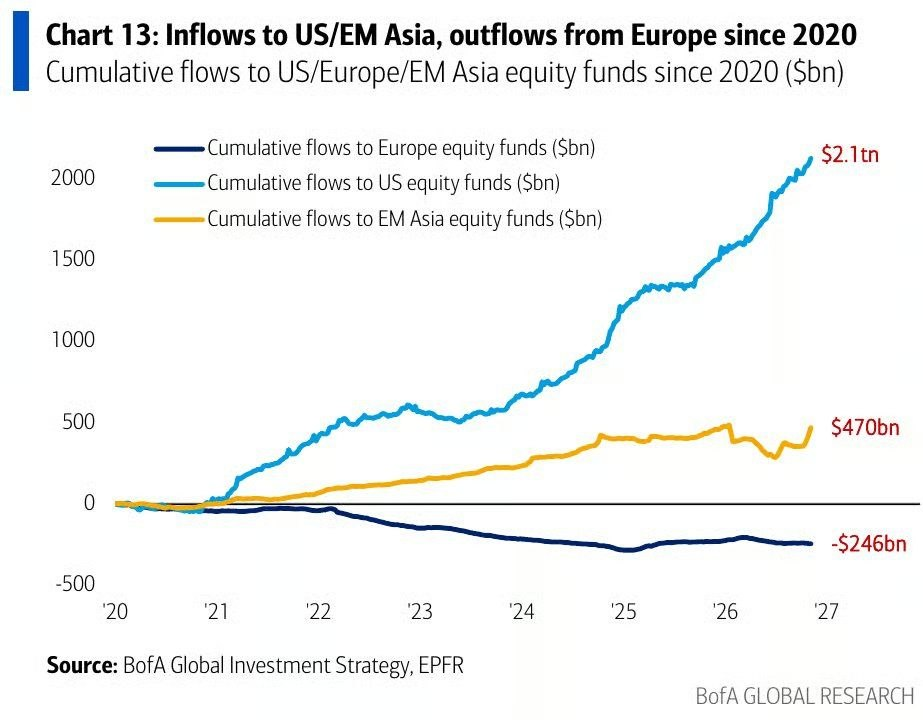

- M7 밖으로 이익 상향과 주가 상승이 확산되면 미국 비중 축소보다 미국 내 포트폴리오 교체가 유효
  - 시가총액 가중 지수는 이미 많이 오른 대형주 비중이 커 미국 증시 강세와 기존 주도주 강세를 구분할 필요
- BOJ가 12월에 25bp를 인상하면 1989년 이후 37년 만에 연간 세 차례 금리 인상
  - 기조물가의 2% 도달 여부를 평가하는 단계에서 2% 부근에 안착시키도록 완화 정도를 조절하는 단계로 이동
  - 1989년에는 공정할인율을 2.50%에서 4.25%로 총 175bp 인상해 이번과 인상 폭에 차이
- 일본의 9월 명목임금은 전년 대비 4.6% 늘어 1997년 1월 이후 최고 상승률 기록
  - 기본급은 3.7%, 실질임금은 2.2% 상승
  - 3년 연속 5%를 넘는 춘투 임금 인상과 심각한 구인난이 임금 상승을 뒷받침
  - 임금·물가 정상화는 디플레이션 심리 약화와 한계기업 구조조정으로 이어지는 변화

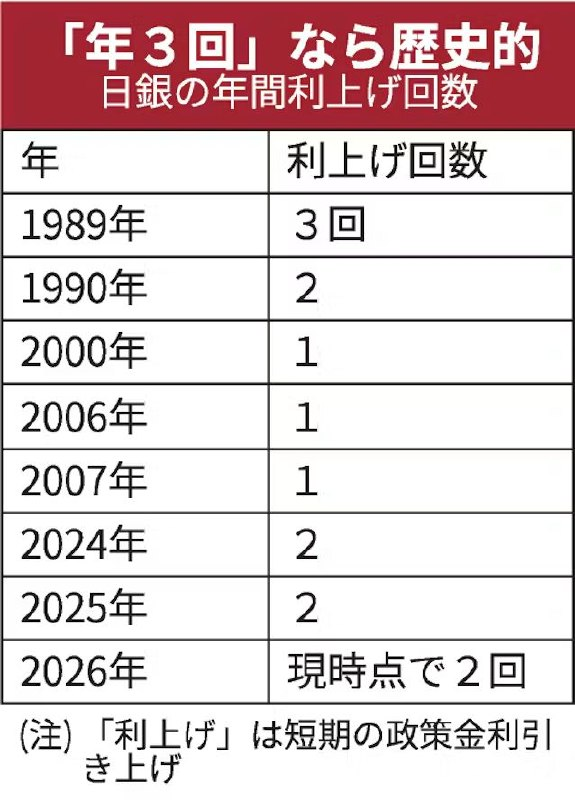

# KHwanK

### 급락한 한미 증시의 반등 조건과 경기 침체 변수

- 11월 첫째 주 코스피는 11.7%, S&P 500은 2.7%, 나스닥은 3.4% 하락
  - 미국 민주당의 양원 장악 이후 데이터센터 규제 강화 우려가 반도체·AI주 하락으로 연결
  - 반도체 비중이 높은 한국의 낙폭이 미국보다 크게 확대됐으며, 코스피는 1980년 이후 최악의 11월 첫 주 기록
  - AI는 미국 성장과 대중국 기술 경쟁의 핵심이므로 규제로 경쟁력을 포기할 유인은 작음
- 코스피의 이번 낙폭은 과거 사례와 직접 비교하기 어려운 극단값이며, 미국 시장의 계절성이 간접적인 판단 기준
  - 1987년에는 11월 첫 주 약 5% 하락 후 1987~1988년 상승했고, 2025년에도 11월 약세 이후 반등
  - 이번에는 하락 폭이 훨씬 커 과거 반등 경로를 그대로 적용하기 어려움
- 미국 증시는 11월 첫 주 급락 후 남은 11월에도 약세가 이어질 가능성이 높음
  - S&P 500의 11월 둘째~넷째 주 상승 확률은 평소 69%에서 첫 주 급락 시 40%로 하락
  - 12월에는 S&P 500의 반등 사례가 많았지만, 나스닥은 약세가 이어진 사례가 상대적으로 많음
- 다음 해 4월 말까지의 회복을 가르는 핵심 변수는 경기 침체 발생 여부
  - S&P 500의 11월 첫 주 수익률이 음수였던 26개 사례 중 이후 침체가 발생한 경우는 6개
  - 침체가 발생하면 다음 해 4월 말까지 추가 하락하는 경향이 있었고, 침체가 없으면 반등 확률은 약 70%
  - 침체가 없었던 사례는 하락하더라도 손실 폭이 작았음
- 시장의 침체 확률 25~30%와 과거 침체 발생 빈도 사이에 큰 차이 존재
  - 영상에 제시된 미국 침체 발생 빈도는 1945년 이후 약 13.6%, 1983년 이후 약 7%
  - 이를 바탕으로 한 영상의 침체 확률 추정치는 약 10%이며, 2027년 침체 없이 주가가 반등하는 경로에 무게
  - 장기 평균 발생 빈도만으로 현재의 경기 조건을 반영한 침체 확률을 확정할 수는 없음
- 경제학자 컨센서스의 침체 예측력에는 한계가 큼
  - 영상이 인용한 IMF 연구에서 63개국의 1992~2014년 침체 153건 중 전년 예측에 성공한 사례는 5건
  - 침체가 진행 중인 해의 10월에도 118건만 포착해 35건을 놓침
  - 전년에 강하게 침체를 예상한 13건 중에서도 62%가 빗나가, 침체 경고와 실제 발생을 구분할 필요
- 미국이 침체를 피하고 반등하면 한국 증시도 동반 회복할 가능성이 높음
  - 영상에 제시된 한미 증시 상관계수는 약 0.85
  - 1997년 외환위기 이후 코스피가 홀수해마다 상승했다는 계절성도 2027년 회복 기대를 뒷받침하는 보조 근거
- 남은 11월의 약세 가능성과 다음 해 4월 말까지의 회복 가능성을 구분해 투자 기간을 판단할 필요
  - 12월에는 S&P 500과 나스닥의 흐름이 달라질 수 있어 미국 지수 전체의 동반 반등을 전제하기 어려움
- 침체 예측의 낮은 적중률은 낙관 전망의 확실성을 보장하지 않으며, 실제 경기와 기업 실적의 악화 여부를 함께 점검할 필요
- 한국의 홀수해 상승 기록과 한미 증시 상관관계는 보조 지표이며, 반도체 집중도와 AI 규제 변화에 따른 추가 변동성도 고려할 필요

### 거절하기 어려운 제안과 객단가를 높이는 판매 설계

- 소득을 키우는 핵심 기술은 상품·서비스와 자신의 가치를 파는 능력
  - 직장에서도 성과를 상사와 경영진에게 설득하는 능력이 승진과 보상에 연결됨
- 알렉스 호모지의 판매 설계는 거절하기 어려운 제안과 고객당 매출을 높이는 구조에 집중
  - 『오퍼스』는 무엇을 어떤 패키지로 팔지, 『머니 모델』은 구매 이후 무엇을 어떤 순서로 팔지 다룸
  - 좋은 상품을 알리는 고객 유입 전략은 별도 주제
- 동일한 상품을 가격으로만 비교하게 만들면 할인 경쟁에 갇힘
  - 월 5만 원 헬스장과 월 4만 원 헬스장의 경쟁을 벗어나려면 시설보다 서비스 패키지와 고객이 느끼는 가치를 바꿔야 함
- 고객이 느끼는 가치는 원하는 결과와 주관적 달성 가능성이 클수록, 필요한 시간과 노력·고통이 작을수록 높아짐
  - 상품이 안 팔리면 이 네 요소 중 무엇을 개선할지 점검
  - 실제 성과뿐 아니라 고객이 성공 가능성을 얼마나 믿는지도 구매를 좌우함
- 기능보다 고객이 간절히 원하는 변화를 팔아야 함
  - 근력 증가보다 여름 바디프로필, 외모 자신감, 건강, 인정처럼 감정과 연결되는 결과를 제시
  - 회원의 전후 사진, 후기, 추천은 성공 가능성에 대한 신뢰를 높이는 수단
- 빠른 초기 성과와 실행 부담 감소가 상품 가치를 높임
  - 초기에 변화를 확인할 수 있는 프로그램을 설계하고 식단과 운동 순서를 제공해 고객의 고민을 줄임
  - 고객이 결과를 얻기까지 걸리는 시간과 직접 해야 할 일을 줄이는 방향으로 서비스를 구성
- 실제 수용 인원과 시작일을 명확히 정하면 구매를 미루는 이유가 줄어듦
  - 선착순 8명, 다음 주 월요일 개강처럼 실제 운영 조건에 맞는 희소성과 마감 기한을 활용
  - 정원을 넘겨 받거나 허위 마감을 내세우면 안 됨
- 상품명은 명분·대상·목표·기간·프로그램 형태를 조합
  - 여름맞이·직장인·복근·8주·챌린지를 결합하면 고객과 결과가 한눈에 드러남
- 고객당 매출은 유인 오퍼 → 업셀 → 다운셀 → 정기 결제의 흐름으로 설계
  - 고객이 방문한 뒤 어떤 제안을 받을지 미리 정하고 한 번의 판매로 끝내지 않음
- 유인 오퍼는 좁은 문제 하나를 무료나 저가로 확실히 해결하면서 다음 과제를 드러내는 구조
  - 무료 체성분 측정과 운동 체험으로 몸 상태와 운동법을 알려준 뒤 8주 프로그램이나 유료 PT로 연결
  - 무료 서비스도 고객의 시간을 쓰므로 기대 이상의 가치를 줘야 본상품에 대한 신뢰가 생김
- 조건부 환불은 선결제 부담을 낮추면서 프로그램 참여를 유도하는 방식
  - 8주 동안 주 3회 출석과 매일 식단 기록 등 조건을 충족하면 등록비를 돌려주는 구조
  - 100명 중 10명 성공 사례는 설명용 가정이며, 성공자의 전후 변화는 다음 고객을 위한 홍보 자료로 활용
  - 불가피하게 조건을 놓친 고객에게 유연하게 환불하면 신뢰와 후속 구매로 이어질 수 있음
- 업셀은 이미 구매한 고객에게 목표 달성을 돕는 추가 상품을 제안하는 것
  - PT 결제 직후 식단 도시락을 함께 제안하면 운동과 식단 관리의 연결성을 살릴 수 있음
  - 구매 의사가 확인된 시점에 필요한 추가 제안을 빠뜨리면 매출 기회를 놓침
- 다운셀은 가격을 거절한 고객에게 제공 범위를 줄인 대안을 제안하는 것
  - 월 8회 PT 15만 원이 부담되면 월 4회 10만 원처럼 횟수와 구성을 조정
  - 같은 상품을 할인하기보다 서비스를 덜어 정가 체계를 유지
- 장기 결제와 정기 구독은 반복 매출을 만들고 고객 이탈을 줄이는 장치
  - 월 7만 원 대신 연 60만 원, 추가 이용 기간이나 무료 레슨 등으로 장기 계약을 유도
  - 영상에서 인용한 월간 이탈률은 월 결제 12%, 연 결제 2%로, 계약 방식에 따른 유지율 차이를 강조
- 매출 개선은 신규 고객 확보뿐 아니라 제안의 가치, 추가 구매, 대체 상품, 유지 기간을 함께 설계하는 문제
  - 좋은 상품 하나를 만드는 데서 끝내지 말고 고객의 첫 방문부터 재구매까지 이어지는 흐름을 구성
- 판매 메시지와 실제 서비스가 같은 결과를 향해야 신뢰가 누적됨
  - 빠른 성과, 후기, 환불 약속, 정원과 마감이 실제 운영에서 지켜져야 다음 판매의 기반이 됨
- 직장인의 자기 설득에도 같은 가치 공식을 적용할 수 있음
  - 상대가 원하는 성과를 분명히 하고, 달성 가능성을 보여주며, 시간과 업무 부담을 줄이는 방식으로 자신의 기여를 제시

# Kobeissi

- 미국 증시는 기술주 반등과 숏스퀴즈로 장중 시가총액이 1조 5,000억 달러 증가
  - S&P 500은 2.1%, 다우는 1.8% 상승했고 나스닥100은 장중 3.2%까지 상승
  - NVDA가 6.5% 하락해 시가총액 3,000억 달러가 사라졌는데도 기술주 매수세가 확산
  - VIX는 20% 넘게 하락해 광범위한 매수 압력 반영

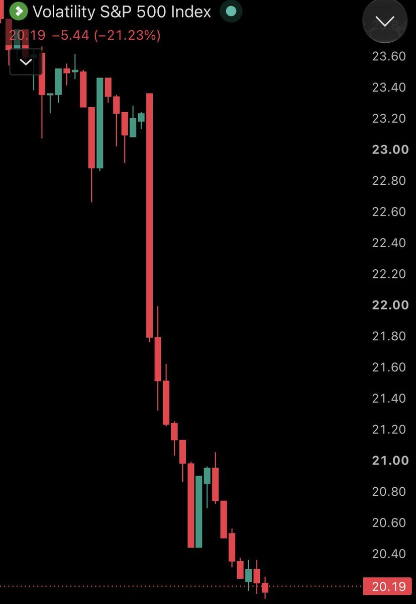

- 빅테크 7곳의 장부 밖 계약상 의무가 4조 4,900억 달러로 장부상 부채·리스 의무의 약 6배
  - Alphabet·Meta·Anthropic·Microsoft·Amazon·Oracle·Nvidia의 미개시 리스, 데이터센터 계약, 장비 구매 등을 합산
  - Alphabet 1조 800억 달러, Anthropic 8,650억 달러, Meta 8,100억 달러 순
  - 장부상 의무 7,580억 달러를 포함한 총액은 약 5조 2,500억 달러로 AI 인프라 경쟁의 미래 자금 부담 확대

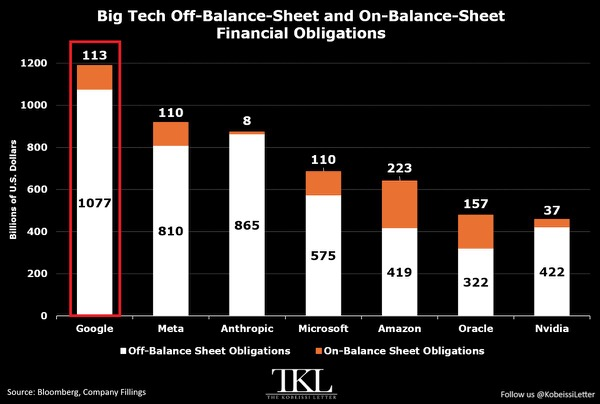

- 이란 추가 공습 불필요 발언과 종전 기대에 미국 유가가 8월 31일 이후 처음 배럴당 85달러 하회
  - 10월 30일 고점 대비 19% 하락
  - 트럼프는 카타르 총리와 논의 후 종전 협상의 진전을 언급했으나 대이란 해상봉쇄 유지도 강조

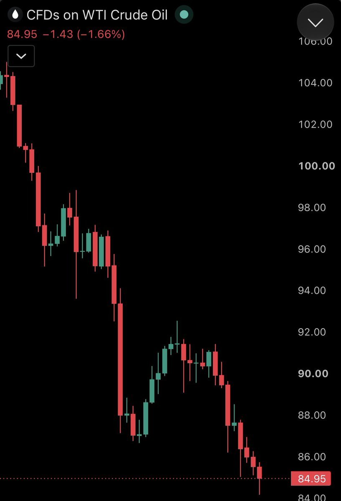

- Nvidia와 Jensen Huang이 중국 정보자산으로 지목된 인물과의 관계 은폐 의혹으로 주주 집단소송에 직면
  - 소송은 주주를 오도했다는 혐의와 금액 미정의 손해배상을 청구
  - The Information은 해당 관계가 2023년부터 이어져 최소 75억 달러의 Nvidia 칩 출하를 도왔다고 보도했으며 확정 사실과 구분 필요
- 미국 10월 CPI가 전월 대비 0.4%, 근원 CPI가 0.3% 올라 각각 예상 0.3%·0.2% 상회
  - 2025년 10월 정부 셧다운에 따른 자료 공백으로 전년 대비 수치는 미발표
  - 발표 후 나스닥100 선물은 1.5% 하락하고 12월 금리 인상 가능성 상승

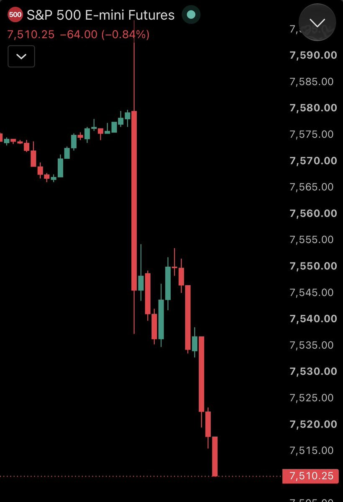

- 반도체지수 SOX가 200일 이동평균 대비 17% 아래로 내려가 과열에서 과매도로 급전환
  - 6월에는 이동평균을 75% 웃돌았으나 5개월 만에 반전
  - 지난 목요일의 음의 이격은 2025년 4월 이후 최대이자 2022년 약세장 이후 두 번째 규모
  - 금융위기와 닷컴버블 붕괴 당시에는 각각 49%·52% 하회해 극단적 침체기보다는 작은 이격

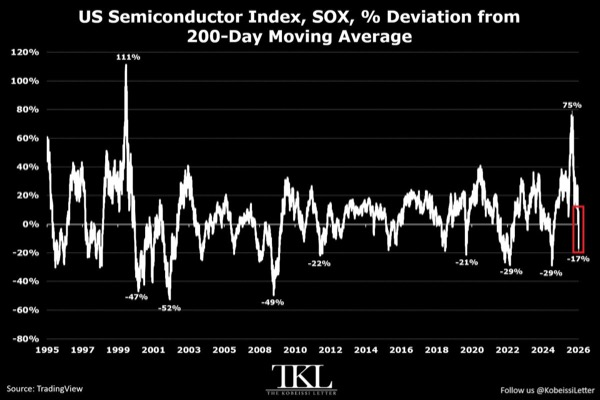

- 미국 9월 소비자신용이 290억 달러 늘어 사상 최대인 5조 1,900억 달러 기록
  - 7개월 연속 증가하며 누적 1,250억 달러 확대
  - 신용카드 등을 포함한 회전신용은 160억 달러 증가한 1조 3,700억 달러, 자동차·학자금 등 비회전신용은 120억 달러 증가한 3조 8,600억 달러
  - 물가 부담 속 소비자의 부채 의존 심화

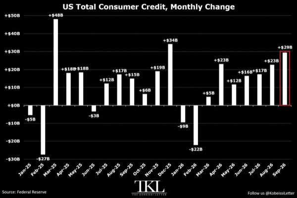

- 미국 주식형 펀드에 2020년 이후 2조 1,000억 달러, 2024년 이후에만 1조 5,000억 달러 유입
  - 아시아 신흥국의 4,700억 달러 대비 약 4.5배이며 유럽은 4,260억 달러 순유출
  - 글로벌 주식형 펀드는 지난주 890억 달러, 최근 4주간 사상 최대인 2,660억 달러 유입
  - 미국 주식형 펀드가 지난주 320억 달러를 흡수하며 자금 유입 주도

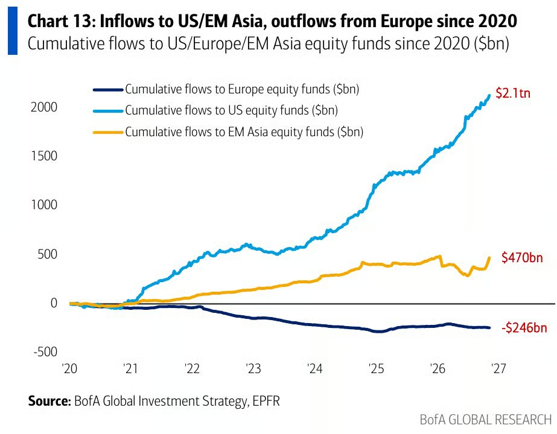

- 개인투자자의 반도체 저가 매수가 레버리지 ETF로 집중
  - SOXL은 지난주 40% 하락했는데도 역대 두 번째인 51억 달러가 유입됐고 최근 4주 유입액은 134억 달러
  - 이후 월요일 SOXL은 22% 반등
  - QQQ에도 지난주 37억 달러, 직전 주 57억 달러가 유입돼 8월 이후 최대 2주 유입 기록

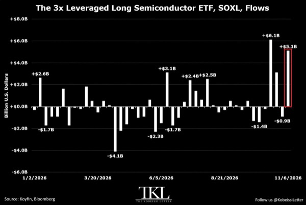

# MKevin

### 물가 둔화와 수익화가 가를 기술주 반등

- 11월 10일 CPI가 12월 금리 인상 기대를 좌우할 핵심 변수
  - 영상 기준 채권시장의 12월 인상 확률은 84%, 2027년 9월까지 반영된 인상 횟수는 약 2.1회
  - 12월 CPI 발표는 12월 10일로 연준 회의 다음 날이어서 이번 CPI와 11월 13일 물가지표의 영향이 큼
  - 굴스비는 인플레이션 대응 부진과 데이터센터 과열을 경계하고, 데일리는 AI 둔화가 전체 성장으로 번질 위험을 지적
- 헤드라인 CPI의 전월 대비 상승률 예상치는 0.3%로 직전 0.6%보다 낮지만, 유가 하락 영향보다 근원물가의 확산 여부가 중요
  - 연율 3% 이상 오르는 품목 비중은 54%에서 50%로 축소됐으며, 이번에 약 45%까지 내려가면 금리 인상 압력 완화
  - 13일 물가지표 예상치는 최종수요 0.4%, 식품·에너지 제외 0.3%, 식품·에너지·유통 제외 0.4%로 제시돼 예상 하회 여지가 있음
- 주가 급락에 따른 금융여건 긴축과 기대인플레이션 하락은 추가 금리 인상 필요성을 낮추는 요인
  - 국채금리가 소폭 내려도 주식시장 매도 충격이 금융여건을 긴축시킴
  - 5년 기대인플레이션은 7~8월 저점 수준으로 하락
- 이란 갈등과 중간선거 이후 AI 주식의 강제청산성 매도가 컸지만, 투자 수요가 유지된다면 급락은 매수 기회
  - 케빈은 Q의 650 부근에서 저가 매수했고, 675 부근 반등과 엔비디아 급락을 긍정적으로 평가
  - 시장 강세 확신은 10점 만점에 9점으로 매우 높아 낙관 편향도 함께 감안할 필요
- AI 신용위험은 기업별로 차별화되며, 코어위브의 자금조달 부담이 상대적으로 큼
  - 오라클·메타의 CDS는 고점 수준이 아니고 메타는 소폭 하락했지만, 코어위브는 선거 이후 상승
  - 코어위브 주가 급락이 신규 자금조달과 대금 지급 능력 우려를 키움
  - 마이크로소프트의 선급금으로 차입 부담을 넘기는 구조는 가능한 대안일 뿐 확정된 조달 방식은 아님
- AI 설비투자 주기는 규제보다 실제 수요와 매출 증가에 더 크게 좌우됨
  - 영상에서 인용한 뱅크오브아메리카 전망은 하이퍼스케일러의 3분기 AI 성장률 약 45%, 2027년 3분기 AI 매출 증가율의 설비투자 증가율 추월
  - 중간선거 이후 규제 강화가 투자 속도를 일부 낮출 수 있지만, 현재 수요 지표는 공격적인 투자 계획을 뒷받침
- 모건스탠리는 선거 이후 AI 투자 우려가 과도하며 자본력이 큰 기술주에 유리한 환경으로 평가
  - 이미 허가와 공사가 진행돼 텍사스 선거가 2027년 데이터센터 건설에 미칠 영향은 제한적
  - 2028년 예정 프로젝트 약 20%가 2029년으로 밀릴 가능성은 있음
  - 비중확대 대상으로 아마존·메타·마이크로소프트·스페이스X·엔비디아를 제시
- 케빈은 대형 AI 기업을 보유하며, 구글보다 브로드컴을 선호
  - 아마존·메타·마이크로소프트·엔비디아·스페이스X 보유를 공개
  - 구글의 브로드컴 협력 칩 개발에도 구글 자체에는 부정적 시각 유지
- AI 투자 수익의 다음 축은 기업 고객을 확보하고 반복매출로 연결하는 소프트웨어 계층
  - 클라우드플레어는 생태계 확장에 투자해 기업 고객과 연간 반복매출을 확보하는 구조
  - 메타도 팔란티어의 고객 현장 지원 엔지니어와 유사한 도입 지원·영업 조직을 확대할 계획
  - 단순 토큰 판매를 넘어 에이전트와 업무 흐름을 통합하는 소프트웨어가 고객 유지와 매출 확대에 유리
- 사이버보안과 인프라 소프트웨어는 AI 확산의 주요 수혜 영역
  - 케빈의 선호 종목은 크라우드스트라이크·센티넬원·클라우드플레어
  - 모건스탠리가 언급한 관련 공급망에는 블룸에너지·브로드컴·TSMC·미디어텍 등이 포함
- 마이크로소프트의 일부 AI 임대계약 철회는 전체 투자 축소보다 학습에서 에이전트로의 수요 전환일 가능성
  - 오라클·IREN 관련 계약 변화는 필요한 연산과 협력사 구성이 달라지는 과정이라는 해석
  - 아마존의 지출 약정은 여름 이후 두 배로 늘어 대형 기업의 AI 투자 확대 흐름은 지속
- 앤트로픽의 장기 지출 약정은 과거 12개월 매출만으로 비교하면 부담이 과장될 수 있음
  - 약정 9,000억 달러와 연매출 350억 달러를 비교하는 비관론에 대해, 케빈은 현재 연환산 매출 약 800억 달러와 IPO 이후 약 3,500억 달러의 자금 여력을 가정
  - 약정이 2045년까지 분산되고 매출이 계속 늘어난다는 전제가 낙관론의 핵심
  - 매출 규모는 순이익이나 실제 지출을 감당할 현금흐름과 구분해야 함
- 데이터센터 투자 회수 속도가 빠르다는 기대가 반도체·AI 인프라 강세론을 뒷받침
  - 영상에서 인용한 리바운드캐피털 추산은 데이터센터 투자 1,000억 달러가 완전 가동 시 연매출 약 1,600억 달러를 창출하는 구조
  - 케빈은 자체 AI 워크스테이션의 높은 연산 수익성을 근거로 빠른 투자 회수 가능성에 낙관
  - 완전 가동 시 매출 추정치를 실제 투자 회수 기간이나 순이익으로 바로 환산할 수는 없음
- 구리는 2027년 1분기부터 낙관적 시각
  - 씨티의 비관론과 달리 민주당 의회의 실제 정책 제약이 확인되면 규제 우려가 줄고 시장 전반에 긍정적으로 작용할 가능성
- 메모리·스토리지와 AI 반도체의 가격 조정이 저가 매수 기회를 제공한다는 시각
  - 씨게이트·SK하이닉스·샌디스크·마이크론을 개별 또는 바스켓 매수 후보로 제시
  - 영상에서 제시한 엔비디아 PEG는 약 0.5, 브로드컴은 약 0.6이며 나스닥100 이익배수는 18.4배로 2020년 이후 최저 수준
  - 이동평균선·밸류에이션 수치는 영상 내 제시값이며 성장률 가정과 산정 기준에 따라 해석이 달라짐
- 기술주 반등의 지속성은 물가 둔화와 AI 매출 실현이 함께 확인되는지에 달림
  - CPI가 높게 나오면 금리 인상 우려가 낮아진 밸류에이션의 매력을 상쇄할 수 있음
- AI 수요가 유지돼도 자금조달 여력에 따라 투자 성과는 갈릴 수 있음
  - 현금이 풍부한 하이퍼스케일러와 외부 조달 의존도가 높은 인프라 기업의 신용위험을 구분할 필요
- AI 투자 확대의 수혜는 칩 판매에서 기업용 소프트웨어·보안·반복매출로 확장될 가능성
  - 수주와 설비투자 규모뿐 아니라 가동률·고객 유지·현금흐름으로 수익화 속도를 확인할 필요

### 엔비디아 경영진 의혹과 반도체 투자 판단

- 젠슨 황의 사생활·중국 정보기관 연계 의혹이 엔비디아의 경영진 신뢰와 수출통제 위험으로 확산되는 구도
  - 영상은 황의 외도 인정 서한, 이사회 독립 조사, 중국 정보요원으로 지목된 앨리스 황과의 관계를 제시하지만 자막만으로 진위와 기밀 유출 여부는 확인할 수 없음
  - 중국 측은 근거 없는 비방이라고 부인한 것으로 소개됨
- 공매도 업체 컬퍼 리서치는 싱가포르 메가스피드가 알리바바 자금으로 엔비디아 GPU를 구매하는 우회 경로라는 의혹을 제기
  - 알리바바와 관련 업체 재무제표의 유사한 자금 규모, 메가스피드와 황의 면담에 알리바바 임원이 동석한 정황을 근거로 제시
  - 컬퍼 리서치는 5월부터 엔비디아 공매도 포지션을 보유한 이해관계자
- 메가스피드의 급격한 사업 전환과 소유구조가 중국 연계 의혹의 핵심
  - 영상에서는 세븐로드 인터내셔널이 2023년 3월 메가스피드로 이름을 바꾸고 대규모 GPU 구매자로 부상한 과정을 소개
  - 앨리스 황의 중국 이름은 황리이며, 메가스피드 경영진으로 활동한 뒤 이사회에서 물러난 것으로 제시됨
  - 중국 게임업체와 정부 지분 연결, 대만·싱가포르 조사 보도도 거론되지만 해당 당국은 조사를 공개적으로 부인한 것으로 소개됨
- 사생활 문제보다 미국의 대중국 첨단기술 통제와 기업 보안 문제가 주가에 더 직접적인 위험
  - 영상에 제시된 11월 4일자 의회 서한은 황에게 외국 정보기관의 침투를 막는 보안 체계와 관련 인물 접촉에 대한 비공개 브리핑을 요구
  - 기밀 유출, 수출통제 위반, 이사회 대응 여부에 따라 파장이 달라질 수 있음
- 중국 시장 접근을 원하는 엔비디아의 사업 동기는 개인적 관계 의혹과 별개로 존재
  - 중국에 칩을 공급하면 자체 반도체 개발 유인을 낮추고 엔비디아의 기술 우위를 유지할 수 있다는 논리
  - 중국 메모리 업체의 구형 DUV 기반 DRAM 개발 사례는 수출 제한이 현지 기술 자립을 자극할 수 있음을 보여주는 사례로 제시됨
- 영상 내 수치 기준 엔비디아는 AMD보다 높은 수익성과 낮은 성장 대비 밸류에이션을 보유
  - PEG는 엔비디아 약 0.6, AMD 약 1로 제시되며 성장 전망 대비 엔비디아의 가격 매력이 더 큼
  - 엔비디아 매출총이익 721억 달러와 매출 962억 달러를 기준으로 계산한 매출총이익률은 약 75%, AMD는 약 54%
  - 데이터센터 매출 비중도 엔비디아 약 90%, AMD 약 62.8%로 제시되며 고수익 사업 구성의 차이가 존재
- AMD는 데이터센터 확대에 따른 수익성 개선 여지가 있지만 가격 결정력과 현금 창출력은 추가 확인 필요
  - 영상에서 제시한 잉여현금흐름은 약 5억 5,400만 달러
  - OpenAI의 칩 도입을 확보하기 위해 주식 인센티브를 제공하는 구조는 고객 확보 비용과 주주 희석을 함께 평가해야 함
- RTX 5090의 품귀와 재판매 가격 상승은 GPU 수요 강세를 보여주는 보조 지표
  - 영상에서 확인한 매물 가격은 약 7,800~9,400달러이며 일부 가격은 최근 30일간 약 8% 상승
  - Qwen 등 AI 모델 구동 수요를 배경으로 제시하지만 단일 소비자용 GPU의 매물 가격을 데이터센터 전체 수요로 일반화하기는 어려움
- 이혼에 따른 잠재 매물은 전량 즉시 매도라는 가정에 크게 좌우됨
  - 영상은 혼전계약이 없고 보유 지분 절반이 배우자에게 이전되는 경우 약 4억 3,500만 주, 전체 발행주식의 약 1.25~1.35%가 영향을 받을 수 있다고 추산
  - 혼전계약 유무, 이혼 여부, 실제 재산분할 조건은 확정되지 않았으며 지분 이전 자체가 즉각적인 시장 매도를 뜻하지는 않음
  - 매켄지 스콧의 아마존 지분 분할·점진적 매각 사례처럼 처분 시점과 방식에 따라 충격이 달라질 수 있음
- 황의 창업자 지위와 사업 기여도를 고려하면 즉각적인 퇴진 가능성은 낮다는 것이 영상의 투자 판단
  - 2018년 인텔 CEO의 사내 관계 문제에 따른 퇴진과 비교하지만 창업자 여부와 회사 내 영향력에 차이가 존재
  - 평판 훼손과 경영진 신뢰 약화는 남더라도 GPU 경쟁력과 이익 창출력이 곧바로 사라지는 것은 아님
- 영상 시점 야간 거래에서 엔비디아는 약 3.5% 하락했지만 나스닥100은 약 0.07% 하락에 그침
  - AMD도 동반 하락해 엔비디아 개별 악재가 AI 종목의 단기 투자심리로 번지는 모습
  - 영상의 투자 결론은 공포에 따른 전량 매도보다 하락 시 분할 매수와 엔비디아·AMD를 포함한 분산 보유
- 투자 판단의 핵심은 의혹의 진위와 실제 사업 영향을 구분하는 것
  - 공식 조사 결과, 수출 허가 변화, 고객 주문, 경영 공백이 확인되기 전에는 평판 충격을 곧바로 실적 훼손으로 환산하기 어려움
- 낮은 PEG와 높은 마진만으로 규제 위험까지 상쇄되지는 않음
  - 성장률 추정의 신뢰도와 대중국 매출 접근성, AMD의 고객 확보 비용을 함께 점검해야 하락이 매수 기회인지 판단할 수 있음

### 착빙과 급성장한 뇌우 속 조종 상실의 연결고리

- 미국 국가교통안전위원회(NTSB)가 리어젯 60 사고기의 조종실 음성기록장치(CVR)를 발견했으며, 조종 상실 전후 상황을 밝힐 핵심 단서가 될 것
  - 사고로 탑승자 9명이 사망하고 지상에서 1명이 부상했으며, 충돌 구덩이의 침수로 잔해 발굴이 지연됨
  - 왼쪽 승강타 대부분이 충돌 지점에서 약 1.3~3.8마일 떨어진 곳에서 세 조각으로 발견됐고, 다른 잔해는 최대 약 3.9마일까지 흩어짐
  - 충돌 전 기체 일부가 분리된 사실은 확인됐지만, 조종 상실의 원인이었는지 급강하 중 과속에 따른 결과였는지는 미확정
- 사고기는 바하마 착륙을 준비하며 41,000피트에서 35,000피트로 하강한 뒤 악천후를 만남
  - 착륙을 위한 사전 하강 자체는 통상적인 절차이며, 최대 운용고도가 51,000피트라는 이유만으로 높은 고도를 유지해야 하는 것은 아님
  - 기상 재구성 자료에서는 뇌우 상단이 약 20분 만에 48,000피트까지 성장해, 41,000피트 유지로 피할 수 있었을지도 불확실
- 승무원은 약 600~700피트의 고도 변동과 착빙을 보고한 뒤 37,000피트로 상승 허가를 받음
  - 외기온은 영하 47도로 보고됐으며, 사고 약 10분 전 부기장이 보낸 문자에도 난기류와 착빙이 언급됨
  - 비상 교신에는 분당 10,000피트 하강과 60도 경사가 등장해 급격한 비정상 비행 상태가 드러남
- 착빙으로 실속 속도가 높아지고 안전한 속도 여유가 줄었을 가능성
  - 35,000피트는 최대 고도 부근의 전형적인 코핀 코너와는 거리가 있지만, 날개 결빙으로 양력이 줄면 실속과 과속 사이의 여유가 좁아질 수 있음
  - 급격한 결빙이 방빙 능력을 넘거나 녹은 물이 비가열 구역에서 다시 얼었을 가능성도 검토 대상
  - 피토관이나 실속 경고 계통의 결빙, 꼬리날개 실속도 가설이며 실제 발생 여부는 확인되지 않음
- 자동조종장치의 수직속도 모드와 착빙이 겹쳐 감속과 실속 징후를 놓쳤을 가능성
  - 일정 상승률을 유지하려고 기수를 올리는 동안 속도가 떨어지고, 자동 보정이 조종사가 느낄 진동이나 조종감 변화를 가렸을 수 있음
  - 조종 상실 당시 자동조종 모드와 트림 상태, 해제 이후 조종 입력은 아직 확인되지 않음
- 착빙과 난기류에서 벗어나려던 상승이 더 강한 폭풍 구역으로 이어졌을 가능성
  - 영상에서 인용한 기체 매뉴얼은 난기류 통과 시 속도 유지와 고도 변동 허용 또는 하강을 제시함
  - 관제에 일정 고도 범위 사용을 요청하는 대안도 있었지만, 당시 상승의 주목적이 착빙 회피였는지 난기류 회피였는지는 불명확
- 기상레이더의 신호 감쇠로 가장 위험한 구역이 빈 공간처럼 보였을 가능성
  - 강한 강수에 가려 반사 신호가 돌아오지 않으면 화면의 검은 구역을 안전한 통로로 오인할 수 있음
  - 2017년 매각 자료에는 콜린스 WXR-840 레이더가 기재돼 있으나, 이후 교체·개량 여부는 확인되지 않음
  - 지상 기상레이더 자료도 수분 지연될 수 있어 빠르게 성장하는 뇌우의 현재 상태와 차이가 벌어질 수 있음
- 악천후 접근을 허용한 비행 의사결정도 주요 조사 쟁점
  - 프리포트 방향 경로 선택을 단순한 5분 절약으로 단정할 근거는 부족하며, 조종사가 실제로 어떤 기상정보를 봤는지가 중요
  - 악천후가 없던 플로리다 서해안에 착륙해 기다리는 대안이 제시됐지만, 일정 압박이나 승객 요구가 실제 판단에 영향을 줬는지는 미확인
- 기계적 고장과 공간정위 상실도 배제되지 않음
  - 승강타·수평안정판·조종계통 이상이나 정비 문제가 먼저 발생했을 가능성과, 실속 후 급강하 과정에서 구조물이 분리됐을 가능성을 구분해야 함
  - 60도 경사는 주날개 실속 가설과 연결되지만 원인을 확정하는 증거는 아니며, 구름 속 시야 상실이 회복을 어렵게 했을 수 있음
  - 저화질 영상의 날개·꼬리 형상은 롤링셔터와 촬영 속도 때문에 왜곡될 수 있어 프레임만으로 분리 시점을 단정하기 어려움
- 기장 제프리 그레고리는 55세로 여러 리어젯 형식한정을 보유했으며, 20세 부기장 나탈리아도 리어젯 60 형식한정을 보유함
  - 부기장의 기장 업무 제한은 부기장 근무 자격 결여를 뜻하지 않으며, 나이와 자격 표기만으로 사고 원인을 연결할 수 없음
  - 최종 원인은 CVR, 잔해, 기상자료와 조종계통 분석을 종합해야 하며, 영상 시점에는 예비보고서가 약 한 달 뒤 나올 것으로 예상됨
- 조사에서 가장 중요한 것은 악천후 진입, 속도·자세 변화, 조종 입력, 구조물 분리의 선후관계
  - 같은 잔해와 교신도 사건 순서에 따라 최초 고장과 후속 손상으로 해석이 달라짐
- 사고 예방의 핵심은 방빙장치·자동조종·기상레이더 각각의 한계가 겹치는 상황을 훈련과 운항 판단에 반영하는 것
  - 단일 장비 고장에만 초점을 맞추기보다 기상 회피, 매뉴얼 적용, 속도 관리와 대체 착륙 판단이 함께 작동했는지 살펴야 함

# Slav

- AI 콘텐츠 공급이 소비 수요보다 빠르게 늘면서 단순 대량생산 콘텐츠의 수익성은 하락할 가능성
  - 진입장벽이 낮아 원가·트래픽 경쟁이 심해지고 일시적 흥행을 반복 수익으로 연결하기 어려움
  - 복제하기 어려운 개인 정체성과 영향력을 보유한 인플루언서·크리에이터의 상대적 가치 상승
- 미국 10월 CPI와 근원 CPI가 모두 시장 예상을 0.1%p 웃돌아 추가 금리 인상 가능성 뒷받침
  - 헤드라인은 전월 대비 0.4%로 예상 0.3%를 상회했으나 9월 0.6%보다는 둔화
  - 근원은 전월과 같은 0.3%로 예상 0.2%를 상회해 기조적 물가 압력 지속

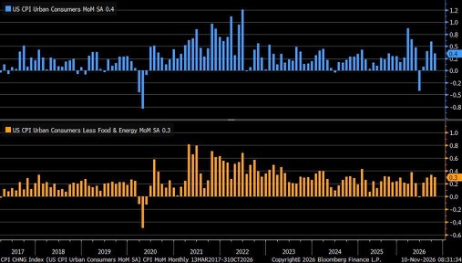

- 목·금요일 청약 예정인 엠비디는 참여 회피
  - 기관 수요예측 경쟁률 187.10대 1, 의무보유확약 0%로 수요의 질이 취약

# Stockbot

- 미국 증시가 유가 하락 속 반등했지만 Nvidia는 약세를 지속
  - S&P 500은 장중 2% 올라 3개월 만에 최대 상승폭을 기록했고 다우는 900포인트 상승
  - 나스닥100은 3.2% 상승한 반면 NVDA는 6.5% 하락해 시가총액 3,000억 달러 감소
  - NVDA는 최근 2주간 약 18% 하락하며 시가총액 9,400억 달러 감소
- 미국 전략비축유가 2억 7,950만 배럴로 줄어 1982년 이후 최저 수준
- Nvidia의 대중국 수출 규제·경영진 관련 법적 위험 확대
  - NYT는 실체가 없거나 군 관련 제재 대상인 중국 기업에 칩 판매가 승인됐다고 보도
  - Nvidia와 Jensen Huang은 중국 정보자산으로 지목된 인물과의 관계를 숨겨 주주를 오도했다는 집단소송에 직면
  - The Information은 해당 관계가 2023년부터 이어져 최소 75억 달러의 칩 출하를 도왔다고 보도
  - 트럼프는 FBI가 Huang을 들여다보고 있다고 발언했으며 수사·소송상 의혹과 확정 사실은 구분 필요
- Anthropic은 다음 주 거래 개시를 목표로 IPO 로드쇼 진행
  - ANT의 공모 희망가는 주당 70~78달러이며 공모 주식 수는 초기 8억 2,500만 주에서 8억 135만 주로 축소
  - Nvidia·Microsoft·Google·AMD·Broadcom·Micron·TSMC Partners 등이 별도 사모배정으로 260억 달러 인수 예정
  - 10월 31일 기준 연환산 매출은 약 810억 달러로 9월보다 100억 달러 증가
- 미국·이란이 호르무즈 해협 운항 재개를 위한 80억 달러 규모 합의안을 검토하면서 유가가 6시간 동안 4% 하락
  - 미국의 이란 자금 80억 달러 동결 해제·해상봉쇄 해제와 이란의 해협 재개방·상선 공격 중단을 교환하는 방안
  - 트럼프는 종전 논의의 진전을 언급했으나 앞선 발언에서는 걸프 국가들이 현행 봉쇄 유지를 지지한다고 밝혀 최종 합의와 구분 필요

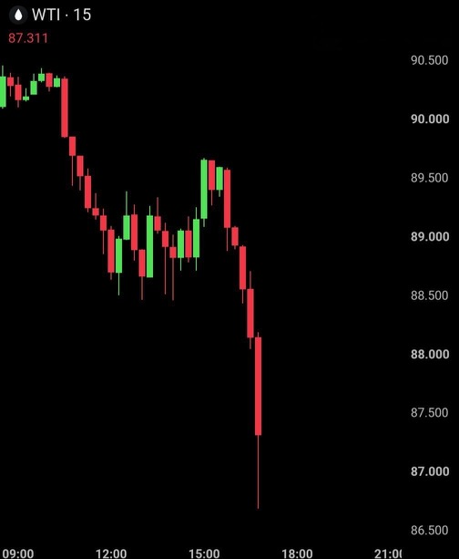

- SoftBank가 전년 동기 160억 달러 흑자에서 분기 70억 달러 적자로 전환
  - 미국 AI 데이터센터 계획 수정에 따른 비용 37억 달러 반영
  - ARM 주식 담보 대출로 50억 달러 조달
- 미국 10월 헤드라인 CPI는 전월 대비 0.4%, 근원 CPI는 0.3%로 각각 예상 0.3%·0.2% 상회
  - 높은 물가 압력이 이어지면서 12월 연준 금리 인상 전망 강화
  - 2025년 10월 정부 셧다운에 따른 자료 누락으로 전년 대비 수치는 미발표

# YDental

### 미국 물가 발표와 금리 인상 전망의 핵심 변수

- 미국 10월 물가는 9월 급등이 일시적 충격인지 지속적 인플레이션인지 가르는 변수
  - 11월 10일 밤 10시 30분 CPI, 11월 13일 밤 10시 30분 PPI 발표 예정
  - 12월 9일 FOMC 직전 마지막 주요 물가 데이터로 제시돼 정책 판단에 미치는 영향이 큼
- 9월 CPI는 전월 대비 0.6%, PPI는 1.3% 급등했으며 PPI의 전년 대비 상승률은 6.3%, 코어 PPI는 5.0%에 도달
  - 10월에도 높은 상승세가 이어지면 유가 충격을 넘어선 광범위한 물가 상승으로 해석될 위험
  - 상승세가 정상화되면 9월 급등이 유가에 따른 일시적 현상이었다는 안도감 형성 가능
- CPI의 핵심은 헤드라인보다 코어, 특히 주거비와 서비스 물가의 둔화 여부
  - 유가 안정에 따른 헤드라인 둔화는 시장에 일부 반영된 상태
  - 전월 대비 수치와 함께 전년 대비 상승률도 확인해 물가의 추세적 안정을 판단할 필요
- 시장에 반영된 12월 금리 인상 확률은 약 78%로, 물가 안정에 따른 상승 여지가 추가 과열에 따른 하락 위험보다 큰 국면
  - 다만 CPI 컨센서스 자체가 전월보다 상승폭 확대를 예상해 낙관적 접근에는 한계
- PPI는 9월 급등 이후 정상화가 예상되지만 운송·창고 서비스 가격이 핵심 변수
  - 9월 해당 항목은 전년 대비 16% 급등
  - 유가 상승이 디젤 가격을 거쳐 서비스 가격으로 전이되는 경로에 주목
  - 10월에도 상승세가 지속되면 에너지발 물가 압력의 확산으로 해석돼 12월 금리 인상 가능성이 강화될 수 있음
- 기본 시나리오는 CPI의 컨센서스 부합과 전월 대비 상승폭 확대, PPI의 소폭 둔화
  - 이 경우 12월 금리 인상 확률은 약 80%로 유지되고 10년 국채 금리는 제시된 현재 수준인 5.1% 부근에서 안정될 가능성
  - 예상에 부합하는 결과만으로도 불확실성이 줄어 위험자산 반등의 계기가 될 수 있음
- 헤드라인 둔화만으로 물가 안정 여부를 판단하기 어려우며 코어 CPI와 운송·창고 서비스의 동반 둔화가 중요
- 위험자산 반등의 조건은 금리 인상 가능성의 소멸보다 추가 긴축 우려를 키우지 않는 물가 결과
  - 컨센서스 부합 여부와 서비스 물가의 지속성을 함께 확인할 필요
