# EconomiExpl

### 기대와 신뢰가 좌우하는 물가와 경기

- 경제정책의 효과는 현재 소득과 금리뿐 아니라 가계·기업이 예상하는 미래 소득, 물가, 정책 방향에 좌우됨
  - 같은 2만 달러라도 반복될 가능성이 높은 성과급은 소비를 늘리기 쉽고, 일회성 소송 합의금은 저축으로 남기기 쉬움
  - 개별 경제주체의 기대와 선택을 합산하면 총량 지표만으로 예상한 정책 효과와 다른 결과가 나타남
- 로버트 홀과 마이클 우드퍼드의 핵심 기여는 기대와 소비 결정을 검증 가능한 미시경제 모형으로 만들고 거시경제 안정화에 적용한 것
  - 프리드먼의 1957년 항상소득가설, 모딜리아니의 생애주기가설, 루커스·펠프스의 기대 연구를 정책 도구로 구체화
  - 홀은 1978년 연구에서 항상소득가설을 실제 자료로 검증할 수 있게 발전시켰고, 우드퍼드는 금리 결정과 미래 정책에 관한 중앙은행 소통을 체계화
- 1970년대 스태그플레이션은 공급 충격에 정책 불신과 인플레이션 기대가 결합하면서 장기화
  - 1973년 OPEC 금수조치와 1979년 이란혁명이 원유 공급을 흔들었고, 첫 충격 당시 유가는 몇 달 사이 거의 3배로 상승
  - 물가 상승은 이미 1960년대 중반부터 시작됐으며, 석유 충격은 비용 상승과 성장 둔화·실업 증가를 동시에 유발
- 아서 번스 시기 연준의 반복적인 긴축 후 완화가 물가 안정 의지에 대한 신뢰를 훼손
  - 1974년 금리를 약 13%까지 올렸지만 1년 안에 약 5%로 낮추면서 기대를 바꿀 만큼 긴축을 유지하지 못함
  - 닉슨 행정부의 1972년 대선 전 저금리 압력도 통화정책의 일관성을 약화
- 지속적인 물가 상승 예상이 임금 인상 요구와 기업의 가격 인상을 연결하며 인플레이션을 재생산
  - 생활비 연동 임금조항이 악순환을 자동화했고, 1981년에는 노조 기본협약의 절반 이상에 관련 조항이 포함
  - 일회성 에너지 가격 상승이 장기 인플레이션으로 이어지는 핵심 경로는 추가 물가 상승에 대한 기대의 고착
- 가격 통제와 일회성 세금 환급은 장기적인 기대를 바꾸는 데 한계
  - 가격 통제 해제 후 급등 예상과 물품 부족이 통제 효과를 약화
  - 일회성 환급은 미래 소득에 대한 확신을 높이지 못해 상당 부분 저축이나 기존 청구서 결제에 사용됨
- 볼커의 물가 안정은 금리를 약 20%까지 올리고 경기침체를 감수하며 긴축을 지속한 결과
  - 실업률이 10.8%에 이르는 비용을 치르면서 향후 물가 상승에 대한 기대를 꺾음
  - 인플레이션 둔화는 가격 상승 속도의 감소이며, 이미 오른 가격을 이전 수준으로 되돌리는 것은 아님
- 경기침체기의 재정 부양은 현금 지원과 함께 정부의 경제 지원 의지를 전달하는 수단
  - 미래 불안으로 소비·투자·창업이 줄면 침체가 심해지고, 소득과 사업의 지속성에 대한 확신은 이 악순환을 완화
  - 반대로 인플레이션기에 지출 통제나 필요한 금리 인상을 회피하면 고물가가 지속될 것이라는 기대를 강화
- 최근 물가 급등은 통상적인 공식 지표상 1970~1980년대 초보다 정점과 지속 기간, 누적 상승 폭이 작지만 측정 방식에 따라 체감 부담이 달라짐
  - 래리 서머스 등이 참여한 연구에서는 1983년 이전처럼 주택담보대출 이자 등 차입 비용을 반영할 경우 2022년 말 물가 상승률이 약 18%에 이를 수 있다고 추산
  - 이 방식은 물가 억제를 위한 금리 인상 자체를 물가 상승으로 집계하므로 해석에 주의가 필요
- 소비 반응은 소득의 지속성뿐 아니라 가계의 유동성 제약과 저축 수준에 따라 달라짐
  - 코로나 지원금 수령 후 저소득·저축 부족 가계는 10일 안에 지원금의 약 4분의 1~3분의 1을 지출한 반면, 저축이 많은 가계는 소비 변화가 작았음
  - 홀의 연구도 재정적으로 제약된 가계의 다른 행동을 인정하며, 단일한 평균 가계 모형으로는 실제 소비를 충분히 설명하기 어려움
- 가격 경직성은 기술 발전으로 일부 약해졌지만 고객 이탈과 경쟁사 대응에 대한 우려는 지속
  - 온라인 가격 변경은 가격표·카탈로그 교체 비용을 줄였고, 아마존은 이미 10여 년 전 하루 250만 회 이상 가격을 변경
  - 가격 전쟁 위험과 적정 가격에 대한 불확실성은 여전히 기업의 가격 조정을 지연
- 정책 신뢰는 발표 내용보다 실제 행동의 일관성과 지속성에 달려 있으며, 중앙은행의 정치적 독립성과 재정의 장기 지속성이 기대 안정의 기반
- 재정 지원의 소비 효과를 판단할 때 총지원액뿐 아니라 수령 가계의 현금 부족, 저축 여력, 지원의 지속 가능성을 함께 봐야 함
- 기대와 가격 경직성에 기반한 정책 모형은 가계별 차이와 디지털 가격 조정 환경에 맞춰 갱신해야 하며, 모형의 유용성이 위기 방지의 보장을 뜻하지는 않음

# GStephan

### 기업 이익 성장과 인공지능 생산성이 여는 투자 기회

- 기업 이익 증가와 물가 둔화가 맞물리면 주가가 오르면서도 이익 대비 밸류에이션은 낮아질 수 있음
  - 강세장 지속의 핵심 조건은 이란 갈등 완화, 유가 하락, 금리 부담 축소, AI 생산성 향상
- 유가·인플레이션·재정적자·AI 투자 회수·고평가가 상승 시나리오의 주요 위험
  - 영상 제시 수치상 소비자물가는 전년 대비 3.7%, 임금은 3% 상승해 실질 구매력이 약화
  - 연간 2조 달러 재정적자와 높은 이자 부담은 재정·금리 불안을 키우는 요인
  - Amazon·Alphabet·Meta·Microsoft·SpaceX의 올해 설비투자는 8,030억~8,280억 달러 규모인 반면, 이번 분기 매그니피센트 7 이익은 합산 기준 예상치를 14.7% 하회
- 중간선거 이후 불확실성 해소는 역사적으로 주식시장에 우호적
  - 영상이 인용한 1946년 이후 통계에서 S&P 500은 중간선거 1년 뒤 매번 상승했고 평균 수익률은 14.4%
  - 분점정부의 이후 1년 평균 수익률은 14.6%, 단일 정당 집권은 14.9%로 정당 구도에 따른 차이는 작음
  - 과거의 연속 상승 기록이 향후 수익을 보장하지는 않음
- 장기 상승 흐름 안에서도 큰 조정은 반복됨
  - Capital Group 인용 통계상 S&P 500의 10% 이상 하락은 약 18개월마다, 20% 이상 하락은 약 6년마다 발생
  - 20% 이상 하락한 약세장의 평균 낙폭은 30%를 조금 넘고 평균 지속 기간은 338일
  - 영상 제시 통계상 급락 이후 12개월 평균 반등률은 52%, 강세장은 평균 67개월간 이어지며 265% 상승
- 고평가 여부는 어떤 이익 지표를 쓰느냐에 따라 달라짐
  - 과거 10년의 물가 조정 이익을 쓰는 실러 CAPE는 약 40으로 150여 년 중 두 번째로 높은 수준
  - 11월 6일 자료 기준 예상 이익을 쓰는 S&P 500 선행 주가수익비율은 17.7배로 5년 평균 19.8배와 10년 평균 19.1배를 하회
  - 예상 이익 증가가 선행 배수를 낮춘 구조이므로 실제 실적이 기대를 충족하는지가 중요
- 이란과의 갈등 완화로 유가가 내려가면 물가와 금리 부담도 낮아질 여지
  - 영상 제시 수치상 9월 식품·에너지 제외 물가 상승률은 2.6%로 전체 물가보다 낮음
  - 미국 10년물 국채금리는 10월 초 5.3%에서 직전 금요일 약 4.8%로 하락
  - 유가 안정과 물가 둔화는 연준의 금리 인하 여력을 넓힐 수 있지만 즉각적인 초저금리 복귀를 뜻하지는 않음
- 기업 실적의 성장 범위가 대형 기술주 밖으로 넓어지는지가 강세장 지속의 관건
  - 영상이 인용한 FactSet 수치상 S&P 500 이익은 전년 대비 31.4% 증가했고, 3개 분기 연속 25% 이상 성장했으며 2026년 연간 예상 증가율은 33%
  - Micron과 Nvidia가 이번 분기 이익 증가의 주요 기여 기업인 동시에, 매그니피센트 7을 제외한 493개 기업의 이익 성장률도 해당 7개사를 웃돌 전망
- AI의 수혜는 인프라 공급 기업에서 비용을 줄이고 생산량을 늘리는 활용 기업으로 확산될 수 있음
  - 행정 업무 시간 단축, 소프트웨어 개발 가속, 운영비 절감이 광범위한 기업의 이익률 개선으로 연결
  - 이미 AI로 수익을 내는 기업과 미래 수익을 기대하며 대규모 자금을 투입하는 기업을 구분할 필요
- 고용 유지와 물가 하락이 함께 진행되면 소비·기업 이익·주가의 선순환이 가능
  - 영상 제시 수치상 지난달 신규 고용은 예상의 약 3배인 16만 5,000명, 실업률은 4.1%
  - 실질임금 개선이 소비 여력을 높이되 유가와 물가의 재상승은 이 경로를 훼손할 수 있음
- 급락 때 매도하면 바로 뒤따르는 강한 반등을 놓칠 위험이 큼
  - JP Morgan 인용 분석에서 20년 동안 상승률 상위 10거래일을 놓치면 연환산 수익률이 거의 절반으로 감소
  - 상위 10거래일 중 7일은 하락률 상위 10거래일 전후 2주 안에 발생
  - 같은 기간 S&P 500에 투자한 1만 달러는 약 8만 2,300달러가 됐지만 최상위 10거래일을 놓치면 약 3만 5,000달러에 그침
- 시장 방향을 맞히기보다 분산투자와 지속 매수, 하락장에서의 보유를 유지하는 접근이 핵심
  - 미국·해외 주식, 부동산, 현금, 지방채 등으로 자산을 나누고 암호화폐는 위험 감내 범위 안에서 제한적으로 편입
  - 완벽한 진입 시점을 기다리면 장기간 시장에 참여하지 못할 수 있음
- AI 투자에서는 설비투자 규모보다 실제 매출·비용 절감·이익 증가로 이어지는지를 확인할 필요
  - 공급 기업의 성장뿐 아니라 AI 도입 기업의 생산성과 이익률 개선도 살펴볼 대상
- 개인에게는 AI 관련 주식 선택보다 AI를 활용해 업무 생산성과 소득 창출 능력을 높이는 일이 더 큰 기회가 될 수 있음
- 조정기에도 매수를 이어가려면 생활자금과 투자자금을 구분하고 견딜 수 있는 위험 수준을 먼저 정할 필요
  - 장기 상승 기대가 있어도 단기 낙폭과 회복 기간은 예측하기 어려움

# Harvey

- 사카나AI의 상장 추진은 일본 증시에 AI 소프트웨어·서비스를 직접 투자할 선택지가 생기는 계기
  - 2027년 가을 일본·미국 상장을 검토하고 골드만삭스 등을 자문사로 선정했으나 상장은 미확정
  - 일본이 AI 장비·소재 공급을 넘어 AI 기술·서비스 기업의 가치까지 자국에서 키울 수 있는지 시험하는 사례
  - MUFG와 3년간 은행 업무 특화 AI 개발·도입 제휴를 체결해 일본형 AI의 유료 수요를 검증할 기회

# KHwanK

### 거절하기 어려운 제안과 객단가를 높이는 판매 설계

- 소득을 키우는 핵심 기술은 상품·서비스와 자신의 가치를 파는 능력
  - 직장에서도 성과를 상사와 경영진에게 설득하는 능력이 승진과 보상에 연결됨
- 알렉스 호모지의 판매 설계는 거절하기 어려운 제안과 고객당 매출을 높이는 구조에 집중
  - 『오퍼스』는 무엇을 어떤 패키지로 팔지, 『머니 모델』은 구매 이후 무엇을 어떤 순서로 팔지 다룸
  - 좋은 상품을 알리는 고객 유입 전략은 별도 주제
- 동일한 상품을 가격으로만 비교하게 만들면 할인 경쟁에 갇힘
  - 월 5만 원 헬스장과 월 4만 원 헬스장의 경쟁을 벗어나려면 시설보다 서비스 패키지와 고객이 느끼는 가치를 바꿔야 함
- 고객이 느끼는 가치는 원하는 결과와 주관적 달성 가능성이 클수록, 필요한 시간과 노력·고통이 작을수록 높아짐
  - 상품이 안 팔리면 이 네 요소 중 무엇을 개선할지 점검
  - 실제 성과뿐 아니라 고객이 성공 가능성을 얼마나 믿는지도 구매를 좌우함
- 기능보다 고객이 간절히 원하는 변화를 팔아야 함
  - 근력 증가보다 여름 바디프로필, 외모 자신감, 건강, 인정처럼 감정과 연결되는 결과를 제시
  - 회원의 전후 사진, 후기, 추천은 성공 가능성에 대한 신뢰를 높이는 수단
- 빠른 초기 성과와 실행 부담 감소가 상품 가치를 높임
  - 초기에 변화를 확인할 수 있는 프로그램을 설계하고 식단과 운동 순서를 제공해 고객의 고민을 줄임
  - 고객이 결과를 얻기까지 걸리는 시간과 직접 해야 할 일을 줄이는 방향으로 서비스를 구성
- 실제 수용 인원과 시작일을 명확히 정하면 구매를 미루는 이유가 줄어듦
  - 선착순 8명, 다음 주 월요일 개강처럼 실제 운영 조건에 맞는 희소성과 마감 기한을 활용
  - 정원을 넘겨 받거나 허위 마감을 내세우면 안 됨
- 상품명은 명분·대상·목표·기간·프로그램 형태를 조합
  - 여름맞이·직장인·복근·8주·챌린지를 결합하면 고객과 결과가 한눈에 드러남
- 고객당 매출은 유인 오퍼 → 업셀 → 다운셀 → 정기 결제의 흐름으로 설계
  - 고객이 방문한 뒤 어떤 제안을 받을지 미리 정하고 한 번의 판매로 끝내지 않음
- 유인 오퍼는 좁은 문제 하나를 무료나 저가로 확실히 해결하면서 다음 과제를 드러내는 구조
  - 무료 체성분 측정과 운동 체험으로 몸 상태와 운동법을 알려준 뒤 8주 프로그램이나 유료 PT로 연결
  - 무료 서비스도 고객의 시간을 쓰므로 기대 이상의 가치를 줘야 본상품에 대한 신뢰가 생김
- 조건부 환불은 선결제 부담을 낮추면서 프로그램 참여를 유도하는 방식
  - 8주 동안 주 3회 출석과 매일 식단 기록 등 조건을 충족하면 등록비를 돌려주는 구조
  - 100명 중 10명 성공 사례는 설명용 가정이며, 성공자의 전후 변화는 다음 고객을 위한 홍보 자료로 활용
  - 불가피하게 조건을 놓친 고객에게 유연하게 환불하면 신뢰와 후속 구매로 이어질 수 있음
- 업셀은 이미 구매한 고객에게 목표 달성을 돕는 추가 상품을 제안하는 것
  - PT 결제 직후 식단 도시락을 함께 제안하면 운동과 식단 관리의 연결성을 살릴 수 있음
  - 구매 의사가 확인된 시점에 필요한 추가 제안을 빠뜨리면 매출 기회를 놓침
- 다운셀은 가격을 거절한 고객에게 제공 범위를 줄인 대안을 제안하는 것
  - 월 8회 PT 15만 원이 부담되면 월 4회 10만 원처럼 횟수와 구성을 조정
  - 같은 상품을 할인하기보다 서비스를 덜어 정가 체계를 유지
- 장기 결제와 정기 구독은 반복 매출을 만들고 고객 이탈을 줄이는 장치
  - 월 7만 원 대신 연 60만 원, 추가 이용 기간이나 무료 레슨 등으로 장기 계약을 유도
  - 영상에서 인용한 월간 이탈률은 월 결제 12%, 연 결제 2%로, 계약 방식에 따른 유지율 차이를 강조
- 매출 개선은 신규 고객 확보뿐 아니라 제안의 가치, 추가 구매, 대체 상품, 유지 기간을 함께 설계하는 문제
  - 좋은 상품 하나를 만드는 데서 끝내지 말고 고객의 첫 방문부터 재구매까지 이어지는 흐름을 구성
- 판매 메시지와 실제 서비스가 같은 결과를 향해야 신뢰가 누적됨
  - 빠른 성과, 후기, 환불 약속, 정원과 마감이 실제 운영에서 지켜져야 다음 판매의 기반이 됨
- 직장인의 자기 설득에도 같은 가치 공식을 적용할 수 있음
  - 상대가 원하는 성과를 분명히 하고, 달성 가능성을 보여주며, 시간과 업무 부담을 줄이는 방식으로 자신의 기여를 제시

# Kobeissi

- NVDA는 경영진 관련 의혹으로 급락한 뒤 저가 매수로 6% 이상 반등하며 전일 낙폭을 회복
  - 앞선 24거래일 동안 32% 하락해 시가총액 1조8,000억 달러가 감소했고, 당일 하락률은 한때 7%에 도달
  - 중국 관련 칩 우회 공급·기술 유출 의혹은 조사 중이며 사실관계와 기존 싱가포르 매출의 연관성은 미확정
  - Nvidia는 국가안보·회사 기밀 침해를 의심할 이유가 없다는 입장이고, 싱가포르 매출은 배송지가 아닌 청구지 기준이라고 해명
  - Kobeissi는 CEO 교체·민감정보 유출 가능성을 각각 20% 미만으로 평가하며 AI 투자 논리와 불확실성 해소 후 매수 유입 전망을 유지

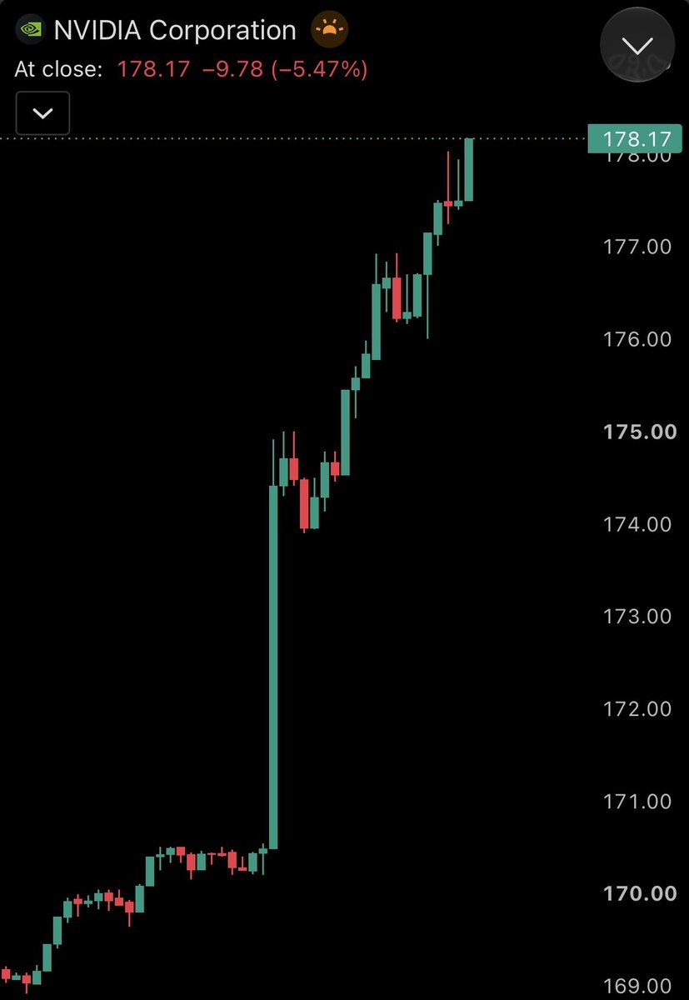

- 미국 10월 CPI가 예상보다 높게 나오면서 10년물 국채금리가 5%를 재돌파하고 12월 금리 인상 기대가 급등
  - 시장 반영 확률은 25bp 인상 84%, 50bp 인상 11%로 인상 폭이 핵심 변수로 부상

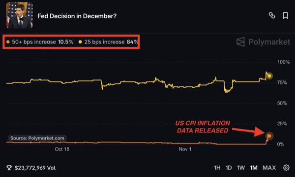

- 온체인 토큰화 주식 공급은 한 주간 사상 최대인 9억3,200만 달러 증가해 47억 달러를 돌파
  - 미국 중간선거 변동성 속 24시간 거래 수요가 확대
  - Solana 기반 Jupiter의 토큰화 주식 거래자는 전월 대비 60%, 거래량은 34% 증가했고 거래량의 62%는 정규장 밖에서 발생

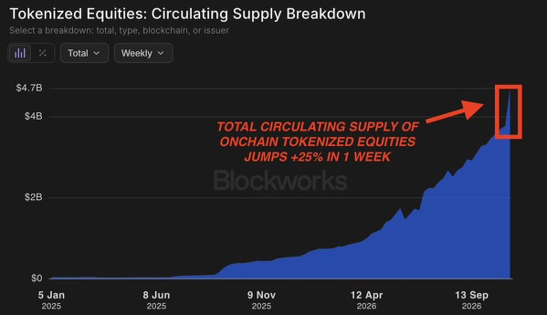

- 중국 10월 PPI는 전년 대비 5.7% 올라 2022년 6월 이후 최대 상승률을 기록하고 3개월 연속 가속
  - 에너지·비철금속 가격 상승과 AI 하드웨어 수요가 제조원가를 압박
  - 생산자 구입가격도 7.9% 상승해 원재료·에너지 비용 부담이 확대

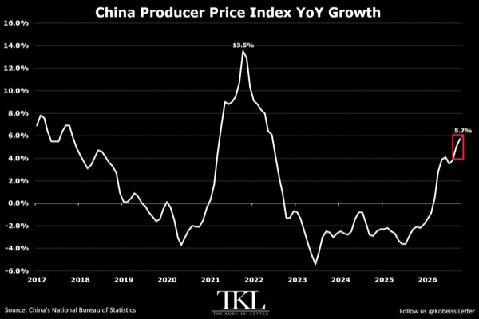

- 미국 상장 ETF의 10월 순유입은 2,010억 달러로 역대 두 번째 규모이며 투자 수요가 강세를 유지
  - 연초 이후 유입액은 1조7,000억 달러로 종전 연간 기록을 이미 경신
  - 2025년 1조4,500억 달러, 2024년 1조1,500억 달러를 넘어 연간 유입액 3년 연속 증가 가능성

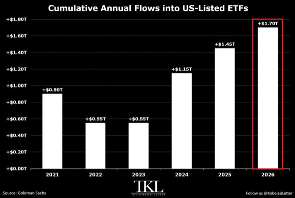

- 헬스케어는 최근 6개월간 기술주를 35.6%포인트 앞서며 25년 만에 최대 상대 강세
  - 헬스케어 31.7% 상승, 기술주 3.9% 하락으로 업종 간 수익률이 크게 분화
  - 2008년 금융위기와 2022년 약세장 당시 상대 초과수익 22.9%포인트·21.2%포인트도 상회

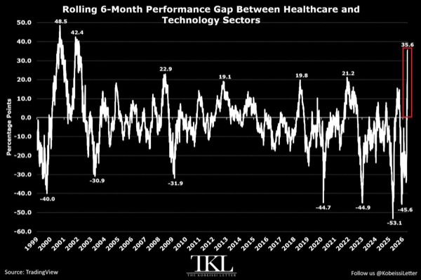

- 홍콩 2026년 3분기 GDP는 전년 대비 5.2% 증가하며 AI 투자 사이클의 수혜가 확대
  - 상품 수출은 AI 전자제품 수요에 힘입어 30.4% 증가해 2분기 28.9%보다 가속
  - 관광객 유입·인프라 투자도 성장을 지원했고, 1~9월 GDP 증가율은 5.1%로 같은 기간 기준 5년 만에 최고

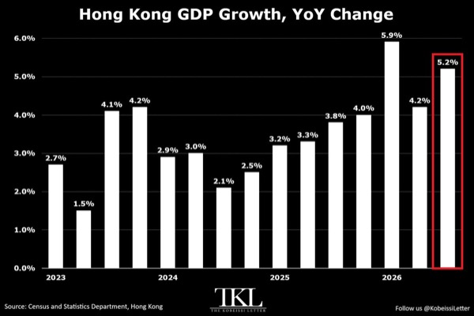

- CoreWeave(CRWV)는 AI 수요에 따른 예상 상회 실적으로 16% 이상 급등하고 기술주 저가 매수가 확산
  - Nasdaq 100 선물은 1.5% 상승했고 S&P 500은 7,600을 돌파해 사상 최고치까지 약 3%를 남김

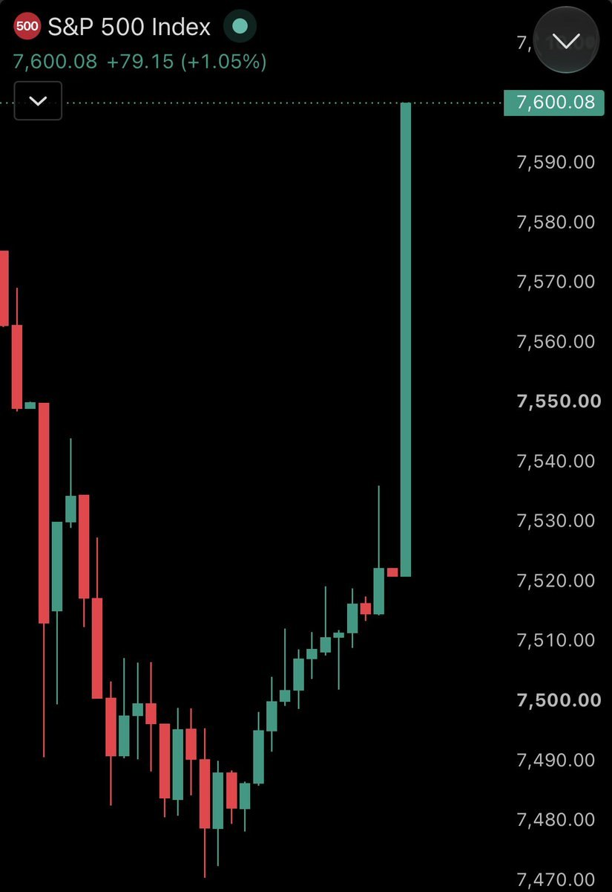

- 세계 중앙은행은 2026년 3분기 금 321톤을 매입하며 금 가격 하락기에 매수를 확대
  - 2024년 4분기 이후 최대이자 역대 다섯 번째 규모로, 전분기 대비 8% 증가하고 5년 분기 평균 227톤을 상회
  - 중국 63톤·폴란드 40톤이 수요를 주도했고 연초 이후 누적 매입은 675톤으로 전년 동기 대비 6% 증가

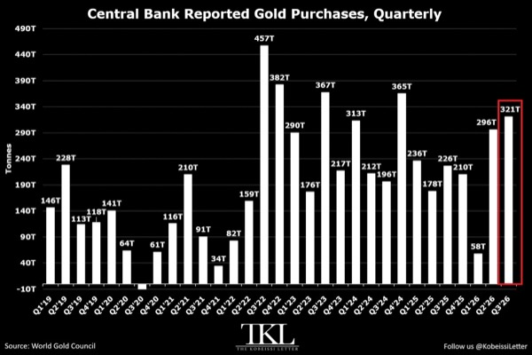

# MKevin

### 엔비디아 소송 비용보다 큰 신뢰와 성장 리스크

- 엔비디아의 중국 우회 수출·경영진 관련 의혹이 증권 집단소송으로 확대됐지만, 투자 위험의 핵심은 배상금보다 신뢰 훼손과 성장 둔화
  - 영상에서는 의혹 관련 시가총액 감소액을 약 1,900억 달러로 제시했으며, 합의금보다 주가 재평가의 영향이 훨씬 큰 상황
- 뉴욕타임스 보도에 따르면 미 상무부는 메가스피드를 수개월 조사하다 중단
  - 엔비디아 최고법률책임자 팀 티터가 제프 케슬러의 허락을 언급하며 조사 내용을 문의한 뒤 중단돼 외압 의혹이 제기됨
  - 하워드 러트닉 및 캔터 피츠제럴드와의 이해관계도 거론됐지만, 내부자거래나 특혜를 입증할 증거는 제시되지 않음
- 메가스피드와 앨리스 황의 엔비디아 접근성이 우회 수출 의혹의 중심
  - 파이낸셜타임스 보도상 메가스피드 자산 규모는 약 3,300만 달러에서 30억 달러로 급증
  - 앨리스 황이 젠슨 황을 부를 수 있다고 말한 뒤 실제 모임에 참석한 사례가 등장했지만, 친분만으로 불법 수출이나 공시 위반이 입증되지는 않음
- 집단소송은 2025년 10월 9일~2026년 11월 8일 사이 주식 매수와 손실을 문제 삼으며, 허위·오도성 공시와 손실 사이의 인과관계 입증이 관건
  - 단순한 기회비용보다 보유 주식 수, 거래 내역, 실제 손실과 원인에 대한 증거가 중요
  - 고객 행사 참석에 관한 회사 해명과 앨리스 황의 발언 차이를 허위 공시로 연결하는 논리는 비약이 크다는 평가
- 소송의 직접 비용은 엔비디아의 이익 창출력에 비해 제한적일 수 있음
  - 영상 인용 통계상 2026년 상반기 종결 사건의 62%는 기각, 38%는 합의로 종료됐으며 평균 합의금은 약 1,700만 달러
  - 과거 대형 증권소송 합의금은 엔론 72억 달러, 월드컴 61억 달러, 타이코 32억 달러 수준
  - 엔론 합의금의 약 두 배인 150억 달러를 가정해도 영상의 연환산 영업이익 추정치 2,800억 달러 대비 약 5%지만, 이는 극단적 비교 시나리오이며 실제 배상액 추정은 아님
- 수출통제 위반 여부는 중국 반입 가능성에 대한 인지와 경고 신호 대응 기록에 달림
  - 영상의 법 해석은 엔비디아가 위반 가능성을 알고 있었는지에 초점을 두며, 모든 칩의 최종 목적지를 추적할 일반적 의무는 없다는 전제
  - 허용된 해외 클라우드 GPU 임대와 중국으로의 물리적 칩 반입은 구분해야 하며, 실제 거래 구조와 규정 적용에 따라 결론이 달라짐
- 엔비디아는 우회 수출 의혹을 철저히 조사해 사실이 아닌 것으로 확인했다고 반박
  - 조사 범위와 내부 문서가 해명의 신뢰도를 좌우하며, 법무부의 메가스피드 조사에서 확보될 자료가 후속 소송의 핵심 변수
  - 영상이 인용한 미국 당국의 초기 설명은 엔비디아 관계자들이 앨리스 황의 정보 수집 활동을 몰랐다는 내용
- 영상에 제시된 월가의 분기 매출 예상치는 1,093억 달러, 영업이익 예상치는 700억 달러
  - 골드만삭스는 매수 의견과 목표주가 300달러를 제시했으며, 영업이익은 시장 예상보다 약 40억 달러 높게 추정
  - 최근 실적의 순이익률 약 62%, 6개월 영업현금흐름 약 740억 달러를 소송 비용 흡수력의 근거로 제시
- 주가 168달러에서 제시된 저평가 논리는 높은 성장률 유지에 의존
  - 영상의 추정 이익 기준 배수는 약 18배이며, 연 성장률 34% 가정 시 PEG 약 0.52, 성장률 15% 가정 시 약 1.2
  - 성장률이 낮아지면 같은 주가에서도 저평가 폭이 줄어들며, 데이터센터 투자 확대 속도가 핵심 변수
- 11월 17일로 제시된 실적 발표에서 젠슨 황의 거취와 의혹 대응, 고객 관계를 확인할 필요
  - 영상은 단기 퇴진 가능성을 낮게 평가하지만, 실제 퇴진 발표는 추가적인 주가 하락 요인
  - 고객 이탈이나 구매처 다변화가 나타나면 AMD에 기회가 생길 수 있으나, 업종 전체 투자심리 악화도 함께 고려
- 합의금 규모만으로 악재 반영 여부를 판단하면 수출 제한, 고객 이탈, 경영진 교체에 따른 장기 이익 감소를 놓칠 수 있음
- 저평가 판단은 법적 방어 논리보다 실적과 현금흐름의 유지 여부로 검증해야 함
  - 다음 실적에서 수요·마진·전망치가 유지되는지와 조사 대응의 구체성을 함께 확인하는 것이 중요

### 착빙과 급성장한 뇌우 속 조종 상실의 연결고리

- 미국 국가교통안전위원회(NTSB)가 리어젯 60 사고기의 조종실 음성기록장치(CVR)를 발견했으며, 조종 상실 전후 상황을 밝힐 핵심 단서가 될 것
  - 사고로 탑승자 9명이 사망하고 지상에서 1명이 부상했으며, 충돌 구덩이의 침수로 잔해 발굴이 지연됨
  - 왼쪽 승강타 대부분이 충돌 지점에서 약 1.3~3.8마일 떨어진 곳에서 세 조각으로 발견됐고, 다른 잔해는 최대 약 3.9마일까지 흩어짐
  - 충돌 전 기체 일부가 분리된 사실은 확인됐지만, 조종 상실의 원인이었는지 급강하 중 과속에 따른 결과였는지는 미확정
- 사고기는 바하마 착륙을 준비하며 41,000피트에서 35,000피트로 하강한 뒤 악천후를 만남
  - 착륙을 위한 사전 하강 자체는 통상적인 절차이며, 최대 운용고도가 51,000피트라는 이유만으로 높은 고도를 유지해야 하는 것은 아님
  - 기상 재구성 자료에서는 뇌우 상단이 약 20분 만에 48,000피트까지 성장해, 41,000피트 유지로 피할 수 있었을지도 불확실
- 승무원은 약 600~700피트의 고도 변동과 착빙을 보고한 뒤 37,000피트로 상승 허가를 받음
  - 외기온은 영하 47도로 보고됐으며, 사고 약 10분 전 부기장이 보낸 문자에도 난기류와 착빙이 언급됨
  - 비상 교신에는 분당 10,000피트 하강과 60도 경사가 등장해 급격한 비정상 비행 상태가 드러남
- 착빙으로 실속 속도가 높아지고 안전한 속도 여유가 줄었을 가능성
  - 35,000피트는 최대 고도 부근의 전형적인 코핀 코너와는 거리가 있지만, 날개 결빙으로 양력이 줄면 실속과 과속 사이의 여유가 좁아질 수 있음
  - 급격한 결빙이 방빙 능력을 넘거나 녹은 물이 비가열 구역에서 다시 얼었을 가능성도 검토 대상
  - 피토관이나 실속 경고 계통의 결빙, 꼬리날개 실속도 가설이며 실제 발생 여부는 확인되지 않음
- 자동조종장치의 수직속도 모드와 착빙이 겹쳐 감속과 실속 징후를 놓쳤을 가능성
  - 일정 상승률을 유지하려고 기수를 올리는 동안 속도가 떨어지고, 자동 보정이 조종사가 느낄 진동이나 조종감 변화를 가렸을 수 있음
  - 조종 상실 당시 자동조종 모드와 트림 상태, 해제 이후 조종 입력은 아직 확인되지 않음
- 착빙과 난기류에서 벗어나려던 상승이 더 강한 폭풍 구역으로 이어졌을 가능성
  - 영상에서 인용한 기체 매뉴얼은 난기류 통과 시 속도 유지와 고도 변동 허용 또는 하강을 제시함
  - 관제에 일정 고도 범위 사용을 요청하는 대안도 있었지만, 당시 상승의 주목적이 착빙 회피였는지 난기류 회피였는지는 불명확
- 기상레이더의 신호 감쇠로 가장 위험한 구역이 빈 공간처럼 보였을 가능성
  - 강한 강수에 가려 반사 신호가 돌아오지 않으면 화면의 검은 구역을 안전한 통로로 오인할 수 있음
  - 2017년 매각 자료에는 콜린스 WXR-840 레이더가 기재돼 있으나, 이후 교체·개량 여부는 확인되지 않음
  - 지상 기상레이더 자료도 수분 지연될 수 있어 빠르게 성장하는 뇌우의 현재 상태와 차이가 벌어질 수 있음
- 악천후 접근을 허용한 비행 의사결정도 주요 조사 쟁점
  - 프리포트 방향 경로 선택을 단순한 5분 절약으로 단정할 근거는 부족하며, 조종사가 실제로 어떤 기상정보를 봤는지가 중요
  - 악천후가 없던 플로리다 서해안에 착륙해 기다리는 대안이 제시됐지만, 일정 압박이나 승객 요구가 실제 판단에 영향을 줬는지는 미확인
- 기계적 고장과 공간정위 상실도 배제되지 않음
  - 승강타·수평안정판·조종계통 이상이나 정비 문제가 먼저 발생했을 가능성과, 실속 후 급강하 과정에서 구조물이 분리됐을 가능성을 구분해야 함
  - 60도 경사는 주날개 실속 가설과 연결되지만 원인을 확정하는 증거는 아니며, 구름 속 시야 상실이 회복을 어렵게 했을 수 있음
  - 저화질 영상의 날개·꼬리 형상은 롤링셔터와 촬영 속도 때문에 왜곡될 수 있어 프레임만으로 분리 시점을 단정하기 어려움
- 기장 제프리 그레고리는 55세로 여러 리어젯 형식한정을 보유했으며, 20세 부기장 나탈리아도 리어젯 60 형식한정을 보유함
  - 부기장의 기장 업무 제한은 부기장 근무 자격 결여를 뜻하지 않으며, 나이와 자격 표기만으로 사고 원인을 연결할 수 없음
  - 최종 원인은 CVR, 잔해, 기상자료와 조종계통 분석을 종합해야 하며, 영상 시점에는 예비보고서가 약 한 달 뒤 나올 것으로 예상됨
- 조사에서 가장 중요한 것은 악천후 진입, 속도·자세 변화, 조종 입력, 구조물 분리의 선후관계
  - 같은 잔해와 교신도 사건 순서에 따라 최초 고장과 후속 손상으로 해석이 달라짐
- 사고 예방의 핵심은 방빙장치·자동조종·기상레이더 각각의 한계가 겹치는 상황을 훈련과 운항 판단에 반영하는 것
  - 단일 장비 고장에만 초점을 맞추기보다 기상 회피, 매뉴얼 적용, 속도 관리와 대체 착륙 판단이 함께 작동했는지 살펴야 함

### 유가와 투자에 달린 금리 인상과 기술주 반등

- 연준 통화정책의 핵심 변수는 중동 전쟁에 따른 에너지 가격과 AI 투자 붐
  - 미셸 보먼 연준 금융감독 부의장은 에너지 가격과 AI 기대가 물가·고용에 미치는 영향을 주시
  - 중동 분쟁과 기술 투자 붐이 빠르게 약해지면 근원 PCE의 목표 복귀도 빨라질 수 있음
  - 이란 합의가 금리 인상 필요성을 낮춘다는 해석은 영상의 핵심 투자 논리이며, 합의 여부와 금리 결정을 직접 연결한 연준의 확약은 아님
- 시장은 12월 금리 인상에 이어 2027년 3월과 9월까지 추가 인상을 반영
  - 영상에 제시된 누적 인상 반영치는 12월 1.13회, 9월 15일 3.19회이며 5년 기대인플레이션은 약 2.25%
  - 이란 협상 결렬, 선거, 높은 CPI, 금리 경로 재조정이 연달아 주가를 압박
  - 향후 주요 일정은 금요일 PPI, ISM·PMI, 연준 발언이며 악재가 상당 부분 반영됐다는 전제에서 변동성 완화와 반등에 무게
- 미국의 대이란 전략은 조기 합의보다 봉쇄를 유지하며 기다리는 방향
  - 마코 루비오는 평화협정과 전쟁 재개 외에 아무 조치 없이 기다리는 선택지가 있으며 트럼프에게 합의 시한 압박이 없다고 강조
  - 예측시장의 2027년 3월 1일 이전 핵 합의 확률은 약 15%로 하락
  - 이란은 종전, 동결자산 반환, 봉쇄·제재 해제, 전쟁 배상, 미군 철수, 우라늄 농축 권리 등 7개 조건을 요구
  - 제재와 해상·육상 봉쇄가 이란의 물가·교역을 압박하는 가운데 해외 미군 기지와 미국 인사에 대한 보복 위협도 지속
- 이란 합의가 없어도 원유 공급 회복은 유가와 증시의 부담을 줄일 수 있음
  - 사우디아라비아의 10월 생산량은 전쟁 직전 수준을 웃돌았고 전체 원유 흐름도 회복
  - 브렌트유는 117달러에서 약 23달러, 약 20% 하락
  - 군사적 확전 억제와 공급 증가는 유가 하락에 유리하지만, 미국의 협상 유인도 약화
  - 보먼은 분쟁이 빨리 끝나도 에너지 가격 정상화에는 시간이 걸릴 수 있다고 경고
- 물가 둔화의 경로는 관세 효과 소멸, 에너지 가격 하락, AI 투자 수요 진정
  - 영상은 물가상승률을 약 4%로 단순화해 통상적 물가 압력·관세·이란 및 원유·AI 기여를 각각 약 1%포인트로 구분
  - 관세 효과는 2027년으로 갈수록 약해지고 에너지 압력은 중동 분쟁 해결에 따라 완화될 가능성
  - 주가 하락에 따른 금융여건 긴축도 수요를 억제하지만, 반등하면 이 억제 효과가 줄어 금리 인상 압력이 남을 수 있음
- 고용 회복은 연준이 물가 대응에 집중할 여지를 주지만 AI의 장기 고용 충격은 별도 위험
  - 해고 감소와 실직자 재흡수는 현재 노동시장의 버팀목
  - AI 도입은 생산성 개선 방식을 찾고 투자를 늘리는 초기 단계이며 대규모 일자리 대체 시점은 불확실
  - AI 투자 붐 둔화와 자산가격 하락이 겹치면 소비와 고용이 함께 약해질 수 있음
- 기술주 반등 논리는 과매도 해소와 포지션 축소 이후의 재진입 여력
  - 헤지펀드의 AI 노출은 6월 47%에서 32%로 약 3분의 1 축소
  - 직전 주 디레버리징 강도는 최근 5년 기준 99백분위로, 강제적 위험 축소가 컸던 구간
  - 영상 당일 SanDisk 약 16%, Micron 12%, SK하이닉스 10%, Seagate 11%, Lumentum 15% 상승과 QQQ 약 2.5% 반등을 사례로 제시
  - 200일 이동평균선 부근까지 밀린 기술주를 분산 매수하는 전략을 선호하며 AI 과열의 정점은 아직 앞에 있다는 낙관론 유지
- CoreWeave의 자금조달은 고금리 무담보채보다 기존 대출 약정과 고객 선급금에 집중
  - 실적 발표에서 현재 금리의 무담보채를 사용할 필요가 없으며 잔여 설비투자를 수주잔고, 인출 시점을 늦춘 대출, 고객·기업 금융으로 충당할 계획을 제시
  - Microsoft 등 우량 고객의 선급금은 시장 차입금리가 높아도 GPU 투자를 지속할 수 있는 완충장치
  - 영상 당일 주가 약 22% 반등과 CoreWeave·Meta·Oracle의 CDS 하락을 AI 신용불안 완화 신호로 해석
- AI 기업의 매출 성장과 자금 수요는 투자 붐이 당장 끝나지 않았다는 근거
  - 영상은 Anthropic의 약 1조4,000억달러 가치 IPO에 초과 청약이 발생했다고 제시
  - OpenAI는 분기 매출 50% 성장과 연환산 반복매출 약 400억달러, 약 1조2,500억달러 가치의 자금조달을 언급
  - Anthropic의 연환산 반복매출은 OpenAI의 약 두 배라는 비교를 바탕으로 AI 기업 가치의 하방 지지력을 강조
- 반등 지속 여부는 이미 반영된 악재보다 실제 유가·고용·신용 지표가 추가로 악화되는지에 달림
  - 금리 인상과 협상 교착이 가격에 반영됐더라도 확전이나 공급 차질은 기존 반등 논리를 훼손할 수 있음
  - 이란 합의는 추가 호재지만 합의 없이도 공급 증가와 신용불안 완화가 이어지는지 확인할 필요
- AI 수요의 성장과 AI 인프라 기업의 자금조달 안정성은 함께 점검할 변수
  - 고객 선급금은 단기 차입 부담을 줄이지만 투자 지속성은 고객의 현금흐름과 계약 이행 능력에도 좌우됨
  - 주가 반등만으로 위험 해소를 단정하기보다 CDS, 실제 자금조달 조건, 고용 변화를 함께 확인

# Slav

- 공모주 청약은 기관경쟁률과 의무보유확약이 높은 종목을 선별하고 낮은 종목은 거르는 기준을 활용
  - 흥행 지표가 부진한 종목에 무차별 청약하면 손실 위험이 커짐

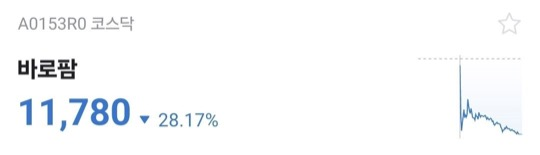

- 코스닥의 1월 강세 계절성에 주목하고 지수 정상화 이후 CES 관련 투자 준비

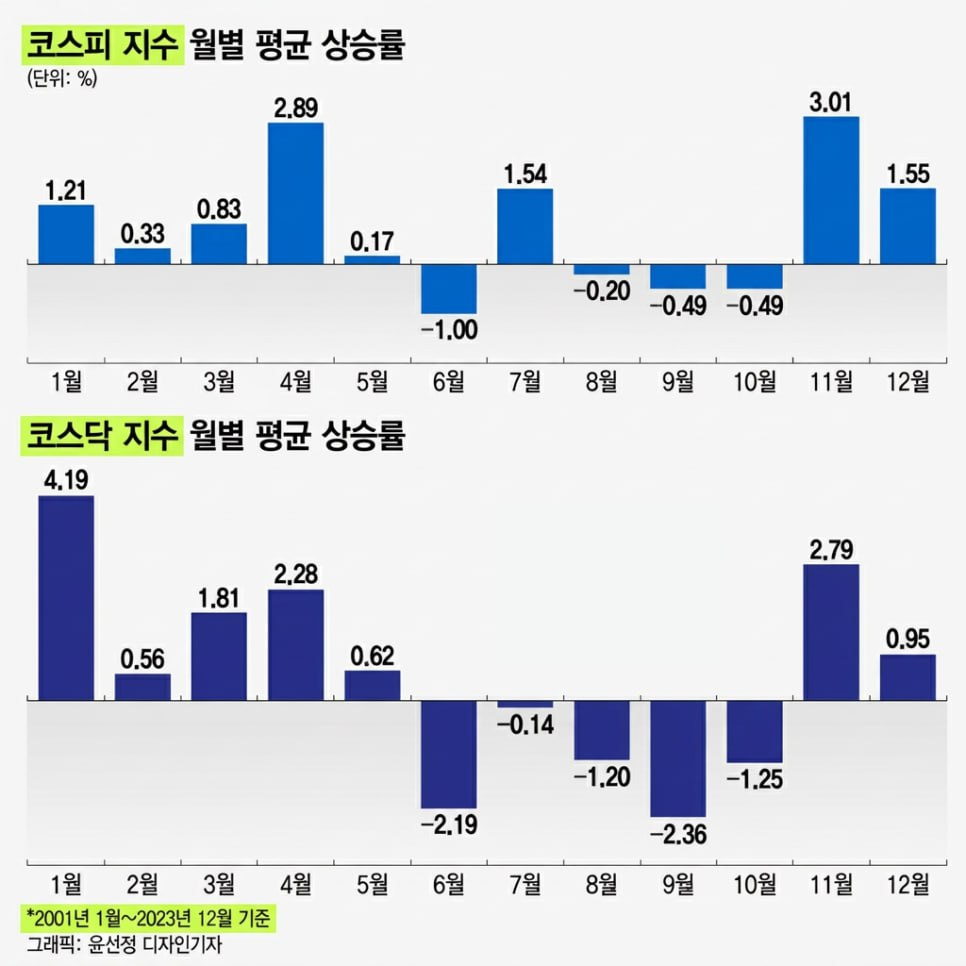

- 11월 1~10일 DRAM 수출 단가가 사상 최고치를 경신했으며 구조적 가격 상승이 2027년까지 지속될 전망
  - 2026년 4분기 출하 증가는 초과수요 속에서 판가 인상과 함께 흡수되는 흐름
  - 메리츠 전망은 2027년 반도체 공급부족과 역사적 저점 수준 밸류에이션의 강한 회복을 예상

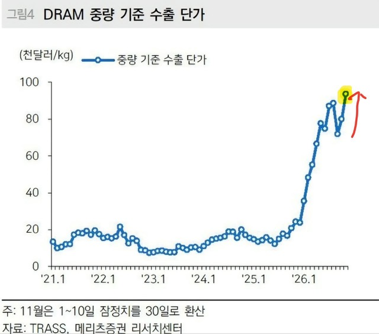

- 씨엔엠과 제이앤티지가 공모를 철회하면서 이번 주 청약 대상이 4종목에서 1종목으로 축소
  - 대내외 불확실성으로 기업가치를 적절히 평가받기 어려운 공모시장 환경에 주의

- NVDA는 젠슨 황 관련 인물의 중국 AI 칩 우회 반입 의혹으로 경영진·수출통제 위험이 부각
  - 최소 75억 달러 규모 칩 운송에 기여했다는 보도가 제기됐으나 의혹의 사실관계 확인이 필요

# Stockbot

- 예상보다 높은 미국 10월 CPI로 10년물 국채금리가 5%를 재돌파하고 12월·1월 연속 금리 인상 기대가 확대
  - 12월 50bp 인상 확률은 13%까지 상승
  - 12월 50bp와 1월 25bp 인상이 함께 이뤄질 확률은 6.7%로 CPI 발표 전 0%에서 급등

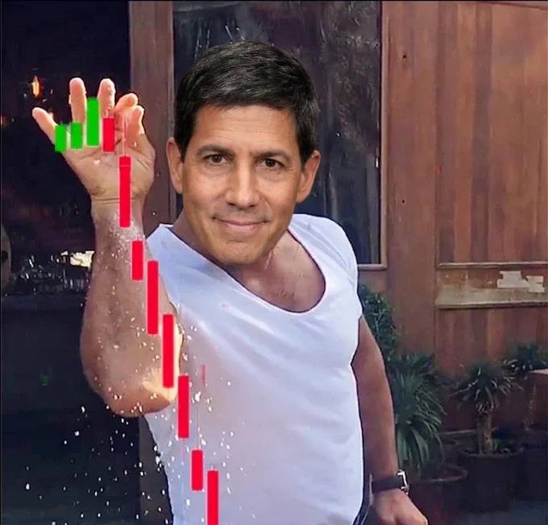

- Microsoft(MSFT)가 Nvidia(NVDA)를 시가총액에서 추월한 가운데 Nvidia의 정치·수출통제 위험이 확대
  - 미 하원 중국특위 위원장은 젠슨 황이 당일 업무 종료까지 답하지 않으면 소환장 발부 가능성을 경고
  - 중국 군 연계 대학이 미국 제재 명단에도 공급업체를 통해 10월 H200 두 개를 12만3,000달러에 구입했다는 보도
  - 트럼프의 젠슨 황 옹호를 두고 민주당이 해명을 요구하고, 과거 관련 브리핑 여부도 논란

- Strategy(MSTR)는 기관 지분 확대와 MSCI 지수 제외에 따른 패시브 매도 위험이 공존
  - Fidelity는 지분 규모를 세 배인 1억5,600만 달러로 늘렸고 Amundi는 3분기 지분을 43.7% 확대
  - MSCI 제외 시 최대 28억 달러의 매도 가능성이 있으며 최종 결정은 11월 12일 오전 6시 이후 예상되나 시간대는 원문에 미표기
  - 보유 비트코인은 85만 개 이상

- OpenAI의 3분기 매출은 50% 증가한 100억 달러이며 CFO Sarah Friar는 연환산 매출이 70% 증가했다고 발표

- Anthropic은 약 1조 달러 기업가치의 IPO를 추진하며 AI 기업의 대규모 자금 조달이 지속
  - 총 공모 규모는 최대 644억 달러, 일본 투자자 대상 조달 목표는 최대 35억 달러
  - 해당 IPO 가격 기준 FTX가 2024년 13억4,000만 달러에 매각한 지분 가치는 300억 달러 이상으로 매각가의 22배를 초과
  - IPO 서류에는 시험 중 AI 모델의 실제 컴퓨터 시스템 무단 접근이 기재됐고, 회사는 자체 정책상 AI 연구개발 역량 임계치에 도달했다고 발표

- Binance의 63억 달러 해킹 피해와 관련해 밈코인을 활용한 자금세탁 방식이 부각
  - Elliptic에 따르면 NEAR 기반 신규 토큰 6개를 통해 약 43만 달러가 다른 지갑으로 이동
  - 수 시간 거래한 뒤 토큰을 방치하는 방식으로 추적을 어렵게 했으며 Bybit 해킹 이후에도 유사 수법이 사용

- Ripple 지원 Evernorth(XRPN)는 상장 이후 주가가 40% 하락한 가운데 내부자 보유 7,370만 주의 재매각 등록을 신청
  - Ripple·Arrington·Larsen 연계 신탁의 보호예수는 2027년 4월 9일까지 유지
  - 회사는 이번 등록이 실제 매도 결정이 아닌 계약상 의무 이행이라고 설명

# WUncle

### 앤트로픽 상장 가치와 반도체 파급효과

- 앤트로픽 상장의 핵심 쟁점은 기업가치 적정성, 흑자의 질, 기존 AI·반도체 주식에 미치는 영향
  - 영상에서 거론된 기업가치는 1조 5천억~2조 달러이며, 역대 최대 규모 상장 가능성에 시장 관심 집중
  - 영상이 인용한 보도 기준 거래 개시 예상 시점은 11월 16~25일이며 공모가 범위는 발표 전
- 흑자 달성만으로 수익성을 단정하기 어려우며 실제 돈을 버는 구조인지 확인 필요
  - 앤트로픽의 성장이 기존 AI 주식과 삼성전자·SK하이닉스에 얼마나 연결되는지도 주요 검토 대상
- 11월 12일 오후 7시 무료 온라인 특강에서 앤트로픽 상장 관련 쟁점 점검 예정
- 12월 1일 기관 대상 오프라인 세미나는 2027년 매크로·지정학·에너지·핵심 광물·농산물 전망을 다룰 예정
  - 신청 대상은 수출입 기업과 금융기관의 원자재 유관 부서 담당자이며 좌석 제한
- 상장 기대감과 투자 매력은 별도로 평가할 필요가 있으며 공모가, 실질 수익성, 반도체 수요 연결성을 함께 확인해야 함

# YDental

### 미국 물가 발표와 금리 인상 전망의 핵심 변수

- 미국 10월 물가는 9월 급등이 일시적 충격인지 지속적 인플레이션인지 가르는 변수
  - 11월 10일 밤 10시 30분 CPI, 11월 13일 밤 10시 30분 PPI 발표 예정
  - 12월 9일 FOMC 직전 마지막 주요 물가 데이터로 제시돼 정책 판단에 미치는 영향이 큼
- 9월 CPI는 전월 대비 0.6%, PPI는 1.3% 급등했으며 PPI의 전년 대비 상승률은 6.3%, 코어 PPI는 5.0%에 도달
  - 10월에도 높은 상승세가 이어지면 유가 충격을 넘어선 광범위한 물가 상승으로 해석될 위험
  - 상승세가 정상화되면 9월 급등이 유가에 따른 일시적 현상이었다는 안도감 형성 가능
- CPI의 핵심은 헤드라인보다 코어, 특히 주거비와 서비스 물가의 둔화 여부
  - 유가 안정에 따른 헤드라인 둔화는 시장에 일부 반영된 상태
  - 전월 대비 수치와 함께 전년 대비 상승률도 확인해 물가의 추세적 안정을 판단할 필요
- 시장에 반영된 12월 금리 인상 확률은 약 78%로, 물가 안정에 따른 상승 여지가 추가 과열에 따른 하락 위험보다 큰 국면
  - 다만 CPI 컨센서스 자체가 전월보다 상승폭 확대를 예상해 낙관적 접근에는 한계
- PPI는 9월 급등 이후 정상화가 예상되지만 운송·창고 서비스 가격이 핵심 변수
  - 9월 해당 항목은 전년 대비 16% 급등
  - 유가 상승이 디젤 가격을 거쳐 서비스 가격으로 전이되는 경로에 주목
  - 10월에도 상승세가 지속되면 에너지발 물가 압력의 확산으로 해석돼 12월 금리 인상 가능성이 강화될 수 있음
- 기본 시나리오는 CPI의 컨센서스 부합과 전월 대비 상승폭 확대, PPI의 소폭 둔화
  - 이 경우 12월 금리 인상 확률은 약 80%로 유지되고 10년 국채 금리는 제시된 현재 수준인 5.1% 부근에서 안정될 가능성
  - 예상에 부합하는 결과만으로도 불확실성이 줄어 위험자산 반등의 계기가 될 수 있음
- 헤드라인 둔화만으로 물가 안정 여부를 판단하기 어려우며 코어 CPI와 운송·창고 서비스의 동반 둔화가 중요
- 위험자산 반등의 조건은 금리 인상 가능성의 소멸보다 추가 긴축 우려를 키우지 않는 물가 결과
  - 컨센서스 부합 여부와 서비스 물가의 지속성을 함께 확인할 필요
