# Harvey

- 아시아 외국인 매도는 한국·대만에 집중되고 인도는 순매수로 전환
  - 10월 한국·대만 순매도 합계는 452.7억 달러로 아시아 7개 시장 순유출의 약 91%를 차지

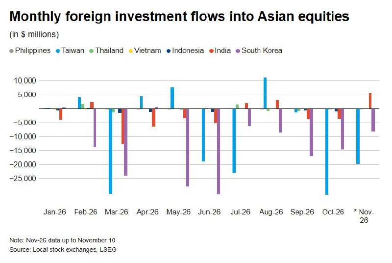

- 한국·대만 자금 이탈은 아시아 전체 경기 비관보다 AI 투자 사이클 관련 위험 축소 성격이 강함
  - AI 투자 불안이 커지면 개별 기업을 구분하기 전에 반도체·국가·고변동성 노출부터 줄일 수 있음
- 한국은 연초부터 외국인 순매도가 이어져 최근 AI 투자 우려만으로 자금 이탈을 설명하기 어려움
- 한국 증시 재평가에는 저평가뿐 아니라 기업 이익이 일반주주 수익으로 연결된다는 신뢰가 필요
  - 예측 가능한 규칙과 주주 수익에 대한 정책 신뢰가 확보되지 않으면 낮은 밸류에이션이 장기 할인으로 고착될 수 있음

# KHwanK

### 잠재 고객을 모으는 네 가지 방법과 하루 백 번 실행법

- 상품 가치가 높아도 잠재 고객이 모르면 매출은 발생하지 않음
  - 알렉스 호모지의 고객 확보 전략에서 리드는 직접 연락할 수 있는 잠재 고객을 뜻함
  - 고객 확보 경로는 지인에게 직접 연락하기, 무료 콘텐츠 배포하기, 모르는 사람에게 직접 연락하기, 유료 광고 집행하기의 네 가지
- 상품 가치는 고객이 원하는 결과와 달성 가능성을 높이고, 소요 시간과 노력·고통을 줄일수록 커짐
  - 수량·시간 제한과 상품명으로 구매 동기를 강화하고, 미끼 상품·업셀·다운셀·정기 결제로 객단가와 반복 매출을 높임
  - 고객 확보와 함께 상품 자체의 가치도 계속 개선해야 함
- 초기 고객은 이미 신뢰가 있는 지인에게 개별 연락해 확보
  - 연락처와 SNS에서 대상을 찾고, 단체 문자 대신 상대의 근황으로 대화를 시작
  - 곧바로 구매를 요구하기보다 해당 서비스에 관심 있을 사람을 아는지 물어 본인 수요나 소개를 끌어냄
- 첫 고객 5명에게 무료로 제공해 서비스의 약점을 찾고 피드백을 축적
  - 이후 5명씩 정가의 20%, 40% 등으로 결제 비율을 높이고, 약 20명의 할인 고객을 거친 뒤 정상 가격 적용
  - 제시된 전환 예시는 100명 연락 → 20명 답장 → 4명 무료 체험 → 1명 결제
  - 같은 전환율이면 1,000명 연락으로 10명 결제 확보 가능하며, 객단가가 높으면 적은 고객으로도 사업 유지 가능
- 무료 콘텐츠는 관심을 붙잡고 실제 효용을 제공해 잠재 고객을 유입시키는 수단
  - 제목·썸네일·첫 2초로 관심을 끌고, 끝까지 볼 이유와 바로 활용할 수 있는 결과물을 제공
  - 5분 운동 루틴처럼 시청자가 즉시 실행할 수 있는 내용이 효과적
  - 무료 콘텐츠 10개 뒤 11번째에 판매 안내를 섞는 식으로 홍보 빈도를 낮추고 신뢰를 축적
- 당장 판매할 상품이 없어도 SNS와 콘텐츠로 관심 고객을 먼저 모을 수 있음
  - 여러 플랫폼에 꾸준히 콘텐츠를 배포하면 이후 상품·서비스 판매의 기반이 됨
- 모르는 사람에게 연락할 때는 판매자 소개보다 상대의 문제로 시작
  - 상대의 SNS 등에서 확인한 구체적인 불편을 언급하고, 30초 안에 쓸모 있는 정보나 짧은 영상을 무료로 제공
  - 초등학교 3학년도 이해할 정도로 문장을 쉽게 써야 읽고 반응할 가능성이 높아짐
- 유료 광고는 여러 소재를 소액으로 시험하고 성과가 확인된 광고에 예산을 집중
  - 대부분의 시험이 실패할 수 있으므로 반응 없는 광고는 중단하고, 성과가 좋은 광고는 변형 소재와 집행 규모를 확대
  - 광고비 10만 원으로 매출 50만 원을 만든 소재가 있다면 추가 집행 후보가 됨
- 고객 확보를 혼자 감당하기 어려우면 직원·제휴 파트너·인플루언서에게 일부 경로를 맡김
  - 고객 유입으로 매출이 발생하면 일부를 지급하는 제휴 구조 활용 가능
  - 기존 고객도 좋은 서비스에 만족하면 새 고객을 소개하는 유입 경로가 됨
- 실행 기준은 하루 100회 수준의 활동을 100일간 지속하는 것
  - 직접 연락은 하루 100명, 콘텐츠 제작은 하루 100분처럼 채널에 맞는 실행량을 설정
  - 성과가 부족하면 방법을 바꾸기 전에 실제 접촉량·콘텐츠 수·지속 기간과 상품 개선 노력을 점검
- 판매와 자기 홍보는 강의·매장·프리랜서뿐 아니라 직장에서도 필요한 기술
  - 고객이나 상사가 원하는 결과를 이해하고 자신의 가치를 전달하는 능력이 수익과 경력 기회를 좌우
- 초기에는 지인 접촉과 무료 체험으로 수요·서비스 품질·전환율을 확인하고, 검증된 제안을 콘텐츠·제휴·광고로 확대하는 순서가 효율적
- 광고 확대는 매출 배수만으로 결정하기 어려우며, 상품 원가·서비스 제공 비용·고객 유지율을 반영한 실제 수익성 확인이 필요
- 하루 100회는 실행량을 확보하는 기준이며, 답장률·체험 전환율·결제율을 함께 기록해야 어느 단계의 개선이 필요한지 드러남

# Kobeissi

- 머신러닝과 AI 추론 소프트웨어는 고성장 전망이 이어지며 투자 초점이 연산 능력에서 비용 효율로 확대
  - 글로벌 머신러닝 시장은 2025년 약 1,000억 달러에서 2033년 6,840억 달러로 연평균 27.2% 성장 전망
  - AI 추론 소프트웨어 시장은 2026년 211억 달러에서 2033년 809억 달러로 283% 성장 전망
  - 지속 학습·지식 유지·새로운 작업 적응과 함께 작업별 모델 선택 및 추론 비용 절감 수요가 확대될 것

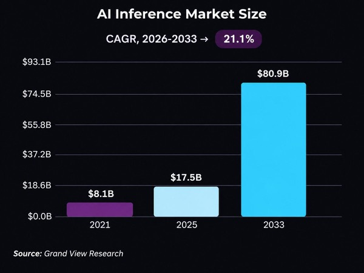

- 나스닥100은 공매도 청산 가속으로 장중 3% 넘게 상승하며 6일 전 저점 대비 9% 반등

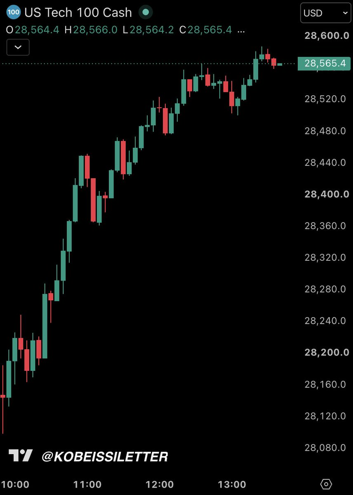

- 미국 소비자의 고용 불안이 팬데믹 초기 수준에 근접
  - 10월 1년 뒤 실업률 상승 예상 확률은 전월 대비 1.5%포인트 오른 45.3%로 2020년 4월 이후 최고
  - 40세 미만은 48.9%, 연소득 10만 달러 초과 계층은 51.5%로 각각 역대 두 번째 수준

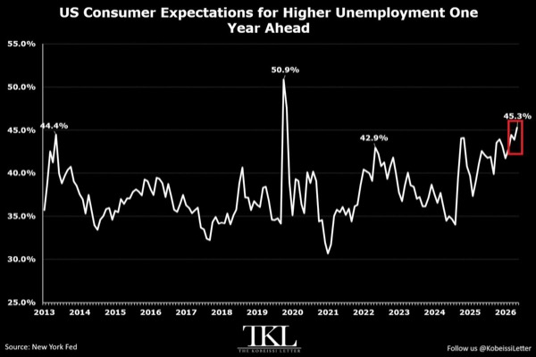

- 미국 연기금 주식 포트폴리오의 기술주 집중도가 높아져 기술주 조정에 대한 노출 확대
  - 70개 이상 연기금 분석에서 기술주 비중은 44%로 2015년의 두 배 이상이며 금융 16%·헬스케어 12%·산업재 11%를 합친 비중보다 큼

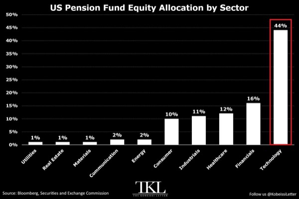

- 피드는 젠슨 황의 사생활 의혹 이후 NVIDIA 경영진 교체 속보가 이어지며 NVDA가 10% 넘게 급락했다고 보도
  - 해임 검토·외부 후임 물색·해임 확률 하락에 따른 반등 이후 CEO·사장·이사직 즉시 사임과 CFO Colette Kress의 임시 CEO 선임 소식으로 전개
  - 피드가 제시한 스캔들 이후 시가총액 감소액은 최종 7,500억 달러
  - Kobeissi는 명확한 후임이 없는 핵심 CEO 이탈이 장기 주주가치와 AI 산업에 부정적이며 충분한 조사와 주주 의견 수렴이 필요하다는 입장

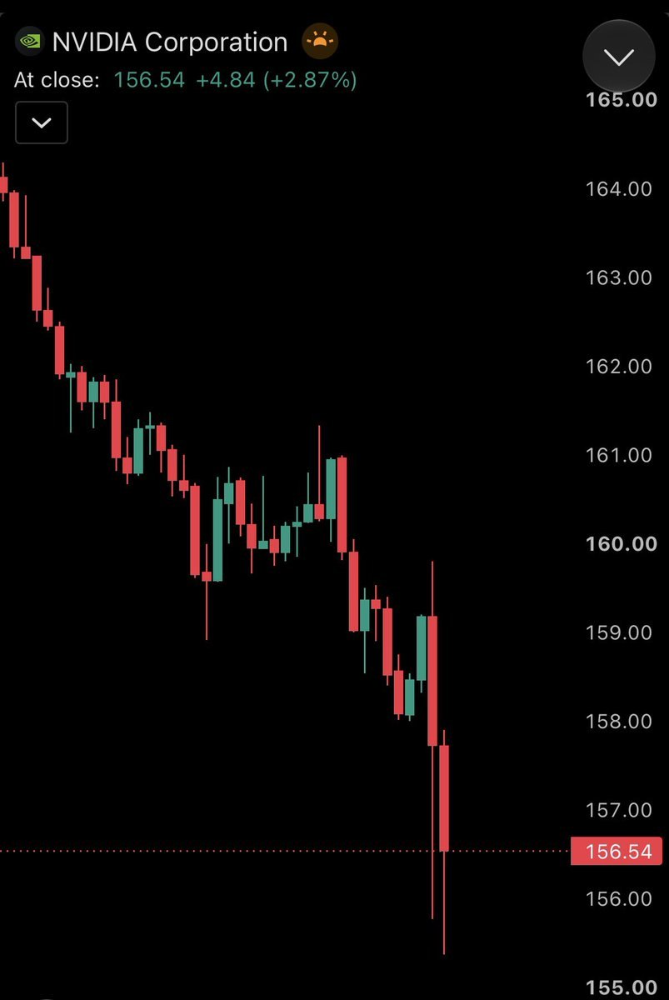

- 피드의 황 사임 속보 이후 네오클라우드 종목이 동반 급락하고 나스닥100 선물은 1.5% 하락으로 약세 확대
  - NBIS -21%, CRWV -14%, NEO -13%, IREN·CIFR 각각 -9%, APLD -8%, WULF -7%, CORZ -5%
- 미국 물가 압력이 광범위하게 재확산되며 연준의 인플레이션 대응 부담이 커짐
  - 10월 근원 CPI의 3개월 연율은 3.75%로 7월 1.64%에서 3개월 연속 상승
  - 주거비 제외 근원 서비스 물가의 3개월 연율은 5.45%, 연율 2% 넘게 오르는 CPI 구성요소의 가중 비중은 76%로 확대

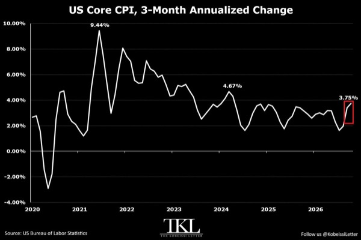

- 미국 소기업의 가격 인상 계획이 늘어 추가 인플레이션 압력 예고
  - 향후 3개월 내 인상 계획 비중은 10월 37%로 전월 대비 6%포인트 상승하며 2022년 7월 이후 최고
  - 최근 3개월 실제 가격 인상 비중은 33%, 인플레이션을 최대 경영 문제로 꼽은 비중은 전년 12%에서 17%로 상승

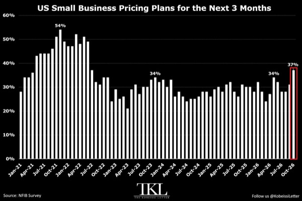

- 피드는 트럼프가 미국행 이주민 행렬을 막지 않으면 멕시코 관세를 두 배로 올리겠다고 위협했다고 보도

# MKevin

### 앤트로픽의 성장과 장기 인프라 약정의 위험

- 앤트로픽 투자의 핵심은 모델 선두 유지와 기업용 업무 플랫폼으로의 확장에 동시에 베팅하는 것
  - 토큰 판매를 넘어 회계·문서·메일·고객지원·에이전트 운영을 통합하는 ‘SaaS 2.0’ 허브로 성장해야 높은 기업가치와 인프라 지출을 정당화할 수 있음
- 영상에서 제시한 공모 일정은 11월 18일 가격 확정, 다음 날 캘리포니아 시간 오전 10~11시 상장이며 예상 공모가는 주당 70~78달러
  - 목표 기업가치는 약 1조4,000억달러, 조달 목표 약 1,000억달러 중 구글·엔비디아 등 업계 투자자 자금이 약 260억달러
- 단기 유동성은 풍부하지만 현금 규모와 장기 지출 약정을 구분해야 함
  - 현재 현금·단기투자 약 1,310억달러와 매출채권 약 80억달러에 비해 단기 매입채무는 약 96억달러
  - 상장 후 예상 현금은 초반에 2,126억달러, 이후 계산에서는 약 2,300억달러로 제시돼 수치가 혼재함
  - 향후 12개월 지출 약정 약 700억달러는 제시된 현금 범위 안에서 감당 가능
- 아마존 전환사채는 현금 상환 부담보다 지분 희석으로 봐야 함
  - 약 62억달러 규모 전환사채의 전환가는 약 2.99달러와 5.50달러로 예상 공모가보다 크게 낮음
  - 주식 전환 시 부채는 사라지지만 기존 주주의 지분 희석은 남음
- 연환산 매출 810억달러와 빠른 분기 성장이 기업가치의 주요 근거
  - 비교 대상으로 제시된 오픈AI는 분기 매출 100억달러, 연환산 매출 400억달러, 자금조달 기업가치 1조2,500억달러
  - 앤트로픽의 3분기 매출은 전 분기 대비 47% 증가했으며 구형 Opus 가격 인하가 없었다면 52% 증가했을 것
  - 영상의 과거 손익 수치는 매출 약 330억달러와 비용 약 345억달러로, 최신 연환산 매출과 집계 기간이 달라 직접 비교에 주의가 필요함
- 약 9,000억달러의 컴퓨팅·GPU·데이터센터 약정이 가장 큰 재무 위험
  - 일부 계약은 해지가 가능하지만 사용하지 않아도 대금을 내는 최소사용보장 계약도 존재
  - 현금 약 2,300억달러를 차감한 약정 잔액도 현재 연환산 매출의 약 8배에 달함
  - 매출 전체를 약정 상환에 쓸 수 없으므로 이 계산만으로 실제 상환 여력을 판단할 수 없음
- 대형 기술기업의 지원이 자금조달 위험을 완화하지만 지속적인 매출 성장이 전제됨
  - 주요 약정 상대방별 규모는 브로드컴 1,610억달러, 구글 1,210억달러, 스페이스X 1,200억달러, 아마존 1,100억달러, 마이크로소프트 480억달러
  - 코어위브는 고금리 시장 차입 대신 고객 선급금과 엔비디아 자금 지원을 활용하는 사례로 제시됨
  - 스페이스X와 앤트로픽의 계약 해지설은 미확인 상태이며 90일 해지권이 곧 실제 해지를 뜻하지는 않음
- 매출 전망은 2027년 1,000억달러 돌파, 2028년 약 1,500억달러, 2030년 약 2,550억달러를 향하는 고성장 경로
  - 낙관적 경로는 2027년 1,200억달러 이상, 2028년 2,000억달러 이상
  - 현재 연환산 매출 810억달러에서 수배 성장해야 장기 인프라 투자를 뒷받침할 수 있음
- 골드만삭스 전망에서는 컴퓨팅 투자가 영업현금흐름을 흡수해 2030년까지 잉여현금흐름 흑자 전환이 어려움
  - 현금 유출은 2027년 정점을 찍고 이후 개선되는 경로
  - 같은 시기 메모리 공급 확대로 AI 인프라 비용 압박이 완화되면 현금흐름 회복에 도움이 되지만 공급·가격 경로는 불확실
- 인프라 계약과 고객 계약의 만기 차이가 핵심 사업 위험
  - 컴퓨팅 공급자와는 5~7년 약정을 맺지만 기업 고객은 주로 연간 계약을 체결
  - 제미나이·그록·오픈AI가 앞서면 고객은 이동할 수 있고 장기 비용은 남음
  - 성장 둔화 시 약정 이행을 위해 추가 차입이나 신주 발행이 필요해질 수 있음
- 기업용 수요가 성장의 실질적 기반
  - 영상에서 제시한 기업 AI 모델 지출 점유율은 55%
  - 연간 10만달러 이상 지출 고객은 1만1,000곳을 넘을 것으로 예상되며 해당 고객군은 1년 사이 12.5배 증가
  - 문서 편집과 업무 통합 기능이 확대될수록 기존 생산성 소프트웨어와 기업용 AI 플랫폼의 성장 기회를 잠식할 수 있음
- 로컬 모델과 사용자별 라이선스는 장기 수익모델의 잠재적 확장 경로
  - 경량 모델을 고객 인프라에서 실행하고 토큰 과금 대신 사용자별 이용료를 받는 방식은 화자의 가정이며 확정된 사업계획은 아님
  - 실현되면 AMD·엔비디아·델과 기업용 로컬 인프라 수요에 유리할 수 있으나 최첨단 모델 개발 경쟁과 투자 부담은 계속됨
- 매출 배수만 보면 앤트로픽이 팔란티어보다 저렴하지만 수익성과 투자 부담이 크게 다름
  - 기업가치 1조4,000억달러를 연환산 매출 810억달러로 나누면 약 17배, 매출 1,000억달러를 적용하면 14배
  - 팔란티어는 분기 매출 연환산 기준 약 43배, 시가총액 4,170억달러와 연매출 전망 70억달러를 적용하면 약 60배로 계산됨
  - 서로 다른 매출 기준이 섞인 비교이며 팔란티어는 영업이익·현금흐름과 상대적으로 낮은 인프라 지출 부담이 강점
- 화자의 매수 전략은 공모 참여를 피하고 상장 후 조정을 기다리는 것
  - 시장 전체의 급락이 없다면 10~20% 하락 범위를 예상하며 해당 구간에서 매수 검토 가능
  - 일부 내부자의 상장 첫날 매도 가능성이 초기 주가 변동성을 키울 수 있음
- 단기 현금 여유와 장기 사업의 안전성은 별개이며 신규 계약의 수익성·고객 유지율·실제 현금 소진을 함께 확인해야 함
- 낮은 매출 배수보다 모델 경쟁력과 업무 플랫폼 전환이 지속 가능한 현금흐름으로 연결되는지가 투자 성과를 좌우함

### 유가와 투자에 달린 금리 인상과 기술주 반등

- 연준 통화정책의 핵심 변수는 중동 전쟁에 따른 에너지 가격과 AI 투자 붐
  - 미셸 보먼 연준 금융감독 부의장은 에너지 가격과 AI 기대가 물가·고용에 미치는 영향을 주시
  - 중동 분쟁과 기술 투자 붐이 빠르게 약해지면 근원 PCE의 목표 복귀도 빨라질 수 있음
  - 이란 합의가 금리 인상 필요성을 낮춘다는 해석은 영상의 핵심 투자 논리이며, 합의 여부와 금리 결정을 직접 연결한 연준의 확약은 아님
- 시장은 12월 금리 인상에 이어 2027년 3월과 9월까지 추가 인상을 반영
  - 영상에 제시된 누적 인상 반영치는 12월 1.13회, 9월 15일 3.19회이며 5년 기대인플레이션은 약 2.25%
  - 이란 협상 결렬, 선거, 높은 CPI, 금리 경로 재조정이 연달아 주가를 압박
  - 향후 주요 일정은 금요일 PPI, ISM·PMI, 연준 발언이며 악재가 상당 부분 반영됐다는 전제에서 변동성 완화와 반등에 무게
- 미국의 대이란 전략은 조기 합의보다 봉쇄를 유지하며 기다리는 방향
  - 마코 루비오는 평화협정과 전쟁 재개 외에 아무 조치 없이 기다리는 선택지가 있으며 트럼프에게 합의 시한 압박이 없다고 강조
  - 예측시장의 2027년 3월 1일 이전 핵 합의 확률은 약 15%로 하락
  - 이란은 종전, 동결자산 반환, 봉쇄·제재 해제, 전쟁 배상, 미군 철수, 우라늄 농축 권리 등 7개 조건을 요구
  - 제재와 해상·육상 봉쇄가 이란의 물가·교역을 압박하는 가운데 해외 미군 기지와 미국 인사에 대한 보복 위협도 지속
- 이란 합의가 없어도 원유 공급 회복은 유가와 증시의 부담을 줄일 수 있음
  - 사우디아라비아의 10월 생산량은 전쟁 직전 수준을 웃돌았고 전체 원유 흐름도 회복
  - 브렌트유는 117달러에서 약 23달러, 약 20% 하락
  - 군사적 확전 억제와 공급 증가는 유가 하락에 유리하지만, 미국의 협상 유인도 약화
  - 보먼은 분쟁이 빨리 끝나도 에너지 가격 정상화에는 시간이 걸릴 수 있다고 경고
- 물가 둔화의 경로는 관세 효과 소멸, 에너지 가격 하락, AI 투자 수요 진정
  - 영상은 물가상승률을 약 4%로 단순화해 통상적 물가 압력·관세·이란 및 원유·AI 기여를 각각 약 1%포인트로 구분
  - 관세 효과는 2027년으로 갈수록 약해지고 에너지 압력은 중동 분쟁 해결에 따라 완화될 가능성
  - 주가 하락에 따른 금융여건 긴축도 수요를 억제하지만, 반등하면 이 억제 효과가 줄어 금리 인상 압력이 남을 수 있음
- 고용 회복은 연준이 물가 대응에 집중할 여지를 주지만 AI의 장기 고용 충격은 별도 위험
  - 해고 감소와 실직자 재흡수는 현재 노동시장의 버팀목
  - AI 도입은 생산성 개선 방식을 찾고 투자를 늘리는 초기 단계이며 대규모 일자리 대체 시점은 불확실
  - AI 투자 붐 둔화와 자산가격 하락이 겹치면 소비와 고용이 함께 약해질 수 있음
- 기술주 반등 논리는 과매도 해소와 포지션 축소 이후의 재진입 여력
  - 헤지펀드의 AI 노출은 6월 47%에서 32%로 약 3분의 1 축소
  - 직전 주 디레버리징 강도는 최근 5년 기준 99백분위로, 강제적 위험 축소가 컸던 구간
  - 영상 당일 SanDisk 약 16%, Micron 12%, SK하이닉스 10%, Seagate 11%, Lumentum 15% 상승과 QQQ 약 2.5% 반등을 사례로 제시
  - 200일 이동평균선 부근까지 밀린 기술주를 분산 매수하는 전략을 선호하며 AI 과열의 정점은 아직 앞에 있다는 낙관론 유지
- CoreWeave의 자금조달은 고금리 무담보채보다 기존 대출 약정과 고객 선급금에 집중
  - 실적 발표에서 현재 금리의 무담보채를 사용할 필요가 없으며 잔여 설비투자를 수주잔고, 인출 시점을 늦춘 대출, 고객·기업 금융으로 충당할 계획을 제시
  - Microsoft 등 우량 고객의 선급금은 시장 차입금리가 높아도 GPU 투자를 지속할 수 있는 완충장치
  - 영상 당일 주가 약 22% 반등과 CoreWeave·Meta·Oracle의 CDS 하락을 AI 신용불안 완화 신호로 해석
- AI 기업의 매출 성장과 자금 수요는 투자 붐이 당장 끝나지 않았다는 근거
  - 영상은 Anthropic의 약 1조4,000억달러 가치 IPO에 초과 청약이 발생했다고 제시
  - OpenAI는 분기 매출 50% 성장과 연환산 반복매출 약 400억달러, 약 1조2,500억달러 가치의 자금조달을 언급
  - Anthropic의 연환산 반복매출은 OpenAI의 약 두 배라는 비교를 바탕으로 AI 기업 가치의 하방 지지력을 강조
- 반등 지속 여부는 이미 반영된 악재보다 실제 유가·고용·신용 지표가 추가로 악화되는지에 달림
  - 금리 인상과 협상 교착이 가격에 반영됐더라도 확전이나 공급 차질은 기존 반등 논리를 훼손할 수 있음
  - 이란 합의는 추가 호재지만 합의 없이도 공급 증가와 신용불안 완화가 이어지는지 확인할 필요
- AI 수요의 성장과 AI 인프라 기업의 자금조달 안정성은 함께 점검할 변수
  - 고객 선급금은 단기 차입 부담을 줄이지만 투자 지속성은 고객의 현금흐름과 계약 이행 능력에도 좌우됨
  - 주가 반등만으로 위험 해소를 단정하기보다 CDS, 실제 자금조달 조건, 고용 변화를 함께 확인

### 엔비디아 경영 공백과 기술주 저가 매수의 조건

- 영상은 젠슨 황의 엔비디아 최고경영자·사장·이사직 사임과 이사회 개편을 전제로 경영 공백과 주가 영향을 분석하며, 관련 사건의 사실 여부는 원문만으로 확인되지 않음
  - 재무책임자 콜레트 크레스가 임시 최고경영자를 맡고, 이사회가 내부·외부 후보를 대상으로 정식 후임을 물색하는 구도
  - 하비 존스의 이사회 의장 선임과 닷새 뒤 실적 발표가 단기 관전 지점
- 원문상 엔비디아 주가는 장전 약 13% 급락한 뒤 약 7% 하락으로 낙폭을 축소했으며, 충격이 기술주 전반으로 확산
  - 사임 사유는 공식 발표에 명시되지 않았고, 사생활·사내 규정 위반 및 대중국 거래 조사와 연결한 해석은 진행자의 추정
- 창업자 이탈만으로 엔비디아의 사업 경쟁력이 무너지는 것은 아님
  - 약 4만 2,000명 규모의 조직과 높은 직원당 매출이 사업 지속력을 뒷받침
  - 스티브 잡스 사후에도 성장한 애플이 비교 사례이며, 원문은 2011년 이후 약 2,800%의 주가 수익률을 제시
  - 애플의 성과가 엔비디아의 향후 수익률을 보장하지는 않음
- 후임 최고경영자의 핵심 과제는 투자·공급망 협상 역량 유지와 조직 안정
  - 재무 운영의 연속성과 별개로 대형 거래를 성사시키고 장기 성장 방향을 이끌 경영 역량이 필요
- 머스크의 황 영입 가능성은 반도체 조달과 테라팹 구축 구상에 연결됨
  - 원문에 인용된 머스크의 반응은 황을 채용하면 영광이라는 취지이며, 구체적인 채용 제안이나 합류 확정은 제시되지 않음
  - 황의 반도체 업계 인맥과 협상 경험은 칩 공급 확보와 투자 제휴에 활용될 여지
  - 엔비디아 인수는 자금 조달 부담이 큰 가정이며, 황 개인 영입이 대안으로 거론됨
- 스페이스엑스의 약 3% 상승과 테슬라의 인수 프리미엄 가능성도 언급되지만, 스페이스엑스의 테슬라 인수와 황의 합류는 모두 추측 단계
- 황과 배우자의 엔비디아 지분 매각 가능성은 추가 수급 부담
  - 실제 매도 여부와 규모는 확인되지 않았으며, 황이 다른 회사에 합류해 자금을 옮길지도 미정
- 미국과 이란의 협상 지연 가능성은 고금리·유가 부담을 연장하는 변수
  - 원문은 미국 10년물 국채금리 약 5.07%와 유가 85~95달러 범위의 안정 가능성을 제시
  - 협상 유인 약화와 봉쇄 장기화가 기술주 조정에 거시경제 부담을 더하는 구도
- 진행자는 엔비디아와 기술주 하락을 저가 매수 기회로 평가하지만, 경영진 교체·지분 매각·금리 상승 위험이 동시에 남아 있음
- 저가 매수의 핵심은 창업자의 상징성보다 수주·공급망·수익성의 지속 여부
  - 실적 발표에서 사업 전망과 고객 수요가 유지되는지 확인해야 경영 충격의 크기를 가늠할 수 있음
- 인물 영입과 기업 인수 기대는 실제 계약·공시로 확인될 때 투자 근거가 강화됨
  - 발언과 추측만으로 형성된 주가 반응은 되돌림 위험이 큼

### 엔비디아 경영진 교체 의혹과 핵심 인물 리스크

- 영상의 핵심은 젠슨 황의 사생활 의혹이 엔비디아의 경영진 교체와 주가 하락으로 번질 가능성
  - 직속 임원 킴벌리 파월과의 관계, 이사회의 해임 준비, 후임 물색 등이 거론되지만 원문에서도 엔비디아와 황의 공식 확인은 없다고 명시
  - 아래 보도·시장 수치·인물 관련 의혹은 영상에 제시된 내용이며 별도 검증되지 않음
- 직속 임원과의 관계 의혹은 회사 행동강령 위반과 이사회의 감독 책임으로 연결될 수 있음
  - 파월은 2008년 입사해 2016년 선임 이사, 2017년 부사장으로 승진했으며 헬스케어·의료영상·관련 AI 사업을 담당한 인물로 소개
  - 영상은 뉴욕타임스와 사정을 아는 5명을 인용하지만 기사 원문이나 확인 가능한 자료는 제공하지 않음
  - 행사장 호텔에서 촬영된 영상과 보안팀의 비밀유지계약 제안도 거론되나 해당 영상은 공개되지 않았고 계약 체결 여부도 불분명
- 이사회가 외부 업체를 통해 후임을 찾고 임시 최고경영자 선임을 검토한다는 내용이 경영 불확실성의 중심
  - 트럼프 행정부에도 교체 준비가 전달됐다는 내용과 11월 18일 브리핑 일정이 제시되지만 공식 확인 자료는 없음
  - 딸 매디슨 황의 승계 가능성은 소문 수준이며 확정된 인사 계획이 아님
- 영상에 제시된 예측시장 수치는 2027년 1월 1일까지 황이 물러날 확률 88~90%, 7월 1일까지 약 94%
  - 첫 반응에서 약 80%까지 상승한 뒤 73%로 내려갔다가 다시 높아진 흐름으로 소개
  - 계약 조건과 거래 규모가 제시되지 않아 실제 해임 가능성으로 그대로 해석하기 어려움
- 영상 속 시장 반응은 엔비디아 시간외 주가 최대 9% 이상 하락, 시가총액 약 3,770억 달러 감소
  - 녹화 중 주가 약 160달러, 시간외 낙폭 약 7~8%, 나스닥 약 1% 하락을 언급
  - 엔비디아의 높은 시장 영향력 때문에 개별 기업의 지배구조 충격이 AI 업종과 지수 변동성으로 확대될 수 있음
- 창업자의 지분 보유가 최고경영자 지위를 자동으로 보장하지는 않음
  - 영상은 황의 엔비디아 지분을 3.58%로 제시하고 차등의결권이 없어 이사회의 교체 결정에 취약한 구조로 설명
  - 메타의 차등의결권 구조와 대비하며 경제적 지분과 경영권 방어 수단을 구분
- 임시 최고경영자를 선임해도 정식 후임과 권한 배분이 확정될 때까지 불확실성이 이어질 수 있음
  - 영상의 선호 시나리오는 황과 가까운 후임이 제품 방향과 조직의 추진력을 이어받는 방식
  - 가족 승계로 황의 영향력을 유지할 수 있다는 전망은 후임 인사와 실제 지배구조가 확인되지 않은 추정
- 기존 앨리스 황·메가스피드 관련 의혹 조사와 집단소송에 추가 의혹이 겹치면 법률 비용과 주주 손해배상 위험이 확대될 수 있음
  - 영상은 앨리스 황의 간첩 연루 가능성을 언급하지만 이를 뒷받침하는 검증 자료는 제시하지 않음
  - 인텔의 2018년 최고경영자 사임과 맥도날드의 2019년 최고경영자 해임을 사내 관계와 행동강령 문제의 비교 사례로 제시
- 영상의 투자 관점은 경영진 논란에도 장기 AI 수요가 유지되고 엔비디아와 AI 업종의 가격 매력이 커졌다는 쪽
  - 황과 가까운 후임을 통한 전략 연속성이 낙관론의 전제이며 구체적인 적정가나 매수 기준은 제시하지 않음
- 투자 판단의 첫 관문은 의혹의 사실 여부와 이사회·회사 공시 확인
  - 미공개 영상, 후임 소문, 출처가 불명확한 예측시장 수치만으로 매매하면 정보 오류와 급격한 가격 반전 위험이 큼
- 장기 기업가치는 AI 수요뿐 아니라 핵심 인물 의존도, 후계 체계, 내부통제의 신뢰에도 좌우됨
  - 후임의 창업자와의 친밀도보다 제품 실행력과 독립적인 감독 체계가 전략 연속성을 평가하는 핵심 기준

# Slav

- 피드는 NVIDIA의 젠슨 황 해임 검토와 사생활·이해충돌 의혹 보도 이후 시간외 낙폭이 8%까지 확대됐다고 전함
  - 후속 속보는 황의 CEO·사장·이사직 즉시 사임, CFO Colette Kress의 임시 CEO 선임, Harvey C. Jones의 이사회 의장 선임으로 이어짐
  - 내부·외부 후보를 대상으로 차기 CEO 물색에 착수했다는 소식까지 하나의 경영진 교체 사건으로 연결

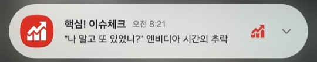

- S&P 500의 연중 두 자릿수 조정이 연간 손실을 뜻하지는 않음
  - J.P. Morgan 자료 기준 1980년 이후 연중 최대 하락률은 평균 14.2%지만 46년 중 35년은 연간 상승 마감

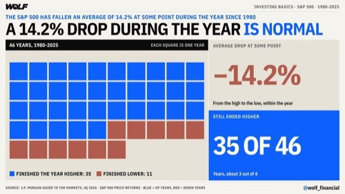

- AI 에이전트의 예약·예매 자동화는 서비스 사업자의 접근 차단이 상용화 제약으로 작용
  - 피클의 코레일 접근 차단과 미국 항공사의 AI 차단 사례가 등장
- 피드가 제시한 젠슨 황의 연내 SpaceX 합류 가능성은 38%로 확정 인사와 구분할 필요

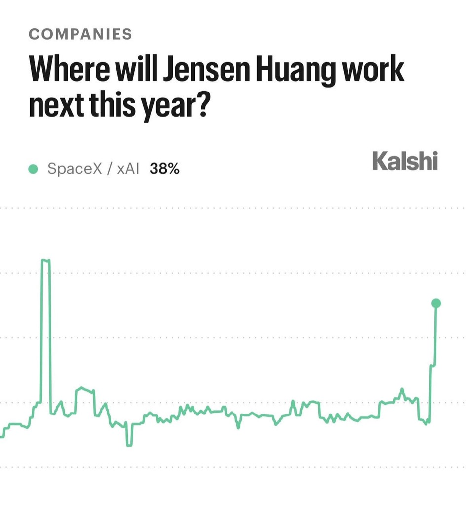

# Stockbot

- 피드는 젠슨 황의 NVIDIA CEO·사장·이사직 즉시 사임과 NVDA 10% 급락을 보도
  - 해임 검토와 후임 물색 속보 이후 Colette Kress가 CFO를 겸하는 임시 CEO로, Harvey Jones가 이사회 의장으로 선임됐다는 소식으로 이어짐
  - Bernstein·Oppenheimer·William Blair·Evercore·Melius의 투자의견 하향과 Bernstein 목표주가 400달러에서 200달러로 인하 소식이 동반
  - 황 이탈로 장기 기업가치가 1.4조 달러 감소할 수 있다는 추정도 제시

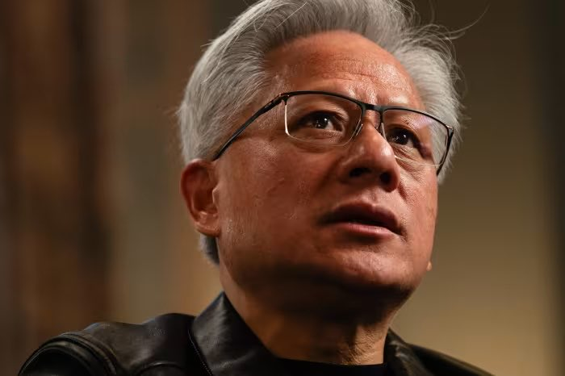

- 피드는 Strategy(MSTR)의 MSCI 글로벌 표준지수 제외 소식에 주가가 6% 하락했다고 전함
  - 11월 30일 이후 지수 추종 자금 매도가 예상되며 JPMorgan 추정 월말 매도 규모는 25억 달러
  - Metaplanet도 제외 대상이며 지수 편출 자체가 Strategy의 비트코인 매도를 강제하지는 않음
- Canaan(CAN)은 2,000만 달러 자사주 매입 재원을 위해 비트코인 추가 매도 가능성
  - 보유 비트코인 대부분이 담보로 제공되거나 만기형 상품에 묶여 있어 가용 유동성에 제약
- 미국 물가 강세로 연준 금리 인상 기대가 커지며 달러는 2025년 5월 이후 최고, 국채 선물은 하락
  - 주간 신규 실업수당 청구는 20만 건으로 예상 19만5,000건 상회
  - 계속 청구는 169만7,000건으로 예상 171만 건 하회
- 지역별 주식시장 흐름은 인도 자금 유입·독일 신고가와 대만 AI·기술주 약세로 차별화
  - 인도 증시 시가총액은 5.4조 달러로 대만을 제치고 세계 5위, 11월 글로벌 자금 순매수는 60억 달러
  - 독일 DAX는 당일 0.9% 상승해 8월 말 이후 처음 사상 최고치 경신
  - 영국 3분기 경제 성장률은 0.7%
- AI 도입 확대로 추론 성능과 비용 효율을 함께 최적화하는 소프트웨어 수요 확대
  - 글로벌 AI 추론 소프트웨어 시장은 2026년 211억 달러에서 2033년 809억 달러로 283% 성장 전망
  - 모든 작업에 최상위 모델이 필요한 것은 아니며 대규모 배포에서 달러당 성과가 중요해짐

- AI 기업의 대규모 자금 조달과 성과 기반 과금 시도가 병행
  - 피드는 OpenAI가 기업가치 1.25조 달러에 150억 달러를 조달했다고 전함
  - Anthropic의 사모펀드 지원 벤처 Ode는 Blackstone·Hellman & Friedman 등에서 15억 달러를 유치해 7월 출범했으며 기존 정액 과금에서 AI 성과에 따른 과금을 추진
- 피드는 트럼프가 미국행 이주민 행렬을 막지 않으면 멕시코 관세를 두 배로 인상하겠다고 위협했다고 보도
- 미국 주택담보대출 금리 하락이 주택 구매 신청 회복을 뒷받침
  - 금리는 4주 연속 하락해 30년물이 7.21%로 약 한 달 내 최저
  - 주택 구매 대출 신청은 전주 대비 7.5% 늘어 4월 중순 이후 최대 증가

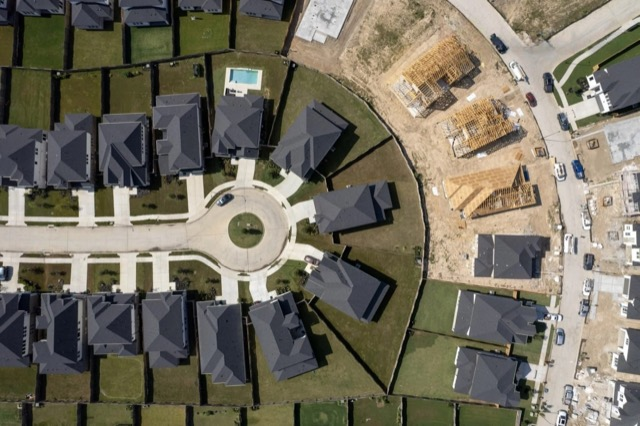

- 매매 전략 평가는 승률과 함께 평균 이익·손실 규모 및 가격의 평균 회귀 가정을 확인해야 함
  - 평균 회귀 전략은 높은 승률에도 새로운 가격 균형이 형성되면 큰 손실이 발생할 수 있음
  - 추세 추종 전략은 승률이 낮아도 이익 거래 규모가 손실 거래의 몇 배라면 유효할 수 있음

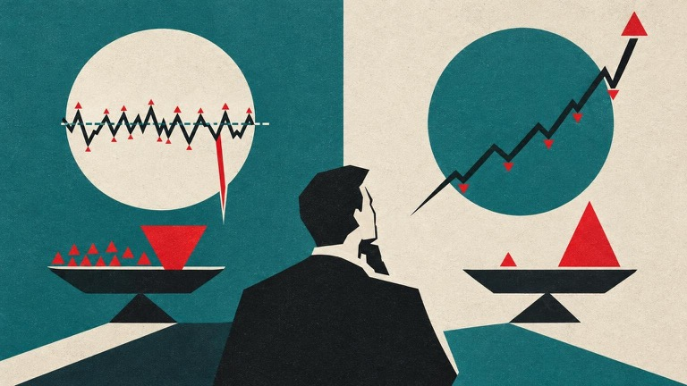

# WUncle

### 앤트로픽 상장 가치와 반도체 파급효과

- 앤트로픽 상장의 핵심 쟁점은 기업가치 적정성, 흑자의 질, 기존 AI·반도체 주식에 미치는 영향
  - 영상에서 거론된 기업가치는 1조 5천억~2조 달러이며, 역대 최대 규모 상장 가능성에 시장 관심 집중
  - 영상이 인용한 보도 기준 거래 개시 예상 시점은 11월 16~25일이며 공모가 범위는 발표 전
- 흑자 달성만으로 수익성을 단정하기 어려우며 실제 돈을 버는 구조인지 확인 필요
  - 앤트로픽의 성장이 기존 AI 주식과 삼성전자·SK하이닉스에 얼마나 연결되는지도 주요 검토 대상
- 11월 12일 오후 7시 무료 온라인 특강에서 앤트로픽 상장 관련 쟁점 점검 예정
- 12월 1일 기관 대상 오프라인 세미나는 2027년 매크로·지정학·에너지·핵심 광물·농산물 전망을 다룰 예정
  - 신청 대상은 수출입 기업과 금융기관의 원자재 유관 부서 담당자이며 좌석 제한
- 상장 기대감과 투자 매력은 별도로 평가할 필요가 있으며 공모가, 실질 수익성, 반도체 수요 연결성을 함께 확인해야 함
