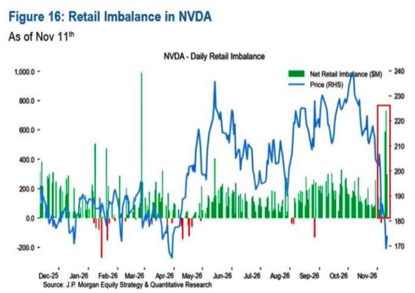
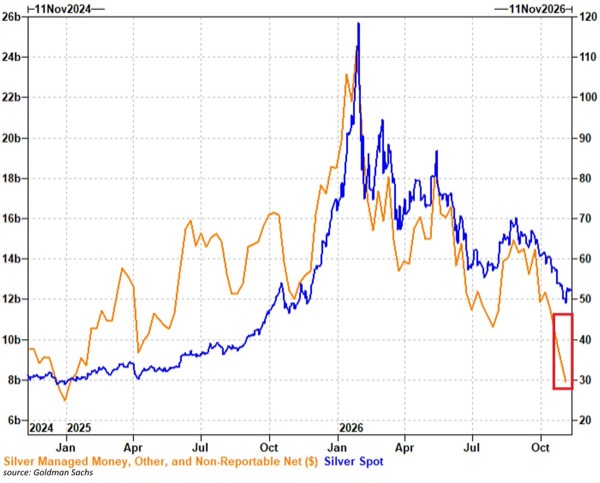
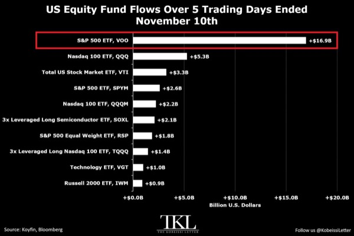
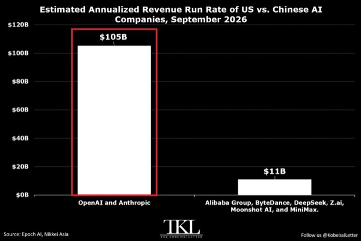
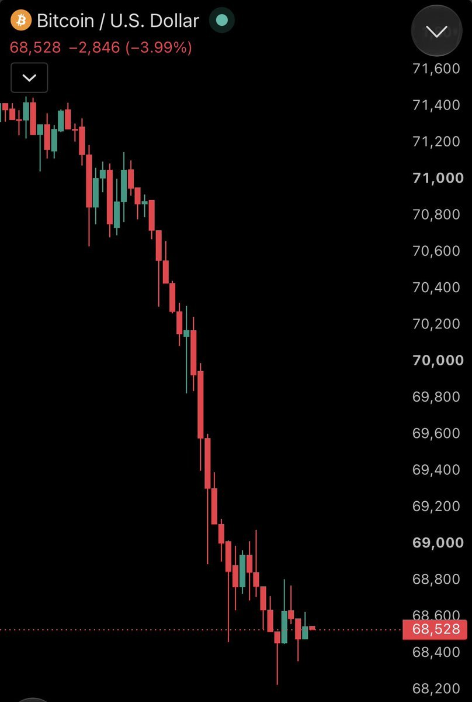
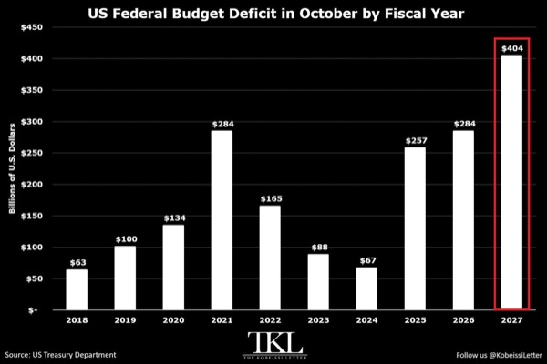
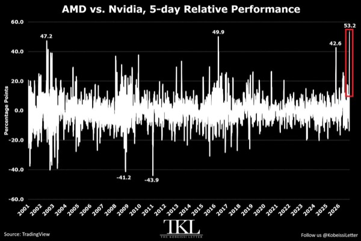
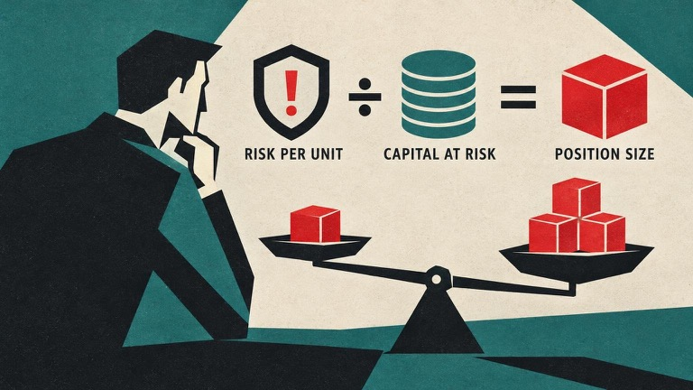

# AJikh

### 무료 인공지능이 흔드는 미국의 투자 회수 구조

- 인공지능 경쟁의 핵심은 성능 우위뿐 아니라 모델을 유료로 임대할지, 공개해 누구나 운용하게 할지에 달림
  - 폐쇄형 모델은 공급자가 가격·접근·사용 조건을 통제하며, 공개형 모델은 이용자가 직접 내려받아 운용·수정할 수 있음
  - 무료에 가까운 대체 모델이 확산되면 유료 모델의 가격 결정력과 막대한 개발비 회수 가능성이 약해짐
- 오픈AI·앤트로픽 등 모델 판매 기업과 엔비디아 등 인프라 공급 기업의 수익 구조가 충돌
  - 모델 판매 기업은 유료 접근과 높은 가격을 유지해야 투자금을 회수하기 쉬움
  - 엔비디아는 모델 사용이 저렴해지고 보급이 확대될수록 반도체 수요가 늘어나는 구조이며, 클라우드 기업도 연산 수요 증가의 수혜 가능
  - 원문에 제시된 엔비디아의 공개형 모델 투자 계획은 5년간 약 260억 달러
- 중국은 최첨단 반도체의 열세를 저렴한 공개형 모델의 세계 보급으로 우회할 수 있음
  - 미국 최고 수준에 가까운 모델을 거의 무료로 공급하면 미국 기업의 모델 판매 수익과 투자 회수 구조를 압박
  - 개발도상국에는 미국 기업의 서비스를 계속 임대하는 대신 자국 서버에서 모델을 운용하고 통제할 유인이 존재
  - 원문은 중국 공개형 모델의 성능을 미국 선도 모델의 약 90~95%, 비용을 약 100분의 1로 제시하지만 비교 조건은 명확하지 않음
- 중국 모델 제한을 둘러싸고 국가안보와 기업의 수익 보호 이해관계가 겹침
  - 지식재산권 침해·모델 증류 의혹은 제재 논거가 되며, 무료 경쟁자를 제한하면 미국 유료 모델의 가격 방어에도 유리
  - 원문에 따르면 7월 24일 엔비디아·마이크로소프트·메타 등 25개 이상 기업이 공개형 모델 금지에 반대하는 서한에 참여
  - 모델을 직접 소유·운용할 권한은 국가와 기업의 인공지능 자율성 확보 수단
- 젠슨 황의 중국 관련 의혹 공개와 공개형 모델 지지 활동을 연결하는 정치적 해석은 확인된 인과관계가 아님
  - 원문은 10월 29일 보도와 앞선 공개형 모델 규제 반대 활동의 시점에 주목하지만, 유출 주체와 동기는 알 수 없다고 인정
  - 개인 의혹의 진위와 모델 개방 여부에 따른 사업상 이해관계는 구분할 필요
- 공개 전 의무 안전시험과 손해배상 책임 확대는 대형 연구소의 진입장벽으로 작용할 수 있음
  - 법무·규제 대응 비용을 감당할 수 있는 대기업에 유리하고, 무료로 모델을 배포하는 소규모 프로젝트에는 부담
  - 미국 공개형 모델 생태계가 위축돼도 해외의 무료 모델 수요는 남아 중국 모델의 영향력이 커질 가능성
- 미국 인공지능 투자에는 기술 성공과 별개로 수익화 실패 위험이 존재
  - 최고급 유료 모델이 몇 달 만에 무료 대체재와 경쟁하게 되면 초과수익을 얻을 수 있는 기간이 짧아짐
  - 무료화 속도가 투자 회수 속도를 앞지르면 기술 발전과 동시에 기존 투자자본의 가치가 훼손될 수 있음
  - 미국 증시가 소수 기술기업과 미래 인공지능 이익에 크게 의존할수록 수익 기대 조정의 충격도 커짐
- 인공지능 기업의 대규모 차입은 미국 정부와 자금 조달 경쟁을 심화할 수 있음
  - 회사채와 국채가 투자자 자금을 놓고 경쟁하면 차입금리 상승 압력이 커지고 정부의 이자 부담도 증가
  - 국채금리 상승은 주택담보대출·자동차대출 등 가계 금융비용으로 전이될 수 있음
- 루크 그로먼의 첫 번째 시나리오는 인공지능 투자 실패에 따른 부채 손실과 디플레이션 충격
  - 기대 수익이 나오지 않으면 기업 부채 상환과 투자금 회수가 어려워지고 주식·사모대출 등으로 손실이 번질 가능성
  - 금융 충격을 막기 위한 정부 구제와 통화 공급 확대가 뒤따르면 초기 자산가격 하락이 이후 화폐가치 하락으로 이어질 수 있음
- 두 번째 시나리오는 인공지능 성공이 노동소득과 세수 기반을 약화하는 경로
  - 사무직 대체로 임금·소비·차입 능력이 줄면 노동소득에 의존하는 세수도 압박받을 수 있음
  - 원문은 미국 세수의 거의 절반이 개인의 노동소득과 연결돼 있다는 점에 주목
  - 부채 이자와 재정지출이 유지되는 가운데 세수가 줄면 추가 차입과 통화 공급 확대 압력이 커질 수 있음
- 두 시나리오가 모두 통화 팽창으로 귀결된다는 것은 그로먼의 가설이며 확정된 결과는 아님
  - 실패 시 금융 구제, 성공 시 세수 감소 대응이 각각 통화 팽창의 경로
  - 이 경우 자산의 달러 표시 가격 상승과 실질 구매력 하락이 동시에 나타날 수 있음
- 영상의 투자 대응은 인공지능 승자를 고르기보다 서로 다른 충격에 대비하는 자산을 나누어 보유하는 방식
  - 초기 디플레이션·신용경색에는 현금과 금, 이후 통화 팽창에는 비트코인을 대응 자산으로 제시
  - 진행자는 실물 금·은 매수와 비트코인 직접 보관을 선택했으며, 금의 하방 방어와 비트코인의 유동성 확대 수혜를 기대
  - 이러한 역할 구분은 영상의 투자 가설이며 각 자산의 가격 방어를 보장하지 않음
- 전력·송전망·구리·은은 모델 판매 수익과 별개로 인공지능 인프라 확충에 연결되는 투자 대상
  - 원문은 미국의 2004~2024년 발전능력 정체를 근거로 전력 공급과 전력망 투자 필요성을 강조
  - 에너지·금속 등 공급 확대가 어려운 실물자산은 통화 팽창과 인프라 수요를 함께 살피는 관점에서 제시됨
- 인공지능 보급 확대와 인공지능 기업의 주주 수익은 같은 방향으로 움직이지 않을 수 있음
  - 사용자는 저렴한 고성능 모델의 혜택을 얻어도 모델 판매 기업은 가격 하락으로 수익성이 악화될 수 있음
- 투자 회수 가능성은 모델 성능 순위보다 가격 하락 속도·고객 전환비용·지속적인 현금흐름·차입 부담을 함께 봐야 함
- 인프라 투자도 최종 수요와 수익화에 의존하므로 반도체·클라우드·전력 수혜를 무조건적인 방어 논리로 삼기는 어려움

# EconomiExpl

### 캐나다의 대미 의존과 경제 자립의 조건

- 캐나다의 대미 의존은 무역 규모보다 경제 구조와 물류망에 깊이 고착돼 있음
  - 상품·서비스 무역은 GDP의 약 3분의 2, 수출은 약 3분의 1이며 상품 수출의 약 72%가 미국에 집중
  - 대미 수출은 캐나다 GDP의 약 19%인 반면 미국의 대캐나다 수출은 미국 GDP의 1.5% 미만
  - 미국은 대체 공급망 구축 비용을 부담하면 되지만 캐나다는 최대 고객을 대체하기가 훨씬 어려움
- 관세 충돌은 심각하지만 전면적인 국경 봉쇄와는 거리가 있음
  - 미국은 일부 캐나다산 제품에 최대 50% 관세를 부과했고 캐나다는 미국산 276억 캐나다달러 규모 상품에 맞대응
  - 철강·알루미늄 관세는 최대 50%, 자동차는 25%이며 목재·구리 등도 분쟁에 포함
  - 캐나다산 상품의 약 4분의 3은 여전히 무관세로 미국에 진입해 피해가 특정 산업에 집중
  - 보복관세는 미국 생산자를 압박하는 동시에 캐나다 소비자 물가도 끌어올림
- 캐나다의 원유 수출은 생산 능력보다 미국을 향한 수송망에 묶여 있음
  - 하루 약 500만 배럴을 생산하고 400만 배럴을 수출하며 원유 수출액은 연간 약 1,400억 캐나다달러
  - 원유 수출의 약 90%가 미국으로 향하고 항구로 연결되는 송유관 용량은 전체의 5분의 1 미만
  - 국내 동서 수송망이 부족해 대규모 원유 수출국이면서도 미국산 원유와 정제유를 수입
- 자동차 산업은 국경을 반복해서 넘는 분업 구조여서 무역장벽 충격이 증폭됨
  - 온타리오 윈저의 자동차 도어 잠금 부품은 미국산 철강의 가공·열처리·도금·검사·조립 과정에서 국경을 네 차례 통과
  - 관세가 반복 적용될 수 있고 캐나다의 자동차·부품 수출은 주요 관세 도입 이후 약 6% 감소
  - 스텔란티스는 브램턴 조립공장 매각이나 폐쇄를 검토
- 미국도 캐나다산 핵심 자원을 단기간에 대체하기 어려움
  - 캐나다산 원유는 미국 원유 수입의 약 3분의 2이며 중서부 정유시설은 캐나다산 중질유 처리에 맞춰 설계돼 있음
  - 캐나다는 미국 칼륨비료 수입의 약 80%를 공급하고 알루미늄·우라늄·전력 수입에서도 큰 비중을 차지
  - 에너지·칼륨비료·수산물·핵심 광물의 관세 예외는 미국이 공급 중단을 감수하기 어려운 품목을 드러냄
- 미국의 대캐나다 무역적자는 필요한 원유를 사들이는 구조의 결과에 가까움
  - 서비스 흑자를 반영한 전체 적자는 약 9,000억 달러 규모의 양국 교역에서 300억 달러 미만
  - 에너지를 제외하면 미국은 대캐나다 상품 교역에서 대체로 흑자
  - 미국 정유업체는 캐나다산 원유를 휘발유·경유로 가공해 국내외에 판매하고 일부는 캐나다로 재수출
  - 캐나다는 미국 절반 이상 주의 최대 수출시장이며 노스다코타 수출의 80% 이상을 흡수
- 에너지 공급 중단은 캐나다의 협상 수단이지만 수출 수입도 함께 끊어 자국 피해가 큼
  - 온타리오는 미국 접경 3개 주에 대한 전력 수출 할증료를 도입했다가 다음 날 중단
  - 캐나다인 약 3분의 2는 물가가 올라도 보복관세를 지지하지만 미국에서는 대캐나다 관세 반대가 과반
  - 경제 규모의 우위가 정치적 인내심의 우위로 이어지는 것은 아님
- 캐나다의 단기 성장 반등에는 지속하기 어려운 일회성 요인이 많음
  - 1분기 정체 이후 2분기 경제가 0.8% 성장하고 자동차·경트럭 수출이 전년 동기 대비 27% 증가
  - 겨울철 생산 차질의 반작용, 일회성 GST 환급 추가 지급, 월드컵 관련 소비가 성장에 기여
  - 에너지 기업 중심의 이익 증가와 수출 반등만으로 경제 전반의 회복을 판단하기 어려움
- 고용 악화와 물가 상승이 겹쳐 통화정책의 선택지가 좁아짐
  - 8~9월 일자리 10만 개 이상이 사라져 연중 증가분 대부분을 반납했고 실업률은 약 6.5%로 상승
  - 교육·보건·사회복지 부문 고용 감소에는 유학생 허가 축소도 영향을 미쳐 관세만으로 설명하기 어려움
  - 퀘벡·온타리오는 고용이 줄지만 앨버타는 원유 가격과 송유관 확장에 힘입어 고용 증가
  - 보복관세와 휘발유 가격 상승으로 연중 인플레이션이 3%를 넘었고 캐나다 중앙은행은 10월 28일 기준금리를 2.5%로 인상
- 이민 축소는 주거 부담을 낮추는 동시에 내수 둔화를 심화함
  - 연간 영주권 목표를 50만 명에서 39만 5,000명으로 낮추고 추가 감축을 추진했으며 임시 거주자는 약 7% 감소
  - 2023년 3%를 넘었던 인구 증가율이 사실상 정체되면서 소비자·임차인·주택 구매자 증가도 멈춤
  - 온타리오·브리티시컬럼비아의 콘도를 중심으로 주택가격 하락 압력이 이어짐
- 캐나다의 더 깊은 취약점은 생산성과 기업 투자 부족
  - 1990년대 후반 이후 미국 대비 상대 생산성이 약 4분의 1 하락했고 2015년 유가 급락 이후 1인당 GDP도 뒤처짐
  - 근로자당 기업 투자액은 미국 1달러당 약 90센트에서 55센트로 하락해 장비·기술·자본 부족이 생산과 임금을 제약
  - 연방 재정적자는 해당 회계연도 약 650억 캐나다달러이며 이자 부담도 커져 재정 대응 여력이 제한됨
- 현실적인 위험은 국경의 완전 봉쇄보다 북미 자유무역의 우대 접근권 상실
  - 캐나다·미국·멕시코 무역협정인 CUSMA는 6년 주기 검토에서 연장에 합의하지 못하면 2036년까지 유효하지만 매년 재검토 대상이 됨
  - 원문 시점의 7월 검토에서 미국이 현행 협정 연장에 동의하지 않아 기업 투자에 연례 불확실성이 추가됨
  - 옥스퍼드 이코노믹스는 협정 붕괴 시 향후 10년간 캐나다 산출 손실을 약 1%, 미국은 0.5% 미만으로 추산
  - 미국은 경제 규모가 커 절대 손실액이 약 1조 달러로 더 크지만 캐나다의 상대적 타격이 더 큼
- 비미국 수출 확대는 필요하지만 현재 성과의 질과 규모가 부족함
  - 카니 총리는 10년 안에 비미국 수출을 두 배로 늘리는 목표를 제시
  - 최근 비미국 수출 증가는 영국행 금·귀금속 수출에 크게 의존해 제조업의 신규 시장 확보와는 차이가 있음
  - 목표 달성에는 GDP 약 5%에 해당하는 추가 수출이 필요하며 이는 광업·채석·석유·가스 산업의 합산 산출 규모에 가까움
  - 중국산 전기차와 캐나다산 카놀라의 상호 관세 완화에도 미국의 보복 위협이 뒤따라 수출 다변화 자체가 외교 갈등이 됨
- 항만·송유관 확충과 주 간 무역장벽 해소가 의존도 축소의 실질적 기반
  - 밴쿠버항은 세계은행 컨테이너항 성과 지수에서 약 400개 항만 중 375위로 물류 병목이 큼
  - 트랜스마운틴 확장 이후 밴쿠버 터미널 출항 유조선의 약 3분의 2가 아시아로 향함
  - 앨버타와 브리티시컬럼비아 해안을 잇는 신규 송유관 구상이 실현돼도 비미국 원유 수출 비중은 약 15%에서 23%로 늘어나는 수준
  - 주 간 규제·인증 장벽 해소의 GDP 증가 효과는 추정에 따라 1~7%이며 상호 제품 기준 인정 등 일부 진전이 있음
- 대미 의존 축소의 성패는 수출 대상국 수보다 물류 전환 능력과 생산성 개선에 달림
  - 투자 격차를 줄이지 못하면 경쟁력이 약한 상품을 더 먼 시장에 운송하는 데 그칠 수 있음
- 전면 단절보다 미국 시장 접근을 유지하면서 대체 수출 경로와 국내 시장 통합을 확대하는 편이 경제적 비용이 작음
  - 다변화의 낙관적 효과도 미국 시장 우대 접근권 상실에 따른 손실을 완전히 상쇄하기 어려움
- 관세 압박으로 시작된 구조개혁을 무역 긴장 완화 이후에도 지속해야 장기적인 협상력이 높아짐
  - 송유관·항만·기업 투자는 완성까지 오래 걸려 당장의 정치적 압박만으로는 성과를 내기 어려움

# KHwanK

### 잠재 고객을 모으는 네 가지 방법과 하루 백 번 실행법

- 상품 가치가 높아도 잠재 고객이 모르면 매출은 발생하지 않음
  - 알렉스 호모지의 고객 확보 전략에서 리드는 직접 연락할 수 있는 잠재 고객을 뜻함
  - 고객 확보 경로는 지인에게 직접 연락하기, 무료 콘텐츠 배포하기, 모르는 사람에게 직접 연락하기, 유료 광고 집행하기의 네 가지
- 상품 가치는 고객이 원하는 결과와 달성 가능성을 높이고, 소요 시간과 노력·고통을 줄일수록 커짐
  - 수량·시간 제한과 상품명으로 구매 동기를 강화하고, 미끼 상품·업셀·다운셀·정기 결제로 객단가와 반복 매출을 높임
  - 고객 확보와 함께 상품 자체의 가치도 계속 개선해야 함
- 초기 고객은 이미 신뢰가 있는 지인에게 개별 연락해 확보
  - 연락처와 SNS에서 대상을 찾고, 단체 문자 대신 상대의 근황으로 대화를 시작
  - 곧바로 구매를 요구하기보다 해당 서비스에 관심 있을 사람을 아는지 물어 본인 수요나 소개를 끌어냄
- 첫 고객 5명에게 무료로 제공해 서비스의 약점을 찾고 피드백을 축적
  - 이후 5명씩 정가의 20%, 40% 등으로 결제 비율을 높이고, 약 20명의 할인 고객을 거친 뒤 정상 가격 적용
  - 제시된 전환 예시는 100명 연락 → 20명 답장 → 4명 무료 체험 → 1명 결제
  - 같은 전환율이면 1,000명 연락으로 10명 결제 확보 가능하며, 객단가가 높으면 적은 고객으로도 사업 유지 가능
- 무료 콘텐츠는 관심을 붙잡고 실제 효용을 제공해 잠재 고객을 유입시키는 수단
  - 제목·썸네일·첫 2초로 관심을 끌고, 끝까지 볼 이유와 바로 활용할 수 있는 결과물을 제공
  - 5분 운동 루틴처럼 시청자가 즉시 실행할 수 있는 내용이 효과적
  - 무료 콘텐츠 10개 뒤 11번째에 판매 안내를 섞는 식으로 홍보 빈도를 낮추고 신뢰를 축적
- 당장 판매할 상품이 없어도 SNS와 콘텐츠로 관심 고객을 먼저 모을 수 있음
  - 여러 플랫폼에 꾸준히 콘텐츠를 배포하면 이후 상품·서비스 판매의 기반이 됨
- 모르는 사람에게 연락할 때는 판매자 소개보다 상대의 문제로 시작
  - 상대의 SNS 등에서 확인한 구체적인 불편을 언급하고, 30초 안에 쓸모 있는 정보나 짧은 영상을 무료로 제공
  - 초등학교 3학년도 이해할 정도로 문장을 쉽게 써야 읽고 반응할 가능성이 높아짐
- 유료 광고는 여러 소재를 소액으로 시험하고 성과가 확인된 광고에 예산을 집중
  - 대부분의 시험이 실패할 수 있으므로 반응 없는 광고는 중단하고, 성과가 좋은 광고는 변형 소재와 집행 규모를 확대
  - 광고비 10만 원으로 매출 50만 원을 만든 소재가 있다면 추가 집행 후보가 됨
- 고객 확보를 혼자 감당하기 어려우면 직원·제휴 파트너·인플루언서에게 일부 경로를 맡김
  - 고객 유입으로 매출이 발생하면 일부를 지급하는 제휴 구조 활용 가능
  - 기존 고객도 좋은 서비스에 만족하면 새 고객을 소개하는 유입 경로가 됨
- 실행 기준은 하루 100회 수준의 활동을 100일간 지속하는 것
  - 직접 연락은 하루 100명, 콘텐츠 제작은 하루 100분처럼 채널에 맞는 실행량을 설정
  - 성과가 부족하면 방법을 바꾸기 전에 실제 접촉량·콘텐츠 수·지속 기간과 상품 개선 노력을 점검
- 판매와 자기 홍보는 강의·매장·프리랜서뿐 아니라 직장에서도 필요한 기술
  - 고객이나 상사가 원하는 결과를 이해하고 자신의 가치를 전달하는 능력이 수익과 경력 기회를 좌우
- 초기에는 지인 접촉과 무료 체험으로 수요·서비스 품질·전환율을 확인하고, 검증된 제안을 콘텐츠·제휴·광고로 확대하는 순서가 효율적
- 광고 확대는 매출 배수만으로 결정하기 어려우며, 상품 원가·서비스 제공 비용·고객 유지율을 반영한 실제 수익성 확인이 필요
- 하루 100회는 실행량을 확보하는 기준이며, 답장률·체험 전환율·결제율을 함께 기록해야 어느 단계의 개선이 필요한지 드러남

# Kobeissi

- NVDA는 젠슨 황 사임 이후 저가 매수로 163달러를 회복하고 당일 낙폭의 절반 이상을 만회했으며 S&P 500도 상승 전환
  - 사임 배경인 중국 스파이 의혹은 정보기관 내부에서도 입증이 충분하지 않다는 보도가 나왔고, 복귀를 요구하는 사내 게시물에 댓글 1,600개 이상이 달리는 등 경영진 불확실성 지속
  - 개인은 수요일까지 3거래일간 NVDA 16억 달러를 순매수했고 NVDL·NVDU에도 각각 4억100만·6,400만 달러 유입

- 중국향 반도체 유출 의혹이 SMCI와 미국 수출통제 정책으로 확산
  - 미 법무부가 앨리스 황의 SMCI 제품 중국 밀수 연루 여부를 조사한다는 보도에 SMCI 당일 낙폭 14%로 확대
  - 대중 반도체 판매 제한을 지연했다는 보도와 함께 하워드 러트닉 상무장관 해임 검토설 제기
- SpaceX와 Tesla의 합병이 이르면 12월 이뤄질 수 있다는 보도 등장
  - 양사 이사회와 자문단이 합병 조건을 협의 중이라는 소식으로, 성사 여부와 구체적 조건은 미확정
- 은 선물의 투기적 순매수 포지션은 80억 달러로 2025년 1월 이후 최저 수준까지 축소
  - 11월 3일까지 5주간 23억 달러 순매도는 신규 매도 포지션 26억 달러가 주도했고 신규 매수 3억 달러가 일부 상쇄
  - 2026년 1월 고점 대비 순매수 포지션이 160억 달러 이상 줄어 약세 베팅이 크게 확대

- 미국 주식 ETF로 대규모 저가 매수 자금 유입
  - 11월 10일까지 5거래일간 주요 ETF 10개에 총 375억 달러 유입, VOO 169억·QQQ 53억·VTI 33억 달러 기록
  - SPYM 26억·QQQM 22억 달러와 함께 3배 레버리지 SOXL 21억·TQQQ 14억 달러 유입으로 공격적인 위험자산 매수 지속

- 미국 AI 기업의 매출 규모가 중국 경쟁사를 크게 앞서는 구도 지속
  - 9월 말 OpenAI·Anthropic 합산 연환산 매출 추정치는 1,050억 달러로 중국 주요 6개사 합계 110억 달러의 약 10배
  - 3분기 Anthropic 매출은 전분기 대비 47% 증가한 170억 달러, OpenAI는 50% 증가한 100억 달러로 제시
  - 중국에서는 ByteDance 연환산 매출 40억 달러가 합계의 36%를 차지하고 DeepSeek는 9월 두 배 성장에도 10억 달러 수준

- 암호화폐 매도가 가속되며 비트코인 6만9,000달러 하회, ETH 1,900달러 접근
  - 비트코인은 앞서 7만1,000달러 이탈 당시 10월 2일 대비 19% 이상 하락했고, 암호화폐 전체 시가총액은 48시간 동안 1,500억 달러 감소

- 미국 10월 재정적자는 4,040억 달러로 역대 10월 최대 규모
  - 전년 대비 1,200억 달러 확대됐으며 지출은 840억 달러 증가한 7,730억 달러, 세입은 350억 달러 감소한 3,690억 달러
  - 국방 지출이 전년 대비 290억 달러 증가한 1,290억 달러로 월간 사상 최대를 기록하며 적자 확대 주도

- 미국 10월 PPI 상승률 6.5%로 2022년 11월 이후 최고, 근원 PPI는 예상과 같은 5.0%
  - CPI·PPI·PCE의 동반 상승 흐름을 근거로 12월 금리 인상 가능성 제기
- AMD가 NVDA 변동성의 수혜를 받으며 최근 5거래일 수익률 격차 53.2%포인트로 NVDA 상장 이후 최대
  - 같은 기간 AMD 44.7% 상승, NVDA 8.5% 하락으로 기존 2016년 4월 기록인 49.9%포인트를 경신
  - 연초 이후 AMD 173.3% 상승과 NVDA 10.7% 하락으로 누적 수익률 격차 184%포인트

# MKevin

### 엔비디아 경영 공백과 기술주 저가 매수의 조건

- 영상은 젠슨 황의 엔비디아 최고경영자·사장·이사직 사임과 이사회 개편을 전제로 경영 공백과 주가 영향을 분석하며, 관련 사건의 사실 여부는 원문만으로 확인되지 않음
  - 재무책임자 콜레트 크레스가 임시 최고경영자를 맡고, 이사회가 내부·외부 후보를 대상으로 정식 후임을 물색하는 구도
  - 하비 존스의 이사회 의장 선임과 닷새 뒤 실적 발표가 단기 관전 지점
- 원문상 엔비디아 주가는 장전 약 13% 급락한 뒤 약 7% 하락으로 낙폭을 축소했으며, 충격이 기술주 전반으로 확산
  - 사임 사유는 공식 발표에 명시되지 않았고, 사생활·사내 규정 위반 및 대중국 거래 조사와 연결한 해석은 진행자의 추정
- 창업자 이탈만으로 엔비디아의 사업 경쟁력이 무너지는 것은 아님
  - 약 4만 2,000명 규모의 조직과 높은 직원당 매출이 사업 지속력을 뒷받침
  - 스티브 잡스 사후에도 성장한 애플이 비교 사례이며, 원문은 2011년 이후 약 2,800%의 주가 수익률을 제시
  - 애플의 성과가 엔비디아의 향후 수익률을 보장하지는 않음
- 후임 최고경영자의 핵심 과제는 투자·공급망 협상 역량 유지와 조직 안정
  - 재무 운영의 연속성과 별개로 대형 거래를 성사시키고 장기 성장 방향을 이끌 경영 역량이 필요
- 머스크의 황 영입 가능성은 반도체 조달과 테라팹 구축 구상에 연결됨
  - 원문에 인용된 머스크의 반응은 황을 채용하면 영광이라는 취지이며, 구체적인 채용 제안이나 합류 확정은 제시되지 않음
  - 황의 반도체 업계 인맥과 협상 경험은 칩 공급 확보와 투자 제휴에 활용될 여지
  - 엔비디아 인수는 자금 조달 부담이 큰 가정이며, 황 개인 영입이 대안으로 거론됨
- 스페이스엑스의 약 3% 상승과 테슬라의 인수 프리미엄 가능성도 언급되지만, 스페이스엑스의 테슬라 인수와 황의 합류는 모두 추측 단계
- 황과 배우자의 엔비디아 지분 매각 가능성은 추가 수급 부담
  - 실제 매도 여부와 규모는 확인되지 않았으며, 황이 다른 회사에 합류해 자금을 옮길지도 미정
- 미국과 이란의 협상 지연 가능성은 고금리·유가 부담을 연장하는 변수
  - 원문은 미국 10년물 국채금리 약 5.07%와 유가 85~95달러 범위의 안정 가능성을 제시
  - 협상 유인 약화와 봉쇄 장기화가 기술주 조정에 거시경제 부담을 더하는 구도
- 진행자는 엔비디아와 기술주 하락을 저가 매수 기회로 평가하지만, 경영진 교체·지분 매각·금리 상승 위험이 동시에 남아 있음
- 저가 매수의 핵심은 창업자의 상징성보다 수주·공급망·수익성의 지속 여부
  - 실적 발표에서 사업 전망과 고객 수요가 유지되는지 확인해야 경영 충격의 크기를 가늠할 수 있음
- 인물 영입과 기업 인수 기대는 실제 계약·공시로 확인될 때 투자 근거가 강화됨
  - 발언과 추측만으로 형성된 주가 반응은 되돌림 위험이 큼

### 엔비디아 경영진 교체 의혹과 핵심 인물 리스크

- 영상의 핵심은 젠슨 황의 사생활 의혹이 엔비디아의 경영진 교체와 주가 하락으로 번질 가능성
  - 직속 임원 킴벌리 파월과의 관계, 이사회의 해임 준비, 후임 물색 등이 거론되지만 원문에서도 엔비디아와 황의 공식 확인은 없다고 명시
  - 아래 보도·시장 수치·인물 관련 의혹은 영상에 제시된 내용이며 별도 검증되지 않음
- 직속 임원과의 관계 의혹은 회사 행동강령 위반과 이사회의 감독 책임으로 연결될 수 있음
  - 파월은 2008년 입사해 2016년 선임 이사, 2017년 부사장으로 승진했으며 헬스케어·의료영상·관련 AI 사업을 담당한 인물로 소개
  - 영상은 뉴욕타임스와 사정을 아는 5명을 인용하지만 기사 원문이나 확인 가능한 자료는 제공하지 않음
  - 행사장 호텔에서 촬영된 영상과 보안팀의 비밀유지계약 제안도 거론되나 해당 영상은 공개되지 않았고 계약 체결 여부도 불분명
- 이사회가 외부 업체를 통해 후임을 찾고 임시 최고경영자 선임을 검토한다는 내용이 경영 불확실성의 중심
  - 트럼프 행정부에도 교체 준비가 전달됐다는 내용과 11월 18일 브리핑 일정이 제시되지만 공식 확인 자료는 없음
  - 딸 매디슨 황의 승계 가능성은 소문 수준이며 확정된 인사 계획이 아님
- 영상에 제시된 예측시장 수치는 2027년 1월 1일까지 황이 물러날 확률 88~90%, 7월 1일까지 약 94%
  - 첫 반응에서 약 80%까지 상승한 뒤 73%로 내려갔다가 다시 높아진 흐름으로 소개
  - 계약 조건과 거래 규모가 제시되지 않아 실제 해임 가능성으로 그대로 해석하기 어려움
- 영상 속 시장 반응은 엔비디아 시간외 주가 최대 9% 이상 하락, 시가총액 약 3,770억 달러 감소
  - 녹화 중 주가 약 160달러, 시간외 낙폭 약 7~8%, 나스닥 약 1% 하락을 언급
  - 엔비디아의 높은 시장 영향력 때문에 개별 기업의 지배구조 충격이 AI 업종과 지수 변동성으로 확대될 수 있음
- 창업자의 지분 보유가 최고경영자 지위를 자동으로 보장하지는 않음
  - 영상은 황의 엔비디아 지분을 3.58%로 제시하고 차등의결권이 없어 이사회의 교체 결정에 취약한 구조로 설명
  - 메타의 차등의결권 구조와 대비하며 경제적 지분과 경영권 방어 수단을 구분
- 임시 최고경영자를 선임해도 정식 후임과 권한 배분이 확정될 때까지 불확실성이 이어질 수 있음
  - 영상의 선호 시나리오는 황과 가까운 후임이 제품 방향과 조직의 추진력을 이어받는 방식
  - 가족 승계로 황의 영향력을 유지할 수 있다는 전망은 후임 인사와 실제 지배구조가 확인되지 않은 추정
- 기존 앨리스 황·메가스피드 관련 의혹 조사와 집단소송에 추가 의혹이 겹치면 법률 비용과 주주 손해배상 위험이 확대될 수 있음
  - 영상은 앨리스 황의 간첩 연루 가능성을 언급하지만 이를 뒷받침하는 검증 자료는 제시하지 않음
  - 인텔의 2018년 최고경영자 사임과 맥도날드의 2019년 최고경영자 해임을 사내 관계와 행동강령 문제의 비교 사례로 제시
- 영상의 투자 관점은 경영진 논란에도 장기 AI 수요가 유지되고 엔비디아와 AI 업종의 가격 매력이 커졌다는 쪽
  - 황과 가까운 후임을 통한 전략 연속성이 낙관론의 전제이며 구체적인 적정가나 매수 기준은 제시하지 않음
- 투자 판단의 첫 관문은 의혹의 사실 여부와 이사회·회사 공시 확인
  - 미공개 영상, 후임 소문, 출처가 불명확한 예측시장 수치만으로 매매하면 정보 오류와 급격한 가격 반전 위험이 큼
- 장기 기업가치는 AI 수요뿐 아니라 핵심 인물 의존도, 후계 체계, 내부통제의 신뢰에도 좌우됨
  - 후임의 창업자와의 친밀도보다 제품 실행력과 독립적인 감독 체계가 전략 연속성을 평가하는 핵심 기준

### 엔비디아 경영 불확실성과 대중국 칩 수출 논란

- 영상은 젠슨 황의 사임과 사생활 의혹을 전제로 엔비디아의 경영 공백·대중국 수출통제·법적 위험을 연결하며, 제시된 보도와 의혹의 사실 여부는 원문만으로 확인되지 않음
  - 황이 CEO·사장·이사직에서 물러나고 CFO 콜레트 크레스가 임시 경영을 맡았다는 내용
  - 앨리스 황의 중국 정보기관 연계는 미확정이며, 추가 직원과의 관계 및 신원이 공개되지 않은 세 번째 인물도 의혹 단계
- 핵심 정책 쟁점은 중국의 최신 엔비디아 칩 접근 경로와 미국의 수출통제 집행 책임
  - 딥시크·문샷·미니맥스 등 중국 AI 업체의 블랙웰 GB200·GB300 활용 의혹을 제기하며, 해외 연산자원 임대와 제3국 우회 공급 가능성을 거론
  - 칩 접근 사실만으로 간첩 활동이나 황의 직접 관여가 입증되는 것은 아니며, 영상에서도 접근 경로를 확정하지 못함
- 하워드 러트닉 상무장관에게 수출통제 실패의 정치적 책임이 집중될 가능성
  - 영상이 인용한 보도에서는 러트닉이 동남아시아 경유 AI 칩 공급 단속과 수출규제 강화를 지연시켰다는 비판이 제기됨
  - 백악관은 신임을 유지한다고 밝혔으나, 의회 증언에서 대응에 실패하면 경질 계기가 될 수 있다는 시나리오
- 미국산 칩에 중국을 계속 묶어두려는 산업 전략과 국가안보 목적의 수출 제한이 충돌
  - 엔비디아에는 중국 매출, 테슬라에는 중국 판매와 FSD 승인이 걸려 있어 규제 완화 유인이 큼
  - 영상은 황의 백악관 연회장 약 2,500만 달러·취임기금 100만 달러 기부 의혹 등을 트럼프의 우호적 태도와 연결하지만, 기부와 정책 사이의 대가관계는 입증하지 못함
- 러트닉 일가의 금융거래에도 이해충돌 의혹이 겹침
  - 영상에 따르면 아들들이 운영하는 캔터 피츠제럴드는 관세 환급 청구권을 액면가의 약 30%에 매입
  - 관세정책을 추진하는 장관의 가족이 정책 무효화에 따른 수익을 기대하는 구조가 쟁점이며, 내부정보 활용 의혹은 추측이고 관련 측은 부인
- 황이 선임했다는 폴 와이스 변호인단은 의회 조사와 기업·형사 사건 대응 경험을 보유
  - 멀린다 헤이그는 2010~2015년 캘리포니아 북부 연방검사장을 지냈고, 엔비디아 소재지인 샌타클래라가 관할에 포함
  - 월터 브라운은 연방대출 5억 3,500만 달러가 걸린 솔린드라 사건에 관여했으며, 당시 경영진은 의회에서 수정헌법 5조에 따른 증언거부권을 행사
  - 같은 변호사를 선임했다는 사실만으로 황의 증언거부 여부를 단정할 수는 없음
- 폴 와이스와 트럼프의 기존 합의도 변호인 선임의 정치적 배경으로 부각
  - 영상에 따르면 트럼프는 로펌의 보안인가·정부 접근을 제한하는 행정명령을 내렸고, 로펌은 4,000만 달러 규모의 공익 법률서비스 제공 등을 약속한 뒤 철회를 이끌어냄
  - 로펌 관계자와 정치권 인사의 인맥을 나열하지만, 이러한 연결만으로 사건 은폐나 수사 개입이 입증되지는 않음
- 영상이 제시한 단기 일정은 11월 17일 엔비디아 실적 발표, 추수감사절 전 황의 의회 증언, 12월 3일 러트닉 관련 청문회
  - 워런·쿤스 의원의 답변 및 기록 보존 요구, 와이든·닐 의원의 러트닉 조사 서한도 거론
  - 일정과 출석 여부는 영상 시점의 설명이며 확정 여부를 별도로 확인할 필요
- 법적 위험은 의회·법무부·FBI 조사뿐 아니라 회사의 보수 환수와 개인 소송 가능성까지 확대
  - 직원과의 관계를 둘러싼 맥도날드 전 CEO의 1억 500만 달러 보수 반환 합의를 비교 사례로 제시하지만, 엔비디아가 실제 소송을 제기했다는 내용은 없음
  - 영상이 인용한 블룸버그 보도에서는 황이 법무부 수사 대상이 아니며, 당시 기소나 기소 징후도 확인되지 않았다고 구분
  - 엔비디아 반독점 조사, 메가스피드·슈퍼마이크로 관련 조사, 앨리스 황 관련 조사를 함께 거론하지만 각 사건의 연결은 확정되지 않음
- 영상상 엔비디아 주가는 약 한 달 전 227달러에서 167달러로 약 26% 하락
  - 시가총액 약 5조 달러 기업의 급락은 지수 전체에 큰 부담이며, 개인 의혹이 기업 평판과 경영 안정성에 미치는 영향이 쟁점
  - 약 4만 2,000명의 인력과 기존 사업 기반은 창업자 개인과 별도로 평가할 요소이나, 주가 하락분 전체를 이번 의혹 탓으로 돌릴 근거는 제시되지 않음
- 투자 판단의 우선 확인 대상은 공식 경영진 공시, 수사기관 발표, 의회 증언, 실적과 가이던스
  - 미확인 사생활 의혹과 인맥 추정보다 중국 매출 접근성·수출허가·고객 수요·경영 승계의 실제 변화가 기업가치에 미치는 영향을 구분해야 함
- 주가 급락만으로 저평가를 확정하기 어려우며, 수출통제와 경영 불확실성이 예상 이익을 얼마나 바꾸는지가 핵심
  - 실적이 유지되면 평판 충격과 사업가치의 괴리가 기회가 될 수 있지만, 중국 공급 제한이나 법적 비용이 확대되면 낮아진 주가에도 추가 위험이 남음

### 유가발 물가 확산과 연준 추가 인상 압력

- 에너지 가격 상승이 운송비와 근원물가로 확산되면서 연준의 추가 금리 인상 압력이 커짐
  - 굴스비는 물가가 2% 목표로 복귀하는 경로에 있지 않으며, 악화 흐름이 이어지면 적극적인 대응이 필요하다고 발언
  - 고용시장은 안정적이고 일부 긴축 조짐까지 나타나 물가 대응을 제약할 고용 둔화 신호가 부족함
  - 인공지능 투자에 따른 수요 과열, 관세 전가, 이란 전쟁에 따른 에너지 비용이 동시에 물가를 자극
- 생산자물가는 헤드라인 둔화보다 기조적 물가 압력 확대가 핵심
  - 헤드라인 PPI는 전년 대비 6.5%로 예상 6.6%를 밑돌고, 전월 대비 0.3%로 예상 0.4%를 하회
  - 식품·에너지·무역서비스 제외 PPI는 전월 대비 0.5%로 예상 0.4%를 상회하고, 전년 대비 4.9%로 예상 4.8%를 상회
  - 앞선 전월 대비 PPI와 식품·에너지 제외 PPI는 각각 0.1%포인트 상향 수정돼 1.4%, 0.8%로 조정
- 유가 충격이 서비스 가격으로 전이돼 에너지를 제외한 지표도 안심하기 어려움
  - 화물 트럭 운송비가 3.9% 상승하며 최종수요 서비스 물가 상승분의 약 80%를 차지
  - 헤드라인 PPI에는 10월 말 유가 하락이 반영됐지만 11월 들어 유가가 다시 상승해 최근 비용 압력을 충분히 포착하지 못함
  - 유가는 배럴당 약 89.90달러에서 96달러로 반등
- 소비자물가도 예상치를 웃돌아 계절적 물가 둔화 기대가 약해짐
  - 전월 대비 CPI는 예상 0.3%보다 높은 0.4%, 근원 CPI는 예상 0.2%보다 높은 0.3% 기록
  - 통상 물가가 약해지는 가을에도 상승 압력이 지속돼 향후 연초 물가 흐름에 대한 경계가 필요
- 시장은 12월 금리 인상을 사실상 전부 반영하고, 이후 추가 인상 폭도 확대 반영
  - 12월 9일 회의까지 25bp 인상 약 1.1회가 반영돼 50bp 인상 확률은 약 11% 수준
  - 2027년 9월까지 예상 인상 횟수는 약 열흘 전 1.9회에서 3.55회로 증가
  - 이는 시장에 반영된 기대이며 실제 인상 결정과 구분해야 함
- 이란과의 합의 지연과 군사 충돌 위험이 유가 안정 및 통화정책 완화의 걸림돌
  - 트럼프가 선거 이후 이란과의 합의 필요성을 낮게 평가한다는 보도로 조기 타결 기대가 후퇴
  - 바레인 미군 자산 공격 여부를 두고 이란과 미 중부사령부의 발표가 엇갈리고, 이란 혁명수비대는 추가 대응을 경고
  - 카타르와 아랍에미리트는 전쟁 재확대를 막아 달라고 미국에 요청
- 전쟁이 끝나도 유가가 곧바로 정상화된다는 보장은 없음
  - 굴스비와 보먼은 종전 이후에도 생산·공급 회복에 시간이 걸려 유가가 높게 유지될 가능성을 경고
  - 걸프 지역 원유 수출이 전쟁 이전 수준을 웃돈다는 점은 합의 시 유가 급락 가능성을 뒷받침
  - 후티의 공격과 사우디 동서 송유관의 드론 공격 취약성이 공급 불확실성을 지속시킴
- 국제원자력기구의 이스파한 핵시설 감시 공백 우려가 협상 불확실성을 높임
  - 영상에 인용된 보고서는 2025년 6월 미드나이트 해머 작전 이전부터 접근하지 못한 시설의 정확한 위치, 핵물질 보유 여부, 감시 상태를 확인하지 못했다고 지적
- 관세 협상 지연과 반도체 수출통제 갈등이 정책 불확실성을 추가
  - 베선트는 멕시코·캐나다와의 조속한 합의를 기대했지만, 2025년 4월 이후 약속했던 협상이 2026년 11월에도 미완료
  - 반도체 수출통제에서는 재무부가 통제를 지지했지만 상무부는 그렇지 않았다고 발언해 부처 간 이견을 드러냄
- 금리 인상 기대와 지정학적 위험이 겹치며 위험자산의 단기 부담이 커짐
  - 비트코인은 7만 달러를 하회하고 미국 10년물 국채금리는 약 5.147%로 상승
  - 합의 기대가 강했을 때의 약 4.9%보다 높지만, 영상에서 제시한 경계 수준 5.27%보다는 낮음
- 향후 물가 판단은 유가 자체뿐 아니라 운송비·서비스 가격으로의 전가가 진정되는지에 달림
  - 헤드라인 물가가 잠시 둔화해도 근원 지표와 이전 수치의 상향 수정이 이어지면 긴축 압력은 쉽게 낮아지기 어려움
- 낙폭 확대만으로 저가매수 근거가 충분해지지는 않음
  - 추가 인상에 따른 할인율 상승과 에너지 비용 증가를 반영해 기업별 현금흐름·이익 전망·매수가격을 다시 점검할 필요

# Slav

- 젠슨 황 사임은 단기 악재를 한 번에 반영하는 계기가 될 수 있으나 조사 결과에 따른 추가 영향은 불확실
  - 밍치 궈는 황과 엔비디아의 관계 정리로 향후 의회 출석 요구와 후속 조사의 주가 영향이 줄어들 가능성 제시
- 엔비디아 CEO 승계 불확실성은 Google TPU의 고객·공급망 신뢰 확보 기회
  - TPU 핵심 파트너인 MediaTek과 Broadcom에 단기 관심이 집중될 가능성
- 엔비디아 CEO 교체에 따른 제품 개발·경쟁력 변화는 빨라도 2028년부터 가시화될 전망
  - 콜레트 크레스 CFO의 임시 CEO 체제 이후 정식 CEO 선임과 조직 개편까지 시차 필요
- 엔비디아 공급망의 높은 PER을 지탱하는 핵심은 생산능력 선점과 제품 사양 상향
  - 경영진 교체 이후 공급망 기업의 증설 계획과 신기술 개발 속도 변화가 주요 점검 대상
- 미국의 수출 규제 강화가 중국의 AI 반도체 최종 수요까지 없애지는 못할 것
  - 엔비디아 매출에서 중국 최종 구매자 비중이 공식 수치보다 높을 가능성이 있어 규제 강화는 매출 위험 요인
  - 해외 재판매 경로가 유지되면 중국 구매자가 통상 가격의 몇 배를 부담하며 칩·랙을 확보할 유인 지속
- 중국 주요 AI 연구소의 수출통제 대상 Blackwell 사용 의혹으로 규제 리스크 확대
  - 전 OpenAI 엔지니어 willdepue는 공개 모델 가중치의 초기화 패턴과 GPU·시드 조합을 비교해 중국 모델 6개에서 Blackwell 흔적을 찾았다고 공개
  - DeepSeek-V4-Pro·Kimi K3·MiniMax-M3 등이 대상이며, 4개 모델은 GB200·GB300과 일치한다는 분석
  - 가장 큰 두 모델에 각각 GPU 2,000~3,000개와 클러스터당 1억5,000만~2억 달러가 투입됐다는 추정으로, 실제 사용 규모와 규제 위반 여부는 미확정
- 엔비디아 주문의 경쟁사 이전과 기업 분할 가능성은 확인되지 않은 시장 루머
  - 2027년 납품 랙 주문 중단과 Broadcom·Marvell로의 지출 이동, 젠슨 황의 xAI·Tesla 합류설 등이 유통되지만 원문도 공신력 없는 루머로 명시

# Stockbot

- 엔비디아 CEO 후임과 젠슨 황 복귀를 둘러싼 경영 불확실성 지속
  - 트럼프는 전 Apple CEO 팀 쿡을 차기 NVDA CEO로 제안
  - 황 복귀를 요구하는 사내 게시물에 댓글 1,600개 이상이 달렸고 다수가 복귀를 지지했다는 WIRED 보도
- 중국의 수출통제 대상 NVDA 칩 확보 의혹이 데이터센터·서버 거래로 확산
  - 앨리스 황 관련 기업이 NVDA 칩 제공을 약속하며 DeepSeek에 투자했다는 보도와, 황이 설립한 중국 기업이 확보한 밀수 칩이 Megaspeed 관련 상하이 데이터센터에서 사용됐다는 Bloomberg 보도 등장
  - 30억 달러 이상 규모의 중국 컴퓨팅 사업에 제한 대상 칩이 쓰였다는 소식에도 NVDA는 미국 규제로 중국 AI 데이터센터 시장에서 배제됐다는 입장
  - 싱가포르는 말레이시아로 배송된 약 3억9,000만 달러 규모 NVDA 서버 사기 사건에서 다섯 번째 인물을 41개 혐의로 기소
- 대중 AI 칩 수출통제 논란으로 러트닉 상무장관의 정치·정책 리스크 확대
  - 칩 판매 제한을 지연했다는 의혹에 행정부가 해임을 검토한다는 보도 등장
  - 러트닉은 엔비디아 사태와 상무부의 대중 칩 통제 이행을 둘러싼 의회 증언에 동의
- 미국 주식 시가총액이 2시간 만에 1조 달러 이상 증가하며 장중 급반등
- 포지션 규모는 투자금이 아니라 손절 시 허용 손실과 단위당 위험으로 산정
  - Van Tharp의 CPR 공식은 포지션 수량 = 허용 손실액 ÷ 단위당 위험
  - 계좌 10만 달러에서 위험 예산을 예시로 1%인 1,000달러로 정하고 진입가와 손절가 차이가 10달러라면 수량은 100주
  - 고정 비율 위험 예산을 쓰면 계좌 자산 변화에 맞춰 수량을 다시 계산해야 하며 1%는 모든 투자자에게 적용할 권고치가 아님

- Tesla와 SpaceX 합병이 이르면 12월 발표될 수 있다는 보도 등장
  - TSLA·SPCX 거래 조건과 성사 여부는 미확정
- Microsoft 서비스 장애가 전 세계 기업 업무와 시장 거래 커뮤니케이션에 영향
  - 트레이더들이 전화와 대체 연락 수단으로 전환해야 하는 운영 차질 발생
- Vanguard 정보 유출로 고객 개인정보와 법적 비용 위험 부각
  - 버몬트 규제당국에 사회보장번호 노출을 통보했고 집단소송 3건 제기
  - 해커는 1,400만 명의 정보 탈취를 주장했으나 전체 피해 규모는 회사가 제시하지 않음
- 미국 10월 PPI 상승률 6.5%로 2022년 11월 이후 최고, 근원 PPI 5.0%로 예상 부합
  - CPI·PPI·PCE 상승세가 이어지며 12월 금리 인상 가능성 제기

# WUncle

### 앤트로픽 상장 가치와 반도체 파급효과

- 앤트로픽 상장의 핵심 쟁점은 기업가치 적정성, 흑자의 질, 기존 AI·반도체 주식에 미치는 영향
  - 영상에서 거론된 기업가치는 1조 5천억~2조 달러이며, 역대 최대 규모 상장 가능성에 시장 관심 집중
  - 영상이 인용한 보도 기준 거래 개시 예상 시점은 11월 16~25일이며 공모가 범위는 발표 전
- 흑자 달성만으로 수익성을 단정하기 어려우며 실제 돈을 버는 구조인지 확인 필요
  - 앤트로픽의 성장이 기존 AI 주식과 삼성전자·SK하이닉스에 얼마나 연결되는지도 주요 검토 대상
- 11월 12일 오후 7시 무료 온라인 특강에서 앤트로픽 상장 관련 쟁점 점검 예정
- 12월 1일 기관 대상 오프라인 세미나는 2027년 매크로·지정학·에너지·핵심 광물·농산물 전망을 다룰 예정
  - 신청 대상은 수출입 기업과 금융기관의 원자재 유관 부서 담당자이며 좌석 제한
- 상장 기대감과 투자 매력은 별도로 평가할 필요가 있으며 공모가, 실질 수익성, 반도체 수요 연결성을 함께 확인해야 함

# YDental

### 비트코인 약세장의 레인지 매매와 손실 관리

- 비트코인은 상위 시간봉의 약세가 유지되는 구간이며, 단기 반등만으로 중기 바닥을 확정하기 어려움
  - 일봉에서 고점과 저점이 낮아지고 하락 기울기도 가팔라졌으며, 4·8시간봉에서도 하락을 멈추는 명확한 셀링 클라이맥스가 확인되지 않음
  - 일봉 200일 이동평균은 약 76.4K, 기존 저점 75.5K 이탈은 약세 구조를 강화하는 신호
  - 테더 도미넌스의 스토캐스틱·RSI·MACD 강세도 적극적인 매수에 불리한 조건
- 현물 CVD에서 고액 매도와 소액 매수가 이어지는 동안 중기 추가 하락 가능성에 무게
  - 최근 약 3개월의 상승·고점 형성·하락 과정에서 고액 매도와 소액 매수 경향이 관찰됨
  - 중기 추세 전환은 고액 매수·소액 매도로의 흐름 변화와 가격 구조 회복을 함께 확인할 필요
- 주요 하방 관찰 구간은 69K와 61~65K이며, 가격 도달보다 매도세 소진 확인이 중요
  - 기존 상승의 피보나치 되돌림은 0.618 약 69K, 0.786 약 64K, 0.886 약 61.1K
  - 61.5~64.7K는 상승형 샤크 패턴, 깊은 되돌림, 일봉 오더블록과 과거 재축적 구간이 겹치는 영역
  - 해당 구간에서 급락과 대량 거래를 동반한 일봉 셀링 클라이맥스가 나오면 손절을 정한 반등 매수 검토
  - 완만하게 하락해 도달하는 경우와 급락 후 매도세가 소진되는 경우를 구분하고, 하위 시간봉 진입 근거까지 중첩
- 61~65K는 큰 레인지의 지지 후보지만 59K 이탈은 별도 중장기 하락 시나리오를 점검할 조건
  - 과거 축적 구간을 다시 지지하며 반전하는 마켓메이커 매수 모델과도 겹치는 영역
  - 큰 레인지는 아직 와이코프 페이즈 B가 이어질 수 있어, 반등 후에도 전고점 돌파 실패와 재하락 가능성 존재
  - 2027년 1~2분기, 특히 3~4월 전후 바닥 형성은 개인적인 중장기 시나리오이며 확정된 시점은 아님
- 매수 추격은 저점 형성 뒤 높은 저점과 단기 고점 돌파를 확인한 다음 검토
  - 스토캐스틱·RSI 반등만으로는 중기 하락 속 단기 반등일 수 있으며, 상대적으로 느린 MACD의 전환도 확인
  - 76K 위로 하락 추세선을 돌파하면 상방에 남은 FVG를 해소하는 반등 가능성
  - 그전에는 하위 시간봉의 셀링 클라이맥스와 지지를 활용해 짧은 손절이 가능한 단기 매수에 집중
- 레인지 매매는 클라이맥스 캔들과 이후 재시험에서 출발
  - 큰 거래량에도 더 하락하지 않으면 셀링 클라이맥스, 더 상승하지 못하면 바잉 클라이맥스 후보
  - 세컨더리 테스트는 이전과 같은 가격을 정확히 재방문할 필요 없이, 더 적은 거래량으로 지지가 유지되는지 확인하는 과정
  - 저점을 잠깐 낮춰도 이전 저점 위에서 봉이 마감하거나, 거래량이 줄면서 저점을 높이면 지지 재시험으로 해석 가능
  - 오토매틱 랠리와 업스러스트가 같은 가격일 필요는 없으며, 모식도보다 실제 지지·저항과 거래량을 우선
- 11월 11일 단기 매매는 72.7~74K 레인지 상단 숏과 제한된 손절을 활용
  - 피보나치 1.13·1.272는 레인지 밖의 손절 여유를 판단하는 보조 기준이며, 적용 범위는 매매 시간축에 맞춰야 함
  - 당시 1.13 기준 손절 후보는 약 74.25K였으며, 74.9~75.1K까지 손절을 넓히면 단기 목표 대비 손익비 악화
  - 74K 강한 돌파는 조기 종료 검토 조건, 74.25K 돌파는 기존 레인지가 바뀔 수 있는 조건
- 레인지 상단 돌파 후 더블톱과 매수 거래량 부족이 나타나면 새로운 단기 숏 후보
  - 고점 부근에서 매수 거래량이 비슷하거나 증가해도 돌파하지 못하면 공급 압력과 저항이 강해진 신호
  - 기존 레인지가 위로 확장된 뒤 재분배로 이어질 가능성에 무게를 두되, 페이즈 B에서는 방향 확신을 낮춰야 함
  - 하단 매수는 매도 거래량 감소 뒤 매수 거래량 유입과 지지 형성을 확인하고 짧은 손절로 접근
- FVG를 적은 거래량으로 채웠다는 사실만으로 강한 매수세를 확정할 수 없음
  - 급락 중 생긴 FVG는 가격별 거래가 충분히 쌓이지 않은 불균형 구간이므로 작은 힘으로도 되돌리기 쉬움
  - 핵심은 갭을 채우는 동안의 거래량보다, 해소 후 기존 횡보 구간과 약세 오더블록에서 나타나는 캔들 폭·거래량·돌파 여부
- 급락 후 상승 전환과 레인지 저항은 오더블록 회복 여부로 구분
  - 상승 전환은 이전 횡보 구간을 회복하고 지지하거나, 약세 오더블록을 큰 캔들로 돌파해 강세 브레이커 블록을 만든 뒤 재시험하는 흐름이 필요
  - 약세 오더블록을 돌파한 브레이커 블록과 재시험은 유니콘 모델의 전환 구조로 연결
  - 오더블록을 건드리기만 하고 진입·돌파하지 못하면 FVG 해소 후 레인지 상단 저항으로 해석할 여지
- 단기 숏은 거래량·캔들·레인지 근거를 겹쳐 진입
  - 1분봉에서 매수 거래량 감소, 고점 갱신 실패, 음봉 출현, 스토캐스틱·RSI·MACD의 하방 전환을 함께 확인
  - 거래량이 적어도 저항을 실제로 돌파한 캔들이라면 저항에 막힌 캔들과 다르게 해석해야 함
  - 승률이 아주 높지 않아도 손실 1에 수익 2~4를 기대할 수 있고 손절 근거가 명확하면 시도 가능한 거래
- 거래당 허용 손실 1R을 먼저 정하고, 손절 가격에 맞춰 포지션 크기를 역산
  - 총자금 10만 USDT에서 1R을 1%로 잡으면 최대 허용 손실은 1,000 USDT
  - 거래소 TP·SL 화면에 진입가·손절가·포지션 크기를 입력해 예상 손실이 1R에 맞는지 확인
  - 짧은 손절은 같은 허용 손실 안에서 포지션을 키울 여지를 주지만, 손절 사냥과 낮은 승률 가능성까지 고려해야 함
  - 체결 뒤 분할 익절 주문과 알림을 설정하고, 계속 화면을 보며 손절을 임의로 바꾸는 행동은 줄일 것
- 단기 레인지에서는 최종 목표만 기다리지 말고 0.5R 간격 등으로 분할 익절
  - 짧은 시간봉은 1R 수익을 줬다가 빠르게 되돌리는 움직임이 잦아 중간 수익 확보가 중요
  - 손절 폭이 가격의 0.5%라면 0.5R은 약 0.25% 움직임에 해당
  - 일부 익절은 잔여 포지션의 위험을 낮추며, 필요하면 잔여 손절을 진입가로 옮겨 수익을 보호
  - 최종 목표까지는 일부 비중만 남겨 레인지 이탈이나 추세 확장에 대응
- 재진입은 기존 근거가 유지되고 총위험이 원래의 1R 범위를 넘지 않을 때 검토
  - 저점을 높이고 상승 추세선을 지키면 숏 재진입보다 잔여 비중 보유나 종료를 우선 검토
  - 거래량 증가에도 고점을 돌파하지 못하는 바잉 클라이맥스 후보에서는 익절한 물량의 일부 재진입 검토 가능
  - 손절 구간을 강하게 돌파하면 남은 물량을 정리하고 다음 셋업을 탐색
- 손절을 넓혀 1R을 2~3R로 키우면 매매법의 승률과 기대수익을 검증할 수 없음
  - 손실 1·목표 수익 2인 거래에서 손실을 2로 늘리면 손익비가 1대 2에서 1대 1로 악화
  - 손절 확대와 추가 매수로 살아난 경험을 실력으로 착각하면 다음 거래에서 위험을 더 키우기 쉬움
  - 동일한 손실 제한을 지키며 100~200회 복기해야 반복 가능한 매매법인지 평가 가능
  - 손절 뒤에는 레인지 설정 오류, 다음 페이즈 전환 누락, 예상하지 못한 시장 이슈를 점검
- 손절 부근 추가 진입은 평균가보다 총손실 변화로 평가
  - 최초 포지션 위험이 1R일 때 같은 수량을 손절 가까이 추가해도 추가 위험은 0.2~0.3R에 그칠 수 있음
  - 기존 손절을 유지하고 저항 확인 뒤 추가하는 대응과, 평균가가 좋아졌다는 이유로 손절까지 넓히는 행동을 구분
  - 이후 유리한 방향으로 움직이면 추가 비중을 줄여 총위험을 다시 1R 수준으로 축소
- 알트코인은 추세가 보이는 종목만 선별하고 기회가 적으면 거래를 줄일 것
  - 숏 후보는 고점 갱신 실패, 상승 추세선 이탈과 재시험, 15분봉 200 EMA 이탈 등을 확인
  - 순롱과 롱 계좌 비율이 증가해도 가격이 오르지 않고 고점이 낮아지면 매수 효율이 약한 상태
  - 롱 계좌 비율이 50% 아래인 경우에는 저항 돌파 후 강한 상승 가능성도 남아 있어 손절이 필수
  - 비트코인과 무관하게 개별 추세가 급변할 수 있으므로 알트 숏을 무작정 모아가는 방식은 경계
- 상위 시간봉과 단기 매매 방향이 일치하면 분할 익절 뒤 잔여 물량으로 추세 수익을 늘릴 여지
  - 상위 약세 속 하위 시간봉 숏은 하락 연장에 대응하고, 역방향 매수는 단기 지지 반등의 범위부터 계산
- 분석의 초점은 반등의 존재보다 저항을 회복하는 힘과 손절 근거의 유지 여부
  - FVG 해소·오실레이터 반등·거래량 증가를 단독 신호로 쓰지 말고 가격 구조 변화와 결합
- 매매 개선은 손실 한도를 고정한 뒤 익절 방식과 재진입 조건을 비교하는 과정
  - 분할 익절과 전량 익절 중 정답을 미리 정하기보다 실제 복기로 수익 보존과 추세 포착의 균형을 조정

### 비트코인 칠만 달러 붕괴와 바닥 확인 조건

- 비트코인 7만 달러 이탈 후 67,400달러 부근까지 하락, 물타기보다 매도 진정과 저점 방어 확인이 우선
  - 가격은 11월 13일 브리핑 기준이며 거래소별 저점과 차트 캡처 시점에 차이
  - 기존 박스 하단 72,700달러가 무너져 이전 지지를 근거로 한 매수 논리도 재검토 필요
- 단기 매도 클라이맥스인 SC는 아직 뚜렷하게 식별되지 않음
  - 거래량 급증이나 긴 아래꼬리만으로 부족하며 강한 매도에도 가격이 덜 밀리고 반등이 이어져야 함
  - 재차 저점을 시험할 때 매도 압력이 줄고 새 저점을 지켜야 하며, 저점 이탈 후 회복 실패 시 바닥 가정 무효
  - SC 후보가 나타나도 최종 바닥을 보장하지 않음
- 미국 10월 소비자물가는 전월 대비 0.4%, 근원 물가는 0.3% 상승해 물가·금리 부담 지속
  - 물가 수치 하나로 하락 전체를 설명할 수 없으며 금리 전망과 실제 정책 결정은 구분 필요
- 얇아진 호가와 청산 주문이 매도 충격을 확대할 수 있음
  - 탈로스 집계상 주요 거래소 호가 깊이는 11월 9일 기준 대비 약 33% 감소했으나 보고서 최신 구간의 감소폭은 약 10~15%
  - 호가 감소율로 다음 하락폭을 계산할 수는 없음
- 현물 ETF 자금 유출이 이어져 반등을 지탱할 수요 회복 확인 필요
  - 파사이드 집계상 11월 9~11일 약 6억 달러 순유출
  - 12일 자료는 주요 운용사 수치가 빠진 잠정 집계로 유출 중단을 확정할 수 없음
  - 유출 축소나 순유입 전환과 가격 회복이 함께 나타나는지가 핵심
- 일봉상 50% 되돌림인 72,600달러를 이탈했으며 61.8% 되돌림은 65,100달러 부근
  - 되돌림 가격 도달만으로 지지가 확인되지는 않으며 깨진 가격대를 회복하고 유지해야 함
  - 반등 고점이 낮아지고 하단이 반복해서 무너지는 재분배 구조에 주의
  - SOW는 약세 신호, LPSY는 공급이 다시 드러나는 지점이며 저항 회복과 눌림 지지가 확인되면 재분배 해석 수정
- 급락 전 74,000달러 부근에서는 현물·선물 CVD 하락에도 미결제약정이 크게 줄지 않아 포지션 부담 존재
  - 당시 롱 계좌 비율은 약 60%, 펀딩은 소폭 플러스였으나 급락 후 잔존 포지션은 별도 확인 필요
  - 계좌 비율은 자금 비율이 아니며 펀딩 하나로 방향을 확정할 수 없음
- 거래 규모별 CVD가 엇갈리며 10만 달러 이상 고액 체결 흐름은 주간 기준으로도 약세
  - 일부 소액 구간은 개선됐지만 1천~1만 달러 구간은 약해 소액 거래 전체를 매수 우위로 묶을 수 없음
  - 고액 체결을 기관 거래로 단정하거나 상대값 차트로 전량 매도·순유출액을 계산할 수 없음
  - 고액 체결 흐름 개선과 가격의 저항 회복을 함께 확인해야 함
- 추가 하락 시 66,500달러 부근과 그 아래 61,500~64,700달러를 중기 관심 구간으로 점검
  - 깊은 되돌림·수요대·하모닉 반전 후보가 겹치는 구간이지만 필수 도달 목표나 자동 매수 신호는 아님
  - 매도 진정과 반등 구조 유지가 필요하며 급락으로 관통하면 반전 시나리오 무효
- 단기 관찰 기준은 67,400달러 재시험 시 방어 여부와 69,100달러 주변 범위 형성·유지
  - 무너진 70,000~72,700달러 지지는 반등 시 저항으로 작용할 수 있음
  - 11월 13일 오후 10시 30분 미국 생산자물가 발표 예정이며 첫 급등락보다 이후 회복 가격 유지 여부가 중요
- 물타기와 급락 뒤 추격 숏 모두 진입 전에 실패 조건과 허용 손실을 정해야 함
  - 1R은 사전에 정한 위험 단위이며 계좌의 1%로 자동 고정되지 않음
  - 급변장에서는 체결 미끄러짐으로 실제 손실이 계획보다 커질 수 있으며 조건이 부족하면 거래 보류
- 단기 반등과 중기 추세 전환은 구분해야 하며 저점 방어·저항 회복·수급 개선이 함께 나타날수록 반전 근거 강화
- 관심 가격대는 매수 확정점이 아닌 관찰 구간으로 활용하고 가격 반응에 따라 시나리오 갱신
