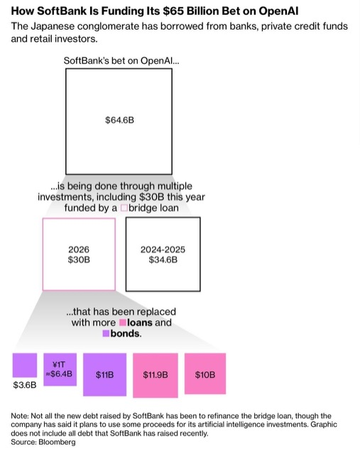
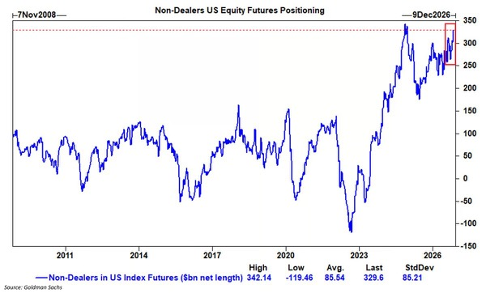
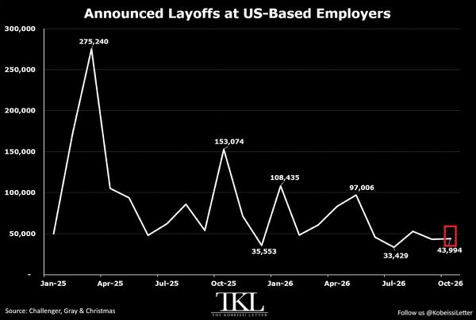
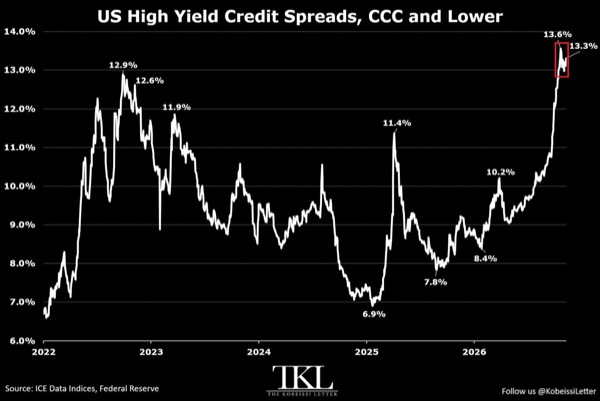
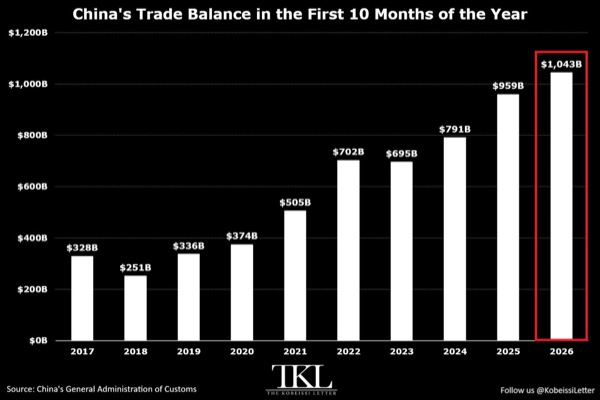
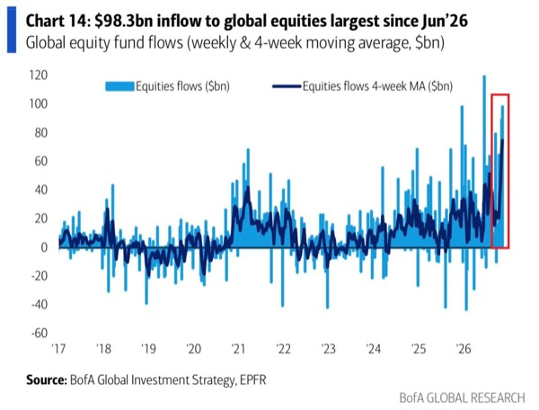
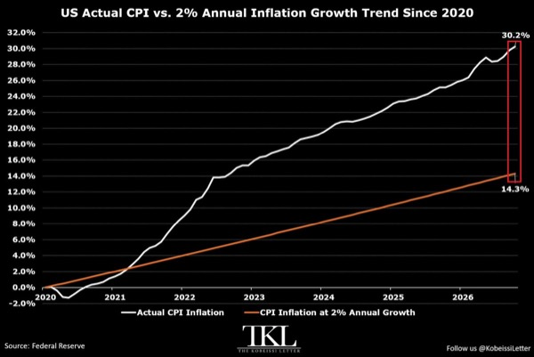
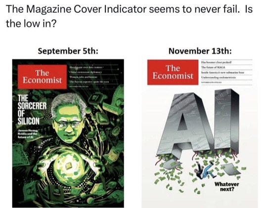

# EconomiExpl

### 캐나다의 대미 의존과 경제 자립의 조건

- 캐나다의 대미 의존은 무역 규모보다 경제 구조와 물류망에 깊이 고착돼 있음
  - 상품·서비스 무역은 GDP의 약 3분의 2, 수출은 약 3분의 1이며 상품 수출의 약 72%가 미국에 집중
  - 대미 수출은 캐나다 GDP의 약 19%인 반면 미국의 대캐나다 수출은 미국 GDP의 1.5% 미만
  - 미국은 대체 공급망 구축 비용을 부담하면 되지만 캐나다는 최대 고객을 대체하기가 훨씬 어려움
- 관세 충돌은 심각하지만 전면적인 국경 봉쇄와는 거리가 있음
  - 미국은 일부 캐나다산 제품에 최대 50% 관세를 부과했고 캐나다는 미국산 276억 캐나다달러 규모 상품에 맞대응
  - 철강·알루미늄 관세는 최대 50%, 자동차는 25%이며 목재·구리 등도 분쟁에 포함
  - 캐나다산 상품의 약 4분의 3은 여전히 무관세로 미국에 진입해 피해가 특정 산업에 집중
  - 보복관세는 미국 생산자를 압박하는 동시에 캐나다 소비자 물가도 끌어올림
- 캐나다의 원유 수출은 생산 능력보다 미국을 향한 수송망에 묶여 있음
  - 하루 약 500만 배럴을 생산하고 400만 배럴을 수출하며 원유 수출액은 연간 약 1,400억 캐나다달러
  - 원유 수출의 약 90%가 미국으로 향하고 항구로 연결되는 송유관 용량은 전체의 5분의 1 미만
  - 국내 동서 수송망이 부족해 대규모 원유 수출국이면서도 미국산 원유와 정제유를 수입
- 자동차 산업은 국경을 반복해서 넘는 분업 구조여서 무역장벽 충격이 증폭됨
  - 온타리오 윈저의 자동차 도어 잠금 부품은 미국산 철강의 가공·열처리·도금·검사·조립 과정에서 국경을 네 차례 통과
  - 관세가 반복 적용될 수 있고 캐나다의 자동차·부품 수출은 주요 관세 도입 이후 약 6% 감소
  - 스텔란티스는 브램턴 조립공장 매각이나 폐쇄를 검토
- 미국도 캐나다산 핵심 자원을 단기간에 대체하기 어려움
  - 캐나다산 원유는 미국 원유 수입의 약 3분의 2이며 중서부 정유시설은 캐나다산 중질유 처리에 맞춰 설계돼 있음
  - 캐나다는 미국 칼륨비료 수입의 약 80%를 공급하고 알루미늄·우라늄·전력 수입에서도 큰 비중을 차지
  - 에너지·칼륨비료·수산물·핵심 광물의 관세 예외는 미국이 공급 중단을 감수하기 어려운 품목을 드러냄
- 미국의 대캐나다 무역적자는 필요한 원유를 사들이는 구조의 결과에 가까움
  - 서비스 흑자를 반영한 전체 적자는 약 9,000억 달러 규모의 양국 교역에서 300억 달러 미만
  - 에너지를 제외하면 미국은 대캐나다 상품 교역에서 대체로 흑자
  - 미국 정유업체는 캐나다산 원유를 휘발유·경유로 가공해 국내외에 판매하고 일부는 캐나다로 재수출
  - 캐나다는 미국 절반 이상 주의 최대 수출시장이며 노스다코타 수출의 80% 이상을 흡수
- 에너지 공급 중단은 캐나다의 협상 수단이지만 수출 수입도 함께 끊어 자국 피해가 큼
  - 온타리오는 미국 접경 3개 주에 대한 전력 수출 할증료를 도입했다가 다음 날 중단
  - 캐나다인 약 3분의 2는 물가가 올라도 보복관세를 지지하지만 미국에서는 대캐나다 관세 반대가 과반
  - 경제 규모의 우위가 정치적 인내심의 우위로 이어지는 것은 아님
- 캐나다의 단기 성장 반등에는 지속하기 어려운 일회성 요인이 많음
  - 1분기 정체 이후 2분기 경제가 0.8% 성장하고 자동차·경트럭 수출이 전년 동기 대비 27% 증가
  - 겨울철 생산 차질의 반작용, 일회성 GST 환급 추가 지급, 월드컵 관련 소비가 성장에 기여
  - 에너지 기업 중심의 이익 증가와 수출 반등만으로 경제 전반의 회복을 판단하기 어려움
- 고용 악화와 물가 상승이 겹쳐 통화정책의 선택지가 좁아짐
  - 8~9월 일자리 10만 개 이상이 사라져 연중 증가분 대부분을 반납했고 실업률은 약 6.5%로 상승
  - 교육·보건·사회복지 부문 고용 감소에는 유학생 허가 축소도 영향을 미쳐 관세만으로 설명하기 어려움
  - 퀘벡·온타리오는 고용이 줄지만 앨버타는 원유 가격과 송유관 확장에 힘입어 고용 증가
  - 보복관세와 휘발유 가격 상승으로 연중 인플레이션이 3%를 넘었고 캐나다 중앙은행은 10월 28일 기준금리를 2.5%로 인상
- 이민 축소는 주거 부담을 낮추는 동시에 내수 둔화를 심화함
  - 연간 영주권 목표를 50만 명에서 39만 5,000명으로 낮추고 추가 감축을 추진했으며 임시 거주자는 약 7% 감소
  - 2023년 3%를 넘었던 인구 증가율이 사실상 정체되면서 소비자·임차인·주택 구매자 증가도 멈춤
  - 온타리오·브리티시컬럼비아의 콘도를 중심으로 주택가격 하락 압력이 이어짐
- 캐나다의 더 깊은 취약점은 생산성과 기업 투자 부족
  - 1990년대 후반 이후 미국 대비 상대 생산성이 약 4분의 1 하락했고 2015년 유가 급락 이후 1인당 GDP도 뒤처짐
  - 근로자당 기업 투자액은 미국 1달러당 약 90센트에서 55센트로 하락해 장비·기술·자본 부족이 생산과 임금을 제약
  - 연방 재정적자는 해당 회계연도 약 650억 캐나다달러이며 이자 부담도 커져 재정 대응 여력이 제한됨
- 현실적인 위험은 국경의 완전 봉쇄보다 북미 자유무역의 우대 접근권 상실
  - 캐나다·미국·멕시코 무역협정인 CUSMA는 6년 주기 검토에서 연장에 합의하지 못하면 2036년까지 유효하지만 매년 재검토 대상이 됨
  - 원문 시점의 7월 검토에서 미국이 현행 협정 연장에 동의하지 않아 기업 투자에 연례 불확실성이 추가됨
  - 옥스퍼드 이코노믹스는 협정 붕괴 시 향후 10년간 캐나다 산출 손실을 약 1%, 미국은 0.5% 미만으로 추산
  - 미국은 경제 규모가 커 절대 손실액이 약 1조 달러로 더 크지만 캐나다의 상대적 타격이 더 큼
- 비미국 수출 확대는 필요하지만 현재 성과의 질과 규모가 부족함
  - 카니 총리는 10년 안에 비미국 수출을 두 배로 늘리는 목표를 제시
  - 최근 비미국 수출 증가는 영국행 금·귀금속 수출에 크게 의존해 제조업의 신규 시장 확보와는 차이가 있음
  - 목표 달성에는 GDP 약 5%에 해당하는 추가 수출이 필요하며 이는 광업·채석·석유·가스 산업의 합산 산출 규모에 가까움
  - 중국산 전기차와 캐나다산 카놀라의 상호 관세 완화에도 미국의 보복 위협이 뒤따라 수출 다변화 자체가 외교 갈등이 됨
- 항만·송유관 확충과 주 간 무역장벽 해소가 의존도 축소의 실질적 기반
  - 밴쿠버항은 세계은행 컨테이너항 성과 지수에서 약 400개 항만 중 375위로 물류 병목이 큼
  - 트랜스마운틴 확장 이후 밴쿠버 터미널 출항 유조선의 약 3분의 2가 아시아로 향함
  - 앨버타와 브리티시컬럼비아 해안을 잇는 신규 송유관 구상이 실현돼도 비미국 원유 수출 비중은 약 15%에서 23%로 늘어나는 수준
  - 주 간 규제·인증 장벽 해소의 GDP 증가 효과는 추정에 따라 1~7%이며 상호 제품 기준 인정 등 일부 진전이 있음
- 대미 의존 축소의 성패는 수출 대상국 수보다 물류 전환 능력과 생산성 개선에 달림
  - 투자 격차를 줄이지 못하면 경쟁력이 약한 상품을 더 먼 시장에 운송하는 데 그칠 수 있음
- 전면 단절보다 미국 시장 접근을 유지하면서 대체 수출 경로와 국내 시장 통합을 확대하는 편이 경제적 비용이 작음
  - 다변화의 낙관적 효과도 미국 시장 우대 접근권 상실에 따른 손실을 완전히 상쇄하기 어려움
- 관세 압박으로 시작된 구조개혁을 무역 긴장 완화 이후에도 지속해야 장기적인 협상력이 높아짐
  - 송유관·항만·기업 투자는 완성까지 오래 걸려 당장의 정치적 압박만으로는 성과를 내기 어려움

# Harvey

- 소프트뱅크의 OpenAI 누적 투자액은 646억 달러이며, 장기간 현금화하기 어려운 비상장 지분을 여러 종류의 부채로 보유하는 조달 구조가 핵심 위험
  - 646억 달러는 현재 지분 평가액이 아닌 누적 투자액이며, 첨부 도식은 정확한 자금 추적표가 아닌 조달 구조의 개략도
  - 보유 자산을 활용한 금융이 주요 조달 수단이며, Arm·통신 자회사 지분 외에 OpenAI 지분의 조달 활용 가능성도 거론

- OpenAI의 사업 성공이 소프트뱅크 주주의 투자 성공으로 직결되지는 않으며, 금융비용과 현금화 시점이 수익률을 좌우
  - OpenAI의 장기 가치가 유지돼도 현금화가 늦어지면 소프트뱅크 주가는 하락할 수 있음
- 소프트뱅크 투자는 현재 NAV와 함께 AI 성장의 결실을 기다릴 자본의 지속성을 평가해야 함
  - 현금 필요 시 처분할 자산과 가격, 처분 후 잔여 위험을 점검
  - OpenAI 가치 실현 전에 다른 우량자산의 상승 여력을 얼마나 포기하는지도 최종 성과를 결정

# Kobeissi

- 미국 주식에 대한 기관투자자의 선물 포지션이 사상 최고 수준에 근접
  - 자산운용사·헤지펀드·CTA 등을 포함한 비딜러 순매수 포지션은 3,300억 달러로 역대 두 번째이며, 최근 6개월간 1,000억 달러 증가
  - 2024년 최고치와의 차이는 100억 달러에 불과하며, 2010~2023년에는 1,500억 달러를 넘지 않았음

- 미국 감원 발표는 둔화하지만 기술업종의 누적 감원은 증가
  - 10월 감원 발표는 전년 대비 71% 감소한 43,994명, 1~10월 누적은 44% 감소한 617,189명
  - 기술업종 누적 감원은 171,501명으로 21% 증가했으며, 10월에는 식품업종이 9,677명으로 최다
  - 시장·경제 여건에 따른 누적 감원은 130,531명으로 AI를 제치고 가장 많이 언급된 사유가 됨

- 미국 최저 신용등급 회사채의 스트레스가 빠르게 확대
  - CCC 이하 회사채 스프레드는 13.3%로 연초 대비 490bp 상승해 2022년 약세장 고점 12.9%를 상회
  - CCC와 BBB 회사채의 스프레드 차이는 약 1,200bp로 최소 5년 내 최대이며, 저신용 채권에 요구하는 추가 보상이 급증

- NVIDIA($NVDA)의 Jensen Huang 복귀 요구가 확대되며 경영진·이사회 문제가 주요 쟁점으로 부상
  - 피드 기준 Huang이 CEO·사장·이사회 직책에서 사임한 뒤 약 48시간이 지났으며, 복귀 공개서한 서명은 65,000명을 넘어섬
  - 주주 35,000명 이상과 전·현직 직원 4,700명이 참여했고 Elon Musk도 서명과 복귀 지지를 표명
  - Kobeissi는 조사와 사실관계 확정 전 퇴진이 성급했으며, 이사회가 충분한 조사 후 복귀 가능성을 열어둬야 한다고 촉구
- 미국 FAA가 이례적 상황을 이유로 전국 항공편 운항 중단 권고를 발령했다는 속보
  - 원문 게시 시점에는 추가 정보가 제공되지 않음
- 중국의 1~10월 무역흑자는 1조 400억 달러로 전년 대비 840억 달러·8.8% 증가하며 같은 기간 사상 최대
  - 10월 흑자는 1,050억 달러로 170억 달러 증가했으며, 수출은 35% 증가한 4,120억 달러, 수입은 42% 증가한 3,070억 달러
  - AI 투자 확대 속 교역이 증가하며 누적 흑자는 2025년을 제외한 모든 과거 연간 실적을 이미 상회

- 글로벌 주식형 펀드에 대규모 자금이 유입되며 저가 매수가 강화
  - 11월 11일 종료 주간 유입액은 980억 달러로 역대 두 번째이며, 5주 연속 유입액은 약 3,500억 달러
  - 4주 평균 유입액은 약 750억 달러로 사상 최대이며, 2021년 밈주식 열풍 당시 고점 약 450억 달러를 상회
  - 기술주 펀드는 해당 주간 26억 달러, 최근 3주간 91억 달러 순유입

- 미국 소비자물가의 누적 상승폭이 연준의 연 2% 목표 경로를 크게 이탈
  - 2020년 1월 이후 CPI 누적 상승률은 30.2%로 연율 약 4%이며, 연 2% 경로의 누적 상승률 14.3%보다 15.9%포인트 높음
  - 물가상승률은 67개월 연속 2%를 웃돌고 최근 7개월 연속 3%를 상회하며 3월부터 목표 경로와의 격차가 다시 확대
  - 지속적인 물가 상승은 자산 보유자에게 유리한 환경

# MKevin

### 엔비디아 경영 불확실성과 대중국 칩 수출 논란

- 영상은 젠슨 황의 사임과 사생활 의혹을 전제로 엔비디아의 경영 공백·대중국 수출통제·법적 위험을 연결하며, 제시된 보도와 의혹의 사실 여부는 원문만으로 확인되지 않음
  - 황이 CEO·사장·이사직에서 물러나고 CFO 콜레트 크레스가 임시 경영을 맡았다는 내용
  - 앨리스 황의 중국 정보기관 연계는 미확정이며, 추가 직원과의 관계 및 신원이 공개되지 않은 세 번째 인물도 의혹 단계
- 핵심 정책 쟁점은 중국의 최신 엔비디아 칩 접근 경로와 미국의 수출통제 집행 책임
  - 딥시크·문샷·미니맥스 등 중국 AI 업체의 블랙웰 GB200·GB300 활용 의혹을 제기하며, 해외 연산자원 임대와 제3국 우회 공급 가능성을 거론
  - 칩 접근 사실만으로 간첩 활동이나 황의 직접 관여가 입증되는 것은 아니며, 영상에서도 접근 경로를 확정하지 못함
- 하워드 러트닉 상무장관에게 수출통제 실패의 정치적 책임이 집중될 가능성
  - 영상이 인용한 보도에서는 러트닉이 동남아시아 경유 AI 칩 공급 단속과 수출규제 강화를 지연시켰다는 비판이 제기됨
  - 백악관은 신임을 유지한다고 밝혔으나, 의회 증언에서 대응에 실패하면 경질 계기가 될 수 있다는 시나리오
- 미국산 칩에 중국을 계속 묶어두려는 산업 전략과 국가안보 목적의 수출 제한이 충돌
  - 엔비디아에는 중국 매출, 테슬라에는 중국 판매와 FSD 승인이 걸려 있어 규제 완화 유인이 큼
  - 영상은 황의 백악관 연회장 약 2,500만 달러·취임기금 100만 달러 기부 의혹 등을 트럼프의 우호적 태도와 연결하지만, 기부와 정책 사이의 대가관계는 입증하지 못함
- 러트닉 일가의 금융거래에도 이해충돌 의혹이 겹침
  - 영상에 따르면 아들들이 운영하는 캔터 피츠제럴드는 관세 환급 청구권을 액면가의 약 30%에 매입
  - 관세정책을 추진하는 장관의 가족이 정책 무효화에 따른 수익을 기대하는 구조가 쟁점이며, 내부정보 활용 의혹은 추측이고 관련 측은 부인
- 황이 선임했다는 폴 와이스 변호인단은 의회 조사와 기업·형사 사건 대응 경험을 보유
  - 멀린다 헤이그는 2010~2015년 캘리포니아 북부 연방검사장을 지냈고, 엔비디아 소재지인 샌타클래라가 관할에 포함
  - 월터 브라운은 연방대출 5억 3,500만 달러가 걸린 솔린드라 사건에 관여했으며, 당시 경영진은 의회에서 수정헌법 5조에 따른 증언거부권을 행사
  - 같은 변호사를 선임했다는 사실만으로 황의 증언거부 여부를 단정할 수는 없음
- 폴 와이스와 트럼프의 기존 합의도 변호인 선임의 정치적 배경으로 부각
  - 영상에 따르면 트럼프는 로펌의 보안인가·정부 접근을 제한하는 행정명령을 내렸고, 로펌은 4,000만 달러 규모의 공익 법률서비스 제공 등을 약속한 뒤 철회를 이끌어냄
  - 로펌 관계자와 정치권 인사의 인맥을 나열하지만, 이러한 연결만으로 사건 은폐나 수사 개입이 입증되지는 않음
- 영상이 제시한 단기 일정은 11월 17일 엔비디아 실적 발표, 추수감사절 전 황의 의회 증언, 12월 3일 러트닉 관련 청문회
  - 워런·쿤스 의원의 답변 및 기록 보존 요구, 와이든·닐 의원의 러트닉 조사 서한도 거론
  - 일정과 출석 여부는 영상 시점의 설명이며 확정 여부를 별도로 확인할 필요
- 법적 위험은 의회·법무부·FBI 조사뿐 아니라 회사의 보수 환수와 개인 소송 가능성까지 확대
  - 직원과의 관계를 둘러싼 맥도날드 전 CEO의 1억 500만 달러 보수 반환 합의를 비교 사례로 제시하지만, 엔비디아가 실제 소송을 제기했다는 내용은 없음
  - 영상이 인용한 블룸버그 보도에서는 황이 법무부 수사 대상이 아니며, 당시 기소나 기소 징후도 확인되지 않았다고 구분
  - 엔비디아 반독점 조사, 메가스피드·슈퍼마이크로 관련 조사, 앨리스 황 관련 조사를 함께 거론하지만 각 사건의 연결은 확정되지 않음
- 영상상 엔비디아 주가는 약 한 달 전 227달러에서 167달러로 약 26% 하락
  - 시가총액 약 5조 달러 기업의 급락은 지수 전체에 큰 부담이며, 개인 의혹이 기업 평판과 경영 안정성에 미치는 영향이 쟁점
  - 약 4만 2,000명의 인력과 기존 사업 기반은 창업자 개인과 별도로 평가할 요소이나, 주가 하락분 전체를 이번 의혹 탓으로 돌릴 근거는 제시되지 않음
- 투자 판단의 우선 확인 대상은 공식 경영진 공시, 수사기관 발표, 의회 증언, 실적과 가이던스
  - 미확인 사생활 의혹과 인맥 추정보다 중국 매출 접근성·수출허가·고객 수요·경영 승계의 실제 변화가 기업가치에 미치는 영향을 구분해야 함
- 주가 급락만으로 저평가를 확정하기 어려우며, 수출통제와 경영 불확실성이 예상 이익을 얼마나 바꾸는지가 핵심
  - 실적이 유지되면 평판 충격과 사업가치의 괴리가 기회가 될 수 있지만, 중국 공급 제한이나 법적 비용이 확대되면 낮아진 주가에도 추가 위험이 남음

### 유가발 물가 확산과 연준 추가 인상 압력

- 에너지 가격 상승이 운송비와 근원물가로 확산되면서 연준의 추가 금리 인상 압력이 커짐
  - 굴스비는 물가가 2% 목표로 복귀하는 경로에 있지 않으며, 악화 흐름이 이어지면 적극적인 대응이 필요하다고 발언
  - 고용시장은 안정적이고 일부 긴축 조짐까지 나타나 물가 대응을 제약할 고용 둔화 신호가 부족함
  - 인공지능 투자에 따른 수요 과열, 관세 전가, 이란 전쟁에 따른 에너지 비용이 동시에 물가를 자극
- 생산자물가는 헤드라인 둔화보다 기조적 물가 압력 확대가 핵심
  - 헤드라인 PPI는 전년 대비 6.5%로 예상 6.6%를 밑돌고, 전월 대비 0.3%로 예상 0.4%를 하회
  - 식품·에너지·무역서비스 제외 PPI는 전월 대비 0.5%로 예상 0.4%를 상회하고, 전년 대비 4.9%로 예상 4.8%를 상회
  - 앞선 전월 대비 PPI와 식품·에너지 제외 PPI는 각각 0.1%포인트 상향 수정돼 1.4%, 0.8%로 조정
- 유가 충격이 서비스 가격으로 전이돼 에너지를 제외한 지표도 안심하기 어려움
  - 화물 트럭 운송비가 3.9% 상승하며 최종수요 서비스 물가 상승분의 약 80%를 차지
  - 헤드라인 PPI에는 10월 말 유가 하락이 반영됐지만 11월 들어 유가가 다시 상승해 최근 비용 압력을 충분히 포착하지 못함
  - 유가는 배럴당 약 89.90달러에서 96달러로 반등
- 소비자물가도 예상치를 웃돌아 계절적 물가 둔화 기대가 약해짐
  - 전월 대비 CPI는 예상 0.3%보다 높은 0.4%, 근원 CPI는 예상 0.2%보다 높은 0.3% 기록
  - 통상 물가가 약해지는 가을에도 상승 압력이 지속돼 향후 연초 물가 흐름에 대한 경계가 필요
- 시장은 12월 금리 인상을 사실상 전부 반영하고, 이후 추가 인상 폭도 확대 반영
  - 12월 9일 회의까지 25bp 인상 약 1.1회가 반영돼 50bp 인상 확률은 약 11% 수준
  - 2027년 9월까지 예상 인상 횟수는 약 열흘 전 1.9회에서 3.55회로 증가
  - 이는 시장에 반영된 기대이며 실제 인상 결정과 구분해야 함
- 이란과의 합의 지연과 군사 충돌 위험이 유가 안정 및 통화정책 완화의 걸림돌
  - 트럼프가 선거 이후 이란과의 합의 필요성을 낮게 평가한다는 보도로 조기 타결 기대가 후퇴
  - 바레인 미군 자산 공격 여부를 두고 이란과 미 중부사령부의 발표가 엇갈리고, 이란 혁명수비대는 추가 대응을 경고
  - 카타르와 아랍에미리트는 전쟁 재확대를 막아 달라고 미국에 요청
- 전쟁이 끝나도 유가가 곧바로 정상화된다는 보장은 없음
  - 굴스비와 보먼은 종전 이후에도 생산·공급 회복에 시간이 걸려 유가가 높게 유지될 가능성을 경고
  - 걸프 지역 원유 수출이 전쟁 이전 수준을 웃돈다는 점은 합의 시 유가 급락 가능성을 뒷받침
  - 후티의 공격과 사우디 동서 송유관의 드론 공격 취약성이 공급 불확실성을 지속시킴
- 국제원자력기구의 이스파한 핵시설 감시 공백 우려가 협상 불확실성을 높임
  - 영상에 인용된 보고서는 2025년 6월 미드나이트 해머 작전 이전부터 접근하지 못한 시설의 정확한 위치, 핵물질 보유 여부, 감시 상태를 확인하지 못했다고 지적
- 관세 협상 지연과 반도체 수출통제 갈등이 정책 불확실성을 추가
  - 베선트는 멕시코·캐나다와의 조속한 합의를 기대했지만, 2025년 4월 이후 약속했던 협상이 2026년 11월에도 미완료
  - 반도체 수출통제에서는 재무부가 통제를 지지했지만 상무부는 그렇지 않았다고 발언해 부처 간 이견을 드러냄
- 금리 인상 기대와 지정학적 위험이 겹치며 위험자산의 단기 부담이 커짐
  - 비트코인은 7만 달러를 하회하고 미국 10년물 국채금리는 약 5.147%로 상승
  - 합의 기대가 강했을 때의 약 4.9%보다 높지만, 영상에서 제시한 경계 수준 5.27%보다는 낮음
- 향후 물가 판단은 유가 자체뿐 아니라 운송비·서비스 가격으로의 전가가 진정되는지에 달림
  - 헤드라인 물가가 잠시 둔화해도 근원 지표와 이전 수치의 상향 수정이 이어지면 긴축 압력은 쉽게 낮아지기 어려움
- 낙폭 확대만으로 저가매수 근거가 충분해지지는 않음
  - 추가 인상에 따른 할인율 상승과 에너지 비용 증가를 반영해 기업별 현금흐름·이익 전망·매수가격을 다시 점검할 필요

### 항공관제 통신 마비와 운항 차질의 연쇄 파급

- 미국 항공관제 통신 장애로 FAA가 대규모 출발 중단 조치를 시행하며 항공편 지연·취소가 급증
  - 방송 초반 집계는 지연 9,000편 이상, 취소 600편 이상이며 이후에도 피해 규모가 계속 변동
  - 델타항공은 신규 출발을 중단하고 이미 비행 중인 항공기는 목적지까지 운항한다고 공지
  - 방송 말미 출발 중단 종료 예정 시각은 최소 미 동부시간 오후 11시·태평양시간 오후 8시까지 연장
- 운항 제한은 미국 본토 48개 주를 중심으로 확산하고 국제선 출발에도 파급
  - 유로컨트롤은 FAA 요청으로 회원국의 미국행 항공편 출발을 중단했다고 공지하고 멕시코에도 미국행 항공편 대기 요청
  - 알래스카항공은 알래스카·하와이 내 운항이 영향을 받지 않았다고 안내했으나 본토와 연결되는 개별 노선의 예외 범위는 불명확
- 장애의 핵심은 항로교통관제센터 ARTCC와 조종사 사이의 통신 연결
  - 관제사는 구역별 주파수 인계를 통해 항공기 간 안전 간격을 유지하며 통신 장애는 운항 처리 능력을 직접 제한
  - 비상 주파수 121.5MHz가 대체 통신 수단으로 사용된다는 보도가 있으나 정상 관제 기능을 전부 대체하는지는 확인되지 않음
- L3해리스 테크놀로지스가 운영하는 통신망이 장애와 연결됐을 가능성이 부상
  - 로이터가 전한 월스트리트저널 보도에 따르면 관제사와 조종사의 핵심 무선 통신을 지원하는 망이 영향을 받은 것으로 추정
  - 관제 레이더까지 영향을 받았는지는 불명확하며 방송 시점 회사 측 답변도 없음
- FAA는 일시적 통신 장애에 따른 예방적 운항 중단으로 안내했으며 정확한 원인은 미확정
  - 소프트웨어 업데이트 오류와 통신망 현대화 과정의 문제가 원인 후보로 거론
  - FBI가 사이버공격이나 범죄 정황으로 보지 않는다는 관계자 보도가 나왔으며 전파 방해·인공지능 오류·테러와의 연관성은 확인되지 않음
- 항공관제 현대화가 진행 중이지만 이번 장애와의 인과관계는 입증되지 않음
  - 구리선의 60% 이상을 광섬유·무선 인프라로 교체하고 아날로그 음성 스위치를 IP 방식으로 전환 중
  - 8월 말 기준 무전기 1,581개 중 380개, 음성 스위치 450개 중 166개를 개량했다는 수치가 제시됨
  - 종이 운항기록표를 쓰던 관제탑 89곳 중 20곳은 전자 화면으로 전환
- 과거 비교 사례는 2023년 1월 11일 NOTAM 장애에 따른 약 1시간 37분의 출발 중단
  - NOTAM은 공항·활주로 폐쇄, 조명 고장, 공사 등 조종사에게 필요한 안전 정보를 전달하는 체계
  - 이번 방송에서는 해당 중단 시간을 이미 넘어섰으나 복구 완료 시점은 제시되지 않음
- 영국 이스트앵글리아의 미군 기지에서는 무단 드론 활동 의심으로 경보와 실내 대피 지시가 발령됐다는 보도
  - 미국의 출발 중단 약 1시간 전에 발생해 연관성 추측이 확산했으나 두 사건의 연결이나 이란의 개입은 확인되지 않음
  - 이스라엘 정보 수장의 미국 방문과 이란 관련 협의도 언급됐지만 항공관제 장애와 연결할 근거는 없음
- 미국 기상청 레이더 웹사이트 장애도 함께 보도됐으나 방송 도중 정상화 공지가 나옴
  - 이후 인터넷 장애 보도도 이어져 서비스 상태가 혼재했으며 FAA 통신 장애와 공통 원인이 있는지는 불명확
- 통신 복구 뒤에도 항공편 정상화에는 주말이나 수일이 걸릴 가능성
  - 승무원 근무시간 초과, 항공기·승무원 위치 불일치, 관제 처리 적체가 후속 지연을 유발
  - 성수기 하루 TSA 검색 인원 약 270만 명 규모에서 발생해 민간 전세기까지 지연 여파가 확산할 수 있음
- 방송에 제시된 시간외 거래에서 렌터카주가 오르고 항공주와 기술주가 하락
  - 허츠 글로벌은 약 10.6% 상승하고 델타항공은 수% 하락했으며 나스닥100은 약 0.75% 하락
  - 원인과 복구 시간이 불분명한 상태의 반응이며 거래가 적은 시간외 가격이라는 한계가 있음
- 항공·여행업 충격의 크기는 장애 원인보다 운항 중단 시간과 복구 후 적체 해소 속도에 좌우될 수 있음
  - 출발 재개 공지와 함께 승무원 배치, 취소율, 국제선 제한 해제 여부를 확인할 필요
- 통신망 운영사의 책임과 손실 규모는 원인 조사 결과에 달려 있으며 초기 보도만으로 기업 책임이나 공격 배후를 확정하기 어려움
- 관제 현대화의 효과는 장비 교체율과 함께 통신망 이중화, 장애 격리, 전환 실패 시 복구 능력으로 평가할 필요

### 사이버캡 개인 판매와 구독 수익의 확장 조건

- 영상에 소개된 사이버캡 개인 판매 조건은 차량 가격 2만9,990달러와 월 299달러 필수 구독
  - 오스틴 운행 허용 구역 거주자를 대상으로 초청 판매하며 이르면 12월 인도 예정
  - 개인용으로만 운행할 수 있고 택시 영업이나 호출 앱 등록은 불가
  - 구독을 해지하면 차량을 사용할 수 없어 구매 이후에도 지속적인 이용료 부담
- 월 299달러에는 자율주행·연결 서비스·긴급출동·일부 정비가 포함
  - 타이어 교체와 위치 교환, 유리와 워셔액 관리, 안전 점검, 서비스센터 이동, 최대 50마일 견인 등
  - 일반 FSD 월 99달러보다 연간 2,400달러 비싸며 정비비와 자율주행 서비스 가격의 세부 배분은 불명확
  - 타이어와 카메라 시야 등 안전에 영향을 주는 관리를 테슬라가 통제하는 구조
- 차량 소유권을 확보해도 운행 권한과 유지보수는 테슬라에 종속
  - 테슬라는 서비스 구역을 확대·축소·폐지하고 차량을 원격 추적·제한·정지할 수 있음
  - 규정 위반 시 경고 누적으로 1주일 이용 정지가 가능하며 구독료 환불은 없음
  - 차고 진입 등 수동 이동은 터치스크린으로 시속 2마일까지 가능하고 운전면허 필요
  - 랩핑·선팅·휠 교체와 비승인 수리는 테슬라 승인에 종속
- 보험·등록·주차·충전·세차 비용은 소유자 부담
  - 자택 충전과 허용 구역 내 생활이 가능한 이용자에게 적합
  - 목적지에서 하차한 뒤 차량이 이동하고 다시 데리러 오는 개인 전용 택시가 핵심 효용
  - 초기 보험 공급이 테슬라에 집중되면 추가 수익원이 될 수 있으나 보험 독점은 진행자의 추정
- 개인 판매 확대는 테슬라가 차량을 직접 보유·운영하는 사업보다 차량 판매와 반복 구독료를 결합하는 방향
  - 10월 21일 실적 발표에서는 사이버캡 대부분을 테슬라가 보유하고 초기 생산분도 자체 운영에 투입하는 방향이 제시됨
  - 개인 판매가 확장되면 고객이 차량 구매 자금과 관리 부담을 맡고 테슬라는 판매 마진·구독료·보험 수익을 확보
  - 진행자는 대량생산 시 차량 매출총이익률 30~35%와 기존 서비스센터 활용에 따른 정비 원가 하락을 가정
- 월 299달러 구독의 연간 매출은 차량 1대당 3,588달러이며 보급 대수가 반복 매출 규모를 결정
  - 1만 대는 약 3,600만 달러, 10만 대는 약 3억6,000만 달러, 100만 대는 약 36억 달러
  - 진행자는 정비비 등을 차감한 100만 대의 연간 이익 기여를 약 27억 달러로 추산
  - 영상에서 비교 기준으로 제시한 테슬라의 2025년 순이익 약 37억 달러에 근접하는 규모지만 구독 매출 전체가 순이익은 아님
- 최대 확장 변수는 생산량과 완전 자율주행 운행 구역을 늘리는 속도
  - 오스틴 구축에 약 14개월이 걸렸으며 후속 지역에서 9개월·6개월로 단축할 수 있는지는 미확인
  - 지역마다 같은 시간이 필요하면 차량 생산이 늘어도 실제 가입자와 운행 대수 확대는 지연
  - 신규 구역 발표보다 실제 무인 운행 가능 여부와 규제 승인이 중요
- 진행자의 2030년 모형은 연간 차량 500만 대와 여러 사업의 동시 성장을 전제
  - 차량 판매량 약 2.5배 확대, 세미 영업이익 40억 달러, FSD 구독 이익 25억 달러, 로봇 기여 3억7,500만 달러 가정
  - 에너지 매출 500억 달러와 이익률 22%를 포함해 전체 영업이익 약 550억 달러를 산정
  - 현재 실적보다 훨씬 높은 장기 가정이므로 사이버캡 수익만으로 목표 실적이 완성되지는 않음
- 사이버캡 100만 대의 추가 이익은 낙관적 장기 모형에서 주당 가치 약 39달러 상승으로 연결
  - 약 30억 달러 이익을 더하면 EPS가 10.96달러에서 11.53달러로, 추정 주가는 740달러에서 779달러로 상승
  - 1,000만 대 보급과 전체 이익 약 850억 달러를 가정하면 추정 주가 약 1,100달러
  - 현재 이익 대비 영향은 커도 다른 사업의 급성장을 이미 반영한 가치평가에서는 100만 대의 추가 효과가 제한적
- 영상이 제시한 P/E 약 200배와 PEG 약 5배는 높은 성장 기대를 이미 반영
  - 차량·세미·에너지·로봇·구독 사업이 계획대로 성장해야 장기 가치평가가 성립
  - 진행자는 테슬라를 통한 스페이스엑스 간접 노출 가능성도 매수 논리로 제시
  - 영상 속 예측시장 합병 확률은 2027년 3월까지 67%, 2028년 이전 85%였으나 합병과 주주 프리미엄은 미확정
  - 합병이 성사돼도 시장 하락과 양사 가치 하락이 겹치면 투자 손실 가능
- 구매 가격보다 구독료·보험·충전·정비 제외 항목을 합친 총보유비용과 운행 구역의 안정성이 소비자 채택을 좌우
- 투자 판단에서는 구독 매출보다 실제 가입 대수·대당 정비 원가·이용 정지와 해지·지역 확장 속도가 반복 이익의 질을 결정
- 사이버캡·세미·로봇·에너지는 성장 기회를 넓히지만 각각의 성공 가정을 동시에 가격에 반영할수록 실행 지연에 대한 주가 민감도도 상승

# Slav

- 젠슨 황의 엔비디아 CEO 복귀 청원이 진행 중이며, 일론 머스크가 엔비디아 주주로 공개 서명
- 이코노미스트 표지는 역발상 투자 신호로 해석하며, 매경 표지에 코인이 등장했던 시점도 고점 신호로 인식

# Stockbot

- 엔비디아($NVDA) 젠슨 황 CEO 복귀 공개서한의 서명이 65,000명을 넘으며 복귀 요구가 확대
  - 주주 35,000명 이상과 전·현직 직원 4,700명이 서명했고, 일론 머스크도 서명과 복귀 지지를 표명
  - 공개서한은 황의 퇴진 과정에서 실질적인 적법 절차가 부족했다고 문제 제기
- 미국 FAA가 이례적 상황을 이유로 전국 항공편 운항 중단 권고를 발령했다는 속보
  - 원문 게시 시점에는 추가 정보가 제공되지 않음
- 트럼프가 존스법 적용 면제를 90일 연장해 외국 국적 선박의 미국 항구 간 원유·연료·기타 화물 운송을 허용
  - 이란 전쟁과 에너지 공급 차질 속 연료 가격을 낮추기 위한 조치
- Trezor Safe 5 일부 제품에서 시드 문구를 탈취하는 은닉 칩이 확인됐다는 소식으로 암호자산 지갑의 유통망 보안 위험 부각
  - 원문에 따르면 48건 조사 결과, 2026년 8~9월 말레이시아 판매사 CryptoBilis가 판매한 지갑 3개에서 시드 문구를 읽고 이동통신망으로 전송하는 칩이 발견
  - Trezor는 차단 펌웨어를 배포하고 리셀러망을 80% 축소했으며 물류 통제를 강화
  - 같은 판매사를 통해 유통된 Ledger 지갑에서도 유사 백도어가 발견됐으며, 외부 추산 피해액은 9,000만 달러 이상

# WUncle

### 앤트로픽 공모가의 성장 전제와 주주 몫의 한계

- 앤트로픽 공모가의 핵심은 성장 기대가 아니라 그 가격을 정당화할 매출·이익률·재투자 부담의 조합임
  - 공모가 밴드 70~78달러는 발행 주식 기준 약 1조 달러, 잠재 주식 포함 약 1조 3,000억 달러에 해당
  - 같은 3분기 실적을 두고 시장의 평가액은 2조 달러에서 1조 2,000억~1조 3,000억 달러까지 급변했고, 수요 회복 뒤에는 1조 5,000억 달러 이상으로 상향하는 방안도 거론
  - 사업 전망의 변화와 투자자가 같은 전망에 지불하는 가격의 변화를 구분해야 함
- 주당 가치는 발행 주식과 잠재 주식, 향후 자금 조달에 따른 희석까지 확인해야 함
  - 공모·사모 이후 발행 주식은 약 131억 주, 옵션·RSU 등을 포함하면 약 180억 주
  - 아마존·구글·브로드컴과의 조달 약정은 사모 이후에도 670억 달러가 남으며, 자금 인출 시점의 평균 주가를 기준으로 주식을 지급하는 구조
  - 브로드컴 약정은 평균 주가의 90%, 매출 조건 미충족 시 85%로 전환하며 이자도 원금에 가산돼 주가가 낮을수록 희석 부담 확대
  - 미래 적자 현금흐름을 가치에서 이미 차감했다면 이를 충당할 신주를 다시 더해 희석을 이중 계산하지 않아야 함
- 다모다란의 기본 지분 가치 1조 4,500억 달러는 2036년 매출 약 1조 달러와 영업이익률 27.5%를 전제로 함
  - 최근 1년 매출 약 350억 달러의 약 30배이며, 10월 말 연환산 매출 810억 달러에서 출발해도 10년간 연평균 약 30% 성장 필요
  - 매출 1조 달러에서 영업이익률 27.5%를 달성하면 연간 영업이익은 2,750억 달러
  - 매출 증가 3달러당 1달러 재투자, 실패 확률 10%, 공모 유입 자금 1,000억 달러를 반영하고 컴퓨트 약정의 현재 가치를 부채로 차감
- 매출 성장만큼 컴퓨트 효율 개선이 중요하며 현재 수익 구조로는 높은 장기 이익률이 자동으로 확보되지 않음
  - 3분기 매출 170억 달러 중 컴퓨트·인프라 비용이 99억 달러로 약 58%를 차지
  - 영업이익률 27.5%를 내려면 컴퓨트와 인건비를 포함한 전체 영업비용을 매출의 72.5% 안에 묶어야 함
  - 컴퓨트 1달러당 매출은 2분기 2달러 이상에서 3분기 1.72달러로 하락했고, 전분기 대비 매출 배수도 2.4배에서 1.5배로 둔화
- 규제와 데이터센터 건설 제약은 매출 전망이 같아도 지분 가치를 크게 낮출 수 있음
  - 재투자 효율을 매출 증가 3달러당 1달러에서 2.5달러당 1달러로 낮추고 영업이익률을 27.5%에서 25%로 조정하면 가치가 약 1조 2,500억 달러로 하락
  - 두 가정의 조정만으로 약 2,000억 달러가 감소하며, 이 평가액도 2036년 매출 1조 달러라는 높은 성장 전제를 유지
  - 목표 매출 미달은 이익률 악화와 위험 상승으로 이어질 수 있어 변수들이 동시에 나빠질 가능성까지 고려해야 함
  - 금리 상승은 먼 미래 현금흐름의 현재 가치를 더 크게 깎아 고성장 기업의 평가에 부담
- 골드만삭스의 더 낙관적인 성장 경로에서도 잉여현금흐름 흑자는 2030년에야 가능
  - 매출은 올해 약 520억 달러에서 2030년 6,000억 달러 이상으로 확대하는 경로
  - 내년 잉여현금 유출만 657억 달러로 예상돼 매출 급증과 외부 자금 의존이 수년간 병존
- 높은 매출 배수로 상장할수록 장기 실적이 기대를 충족해야 할 부담도 커짐
  - 제이 리터의 분석에서 기업가치 1조 4,100억 달러 이상은 최근 1년 매출 대비 40배 초과에 해당
  - 1980~2024년 미국 IPO 4,110건 중 매출 배수 40배를 넘긴 기업은 14곳이며, 상장 후 최대 3년간 평균 수익률은 시장 대비 15.4%포인트 낮았음
  - 표본은 작지만 현재 밴드도 발행 주식 기준 26~29배, 잠재 주식 포함 36~40배로 높은 기대를 반영
- 강세 시나리오는 토큰 가격 인하에 따른 사용량 급증과 클로드의 성능 우위가 매출·이익으로 이어지는 경로임
  - 10월 말 연환산 매출 810억 달러는 9월 말보다 약 14% 증가했지만, 성장 재가속 여부는 상장 후 실적으로 확인 필요
  - 오픈AI·구글의 추격 속에서 성능 우위가 지속되고 AI가 만드는 경제적 가치 중 더 큰 몫을 확보해야 높은 평가액 유지 가능
- 컴퓨트 약정은 매출이나 가동률이 낮아져도 지급해야 하는 고정 부담이라 성장 둔화 때 위험이 증폭됨
  - 다모다란은 계약으로 확정된 약 4,500억 달러의 약정을 현재 가치 약 3,730억 달러로 환산해 부채 처리
  - 전체 약정이 신고서 여러 곳에 흩어져 있어 어떤 계약을 포함하느냐에 따라 부채 추정치가 크게 달라짐
  - 올해 9개월 영업현금 유입 66억 달러와 초기 약정을 감당할 현금, 장기간에 분산된 지급 일정은 완충 요인
  - 장기 생존의 관건은 매출이 약정과 컴퓨트 비용보다 빠르게 늘어나는지 여부
- 칩 금융은 공급자의 보증으로 대규모 조달을 가능하게 하지만 앤트로픽 자체 신용에 연결된 자금에는 높은 비용이 붙음
  - 구글 AI 칩 이용을 위한 630억 달러 규모 금융에서 420억 달러 이상 선순위 대출은 A등급대 브로드컴이 보증
  - 앤트로픽의 리스료가 뒷받침하는 후순위 대출 180억 달러는 BB+ 등급과 연 10% 이상의 수익률 적용
  - 투자등급 확보가 어려우면 보험사·연기금 등 자금 공급 기반이 좁아지고 높은 신용등급을 가진 공급자에 대한 의존 확대
  - 차입 비용 상승은 추가 주식 발행과 기존 주주 희석으로 이어질 수 있음
- 주식 보상은 현금 지급이 없어도 주주 몫을 줄이는 비용임
  - 분기 주식 보상 비용은 전년 동기 3억 달러에서 11억 달러로 증가했고, 미인식 RSU 비용도 향후 약 2년에 걸쳐 반영 예정
  - 주식 보상을 제외한 조정 영업이익만으로 주주 수익성을 평가하면 비용을 과소평가
  - 향후 보상은 비용에 반영하고, 기존 미행사 옵션의 가치 차감과 RSU의 주식 수 반영은 각각 한 번만 적용
- 공익법인과 창업자 지배가 결합된 구조에서는 사업 성공이 주주 이익 극대화로 곧바로 이어지지 않음
  - 창업자는 클래스 F 주식으로 의결권 50.1%를 보유하고 장기이익신탁은 이사회 과반을 선임
  - 공모 투자자는 경제적 지분을 보유해도 경영을 견제하거나 회사 방향을 바꿀 권한이 제한적
  - 장기 연구와 사명 보호에는 유리하지만 공익과 주주 이익이 충돌할 수 있고 환경 변화에 대한 외부 견제가 약함
  - 다모다란은 이런 구조를 감안해 추정 가치보다 충분히 할인된 매수가를 요구
- 현재 공모가 밴드는 낙관적인 성장과 수익성 전제를 상당 부분 반영해 별도의 안전마진이 넉넉하지 않음
  - 잠재 주식 포함 약 1조 3,000억 달러는 기본 평가액 1조 4,500억 달러보다 낮지만 규제·재투자 부담을 조정한 1조 2,500억 달러와 비슷한 수준
  - 평가액이 1조 5,000억 달러 이상으로 높아지면 기본 평가액도 넘어 추가 낙관론이 필요
  - 가치 추정치와 매수가를 구분하고 성장 가정의 오차와 지배구조 부담에 대한 할인을 별도로 확보해야 함
- 상장 후에는 매출 증가율보다 컴퓨트 1달러당 매출, 재투자 부담, 잉여현금흐름, 완전희석 주식 수를 함께 추적해야 함
  - 가격 인하로 사용량이 늘어도 컴퓨트 비용과 조달 비용이 더 빠르게 증가하면 주주에게 남는 현금은 줄어듦
- 기업가치 변동을 볼 때 사업 전제가 바뀌었는지, 할인율과 시장의 지불 의사가 바뀌었는지부터 분리해야 함
  - 훌륭한 사업도 비싼 가격에서는 낮은 수익을 낼 수 있으며, 상장 참여보다 실적 검증과 가격 하락을 기다리는 선택이 유리할 수 있음

# YDental

### 비트코인 칠만 달러 붕괴와 바닥 확인 조건

- 비트코인 7만 달러 이탈 후 67,400달러 부근까지 하락, 물타기보다 매도 진정과 저점 방어 확인이 우선
  - 가격은 11월 13일 브리핑 기준이며 거래소별 저점과 차트 캡처 시점에 차이
  - 기존 박스 하단 72,700달러가 무너져 이전 지지를 근거로 한 매수 논리도 재검토 필요
- 단기 매도 클라이맥스인 SC는 아직 뚜렷하게 식별되지 않음
  - 거래량 급증이나 긴 아래꼬리만으로 부족하며 강한 매도에도 가격이 덜 밀리고 반등이 이어져야 함
  - 재차 저점을 시험할 때 매도 압력이 줄고 새 저점을 지켜야 하며, 저점 이탈 후 회복 실패 시 바닥 가정 무효
  - SC 후보가 나타나도 최종 바닥을 보장하지 않음
- 미국 10월 소비자물가는 전월 대비 0.4%, 근원 물가는 0.3% 상승해 물가·금리 부담 지속
  - 물가 수치 하나로 하락 전체를 설명할 수 없으며 금리 전망과 실제 정책 결정은 구분 필요
- 얇아진 호가와 청산 주문이 매도 충격을 확대할 수 있음
  - 탈로스 집계상 주요 거래소 호가 깊이는 11월 9일 기준 대비 약 33% 감소했으나 보고서 최신 구간의 감소폭은 약 10~15%
  - 호가 감소율로 다음 하락폭을 계산할 수는 없음
- 현물 ETF 자금 유출이 이어져 반등을 지탱할 수요 회복 확인 필요
  - 파사이드 집계상 11월 9~11일 약 6억 달러 순유출
  - 12일 자료는 주요 운용사 수치가 빠진 잠정 집계로 유출 중단을 확정할 수 없음
  - 유출 축소나 순유입 전환과 가격 회복이 함께 나타나는지가 핵심
- 일봉상 50% 되돌림인 72,600달러를 이탈했으며 61.8% 되돌림은 65,100달러 부근
  - 되돌림 가격 도달만으로 지지가 확인되지는 않으며 깨진 가격대를 회복하고 유지해야 함
  - 반등 고점이 낮아지고 하단이 반복해서 무너지는 재분배 구조에 주의
  - SOW는 약세 신호, LPSY는 공급이 다시 드러나는 지점이며 저항 회복과 눌림 지지가 확인되면 재분배 해석 수정
- 급락 전 74,000달러 부근에서는 현물·선물 CVD 하락에도 미결제약정이 크게 줄지 않아 포지션 부담 존재
  - 당시 롱 계좌 비율은 약 60%, 펀딩은 소폭 플러스였으나 급락 후 잔존 포지션은 별도 확인 필요
  - 계좌 비율은 자금 비율이 아니며 펀딩 하나로 방향을 확정할 수 없음
- 거래 규모별 CVD가 엇갈리며 10만 달러 이상 고액 체결 흐름은 주간 기준으로도 약세
  - 일부 소액 구간은 개선됐지만 1천~1만 달러 구간은 약해 소액 거래 전체를 매수 우위로 묶을 수 없음
  - 고액 체결을 기관 거래로 단정하거나 상대값 차트로 전량 매도·순유출액을 계산할 수 없음
  - 고액 체결 흐름 개선과 가격의 저항 회복을 함께 확인해야 함
- 추가 하락 시 66,500달러 부근과 그 아래 61,500~64,700달러를 중기 관심 구간으로 점검
  - 깊은 되돌림·수요대·하모닉 반전 후보가 겹치는 구간이지만 필수 도달 목표나 자동 매수 신호는 아님
  - 매도 진정과 반등 구조 유지가 필요하며 급락으로 관통하면 반전 시나리오 무효
- 단기 관찰 기준은 67,400달러 재시험 시 방어 여부와 69,100달러 주변 범위 형성·유지
  - 무너진 70,000~72,700달러 지지는 반등 시 저항으로 작용할 수 있음
  - 11월 13일 오후 10시 30분 미국 생산자물가 발표 예정이며 첫 급등락보다 이후 회복 가격 유지 여부가 중요
- 물타기와 급락 뒤 추격 숏 모두 진입 전에 실패 조건과 허용 손실을 정해야 함
  - 1R은 사전에 정한 위험 단위이며 계좌의 1%로 자동 고정되지 않음
  - 급변장에서는 체결 미끄러짐으로 실제 손실이 계획보다 커질 수 있으며 조건이 부족하면 거래 보류
- 단기 반등과 중기 추세 전환은 구분해야 하며 저점 방어·저항 회복·수급 개선이 함께 나타날수록 반전 근거 강화
- 관심 가격대는 매수 확정점이 아닌 관찰 구간으로 활용하고 가격 반응에 따라 시나리오 갱신
