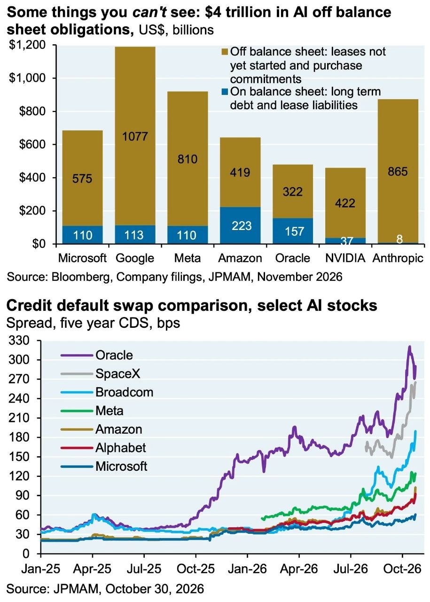
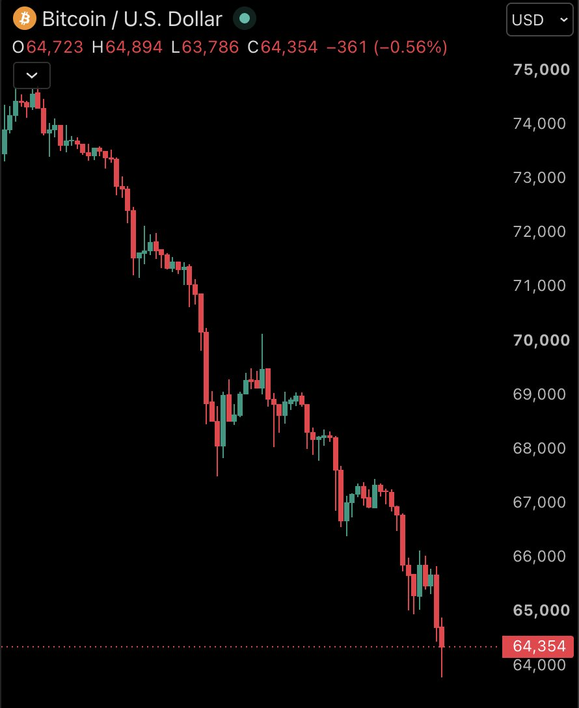
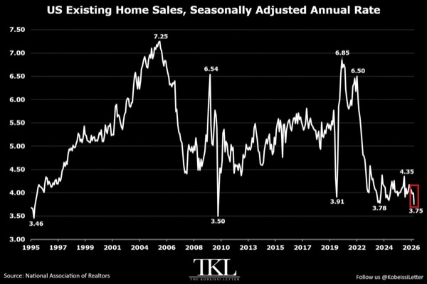
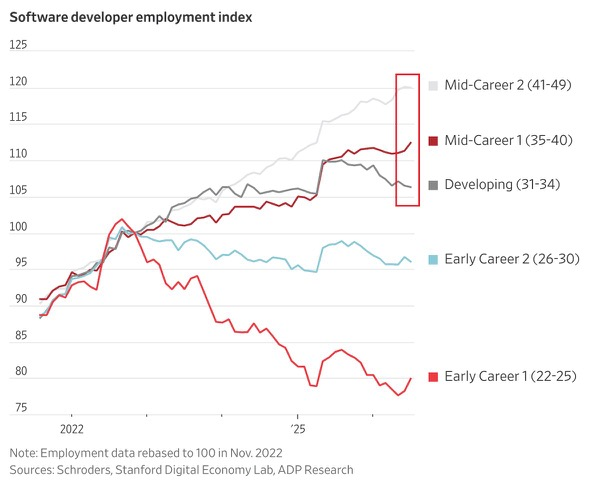
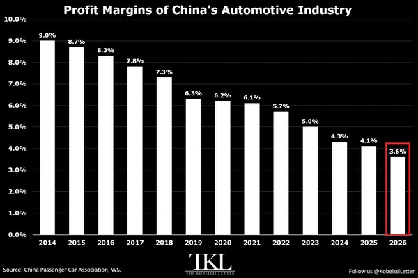
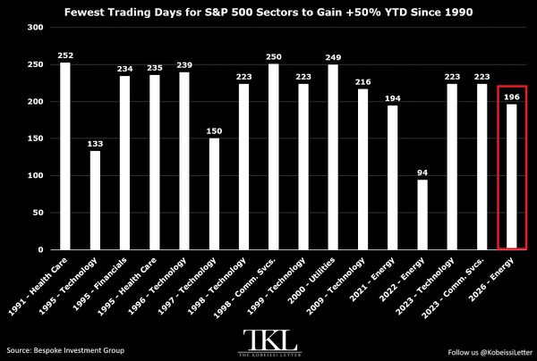
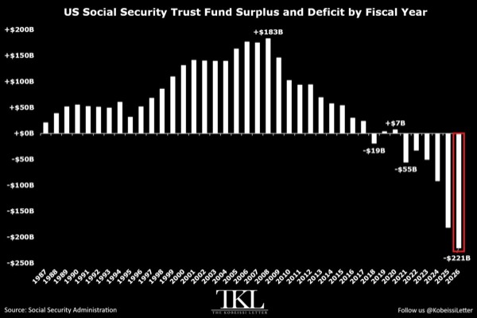
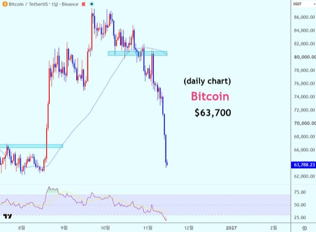
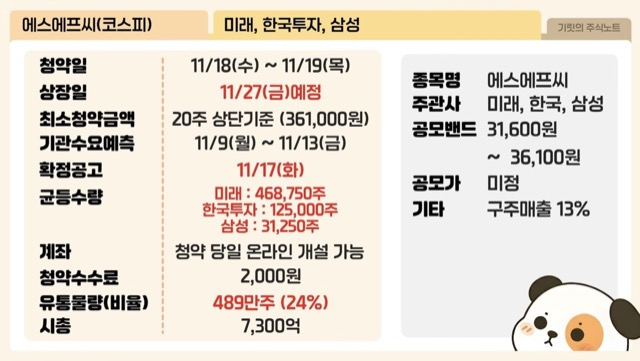

# Harvey

- AI 기업은 불확실한 미래 매출과 경직된 대규모 지급약정 사이의 격차로 현금흐름 부담이 커짐
  - 재무제표 주석에 공개된 부외 약정도 통상적인 순차입금 지표에는 충분히 반영되지 않을 수 있음
  - 수요나 기술이 예상과 달라져도 확정된 지출을 줄일 여지가 제한적임

- 연준의 추가 금리 인상이 현실화되면 신규 차입·차환·변동금리 부채부터 조달 부담이 확대됨
  - 기존 고정금리 차입으로 시간을 확보했더라도 미래 지급약정 이행에 필요한 신규 자금의 비용은 상승할 수 있음
- 블루웨이브 이후 주정부·지방정부의 데이터센터 인허가 강화, 전력망 비용 부담 확대, 세제 혜택 축소가 나타나면 투자비가 늘고 현금회수가 지연될 수 있음
- AI 투자의 분기점은 수요 감소보다 현금화까지 기다려줄 자본의 가격이 사업 수익성을 넘어서는 시점에 먼저 올 수 있음
  - 기업별 지급 부담과 대응 능력의 차이가 주가·신용스프레드에 얼마나 반영됐는지가 투자 기회를 좌우함

# Kobeissi

- 비트코인이 6만5,000달러, ETH가 1,750달러 아래로 하락하며 가상자산 강제청산과 매도 압력이 확대됨
  - 비트코인은 하루 5,000달러, 사흘간 1만1,000달러 하락해 연중 저점 수준으로 복귀
  - 24시간 청산액은 20억달러를 돌파했고 최근 4시간에만 9억달러 이상이 청산됨
  - 가상자산 시가총액은 주간 3,300억달러, 10월 6일 이후 8,000억달러 감소해 새로운 반등 촉매가 필요함

- 미국 10월 기존주택 판매가 전월 대비 5.5% 감소한 연율 375만채로 2010년 8월 이후 최저치를 기록하며 주택 수요가 위축됨
  - 전년 대비 8.8% 감소했고 서부 지역은 전월 대비 9.7% 줄어든 연율 65만채로 1999년 이후 최저
  - 단독주택 판매는 전월 대비 5.8% 감소한 연율 341만채이며 30년 모기지 금리는 7.6%까지 상승

- 미국 소프트웨어 개발자 고용에서 신입과 경력직의 격차가 확대됨
  - ChatGPT 출시 시점인 2022년 11월 이후 22~25세 고용은 20%, 26~30세는 4% 감소
  - 같은 기간 41~49세는 20%, 35~40세는 11%, 31~34세는 6% 증가해 최연소·최고령 집단의 증가율 격차가 40%포인트에 도달

- Nvidia(NVDA)의 Jensen Huang 복귀 청원과 사임 경위 보도가 지배구조 불확실성을 키움
  - 복귀 청원은 10만명을 넘겼고 주주 5만3,000명 이상과 전·현직 직원 6,200명이 참여했으며 이사회는 아직 입장을 내놓지 않음
  - 워싱턴포스트 보도에 따르면 Marco Rubio가 중국 스파이 의심 인물과 Huang의 관계를 경고하는 메모를 Trump에게 전달했고, 메모 내용 유출 6일 뒤 Huang이 사임함
- FT 보도에 따르면 미국 의회가 Nvidia 사태 이후 AI 칩 수출 규제 강화를 추진하며 해외 매출의 규제 위험이 확대됨
  - 민감한 칩의 해외 판매를 제한하고 행정부가 승인한 거래도 의회가 검토·차단할 수 있도록 하는 법안에 양당이 지지
- 중국 자동차 산업은 과잉 생산능력과 내수 감소에 따른 가격 경쟁으로 수익성이 악화됨
  - 2026년 1~8월 이익률은 최소 12년 내 최저인 3.6%이며 연간 기준 12년 연속 하락할 가능성
  - 같은 기간 내수 승용차 판매는 전년 대비 22% 감소했고 연간 판매량도 22% 줄어든 1,850만대로 예상됨
  - 올해 생산능력은 약 6,290만대로 예상 판매량의 3배를 상회

- S&P 500 에너지 업종이 196거래일 만에 연초 대비 50% 상승해 1990년 이후 전체 업종 중 다섯 번째로 빠른 기록을 달성
  - 2022년 에너지 업종은 94거래일 만에 같은 상승률에 도달했으며 기술 업종은 1996년 133일, 1997년 160일이 걸림

- 다음 주 시장 변수는 Nvidia 실적, 미국 소비·주택 지표와 연준의 정책 신호임
  - 월요일 Warsh 연준 의장 발언, 화요일 10월 소매판매와 Nvidia 실적, 수요일 10월 잠정주택판매와 FOMC 의사록 공개 예정
  - 목요일 11월 필라델피아 연은 제조업 지수, 금요일 미시간대 소비심리·기대인플레이션 발표 예정이며 주간 연준 인사 발언은 총 15건
- 미국 사회보장 신탁기금의 2026회계연도 적자가 전년보다 390억달러 늘어난 사상 최대 2,210억달러로 확대됨
  - 지출은 830억달러 늘어난 1조5,000억달러, 수입은 440억달러 늘어난 1조3,000억달러
  - 적자는 2022회계연도보다 1,880억달러 증가했고 적립금은 2조1,800억달러로 2007년 이후 최저 수준

# MKevin

### 사이버캡 개인 판매와 구독 수익의 확장 조건

- 영상에 소개된 사이버캡 개인 판매 조건은 차량 가격 2만9,990달러와 월 299달러 필수 구독
  - 오스틴 운행 허용 구역 거주자를 대상으로 초청 판매하며 이르면 12월 인도 예정
  - 개인용으로만 운행할 수 있고 택시 영업이나 호출 앱 등록은 불가
  - 구독을 해지하면 차량을 사용할 수 없어 구매 이후에도 지속적인 이용료 부담
- 월 299달러에는 자율주행·연결 서비스·긴급출동·일부 정비가 포함
  - 타이어 교체와 위치 교환, 유리와 워셔액 관리, 안전 점검, 서비스센터 이동, 최대 50마일 견인 등
  - 일반 FSD 월 99달러보다 연간 2,400달러 비싸며 정비비와 자율주행 서비스 가격의 세부 배분은 불명확
  - 타이어와 카메라 시야 등 안전에 영향을 주는 관리를 테슬라가 통제하는 구조
- 차량 소유권을 확보해도 운행 권한과 유지보수는 테슬라에 종속
  - 테슬라는 서비스 구역을 확대·축소·폐지하고 차량을 원격 추적·제한·정지할 수 있음
  - 규정 위반 시 경고 누적으로 1주일 이용 정지가 가능하며 구독료 환불은 없음
  - 차고 진입 등 수동 이동은 터치스크린으로 시속 2마일까지 가능하고 운전면허 필요
  - 랩핑·선팅·휠 교체와 비승인 수리는 테슬라 승인에 종속
- 보험·등록·주차·충전·세차 비용은 소유자 부담
  - 자택 충전과 허용 구역 내 생활이 가능한 이용자에게 적합
  - 목적지에서 하차한 뒤 차량이 이동하고 다시 데리러 오는 개인 전용 택시가 핵심 효용
  - 초기 보험 공급이 테슬라에 집중되면 추가 수익원이 될 수 있으나 보험 독점은 진행자의 추정
- 개인 판매 확대는 테슬라가 차량을 직접 보유·운영하는 사업보다 차량 판매와 반복 구독료를 결합하는 방향
  - 10월 21일 실적 발표에서는 사이버캡 대부분을 테슬라가 보유하고 초기 생산분도 자체 운영에 투입하는 방향이 제시됨
  - 개인 판매가 확장되면 고객이 차량 구매 자금과 관리 부담을 맡고 테슬라는 판매 마진·구독료·보험 수익을 확보
  - 진행자는 대량생산 시 차량 매출총이익률 30~35%와 기존 서비스센터 활용에 따른 정비 원가 하락을 가정
- 월 299달러 구독의 연간 매출은 차량 1대당 3,588달러이며 보급 대수가 반복 매출 규모를 결정
  - 1만 대는 약 3,600만 달러, 10만 대는 약 3억6,000만 달러, 100만 대는 약 36억 달러
  - 진행자는 정비비 등을 차감한 100만 대의 연간 이익 기여를 약 27억 달러로 추산
  - 영상에서 비교 기준으로 제시한 테슬라의 2025년 순이익 약 37억 달러에 근접하는 규모지만 구독 매출 전체가 순이익은 아님
- 최대 확장 변수는 생산량과 완전 자율주행 운행 구역을 늘리는 속도
  - 오스틴 구축에 약 14개월이 걸렸으며 후속 지역에서 9개월·6개월로 단축할 수 있는지는 미확인
  - 지역마다 같은 시간이 필요하면 차량 생산이 늘어도 실제 가입자와 운행 대수 확대는 지연
  - 신규 구역 발표보다 실제 무인 운행 가능 여부와 규제 승인이 중요
- 진행자의 2030년 모형은 연간 차량 500만 대와 여러 사업의 동시 성장을 전제
  - 차량 판매량 약 2.5배 확대, 세미 영업이익 40억 달러, FSD 구독 이익 25억 달러, 로봇 기여 3억7,500만 달러 가정
  - 에너지 매출 500억 달러와 이익률 22%를 포함해 전체 영업이익 약 550억 달러를 산정
  - 현재 실적보다 훨씬 높은 장기 가정이므로 사이버캡 수익만으로 목표 실적이 완성되지는 않음
- 사이버캡 100만 대의 추가 이익은 낙관적 장기 모형에서 주당 가치 약 39달러 상승으로 연결
  - 약 30억 달러 이익을 더하면 EPS가 10.96달러에서 11.53달러로, 추정 주가는 740달러에서 779달러로 상승
  - 1,000만 대 보급과 전체 이익 약 850억 달러를 가정하면 추정 주가 약 1,100달러
  - 현재 이익 대비 영향은 커도 다른 사업의 급성장을 이미 반영한 가치평가에서는 100만 대의 추가 효과가 제한적
- 영상이 제시한 P/E 약 200배와 PEG 약 5배는 높은 성장 기대를 이미 반영
  - 차량·세미·에너지·로봇·구독 사업이 계획대로 성장해야 장기 가치평가가 성립
  - 진행자는 테슬라를 통한 스페이스엑스 간접 노출 가능성도 매수 논리로 제시
  - 영상 속 예측시장 합병 확률은 2027년 3월까지 67%, 2028년 이전 85%였으나 합병과 주주 프리미엄은 미확정
  - 합병이 성사돼도 시장 하락과 양사 가치 하락이 겹치면 투자 손실 가능
- 구매 가격보다 구독료·보험·충전·정비 제외 항목을 합친 총보유비용과 운행 구역의 안정성이 소비자 채택을 좌우
- 투자 판단에서는 구독 매출보다 실제 가입 대수·대당 정비 원가·이용 정지와 해지·지역 확장 속도가 반복 이익의 질을 결정
- 사이버캡·세미·로봇·에너지는 성장 기회를 넓히지만 각각의 성공 가정을 동시에 가격에 반영할수록 실행 지연에 대한 주가 민감도도 상승

### 젠슨 황 복귀의 관건과 엔비디아 경영 공백 위험

- 젠슨 황 복귀 시나리오의 핵심은 지지 청원보다 독립조사를 통한 의혹 해소와 이사회 신뢰 회복
  - 대본은 황의 CEO 해임과 사생활·중국 관련 정보 유출 의혹을 전제로 전개되며, 해당 사건과 수치의 사실 여부는 대본만으로 확인되지 않음
  - 복귀에는 간첩 연루 여부뿐 아니라 윤리 위반과 회사에 대한 신뢰 문제까지 해소할 조사 결과가 필요
- 황의 경영 공백은 고객 협상력과 공급망 유지에 위험 요인
  - 개인적 관계와 구두 합의에 의존한 거래는 황이 떠나면 일부 소멸할 가능성
  - 대본에 제시된 모건스탠리 목표주가는 300달러에서 267달러로 11% 하향되며, 후임자 부재와 중국 규제 위험도 할인 요인
- 복귀 청원은 여론 압박 수단이지만 서명자 검증과 실제 의결권 확보는 별개
  - 대본상 서명 규모는 주주 50,794명, 지지자 38,822명, 현직 직원 약 42,000명 중 5,000명, 전직 직원 880명
  - 요구 사항은 독립조사 중 황의 복직, 공정한 조사, 이사회의 신속하고 정직한 설명
  - 일론 머스크의 공개 지지는 소개되지만, 청원 명단은 누구나 이름을 입력할 수 있어 개별 서명 확인이 필요
- 황은 창업자여도 단독 의결권으로 복귀를 강제하기 어려운 구조
  - 대본상 엔비디아에는 차등의결권 주식이 없고, 황 부부의 지분은 약 3.58%
  - 블랙록 7.43%, 뱅가드 7.31% 등 기관 주주의 지지가 필요하며, 기관은 복귀에 따른 책임과 조사 결과를 함께 고려
- 임시 CEO 콜레트에 대한 시장의 우려는 재무·규정 준수 역량과 사업 확장 역량의 차이
  - 보고·문서화·위원회 중심 운영이 황의 빠른 의사결정과 거래 성사를 대체할 수 있을지가 쟁점
  - 재무 전문성이 뛰어나도 공급망과 고객 관계를 이끄는 전략 역량까지 자동으로 보장되지는 않음
- 공급자 금융과 고객사 지분 투자는 AI 인프라 수요를 앞당기는 동시에 자금 순환 구조를 복잡하게 만듦
  - 코어위브 같은 고객사가 칩 대금을 분할 지급하고, 마이크로소프트 같은 최종 고객의 선급금으로 인프라 구축과 대금 상환을 진행하는 예시
  - 엔비디아가 해당 고객사에 지분 투자까지 하면 투자금·매출·고객 자금 조달이 연결되는 구조
- 대본에서 복귀의 핵심 변수로 제시된 조사는 워치텔 립턴과 준 김이 맡은 독립조사
  - 외부 조사 결과는 이사회가 복귀 결정을 정당화하고 주주 소송에 대응할 근거
  - 조사자의 독립성과 엄격한 이력은 무혐의 결론의 설득력을 높이지만, 추가 문제를 발견할 위험도 높임
- 조사 결과가 나올 때까지 정치권 인사와 대주주의 옹호 발언은 제한적으로 해석할 필요
  - 정치적 이해관계나 보유 주식의 가치 회복 동기가 개입될 수 있음
  - 아직 의혹이 입증되지 않았다는 사실과 의혹이 해소됐다는 결론은 구분해야 함
- CEO 복귀 전례는 해임 사유에 따라 적용 가능성이 달라짐
  - 스티브 잡스의 1997년 복귀와 샘 올트먼의 2023년 복귀는 이사회·경영권 갈등 사례
  - 사생활 문제와 은폐·허위 진술로 신뢰가 무너진 사례는 복귀가 훨씬 어려우며, 창업자라는 지위만으로 해결되지 않음
- 조사에 수개월이 걸리면 복귀 기대와 주가 회복도 장기화될 수 있음
  - 대본은 이듬해 1~2월까지 이어질 수 있는 조사 일정을 예시로 제시하며 확정된 일정은 아님
  - 저가 매수 논리는 독립조사가 황에게 유리하게 끝나고 이사회가 복귀를 수용한다는 조건에 의존
- 투자 판단에서는 황의 복귀 가능성과 엔비디아의 사업 지속성을 따로 평가할 필요
  - 핵심 고객 계약, 공급망 유지, 후임 경영진의 실행력으로 창업자 의존도가 실제 실적에 미치는 영향을 점검
- 지지 서명 수보다 조사 범위·결론, 이사회 결정, 주요 기관 주주의 태도가 더 직접적인 주가 촉매
  - 무혐의 결론과 복귀 기대만 반영하면 추가 의혹 발견, 복귀 지연, 주주 소송의 하방 위험을 놓칠 수 있음

# PBoyle

### 엔비디아의 창업자 의존과 인공지능 금융의 취약성

- 원문상 젠슨 황의 갑작스러운 퇴진으로 엔비디아의 창업자 의존, 수출통제, 이사회 감독, 고객 금융지원 위험이 동시에 부각
  - 10월 말 첫 의혹 보도 이후 주가가 20% 이상 하락하고 시가총액 약 1조1,000억 달러 감소
  - 시가총액 약 4조 달러, S&P 500 비중 약 7%인 기업의 경영 공백이 인공지능 산업 전반으로 파급
- 앨리스 황과의 관계는 사생활 문제를 넘어 기술 보안과 투자자 공시 문제로 확대
  - 미국 정보기관의 중국 정보기관 연계 의혹과 별개로, 앨리스 황은 기소되지 않았고 중국은 간첩 혐의를 부인
  - 엔비디아는 통상적인 고객 접촉이라며 해명했지만, 이후 황의 혼외관계 인정과 추가 임직원 관계 보도가 이어짐
  - 사생활 자체보다 회사의 부정확한 해명과 투자자 오도가 주주 소송 위험을 키움
- 중국의 첨단 반도체 접근은 직접 수입뿐 아니라 해외 데이터센터 임대로도 가능
  - 싱가포르 메가스피드는 말레이시아 데이터센터에서 알리바바 등 중국 고객에 연산 자원을 임대
  - 원문에서 해당 해외 임대 구조는 합법이며, 바이든 행정부가 마련한 제한안은 2025년 5월 시행 전 트럼프 행정부가 폐기
  - 중국 반입 금지와 해외 연산 자원 이용 제한은 서로 다른 규제 영역
- 메가스피드의 자금력과 실질 소유구조는 대규모 장비 구매를 설명하기에 불투명
  - 2023년 말 계좌 자금 약 570만 달러에 비해 이후 2년간 엔비디아 장비 수입액은 46억 달러 이상
  - 알리바바가 말레이시아 사업 전체를 담보로 선급금을 제공했지만 나머지 자금 출처는 미확인
  - 소유권 이전 나흘 뒤 엔비디아 공식 클라우드 파트너로 지정돼 희소한 장비에 우선 접근
- 판매자가 고객의 수출통제 준수 여부까지 감사하는 구조에는 이해상충이 존재
  - 엔비디아는 현장 점검에서 장비가 모두 존재한다고 보고했지만, 블룸버그의 무역자료 대조에서는 칩 약 5만 개의 행방에 불일치 발생
  - 엔비디아는 2025년 6월 메가스피드를 내부 차단 목록에 올렸다고 밝혔으나, 5개월 뒤에도 약 7억8,700만 달러 규모 칩 1만7,544개가 수입된 것으로 원문에 제시
  - 엔비디아는 위반을 발견하지 못했고 미국 정부도 거래 중단을 요구하지 않았다는 입장
- 칩 밀수는 장비를 숨기는 기술보다 통관서류와 유통망 조작에 의존
  - 수출제한 서버를 어댑터 모듈로 신고하거나 상자에서 일련번호를 제거한 사례가 등장
  - 메가스피드 투자자료의 시설 이미지, 상하이 데이터센터, 유사한 웹사이트와 금지 칩 관련 채용공고가 연결 정황으로 제시
  - 중국 중앙은행 신용등록 문서에는 해당 상하이 시설의 제한 대상 서버를 대출 담보로 설정한 기록이 등장
  - 메가스피드는 밀수를 부인하며 원문상 미국 법무부 수사 대상도 엔비디아가 아닌 메가스피드
- 수출통제 강화는 엔비디아의 판매 경로를 줄이고 중국산 반도체의 대체 수요를 확대
  - 미국 의회의 초당적 법안 3건과 해외 칩 임대 규제 강화가 추가 제약으로 부상
  - 중국 인공지능 관련주는 약세를 보인 반면 자체 조달 수혜가 예상된 캠브리콘 등 반도체주는 해당 주간 20% 이상 상승
  - 규제와 미중 무역 협상 사이의 충돌로 정부의 집행 의지도 불확실
- 황에게 약 60명의 임원이 직접 보고하는 조직은 빠른 정보 수집에 강하지만 승계에는 취약
  - 직원들이 보내는 핵심 업무 이메일을 하루 약 100개 읽는 방식으로 사업 정보를 직접 통합
  - 인공지능 기회를 조기에 포착하는 데 유리했지만 경영 체계가 한 사람에게 집중
  - 원문상 지정된 후계자가 없어 갑작스러운 퇴진 이후 승계 준비가 나흘로 압축
- 시가총액 1조1,000억 달러 감소는 황 개인의 경영 능력 상실만으로 설명하기 어려움
  - 정부의 불신, 고객의 경쟁사 분산, 규제 비용, 후임 경영진의 수습 부담이 함께 반영
  - 창업자의 가치는 개인의 존재뿐 아니라 자신 없이도 작동하는 조직을 만들었는지에 달림
- 이사회의 장기 재임과 전문성 부족은 창업자 견제를 약화
  - 이사 평균 재임 약 15년으로 S&P 500 평균의 약 두 배이며, 현직·전직 S&P 500 최고경영자 출신은 부재
  - 외부 이사회 평가에서 약 650개 기업 중 609위로 제시됐고 공식 준법감시책임자도 부재
  - 첫 이사회 의장으로 선임된 하비 존스는 1993년부터 재임한 황의 오랜 멘토로, 인적 쇄신 효과는 제한적
- 창업자 가족의 사내 역할과 고객 금융지원 관여에는 독립적인 감독이 필요
  - 황의 딸과 아들, 사위가 엔비디아에 근무하며 사위는 고객 금융보증 프로그램 운영에 관여
  - 가족 채용 자체보다 보상과 거래, 금융 위험에 이사회가 이의를 제기할 수 있는지가 핵심
- 엔비디아는 인공지능 장비 공급자를 넘어 고객의 구매 능력까지 지원하는 금융 중개자로 확대
  - 원문상 7월 말까지 지분투자 규모 1,240억 달러, 평균 약 2.5일마다 신규 거래 체결
  - 고객 투자, 대출 보증, 임대 지원이 다시 엔비디아 칩 구매로 연결돼 판매 실적과 고객 신용 위험이 결합
  - 단순한 반도체 수요뿐 아니라 거래 상대방의 상환 능력과 담보 가치가 중요해짐
- 콜레트 크레스의 재무 통제 강화는 공격적인 고객 금융지원의 속도를 낮출 가능성
  - 오픈AI 오하이오 데이터센터에 대한 2,500억 달러 지원 검토 보도 다음 날 주가가 5% 하락해 약 2,500억 달러의 시가총액 감소
  - 크레스는 최초 지원 약정을 절반으로 줄였고, 일부 신용지원 계약은 중단되거나 고위 경영진·이사회 승인 대상으로 전환
  - 금융지원의 전면 중단보다 담보 평가, 거래 선별, 수익성 심사 강화가 핵심 변화
- 엔비디아의 자금 공급 축소는 고객별 자금조달 능력 차이를 확대
  - 코어위브 같은 신생 클라우드 업체는 장비 확보와 차입 여건 변화에 민감
  - 독자적인 투자 수요가 충분한 기업은 엔비디아 지원 축소의 충격을 상대적으로 덜 받을 수 있음
- 엔비디아 가치 평가에는 칩 성능과 매출 성장뿐 아니라 고객 자금의 출처, 보증 약정, 실제 최종 사용처를 함께 반영할 필요
  - 공급자 금융이 만든 매출은 최종 고객의 독립적인 지불 능력이 뒷받침하는 수요와 구분할 필요
- 수출통제가 강화될수록 중국 매출 축소와 중국산 경쟁사의 성장이라는 이중 압력이 커질 수 있음
  - 단기 공급 차질이 장기적인 기술 자립 투자로 이어지면 규제 완화만으로 기존 시장 지배력을 되찾기 어려움
- 인공지능 산업의 안정성은 모델 통제뿐 아니라 승계 계획과 이사회 독립성, 준법감시, 금융지원 한도에도 달림
  - 창업자 개인의 판단에 집중된 권한을 조직의 검증과 승인 절차로 분산해야 사업 위험의 연쇄 전이를 줄일 수 있음

# Slav

- 가상자산 급락은 뚜렷한 주말 매크로 악재보다 선물 롱 포지션의 연쇄 강제청산으로 증폭됐을 가능성
  - 토요일 비트코인 6%, 리플 10%, 이더리움 9%, 솔라나 11% 하락하며 다수 코인의 일봉 RSI가 과매도 구간에 진입
  - 11월 19일 Anthropic IPO를 앞둔 자금 재배치, Strategy의 MSCI 지수 편출, 반도체 하락에 따른 증거금 확보용 매도가 잠재적 압력
  - 비트코인 ETF의 5거래일 연속 순유출과 연준의 12월 금리 인상 우려도 투자심리 악화 요인

- SpaceX 스타십 상단부가 궤도 비행 후 발사대로 복귀·회수되며 재사용 기술의 진전을 보여줌
  - 22시간 동안 지구를 14바퀴 돈 뒤 메카질라 로봇팔에 안착했고 고도 약 260km에서 스타링크 위성 26기를 배치
- AI 발전과 기본소득 도입이 기존 자산 보유자에게 유리한 구조를 강화하고 중산층 축소·자산 양극화로 이어질 가능성
  - 기본소득이 생활의 하한을 높이더라도 자산 격차까지 해소하기는 어려우며 기술 변화 전에 축적한 자산의 중요성이 커질 수 있음
- 에스에프씨·유캐스트 공모주 청약은 수요예측 결과를 확인한 뒤 참여 여부를 판단
  - 두 종목 모두 수·목요일 청약이며 에스에프씨는 미래·한국·삼성, 유캐스트는 유진·신영에서 진행
  - 상장 일정은 월요일 영광와이케이엠씨, 화요일 옵토닉스, 수요일 에이엘로봇, 금요일 하나에어로다이내믹스

# Stockbot

- Nvidia의 Jensen Huang CEO 복귀 청원에 10만명 이상이 참여하며 경영진 복귀 압력이 확대됨
  - 주주 5만3,000명 이상과 전·현직 직원 6,200명이 서명했고 첫 24시간 동안 직원의 약 15%가 참여했으며 이사회는 아직 입장을 내놓지 않음
- OpenAI가 AI 에이전트의 사용자 대리 구매를 지원하는 ChatGPT Wallet을 출시하며 AI의 상거래 활용을 확대함

# WUncle

### 앤트로픽 공모가의 성장 전제와 주주 몫의 한계

- 앤트로픽 공모가의 핵심은 성장 기대가 아니라 그 가격을 정당화할 매출·이익률·재투자 부담의 조합임
  - 공모가 밴드 70~78달러는 발행 주식 기준 약 1조 달러, 잠재 주식 포함 약 1조 3,000억 달러에 해당
  - 같은 3분기 실적을 두고 시장의 평가액은 2조 달러에서 1조 2,000억~1조 3,000억 달러까지 급변했고, 수요 회복 뒤에는 1조 5,000억 달러 이상으로 상향하는 방안도 거론
  - 사업 전망의 변화와 투자자가 같은 전망에 지불하는 가격의 변화를 구분해야 함
- 주당 가치는 발행 주식과 잠재 주식, 향후 자금 조달에 따른 희석까지 확인해야 함
  - 공모·사모 이후 발행 주식은 약 131억 주, 옵션·RSU 등을 포함하면 약 180억 주
  - 아마존·구글·브로드컴과의 조달 약정은 사모 이후에도 670억 달러가 남으며, 자금 인출 시점의 평균 주가를 기준으로 주식을 지급하는 구조
  - 브로드컴 약정은 평균 주가의 90%, 매출 조건 미충족 시 85%로 전환하며 이자도 원금에 가산돼 주가가 낮을수록 희석 부담 확대
  - 미래 적자 현금흐름을 가치에서 이미 차감했다면 이를 충당할 신주를 다시 더해 희석을 이중 계산하지 않아야 함
- 다모다란의 기본 지분 가치 1조 4,500억 달러는 2036년 매출 약 1조 달러와 영업이익률 27.5%를 전제로 함
  - 최근 1년 매출 약 350억 달러의 약 30배이며, 10월 말 연환산 매출 810억 달러에서 출발해도 10년간 연평균 약 30% 성장 필요
  - 매출 1조 달러에서 영업이익률 27.5%를 달성하면 연간 영업이익은 2,750억 달러
  - 매출 증가 3달러당 1달러 재투자, 실패 확률 10%, 공모 유입 자금 1,000억 달러를 반영하고 컴퓨트 약정의 현재 가치를 부채로 차감
- 매출 성장만큼 컴퓨트 효율 개선이 중요하며 현재 수익 구조로는 높은 장기 이익률이 자동으로 확보되지 않음
  - 3분기 매출 170억 달러 중 컴퓨트·인프라 비용이 99억 달러로 약 58%를 차지
  - 영업이익률 27.5%를 내려면 컴퓨트와 인건비를 포함한 전체 영업비용을 매출의 72.5% 안에 묶어야 함
  - 컴퓨트 1달러당 매출은 2분기 2달러 이상에서 3분기 1.72달러로 하락했고, 전분기 대비 매출 배수도 2.4배에서 1.5배로 둔화
- 규제와 데이터센터 건설 제약은 매출 전망이 같아도 지분 가치를 크게 낮출 수 있음
  - 재투자 효율을 매출 증가 3달러당 1달러에서 2.5달러당 1달러로 낮추고 영업이익률을 27.5%에서 25%로 조정하면 가치가 약 1조 2,500억 달러로 하락
  - 두 가정의 조정만으로 약 2,000억 달러가 감소하며, 이 평가액도 2036년 매출 1조 달러라는 높은 성장 전제를 유지
  - 목표 매출 미달은 이익률 악화와 위험 상승으로 이어질 수 있어 변수들이 동시에 나빠질 가능성까지 고려해야 함
  - 금리 상승은 먼 미래 현금흐름의 현재 가치를 더 크게 깎아 고성장 기업의 평가에 부담
- 골드만삭스의 더 낙관적인 성장 경로에서도 잉여현금흐름 흑자는 2030년에야 가능
  - 매출은 올해 약 520억 달러에서 2030년 6,000억 달러 이상으로 확대하는 경로
  - 내년 잉여현금 유출만 657억 달러로 예상돼 매출 급증과 외부 자금 의존이 수년간 병존
- 높은 매출 배수로 상장할수록 장기 실적이 기대를 충족해야 할 부담도 커짐
  - 제이 리터의 분석에서 기업가치 1조 4,100억 달러 이상은 최근 1년 매출 대비 40배 초과에 해당
  - 1980~2024년 미국 IPO 4,110건 중 매출 배수 40배를 넘긴 기업은 14곳이며, 상장 후 최대 3년간 평균 수익률은 시장 대비 15.4%포인트 낮았음
  - 표본은 작지만 현재 밴드도 발행 주식 기준 26~29배, 잠재 주식 포함 36~40배로 높은 기대를 반영
- 강세 시나리오는 토큰 가격 인하에 따른 사용량 급증과 클로드의 성능 우위가 매출·이익으로 이어지는 경로임
  - 10월 말 연환산 매출 810억 달러는 9월 말보다 약 14% 증가했지만, 성장 재가속 여부는 상장 후 실적으로 확인 필요
  - 오픈AI·구글의 추격 속에서 성능 우위가 지속되고 AI가 만드는 경제적 가치 중 더 큰 몫을 확보해야 높은 평가액 유지 가능
- 컴퓨트 약정은 매출이나 가동률이 낮아져도 지급해야 하는 고정 부담이라 성장 둔화 때 위험이 증폭됨
  - 다모다란은 계약으로 확정된 약 4,500억 달러의 약정을 현재 가치 약 3,730억 달러로 환산해 부채 처리
  - 전체 약정이 신고서 여러 곳에 흩어져 있어 어떤 계약을 포함하느냐에 따라 부채 추정치가 크게 달라짐
  - 올해 9개월 영업현금 유입 66억 달러와 초기 약정을 감당할 현금, 장기간에 분산된 지급 일정은 완충 요인
  - 장기 생존의 관건은 매출이 약정과 컴퓨트 비용보다 빠르게 늘어나는지 여부
- 칩 금융은 공급자의 보증으로 대규모 조달을 가능하게 하지만 앤트로픽 자체 신용에 연결된 자금에는 높은 비용이 붙음
  - 구글 AI 칩 이용을 위한 630억 달러 규모 금융에서 420억 달러 이상 선순위 대출은 A등급대 브로드컴이 보증
  - 앤트로픽의 리스료가 뒷받침하는 후순위 대출 180억 달러는 BB+ 등급과 연 10% 이상의 수익률 적용
  - 투자등급 확보가 어려우면 보험사·연기금 등 자금 공급 기반이 좁아지고 높은 신용등급을 가진 공급자에 대한 의존 확대
  - 차입 비용 상승은 추가 주식 발행과 기존 주주 희석으로 이어질 수 있음
- 주식 보상은 현금 지급이 없어도 주주 몫을 줄이는 비용임
  - 분기 주식 보상 비용은 전년 동기 3억 달러에서 11억 달러로 증가했고, 미인식 RSU 비용도 향후 약 2년에 걸쳐 반영 예정
  - 주식 보상을 제외한 조정 영업이익만으로 주주 수익성을 평가하면 비용을 과소평가
  - 향후 보상은 비용에 반영하고, 기존 미행사 옵션의 가치 차감과 RSU의 주식 수 반영은 각각 한 번만 적용
- 공익법인과 창업자 지배가 결합된 구조에서는 사업 성공이 주주 이익 극대화로 곧바로 이어지지 않음
  - 창업자는 클래스 F 주식으로 의결권 50.1%를 보유하고 장기이익신탁은 이사회 과반을 선임
  - 공모 투자자는 경제적 지분을 보유해도 경영을 견제하거나 회사 방향을 바꿀 권한이 제한적
  - 장기 연구와 사명 보호에는 유리하지만 공익과 주주 이익이 충돌할 수 있고 환경 변화에 대한 외부 견제가 약함
  - 다모다란은 이런 구조를 감안해 추정 가치보다 충분히 할인된 매수가를 요구
- 현재 공모가 밴드는 낙관적인 성장과 수익성 전제를 상당 부분 반영해 별도의 안전마진이 넉넉하지 않음
  - 잠재 주식 포함 약 1조 3,000억 달러는 기본 평가액 1조 4,500억 달러보다 낮지만 규제·재투자 부담을 조정한 1조 2,500억 달러와 비슷한 수준
  - 평가액이 1조 5,000억 달러 이상으로 높아지면 기본 평가액도 넘어 추가 낙관론이 필요
  - 가치 추정치와 매수가를 구분하고 성장 가정의 오차와 지배구조 부담에 대한 할인을 별도로 확보해야 함
- 상장 후에는 매출 증가율보다 컴퓨트 1달러당 매출, 재투자 부담, 잉여현금흐름, 완전희석 주식 수를 함께 추적해야 함
  - 가격 인하로 사용량이 늘어도 컴퓨트 비용과 조달 비용이 더 빠르게 증가하면 주주에게 남는 현금은 줄어듦
- 기업가치 변동을 볼 때 사업 전제가 바뀌었는지, 할인율과 시장의 지불 의사가 바뀌었는지부터 분리해야 함
  - 훌륭한 사업도 비싼 가격에서는 낮은 수익을 낼 수 있으며, 상장 참여보다 실적 검증과 가격 하락을 기다리는 선택이 유리할 수 있음

# YDental

### 비트코인 급반등보다 매도 소진과 저점 재시험 확인

- 비트코인 6만 달러대 진입과 첫 급반등만으로 중기 바닥을 확정할 수 없음
  - 매도 진정 → 매도 압력이 줄어든 저점 재시험 → 회복한 가격의 지지 전환 순서로 확인
  - 11월 15일 브리핑 복기 기준이며 당시 가격대를 현재 진입 신호로 적용하면 안 됨
- 미국 비트코인 현물 ETF에서 11월 9~13일 약 10.7억 달러 순유출, 2주 연속 주간 유출 10억 달러 초과
  - 금리 인상 우려와 약한 현물 수급 속에서는 단기 반등만으로 매수 수요 회복을 단정하기 어려움
  - 금리 인상 예상과 실제 정책 확정은 구분하고, 자금 유출 진정과 가격 지지를 함께 확인
- 7만 달러 이탈 뒤 반등 고점은 낮아지고 저점은 계속 깨지는 약세 구조 지속
  - 6만 7,400달러 지지 실패 후 토요일 저가 약 6만 5,800달러, 일요일 오전 거래소별 6만 1,900~6만 2,200달러까지 하락
  - 숏 인증 두 화면은 동일 진입가의 서로 다른 시점이며, 표시 수익률은 150배 레버리지 포지션 기준으로 계좌 전체 수익률이나 확정 수익이 아님
- 중장기 관심 구간 6만 1,500~6만 4,700달러는 하모닉 샤크 비율·깊은 되돌림·과거 수요 구간이 겹치는 영역
  - 지지 보장 구간이 아니라 도착 후 가격과 거래량으로 매수 대응을 확인할 관찰 구간
  - 일요일 저점은 관심 구간에 진입했지만 매도 소진과 반전 확인은 별도 과제
- 일요일 한 시간 만에 6만 5,000달러 위로 반등한 뒤 오후 6만 3,700달러, 저녁 6만 6,100달러, 마감 무렵 6만 4,600달러로 급등락 반복
  - 6만 3,700달러의 높은 저점은 긍정적이지만 명확한 매도 소진과 재시험을 확인하기에는 근거 부족
- 추가 하방 시험 영역은 6만 800~6만 2,500달러, 아래 확인 가격은 약 6만 500달러와 6만 달러
  - 이탈 후 회복하지 못하면 7월 저점 5만 7,700~5만 8,600달러까지 관점 재검토
  - 청산 히트맵은 모델이 추정한 청산 집중 구간으로, 실제 주문 전체나 필수 도달·반등 가격을 뜻하지 않음
- 매도 클라이맥스인 SC는 거래량 급증보다 대량 매도 이후 하락 진정과 반등 여부가 핵심
  - 거래량이 커져도 가격이 계속 밀리면 매도 우위 지속 가능
  - 저점 재시험인 ST에서는 이전보다 매도 압력이 줄고 가격이 쉽게 밀리지 않아야 함
- 반등 판단을 강화하려면 6만 3,700달러 재시험에서 버티고, 6만 6,100~6만 7,400달러를 회복한 뒤 지지로 전환해야 함
  - 작은 박스 상단 회복 후 눌림 지지, 매도 압력 감소, 현물 수급 개선을 함께 확인
  - 재시험 때 매도량이 늘고 가격이 더 쉽게 밀리면 바닥 확인 근거 약화
  - 6만 800달러·6만 달러 이탈 후 빠른 회복과 해당 가격 아래에서 반등이 막히는 상황을 구분
- 바닥 미확인은 숏 추격 근거가 아니며, 중장기 관심 구간에서는 반등 폭도 커질 수 있음
  - 롱·숏 모두 실패 시 청산 기준을 먼저 정하고 명확한 단기 범위 안에서 손익비 판단
- 바닥 가격을 먼저 맞히기보다 지지 후보가 실제 지지로 바뀌는 과정을 확인하는 편이 자금 보전에 유리
  - 5만 7,000~8만 7,000달러의 큰 범위도 축적·재분배라는 이름보다 저점 유지와 회복 구간의 지지 여부로 평가
- 급반등을 놓칠 불안보다 매도 진정·재시험·회복 가격 유지라는 조건을 우선하면 추격 진입을 줄일 수 있음
