# Harvey

- 유가가 안정돼도 누적된 에너지 비용의 소비자물가 전가로 물가 둔화와 통화정책 완화가 지연될 수 있음
  - 9월 이후 전 세계 중앙은행의 금리 인상 속도는 2023년 3분기 이후 가장 빠른 수준이며, 인상 국가 증가로 정책 부담이 확산

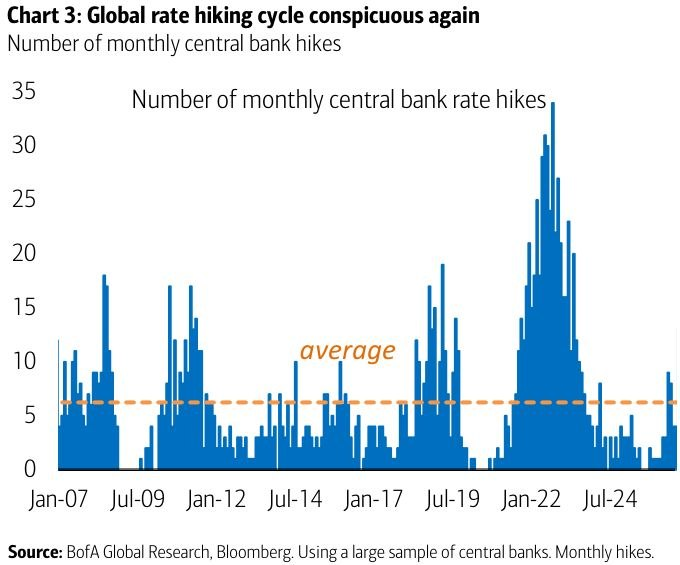

- 한·미·일의 12월 금리 인상 가능성을 가를 변수는 유가 추가 상승보다 누적 비용의 소비자물가 반영 속도
  - 유가 하락만으로 디스인플레이션을 기대하면 기업의 뒤늦은 가격 인상을 놓칠 위험
- 높은 원가와 금리를 견딜 현금흐름이 자산가격의 핵심 시험대
  - 비용 전가는 소비자의 실질구매력을 약화시키고, 전가 실패는 기업 마진을 훼손
- 일본 3분기 경제는 성장 정체 속 설비투자 증가와 가계 소비 부진이 엇갈림
  - 기업 투자는 소비 호황보다 인력 부족 대응, 자동화, 미래 생산능력 확보에 초점

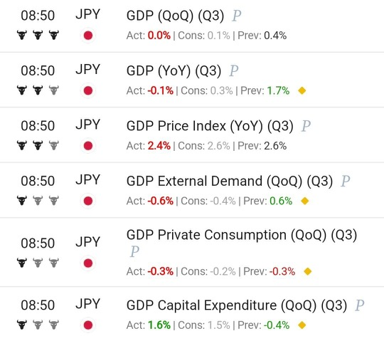

- 일본 GDP 부진은 BOJ의 추가 금리 인상 방향보다 인상 간격과 폭을 신중하게 조정할 요인
  - BOJ는 10월 전망에서 기조적 인플레이션이 2% 목표와 대체로 부합하는 수준에 도달했다고 평가
  - 1.75% 이상으로 향하는 인상 속도는 가계 소비 회복에 크게 좌우될 가능성
- 일본의 지속 가능한 정상화는 설비투자가 생산성과 임금을 높이고 실질소득 증가가 소비로 연결되는지에 달림
  - 기업 투자 정상화가 가계 구매력 회복보다 앞서 있어 소비의 후속 회복 확인이 필요

# KHwanK

### 비트코인 급락과 장기 바닥권 투자 조건

- 비트코인은 하락 13개월 차에 악재와 투매가 겹치며 장기 가치투자 관점의 바닥권에 접근했을 가능성
  - 영상 기준 11월 중 16% 하락하고 5주 연속 약세를 보였으며, 6만 2,000달러까지 밀린 뒤 6만 5,000달러 부근으로 반등
  - 6월 말에는 고점 대비 54% 하락했지만, 하락 기간이 9개월로 짧고 대규모 투매를 촉발할 사건도 부족했음
- 과거 하락장은 약 364~406일 지속됐고, 고점 이듬해 11월~1월에 최종 저점이 형성되는 패턴
  - 2014년 거래소 해킹, 2018년 비트코인캐시 분열, 2022년 FTX 파산처럼 큰 악재가 마지막 투매를 촉발
  - 이번에도 하락 기간과 악재 집중이 겹쳐 바닥 형성 조건에 가까워졌다는 해석
- 바이낸스 관련 손실과 미국 정치 변화가 직접 악재로, 위험자산 약세와 자금 유출이 추가 하락 압력으로 작용
  - 영상에서는 바이낸스 해킹 관련 63억 달러 손실, 7만 달러 이탈에 따른 연쇄 청산을 주요 충격으로 제시
  - 민주당의 상·하원 장악과 엘리자베스 워런의 상원 은행위원장 가능성은 규제 강화 우려 요인
  - 엔비디아·나스닥 약세, 5%를 넘는 금리, 스트래티지의 MSCI 퇴출에 따른 패시브 자금 감소, 2026년 현물 ETF 자금 유출도 부담
- 비트코인 200주 이동평균선과 채굴 원가 부근은 장기 저점 판단의 핵심 가격대
  - 2015년·2018년·2022년에는 200주선 부근 또는 그 아래에서 반등했고, 영상 기준 이번에도 200주선을 하향 이탈
  - 채굴 원가로 제시한 약 6만 달러에 근접했으며, 극심한 공포와 레버리지 청산도 바닥권 신호로 해석
- 하락 추세가 이어지는 만큼 추세 추종 전략의 진입 시점과 장기 가치투자의 매수 시점은 구분해야 함
  - 추세 추종은 상승 전환 확인이 필요하고, 장기 투자는 현재 가격대의 저평가 가능성에 주목
  - 과거 200주선 부근에서 반등한 뒤 약 3년간 상승했던 흐름이 장기 투자 논리의 근거
- 규제 강도가 높아져도 실물자산 토큰화와 스테이블코인, 인공지능 에이전트 결제의 확산은 장기 수요를 뒷받침할 가능성
  - 실물자산 토큰화는 국채·주식의 블록체인 이전과 24시간 거래로 금융 인프라를 확장
  - 스테이블코인은 미국 국채 수요를 늘리고, 에이전트 간 자동 결제 수단으로 활용될 여지
  - 초당적 법안 지지와 대통령 거부권, 중국과의 금융·기술 경쟁은 과도한 규제를 제약할 요인
- 바닥권 진입과 즉각적인 상승 전환은 별개이며, 6월 저점인 5만 8,600달러를 다시 깰 가능성도 열려 있음
  - 상승 재개까지 수주~수개월, 길게는 1년이 걸릴 수 있고 바닥권에서도 큰 변동성이 이어질 수 있음
  - 추가 하락과 장기 횡보를 견디기 위해 레버리지 사용 금지
- 장기 강세 전망의 중심은 3년 상승·1년 하락이 반복된다는 사이클 가설
  - 현재의 비관과 투매를 다음 상승 주기 직전의 마지막 정리 과정으로 해석하지만, 반복 여부는 확정되지 않음
- 매수 판단은 악재의 크기보다 장기 수요가 유지되는지와 추가 하락을 감당할 수 있는지에 달림
  - 공포가 극심해도 최저점이 확정되는 것은 아니므로 투자 기간과 자금 여력을 함께 점검
- 과거 사이클과 200주선은 바닥 후보를 찾는 참고 지표이며, 상승 재개의 확인과는 구분해야 함
  - 장기 투자 논리를 유지하더라도 ETF 자금 흐름과 규제 변화, 위험자산 유동성이 개선되는지 확인할 필요

# Kobeissi

- 기술주 공매도 쏠림과 변동성 확대로 숏스퀴즈 가능성과 급락 위험이 함께 커짐
  - QQQ 공매도 잔고는 발행주식의 11%로 2023년 이후 최고이며 연초보다 5%포인트 상승, 2022년 약세장 고점은 약 14%
  - Goldman Sachs 기준 헤지펀드 미국 기술주 롱·숏 비율은 1.5로 2016년 집계 이후 최저이며 6월보다 0.6 하락
  - 11월 Nasdaq 100 평균 일중 변동폭은 2.4%로 9월 1.0%의 두 배 이상, S&P 500도 1.6%로 확대

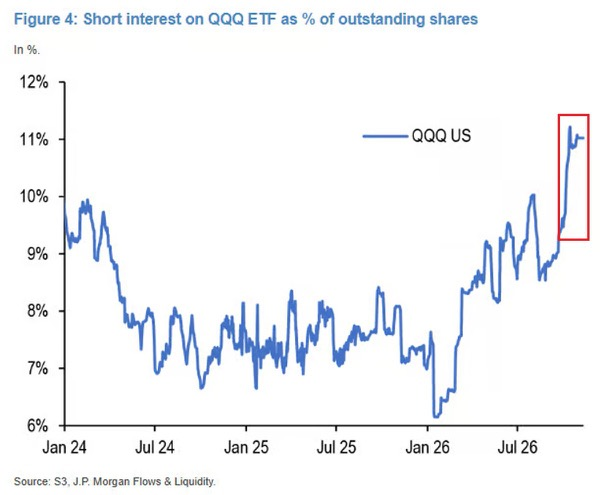

- Nvidia(NVDA)는 경영진 복귀 보도와 당국 발언에 급등락하며 이번 주 실적 발표가 핵심 변수로 부상
  - 6주 연속 하락하며 해당 기간 31% 하락, 10월 고점 이후 시가총액 약 1조9,000억 달러 감소
  - Jensen Huang 복귀 검토 보도에 Nasdaq 100 선물이 0.7% 상승했다가 반도체 매도로 1.7% 하락하고 NVDA도 160달러를 하회하며 5% 넘게 하락
  - 피드에 따르면 Bessent는 불법 판매 의혹과 회사 문화에 대한 이사회 답변을 10일 내 요구했고, 독립 조사 중 Huang 복귀를 추진하는 움직임도 보도됨
  - 이후 Trump가 Huang 복귀에 반대하지 않으며 Xi와 논의할 수 있다고 발언했다는 속보에 NVDA가 상승 전환
  - Nvidia 실적과 Anthropic IPO가 이번 주 기술주 주요 일정

- 미국 자동차 구매 여건은 차량가치보다 많은 대출 잔액과 높은 금융비용으로 악화
  - 2026년 3분기 신차 구매 보상판매의 29%가 초과부채 상태이며 평균 초과부채는 7,107달러로 역대 세 번째 규모
  - 기존 차 부채를 신규 대출에 합친 구매자의 평균 대출은 5만7,235달러로 2019년보다 44% 증가
  - 평균 연이율 8.1%, 총 이자 부담 1만6,610달러로 2019년보다 83% 증가

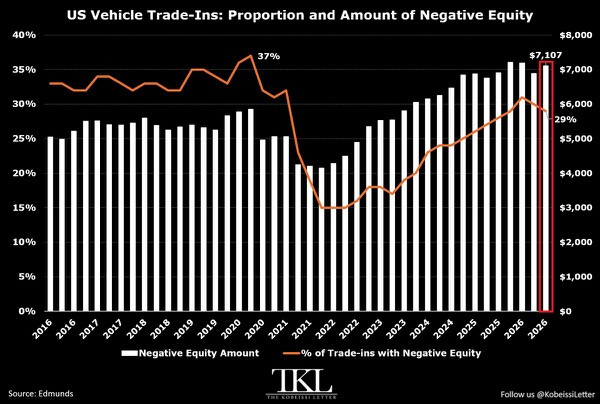

- AI 투자 확대 속 미국 기술기업의 채권 조달비용이 상승
  - 투자등급 기술채의 연초 이후 수익률은 전체 투자등급 회사채보다 9% 부진하며 상대 수익률은 최소 30년 내 최저
  - 국채 대비 스프레드는 전체 투자등급 회사채보다 15bp 높아 최소 14년 내 최대 격차, 2012~2025년에는 기술채 스프레드가 더 낮았음
  - 2026년 빅테크 채권 발행은 1,820억 달러로 사상 최대이며 2024년 170억 달러 대비 971% 증가

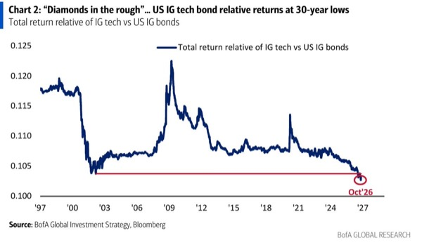

- 미국 신규 채용 공고는 감소세가 완만해졌어도 회복 신호가 부족
  - Indeed 신규 공고는 10월 16일 종료 주간 전년 대비 4.8%, 2022년 4월 대비 46.7% 감소
  - 2020년 2월보다도 0.8% 낮아 후행하는 BLS 구인 통계의 뚜렷한 반등을 기대하기 어려움

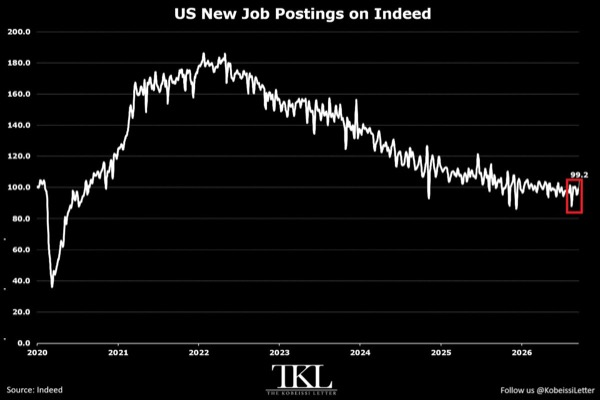

- 중국 인민은행의 금 매입 가속으로 공식 보유량이 사상 최대치 경신
  - 10월 26톤 매입은 2023년 8월 이후 최대이며 9월 23톤에 이어 24개월 연속 매입
  - 연초 이후 129톤을 추가해 총 2,435톤 보유, 세계 4위 보유국 프랑스와 격차는 2톤

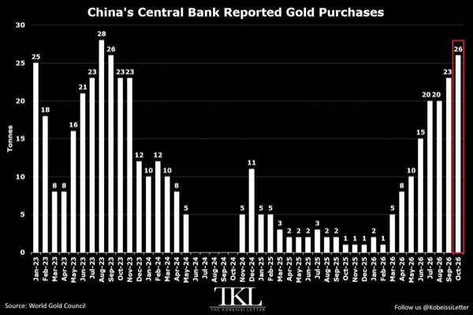

- 세계 기업이익 증가가 IT에 집중되며 AI 관련 실적 의존도가 높아짐
  - 2026년 MSCI ACWI 이익은 전년 대비 34% 증가 예상, IT가 증가분의 48%를 차지해 다음 7개 업종 합계와 같은 수준
  - 업종별 증가 기여도는 에너지 11%, 금융 10%, 통신 9%이며 IT 주당순이익 증가율은 88% 예상
  - 세계 EPS 감소 연도를 제외하면 단일 업종 이익 집중도는 최근 30년 중 2022년 에너지 위기에 이어 두 번째로 높을 전망

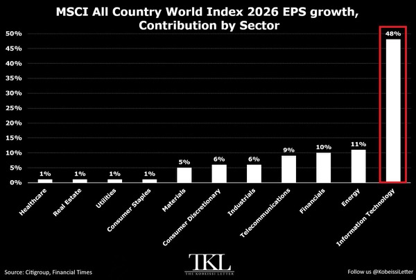

- 미국 소비심리는 역사적 저점권이지만 소매판매는 사상 최대를 기록하며 괴리 확대
  - 9월 소매판매는 0.8% 증가한 7,450억 달러로 최근 8개월 중 7개월 증가, 2년간 10% 확대
  - 10월 초 소비심리지수는 1.8포인트 하락한 46.3으로 역대 두 번째로 낮고 2년간 34% 하락
  - 저소득층과 주식 보유 규모가 작은 소비자에게서 심리 악화가 두드러짐

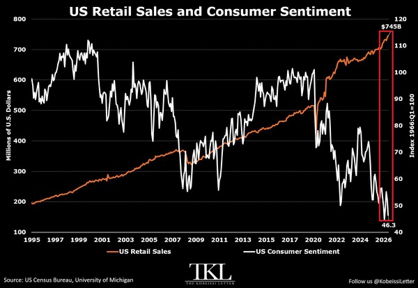

- 미국 상무부의 첨단 AI 칩·컴퓨팅 인프라 원격접속 제한으로 클라우드를 통한 수출통제 우회 경로 축소
  - 중국 등 통제 대상이 제한된 칩을 직접 수입하지 않고 미국의 첨단 연산 능력을 이용하던 경로가 규제 대상

# MKevin

### 엔비디아 복귀 기대와 고객 이탈 위험

- 영상은 젠슨 황의 사임·사생활 및 간첩 연루 의혹·복귀 협의를 전제로 엔비디아 반등 가능성을 분석하며, 해당 사건과 보도의 진위는 대본만으로 확인되지 않음
  - 복귀 확정 소식과 복귀 의향·협의 단계가 혼재하며, 이사회 승인과 조사 결과는 미해결 상태
- 주주 5만 명 이상의 청원과 일론 머스크·에픽게임즈 CEO 등 기술업계의 지지가 복귀 압력으로 작용
  - 실리콘밸리 경영진이 복귀 지원 조직을 꾸리고 백악관의 지지를 확보하려는 움직임도 거론됨
  - 정식 후임 선임 절차가 시작되지 않은 상태가 복귀에 유리하며, 새 CEO가 자리 잡으면 복귀 문턱이 높아짐
- 엔비디아의 기술 기반은 대규모 연구개발 조직이고, 젠슨의 핵심 가치는 기술 로드맵을 대형 고객의 구매 약속으로 연결하는 영업력
  - 대본상 직원 4만 2,000명 중 약 3만 2,000명이 연구개발에 종사
  - 고객 관계·맞춤형 제품 협의·경영진 간 신뢰가 장기 거래를 묶는 역할
- 젠슨의 부재는 고객의 AMD·구글 칩 검토를 촉진할 수 있음
  - 한 클라우드 업체는 이전에도 공급처 다변화를 검토했지만 젠슨과의 관계 때문에 주저했다는 보도가 인용됨
  - 고객 이탈 우려는 개인의 평판 문제를 매출과 시장점유율 문제로 확대
- 대본상 주가 162달러는 고점 239달러 대비 약 31.9% 하락한 수준이며, 최근 11% 급락도 복귀 압력을 키우는 요인
  - 추가 하락은 이사회의 대응 필요성을 높이는 동시에 집단소송의 손해배상 논쟁을 확대할 위험
  - 화자는 엔비디아·AMD를 모두 보유하며 엔비디아 하락을 매수 기회로 평가
- 복귀의 핵심 관문은 독립 조사에서 확인될 사실관계와 이사회에 대한 허위 진술 여부
  - 법무책임자 팀 티터에게 어떤 답변을 했는지, 이후 인정한 내용과 얼마나 다른지가 쟁점
  - Wachtell과 준 킴의 조사 결과에 따라 복귀 명분과 법적 부담이 달라질 수 있음
- 샘 올트먼의 복귀 사례는 CEO 복귀와 이사회 복귀가 서로 다른 일정으로 진행될 수 있음을 보여줌
  - 올트먼은 2023년 11월 17일 해임 후 5일 만에 CEO로 복귀했고, 독립 조사 이후 2024년 3월 8일 이사회에 복귀
  - BP의 2023년 사례처럼 이사회를 오도한 경영자가 복귀하지 못한 선례도 있어 결과를 단정하기 어려움
- 영상이 예상하는 독립 조사 기간은 3~5개월이며, 종료 시점은 2월 10일~4월 10일 무렵
  - 이사회 복귀는 조사 종료 뒤로 미뤄져도 CEO 복귀는 그보다 먼저 진행될 수 있다는 시나리오
- 간첩 의혹의 책임 소재와 가족 관련 불확실성도 복귀 과정의 변수
  - 하워드 러트닉에게 책임이 옮겨갈 가능성은 화자의 추측이며, 내부자거래 등 관련 의혹도 확인된 사실로 제시되지 않음
  - 배우자의 이혼·지분 매각 가능성 역시 확인되지 않은 가정
- 약 5,000억 달러의 향후 사업 약속과 보장, 2,790억 달러의 공급 약정이 영업 연속성 논쟁의 중심
  - 향후 구매 의향과 예비 합의는 확정 매출이나 당장 지급할 손실과 구분해야 함
  - 고객 약속이 취소되면 선행 공급 약정과 실제 수요 사이의 불일치가 커질 수 있음
- 향후 첨단 AI 연구소의 컴퓨팅 거래에서 엔비디아 비중이 39%로 낮아진다는 수치만으로 매출 감소를 단정하기 어려움
  - 대본이 비교한 2023~2025년 점유율은 약 80%지만, 향후 전체 시장과 투자 약정 규모도 크게 확대
  - 더 큰 시장에서의 점유율 하락은 절대 매출 증가와 동시에 나타날 수 있음
- AMD GPU로 모델을 옮기는 시간이 6~12개월에서 3일로 줄었다는 내용은 적용 범위를 확인해야 함
  - 화자는 해당 수치가 앤스로픽의 홍보 내용에서 나왔으며 입력 처리 단계에 한정되고, 디코딩이나 전체 모델 운용 성능을 입증하지 못한다고 반박
  - 독립 검증과 구체적인 작업 범위가 제시되지 않아 CUDA의 경쟁 우위가 사라졌다는 결론으로 확대하기 어려움
- 후임 후보로 ARM의 르네 하스와 엔비디아 소프트웨어 사업의 이언 벅이 거론됨
  - 영상에 제시된 예측시장에서 젠슨의 차기 CEO 확률은 13%, 거래량은 약 970만 달러이며 화자는 시장보다 복귀 가능성을 높게 평가
- 복귀 기대에 따른 주가 반등과 고객 구매 약속의 실제 유지 여부를 함께 확인할 필요
  - 복귀 의향·이사회 승인·독립 조사·확정 계약 전환은 각각 별개의 관문
- 엔비디아의 투자 논리는 경영진 개인의 영업력, 연구개발 역량, CUDA 전환 비용을 나눠 평가해야 함
  - 젠슨 복귀만으로 법적 위험이나 경쟁사의 기술 발전이 사라지지는 않으며, 경쟁 칩 도입도 곧바로 엔비디아 매출 감소를 뜻하지 않음

# PBoyle

### 엔비디아의 창업자 의존과 인공지능 금융의 취약성

- 원문상 젠슨 황의 갑작스러운 퇴진으로 엔비디아의 창업자 의존, 수출통제, 이사회 감독, 고객 금융지원 위험이 동시에 부각
  - 10월 말 첫 의혹 보도 이후 주가가 20% 이상 하락하고 시가총액 약 1조1,000억 달러 감소
  - 시가총액 약 4조 달러, S&P 500 비중 약 7%인 기업의 경영 공백이 인공지능 산업 전반으로 파급
- 앨리스 황과의 관계는 사생활 문제를 넘어 기술 보안과 투자자 공시 문제로 확대
  - 미국 정보기관의 중국 정보기관 연계 의혹과 별개로, 앨리스 황은 기소되지 않았고 중국은 간첩 혐의를 부인
  - 엔비디아는 통상적인 고객 접촉이라며 해명했지만, 이후 황의 혼외관계 인정과 추가 임직원 관계 보도가 이어짐
  - 사생활 자체보다 회사의 부정확한 해명과 투자자 오도가 주주 소송 위험을 키움
- 중국의 첨단 반도체 접근은 직접 수입뿐 아니라 해외 데이터센터 임대로도 가능
  - 싱가포르 메가스피드는 말레이시아 데이터센터에서 알리바바 등 중국 고객에 연산 자원을 임대
  - 원문에서 해당 해외 임대 구조는 합법이며, 바이든 행정부가 마련한 제한안은 2025년 5월 시행 전 트럼프 행정부가 폐기
  - 중국 반입 금지와 해외 연산 자원 이용 제한은 서로 다른 규제 영역
- 메가스피드의 자금력과 실질 소유구조는 대규모 장비 구매를 설명하기에 불투명
  - 2023년 말 계좌 자금 약 570만 달러에 비해 이후 2년간 엔비디아 장비 수입액은 46억 달러 이상
  - 알리바바가 말레이시아 사업 전체를 담보로 선급금을 제공했지만 나머지 자금 출처는 미확인
  - 소유권 이전 나흘 뒤 엔비디아 공식 클라우드 파트너로 지정돼 희소한 장비에 우선 접근
- 판매자가 고객의 수출통제 준수 여부까지 감사하는 구조에는 이해상충이 존재
  - 엔비디아는 현장 점검에서 장비가 모두 존재한다고 보고했지만, 블룸버그의 무역자료 대조에서는 칩 약 5만 개의 행방에 불일치 발생
  - 엔비디아는 2025년 6월 메가스피드를 내부 차단 목록에 올렸다고 밝혔으나, 5개월 뒤에도 약 7억8,700만 달러 규모 칩 1만7,544개가 수입된 것으로 원문에 제시
  - 엔비디아는 위반을 발견하지 못했고 미국 정부도 거래 중단을 요구하지 않았다는 입장
- 칩 밀수는 장비를 숨기는 기술보다 통관서류와 유통망 조작에 의존
  - 수출제한 서버를 어댑터 모듈로 신고하거나 상자에서 일련번호를 제거한 사례가 등장
  - 메가스피드 투자자료의 시설 이미지, 상하이 데이터센터, 유사한 웹사이트와 금지 칩 관련 채용공고가 연결 정황으로 제시
  - 중국 중앙은행 신용등록 문서에는 해당 상하이 시설의 제한 대상 서버를 대출 담보로 설정한 기록이 등장
  - 메가스피드는 밀수를 부인하며 원문상 미국 법무부 수사 대상도 엔비디아가 아닌 메가스피드
- 수출통제 강화는 엔비디아의 판매 경로를 줄이고 중국산 반도체의 대체 수요를 확대
  - 미국 의회의 초당적 법안 3건과 해외 칩 임대 규제 강화가 추가 제약으로 부상
  - 중국 인공지능 관련주는 약세를 보인 반면 자체 조달 수혜가 예상된 캠브리콘 등 반도체주는 해당 주간 20% 이상 상승
  - 규제와 미중 무역 협상 사이의 충돌로 정부의 집행 의지도 불확실
- 황에게 약 60명의 임원이 직접 보고하는 조직은 빠른 정보 수집에 강하지만 승계에는 취약
  - 직원들이 보내는 핵심 업무 이메일을 하루 약 100개 읽는 방식으로 사업 정보를 직접 통합
  - 인공지능 기회를 조기에 포착하는 데 유리했지만 경영 체계가 한 사람에게 집중
  - 원문상 지정된 후계자가 없어 갑작스러운 퇴진 이후 승계 준비가 나흘로 압축
- 시가총액 1조1,000억 달러 감소는 황 개인의 경영 능력 상실만으로 설명하기 어려움
  - 정부의 불신, 고객의 경쟁사 분산, 규제 비용, 후임 경영진의 수습 부담이 함께 반영
  - 창업자의 가치는 개인의 존재뿐 아니라 자신 없이도 작동하는 조직을 만들었는지에 달림
- 이사회의 장기 재임과 전문성 부족은 창업자 견제를 약화
  - 이사 평균 재임 약 15년으로 S&P 500 평균의 약 두 배이며, 현직·전직 S&P 500 최고경영자 출신은 부재
  - 외부 이사회 평가에서 약 650개 기업 중 609위로 제시됐고 공식 준법감시책임자도 부재
  - 첫 이사회 의장으로 선임된 하비 존스는 1993년부터 재임한 황의 오랜 멘토로, 인적 쇄신 효과는 제한적
- 창업자 가족의 사내 역할과 고객 금융지원 관여에는 독립적인 감독이 필요
  - 황의 딸과 아들, 사위가 엔비디아에 근무하며 사위는 고객 금융보증 프로그램 운영에 관여
  - 가족 채용 자체보다 보상과 거래, 금융 위험에 이사회가 이의를 제기할 수 있는지가 핵심
- 엔비디아는 인공지능 장비 공급자를 넘어 고객의 구매 능력까지 지원하는 금융 중개자로 확대
  - 원문상 7월 말까지 지분투자 규모 1,240억 달러, 평균 약 2.5일마다 신규 거래 체결
  - 고객 투자, 대출 보증, 임대 지원이 다시 엔비디아 칩 구매로 연결돼 판매 실적과 고객 신용 위험이 결합
  - 단순한 반도체 수요뿐 아니라 거래 상대방의 상환 능력과 담보 가치가 중요해짐
- 콜레트 크레스의 재무 통제 강화는 공격적인 고객 금융지원의 속도를 낮출 가능성
  - 오픈AI 오하이오 데이터센터에 대한 2,500억 달러 지원 검토 보도 다음 날 주가가 5% 하락해 약 2,500억 달러의 시가총액 감소
  - 크레스는 최초 지원 약정을 절반으로 줄였고, 일부 신용지원 계약은 중단되거나 고위 경영진·이사회 승인 대상으로 전환
  - 금융지원의 전면 중단보다 담보 평가, 거래 선별, 수익성 심사 강화가 핵심 변화
- 엔비디아의 자금 공급 축소는 고객별 자금조달 능력 차이를 확대
  - 코어위브 같은 신생 클라우드 업체는 장비 확보와 차입 여건 변화에 민감
  - 독자적인 투자 수요가 충분한 기업은 엔비디아 지원 축소의 충격을 상대적으로 덜 받을 수 있음
- 엔비디아 가치 평가에는 칩 성능과 매출 성장뿐 아니라 고객 자금의 출처, 보증 약정, 실제 최종 사용처를 함께 반영할 필요
  - 공급자 금융이 만든 매출은 최종 고객의 독립적인 지불 능력이 뒷받침하는 수요와 구분할 필요
- 수출통제가 강화될수록 중국 매출 축소와 중국산 경쟁사의 성장이라는 이중 압력이 커질 수 있음
  - 단기 공급 차질이 장기적인 기술 자립 투자로 이어지면 규제 완화만으로 기존 시장 지배력을 되찾기 어려움
- 인공지능 산업의 안정성은 모델 통제뿐 아니라 승계 계획과 이사회 독립성, 준법감시, 금융지원 한도에도 달림
  - 창업자 개인의 판단에 집중된 권한을 조직의 검증과 승인 절차로 분산해야 사업 위험의 연쇄 전이를 줄일 수 있음

# Slav

- 이용자 3,000만 명 규모의 금융앱 토스가 이더리움·테더·USDC 송수신을 지원하는 코인지갑 출시 소식

# Stockbot

- Nvidia(NVDA)는 Jensen Huang 복귀 논의와 정치권 발언에 주가 민감도가 높아짐
  - FT 인용 보도에 따르면 이사회의 독립 조사 중 Huang이 CEO 복귀를 검토하고 기술기업 경영진이 이사회에 복귀를 압박
  - Trump가 복귀에 반대하지 않으며 Xi와 Nvidia 사안을 논의할 수 있다고 발언했다는 속보 이후 주가가 낙폭을 지우고 상승 전환

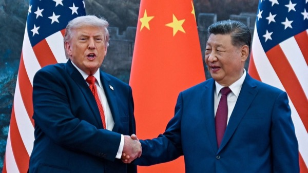

- 이번 주 핵심 변수는 화요일 10월 소매판매와 Nvidia 실적, 수요일 연준 의사록
  - 소매판매 약세는 성장·금리 기대를 낮출 수 있고 Nvidia 가이던스는 기술주 방향을 좌우할 가능성
  - 연준 의사록은 향후 금리 경로 재평가의 계기

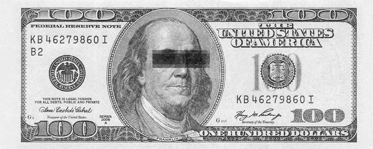

- 연준 인사 발언이 채권금리와 정책 기대의 변동성을 키울 가능성
  - 월요일 Warsh 연준 의장 연설을 포함해 주간 총 15차례 발언 예정
  - 비둘기파 발언은 금리 기대를 낮추고 매파 발언은 수익률 상승을 유발할 수 있음
- 주택·제조업·소비심리 지표로 미국 성장세와 물가 기대를 점검할 필요
  - 수요일 10월 잠정주택판매, 목요일 11월 필라델피아 연은 제조업 지수 발표 예정
  - 금요일 11월 미시간대 소비심리·기대인플레이션 발표 예정이며 소비심리 약화는 지출 우려, 기대인플레이션 하락은 금리 완화 기대를 자극할 가능성
- 미국 상무부가 첨단 AI 칩과 컴퓨팅 인프라 원격접속을 제한해 클라우드 수출통제 우회를 차단
  - 중국 등 통제 대상이 제한된 칩을 수입하지 않고 미국의 첨단 연산 능력을 활용하던 경로를 겨냥
- SpaceX가 궤도 복귀 후 Starship 포착에 성공했다는 소식
  - 11월 13일 텍사스 Starbase에서 발사했으며 발사 22.5시간 후 Starship이 귀환

# YDental

### 비트코인 급반등보다 매도 소진과 저점 재시험 확인

- 비트코인 6만 달러대 진입과 첫 급반등만으로 중기 바닥을 확정할 수 없음
  - 매도 진정 → 매도 압력이 줄어든 저점 재시험 → 회복한 가격의 지지 전환 순서로 확인
  - 11월 15일 브리핑 복기 기준이며 당시 가격대를 현재 진입 신호로 적용하면 안 됨
- 미국 비트코인 현물 ETF에서 11월 9~13일 약 10.7억 달러 순유출, 2주 연속 주간 유출 10억 달러 초과
  - 금리 인상 우려와 약한 현물 수급 속에서는 단기 반등만으로 매수 수요 회복을 단정하기 어려움
  - 금리 인상 예상과 실제 정책 확정은 구분하고, 자금 유출 진정과 가격 지지를 함께 확인
- 7만 달러 이탈 뒤 반등 고점은 낮아지고 저점은 계속 깨지는 약세 구조 지속
  - 6만 7,400달러 지지 실패 후 토요일 저가 약 6만 5,800달러, 일요일 오전 거래소별 6만 1,900~6만 2,200달러까지 하락
  - 숏 인증 두 화면은 동일 진입가의 서로 다른 시점이며, 표시 수익률은 150배 레버리지 포지션 기준으로 계좌 전체 수익률이나 확정 수익이 아님
- 중장기 관심 구간 6만 1,500~6만 4,700달러는 하모닉 샤크 비율·깊은 되돌림·과거 수요 구간이 겹치는 영역
  - 지지 보장 구간이 아니라 도착 후 가격과 거래량으로 매수 대응을 확인할 관찰 구간
  - 일요일 저점은 관심 구간에 진입했지만 매도 소진과 반전 확인은 별도 과제
- 일요일 한 시간 만에 6만 5,000달러 위로 반등한 뒤 오후 6만 3,700달러, 저녁 6만 6,100달러, 마감 무렵 6만 4,600달러로 급등락 반복
  - 6만 3,700달러의 높은 저점은 긍정적이지만 명확한 매도 소진과 재시험을 확인하기에는 근거 부족
- 추가 하방 시험 영역은 6만 800~6만 2,500달러, 아래 확인 가격은 약 6만 500달러와 6만 달러
  - 이탈 후 회복하지 못하면 7월 저점 5만 7,700~5만 8,600달러까지 관점 재검토
  - 청산 히트맵은 모델이 추정한 청산 집중 구간으로, 실제 주문 전체나 필수 도달·반등 가격을 뜻하지 않음
- 매도 클라이맥스인 SC는 거래량 급증보다 대량 매도 이후 하락 진정과 반등 여부가 핵심
  - 거래량이 커져도 가격이 계속 밀리면 매도 우위 지속 가능
  - 저점 재시험인 ST에서는 이전보다 매도 압력이 줄고 가격이 쉽게 밀리지 않아야 함
- 반등 판단을 강화하려면 6만 3,700달러 재시험에서 버티고, 6만 6,100~6만 7,400달러를 회복한 뒤 지지로 전환해야 함
  - 작은 박스 상단 회복 후 눌림 지지, 매도 압력 감소, 현물 수급 개선을 함께 확인
  - 재시험 때 매도량이 늘고 가격이 더 쉽게 밀리면 바닥 확인 근거 약화
  - 6만 800달러·6만 달러 이탈 후 빠른 회복과 해당 가격 아래에서 반등이 막히는 상황을 구분
- 바닥 미확인은 숏 추격 근거가 아니며, 중장기 관심 구간에서는 반등 폭도 커질 수 있음
  - 롱·숏 모두 실패 시 청산 기준을 먼저 정하고 명확한 단기 범위 안에서 손익비 판단
- 바닥 가격을 먼저 맞히기보다 지지 후보가 실제 지지로 바뀌는 과정을 확인하는 편이 자금 보전에 유리
  - 5만 7,000~8만 7,000달러의 큰 범위도 축적·재분배라는 이름보다 저점 유지와 회복 구간의 지지 여부로 평가
- 급반등을 놓칠 불안보다 매도 진정·재시험·회복 가격 유지라는 조건을 우선하면 추격 진입을 줄일 수 있음
