# GStephan

### 대형주 쏠림을 줄이고 자산 보전으로 전환

- 최근 수년간의 상승을 영구적인 흐름으로 받아들이면 자산 집중 위험을 놓치기 쉬움
  - 2011년부터 로스앤젤레스 부동산 가격과 임대료가 오르자 신규 자금을 거의 전부 재투자했지만, 여러 건물과 세입자가 있어도 반경 5마일 내 한 도시·한 자산군에 집중된 구조였음
  - 2019년 Kevin O’Leary의 지적 이후 분산을 준비했고, 코로나 급락기에 부동산 매수용 현금을 주식에 투입한 뒤 약 6년간 매월 투자
  - 당시 저점 매수는 실력보다 운의 영향이 컸으며, 부동산 집중을 유지했다면 이후 지역 시장 부진으로 수백만 달러의 손실에 노출됐을 가능성
- S&P 500도 상위 기업에 대한 실질 노출을 점검해야 함
  - 대본 기준 상위 10개 기업 비중은 약 37%로 2017년의 24%보다 높아졌으며, 지수 투자금의 3분의 1 이상이 같은 기업들에 집중
  - 상위 기업의 성장이 이어지면 수익에 유리하지만, 이들이 흔들릴 때 나머지 490개 기업만으로 충격을 상쇄하기 어려움
- AI의 성공과 AI 관련 주식의 투자 수익은 별개
  - 핵심 위험은 기술 자체의 실패보다 수천억 달러의 투자비를 정당화할 수익이 나오지 않는 것
  - 인터넷은 세상을 바꿨지만 Cisco 주가는 닷컴버블 이후 약 90% 하락했고, 대본에서는 2000년 수준 회복에 25년이 걸린 사례를 제시
  - 기술과 기업의 미래를 맞혀도 매입 가격이 과도하면 장기간 손실을 볼 수 있음
- 자산이 커지고 생활 목표가 달라지면 수익 극대화보다 보전·유연성·심리적 안정의 비중을 높일 필요
  - 26세 때 감수할 수 있었던 위험이 현재에도 적절한 것은 아니며, 5년 전의 투자 방식을 목적 확인 없이 반복하면 목표와 포트폴리오가 어긋날 수 있음
  - 장기 하락장에서도 보유를 지속할 수 있는지 시장이 안정적일 때 점검
- Graham Stephan의 현재 자산 구성은 미국·해외 저비용 인덱스펀드 중심이며, 지방채 약 15~20%, 비트코인 ETF 약 10%, 그 밖에 개인 부동산과 수집품을 보유
  - 면세 지방채의 제시 수익률은 3.5~4%이며, 과세 계좌에서 비교적 안정적인 소득을 확보하려는 목적
- 신규 투자금은 해외 자산과 채권으로 더 배분해 미국 대형주 의존도를 낮추는 방향
  - S&P 500을 유지하면서 해외 자산 비중을 조금 높이고, 가격이 크게 하락한 지방채에도 추가 투자
  - 시장 예측이나 지수 초과수익보다 변동성을 줄이는 데 초점을 두며, 시장 수익률에 다소 뒤처지는 결과도 수용
- 현금은 장기 하락장에서 생활과 추가 매수를 지속할 수 있을 만큼 확보
  - 급락 때도 계속 매수할 계획이 있어도 실제 평가손실은 기분과 판단에 영향을 줄 수 있음
  - 시장을 다루는 업무와 잦은 계좌 확인이 겹치는 만큼, 일상에 영향을 덜 주는 자산 구성을 선호
- 비트코인 ETF는 현재 목적에 비해 비중이 높아 추가 매수를 중단
  - 기존 보유분을 매도하기보다 다른 자산에 신규 자금을 넣어 시간이 지나며 상대 비중을 낮추는 방식
- 투자 초기에는 시간·저축률·꾸준한 투자가 핵심이며, 자산 보전 중심의 배분을 그대로 복제할 필요는 없음
  - 자산 축적기에는 매번 조정을 피하려는 시도보다 지속적인 저축과 변동성을 견디는 능력이 더 중요
  - 자산 규모와 사용 시점에 따라 감수할 위험을 달리 설정
- 2027년 전 모든 계좌를 합산해 같은 기업·자산·지역에 얼마나 중복 노출됐는지 확인
  - 여러 계좌와 펀드를 보유해도 동일한 대형주, 단일 종목, 한 도시의 부동산에 위험이 몰릴 수 있음
  - 하락장 매수 여부와 필요한 현금, 보유 지속 조건을 미리 정하고 신규 자금의 배분 방향까지 설정
- 분산 수준은 보유 상품 수보다 함께 하락할 수 있는 위험 요인의 중복으로 평가해야 함
  - 계좌별 잔액보다 전체 자산을 관통하는 기업·지역·자산군 노출을 보는 것이 중요
- 포트폴리오 조정은 전량 매도 없이 신규 자금의 흐름만 바꿔도 점진적으로 가능
  - 최고 수익률보다 하락장에서 실제로 유지할 수 있는 구조를 선택해야 장기 투자 계획이 지속됨

# Harvey

- 2026년 미국 규모 상위 IPO 10건의 주가가 공모가 대비 평균 20.5% 하락
  - 상장 초기 프리미엄 소멸 이후에는 조달 자금을 주당 가치 성장으로 연결하는 기업과 추가 자금 조달에 의존하는 기업의 성과가 갈릴 것
  - 공모가보다 현재 기업가치와 향후 필요 자본을 함께 고려해 기존 주주에게 남을 가치를 계산해야 함

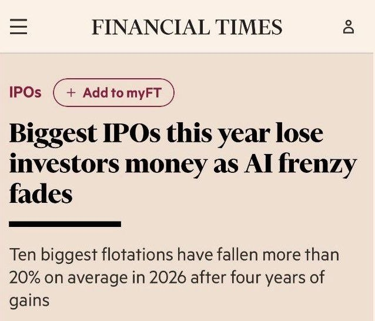

- 앤트로픽 상장의 투자 성과는 AI 성장 자체보다 공모가격과 향후 주주에게 귀속될 가치에 달림
  - 대규모 신주 발행으로 자금 여력이 늘어도 미래 성공이 공모가에 과도하게 반영되면 사업 성장과 투자 수익률이 엇갈릴 수 있음
- 달러당 160엔은 일본의 물가·금리·외환 수급 변화로 설명 가능한 수준
  - 미즈호 모형의 추정 환율은 163.70엔이며, 2022년 이후 일본의 기대인플레이션 상승이 엔저에 크게 기여
  - 과거 100~120엔만 기준으로 과도한 엔저를 판단하기 어려우며 일본의 물가 기대, 미국 금리, 실제 엔화 환전 수급을 함께 봐야 함
  - 미즈호는 7월 미국의 협조 배경을 일본 장기금리 상승과 엔저가 미국 국채시장까지 불안하게 만들 가능성으로 해석

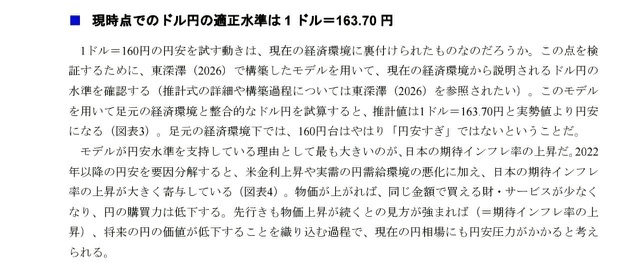

# KHwanK

### 비트코인 급락과 장기 바닥권 투자 조건

- 비트코인은 하락 13개월 차에 악재와 투매가 겹치며 장기 가치투자 관점의 바닥권에 접근했을 가능성
  - 영상 기준 11월 중 16% 하락하고 5주 연속 약세를 보였으며, 6만 2,000달러까지 밀린 뒤 6만 5,000달러 부근으로 반등
  - 6월 말에는 고점 대비 54% 하락했지만, 하락 기간이 9개월로 짧고 대규모 투매를 촉발할 사건도 부족했음
- 과거 하락장은 약 364~406일 지속됐고, 고점 이듬해 11월~1월에 최종 저점이 형성되는 패턴
  - 2014년 거래소 해킹, 2018년 비트코인캐시 분열, 2022년 FTX 파산처럼 큰 악재가 마지막 투매를 촉발
  - 이번에도 하락 기간과 악재 집중이 겹쳐 바닥 형성 조건에 가까워졌다는 해석
- 바이낸스 관련 손실과 미국 정치 변화가 직접 악재로, 위험자산 약세와 자금 유출이 추가 하락 압력으로 작용
  - 영상에서는 바이낸스 해킹 관련 63억 달러 손실, 7만 달러 이탈에 따른 연쇄 청산을 주요 충격으로 제시
  - 민주당의 상·하원 장악과 엘리자베스 워런의 상원 은행위원장 가능성은 규제 강화 우려 요인
  - 엔비디아·나스닥 약세, 5%를 넘는 금리, 스트래티지의 MSCI 퇴출에 따른 패시브 자금 감소, 2026년 현물 ETF 자금 유출도 부담
- 비트코인 200주 이동평균선과 채굴 원가 부근은 장기 저점 판단의 핵심 가격대
  - 2015년·2018년·2022년에는 200주선 부근 또는 그 아래에서 반등했고, 영상 기준 이번에도 200주선을 하향 이탈
  - 채굴 원가로 제시한 약 6만 달러에 근접했으며, 극심한 공포와 레버리지 청산도 바닥권 신호로 해석
- 하락 추세가 이어지는 만큼 추세 추종 전략의 진입 시점과 장기 가치투자의 매수 시점은 구분해야 함
  - 추세 추종은 상승 전환 확인이 필요하고, 장기 투자는 현재 가격대의 저평가 가능성에 주목
  - 과거 200주선 부근에서 반등한 뒤 약 3년간 상승했던 흐름이 장기 투자 논리의 근거
- 규제 강도가 높아져도 실물자산 토큰화와 스테이블코인, 인공지능 에이전트 결제의 확산은 장기 수요를 뒷받침할 가능성
  - 실물자산 토큰화는 국채·주식의 블록체인 이전과 24시간 거래로 금융 인프라를 확장
  - 스테이블코인은 미국 국채 수요를 늘리고, 에이전트 간 자동 결제 수단으로 활용될 여지
  - 초당적 법안 지지와 대통령 거부권, 중국과의 금융·기술 경쟁은 과도한 규제를 제약할 요인
- 바닥권 진입과 즉각적인 상승 전환은 별개이며, 6월 저점인 5만 8,600달러를 다시 깰 가능성도 열려 있음
  - 상승 재개까지 수주~수개월, 길게는 1년이 걸릴 수 있고 바닥권에서도 큰 변동성이 이어질 수 있음
  - 추가 하락과 장기 횡보를 견디기 위해 레버리지 사용 금지
- 장기 강세 전망의 중심은 3년 상승·1년 하락이 반복된다는 사이클 가설
  - 현재의 비관과 투매를 다음 상승 주기 직전의 마지막 정리 과정으로 해석하지만, 반복 여부는 확정되지 않음
- 매수 판단은 악재의 크기보다 장기 수요가 유지되는지와 추가 하락을 감당할 수 있는지에 달림
  - 공포가 극심해도 최저점이 확정되는 것은 아니므로 투자 기간과 자금 여력을 함께 점검
- 과거 사이클과 200주선은 바닥 후보를 찾는 참고 지표이며, 상승 재개의 확인과는 구분해야 함
  - 장기 투자 논리를 유지하더라도 ETF 자금 흐름과 규제 변화, 위험자산 유동성이 개선되는지 확인할 필요

### 비트코인 바닥권 신호와 장기 매수 논리

- 비트코인은 13개월 하락, 대형 악재, 극단적 공포가 겹치며 장기 가치투자 관점의 바닥권에 진입했을 가능성
  - 11월 15일 17시 촬영 기준 6만 2,000달러까지 하락한 뒤 약 6만 5,000달러로 반등
  - 11월 들어 약 16% 하락하고 5주 연속 약세, 이더리움·솔라나·리플·도지도 동반 급락
- 과거 하락장은 약 364~406일 이어졌고, 최종 저점은 고점 다음 해 11월~1월에 형성
  - 이번 하락은 전년 10월 6일부터 약 13개월 진행돼 과거 저점 형성 시기와 유사
  - 6월 말 반등은 하락 기간이 약 9개월이고 낙폭도 약 54%에 그쳐 최종 바닥으로 보기에는 이른 구간
- 과거 최종 저점에는 시장의 마지막 희망을 꺾는 대형 악재와 투매가 동반
  - 2014년 거래소 해킹, 2018년 비트코인·비트코인캐시 분열 이슈, 2022년 FTX 파산이 대표 사례
  - 6월 말에는 뚜렷한 투매 계기가 없었지만 최근에는 여러 악재가 겹치며 마지막 청산 국면이 형성될 가능성
- 영상에서 제시한 직접 악재는 바이낸스 해킹에 따른 63억 달러 손실과 민주당의 상·하원 장악
  - 비트코인 7만 달러 붕괴와 레버리지 청산이 하락 압력을 확대
  - 엘리자베스 워런의 상원 은행위원장 가능성과 공화당보다 강한 가상자산 규제 우려가 투자심리를 위축
- 위험자산 자금 이탈과 매수 여력 약화도 하락 압력을 가중
  - 영상은 젠슨 황 관련 논란과 엔비디아 약세, 5%를 넘는 금리, 스트래티지의 MSCI 퇴출, 2026년 현물 ETF 자금 유출을 추가 악재로 제시
  - 나스닥에서 위험자산 자금이 빠지면 코인도 동반 약세를 보일 수 있고, 패시브 자금 유입 감소는 스트래티지의 비트코인 추가 매수 여력을 제약
- 비트코인의 200주 이동평균선 하회는 과거 대바닥 구간과 겹치는 가격 신호
  - 2015년·2018년·2022년에는 200주선 부근이나 그 아래에서 저점을 형성한 뒤 반등
  - 영상에서 제시한 채굴 원가는 약 6만 달러로, 최근 가격이 이 수준에 근접
  - 공포·탐욕 지수의 극단적 공포와 대규모 청산도 저점권 판단을 뒷받침
- 하락 추세가 이어지고 있어 추세추종 매수 신호는 아직 부재
  - 장기 가치투자에는 매력적인 가격대지만, 즉시 반등하는 정확한 저점을 의미하지는 않음
  - 실제 상승 전환까지 몇 주~몇 달, 길게는 1년이 걸릴 수 있음
- 규제 강화에도 실물자산 토큰화와 스테이블코인, 인공지능 에이전트 결제의 성장 동력은 지속될 가능성
  - 월가의 국채·주식 토큰화와 24시간 거래 확대는 금융 인프라의 변화
  - 스테이블코인은 미국 국채 수요를 만들고 에이전트 간 자동결제 수단으로 확장될 가능성
  - 지니어스 액트 등 초당적 입법 지지와 중국과의 금융·기술 경쟁은 전면 규제를 제약하는 요인
- 장기 상승 논리는 과거의 3년 상승·1년 하락 사이클이 반복된다는 전제에 의존
  - 최근 악재와 공포가 다음 상승장 전 마지막 투매일 수 있지만, 6월 저점인 5만 8,600달러를 다시 깰 가능성도 존재
  - 바닥권에서도 급락과 반등이 반복될 수 있어 레버리지 사용 금지
- 저평가 판단과 매수 시점 판단을 구분할 필요
  - 장기 투자자는 추가 하락과 긴 대기 기간을 감당할 수 있는지가 중요하고, 추세추종 투자자는 상승 전환 확인이 필요
- 바닥권 판단은 단일 악재보다 하락 기간·200주선·투매·자금 흐름을 함께 점검해야 함
  - 과거 사이클과의 유사성만으로 저점을 확정할 수 없으며, 장기 산업 성장도 단기 가격 회복을 보장하지 않음

# Kobeissi

- 글로벌 기업용 AI 시장은 2025년 315억 달러에서 2030년 1,552억 달러로 393% 성장 전망
  - AI 도입이 실험에서 전사적 실행으로 이동하며 업무별 맞춤화, 비용 효율, 통제력이 중요해짐

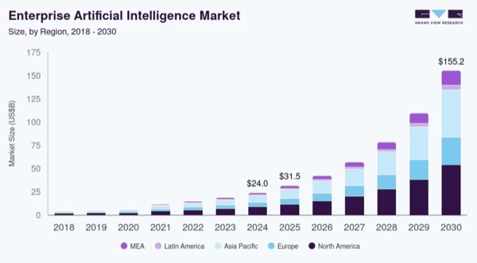

- 미국 기업의 AI 지출과 도입률이 함께 상승하지만 기업 간 지출 격차도 큼
  - Ramp 기준 10월 직원당 AI 지출은 상위 1% 기업 10,199달러, 상위 10% 801달러, 중위 기업 16달러로 각각 1월 대비 3배 이상·180%·164% 증가
  - 상위 1%의 직원당 지출은 일반 기업의 약 625배이며 AI 도입률은 1월 45.5%에서 10월 56.8%로 상승

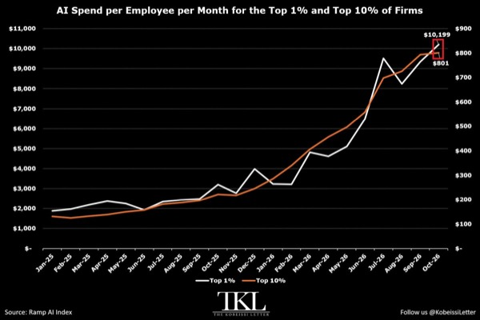

- 미국 가계의 학자금·자동차·신용카드 대출 연체 부담이 확대
  - 2026년 3분기 학자금 대출 심각 연체율은 전분기 대비 0.3%포인트 오른 10.9%로 2019년 4분기 이후 최고이며 4개 분기 연속 상승
  - 자동차 대출 90일 이상 연체율은 0.2%포인트 오른 5.7%로 역대 최고이며 금융위기 이후 고점인 2010년 4분기 5.3%를 상회
  - 신용카드 90일 이상 연체율은 12.9%로 2011년 1분기 이후 두 번째로 높은 수준

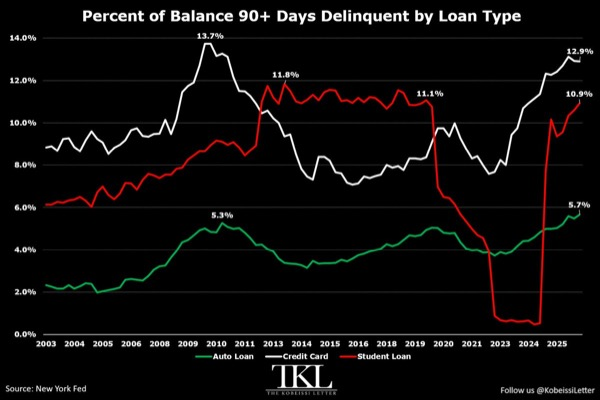

- 엔비디아($NVDA)의 젠슨 황 복귀 불확실성과 지배구조 갈등이 주가와 기술주 시장을 압박
  - CNBC의 이사회 복귀 검토 부인 보도 이후 주가는 장중 저점을 경신해 10월 6일 고점 대비 34% 하락했고 Nasdaq 100의 당일 하락률은 2.3%로 확대
  - 회사는 국가안보·수출통제 감독위원회를 설치하고 독립 외부 전문가를 활용해 국가안보와 국제 무역 준법 프로그램을 감독할 계획
  - WSJ에 따르면 고위 직원들은 황의 CEO 복귀가 무산되면 대체 불가능한 인재를 잃을 수 있다고 이사회에 경고

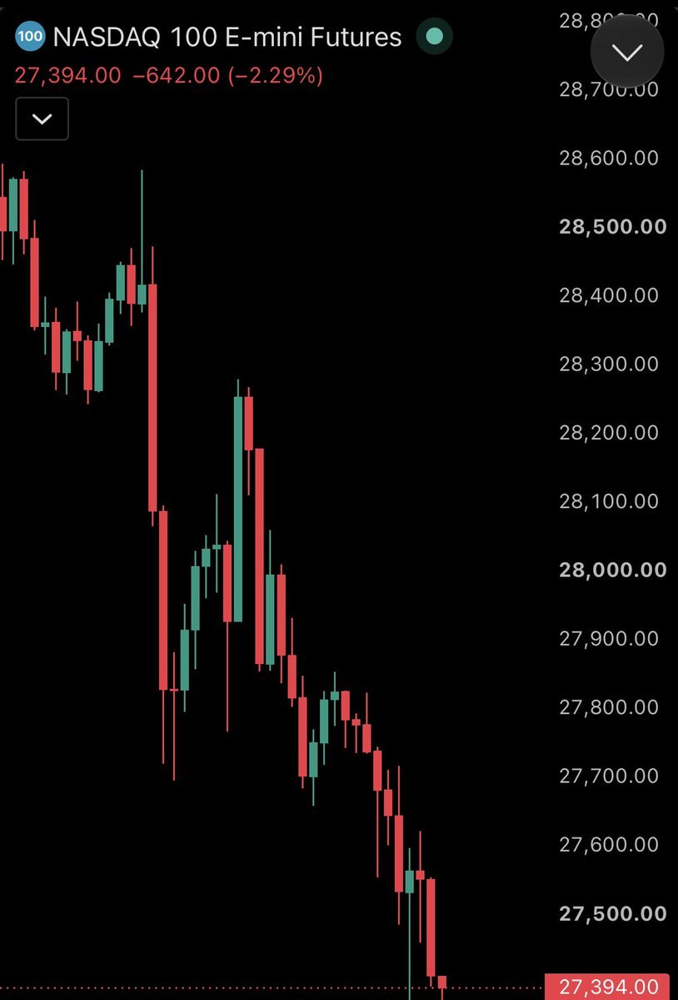

- 미국 채용 계획의 회복은 계절적 수요가 주도
  - 10월 채용 계획은 전년 대비 57% 늘어난 444,692명으로 최소 2009년 이후 10월 최대이며 기술 300,252명, 운송 100,000명, 소매 13,300명 순
  - 연초 이후 채용 계획은 34% 증가한 655,304명이며 계절직은 전체의 72%, 전년 대비 증가분의 약 60%를 차지
  - 계절직 채용 계획은 470,400명으로 26% 늘었지만 2024년 660,150명보다 29% 적음

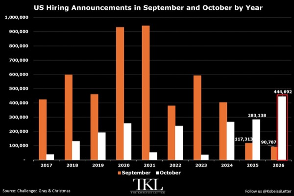

- United Airlines($UAL)는 광범위한 시스템 장애로 항공편 출발이 막히며 주가 하락
- 미국 연방정부 부채 이자 비용이 10월 재정지출의 31.3%로 역대 최고 비중에 도달
  - 이자 비용은 전년 대비 110억 달러 증가한 1,150억 달러로 10월 기준 역대 최대
  - 2022년 10월 대비 960억 달러·505% 증가했으며 전체 지출에서 차지하는 비중은 4년 동안 4배 이상 확대

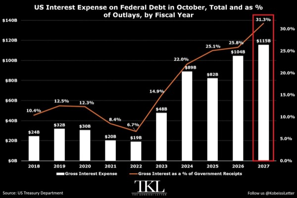

- 미국 가계의 필수 지출 비중이 45.6%로 역대 최고 수준에 근접
  - 의료·주거·공공요금·휘발유·금융서비스·보험 비중이 4년간 1.8%포인트 상승했으며 2010년 최고치 46.5%에 근접
  - 1960~1980년대에는 40%를 넘지 않았던 항목들이 가계 예산에서 차지하는 부담이 커짐

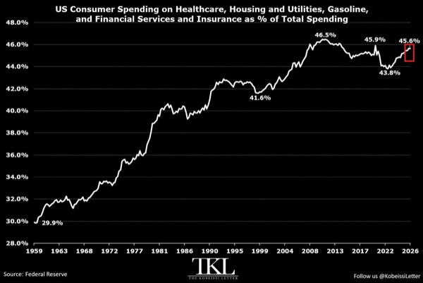

- S&P 500 기업의 2026년 3분기 현재까지 집계된 EPS 증가율은 전년 대비 31.9%로 최소 4년 만에 최고
  - 25% 이상 증익이 3개 분기, 두 자릿수 증익이 8개 분기 연속 이어졌으며 실제 이익은 13개 분기 연속 예상치를 상회
  - 실적 발표 기업의 84%가 EPS 예상치를 웃돌아 5년 평균 78%를 상회
  - 에너지·정보기술·소재가 성장을 주도하며 11개 업종 모두 증익, 7개 업종은 두 자릿수 증가

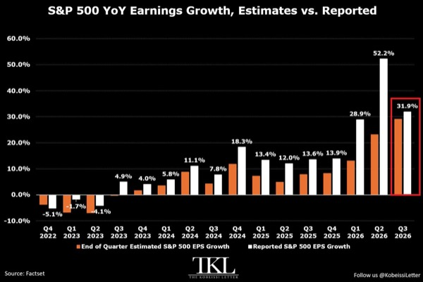

# MKevin

### 투자 전망 급감과 엔비디아 수익성 논쟁

- SemiAnalysis의 2027~2030년 AI 설비투자 전망이 총 1조6,000억 달러 하향되며 엔비디아와 반도체 업종의 하락 압력 확대
  - 2026년 전망은 유지하고 2027년은 7,700억→6,270억 달러로 19%, 2028년은 1조500억→7,580억 달러로 28% 하향
  - 2029년은 1조3,500억→7,960억 달러, 2030년은 1조5,300억→9,230억 달러로 축소
  - 2028~2029년 투자 증가율이 약 5%까지 둔화되는 경로로, 투자 총액뿐 아니라 성장 속도 약화가 핵심 부담
- 전망 하향의 핵심 쟁점은 불과 11일 전까지 유지했던 강한 낙관론을 뒤집을 만큼 새로운 실물 변화가 있었는지임
  - 영상에서는 주요 기업의 주문과 수주잔고가 계속 증가하고 메타·마이크로소프트·구글의 투자 취소도 확인되지 않았다는 점을 강조
  - Anthropic 성장률 둔화와 자금조달 여건 악화는 기존에 알려진 정보여서 급격한 전망 수정의 설명력이 제한적
  - 시장 하락 이후 과도했던 추정치를 낮췄다는 비판이며, 실제 수요 붕괴가 확인됐다는 의미는 아님
- 중간선거 이후 데이터센터 건설 지연과 투자 취소를 구분할 필요
  - 영상이 인용한 지연 규모는 2027~2028년 약 5.8GW
  - GW당 약 600억 달러를 적용하면 약 3,400억 달러의 집행 시점 이동으로, 1조6,000억 달러의 누적 투자 축소를 전부 설명하기 어려움
- SemiAnalysis의 하향 조정은 엔비디아의 가격 결정력과 시장점유율 약화에 집중
  - 2027~2030년 엔비디아 매출 전망을 전체적으로 약 32%, 2030년 데이터센터 매출 전망을 약 66% 하향한 것으로 소개
  - 엔비디아 가격 가정은 약 44% 낮추는 반면 브로드컴은 약 6%, AMD는 10~15% 하향
  - OpenAI·Anthropic·아마존의 자체 ASIC 확대와 GPU 프리미엄 축소가 주요 전제
  - Morgan Stanley의 엔비디아 매출 추정치는 SemiAnalysis의 약 1.7배로, 기관별 가정 차이가 큼
- 반도체 면적·전력·가격 가정의 일관성이 전망 신뢰도를 좌우
  - 영상에서는 전체 실리콘 면적 전망은 약 15% 축소하면서 전력 관련 가정은 약 50% 낮춘 점을 비판
  - 엔비디아의 마크업 약 40% 축소까지 겹치며 매출 전망 하향 폭이 크게 확대되는 구조
- HBM 가격 방향에 따라 반도체 투자 전망이 크게 갈림
  - SemiAnalysis는 메모리 가격 18~30% 하락을 반영하며 전체 하향 조정의 최대 30%를 메모리 가격 하락으로 설명
  - Bernstein은 반대로 2027년 HBM 계약가격이 대략 두 배가 될 것으로 전망
  - 메모리 원가와 GPU 판매가격의 동반 하락 여부, 패키징 프리미엄 유지 여부가 엔비디아 이익률의 핵심 변수
- 증시 조정에는 AI 개별 악재와 거시 부담이 동시에 작용
  - 이란과의 합의 불발, 에너지발 물가 압력, 매파적 연준, 강한 고용, 데이터센터 건설 지연 우려가 중첩
  - 영상에서는 11월 5일 VIX 28과 10월 AI 인프라 관련 CDS 상승을 위험회피 확대의 신호로 제시
  - 높은 물가와 강한 고용의 조합은 경기침체보다 에너지 충격과 긴축 장기화 위험에 가까움
- 영상에 등장하는 젠슨 황 사임·복귀 논란과 중국 우회 수출 의혹은 엔비디아의 지배구조·규제 불확실성을 확대하는 사건으로 제시됨
  - Scott Bessent의 문제 제기로 소개된 내용은 싱가포르에 판매된 칩 중 현지에 남은 비중이 약 1%라는 것
  - 싱가포르 매출 비중은 2024년 최대 20%였으며, 고객 본사 소재지 기준 매출 분류와 실제 칩 도착지를 구분할 필요
  - 트럼프의 엔비디아 지분 약 6,200만 달러와 젠슨 복귀 지지 발언, 약 17만5,000명의 복귀 청원도 영상에서 언급
- 엔비디아의 무제한 자금지원 축소는 AI 생태계의 순환금융 의존도를 시험하는 변수
  - 네오클라우드의 낮은 GPU 임대료와 엔비디아 지원 의존이 지속 가능한지 점검 필요
  - 일론 머스크 측으로 물량을 돌릴 수 있다는 발언은 대체 수요를 시사하지만, 소수 대형 구매자에 대한 수요 집중 위험도 동반
- Anthropic의 성장 둔화와 기업용 AI 경쟁은 상장 흥행 및 업종 심리에 직접 연결
  - 마이크로소프트가 제시한 Claude 주간 이용자는 유료 Copilot의 10분의 1 미만이라는 수치는 경쟁사의 홍보 이해관계를 감안해 해석할 필요
  - 영상은 Anthropic 상장 부진이 AI 업종 전반의 추가 하락으로 번질 가능성에 주목
- 영상에서 제시한 단기 일정은 엔비디아 실적과 규제 대응, 통화정책에 집중
  - 11월 17일 엔비디아 실적에서 예상 상회, 가이던스 상향, 수주잔고 증가 여부 확인
  - 같은 주 목요일 Anthropic 상장, 11월 25일 Bessent의 답변 요구 시한, 12월 3일 젠슨 황 의회 증언 잠정 일정 제시
  - 12월 8~9일 연준 금리 결정이 다음 거시 촉매
- 중기 낙관론은 AI 투자 사이클 유지와 2027년 기업이익 성장에 기반
  - Morgan Stanley는 견조한 세계경제와 이익 증가, 최근 6개월간 위험자산 가격 조정을 2027년의 긍정적 기반으로 평가
  - 영상에서 JP Morgan 자료로 소개된 전망은 2027년 성장의 소폭 둔화 후 2028년 회복이며, 에너지 부담은 2027년 말까지 완화되는 경로
  - 지속적인 인플레이션과 연준의 긴축 대응은 이 경로를 흔들 수 있는 위험
- 투자 판단의 우선순위는 장기 추정치 변화보다 실제 실적·수주잔고·고객 설비투자 계획 확인
  - 투자 집행 지연, GPU 가격 하락, ASIC 점유율 확대를 나눠 점검해야 일시적 심리 악화와 구조적 수익성 훼손을 구분할 수 있음
- AI 투자 총액이 증가해도 엔비디아의 매출과 이익이 같은 속도로 늘어난다는 보장은 없음
  - HBM 가격, 자체 ASIC 전환, GPU 프리미엄 변화에 따라 투자 증가의 수혜가 공급망 내부에서 재배분될 수 있음
- 영상의 매수 전략은 마진거래와 차입을 피한 하락 시 매수이며, 추가 변동성을 버틸 수 있는 자금구조가 전제

### 인공지능 투자 부채와 레버리지의 위험

- 레버리지와 만기 옵션으로 손실을 만회하려 하면 회복을 기다릴 여력까지 사라짐
  - 영상에서 제시한 레오폴드의 Situational Awareness 잔여 자산은 15억8,000만 달러, 손실률은 92%
  - 7월 29일 67% 급락 후 시타델의 켄 그리핀에게 구제받았지만, 반등 이후에도 옵션·공매도·마진 거래를 이어가며 다시 손실 확대
  - 장기 보유가 가능한 우량 자산과 달리 옵션 만기와 마진콜은 투자 판단이 맞아도 버틸 시간을 제한
- Situational Awareness의 현물 축소와 콜옵션 집중으로 포트폴리오 위험이 커짐
  - IREN 보유분 94%, CleanSpark 75%, Bitdeer 44% 매도, 잔여 포지션은 9개로 제시
  - SanDisk·Micron·Bloom Energy·TSMC·Nebius·CoreWeave·Core Scientific·STMicroelectronics·Applied Digital·Riot Platforms 현물 전량 정리
  - Bloom Energy·Nebius·SanDisk 등의 콜옵션을 남겨 손실 회복을 노리는 구조
- 트럼프 측 엔비디아 거래와 대중국 수출정책의 시점이 겹치며 이해충돌 의혹 확대
  - 영상이 인용한 거래 규모는 최대 9,750만 달러, 거래 건수는 103건이며 공시 금액은 구간으로 제시돼 정확한 규모는 불명확
  - 젠슨 황의 첫 백악관 방문 이틀 전 최대 500만 달러 매수, 중국 매출 공유 합의 일주일 뒤 최대 2,500만 달러 매수 사례 제시
  - H200 승인 직전 나흘 연속 매도와 승인 다음 날 추가 매수도 언급되지만, 정책 사전 인지나 거래 의도는 확인되지 않음
  - 트럼프는 거래를 직접 알지 못하며 담당 사무실이 처리했다는 입장
- 엔비디아 이사회의 젠슨 황 복귀 검토 부재를 영구 배제로 해석하기는 이름
  - 영상에서 인용한 CNBC 보도의 핵심은 이사회가 현재 조사에 집중한다는 내용
  - 준 김의 조사 결과와 법무 책임자 팀 티터의 판단이 복귀 검토의 선행 조건
  - 조사에서 혐의가 해소돼야 복귀 논의가 가능하므로 당장의 이사회 입장만으로 결론을 내리기 어려움
- 젠슨 황 복귀 여부는 수개월간 불확실성이 이어질 가능성
  - 영상 기준 Kalshi 복귀 확률은 전일 14%에서 11%로 하락, 화자의 개인 추정치는 약 40%로 차이 큼
  - 유사 기업 조사는 빠르면 약 2개월, 길면 6개월이며 평균 약 3개월이라는 가정 아래 조사 종료를 2~4월로 예상
  - 간첩 의혹까지 포함되면 조사 장기화 가능성, 예측시장 계약의 판단 시한은 2029년 1월
- AI 관련주 반등 이후에도 기관 매도와 투자 전망 하향이 부담
  - Soros Management는 지난 분기 엔비디아 지분을 약 20% 축소
  - Brad Gerstner의 지분 축소설은 확인이 필요하며, 젠슨 복귀 지지와 실제 매매 방향을 구분할 필요
  - SemiAnalysis는 설비투자 전망을 낮췄지만 2026~2028년 추정치는 여전히 다른 주요 은행보다 높은 수준
  - 낙관적 전망의 하향 조정만으로 투자 가정이 충분히 보수적으로 바뀌었다고 보기는 어려움
- 엔비디아 실적과 가이던스가 경영진 불확실성 속 단기 주가의 핵심 변수
  - 화자는 기존 계약과 보수적인 실적 안내 관행을 바탕으로 예상치 상회와 가이던스 상향 가능성을 높게 평가
  - 콜레트의 실적 발표 대응이 향후 최고경영자 지위에도 영향을 줄 가능성
  - 부정적인 전망이 나오면 엔비디아를 넘어 AI 관련주 전반의 추가 하락 위험
- 네오클라우드의 자금 조달은 고금리 차입 대신 공급업체 금융과 고객 선급금에 의존
  - CoreWeave는 연 15% 금리의 차입 대신 Microsoft 등 기존 고객의 선급금 확대와 공급업체 지원을 활용하는 방향
  - 엔비디아의 네오클라우드 지원 축소설이 현실화되면 설비투자 자금 확보가 더 어려워질 수 있음
  - 공급업체 지원과 고객 선급금으로 장비 구매를 이어가는 구조는 AI 서비스의 최종 수익성에 의존
- AI 관련 부외 의무가 금융시장 위험으로 번질 가능성
  - 영상에서 인용한 연준 바 부의장의 경고는 장기계약·리스·잔존가치 보증 등 관련 의무의 잠재 최대 명목금액이 3조 달러를 넘는다는 내용
  - 이 금액 전체를 확정된 대출 부채로 볼 수는 없지만, 자금 조달이 막히면 AI 투자자산의 강제 매각을 유발할 위험
  - 화자는 AI의 장기 수익화를 기대하며 하락 시 매수를 선호하지만, 수익화 지연과 금융 의무 누적을 핵심 위험으로 제시
- 영상에서 제시한 주요 일정은 엔비디아 실적, Anthropic 상장, 중국 반도체 규제와 의회 증언
  - 엔비디아 실적은 영상 기준 다음 날 장 마감 후, Anthropic 공모가 결정은 수요일로 언급
  - 11월 19일 중국 반도체 규칙 발표와 Anthropic 거래 개시 예정으로 제시
  - 12월 2일 엔비디아 법무 책임자의 하원 위원회 증언 예정, 젠슨 황 증언과 후임 최고경영자 선임 일정은 미정
- AI 투자에서는 수요 성장뿐 아니라 현금 유입과 금융 의무의 만기 구조를 함께 확인해야 함
  - 고객 선급금과 공급업체 금융이 줄어도 설비투자를 유지할 수 있는지, 실제 서비스 매출이 투자비를 회수하는지가 중요
- 급락 이후에는 손실 회복 속도보다 생존 가능한 포지션 규모가 우선
  - 같은 AI 투자 가설이라도 만기와 강제청산 위험이 겹치면 반등 전에 자본을 잃을 수 있음

### 항공 관제망 마비와 무리한 현대화의 대가

- 미국 전국 항공편 출발 중단의 핵심 쟁점은 노후 장비 자체보다 신규 장비 도입 과정의 호환성 검증과 일정 관리 부실
  - 영상에 따르면 금요일 오후 3시 54분부터 4시간 21분간 출발이 중단됐고 항공편 7,000편 이상이 취소됨
  - 숀 더피 교통장관은 노후 스위치·라우터·구리 통신선의 과부하를 원인으로 지목했지만, 신규 장비 연결이 기존 시스템을 압도했다는 정부 설명도 나옴
- 영상이 인용한 2026년 9월 미국 회계감사원 GAO 보고서는 FAA 현대화 사업 11,389개의 통합 일정 관리 부재를 지적
  - 같은 시설에서 여러 설치 작업이 진행되는데도 일정 충돌과 관제 업무 영향을 최소화할 조정이 부족
  - FAA는 개선 계획을 제시했지만 해결 시점을 정하지 않았고, GAO는 통합된 상세 마스터 일정이 있다는 FAA 설명을 뒷받침할 증거가 부족하다고 평가
- 관제 시스템 현대화는 필요하지만 공기 단축에 비해 안전장치와 비용 검증이 미흡
  - FAA가 평가한 관제 시스템 138개 중 37%는 지속 운영이 어려운 상태
  - 구리 통신선 교체는 기존 2030년 9월 목표보다 21개월 앞당겨 2028년 완료를 추진
  - 음성 무전기 1,581대 교체도 기존 2037년 9월에서 2028년 12월로 대폭 앞당김
  - 현대화 사업에 조달관리체계 요건의 포괄적 면제를 적용하면서 비용 영향 분석과 사업 통제가 약화
- 직접적인 장애 경로로는 아칸소주 엘도라도의 신규 라우터 설치와 통신망 트래픽 폭증이 거론됨
  - L3Harris가 구리선에서 광통신으로 전환하는 작업 중 새 라우터를 설치했고, 이후 텍사스주 애머릴로 등을 포함한 기존 시스템에 과부하가 발생한 정황
  - 영상에 인용된 FAA 일요일 발표는 4~5초마다 약 1,000회의 연결 시도가 발생하면서 기존 장비가 불안정해졌다고 명시
  - FAA와 L3Harris의 근본 원인 조사가 진행 중이어서 특정 장비나 업체의 책임은 미확정
- 장애는 모든 공항의 관제탑이 동시에 완전히 멈춘 상황과 구분할 필요
  - 주요 문제 구간은 이착륙 관제탑보다 고고도 항로를 담당하는 관제센터 통신망
  - 영상에서는 22개 관제 구역 중 17개가 영향을 받았으며, 일부 조종사는 비행 중 통신과 관제가 정상 작동했다고 증언
  - 더피도 모든 통신과 레이더가 상실된 것은 아니라고 밝혔고, 전국 출발 중단은 장애 대응을 위한 운영 조치
- 구형 통신 방식 TDM을 곧바로 아날로그나 고장의 원인으로 단정하기는 어려움
  - TDM은 정해진 시간 구간에 데이터를 전송하는 방식이며 디지털 구현도 가능
  - IP 전환의 효율성과 별개로 신규 장비의 연결 재시도·트래픽 제어가 기존 망의 처리 능력과 맞아야 함
- 사고 원인 설명이 바뀌면서 노후화만으로 책임을 설명하기 어려워짐
  - 초기에는 노후 시스템, 이후에는 신규 라우터, 다시 3주 전에 설치된 애머릴로 장비가 거론됨
  - 라우터 제조사 HPE는 자사 장비가 정상 작동했다는 입장
  - 장비 자체의 결함과 설정·통합·배포 과정의 문제를 분리해 조사할 필요
- 현대화 예산 요구는 장애 이후 더 커졌지만 추가 지출의 효과를 검증할 근거는 부족
  - 영상은 초기 106억 달러와 2단계 추가 102억 달러 요구, 장애 직전 총 301억 달러 규모 요구를 언급
  - 더피는 장애 이후 의회에 긴급 자금 500억 달러를 요청
  - L3Harris 계약은 10차례 연장됐고 일부 연장은 부적절하게 승인됐다는 지적도 소개됨
- 예산 확보를 위해 장애를 고의로 유발했거나 위험을 묵인했다는 해석은 영상 제작자의 의혹이며 입증되지 않음
  - 제작자는 1월 새 의회 출범 전 예산을 확보하려는 정치적 유인과 사고 직후 증액 요구를 연결
  - GAO의 사전 경고와 일정 관리 부실은 시행 과정의 위험을 보여주지만 고의성의 증거는 아님
- 스타링크와 항공기 실시간 위치 공유로 기존 관제를 대체하는 구상은 전환 비용과 적용 범위가 걸림돌
  - 항공기별 이중 안테나 설치, 기존 항공기·공항 개조 비용, 위치 정보를 의무적으로 송신하지 않는 항공기 처리 문제가 남음
  - 지상 무전·항법·접근 설비와 관제 인력을 한꺼번에 대체하려면 기존 운항 체계 전체의 전환을 설계해야 함
- 현대화 성과는 설치 속도나 예산 규모보다 통합 일정, 호환성 시험, 장애 격리, 복구 절차로 평가해야 함
  - 단일 현장의 신규 장비가 광역 통신망을 흔들 수 있다면 단계별 검증과 영향 범위 제한이 우선
- 추가 예산 승인과 원인 규명은 별도로 추진할 필요
  - 노후 설비 교체의 필요성이 사업 관리 부실이나 계약 감독 책임을 면제하지 않음
  - 조사 결과가 나오기 전에는 노후 장비 탓이라는 단정과 고의 장애설 모두 경계할 필요

# Slav

- 국내 증시는 하락 과정의 막바지 가능성을 염두에 두고 추가 매수를 지속하되 추가 패닉 가능성은 남아 있음
  - SK하이닉스 111만 원, 삼성전자 19만 원 수준에서 당장의 손실을 감수하며 내년 회복을 기대
  - 12월 기술적 반등, 유가 추가 하락, 2027년 1~2월 외국인 수급 복귀가 기대 요인
- 수·목요일 청약 예정이던 에스에프씨가 청약을 철회하며 공모주 시장 부진이 이어짐
- 유캐스트는 청약을 건너뛸 구간
  - 경쟁률 173.42대 1, 의무보유확약 0.57%로 수요 지표가 약하며 국내 증시 부진이 공모주 시장에도 부담

# Stockbot

- 호르무즈 해협의 원유 흐름이 감소하며 공식 통계가 실제 상황을 충분히 반영하지 못할 가능성
  - 위치 신호를 다시 확인할 수 있는 오만만 출항 유조선 기준 7일 평균 물동량이 2개월 최저

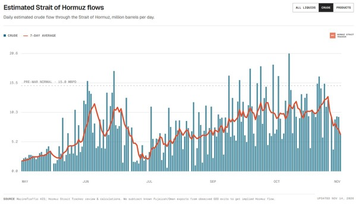

- 미국의 중동 전력 집중으로 이란과의 대규모 군사 충돌 가능성이 커짐
  - 핵추진 항공모함 3척과 전투기 약 200대, 순양함 2척, 구축함 14척, 오하이오급 유도미사일 잠수함 최소 1척을 집결
  - 표준 탑재량 기준 수상함의 토마호크 탑재 가능 수량은 388발이며 공중급유기는 약 200대에 도달한 것으로 전해짐

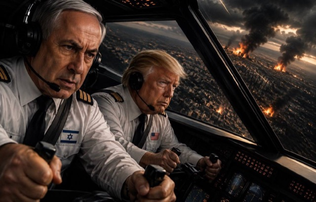

- 엔비디아($NVDA)의 젠슨 황 CEO 복귀 불확실성이 주가와 인력 유지에 부담
  - CNBC의 이사회 복귀 검토 부인 보도 이후 주가는 장중 저점을 경신하며 10월 6일 고점 대비 34% 하락
  - 국가안보·수출통제 감독위원회를 신설해 국가안보와 국제 무역 준법 프로그램을 감독하고 독립 외부 전문가를 활용할 계획
  - WSJ에 따르면 직원들은 복귀 무산 시 대체 불가능한 인재가 이탈할 수 있다고 경고했으며 일부는 사내 지지 시위를 논의
- Goldman Sachs가 금의 연간 전망 가격을 온스당 4,650달러로 제시
