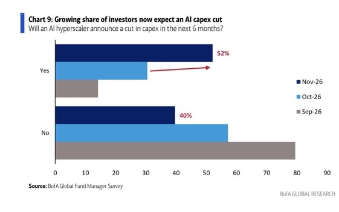
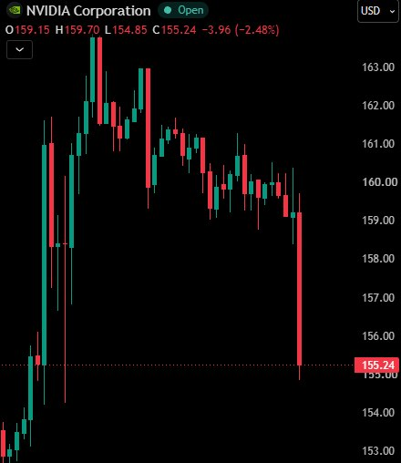
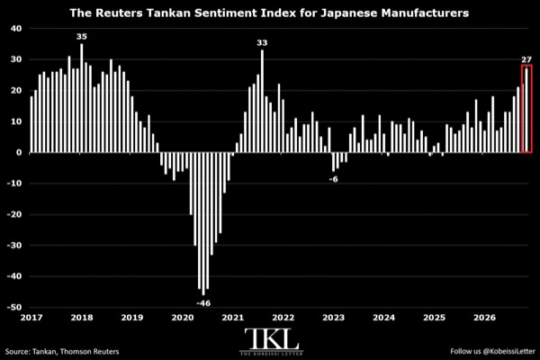
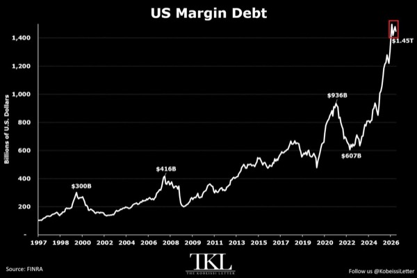
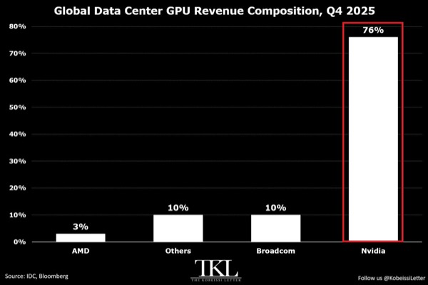
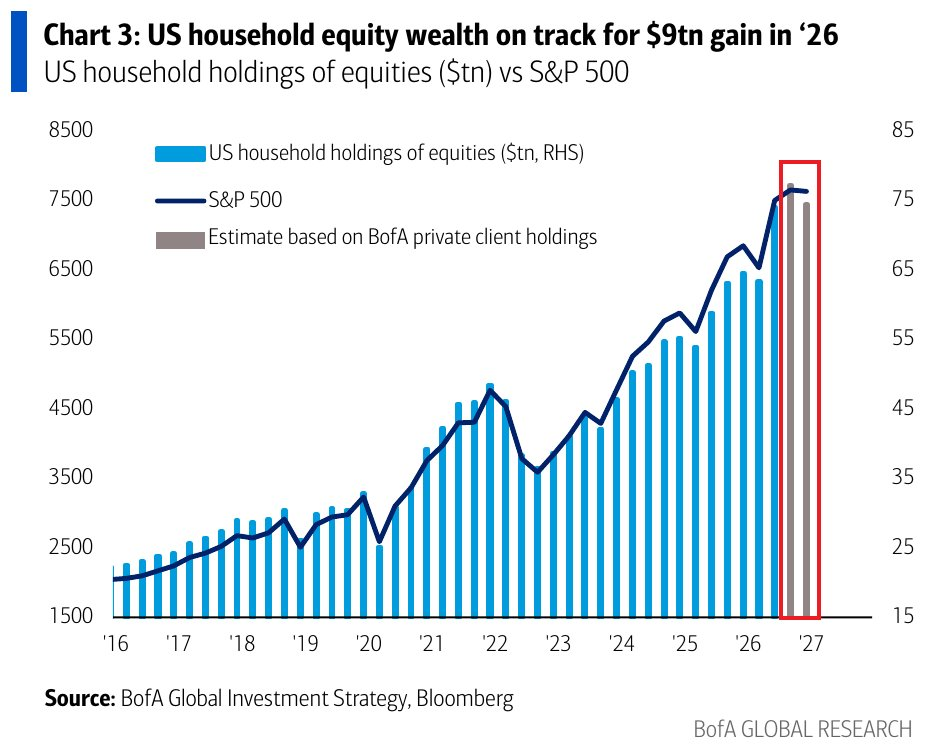
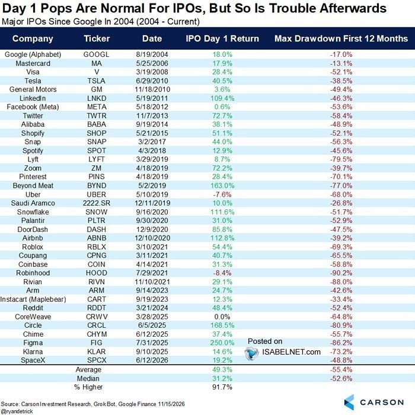

# EconomiExpl

### 성장하는 미국에서 생활이 더 팍팍해지는 구조

- 미국의 성장률·주가·고용 호조가 가계의 생활 안정으로 연결되지 않는 구조
  - 7~9월 성장률은 연율 3.4%로 전 분기 2.2%보다 높지만 10월 미시간대 소비심리지수는 48로 역사적 저점 부근
  - 물가가 임금보다 빠르게 오르면 경제 규모가 커져도 월급의 구매력은 하락
- 연소득 중앙값 8만3,000달러 가구도 주거·교통·의료·보육비를 내면 비상지출을 감당하기 어려움
  - 세후소득 약 6만5,000달러에서 도시 임차료 2만8,000달러, 교통비 1만달러, 직장 건강보험의 근로자 부담 약 6,800달러를 빼면 약 2만달러
  - 자녀 둘의 보육비를 보수적으로 2만달러만 잡아도 식료품·공과금·저축 이전에 여유자금 소진
  - 자동차와 보육은 취업을 유지하기 위한 필수비용이어서 사치품처럼 쉽게 삭감하기 어려움
- 4인 가구의 공식 빈곤선 약 3만1,000달러는 현대의 지출구조를 충분히 반영하지 못함
  - 1960년대 식비가 소득의 약 3분의 1이던 시절 최소 식비에 3을 곱한 방식에서 출발
  - 현재 가정 내 식비 비중은 약 8%로 줄고 주거·의료·보육 부담은 확대
  - 같은 논리를 현재 식비 비중에 적용하면 약 13만달러가 된다는 사고실험으로 기준과 실제 생활비의 괴리를 드러냄
  - 2011년 도입된 보완적 빈곤지표는 최근 지출과 현물급여·세액공제를 반영하지만 상당수 지원 자격은 여전히 기존 빈곤선에 연동
- 복지 자격을 소득 문턱으로 끊으면 임금 상승이 오히려 가처분자원 감소로 이어지는 복지절벽 발생
  - 한부모 가구 예시에서 식품·보육·의료 지원이 단계별로 사라져 작은 임금 인상이 큰 보조금 손실을 유발
  - 지원을 받기에는 소득이 높고 시장가격으로 자립하기에는 낮은 가구가 빈곤 통계 밖에 남음
  - 기준 상향은 의료·식품·주거 지원 대상을 동시에 늘리므로 재정부담이 개편을 제약
- 필수 고정비 상승은 주택 구입·출산·창업·직장 이동을 늦추며 경제의 장기 활력까지 약화
  - 팬데믹 당시 통근·보육 등 지출 감소와 재정지원이 겹치며 개인저축률이 약 32%까지 상승
  - 경제 재개 이후 고정비가 돌아오고 주택금융·보험료까지 올라 가계의 완충 여력이 다시 축소
- 월급에 의존한다는 체감과 실제 생계곤란은 구분할 필요
  - 미국인 63%가 월급에서 월급으로 생활한다고 응답하고 연소득 50만달러 초과 근로자도 40%가 같은 응답
  - 고소득층 설문은 월말 현금 고갈보다 장기 재무목표 달성이 어렵다는 의미까지 포함
  - 400달러 비상지출을 현금으로 감당하지 못하는 성인은 2013년 약 절반에서 2025년 37%로 감소했고 실제 계좌자료상 필수지출로 소득 대부분을 쓰는 가구는 약 4분의 1
- 고소득층의 재정 압박에는 비싼 도시의 주거비·세금에 더해 소득에 맞춰 소비 기준이 올라가는 생활수준 상승이 작용
  - 연소득 50만달러 일자리는 뉴욕·샌프란시스코 등 고비용 지역에 집중되고 가족용 주거비는 월 5,000~1만달러에 달할 수 있음
  - 사립학교·고급여행·주택 개조가 기본 지출로 굳고 대규모 주택대출과 학자금·소비자 부채가 미래 고소득을 전제로 쌓임
- 미국 소비가 부유층에 집중되면서 주가 하락이 실물경제에 전파될 위험 확대
  - 소득 상위 20%가 전체 소비의 약 60%를 차지해 1990년대 약 50%보다 높아짐
  - 자산 상위 10%는 주식시장 자산의 약 90%를 보유하며 투자자산 가치가 소비를 좌우하는 부의 효과가 커짐
  - 고소득층 소비 축소가 음식점·교육·서비스업 매출과 임금을 줄이고 다른 가구의 소비 감소로 이어짐
- GDP를 늘리는 소비와 생활수준을 개선하는 자원 배분은 동일하지 않음
  - 경기침체로 인력·설비가 놀 때 소비 확대는 생산과 고용 회복에 효과적
  - 초호화 요트와 여러 가구의 주택 건설은 비슷한 금액의 생산으로 집계될 수 있지만 수혜 범위와 생활 개선 효과는 크게 다름
  - 개인저축률은 1990년대 초 약 9%에서 최근 약 5%로 낮아지고 신용카드 부채는 약 1조2,000억달러에 도달
- 미국의 높은 소비 의존도는 세계 생산·자본 흐름과도 연결
  - 가계소비의 GDP 비중은 미국 약 68%, 중국 약 40%이며 중국은 세계 제조업 생산의 약 27%를 담당
  - 중국의 낮은 가계소득과 높은 예비적 저축은 생산물을 국내에서 흡수하는 데 제약
  - 달러 자산에 대한 세계 수요가 미국으로 자금을 되돌려 보내 차입과 수입 초과를 뒷받침하고 미국 소비자가 세계 수요의 중요한 축이 됨
- 주택은 거주 기반에서 글로벌 투자자산으로 바뀌면서 소득과 가격의 연결이 약화
  - 95개 도시를 비교한 주택구입능력 조사에서 중위 주택가격이 중위 가구소득의 3배 이하인 시장이 사라짐
  - 홍콩은 14.4배, 시드니는 13.8배이며 조사상 가장 저렴한 피츠버그도 3.2배
  - 미국은 팬데믹 이전 3.9배에서 4.8배로 상승
- 개발 제한과 자산 투자 수요가 결합해 주택가격 상승을 자기강화
  - 용도지역·높이·주차장 규제와 긴 인허가가 공급을 막는 동안 저금리와 풍부한 자금이 같은 주택을 추격
  - 가격 상승이 담보가치와 대출한도를 높이고 더 큰 대출이 다시 입찰가격을 끌어올림
  - 금리 상승 이후에도 기존 저금리 대출을 포기하지 않으려는 소유자의 매도 기피가 공급을 묶음
  - 공급을 늘리지 않은 채 구입 보조금만 주면 같은 주택을 놓고 경쟁하는 구매력만 확대
- 높은 주거비는 필수인력의 도시 이탈과 노동 이동 감소를 통해 생산성까지 떨어뜨림
  - 교사·간호사·기술직이 일터 근처에 살기 어려워지고 최초 주택 구입 연령도 늦어짐
  - 기존 소유자는 희소성으로 자산이 늘지만 임차인과 신규 진입자는 더 큰 부채를 감수
- 주택 접근성 개선에는 공급 확대와 투자 수요 조정을 함께 검토할 필요
  - 뉴질랜드의 장기 주택용지 확보, 미니애폴리스·캘리포니아의 단독주택 전용 규제 완화가 공급 경로
  - 싱가포르는 대규모 공공주택 공급으로 약 90%의 주택 소유율 달성
  - 대만의 단기 매각 과세, 웨일스의 추가주택 과세, 네덜란드 일부 지역의 투자자 매입 제한은 투기 수요 억제 경로
- 선진국의 교사·의료인 부족은 고령화와 긴 양성기간, 직업 매력 저하가 겹친 결과
  - 미국은 2036년까지 의사가 최대 8만6,000명 부족할 수 있고 세계 보건인력 부족은 2030년 약 1,100만명 전망
  - 의료진 은퇴와 고령층 진료 수요가 동시에 늘지만 의사 양성에는 10년 이상 필요
  - 유사 학력의 민간직종보다 제한적인 보상, 학자금·주거비, 행정업무와 과로가 유입을 줄이고 이탈을 촉진
- 이민은 인력 부족을 빠르게 메우지만 세계 전체의 필수인력을 새로 만들지는 못함
  - 영국 의사의 약 3분의 1은 해외에서 훈련받았고 일부는 경력을 쌓은 뒤 미국·호주 등으로 재이동
  - 저소득국은 교육비를 부담하고 고소득국이 인력을 활용하면서 출신국의 의료 기반 약화
  - 2025년 9월 이후 신규 H-1B 청원에 붙은 10만달러 수수료는 외국인 의사 채용에 의존하는 미국 병원의 추가 부담
- 만성적인 인력 부족은 학교와 병원이 운영되는 겉모습 뒤에서 서비스의 질을 떨어뜨림
  - 학급 규모 확대와 개별지도 감소는 미래 숙련도·생산성을 훼손
  - 대기시간과 진단 지연은 예방 가능한 질환을 악화시키고 노동시장 이탈을 늘림
  - 비용을 낼 수 있는 가구는 민간서비스로 이동해 교육·의료의 격차 확대
- 인력 양성과 근무환경 개선은 시간이 걸리지만 부족을 완화할 수 있음
  - 포르투갈은 의대 정원을 장기간 확대했고 루마니아는 임금·교육·근무환경 개선 후 의사 해외 이탈을 줄임
  - AI는 행정과 반복업무를 줄여 전문인력이 환자·학생에게 쓰는 시간을 늘리는 방향으로 활용
- 부는 의료 접근성뿐 아니라 식사·주거환경·노동조건·시간 통제권을 통해 수명을 좌우
  - 미국 남성의 소득 상위 1%와 하위 1% 사이 기대수명 차이는 약 14.6년
  - 저소득층은 오염 노출, 불규칙 근무, 신체 부담, 만성 스트레스를 더 많이 겪음
  - 영국 공무원을 추적한 화이트홀 연구에서도 낮은 직급의 높은 사망률이 관찰돼 고용 안정과 의료 접근만으로 격차가 해소되지 않음
- 보편적 의료는 격차를 줄이지만 민간 진료의 빠른 전문의 접근과 조기진단까지 평등하게 만들지는 못함
  - 민간 부문의 높은 보상이 의료진을 끌어가면 공공 부문의 대기시간과 인력난이 악화될 수 있음
  - 미국에서는 보험 부족이 치료 지연과 비효율적인 응급실 의존으로 이어져 소득별 건강격차를 키움
- 긴 수명은 자산 보유자에게 복리의 시간을 주지만 저축이 적은 은퇴자에게는 지출기간 연장을 뜻함
  - 연 7% 수익률을 가정하면 자산은 약 10년마다 두 배가 되고 500만달러는 14년 뒤 약 1,300만달러로 증가
  - 주식·사업체를 가진 부유층은 자산을 불리는 반면 주택과 연금 중심의 중산층은 생활비로 금융자산을 소진하기 쉬움
  - 미국인 64%는 죽음보다 은퇴자금 고갈을 더 두려워함
- 상속의 효과도 금액과 시점에 따라 갈림
  - 부유층 자녀는 생전 증여로 주택 계약금·교육비·사업자금을 받아 이른 시기부터 자산 형성
  - 중산층의 상속은 주요 주택·경력 형성기가 지난 뒤 도착하고 저소득층의 작은 상속은 부채와 생활비로 소진되기 쉬움
- 소득별 수명 차이는 연금의 재분배 효과까지 약화
  - 같은 연금제도에서도 오래 사는 고소득층이 더 오랫동안 급여를 수령
  - 은퇴 후 기대수명이 3년 짧으면 저소득자의 평생 연금 수령액이 부유층 대비 약 13% 줄어드는 효과
  - 일률적인 수급연령 인상은 육체노동자의 건강 악화와 장애·의료비를 늘려 연금 절감분을 다른 재정지출로 옮길 위험
- 출생 시 투자계좌를 마련하고 저소득층에 더 많이 적립하는 베이비본드는 초기 자산격차를 줄이는 장기 수단
  - 제안된 설계는 출생 시 1,000달러와 저소득층 연간 최대 2,000달러 추가 적립으로 18세에 약 4만6,000달러 조성
  - 코네티컷은 Medicaid 수혜 산모의 신생아에게 3,200달러를 적립하는 제도를 2023년 시작
  - 가족·고용주의 자발적 추가 납입에 의존하는 트럼프 계좌는 저소득층 추가 지원이 없어 기존 자산격차를 반영하기 쉬움
  - 효과가 성년에 나타나므로 당장의 연금 재정난을 해결하지는 못함
- 부과방식 연금은 일하는 세대가 현재 은퇴자를 부양하므로 저출산·고령화에 직접 노출
  - 미국의 수급자 1명당 근로자는 1950년대 16명에서 약 2.7명으로 줄었고 2035년 2.3명 전망
  - 미국 사회보장제도는 약 7,300만명에게 지급하며 사용자·근로자 합산 12.4% 급여세로 재원 조달
  - 영상의 갱신 설명에서는 통합 신탁기금 적립금 소진 전망이 2035년에서 2034년으로 앞당겨지고 은퇴기금 단독으로는 2032년 소진과 약 22% 급여 삭감 위험 제시
- 연금 부담은 국가마다 다른 형태로 재정과 세대 간 형평성을 압박
  - 일본은 취업빙하기 세대의 불안정 고용과 불완전한 납부 이력이 고령화 문제에 겹침
  - 프랑스의 연금지출은 GDP의 약 14%로 다른 공공지출 여력을 제한
  - 중국은 빠른 고령화 속에서 충분한 민간 노후자산을 쌓기 전에 공적연금 압박에 직면
  - 세계경제포럼은 2050년 노후 필요자금과 축적자산의 격차를 400조달러로 추산
- 연금 개혁의 선택지는 더 오래 일하기·더 많이 내기·덜 받기이며 각각 정치·분배 비용 발생
  - 급여 삭감은 노인빈곤, 보험료 인상은 청년 부담, 정년 연장은 육체노동자의 건강 문제를 키움
  - 칠레의 민영화는 불충분한 납입과 투자손실로 급여가 기대에 못 미쳐 정부가 최소급여 보장에 다시 개입
  - 호주의 의무적립식 퇴직연금은 4조달러 이상의 자산을 쌓았지만 세제지원 비용이 GDP 약 1.9%이고 고소득층 혜택이 큼
- 예측 가능한 자동 조정과 취약계층 지원이 급작스러운 연금 위기보다 부담을 분산하기 쉬움
  - 덴마크·네덜란드는 기대수명과 수급연령을 연계하고 스웨덴은 평생 납부액·경제·수명에 맞춰 급여를 조정
  - 호주·캐나다의 소득·자산 기준 지원 조정과 뉴질랜드의 연금 과세는 필요한 계층에 지원을 집중하는 방식
  - 재정 지속성뿐 아니라 직업별 신체 부담·경력 길이·건강수명 차이를 함께 반영해야 수용성 확보 가능
- 주거비·필수인력·건강·연금은 서로 연결돼 있어 한 분야의 비용 상승이 다른 분야의 공급과 재정을 악화
  - 주거난이 교사·간호사를 밀어내고 서비스 부족이 저소득층 건강을 해치며 짧은 수명이 연금의 재분배까지 약화시키는 순환
- 가계의 경제적 안정은 소득 수준보다 필수지출 후 남는 자금과 충격을 버틸 자산으로 평가할 필요
  - 성장률·주가와 함께 주거비 부담률, 비상자금, 의료 접근성, 건강수명을 살펴야 생활 개선 여부를 판단 가능
- 부유층의 자산가격과 소비에 의존한 성장은 하위 가구의 구매력이 약할수록 충격 흡수력이 낮아짐
  - 생산적 일자리와 필수서비스 접근성을 넓히는 자원 배분이 소비 총액 확대보다 장기 생활수준 개선에 중요
- 공급 확대와 장기 인적자본 투자를 미루는 단기 처방은 미래의 개혁 비용을 키움
  - 주택 보조금만 늘리거나 해외인력으로 공백을 메우는 방식은 공급·양성·근무환경의 병목을 해결할 때 지속 가능

# Harvey

- AI 설비투자 축소 가능성이 투자심리에 반영되기 시작했으며, 투자자 과반이 향후 투자 축소 발표를 예상
  - 설비투자를 줄여도 과거 투자의 감가상각비와 에너지 등 운영비 부담은 지속
  - 현금 유출이 둔화하는 동안 감가상각비는 늘고 매출 증가율은 낮아질 수 있음

- 엔비디아의 강한 실적과 매출 가이던스가 단기 AI 투자 급랭 우려를 낮췄지만, 공급자 매출 성장이 구매자의 투자수익률을 보장하지는 않음
  - 하이퍼스케일러에는 감가상각·운영비가 누적되고 엔비디아에도 장기 조달 약정과 생태계 지원 부담이 확대
  - 장기 공급계약이 출하량뿐 아니라 가격과 마진까지 보호하는지 확인할 필요
- 한국 증시의 할인 해소는 기업의 수익성·성장성뿐 아니라 일반주주에게 성과가 돌아가는 구조에 달림
  - Phil Clifton은 지배주주와 일반주주의 이해관계가 어긋나면 성장과 현금 축적이 주주 수익으로 연결되지 않을 수 있다고 지적
  - 저평가 규모와 함께 이를 해소할 주체와 유인을 점검할 필요
- 일본 증시는 지배구조 개혁의 성과와 남아 있는 밸류에이션 할인이 공존
  - 거래소·감독당국의 저평가 해소 노력이 성과를 냈지만 모든 기업의 가격에 변화가 충분히 반영되지는 않음
  - 지수 상승보다 기업 가치가 주주 수익으로 이어지는 경로의 확대가 핵심

# KHwanK

### 비트코인 바닥권 신호와 장기 매수 논리

- 비트코인은 13개월 하락, 대형 악재, 극단적 공포가 겹치며 장기 가치투자 관점의 바닥권에 진입했을 가능성
  - 11월 15일 17시 촬영 기준 6만 2,000달러까지 하락한 뒤 약 6만 5,000달러로 반등
  - 11월 들어 약 16% 하락하고 5주 연속 약세, 이더리움·솔라나·리플·도지도 동반 급락
- 과거 하락장은 약 364~406일 이어졌고, 최종 저점은 고점 다음 해 11월~1월에 형성
  - 이번 하락은 전년 10월 6일부터 약 13개월 진행돼 과거 저점 형성 시기와 유사
  - 6월 말 반등은 하락 기간이 약 9개월이고 낙폭도 약 54%에 그쳐 최종 바닥으로 보기에는 이른 구간
- 과거 최종 저점에는 시장의 마지막 희망을 꺾는 대형 악재와 투매가 동반
  - 2014년 거래소 해킹, 2018년 비트코인·비트코인캐시 분열 이슈, 2022년 FTX 파산이 대표 사례
  - 6월 말에는 뚜렷한 투매 계기가 없었지만 최근에는 여러 악재가 겹치며 마지막 청산 국면이 형성될 가능성
- 영상에서 제시한 직접 악재는 바이낸스 해킹에 따른 63억 달러 손실과 민주당의 상·하원 장악
  - 비트코인 7만 달러 붕괴와 레버리지 청산이 하락 압력을 확대
  - 엘리자베스 워런의 상원 은행위원장 가능성과 공화당보다 강한 가상자산 규제 우려가 투자심리를 위축
- 위험자산 자금 이탈과 매수 여력 약화도 하락 압력을 가중
  - 영상은 젠슨 황 관련 논란과 엔비디아 약세, 5%를 넘는 금리, 스트래티지의 MSCI 퇴출, 2026년 현물 ETF 자금 유출을 추가 악재로 제시
  - 나스닥에서 위험자산 자금이 빠지면 코인도 동반 약세를 보일 수 있고, 패시브 자금 유입 감소는 스트래티지의 비트코인 추가 매수 여력을 제약
- 비트코인의 200주 이동평균선 하회는 과거 대바닥 구간과 겹치는 가격 신호
  - 2015년·2018년·2022년에는 200주선 부근이나 그 아래에서 저점을 형성한 뒤 반등
  - 영상에서 제시한 채굴 원가는 약 6만 달러로, 최근 가격이 이 수준에 근접
  - 공포·탐욕 지수의 극단적 공포와 대규모 청산도 저점권 판단을 뒷받침
- 하락 추세가 이어지고 있어 추세추종 매수 신호는 아직 부재
  - 장기 가치투자에는 매력적인 가격대지만, 즉시 반등하는 정확한 저점을 의미하지는 않음
  - 실제 상승 전환까지 몇 주~몇 달, 길게는 1년이 걸릴 수 있음
- 규제 강화에도 실물자산 토큰화와 스테이블코인, 인공지능 에이전트 결제의 성장 동력은 지속될 가능성
  - 월가의 국채·주식 토큰화와 24시간 거래 확대는 금융 인프라의 변화
  - 스테이블코인은 미국 국채 수요를 만들고 에이전트 간 자동결제 수단으로 확장될 가능성
  - 지니어스 액트 등 초당적 입법 지지와 중국과의 금융·기술 경쟁은 전면 규제를 제약하는 요인
- 장기 상승 논리는 과거의 3년 상승·1년 하락 사이클이 반복된다는 전제에 의존
  - 최근 악재와 공포가 다음 상승장 전 마지막 투매일 수 있지만, 6월 저점인 5만 8,600달러를 다시 깰 가능성도 존재
  - 바닥권에서도 급락과 반등이 반복될 수 있어 레버리지 사용 금지
- 저평가 판단과 매수 시점 판단을 구분할 필요
  - 장기 투자자는 추가 하락과 긴 대기 기간을 감당할 수 있는지가 중요하고, 추세추종 투자자는 상승 전환 확인이 필요
- 바닥권 판단은 단일 악재보다 하락 기간·200주선·투매·자금 흐름을 함께 점검해야 함
  - 과거 사이클과의 유사성만으로 저점을 확정할 수 없으며, 장기 산업 성장도 단기 가격 회복을 보장하지 않음

# Kobeissi

- 엔비디아 실적 기대와 지정학적 불안 속 미국 주식이 급락했으며, 실적 발표 뒤 반등도 유지되지 못함
  - 장중 S&P 500 -1.6%, 다우 -1.5%, 나스닥100 -2.0%, WTI +1.0%, 금 +0.9%를 기록했고 다우 하락폭은 한때 1,000포인트를 초과
  - 엔비디아는 실적 발표 직후 5% 상승하고 나스닥100 선물도 1.3% 올랐으나, 이후 엔비디아가 상승분을 반납하고 하락 전환
  - 엔비디아는 10월 6일 고점 대비 36% 하락했으며 7주 연속 하락 가능성에 직면

- 엔비디아의 기록적 실적과 가이던스 상향은 AI 인프라 투자의 강한 성장세를 뒷받침
  - 분기 매출 1,158억 달러, 데이터센터 매출 1,076억 달러, 순이익 653억 달러, 다음 분기 매출 가이던스 1,300억 달러로 기대치 상회
  - 매출과 조정 EPS는 전년 대비 각각 103%, 106%, 데이터센터 매출은 110% 증가하고 자사주 매입 1,500억 달러 추가
  - FY2028 매출 성장률 가이던스를 70%에서 75%로 높였으며, 연간 매출 약 7,280억 달러에 해당
- 엔비디아의 경영진·공시 불확실성이 주가 부담으로 지속될 가능성
  - Jensen Huang은 이사회 요청 시 CEO 복귀 의사를 밝혔으나, 이사회는 복귀 계획이 없다고 발표하고 실적 설명회에서도 관련 질문을 받지 않기로 함
  - WSJ 인용 보도로 SEC가 투자자를 오도한 공시 여부를 조사하고 있으며, 법무부도 Alice Huang 관련 복수 조사를 진행 중
  - 12월 1일 하원 외교위원회 증언에서는 대중 AI 칩 수출과 국가안보·중국 스파이 의혹을 다룰 예정
  - 독립 조사 결과에 따라 복귀 가능성을 열어두고 주주 의견을 반영해야 한다는 투자 관점
- Anthropic의 IPO 수요가 예상보다 강해 공모가와 기업가치 상향 가능성
  - WSJ 인용 보도로 기존 주당 70~78달러 범위를 넘어 80달러 이상 공모가를 검토
  - 기업가치는 기존 약 1조3,300억 달러에서 1조5,000억~1조6,000억 달러로 높아질 가능성
- 미국 주택건설업 심리가 2012년 이후 최저로 떨어지며 주택시장 둔화가 심화
  - 높은 모기지 금리·비용과 약한 소비자 신뢰로 11월 건설업체의 46%가 가격을 인하해 팬데믹 이후 최고 비중 기록
  - 구매자 방문은 2020년 팬데믹 초기 제외 시 15년 만의 최저
- AI·메모리 수요가 일본 제조업과 비제조업의 기업심리를 함께 개선
  - 11월 제조업 심리지수는 5포인트 오른 27로 2021년 8월 이후 최고이며, 4개월 연속 총 14포인트 상승
  - 전자업종은 14포인트 오른 39, 정밀기계는 4포인트 오른 42로 메모리 수요와 국내외 주문 증가 반영
  - 비제조업은 12포인트 오른 35로 2018년 6월 이후 최고

- 미국 신용융자 잔액이 줄었어도 시장 레버리지는 역사적으로 높은 수준
  - 10월 잔액은 320억 달러 감소한 1조4,500억 달러로 역대 네 번째 규모이며, 연초 대비 2,230억 달러·18% 증가
  - 2022년 약세장 저점 대비 8,420억 달러·139% 증가했고, M2 대비 6.2%로 닷컴버블 당시 6.4%에 근접

- 엔비디아가 글로벌 서버 GPU 매출에서 압도적인 지위를 유지
  - 2025년 4분기 매출 점유율 76%로 나머지 경쟁사 합계의 세 배 이상이며, Broadcom 10%, AMD 3%
  - AI 붐 이전부터 게임 외 GPU 활용에 투자한 축적이 시장 지배력을 뒷받침

- 미국 가계의 주식자산 증가가 소비와 경기의 버팀목으로 작용
  - BofA 추산으로 2026년 가계 주식자산은 연간 9조 달러 증가할 전망이며, 2025년 1월 이후 19조 달러 늘어 75조 달러 기록
  - 같은 기간 S&P 500과 나스닥100은 각각 26%, 29% 상승했으며, 2020년 이후 가계 주식자산은 50조 달러·200% 증가
  - 소비가 미국 GDP의 약 70%를 차지해 자산가격 상승의 소비 지원 효과가 큼

# MKevin

### 엔비디아 수출통제와 미국 클라우드로의 수요 이동

- 젠슨 황의 엔비디아 CEO 복귀 여부는 이사회 결정과 Wachtell 조사 결과가 핵심 변수
  - 영상에 인용된 성명은 개인적 잘못을 인정하면서도 주주·직원·회사에 이익이 된다면 CEO로 복귀하겠다는 내용
  - 이사회는 당장 복귀 검토보다 조사에 집중하고 있으며, 복귀를 승인하려면 법적 책임과 지배구조 문제를 해소해야 함
  - 강력한 고객 관계와 영업력이 복귀 지지의 배경이지만, 개인 비위·공격적 언행 관련 내용에는 확인되지 않은 의혹이 섞여 있음
- Mega Speed의 대중국 칩 우회 공급 의혹은 미국 정부의 규제 집행과 엔비디아의 내부 통제 문제로 확산
  - 재무·국방·국무·무역 관련 기관은 거래 제한을 원했지만 상무부는 Mega Speed를 금지 명단에 넣지 않았다는 내용
  - 상무부는 법무부로 수사를 넘겼고, 엔비디아 법무책임자 Tim Teter의 개입 이후 조사 동력이 약해졌다는 보도를 인용
  - 행정부 관계자들의 이해관계가 규제 지연에 영향을 줬다는 부분은 추가 확인이 필요한 의혹
- 조사와 거래 제한 논의가 진행되는 동안에도 칩 공급이 이어졌다는 점이 핵심 쟁점
  - 2024년 미국 상무부 조사 개시, 2025년 2월 싱가포르 조사, 6월 관련자 여권 압수, 7월 미국에 수사 협조 요청으로 이어진 흐름
  - 영상은 2025년 7월부터 2026년 2월까지 8억 달러 이상의 엔비디아 칩이 계속 도착했다고 제시
  - 중국 정부 지원을 받은 약 90억 달러 규모 데이터센터망과 관련 인물들의 연결고리를 다루지만, 영상 시점 기소는 없다는 내용
- 싱가포르 매출 비중 확대가 규제 위험을 부각하지만 해당 매출 전체가 사라진다고 단정하기는 어려움
  - 영상에 제시된 비중은 2023회계연도 8.5%, 2024년 11.2%, 2025년 18.1%, 2025년 7월 분기 21.7%
  - 매출의 지리적 비중만으로 실제 최종 사용처나 불법 우회 수출 규모를 확정할 수는 없음
  - 칩 수요와 주문 적체가 충분하면 제한된 고객 물량을 다른 고객에게 재배분할 여지가 있다는 강세 논리
- 새 수출통제안은 규제 범위를 넓히지만 허가·규모·용도에 따른 예외도 포함
  - 영상의 초안 해석에 따르면 총 연산량 1,200만 TPP 미만, H100 약 760개 수준에는 예외가 가능하며 합산 기준이 중요
  - H200은 개별 허가와 25% 관세를 전제로 판매 여지가 있고, 기존 데이터센터·모델 가중치·검색용 AI 등에도 예외가 있다는 내용
  - 여러 법인이나 데이터센터로 물량을 분산할 경우 규제 효과가 약해질 가능성
  - 117쪽 규정에 대한 초기 해석이므로 최종 문구와 실제 집행 방식을 확인해야 함
- 중국 기업의 해외 연산자원 임차는 더 까다로워질 수 있지만 미국계 사업자 경유 경로는 남을 가능성
  - 싱가포르·말레이시아·인도네시아·태국·브라질은 제한 대상이지만 미국 본사와 소유구조 등에 따른 조건부 예외가 거론됨
  - 미국에 본사를 둔 Amazon·Microsoft 등의 연산자원을 중국 기업이 임차하는 구조는 미국 하이퍼스케일러에 수요를 모을 수 있음
  - 중국 자본의 미국 데이터센터 투자와 이후 임차까지 허용되는지는 추가 확인이 필요한 부분
- 투자 논리의 중심은 규제 강화에도 칩 판매와 데이터센터 투자가 지속된다는 수요 재배분 시나리오
  - 엔비디아 하락 시 매수 관점을 유지하되 단일 종목 집중보다 분산된 종목 구성을 선호
  - 실제 규제 집행이 예외보다 강해지거나 대체 수요가 부족하면 이 강세 시나리오는 약해질 수 있음
- 엔비디아의 단기 주가에는 CEO 복귀 기대와 조사 결과가 함께 작용하므로 사업 수요와 지배구조 위험을 별도로 평가할 필요
- 수출통제의 투자 영향은 제한 국가의 구매 감소뿐 아니라 미국계 클라우드로 이동하는 연산 수요까지 함께 봐야 함
- 규정의 발표 강도보다 연산량 합산 기준, 최종 사용자 확인, 허가 발급과 위반 단속이 실제 매출 영향을 결정할 변수

### 엔비디아 실적 급증과 투자 확대의 변수

- 엔비디아 매출 1,158억 달러로 시장 예상치를 5.9% 상회, 다음 분기 매출 가이던스는 1,300억 달러
  - 가이던스 오차 범위는 ±3%로 제시돼 전망 변동성에도 주의 필요
- 매출은 2배 이상 증가한 반면 매출원가는 약 95%, 연구개발·판매관리비 등 영업비용은 56% 증가에 그쳐 수익성 개선
  - 매출 증가율이 원가 증가율을 웃돌고 영업이익도 2배 이상 늘어나 가격 결정력과 영업 레버리지 강화
  - 연구개발 인력 약 3만 2,000명, 판매관리 인력 약 1만 명을 기반으로 제품 개발과 판매 효율 확대
- 분기 영업현금흐름 480억 달러로 하루 평균 약 5억 달러의 현금 창출
  - 현금·현금성 자산·매출채권 합계는 약 1,780억 달러로 재무 여력 유지
- 다른 기업의 채무증권 매입은 전 분기 약 210억 달러에서 약 114억 달러로 48% 감소
  - 주식 등 지분증권 투자는 전 분기 158억 달러와 비슷한 수준 유지
  - 채무증권 매입 감소만으로 신용위험 회피를 단정하기 어려우며 투자 기회 부족이나 높은 조달금리에 따른 발행 감소도 가능
- 2030년까지 공급·생산능력 확보를 위한 약정은 3,900억 달러로 전 분기 2,790억 달러 대비 1,110억 달러, 39.7% 증가
  - 고객 주문잔고가 아니라 공급과 생산능력 확보에 필요한 지출 약정이며 지급 시점은 여러 해에 분산
  - 반도체 공급 확대 의지는 강하지만 실제 AI 인프라 가동 속도는 데이터센터 건설 속도에 좌우
- OpenAI 관련 보증은 약 1,050억 달러이며 확대 옵션 행사 시 약 2,000억 달러까지 증가 가능
  - 자사주 매입 한도도 1,500억 달러 추가 확대해 자체 주식으로의 자본 배분 강화
- Vera Rubin은 3분기 출하를 시작했으며 데이터센터 매출 1,070억 달러 중 기여분은 200억 달러
  - 아직 초기 비중으로 추가 생산 확대가 향후 성장 동력이며 회사는 역대 가장 빠른 증산 속도를 강조
  - 신제품을 빠르게 대량 공급하는 능력이 경쟁사 대비 기술 우위와 고객 기반 유지의 핵심
- 구글·마이크로소프트·오라클·코어위브 등 주요 AI 인프라 사업자와 생산·공급 확대 추진
  - DSX Pod는 컨테이너 단위로 GPU 인프라를 배치하는 통합 패키지
  - 팔란티어와 협력해 엔비디아의 공개 가중치 모델 Nemotron을 주권 AI 플랫폼에 통합
- SEC의 엔비디아 조사 보도가 나왔지만 구체적인 조사 대상은 확인되지 않음
  - 쟁점은 투자 성과 자체보다 이해상충과 중요 정보의 공시가 투자자를 오도했는지 여부
  - 10-Q에는 임직원 등의 법규·내부통제 위반이 벌금, 형사 제재, 사업 제한, 평판 훼손으로 이어질 수 있다는 일반 위험 공시가 존재
  - 일반 위험 문구의 존재만으로 개별 사안의 적정 공시나 조사 결과를 판단할 수 없음
- 젠슨 황 관련 논란과 CEO 복귀·후임 구도가 실적 외 경영 불확실성으로 부각
  - 영상에서 제시한 예측시장상 황의 차기 CEO 확률은 13%이며 ARM CEO 르네 하스와 엔비디아의 이언 벅 등이 후보로 거론
  - 예측시장 가격은 인사 결정의 확정 정보가 아니며 영상 제작자는 황의 복귀에 소액 베팅한 이해관계 보유
- 엔비디아 가이던스에 이어 앤트로픽의 공모가와 상장 후 주가가 AI 투자심리의 다음 촉매
  - 영상 기준 다음 날 공모가 결정, 목요일 상장 예정이며 이후 연준 회의까지 단기 이벤트 부담 완화 가능성
  - 이란 합의 부재, 연준의 공격적 금리 인상, 민주당 선거 승리에 따른 인프라 구축 지연 가능성, 중국 반도체 규제도 부담
  - 중국 규제 변화는 일부 판매·라이선스 기회를 열 수 있지만 실제 영향은 정책 내용에 좌우
- 실적 발표 당시 주가 상승폭은 약 1.96%로 강한 실적만으로 거시경제·규제·경영 리스크가 해소되지는 않음
  - AI 인프라와 하이퍼스케일러에 대한 장기 낙관론을 유지하더라도 단기 대응에는 인내와 분산 필요
- 향후 실적의 지속성은 칩 생산량과 공급 약정뿐 아니라 데이터센터 완공, 실제 가동, 고객의 투자 회수 속도를 함께 확인해야 함
- Vera Rubin 매출 비중 확대와 높은 현금 창출이 성장의 핵심 지표이며 대규모 공급 약정·보증은 수요 둔화 시 부담으로 전환 가능
- 단기 주가 판단에는 엔비디아의 실적과 가이던스, 앤트로픽 상장 성과, SEC 조사와 경영진 불확실성을 각각 반영할 필요

### 인공지능 투자 부채와 레버리지의 위험

- 레버리지와 만기 옵션으로 손실을 만회하려 하면 회복을 기다릴 여력까지 사라짐
  - 영상에서 제시한 레오폴드의 Situational Awareness 잔여 자산은 15억8,000만 달러, 손실률은 92%
  - 7월 29일 67% 급락 후 시타델의 켄 그리핀에게 구제받았지만, 반등 이후에도 옵션·공매도·마진 거래를 이어가며 다시 손실 확대
  - 장기 보유가 가능한 우량 자산과 달리 옵션 만기와 마진콜은 투자 판단이 맞아도 버틸 시간을 제한
- Situational Awareness의 현물 축소와 콜옵션 집중으로 포트폴리오 위험이 커짐
  - IREN 보유분 94%, CleanSpark 75%, Bitdeer 44% 매도, 잔여 포지션은 9개로 제시
  - SanDisk·Micron·Bloom Energy·TSMC·Nebius·CoreWeave·Core Scientific·STMicroelectronics·Applied Digital·Riot Platforms 현물 전량 정리
  - Bloom Energy·Nebius·SanDisk 등의 콜옵션을 남겨 손실 회복을 노리는 구조
- 트럼프 측 엔비디아 거래와 대중국 수출정책의 시점이 겹치며 이해충돌 의혹 확대
  - 영상이 인용한 거래 규모는 최대 9,750만 달러, 거래 건수는 103건이며 공시 금액은 구간으로 제시돼 정확한 규모는 불명확
  - 젠슨 황의 첫 백악관 방문 이틀 전 최대 500만 달러 매수, 중국 매출 공유 합의 일주일 뒤 최대 2,500만 달러 매수 사례 제시
  - H200 승인 직전 나흘 연속 매도와 승인 다음 날 추가 매수도 언급되지만, 정책 사전 인지나 거래 의도는 확인되지 않음
  - 트럼프는 거래를 직접 알지 못하며 담당 사무실이 처리했다는 입장
- 엔비디아 이사회의 젠슨 황 복귀 검토 부재를 영구 배제로 해석하기는 이름
  - 영상에서 인용한 CNBC 보도의 핵심은 이사회가 현재 조사에 집중한다는 내용
  - 준 김의 조사 결과와 법무 책임자 팀 티터의 판단이 복귀 검토의 선행 조건
  - 조사에서 혐의가 해소돼야 복귀 논의가 가능하므로 당장의 이사회 입장만으로 결론을 내리기 어려움
- 젠슨 황 복귀 여부는 수개월간 불확실성이 이어질 가능성
  - 영상 기준 Kalshi 복귀 확률은 전일 14%에서 11%로 하락, 화자의 개인 추정치는 약 40%로 차이 큼
  - 유사 기업 조사는 빠르면 약 2개월, 길면 6개월이며 평균 약 3개월이라는 가정 아래 조사 종료를 2~4월로 예상
  - 간첩 의혹까지 포함되면 조사 장기화 가능성, 예측시장 계약의 판단 시한은 2029년 1월
- AI 관련주 반등 이후에도 기관 매도와 투자 전망 하향이 부담
  - Soros Management는 지난 분기 엔비디아 지분을 약 20% 축소
  - Brad Gerstner의 지분 축소설은 확인이 필요하며, 젠슨 복귀 지지와 실제 매매 방향을 구분할 필요
  - SemiAnalysis는 설비투자 전망을 낮췄지만 2026~2028년 추정치는 여전히 다른 주요 은행보다 높은 수준
  - 낙관적 전망의 하향 조정만으로 투자 가정이 충분히 보수적으로 바뀌었다고 보기는 어려움
- 엔비디아 실적과 가이던스가 경영진 불확실성 속 단기 주가의 핵심 변수
  - 화자는 기존 계약과 보수적인 실적 안내 관행을 바탕으로 예상치 상회와 가이던스 상향 가능성을 높게 평가
  - 콜레트의 실적 발표 대응이 향후 최고경영자 지위에도 영향을 줄 가능성
  - 부정적인 전망이 나오면 엔비디아를 넘어 AI 관련주 전반의 추가 하락 위험
- 네오클라우드의 자금 조달은 고금리 차입 대신 공급업체 금융과 고객 선급금에 의존
  - CoreWeave는 연 15% 금리의 차입 대신 Microsoft 등 기존 고객의 선급금 확대와 공급업체 지원을 활용하는 방향
  - 엔비디아의 네오클라우드 지원 축소설이 현실화되면 설비투자 자금 확보가 더 어려워질 수 있음
  - 공급업체 지원과 고객 선급금으로 장비 구매를 이어가는 구조는 AI 서비스의 최종 수익성에 의존
- AI 관련 부외 의무가 금융시장 위험으로 번질 가능성
  - 영상에서 인용한 연준 바 부의장의 경고는 장기계약·리스·잔존가치 보증 등 관련 의무의 잠재 최대 명목금액이 3조 달러를 넘는다는 내용
  - 이 금액 전체를 확정된 대출 부채로 볼 수는 없지만, 자금 조달이 막히면 AI 투자자산의 강제 매각을 유발할 위험
  - 화자는 AI의 장기 수익화를 기대하며 하락 시 매수를 선호하지만, 수익화 지연과 금융 의무 누적을 핵심 위험으로 제시
- 영상에서 제시한 주요 일정은 엔비디아 실적, Anthropic 상장, 중국 반도체 규제와 의회 증언
  - 엔비디아 실적은 영상 기준 다음 날 장 마감 후, Anthropic 공모가 결정은 수요일로 언급
  - 11월 19일 중국 반도체 규칙 발표와 Anthropic 거래 개시 예정으로 제시
  - 12월 2일 엔비디아 법무 책임자의 하원 위원회 증언 예정, 젠슨 황 증언과 후임 최고경영자 선임 일정은 미정
- AI 투자에서는 수요 성장뿐 아니라 현금 유입과 금융 의무의 만기 구조를 함께 확인해야 함
  - 고객 선급금과 공급업체 금융이 줄어도 설비투자를 유지할 수 있는지, 실제 서비스 매출이 투자비를 회수하는지가 중요
- 급락 이후에는 손실 회복 속도보다 생존 가능한 포지션 규모가 우선
  - 같은 AI 투자 가설이라도 만기와 강제청산 위험이 겹치면 반등 전에 자본을 잃을 수 있음

### 항공 관제망 마비와 무리한 현대화의 대가

- 미국 전국 항공편 출발 중단의 핵심 쟁점은 노후 장비 자체보다 신규 장비 도입 과정의 호환성 검증과 일정 관리 부실
  - 영상에 따르면 금요일 오후 3시 54분부터 4시간 21분간 출발이 중단됐고 항공편 7,000편 이상이 취소됨
  - 숀 더피 교통장관은 노후 스위치·라우터·구리 통신선의 과부하를 원인으로 지목했지만, 신규 장비 연결이 기존 시스템을 압도했다는 정부 설명도 나옴
- 영상이 인용한 2026년 9월 미국 회계감사원 GAO 보고서는 FAA 현대화 사업 11,389개의 통합 일정 관리 부재를 지적
  - 같은 시설에서 여러 설치 작업이 진행되는데도 일정 충돌과 관제 업무 영향을 최소화할 조정이 부족
  - FAA는 개선 계획을 제시했지만 해결 시점을 정하지 않았고, GAO는 통합된 상세 마스터 일정이 있다는 FAA 설명을 뒷받침할 증거가 부족하다고 평가
- 관제 시스템 현대화는 필요하지만 공기 단축에 비해 안전장치와 비용 검증이 미흡
  - FAA가 평가한 관제 시스템 138개 중 37%는 지속 운영이 어려운 상태
  - 구리 통신선 교체는 기존 2030년 9월 목표보다 21개월 앞당겨 2028년 완료를 추진
  - 음성 무전기 1,581대 교체도 기존 2037년 9월에서 2028년 12월로 대폭 앞당김
  - 현대화 사업에 조달관리체계 요건의 포괄적 면제를 적용하면서 비용 영향 분석과 사업 통제가 약화
- 직접적인 장애 경로로는 아칸소주 엘도라도의 신규 라우터 설치와 통신망 트래픽 폭증이 거론됨
  - L3Harris가 구리선에서 광통신으로 전환하는 작업 중 새 라우터를 설치했고, 이후 텍사스주 애머릴로 등을 포함한 기존 시스템에 과부하가 발생한 정황
  - 영상에 인용된 FAA 일요일 발표는 4~5초마다 약 1,000회의 연결 시도가 발생하면서 기존 장비가 불안정해졌다고 명시
  - FAA와 L3Harris의 근본 원인 조사가 진행 중이어서 특정 장비나 업체의 책임은 미확정
- 장애는 모든 공항의 관제탑이 동시에 완전히 멈춘 상황과 구분할 필요
  - 주요 문제 구간은 이착륙 관제탑보다 고고도 항로를 담당하는 관제센터 통신망
  - 영상에서는 22개 관제 구역 중 17개가 영향을 받았으며, 일부 조종사는 비행 중 통신과 관제가 정상 작동했다고 증언
  - 더피도 모든 통신과 레이더가 상실된 것은 아니라고 밝혔고, 전국 출발 중단은 장애 대응을 위한 운영 조치
- 구형 통신 방식 TDM을 곧바로 아날로그나 고장의 원인으로 단정하기는 어려움
  - TDM은 정해진 시간 구간에 데이터를 전송하는 방식이며 디지털 구현도 가능
  - IP 전환의 효율성과 별개로 신규 장비의 연결 재시도·트래픽 제어가 기존 망의 처리 능력과 맞아야 함
- 사고 원인 설명이 바뀌면서 노후화만으로 책임을 설명하기 어려워짐
  - 초기에는 노후 시스템, 이후에는 신규 라우터, 다시 3주 전에 설치된 애머릴로 장비가 거론됨
  - 라우터 제조사 HPE는 자사 장비가 정상 작동했다는 입장
  - 장비 자체의 결함과 설정·통합·배포 과정의 문제를 분리해 조사할 필요
- 현대화 예산 요구는 장애 이후 더 커졌지만 추가 지출의 효과를 검증할 근거는 부족
  - 영상은 초기 106억 달러와 2단계 추가 102억 달러 요구, 장애 직전 총 301억 달러 규모 요구를 언급
  - 더피는 장애 이후 의회에 긴급 자금 500억 달러를 요청
  - L3Harris 계약은 10차례 연장됐고 일부 연장은 부적절하게 승인됐다는 지적도 소개됨
- 예산 확보를 위해 장애를 고의로 유발했거나 위험을 묵인했다는 해석은 영상 제작자의 의혹이며 입증되지 않음
  - 제작자는 1월 새 의회 출범 전 예산을 확보하려는 정치적 유인과 사고 직후 증액 요구를 연결
  - GAO의 사전 경고와 일정 관리 부실은 시행 과정의 위험을 보여주지만 고의성의 증거는 아님
- 스타링크와 항공기 실시간 위치 공유로 기존 관제를 대체하는 구상은 전환 비용과 적용 범위가 걸림돌
  - 항공기별 이중 안테나 설치, 기존 항공기·공항 개조 비용, 위치 정보를 의무적으로 송신하지 않는 항공기 처리 문제가 남음
  - 지상 무전·항법·접근 설비와 관제 인력을 한꺼번에 대체하려면 기존 운항 체계 전체의 전환을 설계해야 함
- 현대화 성과는 설치 속도나 예산 규모보다 통합 일정, 호환성 시험, 장애 격리, 복구 절차로 평가해야 함
  - 단일 현장의 신규 장비가 광역 통신망을 흔들 수 있다면 단계별 검증과 영향 범위 제한이 우선
- 추가 예산 승인과 원인 규명은 별도로 추진할 필요
  - 노후 설비 교체의 필요성이 사업 관리 부실이나 계약 감독 책임을 면제하지 않음
  - 조사 결과가 나오기 전에는 노후 장비 탓이라는 단정과 고의 장애설 모두 경계할 필요

### 엔비디아 실적 호조와 주주환원 확대 속 경영진 불확실성

- 회사 측 발언 기준 젠슨 황 복귀 계획은 없으며 외부 조사 완료를 기다리는 상황
  - 행동강령 검토 이후 황의 사임을 이사회가 만장일치로 수용했고 후임 CEO를 신속하면서도 철저하게 찾겠다는 입장
- 분기 매출은 1,158억 달러로 시장 예상치를 5.9% 상회했고 다음 분기 매출 가이던스는 1,300억 달러 ±3%
  - 기존 예상 매출 1,110억 달러와 다음 분기 가이던스 1,200억 달러 ±2%를 모두 상회
  - 정규장 종가 약 155달러에서 시간외 약 160달러로 상승했으며 주요 관찰 가격대는 164달러
- 2027년 1월 말 기준 예상 EPS 9.33달러와 주가 160달러를 적용하면 예상 PER 약 17배
  - 향후 4개 연도 성장률 전망 69%, 33%, 17%, 12%의 평균은 약 33%이며 이를 적용한 PEG는 약 0.51배
  - 장기 성장 둔화를 반영해도 예상 성장률 대비 주가가 낮다는 평가
  - 높은 수익성을 바탕으로 적정 PEG를 2.6~3배로 가정하면 큰 상승 여력이 생기지만 적정 배수 자체는 주관적인 가정
  - 성장률을 연 10%로 낮추면 PEG는 약 1.7배이며 적정 PEG 3배 적용 시 약 76% 상승 여력
  - 성장률 33%와 PEG 2.6배 적용 시 현재의 약 5배 가치이지만 성장률과 적정 배수 유지가 전제
- 매출 증가율이 영업비용 증가율을 웃돌며 수익성 확대
  - 매출이 두 배 이상 증가하는 동안 연구개발비와 판매비 등을 포함한 영업비용 증가는 56%에 그쳐 영업 레버리지 확대
- 데이터센터 매출의 14%가 하이퍼스케일러를 거치지 않고 최첨단 AI 모델 개발사에서 직접 발생
  - 앤트로픽 등 AI 개발사의 자금 조달 능력과 사업 성과가 엔비디아 수요에 직접 연결되는 구조
  - 앤트로픽 IPO의 성패는 엔비디아 투자심리와 수요 지속성의 변수
- 공급 관련 약정은 39.7% 증가했고 클라우드 업계 수주잔고는 2.5조 달러
  - 수요가 공급을 크게 웃돌고 투자 확대 흐름이 지속되는 상황
  - 2028년 매출 증가율 전망을 75%로 높여 성장 기대 강화
- GPU 임대료 상승은 기존 장비와 신제품 모두에 대한 강한 수요를 뒷받침
  - Hopper 관련 임대료는 최초 도입 가격 대비 약 60% 상승했고 Blackwell은 더 큰 상승폭
  - Silicon Data 자료상 H100 가격은 약 2달러에서 3달러로, B200·B300 계열은 약 4.5달러에서 7달러로 상승
  - Goldman Sachs 자료상 헤지펀드가 반도체 주식을 매도하고 있어 기업 실적 외에 포지션 축소도 주가 하락 요인
- 분기 영업현금흐름은 480억 달러이며 자사주 매입 승인 규모를 1,500억 달러 추가 확대
  - 다른 기업 채권에 대한 투자는 전 분기 210억 달러에서 110억 달러로 감소
  - 신규 투자와 보증 심사를 강화하고 가능한 많은 잉여현금흐름을 주주에게 환원
- 데이터센터 건물과 전력 인프라가 실제로 건설되거나 착공되는 등 조건을 충족해야 보증이 발효돼 순환금융 위험을 제한
  - 기존 거래 관계에 대한 투자는 이어가되 신규 투자 심사 강도 강화
  - SEC 조사에서는 투자 성과 자체보다 이해상충과 중요 정보 공개 여부가 주요 쟁점이 될 가능성
- 4분기는 기존 계약 가격을 지키면서 단기 마진 압박이 발생할 수 있지만 이후 가격과 제품 구성 개선으로 회복 기대
  - Blackwell과 Vera Rubin 비중 확대가 향후 마진 개선 요인
  - 황의 부재 이후에도 제품 경쟁력과 GPU 임대료 상승이 판매 지속성을 뒷받침
- 미국 정치 변화와 데이터센터 규제 우려에도 AI 인프라 수요는 지속될 가능성
  - Cisco 경영진은 2028년 이후에도 강한 수요가 이어지고 향후 2년의 데이터센터 구축을 막을 자원·지정학적 문제가 해소될 것으로 예상
  - 데이터센터의 해외 이전을 원치 않는 미국의 산업적 이해관계가 규제 문제 해결을 유도할 가능성
- 로보틱스와 엣지 컴퓨팅은 약 80억 달러 규모로 데이터센터보다 작지만 차기 성장 동력
  - Jetson, GR00T, Isaac 등 로봇 개발 생태계와 엣지 연산 역량에 주목
- 낮은 PEG의 투자 매력은 예상 EPS 실현과 높은 성장률 유지에 달려 있으며 AI 개발사의 자금 조달, 약정의 실제 매출 전환, GPU 임대료 흐름을 함께 확인할 필요
- 주주환원 확대와 외부 채권 투자 축소는 현금 배분의 무게중심 변화를 보여주지만 보증 조건 강화만으로 고객사의 자금 조달 위험이 사라지는 것은 아님
- 경영진 교체 이후의 핵심 검증 지표는 신제품 출하, 고객 발주 지속성, 마진 회복이며 인물 관련 기대보다 사업 지표가 장기 가치에 더 직접적으로 연결

# Slav

- 젠슨 황의 엔비디아 CEO 복귀 의사에도 이사회는 후임 선임 절차를 진행 중으로, 경영진 불확실성이 지속
  - 이사회가 주주·임직원·회사의 이익에 부합한다고 판단하면 복귀할 의향이며, 독립 조사에 협조하겠다는 입장
  - Wachtell Lipton이 국가안보·기업 기밀에 미친 영향을 조사 중이며 중국 정보기관 연관 의혹은 확정되지 않음
- 엔비디아가 FY2028 매출 성장률 전망을 전년 대비 70%에서 75%로 상향
  - 연간 예상 매출 약 7,280억 달러, 분기 평균 약 1,820억 달러로 4년 전 대비 1,100% 이상 성장에 해당
- 한한령 해제 기대에서는 엔터·콘텐츠미디어가 선도 테마로 반응
  - 엔터는 에스엠·JYP·하이브·와이지엔터·디어유·YG플러스·큐브엔터·노머스, 콘텐츠는 스튜디오드래곤·CJ ENM·에이스토리·쇼박스·키다리스튜디오·삼화네트웍스·대원미디어·SBS·키이스트·NEW 등
  - 여행·면세·카지노는 롯데관광개발·하나투어·모두투어·노랑풍선·참좋은여행·글로벌텍스프리·파라다이스·GKL·강원랜드·호텔신라 등
  - 화장품은 아모레퍼시픽·LG생활건강·코스맥스·토니모리·한국콜마·코스메카코리아·한국화장품제조·한국화장품·청담글로벌, 피부미용은 파마리서치·휴젤·클래시스·원텍
  - 게임은 크래프톤·위메이드·넷마블·시프트업·펄어비스, 의류는 감성코퍼레이션·젝시믹스·F&F, 키즈는 SAMG엔터·더핑크퐁컴퍼니
- Anthropic은 상장 초반 공모가 대비 상승을 기대하되 이후 큰 낙폭에 유의
  - 미국 IPO의 첫날 수익률 중앙값은 31.2%였지만 이후 1년 최대낙폭은 약 50%에 달한 사례 통계
  - 한국시간 11월 20일 새벽 2시 전후 상장 예정

# Stockbot

- 엔비디아의 경영진·공시 관련 불확실성이 조사와 의회 청문회로 이어짐
  - 이사회는 젠슨 황을 CEO로 복귀시킬 계획이 없으며 실적 설명회에서 관련 질문을 받지 않겠다고 발표
  - WSJ 인용 보도로 SEC는 투자자를 오도한 공시 여부를 조사하고, 법무부도 Alice Huang 관련 복수 조사를 진행 중
  - 젠슨 황은 12월 1일 하원 외교위원회에서 대중 AI 칩 수출·국가안보·중국 스파이 의혹에 관해 증언할 예정
- 미국 주택건설업 심리가 2012년 이후 최저로 떨어지고 가격 인하가 확대
  - 높은 모기지 금리·비용과 약한 소비자 신뢰로 11월 건설업체의 46%가 가격을 내려 팬데믹 이후 최고 비중 기록
  - 구매자 방문은 2020년 팬데믹 초기 제외 시 15년 만의 최저
- Michael Burry가 나스닥100 풋 포지션을 두 배로 늘리고 반도체 ETF SMH 풋을 추가하며 AI·반도체 하락에 베팅
  - 엔비디아·TSMC 중심이며 행사가격은 현 시세보다 약 20% 낮은 수준
  - 나스닥의 10월 고점을 2000년 3월 닷컴버블 정점과 비교한 약세 논리
- Anthropic은 강한 IPO 수요로 공모가를 기존 70~78달러에서 80달러 초과로 높일 계획
  - 검토 기업가치는 기존 약 1조3,300억 달러에서 1조5,000억~1조6,000억 달러로 상승
- 엔비디아가 FY2028 매출 성장률 전망을 전년 대비 70%에서 75%로 상향
  - 연간 매출 약 7,280억 달러, 분기 평균 약 1,820억 달러로 4년 전 대비 1,100% 이상 성장에 해당
