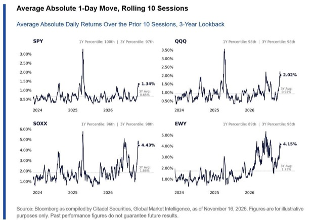
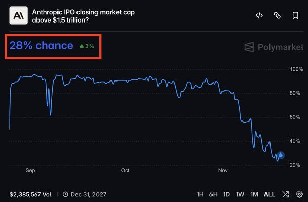
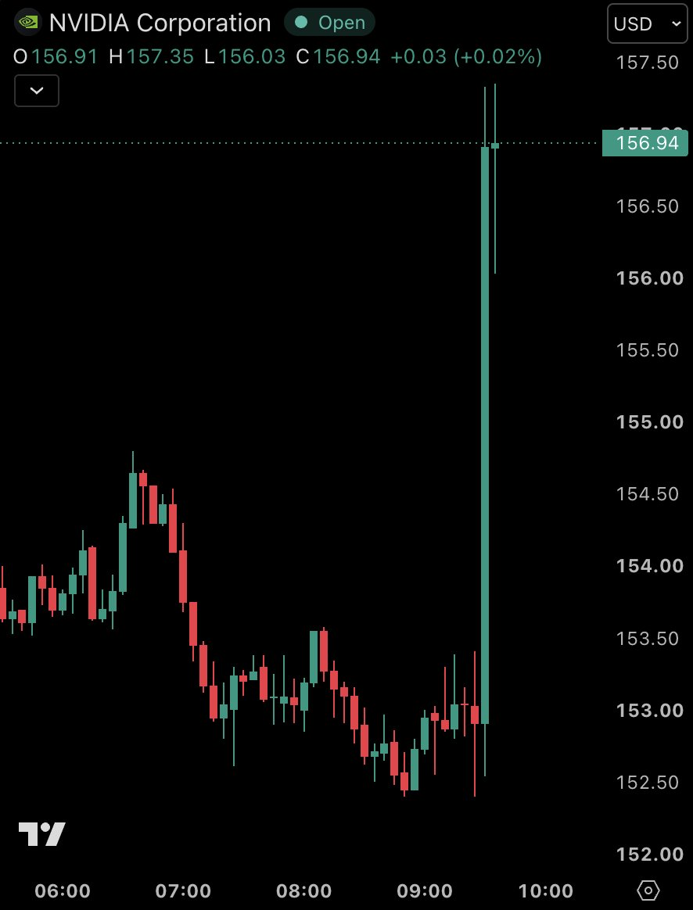
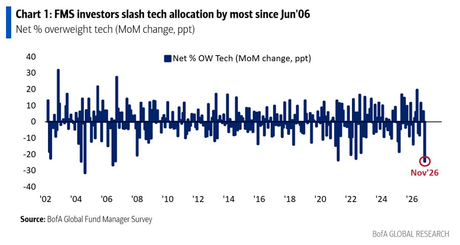
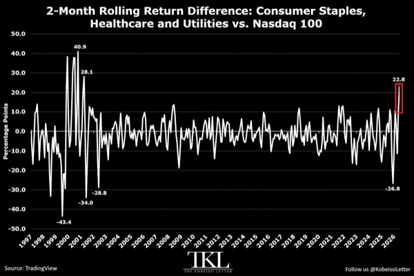
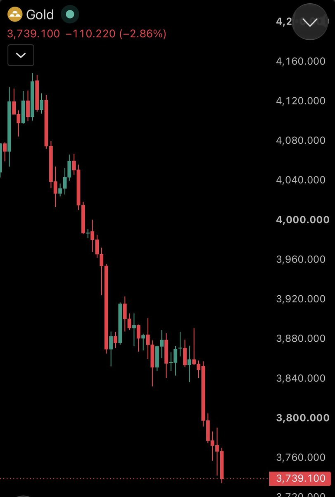
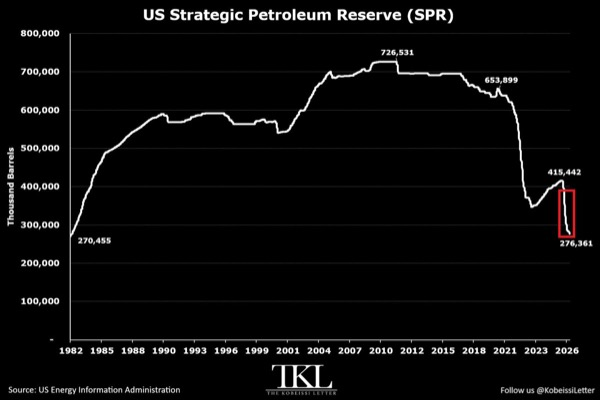
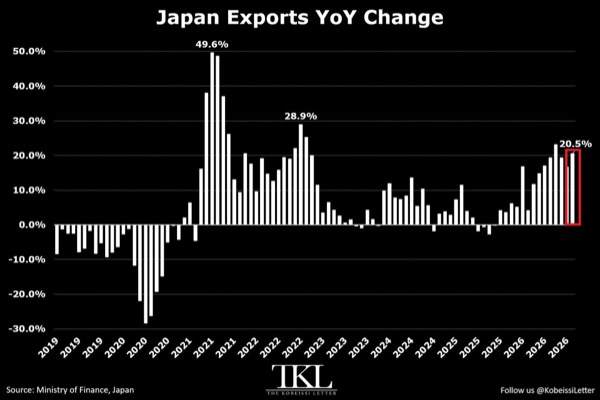
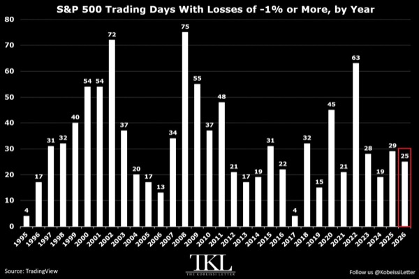
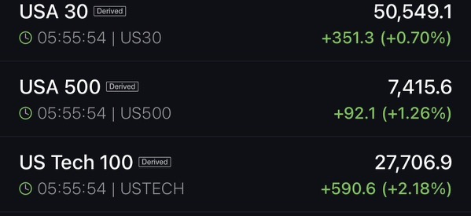

# Harvey

- 글로벌 주식시장의 가격위험이 반도체와 한국 주식에 집중되며, 한국은 2026년 들어 높은 변동폭이 반복됨
  - EWY 4.15%와 SOXX 4.43%의 변동폭이 비슷해도 한국의 위험을 전부 반도체로 설명할 수는 없음

- 반도체와 한국 주식은 기대수익률보다 높아진 위험을 감당할 자본의 잔여 규모와 복귀 조건이 중요함
- 반도체의 저평가 여부는 이익 추정치만으로 판단하기 어려우며, 실적이 버텨도 위험예산 축소로 보유 수요가 줄어들 수 있음
- 한국 주식은 반도체 위험에 환율·국가 위험이 더해지는 구조이므로 함께 평가해야 함
- 한국 증시 재평가는 이익 증가뿐 아니라 그 이익을 보유하기 위해 감수해야 하는 위험의 감소가 필요함

# KHwanK

### 엔비디아 경영진 의혹과 매수 판단의 조건

- 엔비디아의 투자 판단은 경영진 의혹이 개인 사생활에 그치는지, 기밀 유출과 회사 비리로 확대되는지에 달려 있음
  - 영상은 젠슨 황의 사생활·퇴진 및 중국 관련 의혹을 전제로 분석하며, 해당 의혹의 사실 여부는 원문에서 검증되지 않음
  - 영상에 따르면 이사회는 기밀 유출 증거가 아직 없다고 밝혔으며, 조사 결과에 따라 투자 시나리오가 달라짐
- 영상에서 집계한 2003년 이후 스캔들로 물러난 CEO 76명의 기업 중 약 60%는 퇴진 1년 뒤 시장 수익률을 밑돌았음
  - 초기 약 3개월은 지수와 비슷하게 움직이다가 6개월~1년 구간에서 부진이 두드러짐
  - 사건 직후 주가가 버틴다는 이유만으로 저가 매수에 나서기에는 위험이 큼
- 개인 사생활 문제보다 회계 조작·회사 비리·대형 사고가 장기 주가에 더 치명적임
  - 사생활 문제는 평균적으로 시장을 소폭 밑도는 수준이지만, 회계 부정이나 대형 사고는 1년 뒤 상대 수익률이 크게 악화됨
  - CEO 퇴진 자체보다 사건이 기업의 영업·재무·규제 위험을 훼손하는지가 핵심임
- 유능한 CEO의 퇴진이 평범하거나 무능한 CEO의 퇴진보다 반드시 더 나쁜 결과로 이어지지는 않음
  - 유능한 CEO는 직전 3년간 매년 시장 대비 2% 이상 초과 수익을 냈거나 탁월한 경영 성과를 남긴 인물로 분류
  - 유능한 CEO가 퇴진한 기업의 시장 초과 수익 비율은 약 절반, 무능한 CEO가 퇴진한 기업은 19%였음
  - 기존 사업 기반과 후계 체계가 견고하면 CEO 교체 충격을 흡수할 여지가 큼
- 유능한 CEO가 사생활 문제로 퇴진한 사례는 평균 수익률이 양호해도 승률은 약 절반에 그침
  - 전체 20건 중 1년 추적이 완료된 19건에서 시장 초과 수익 10건, 시장 하회 9건으로 승률 약 53%
  - 1년 뒤 평균 시장 대비 초과 수익은 약 4%포인트였으나, 개별 기업의 상승을 보장하는 수치는 아님
  - 맥도날드와 록히드마틴은 경영진 사생활 문제 이후에도 시장보다 양호한 주가 흐름을 보인 사례로 제시됨
- 유능한 CEO라도 회사 비리로 퇴진하면 1년 뒤 성과가 크게 나빠짐
  - 해당 집계에서 시장 대비 수익률은 평균 약 11%포인트 낮았고, 시장 초과 수익 비율은 약 33%였음
  - 노동법 위반으로 사망 사고가 발생한 일본 광고회사와 스톡옵션 날짜 조작이 드러난 유나이티드헬스는 각각 시장 대비 약 32%포인트, 15%포인트 부진한 사례로 제시됨
  - 예스뱅크는 스타 CEO의 과거 성과가 회사 비리의 충격을 막지 못한 사례임
- 엔비디아의 주요 확인 변수는 실적 발표, 후임 CEO, 의회 청문회, 이사회 조사 결과임
  - AI 수요와 실적이 유지되는지, 경영 승계가 안정적인지, 의혹이 회사 제재로 번지는지를 함께 확인해야 함
  - 개인 사생활 문제로 종결되면 사업 기반이 주가 회복을 뒷받침할 수 있으나, 기밀 유출과 조직적 비리로 확대되면 과거 성장성과 별개로 위험이 커짐
- 영상의 매수 구상은 조사 결과를 확인한 뒤 사건 발생 약 3개월 후인 2027년 2월 무렵 재검토하는 것임
  - 사생활 문제로 끝난 과거 사례의 초과 수익이 약 3개월 뒤부터 나타났다는 패턴에 근거함
  - 사건 직후 반등에 베팅하기보다 개인 문제로 종결되는지와 기업 가치 훼손 여부를 먼저 확인하는 접근임
- 평균 초과 수익 4%포인트와 승률 53%는 서로 다른 정보이며, 평균 수익이 높아도 성공 확률이 압도적인 전략은 아님
  - 완료 표본이 19건에 불과하고 사건·기업별 차이가 커 엔비디아의 향후 수익률이나 최적 매수 시점을 확정하기 어려움
- CEO 개인의 평판 충격과 회사의 현금흐름·규제 위험을 구분해야 투자 판단의 기준이 선명해짐
  - 조사 결과로 사건의 성격이 바뀌면 기존 매수 가정도 함께 수정해야 함

# Kobeissi

- Anthropic(ANT)의 공모가는 당초 70~78달러 범위를 웃도는 83달러, 기업가치는 1조5,000억 달러로 책정됨
  - 청약 수요는 약 5,000억 달러로 기관 약 4,000억 달러, 개인 약 1,000억 달러가 몰림
  - 초기 보도는 IPO 최소 680억 달러와 사모 260억 달러를 합친 940억 달러 이상 조달을 제시했고, 후속 보도는 IPO 예상 조달액을 813억 달러로 제시함
  - 당일 종가 시가총액이 1조5,000억 달러를 넘을 시장 확률은 29%로 하락하며 상장 기대가 약화됨

- Nvidia(NVDA)의 Jensen Huang 경영 공백이 AI 투자 사이클 전체의 붕괴를 뜻하지는 않으며, 심리 반전 시 숏스퀴즈 가능성이 있음
  - 미국 AI 설비투자는 연간 1조 달러 이상, AI 관련 업종·기술투자는 최근 4개 분기 미국 GDP 성장의 약 44%를 차지함
  - Nvidia의 내년 매출 가이던스는 약 7,500억 달러로 제시됨
  - Bill Ackman은 이사회의 해임·사임 강요 및 지배구조 실패 의혹을 제기했고, Elon Musk도 Huang의 대체 불가능성을 강조함
  - 복귀 청원은 20만 명을 넘었으며 주주 10만4,000명 이상과 전·현직 직원 1만1,800명 이상이 참여함

- 기술주 저가 매수와 Anthropic 상장 기대에 Nasdaq 100이 장중 2% 상승하고 Nvidia는 4% 넘게 반등함

- 연준 의사록은 12월 금리 인상 가능성을 높임
  - 거의 모든 위원이 추가 조치가 적절하다고 봤고, 일부는 12월 25bp 초과 인상 가능성까지 제기함
  - 10월 동결 지지자 중 일부도 결정을 박빙으로 평가했으며, 물가의 예상보다 긴 고착 가능성과 신속한 2% 복귀를 강조함

- 글로벌 펀드매니저의 기술주 비중 축소와 방어주 이동이 역사적으로 빠른 속도로 진행됨
  - 11월 초 기술주 순비중은 25%포인트 줄어 12%가 됐으며, 월간 감소폭은 2006년 6월 이후 최대임
  - 최대 비중확대 업종은 제약 34%, 산업재 19%이며, 기업 과잉투자를 우려하는 기관 비율은 역대 최고인 38%임
  - 향후 6개월 빅테크 설비투자 축소를 예상하는 비율은 10월 30%에서 52%로 상승함
  - 필수소비재·헬스케어·유틸리티는 10~11월 Nasdaq 100을 22.8%포인트 웃돌아 2001년 이후 최대 두 달 상대성과에 근접함
  - 11월 Nasdaq 100은 4.9% 하락한 반면 필수소비재는 2.9%, 헬스케어는 0.1% 상승하고 유틸리티는 0.3% 하락함

- 달러가 2025년 4월 이후 최고 수준에 오르며 금은 온스당 3,750달러, 은은 45달러 아래로 하락함
  - 금 가격은 2025년 9월 이후 최저 수준임

- 미국 유가가 8월 27일 이후 처음 배럴당 82달러 아래로 떨어지고 휘발유 가격은 18년 만에 최대 하루 낙폭을 기록함
  - 전략비축유(SPR)는 전주 320만 배럴 감소한 2억7,640만 배럴로 1982년 8월 이후 최저 수준임
  - 3월 고점 대비 1억3,910만 배럴·34% 감소했으며 최근 34주 중 33주 줄어 역대 최저치와 차이가 590만 배럴에 불과함

- 일본 10월 수출이 전년 대비 20.5% 늘어난 사상 최대 740억 달러를 기록하며 AI 인프라 투자의 수혜가 확대됨
  - 반도체 제조장비 수출은 49.7%, 전기기기는 33.6% 증가하며 14개월 연속 수출 증가를 견인함
  - 지역별 증가율은 대만 42.7%, ASEAN 34.7%, 미국 23.9%, EU 22.1%, 중국 13.3%임

- 최근 조정에도 S&P 500의 하락 빈도는 역사적 평균 범위에 머무름
  - 2026년 일간 1% 이상 하락은 25거래일이며 이 중 7일이 10~11월에 발생함
  - 1928년 이후 연평균은 29일, 2025년은 29일, 2024년은 19일, 2022년 약세장은 63일임

# MKevin

### 엔비디아 실적 호조와 주주환원 확대 속 경영진 불확실성

- 회사 측 발언 기준 젠슨 황 복귀 계획은 없으며 외부 조사 완료를 기다리는 상황
  - 행동강령 검토 이후 황의 사임을 이사회가 만장일치로 수용했고 후임 CEO를 신속하면서도 철저하게 찾겠다는 입장
- 분기 매출은 1,158억 달러로 시장 예상치를 5.9% 상회했고 다음 분기 매출 가이던스는 1,300억 달러 ±3%
  - 기존 예상 매출 1,110억 달러와 다음 분기 가이던스 1,200억 달러 ±2%를 모두 상회
  - 정규장 종가 약 155달러에서 시간외 약 160달러로 상승했으며 주요 관찰 가격대는 164달러
- 2027년 1월 말 기준 예상 EPS 9.33달러와 주가 160달러를 적용하면 예상 PER 약 17배
  - 향후 4개 연도 성장률 전망 69%, 33%, 17%, 12%의 평균은 약 33%이며 이를 적용한 PEG는 약 0.51배
  - 장기 성장 둔화를 반영해도 예상 성장률 대비 주가가 낮다는 평가
  - 높은 수익성을 바탕으로 적정 PEG를 2.6~3배로 가정하면 큰 상승 여력이 생기지만 적정 배수 자체는 주관적인 가정
  - 성장률을 연 10%로 낮추면 PEG는 약 1.7배이며 적정 PEG 3배 적용 시 약 76% 상승 여력
  - 성장률 33%와 PEG 2.6배 적용 시 현재의 약 5배 가치이지만 성장률과 적정 배수 유지가 전제
- 매출 증가율이 영업비용 증가율을 웃돌며 수익성 확대
  - 매출이 두 배 이상 증가하는 동안 연구개발비와 판매비 등을 포함한 영업비용 증가는 56%에 그쳐 영업 레버리지 확대
- 데이터센터 매출의 14%가 하이퍼스케일러를 거치지 않고 최첨단 AI 모델 개발사에서 직접 발생
  - 앤트로픽 등 AI 개발사의 자금 조달 능력과 사업 성과가 엔비디아 수요에 직접 연결되는 구조
  - 앤트로픽 IPO의 성패는 엔비디아 투자심리와 수요 지속성의 변수
- 공급 관련 약정은 39.7% 증가했고 클라우드 업계 수주잔고는 2.5조 달러
  - 수요가 공급을 크게 웃돌고 투자 확대 흐름이 지속되는 상황
  - 2028년 매출 증가율 전망을 75%로 높여 성장 기대 강화
- GPU 임대료 상승은 기존 장비와 신제품 모두에 대한 강한 수요를 뒷받침
  - Hopper 관련 임대료는 최초 도입 가격 대비 약 60% 상승했고 Blackwell은 더 큰 상승폭
  - Silicon Data 자료상 H100 가격은 약 2달러에서 3달러로, B200·B300 계열은 약 4.5달러에서 7달러로 상승
  - Goldman Sachs 자료상 헤지펀드가 반도체 주식을 매도하고 있어 기업 실적 외에 포지션 축소도 주가 하락 요인
- 분기 영업현금흐름은 480억 달러이며 자사주 매입 승인 규모를 1,500억 달러 추가 확대
  - 다른 기업 채권에 대한 투자는 전 분기 210억 달러에서 110억 달러로 감소
  - 신규 투자와 보증 심사를 강화하고 가능한 많은 잉여현금흐름을 주주에게 환원
- 데이터센터 건물과 전력 인프라가 실제로 건설되거나 착공되는 등 조건을 충족해야 보증이 발효돼 순환금융 위험을 제한
  - 기존 거래 관계에 대한 투자는 이어가되 신규 투자 심사 강도 강화
  - SEC 조사에서는 투자 성과 자체보다 이해상충과 중요 정보 공개 여부가 주요 쟁점이 될 가능성
- 4분기는 기존 계약 가격을 지키면서 단기 마진 압박이 발생할 수 있지만 이후 가격과 제품 구성 개선으로 회복 기대
  - Blackwell과 Vera Rubin 비중 확대가 향후 마진 개선 요인
  - 황의 부재 이후에도 제품 경쟁력과 GPU 임대료 상승이 판매 지속성을 뒷받침
- 미국 정치 변화와 데이터센터 규제 우려에도 AI 인프라 수요는 지속될 가능성
  - Cisco 경영진은 2028년 이후에도 강한 수요가 이어지고 향후 2년의 데이터센터 구축을 막을 자원·지정학적 문제가 해소될 것으로 예상
  - 데이터센터의 해외 이전을 원치 않는 미국의 산업적 이해관계가 규제 문제 해결을 유도할 가능성
- 로보틱스와 엣지 컴퓨팅은 약 80억 달러 규모로 데이터센터보다 작지만 차기 성장 동력
  - Jetson, GR00T, Isaac 등 로봇 개발 생태계와 엣지 연산 역량에 주목
- 낮은 PEG의 투자 매력은 예상 EPS 실현과 높은 성장률 유지에 달려 있으며 AI 개발사의 자금 조달, 약정의 실제 매출 전환, GPU 임대료 흐름을 함께 확인할 필요
- 주주환원 확대와 외부 채권 투자 축소는 현금 배분의 무게중심 변화를 보여주지만 보증 조건 강화만으로 고객사의 자금 조달 위험이 사라지는 것은 아님
- 경영진 교체 이후의 핵심 검증 지표는 신제품 출하, 고객 발주 지속성, 마진 회복이며 인물 관련 기대보다 사업 지표가 장기 가치에 더 직접적으로 연결

### 투자 둔화 공포와 소비주 쏠림 속 하이퍼스케일러의 기회

- 경기침체 공포보다 AI 투자 둔화와 반도체 이탈이 기술주 약세의 핵심
  - 뱅크오브아메리카 설문에서 경기침체 예상은 3%에 불과하지만 향후 6개월 내 AI 설비투자 축소 예상은 9월 15% → 10월 30% → 11월 52%로 급증
  - 펀드매니저의 반도체 매수 노출은 9월 55% → 10월 45% → 11월 39%로 하락하고 헤지펀드의 미국 반도체 매매 지표도 극단적 매도 영역
  - 모건스탠리 집계상 러셀3000 종목의 65%가 6월 이후 20% 넘게 하락해 지수 아래에서는 광범위한 약세장 진행
- 이란 충돌 지속에도 대체 공급 확대로 유가와 경유 공급 불안 완화
  - 브렌트유는 3주 동안 배럴당 26달러 넘게 하락해 92달러 아래로 내려왔고 글로벌 원유 공급은 전쟁 이전 수준 상회
  - 경유 크랙 스프레드는 40달러까지 축소됐지만 통상적인 10~20달러보다 여전히 높음
  - 호르무즈 해협 교란과 바레인·쿠웨이트 공격, 미국의 케슘섬 보복이 이어져도 공급 회복이 에너지 가격과 소비자 부담을 낮추는 구도
- 선거 이후 이란 합의의 정치적 유인이 줄어 봉쇄와 간헐적 보복이 장기화될 위험
  - 카스피해·호르무즈 해상 봉쇄와 경제제재가 이란 교역을 압박하면서 선박 공격과 보복의 악순환 지속 가능
- 유가 하락과 연준의 매파적 발언이 기대인플레이션을 낮추는 가운데 긴축은 주가 반등을 제약
  - 월러의 50bp 인상 가능성 언급과 연준 대차대조표 축소가 금융여건 압박
  - 인플레이션 진정 기대와 즉각적인 주가 상승은 별개이며 추가 긴축 시 저점 확인 지연 가능
- 엔비디아는 12월 초 의회 증언과 수출통제 우회 의혹이 주요 불확실성
  - 젠슨 황의 12월 1일 비공개 청문회와 3일 공개 청문회 가능성, 팀 테터의 다음 날 증언 및 콜레트 크레스 조사 보도
  - 알리바바가 동남아시아에서 칩을 임차하도록 엔비디아 영업팀이 메가스피드를 연결했는지가 조사 쟁점
  - 젠슨 복귀 예측시장 확률은 8%에서 10%로 반등했지만 개인 추정치 40%와 큰 격차가 있으며 소액 관련 베팅 보유
- 오라클과 코어위브의 신용위험이 AI 투자 우려를 증폭시키지만 CDS 가격은 최근 급등 고점 부근에서 안정
  - CDS가 의미 있게 하락하지 않아 위험 해소로 보기 어렵고 차입 의존도가 높은 네오클라우드는 별도 점검 필요
- 모건스탠리는 AI 사이클을 중반 진입으로 보고 하이퍼스케일러와 AI 도입 기업으로 투자 범위 확대
  - AI의 측정 가능한 재무적 혜택을 얻는 S&P500 기업 비중은 16%에서 26%로 증가
  - 하이퍼스케일러·네오클라우드 설비투자 증가율은 2027년 62%에서 2028년 약 14%로 둔화되지만 지출 규모 자체는 계속 증가
  - 성장률 둔화와 투자액 감소를 구분해야 하며 생산성 개선은 초기 단계
- 모건스탠리의 향후 12개월 S&P500 목표는 기본 8,700, 강세 10,000으로 당시 약 7,300 대비 상승 여력 제시
  - 강세 시나리오는 2028년 주당순이익 500달러에 주가수익비율 20배 적용
  - 투매 지표가 주요 저점 근처에 접근했지만 추가 하락 가능성은 남아 있음
  - 2027년 4분기 유가 75달러, 2027년 말 근원인플레이션 2.5%를 전제로 하며 연준의 추가 긴축이 핵심 위험
- AI 생산성 개선 수혜는 기술·통신서비스·금융으로 확산 가능
  - 모건스탠리 분류상 수혜 가능 비중은 기술 51%, 통신서비스 61%, 금융 67%
  - 로빈후드 약 69달러를 잠재적 진입 가격으로 검토하지만 아직 매수하지 않은 상태
- 미국 본사 기업에 대한 예외와 상무부 허가가 해외 AI 컴퓨팅 판매의 통로가 될 가능성
  - 아마존·구글·마이크로소프트·스페이스X·오라클 등 미국 하이퍼스케일러의 해외 데이터센터와 컴퓨팅 판매에 유리한 구도
  - 마이크로소프트와 바이트댄스의 추가 5억달러 클라우드 계약 협상은 사례지만 연매출 약 4,000억달러 대비 영향은 제한적
  - 수출통제 해결과 실제 허가 발급 여부는 별도 불확실성
- 골드만삭스가 주목한 당장의 자금 유입처는 경기소비재와 필수소비재
  - 테이크투 약 8%, 치즈케이크팩토리 4%, 윈리조트 2%, 타깃 5%, 디즈니 2.7% 상승 사례
  - AI 회피 자금이 소비주를 끌어올리는 만큼 단기 수급 강세와 장기 기업가치를 구분할 필요
- 디즈니는 주가 약 120달러, 예상 EPS 7.51달러와 이익성장률 10~11%를 적용하면 PEG 약 1.45배
  - 적정 PEG를 2배로 잡는 개인 평가에서 목표 약 165달러와 37~38% 상승 여력 산출
  - 예상 순이익률은 12.1%에서 약 14%로 개선되지만 20% 미만
- 치즈케이크팩토리는 소비주 쏠림으로 밸류에이션 부담 확대
  - 주가 118달러, PER 25배, 성장률 약 12%, 순이익률 6%로 PEG 약 2배
  - 적정 PEG 1.3배를 적용한 개인 평가에서는 약 35% 조정 여지가 있어 상승 모멘텀만으로 매력적인 가격은 아님
- 브로드컴은 355달러가 단기 저항선이면서 장기 가치 평가의 기준 가격
  - 예상 EPS 11.67달러 적용 시 PER 약 30.4배, 향후 성장률 65%·58%·34%·19.8%의 평균 약 44.2% 적용 시 PEG 약 0.67배
  - 성장률을 20%로 낮춰도 PEG 약 1.5배이며 순이익률 53%가 높은 평가배수의 근거
  - 적정 PEG 2.5배 가정 시 약 67% 상승 여력, 고성장 지속 시 현재 가격의 2~3배 가능성까지 제시하지만 성장률 가정에 크게 의존
- 앤스로픽 IPO는 AI 투자심리 반전의 잠재적 촉매지만 성사와 효과 모두 불확실
  - 장기 AI 노출에서는 현금창출력이 큰 하이퍼스케일러가 코어위브 같은 신용위험 높은 기업보다 안정적인 선택지
- AI 설비투자 증가율 둔화가 이미 주가에 반영됐는지와 실제 투자액 감소가 시작되는지를 구분하는 것이 핵심
  - 지출이 늘어도 성장률 하락만으로 주가는 약세를 보일 수 있어 신규 계약·가동률·현금흐름 확인 필요
- 소비주 상승을 따라갈 때는 업종 이동보다 기업별 가격 차이가 중요
  - 디즈니와 치즈케이크팩토리의 수익성·PEG 차이는 같은 소비주 상승장에서도 기대수익이 달라질 수 있음을 시사
- AI 공급자에서 실제 비용 절감과 이익 증가를 입증하는 도입 기업으로 관심을 넓히되 수출허가·신용스프레드·연준 기조를 함께 점검할 필요

### 앤트로픽 상장 가치와 반도체 반등 기대

- 영상에서 제시한 Anthropic 공모가는 83달러로 최초 예상 범위 72~78달러를 웃돌며, 예상 기업가치는 1조5,000억 달러 이상
  - 공모가와 첫 거래 가격은 다르며, 제한된 유통 물량과 낮은 공모가 설정은 상장 첫날 상승과 제품 홍보 효과를 유도
  - Kevin은 첫날 100달러 돌파를 예상하며, 장외 예상 가격은 96~104달러, 청약 수요는 공급의 10배, Altimeter 주문은 50억 달러로 소개
- 성장률 둔화보다 급격히 커진 매출 기반의 유지가 핵심
  - 2025~2026년 세 자릿수 성장 이후 3분기 성장률이 29%까지 낮아졌다는 수치 제시
  - 고성장 기저를 넘기기 전인 4분기 상장은 성장 기대를 가장 높게 평가받을 시점이라는 해석
- 상장 자금은 단기 생존보다 향후 컴퓨팅 투자와 운영 기간을 확보하는 성격
  - 공모로 약 800억~810억 달러, Google·SpaceX·Broadcom 등의 투자로 약 200억~250억 달러를 조달해 보유 현금이 2,000억 달러를 넘을 것으로 예상
  - 지급 의무 약 700억 달러, 부채 약 60억 달러를 감안해 최소 2년, 매출 성장에 따라 2년 반~3년의 운영 여력 추정
  - Amazon 관련 전환증권은 전환가격이 대략 2.50~5달러대로 낮아 주식 전환 가능성이 높고 현금 상환 부담은 제한적이라는 평가
- 막대한 컴퓨팅 비용 때문에 현재 순이익이나 주당순이익보다 매출 배수가 주된 가치평가 기준
  - 영상에서 제시한 10월 기준 연환산 반복매출은 약 810억 달러로, 과거 손익계산서만으로 최근 성장세를 반영하기 어려움
  - Palantir 시가총액 약 3,900억 달러와 연환산 매출 약 100억 달러를 적용하면 매출 배수는 약 39배
  - 같은 배수를 Anthropic에 적용한 가치는 약 3조1,000억 달러로 예상 상장 가치의 약 2배지만, Palantir는 이미 이익과 현금흐름을 내는 기업이라는 차이 존재
- 장기 투자 논리는 토큰 판매를 넘어 기업 업무 전반의 기반 소프트웨어가 되는 ‘SaaS 2.0’에 있음
  - 에이전트·이메일·회의·문서·사업계획·급여·금융 업무를 하나의 허브로 통합해 기존 소프트웨어 시장을 흡수하는 구상
  - 회의 대체 도구·문서 스캔·문서 수정 기능을 확장 중이며, 일부 업무는 아직 외부 서비스 연동에 의존
  - 고객 자체 하드웨어에서 실행할 수 있는 소프트웨어 라이선스 사업으로의 확장은 Kevin의 장기 가설
- 흥행 여부는 개별 종목을 넘어 나스닥과 반도체 투자심리의 분기점
  - 최근 시장 약세, 선거 이후 불확실성, 중국 반도체 수출 제한, 기술주 가치평가 하락을 상쇄할 촉매로 기대
  - 첫날 종가 110달러 이상이면 시장 전반에 강한 호재, 큰 폭 하락이면 AI 투자와 경기 기대에 악재라는 시각
  - 약 9,000억 달러의 투자 약정이 반도체 기업 매출로 이어질 수 있어, 할인된 반도체 주식의 반등에 더 주목
- Kevin은 상장에 낙관적이지만 공모일 직접 매수는 보류하고 향후 조정 시 매수 검토
  - 예상 하락 여지는 10~20% 수준이며, SpaceX처럼 큰 폭의 등락이 재현될 가능성은 낮게 평가
  - 보유 노출은 후원사 Liquid가 제공한 약 3,300달러의 무기한 파생계약으로, 자기 자금의 비상장 주식 투자가 아니며 직접 지분 소유도 아님
- 영상에서 소개한 목표주가는 Citizens 125달러, Wolfe Research 135달러, Needham 150달러, Melius 155달러
  - SpaceX·Anthropic의 보호예수 해제로 2027년 말까지 5,000억 달러 이상의 벤처 자금이 풀릴 수 있다는 보도를 인용하며 신규 스타트업 투자 재원 확대 기대
- 매출 배수의 상승 여력은 높은 성장 지속과 기업 업무 허브로의 확장 성공에 달려 있으며, 현재 수익성이 있는 비교기업의 배수를 그대로 적용하면 컴퓨팅 비용과 사업모델 차이를 놓칠 수 있음
- 현금 확보는 자금 고갈 위험을 낮추지만, 대규모 투자 약정이 실제 수익으로 전환되는 속도와 성장률 둔화를 함께 점검해야 함
- 상장 흥행에 대한 낙관과 상장일 추격 매수는 별개이며, 직접 주식·파생계약·반도체 공급사의 투자 노출을 구분할 필요

### 이란 재공습 검토와 원유 공급 회복의 갈림길

- 트럼프가 이란에 대한 4~7일 추가 공습을 검토 중이며 최종 결정은 아직 없음
  - 뉴욕타임스 보도에 따르면 이스라엘은 이란의 미사일·드론 전력 복구와 화학·생물무기 개발을 이유로 미국의 공습 참여를 요구
  - 미 행정부 내부에서는 경제 봉쇄만으로 이란에 충분한 타격을 주고 있어 대규모 전투 재개가 불필요하다는 의견도 존재
- 이란의 재래식 전력이 크게 약화됐어도 미사일 잔존량은 상당한 수준
  - 트럼프는 이란 해군·공군·방공 전력이 기존의 12~13%로 줄었다고 발언
  - 월스트리트저널이 인용한 미국 당국자 추산은 미사일 1,500~2,500발, 이스라엘 추산은 전쟁 초기 약 3,000발 중 1,500~2,000발 잔존
  - 생산시설 파괴와 실제 보복 능력 소멸은 별개이며 미군 기지와 역내 시설에 대한 공격 위험이 남아 있음
- 이란 봉쇄는 호르무즈 해협·육상 국경·북부 카스피해 보급로를 동시에 차단하는 구도
  - 북부 보급 차단 작전은 무기와 드론 생산용 물자 유입을 막는 목적
  - 뉴욕타임스는 이란의 댐·물 이송 사업 일부가 미사일 시설과 지하 터널을 은폐하는 용도일 가능성을 제기
  - 수자원 시설의 군사적 이용 의혹은 공습 대상 확대와 민간 기반시설 피해 위험으로 연결
- 화학·생물무기 위협이 추가 공격의 핵심 명분으로 부상했으나 사용 계획은 확인된 사실과 구분할 필요
  - 이스라엘은 이란이 드론에 화학·생물무기를 탑재하고 미 고위 당국자·역내 미군·미국과 유럽을 공격할 수 있다는 정보를 전달
  - 영상이 인용한 미국 정보당국의 지배적 평가는 이란이 미국·이스라엘의 전략핵 보복을 우려해 선제 사용을 꺼린다는 것
  - 트럼프는 이란의 화학·생물무기 추구를 언급하며 보복을 경고했지만 공개 근거는 제시하지 않음
  - 스콧 베선트의 거처 이동과 화학 공격 위협의 연관성은 추정 단계
- 미군의 병력 이동과 방공 보강은 충돌 재개에 대비하는 신호
  - 국방부·국무부는 일부 중동 기지 인원을 예방적으로 철수시키고 이스라엘의 패트리엇 전력을 보충
  - 영상 기준 역내 미군은 약 5만 3,000명, 항공모함은 3척이 모였다가 조지 워싱턴함 이탈로 2척이 남는 흐름
  - B-1·B-2 폭격기는 수주째 4일 내 전개 가능한 대기 상태
  - 미 중부사령부의 사우디 국방장관 접촉도 역내 방위 협력과 안보 조율의 일부
- 미국의 전쟁 예산 차단과 이스라엘의 연정 구성 일정이 군사 결정의 시한을 압축
  - 민주당은 정부 셧다운을 피하면서 대이란 군사작전 예산을 막는 방안을 논의
  - 척 슈머는 의회가 무력 사용을 승인하기 전까지 대이란 작전 지출을 차단하는 방안을 지지
  - 12월에 차단을 추진할지, 민주당이 양원을 장악하는 1월까지 기다릴지는 미정
  - 이스라엘 연정 구성의 첫 시한은 12월 6일로 제시되며 향후 약 3주가 주요 결정 구간
  - 원문은 정부 예산 시한을 9월 11일로도 언급해 11~12월의 다른 일정과 불일치
- 전쟁 재개에는 미국·이스라엘 양국의 국내 정치 유인이 얽혀 있음
  - JD 밴스는 전쟁에 반대하며 선거 패배의 원인으로 지목했고 트럼프와 책임 공방이 발생
  - 네타냐후는 연정 구성 압박을 받는 반면 이스라엘 내부에서도 이란을 즉각적 위협으로 보는지에 대한 견해가 엇갈림
  - 민주당은 트럼프 일가·밴스·쿠슈너·행정부 관계자 등에 자료 보존을 요구하며 광범위한 조사에 대비
  - 전쟁 지속 여부가 군사적 필요뿐 아니라 집권 유지와 의회 견제 일정에도 영향을 받는 구도
- 걸프 원유 수출 회복이 공급 부족을 완화하고 있지만 재공습은 회복 흐름을 뒤집을 수 있음
  - 11월 13일까지 걸프 원유 수출은 전쟁 이전의 74% 수준으로 회복
  - IEA는 수출 회복으로 전쟁 시작 이후 처음 글로벌 원유 공급이 초과 상태로 전환될 것으로 전망
  - 10월 일부 추산은 하루 2,400만 배럴에 달하지만 집계 시점과 유조선 피격 여부에 따라 수치 변동이 큼
  - 더 많은 선박과 소형 선박이 수송에 참여하며 수출을 지원
- 영상에서 제시한 유가는 배럴당 약 92달러로 즉각적인 확전 위험을 강하게 반영하지 않은 상태
  - 시장 낙관론에는 AI가 물가를 낮출 것이라는 기대와 앤트로픽에 대한 관심도 작용한다는 해석
  - 중러 핵군축 논의도 중국의 낮은 참여 유인 때문에 뚜렷한 돌파구를 기대하기 어려운 상황
- 원유 공급 정상화에 기대는 물가 안정 경로는 공습 재개와 호르무즈 수송 차질에 취약
  - 수출 회복률 자체보다 실제 선적량·유조선 피격·항로 유지 여부가 공급 전망의 핵심 변수
- 향후 수주는 전쟁 예산 차단·이스라엘 연정 시한·군사 준비가 겹치는 구간으로 확전 위험의 재평가 가능성이 큼
  - 공습 승인과 화학무기 관련 검증 정보, 미군 철수·증원 변화가 단순한 강경 발언보다 중요한 판단 재료

# Slav

- The Economist의 2027년 전망은 AI 기업 차입과 선진국 재정 부담이 함께 자금조달 비용·위험 프리미엄을 높일 가능성에 무게를 둠
  - AI 기업의 복잡하고 불투명한 금융거래가 투자 붕괴와 금융시장 충격을 키울 수 있음
  - 선진국의 재정적자·국채 발행·이자비용 증가가 누적되며 국채시장 압박이 심화될 전망
- 미국 후계 경쟁과 유럽 정치 불안이 정책·채권시장 변동성을 높일 수 있음
  - 미국은 차기 권력 경쟁 속에서 행정명령·법적 분쟁·군사행동이 확대될 가능성
  - 프랑스 대선에서 마린 르펜이 승리하면 EU 협력 약화와 프랑스 고부채 문제가 맞물려 유럽 채권시장에 충격을 줄 수 있음
- 이란 전쟁의 후폭풍은 중동 질서와 글로벌 에너지 공급 구조를 재편할 전망
  - 비료 공급 부족과 슈퍼 엘니뇨가 겹치면 식량안보 위기가 심화될 수 있음
- 폭염·가뭄·산불과 에너지 공급 불안이 재생에너지의 경제적 매력을 높일 전망
  - 에너지 가격 변동성이 재생에너지 확대를 촉진할 수 있음
- 2027년 중국군의 대만 점령 준비태세를 둘러싼 관측이 대만해협 지정학적 위험을 부각함
  - 드론 등 신기술의 방어 효과는 중국의 군사적 판단에 영향을 줄 수 있음
- GLP-1 비만치료제 확산이 의류·화장품·피트니스 소비와 장수·항노화 치료제 개발을 확대할 전망
- SpaceX Starship의 정기 위성 발사와 민간 우주정거장 추진으로 우주 인프라 투자가 확대될 전망
  - 발사비용 하락은 우주 기반 데이터센터를 현실적인 투자 대상으로 만들 수 있음
- 저예산 크리에이터 영화의 경쟁력 확대로 대형 스튜디오 중심의 콘텐츠 제작·유통 구조가 재편될 수 있음
  - 기존 대형 프랜차이즈는 새로운 관객층 확보가 과제임

# Stockbot

- Anthropic(ANT)의 공모가는 당초 70~78달러 범위를 웃도는 83달러, 기업가치는 1조5,000억 달러로 책정됨
  - 청약 수요는 약 5,000억 달러로 기관 약 4,000억 달러, 개인 약 1,000억 달러가 몰림
  - 초기 조달 전망은 IPO 최소 680억 달러와 사모 260억 달러를 합친 940억 달러 이상이며, 후속 보도는 IPO 예상 조달액을 813억 달러로 제시함
  - 미국 동부시간 오전 9시 50분 호가 공개, 오전 10시 Nasdaq 거래 개시가 예정됨
- Nvidia(NVDA) 이사회가 Jensen Huang 해임 또는 사임 강요 과정에서 수탁자 의무를 위반했다는 Bill Ackman의 비판으로 지배구조 논란이 확대됨
  - Huang의 CEO 복귀 청원은 20만 명을 넘었으며 주주 10만4,000명 이상, 전·현직 직원 1만1,800명 이상이 서명함
  - 현직 직원 약 24%가 참여했으며 이사회는 청원에 입장을 내놓지 않음
- 기술주 저가 매수와 Anthropic 상장 기대에 Nasdaq 100 선물이 2% 넘게 상승함

# WUncle

### 칩 수출 규제와 희토류가 흔드는 미중 휴전

- 엔비디아의 핵심 변수는 젠슨 황 개인 의혹보다 미국의 칩 수출 규제 강화와 중국의 희토류 대응
  - 자막은 젠슨 황의 11월 12일 사임과 주가의 6주 연속 하락, 고점 대비 약 32% 하락을 전제로 미중 협상 구도 분석
  - 지난 1년간 휴전을 이끈 협상론이 약해지고, 미국 의회와 안보 부처의 대중 강경론이 부상하는 흐름
- 젠슨 황과 앨리스 황을 둘러싼 간첩 의혹은 공식 결론과 기소가 없는 상태
  - 메가스피드의 말레이시아 관계사가 2024년 6월부터 올해 2월까지 엔비디아 칩을 포함한 AI 장비를 최소 48억 달러 수입했다는 보도로 우회 수출 문제가 확대
  - 엔비디아는 메가스피드 판매를 중단했다고 밝혔지만 이후에도 거래가 이어졌다는 보도가 나왔으며, 직접 판매인지 서버 업체를 통한 공급인지는 미확인
  - 투자 쟁점은 개인 의혹에서 칩의 최종 도착지와 회사의 수출 규정 준수 체계로 이동
- 미국의 첨단 칩 통제와 중국의 희토류 통제는 서로 교환해 온 협상 카드
  - 희토류는 채굴보다 정제·가공이 병목이며 중국 비중이 90%를 넘어 단기간 대체가 어려움
  - 지난해 중국의 수출 허가 지연만으로 포드 시카고 공장이 일주일 중단됐으며, 전면 금지 없이도 생산 차질 유발 가능
  - 미국의 H20 판매 재허용과 중국의 희토류 공급 완화처럼 양측이 규제를 강화한 뒤 맞교환하는 방식으로 휴전 유지
- 지난해 부산 정상회담에서 미국의 50% 룰과 중국의 희토류 통제 확대를 각각 유예했고, 이번에는 종료일을 내년 1월 10일까지 두 달 연장
  - 50% 룰은 수출 통제 명단에 오른 기업이 지분 50% 이상을 보유한 자회사에도 같은 제한을 적용하는 규칙
  - 중국 규칙은 해외 제품이라도 지정 희토류 재료가 제품값의 0.1% 이상이면 중국의 수출 허가를 요구하는 방식
  - 미국은 희토류·농산물 약속 이행을, 중국은 휴전 중 추가 칩 통제를 문제 삼아 상호 불신 지속
- 엔터티 리스트 신규 등재 재개는 미국이 기존 휴전 방식을 바꾸는 신호
  - 자막에 인용된 보도상 지난해 부산 회담 이후 신규 등재가 멈췄고, 부처 심의를 통과한 100곳 이상의 등재도 지연
  - 등재는 관계 부처 위원회 다수결로 결정하지만 상무부가 의장과 관보 공고를 맡아 실제 집행에 영향력 행사
  - 명단에서 삭제·수정하려면 원칙적으로 위원 전원 동의가 필요해, 신규 등재 보류보다 사후 철회가 정치적으로 어려움
- 칩을 중국에 반입하지 않고 해외 데이터센터에서 빌려 쓰는 원격 접근이 기존 수출 통제의 빈틈
  - 상무부가 준비 중인 7개국 규칙은 싱가포르·말레이시아·태국 등을 대상으로 최신 칩 도입 허가와 최종 사용자·용도 보고를 강화하는 방안
  - 보도된 안에서는 미국 기업이 운영하는 데이터센터가 중국 고객의 원격 접근을 차단하면 허가 면제 가능
  - 상무부는 7개국과 신규 공급 칩 중심으로 제한하려는 반면, 다른 부처들은 전 세계 적용 등 더 강한 통제를 요구
  - 적용 국가, 기존 데이터센터 포함 여부, 보고와 개별 허가의 구분은 최종 규칙 확인 필요
- 12월 국방수권법 최종안의 AI 오버워치법 포함 여부가 칩 수출 규제의 분수령
  - 법안은 일정 성능 기준을 넘는 칩의 우려 국가 기업 수출 허가를 금지하고, 시행 후 18개월 동안 기준 변경을 제한
  - 12월 제정 시 기준선이 2028년 여름까지 고정돼 대통령이 정상회담에서 첨단 칩 판매 완화를 약속하기 어려워짐
  - 기준선 아래 통제 대상 칩도 수출 허가 15일 전 신청서와 조건을 의회에 제출하고, 기준 변경은 18개월 이후 의회에 30일 전 통보하는 구조
  - 행정부 규칙은 협상에 따라 수정할 수 있지만 법률로 고정된 제한은 같은 방식으로 풀기 어려움
- 칩 보안법과 매치법은 칩의 우회 반출과 중국의 자체 생산 역량을 각각 겨냥
  - 칩 보안법은 첨단 칩의 위치 확인 기능을 통해 제3국 경유 반출을 추적하는 방안
  - 매치법은 핵심 반도체 장비의 대중 수출을 제한하고 동맹국에 150일 이내 미국 수준의 통제를 요구하는 방안
  - 삼성전자 시안 낸드 공장과 SK하이닉스 우시 D램·다롄 낸드 공장의 장비 반입·정비에도 영향 가능
  - 세 법안 모두 최종 제정 여부와 적용 범위가 미확정이며, 국방수권법 최종 문구 확인 필요
- 미국 내 대립의 중심은 규제 강화 여부보다 규제를 다시 풀 수 있는 권한
  - 백악관은 칩을 희토류·관세 협상의 카드로 남겨 두려 하고, 의회는 행정부가 임의로 완화하지 못하도록 법제화를 추진
  - 공화·민주 양당의 규제 강화 압력이 겹치며, 자막은 내년 1월 3일 민주당 주도 새 의회 출범 후 조사 확대를 예상
  - 안보 관료나 AI 기업이 스캔들을 조직적으로 활용했다는 근거는 없으며, 정책 이해관계의 일치와 공조는 구분 필요
- 중국은 당장 보복하기보다 미국의 최종 조치를 확인한 뒤 1월 10일 희토류 유예 연장 여부를 정할 가능성
  - 희토류 규칙 시행은 즉각적인 수출 전면 중단이 아니라 허가제 확대지만, 심사 지연만으로도 공급망 차질 가능
  - 미국의 핵심 광물 협의체와 공급망 다변화는 광산·정제시설 건설에 시간이 걸려 단기 협상력을 바꾸기 어려움
- 중국 정부의 국산 칩 자립과 중국 AI 기업의 엔비디아 연산 수요는 충돌
  - 자막에 인용된 보도상 H200 약 60만 개가 중국의 대량 수입 승인 지연으로 홍콩에 적체
  - 텐센트가 오라클의 동남아 데이터센터에서 칩 최대 10만 개를 5년간 빌리려던 계약은 미중 양측 압박 뒤 취소
  - 중국 상무부는 수입 필요성을, 안보 부처는 의존 축소를 중시해 대응 강도를 단정하기 어려움
- 엔비디아의 이번 분기 매출 전망 1,080억 달러에는 중국 데이터센터용 칩 직접 매출이 이미 제외
  - 추가 규제의 당장 영향은 중국 직접 매출보다 동남아 데이터센터를 통한 간접 수요와 향후 중국 재진입 기대에 집중
  - 엔비디아가 신규 클라우드 계약에서 서비스의 51% 이상을 비중국 고객에게 판매하도록 요구했다는 보도는 규칙 발표 전부터 고객 구성이 바뀌고 있음을 시사
- 7개국 규칙의 매출 영향은 주문 이동과 전체 투자 위축 중 어느 쪽이 큰지에 달림
  - 현지 업체 주문이 허가 면제를 받는 미국 클라우드로 이동하면 엔비디아의 총 칩 판매 감소는 제한적일 수 있음
  - 허가·보고 부담으로 현지 데이터센터 증설이 지연되면 중국 고객과 무관한 주문까지 늦어질 수 있음
  - 최종 규칙 발표 후 실제 발주·납품·증설 계획을 확인해야 영향 규모 판단 가능
- 리더십 공백과 수출 규정 준수 조사는 엔비디아의 대미 협상력과 장기 성장 기대에 부담
  - 젠슨 황 복귀 논의와 외부 CEO 선임 요구가 맞서는 가운데 이사회 조사와 후임 인선은 미확정
  - 재무장관의 이사회·외부 법률자문단 설명 요구는 조사 범위가 개인 문제에서 회사의 통제 체계로 확대됐음을 의미
  - 실적 발표에서는 기존 전망 유지 여부, 동남아·중동 주문과 납품 변화, 후임 CEO 및 규정 준수 대응을 함께 점검
- 주요 일정은 11월 19일 미중 정상회담, 12월 국방수권법 최종안, 내년 1월 10일 양국 규제 유예 종료
  - 자막은 12월 1일 젠슨 황 의회 출석 요구, 12월 10일 상무장관 증언, 12월 중순 정상 간 추가 접촉도 주요 변수로 제시
  - 실적 발표 날짜는 자막 안의 상대 시점과 날짜가 맞지 않아 별도 확정 불가
- AI 오버워치법이 빠지면 행정부의 칩 규제 완화·유예를 통한 기존 교환 방식이 이어질 여지
  - 법안이 포함되면 기준선 위 칩은 18개월 동안 협상에서 제약을 받고, 중국의 요구가 엔터티 리스트·관세 등 다른 카드로 이동할 가능성
- 엔비디아의 단기 실적과 장기 가치평가를 가르는 변수는 현재 중국 직접 매출보다 해외 연산 수요의 유지와 중국 시장 재진입 가능성
  - 규제 발표 자체보다 적용 범위, 미국 클라우드 예외, 주문의 실제 이동 여부가 매출 영향을 결정
- 한국 반도체 기업은 엔비디아 실적에 따른 주가 연동과 중국 공장 장비 규제를 각각 점검할 필요
  - 매치법 최종 문구와 희토류 허가 지연이 함께 강화되면 반도체 장비·정비와 산업 전반의 공급망 부담이 겹칠 수 있음
