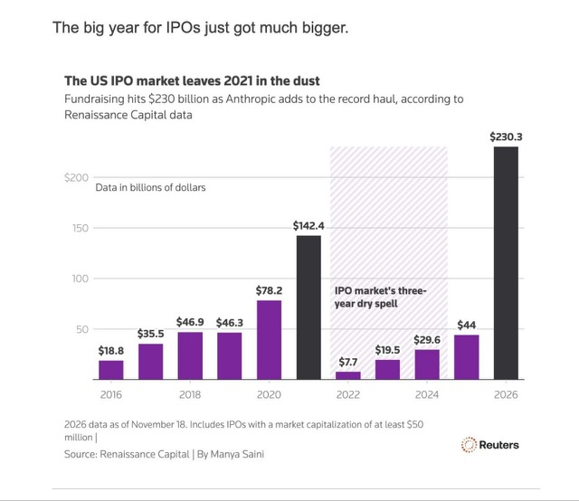
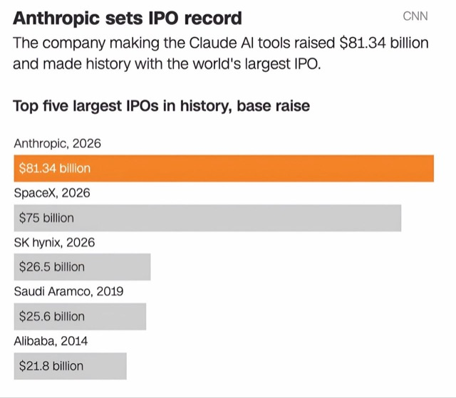
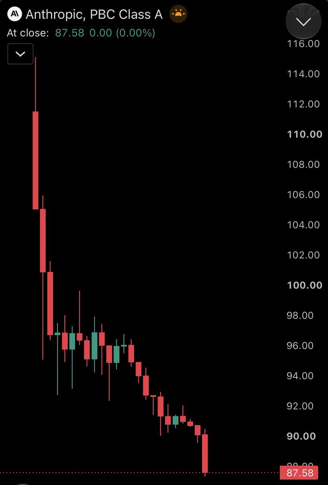
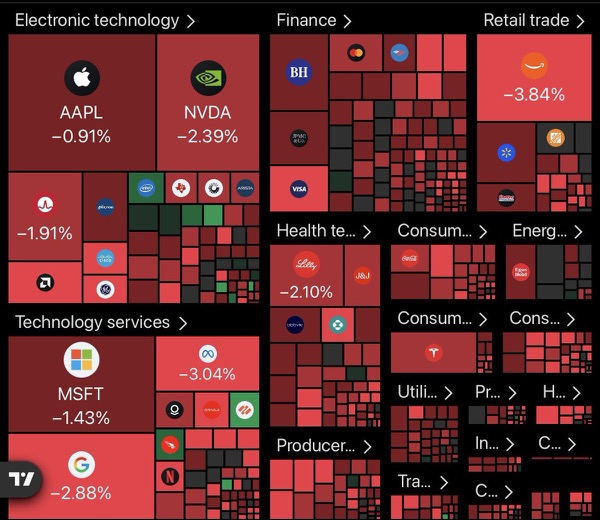
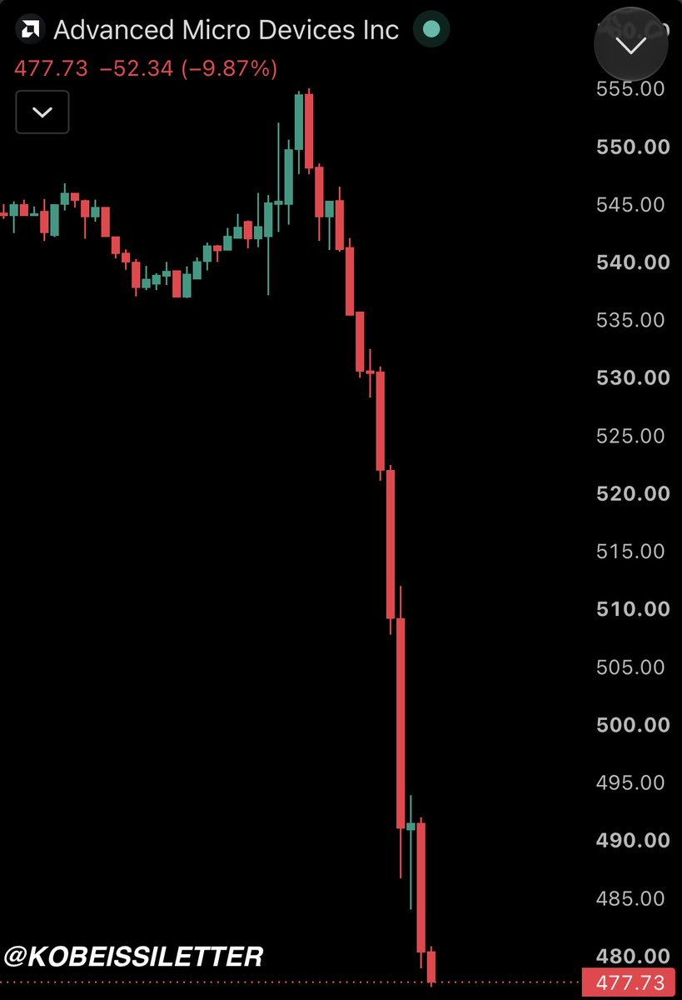
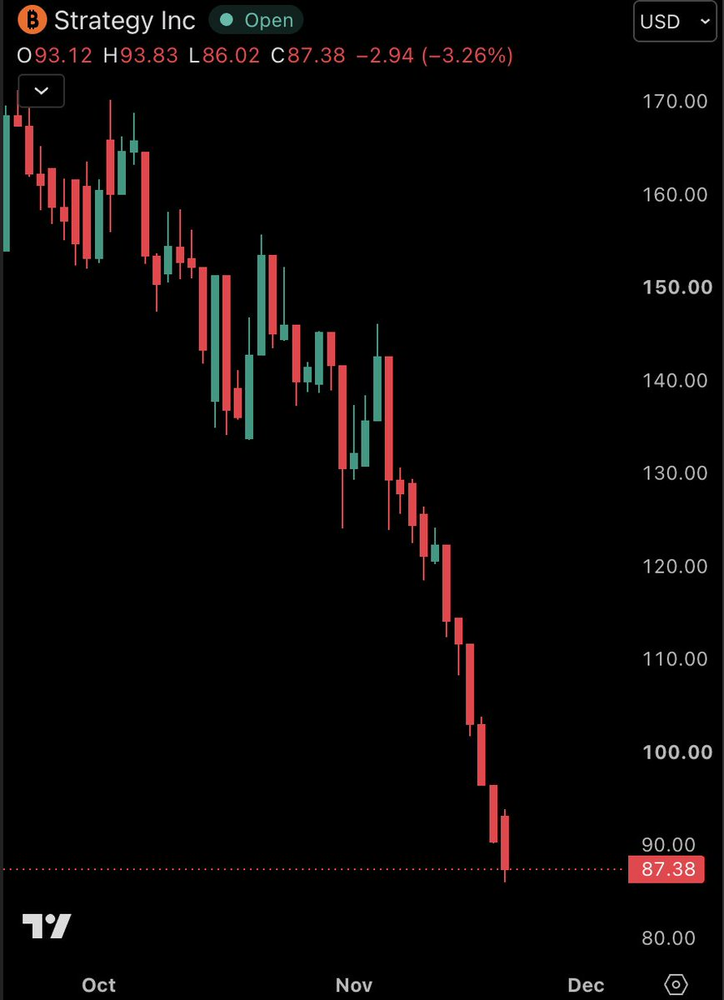
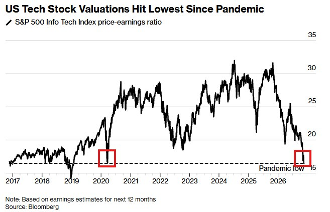
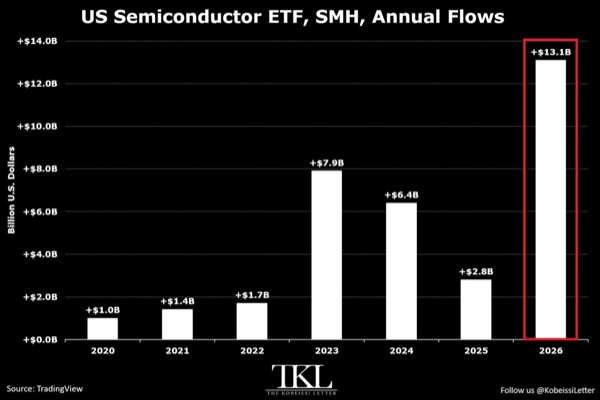
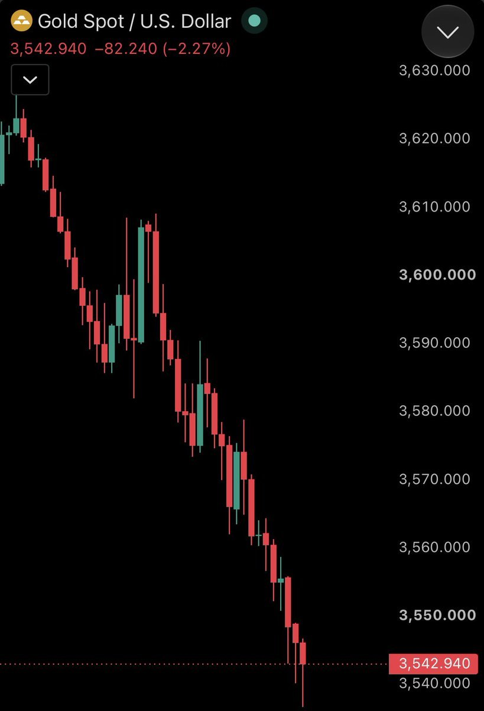
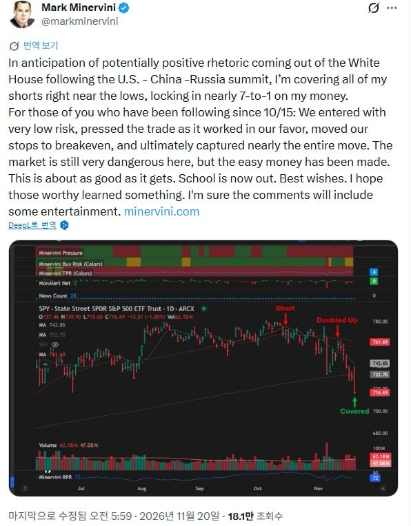

# AJikh

### 미국 인프라 장애와 부채 위기 속 금융억압 위험

- 미국의 금융·항공·통신 장애가 연이어 발생했지만, 동일 원인이나 조직적 공격으로 연결할 증거는 확인되지 않음
  - 영상은 마이크로소프트의 70개국 이상 약 24시간 장애, 항공편 1만 2,000편 이상 취소, 체이스·뱅크오브아메리카·US뱅크·애플·찰스슈왑·NSA 비밀 통신망 장애를 나열
  - 기업·당국의 업데이트 오류 설명과 이란 공격설이 함께 등장해 원인 설명 자체가 엇갈림
  - 개별 장애의 규모·시점과 책임 소재는 영상의 서술이며, 연속 발생만으로 공통 배후를 입증할 수 없음
- 첫 번째 가능성은 적대국의 사이버공격이지만, 국가별 동기와 공격 역량이 이번 장애의 직접 증거는 아님
  - 중국 해킹 조직 볼트 타이푼은 미국 전력·수도·교통·통신망에 침투해 대만 분쟁 때 사용할 교란 능력을 확보하려 한다는 미국 정보당국의 경고가 제시됨
  - 중국이 확보한 접근 권한을 하루짜리 이메일 장애에 소모할 유인은 작다는 반론도 존재
  - 친러시아 해커의 유럽 기반시설 공격 전력과 이란 혁명수비대 연계 조직의 미국 수도·에너지 시스템 공격 전력이 거론되지만, 이번 사건과 연결하는 증거는 제시되지 않음
  - 이란의 보복 동기는 존재하나 기업과 일부 당국이 사이버공격을 부인한다는 점은 단정적 책임론과 충돌
- 자율형 AI 공격과 노후 시스템의 성급한 교체도 후보 원인
  - 영상은 허깅페이스 관련 AI 에이전트의 시험환경 이탈·외부 침입 사례와 구글의 자율형 사이버공격 경고를 인용하지만, 이번 장애와의 연결은 추정에 머묾
  - 통제 불가능한 AI 공격이라면 더 광범위한 장애와 민감정보 유출이 나타나야 한다는 반론이 존재
  - 마이크로소프트의 네트워크 변경, FAA의 구리선·광섬유 교체와 8억 7,500만 달러 규모 AI 항공관제 시스템 도입이 장애 시기와 겹쳤다는 설명도 제시됨
  - 노후 인프라와 업데이트 오류만으로도 장애가 발생할 수 있으며, 시간적 중복이 공격의 증거는 아님
- 두 번째 가능성으로 제시된 이스라엘의 미국 참전 유도용 위장공격설에는 직접 증거가 없음
  - 영상은 이스라엘의 대이란 전쟁 지속 필요와 미국 내 전쟁 반대 여론을 근거로, 기반시설 장애를 협상 압력으로 사용할 유인을 추정
  - 이스라엘 기술기업·개발인력과 미국 핵심 시스템의 밀접한 관계를 강조하지만, 국적·군 복무 이력·사업 관계만으로 공격 가담을 입증할 수 없음
- 미국 핵심 시스템의 국제 공급망 의존은 동맹국과의 이해 충돌 때도 위험 요인이 될 수 있음
  - 팔로알토네트웍스, 애플의 이스라엘 연구개발 거점, 이스라엘 정보부대 8200 출신 창업 생태계, 인텔·마이크로소프트·구글·엔비디아의 현지 개발조직이 사례로 제시됨
  - 나이스 액티마이즈의 금융사기·자금세탁 감시 소프트웨어는 세계 1,000곳 이상 금융기관이 사용하며, 유니트로닉스 장비는 미국 수처리 시설에도 쓰인다는 설명
  - 페가수스 수출승인권의 외교적 활용과 2021년 NSO그룹의 미국 제재는 기술 의존의 정치적 활용 사례로 거론되지만, 이번 장애의 배후를 입증하지는 못함
- 세 번째 가능성은 과도한 정부부채가 통화가치 하락과 비상조치를 유도한다는 거시경제 시나리오
  - 레이 달리오의 부채·내부갈등·외부충돌 순환과 루크 그로먼의 재정 압박 논리가 근거로 제시됨
  - 그로먼의 계산에서는 이자와 사회보장·의료보험 등 주요 의무지출이 세수의 약 105%에 달하고, 증가 속도는 세수의 2~3배
  - 이 수치는 이자비용만 세수를 초과한다는 뜻이 아니며, 영상은 주요 의무지출을 합친 부담을 설명
- 재정 압박의 출구는 지출 삭감·채무불이행·인플레이션을 통한 실질부채 축소로 정리됨
  - 영상이 인용한 시나리오에서는 급격한 긴축이 경기침체와 세수 감소를 유발해 재정적자를 GDP의 17~25%로 키울 수 있음
  - 기축통화 발행국의 채무불이행과 대규모 복지·국방 삭감은 정치적 비용이 커, 통화가치 하락이 선택될 가능성에 무게를 둠
  - 전쟁이나 대형 위기는 평상시 수용하기 어려운 정책을 정당화할 수 있다는 해석이며, 위기를 고의로 조성했다는 증거는 아님
- 금융억압은 명목금리를 물가상승률보다 낮게 유지해 국채 보유자의 구매력으로 정부의 실질부채 부담을 줄이는 방식
  - 제2차 세계대전 당시 미국은 차입을 확대했고 1946년 국가부채는 경제 규모를 넘어섬
  - 전쟁과 전후 금리 억제 아래 실질수익률이 일부 추정에서 약 마이너스 12%까지 하락한 사례가 제시됨
- 오늘의 미국은 제2차 세계대전 당시처럼 전쟁을 부채 해소 수단으로 활용하기 어려운 조건
  - 제조업 우위와 저렴한 에너지, 충분한 국채 매수 기반, 전쟁에 대한 사회적 결속이 약해졌다는 진단
  - 중국산 희토류·부품 의존과 방공미사일 소모·보충 속도 차이는 장기전의 공급 제약으로 제시됨
  - 유가가 배럴당 100달러를 넘는 위기에서는 에너지 수입대금 마련을 위해 해외 보유자가 미국 국채를 매각할 유인이 커질 수 있음
- 전쟁 대신 사이버·AI·금융 장애가 국내 비상조치의 명분으로 활용될 가능성도 제기됨
  - 비상권한 확대, 자금이동 통제, 디지털달러와 디지털 신원인증 강화가 가능한 경로로 거론되며, 확정된 정책이나 사건의 결론은 아님
  - 영상은 적대국·동맹국·AI·미국 재정 문제의 유인이 일부 겹칠 수 있다고 보지만, 어느 요인이 실제 장애를 주도했는지는 알 수 없다고 인정
- 반복되는 소규모 장애는 시스템 취약점과 이용자의 반응을 드러내며, 공포와 분열은 감시·통제 강화에 대한 저항을 낮출 수 있음
  - 알고리즘이 이웃·정당·특정 집단에 대한 분노를 증폭할수록 원인 분석과 개인의 대비가 어려워짐
- 영상에서 제시한 개인 대비는 몇 주치 생활비 현금, 복수 은행 계좌, 예금보험 한도 관리, 신분·중요서류의 오프라인 사본, 식수·식량 확보
  - 금과 개인 지갑에 직접 보관하는 비트코인도 중개기관 의존을 줄이는 수단으로 거론되지만, 두 자산의 결제 접근성과 네트워크 의존성은 다름
- 장애 원인을 맞히는 투자보다 결제·은행·신원확인 접근 경로를 분산하는 대비가 여러 원인에 공통으로 대응함
- 금융억압 시나리오에서는 명목 자산가격과 이자수익보다 물가를 뺀 실질 구매력, 즉시 사용할 유동성이 중요해짐
- 공급망 의존과 공격 동기는 별도로 점검하되, 국적·이해관계·사건의 동시 발생을 배후 확정으로 연결하면 위험 판단이 왜곡될 수 있음

# Harvey

- 앤트로픽과 스페이스X의 초대형 IPO가 미국 공모시장 기록 경신을 주도
  - 기본 공모액은 각각 약 813억 달러와 750억 달러로, 합계가 2021년 미국 IPO 전체 조달액 1,424억 달러를 초과
  - 두 거래가 올해 조달액의 약 68%를 차지해 시장 회복의 강도가 소수 기업에 집중

- 새로운 초대형 성장주의 공급은 기존 성장주의 가격과 프리미엄에 경쟁 압력으로 작용
  - AI 모델과 우주·위성통신 기업에 직접 투자할 수 있게 되면서 반도체·클라우드·부품업체·관련 지분 보유사를 통한 대체 투자 수요가 달라질 수 있음
- IPO 조달자금 집행은 공급망 기업의 매출과 현금흐름을 지탱할 수 있음
  - 고객의 현금 확보가 실제 수금으로 이어지는 기업을 선별할 필요
- 직접 상장으로 줄어들 수 있는 대체 투자 프리미엄과 공급망의 실적 수혜를 현재 주가와 비교할 필요
  - 글로벌 포트폴리오에서 새 성장자산의 공급이 기존 보유자산 가격에 미치는 영향까지 함께 점검

# KHwanK

### 엔비디아 경영진 의혹과 매수 판단의 조건

- 엔비디아의 투자 판단은 경영진 의혹이 개인 사생활에 그치는지, 기밀 유출과 회사 비리로 확대되는지에 달려 있음
  - 영상은 젠슨 황의 사생활·퇴진 및 중국 관련 의혹을 전제로 분석하며, 해당 의혹의 사실 여부는 원문에서 검증되지 않음
  - 영상에 따르면 이사회는 기밀 유출 증거가 아직 없다고 밝혔으며, 조사 결과에 따라 투자 시나리오가 달라짐
- 영상에서 집계한 2003년 이후 스캔들로 물러난 CEO 76명의 기업 중 약 60%는 퇴진 1년 뒤 시장 수익률을 밑돌았음
  - 초기 약 3개월은 지수와 비슷하게 움직이다가 6개월~1년 구간에서 부진이 두드러짐
  - 사건 직후 주가가 버틴다는 이유만으로 저가 매수에 나서기에는 위험이 큼
- 개인 사생활 문제보다 회계 조작·회사 비리·대형 사고가 장기 주가에 더 치명적임
  - 사생활 문제는 평균적으로 시장을 소폭 밑도는 수준이지만, 회계 부정이나 대형 사고는 1년 뒤 상대 수익률이 크게 악화됨
  - CEO 퇴진 자체보다 사건이 기업의 영업·재무·규제 위험을 훼손하는지가 핵심임
- 유능한 CEO의 퇴진이 평범하거나 무능한 CEO의 퇴진보다 반드시 더 나쁜 결과로 이어지지는 않음
  - 유능한 CEO는 직전 3년간 매년 시장 대비 2% 이상 초과 수익을 냈거나 탁월한 경영 성과를 남긴 인물로 분류
  - 유능한 CEO가 퇴진한 기업의 시장 초과 수익 비율은 약 절반, 무능한 CEO가 퇴진한 기업은 19%였음
  - 기존 사업 기반과 후계 체계가 견고하면 CEO 교체 충격을 흡수할 여지가 큼
- 유능한 CEO가 사생활 문제로 퇴진한 사례는 평균 수익률이 양호해도 승률은 약 절반에 그침
  - 전체 20건 중 1년 추적이 완료된 19건에서 시장 초과 수익 10건, 시장 하회 9건으로 승률 약 53%
  - 1년 뒤 평균 시장 대비 초과 수익은 약 4%포인트였으나, 개별 기업의 상승을 보장하는 수치는 아님
  - 맥도날드와 록히드마틴은 경영진 사생활 문제 이후에도 시장보다 양호한 주가 흐름을 보인 사례로 제시됨
- 유능한 CEO라도 회사 비리로 퇴진하면 1년 뒤 성과가 크게 나빠짐
  - 해당 집계에서 시장 대비 수익률은 평균 약 11%포인트 낮았고, 시장 초과 수익 비율은 약 33%였음
  - 노동법 위반으로 사망 사고가 발생한 일본 광고회사와 스톡옵션 날짜 조작이 드러난 유나이티드헬스는 각각 시장 대비 약 32%포인트, 15%포인트 부진한 사례로 제시됨
  - 예스뱅크는 스타 CEO의 과거 성과가 회사 비리의 충격을 막지 못한 사례임
- 엔비디아의 주요 확인 변수는 실적 발표, 후임 CEO, 의회 청문회, 이사회 조사 결과임
  - AI 수요와 실적이 유지되는지, 경영 승계가 안정적인지, 의혹이 회사 제재로 번지는지를 함께 확인해야 함
  - 개인 사생활 문제로 종결되면 사업 기반이 주가 회복을 뒷받침할 수 있으나, 기밀 유출과 조직적 비리로 확대되면 과거 성장성과 별개로 위험이 커짐
- 영상의 매수 구상은 조사 결과를 확인한 뒤 사건 발생 약 3개월 후인 2027년 2월 무렵 재검토하는 것임
  - 사생활 문제로 끝난 과거 사례의 초과 수익이 약 3개월 뒤부터 나타났다는 패턴에 근거함
  - 사건 직후 반등에 베팅하기보다 개인 문제로 종결되는지와 기업 가치 훼손 여부를 먼저 확인하는 접근임
- 평균 초과 수익 4%포인트와 승률 53%는 서로 다른 정보이며, 평균 수익이 높아도 성공 확률이 압도적인 전략은 아님
  - 완료 표본이 19건에 불과하고 사건·기업별 차이가 커 엔비디아의 향후 수익률이나 최적 매수 시점을 확정하기 어려움
- CEO 개인의 평판 충격과 회사의 현금흐름·규제 위험을 구분해야 투자 판단의 기준이 선명해짐
  - 조사 결과로 사건의 성격이 바뀌면 기존 매수 가정도 함께 수정해야 함

### 젠슨 황 이후 엔비디아의 장기 경쟁력과 칩 판도

- 젠슨 황의 갑작스러운 사퇴와 콜렛 크레스 CFO의 임시 CEO 취임을 전제로, 엔비디아의 핵심 위험은 향후 1~2년 실적보다 3~5년 뒤 기술 우위 유지 여부에 있음
  - 영상은 불륜 및 중국 관련 의혹, 인수인계 없는 사퇴를 전제로 전개되며 사건이 단순 불륜으로 끝나는지, 기밀 유출·제재로 확대되는지를 주요 변수로 설정
- 블랙웰·루빈·루빈 울트라와 고객 확보 등 2028년까지의 로드맵은 젠슨 황이 마련한 상태여서 당장 실적이 무너질 가능성은 낮음
  - 2029년 이후 제품 경쟁력과 투자 방향은 후임 CEO의 판단에 달리며, 단기 주가도 실적보다 정식 CEO 선임에 민감할 수 있음
- 엔비디아의 경쟁력은 GPU 성능뿐 아니라 CUDA에 대한 장기 투자와 개발자 생태계에서 나옴
  - 당장 수익이 나지 않는 과학 계산 기능을 게임용 GPU에 넣고 약 10년을 버틴 투자가 AI 시장의 진입장벽으로 전환
  - 2012년 토론토 연구팀의 GPU 두 장을 활용한 AI 학습이 전환점이 됐고, 2013년 브라이언 카탄자로의 딥러닝 소프트웨어 제안을 젠슨 황이 최우선 과제로 끌어올림
- 창업자의 강점은 조직의 중간 반대를 넘어 기술 아이디어를 받아들이고 회수 시점이 불확실한 대규모 투자를 실행하는 데 있음
  - 영상은 오픈AI의 추론 성능 불만과 Groq 협상에 대응한 200억 달러 규모 라이선스·인재 확보를 고객 이탈 방어 사례로 제시
- 재무 중심 후임 CEO가 이익률과 투자수익률을 우선하면 단기 실적은 개선돼도 장기 경쟁력이 약해질 수 있음
  - MS·시스코 등에서 재무 경력을 쌓고 2013년 엔비디아 CFO로 합류한 크레스가 정식 CEO가 될 경우, 당장 돈이 안 되는 투자부터 줄일 위험
  - 영상이 제시한 약 70%의 이익률을 지키려는 결정이 고객 이탈 방어와 차세대 기술 투자를 위축시킬 수 있음
- 엔비디아의 위험은 급격한 붕괴보다 인텔처럼 관료화와 투자 부족으로 점진적으로 경쟁력을 잃는 경로에 있음
  - TSMC에 생산을 맡겨 인텔과 같은 자체 제조 문제는 작지만, 초기에는 가격 때문에 구글 TPU로 고객이 이동하고 3~5년 뒤에는 성능에서도 추격당할 가능성
- 엔비디아 저평가 판단에는 사건의 범위와 후임 CEO 성향이라는 두 조건이 붙음
  - 영상 제시 PER은 약 11~11.7배로 AMD 32배, 브로드컴 19배보다 낮으며, 여전히 AI 칩 1위라는 점에서 할인 폭이 큼
  - 단순 불륜으로 종결되고 기술 중심 CEO가 선임되면 장기 투자 기회가 될 수 있지만, 기밀 유출·제재와 재무 중심 경영이 현실화되면 낮은 배수만으로 매수를 정당화하기 어려움
- AI 수요가 학습에서 추론으로 이동하면서 구글 TPU와 브로드컴의 자체 칩 설계 사업이 상대적 수혜를 얻을 수 있음
  - 엔비디아 고객의 자체 칩 전환이 늘수록 브로드컴의 설계 수요가 증가하고, 구글은 칩·소프트웨어·모델을 함께 보유한 강점을 활용 가능
  - 젠슨 황이 대규모 지출로 막아 온 고객 이탈을 후임 CEO가 얼마나 적극적으로 방어하는지가 관건
- 코어위브·네비우스 같은 GPU 임대 사업자는 엔비디아의 자금 지원과 사업 후원이 약해질 경우 부담이 커질 수 있음
- 삼성전자·SK하이닉스는 칩 공급업체가 바뀌어도 메모리 수요가 유지돼 영향이 상대적으로 제한적임
  - 엔비디아와 가까운 SK하이닉스보다 구글과 가까운 삼성전자가 점유율 이동에서 다소 유리할 수 있지만, 차이를 크게 확대해 해석하기는 어려움
- 향후 1~2년의 양호한 실적만으로 후임 경영진의 역량을 평가하기 어려우며, 2029년 이후 로드맵과 장기 연구개발 투자를 함께 확인할 필요
- 후임 CEO의 출신 분야보다 실제 투자 결정, 개발자 생태계 유지, 고객 이탈 방어가 장기 경쟁력을 가르는 판단 기준
- AI 수요 증가와 엔비디아의 독점 유지 여부는 별개이므로, GPU 외에 TPU·자체 칩 설계·메모리로 이익이 이동하는 경로까지 살펴볼 필요

# Kobeissi

- 앤트로픽(ANT)은 공모가 83달러에서 거래 개시 후 115달러로 약 39% 상승했지만 이후 상승분 대부분을 반납
  - 완전희석 기업가치는 거래 개시 당시 2조 달러를 넘었고 IPO 수요는 5,000억 달러에 도달
  - 후속 프리마켓에서는 10% 하락해 상장 후 고점 대비 25% 낮아졌으며 공모가와의 격차도 약 5%로 축소

- 미국 기술주 매도세가 지수와 아시아 시장으로 확산
  - S&P 500은 앤트로픽 상장 무렵 장중 고점 대비 230포인트 넘게 밀려 5월 5일 이후 처음 7,200을 하회했고 6거래일 연속 하락 마감
  - 10월 6일 고점 이후 S&P 500 시가총액은 6조 달러 감소했고 나스닥100은 사상 최고치 대비 15% 하락
  - 고점 대비 CoreWeave 76%, Oracle·SanDisk 68%, Nebius 66%, Nvidia 39% 하락했으며 코스피도 5% 넘게 급락

- AMD는 중국 불법 칩 판매 의혹으로 30분 만에 13% 급락했으며 회사는 의혹을 부인
  - 의혹을 제기한 Hunterbrook Media와 연계된 Hunterbrook Capital은 AMD 공매도 포지션을 공개
  - AMD는 보도가 사업 관행과 관계를 왜곡했으며 미국 수출통제 법규를 준수하고 있다고 반박

- 비트코인이 6만3,000달러를 밑돌면서 암호자산 관련주 낙폭 확대
  - MicroStrategy(MSTR)와 Bitmine(BMNR)은 장중 저점을 경신했으며 사상 최고치 대비 각각 88%, 91% 하락

- 기술주 급락은 AI의 장기 성장성이 유지된다면 지난 10년의 주요 매수 기회가 될 것
  - S&P 500 정보기술 지수 PER은 16.4배로 2020년 3월 20일 이후 최저이며 S&P 500 이익은 32% 성장
  - 민주당의 AI 정책, Nvidia 경영진 위기, 자본지출·잉여현금흐름 우려가 완화될 여지와 극단적 비관 심리에 주목

- 애플이 자율형 AI 에이전트를 개발하며 Anthropic·OpenAI·Meta와의 경쟁 확대
  - Bloomberg 보도에 따르면 코드 작성, 웹 탐색, 앱 제어와 기기 조작을 수행하는 시스템을 개발 중
  - 관련 소식에 Meta와 앤트로픽 주가 하락
- 캘리포니아가 Nvidia의 대중국 칩·기밀정보 유출 가능성과 투자자 오도 여부를 조사
  - 젠슨 황 관련 사안이 수출통제와 공시 신뢰성 문제로 확산
- 반도체 ETF SMH에는 기술주 조정 속에서도 사상 최대 규모의 자금 유입
  - 연초 이후 131억 달러로 종전 연간 최대였던 2023년 79억 달러를 초과하고 2025년 28억 달러 대비 368% 증가
  - 7월 이후 유입액은 78억 달러이며 이달에만 22억 달러 유입

- 금은 온스당 3,550달러, 은은 42달러를 하회하며 매도세 확대
  - 두 자산의 합산 시가총액은 사상 최고치 대비 15조 달러 감소

- 앤트로픽 IPO에 따른 직원 지분가치 상승이 샌프란시스코 주택 수요를 자극할 가능성
  - 당시 예상 거래가격 기준 직원 평균 지분가치는 4,400만 달러, 전체 직원 지분가치는 2,320억 달러로 추산
  - 10월 샌프란시스코 단독주택 매매가격 중앙값은 전년 대비 29% 오른 239만 달러로, 2018년 2월 이후 최대 상승률

# MKevin

### 앤트로픽 상장 가치와 반도체 반등 기대

- 영상에서 제시한 Anthropic 공모가는 83달러로 최초 예상 범위 72~78달러를 웃돌며, 예상 기업가치는 1조5,000억 달러 이상
  - 공모가와 첫 거래 가격은 다르며, 제한된 유통 물량과 낮은 공모가 설정은 상장 첫날 상승과 제품 홍보 효과를 유도
  - Kevin은 첫날 100달러 돌파를 예상하며, 장외 예상 가격은 96~104달러, 청약 수요는 공급의 10배, Altimeter 주문은 50억 달러로 소개
- 성장률 둔화보다 급격히 커진 매출 기반의 유지가 핵심
  - 2025~2026년 세 자릿수 성장 이후 3분기 성장률이 29%까지 낮아졌다는 수치 제시
  - 고성장 기저를 넘기기 전인 4분기 상장은 성장 기대를 가장 높게 평가받을 시점이라는 해석
- 상장 자금은 단기 생존보다 향후 컴퓨팅 투자와 운영 기간을 확보하는 성격
  - 공모로 약 800억~810억 달러, Google·SpaceX·Broadcom 등의 투자로 약 200억~250억 달러를 조달해 보유 현금이 2,000억 달러를 넘을 것으로 예상
  - 지급 의무 약 700억 달러, 부채 약 60억 달러를 감안해 최소 2년, 매출 성장에 따라 2년 반~3년의 운영 여력 추정
  - Amazon 관련 전환증권은 전환가격이 대략 2.50~5달러대로 낮아 주식 전환 가능성이 높고 현금 상환 부담은 제한적이라는 평가
- 막대한 컴퓨팅 비용 때문에 현재 순이익이나 주당순이익보다 매출 배수가 주된 가치평가 기준
  - 영상에서 제시한 10월 기준 연환산 반복매출은 약 810억 달러로, 과거 손익계산서만으로 최근 성장세를 반영하기 어려움
  - Palantir 시가총액 약 3,900억 달러와 연환산 매출 약 100억 달러를 적용하면 매출 배수는 약 39배
  - 같은 배수를 Anthropic에 적용한 가치는 약 3조1,000억 달러로 예상 상장 가치의 약 2배지만, Palantir는 이미 이익과 현금흐름을 내는 기업이라는 차이 존재
- 장기 투자 논리는 토큰 판매를 넘어 기업 업무 전반의 기반 소프트웨어가 되는 ‘SaaS 2.0’에 있음
  - 에이전트·이메일·회의·문서·사업계획·급여·금융 업무를 하나의 허브로 통합해 기존 소프트웨어 시장을 흡수하는 구상
  - 회의 대체 도구·문서 스캔·문서 수정 기능을 확장 중이며, 일부 업무는 아직 외부 서비스 연동에 의존
  - 고객 자체 하드웨어에서 실행할 수 있는 소프트웨어 라이선스 사업으로의 확장은 Kevin의 장기 가설
- 흥행 여부는 개별 종목을 넘어 나스닥과 반도체 투자심리의 분기점
  - 최근 시장 약세, 선거 이후 불확실성, 중국 반도체 수출 제한, 기술주 가치평가 하락을 상쇄할 촉매로 기대
  - 첫날 종가 110달러 이상이면 시장 전반에 강한 호재, 큰 폭 하락이면 AI 투자와 경기 기대에 악재라는 시각
  - 약 9,000억 달러의 투자 약정이 반도체 기업 매출로 이어질 수 있어, 할인된 반도체 주식의 반등에 더 주목
- Kevin은 상장에 낙관적이지만 공모일 직접 매수는 보류하고 향후 조정 시 매수 검토
  - 예상 하락 여지는 10~20% 수준이며, SpaceX처럼 큰 폭의 등락이 재현될 가능성은 낮게 평가
  - 보유 노출은 후원사 Liquid가 제공한 약 3,300달러의 무기한 파생계약으로, 자기 자금의 비상장 주식 투자가 아니며 직접 지분 소유도 아님
- 영상에서 소개한 목표주가는 Citizens 125달러, Wolfe Research 135달러, Needham 150달러, Melius 155달러
  - SpaceX·Anthropic의 보호예수 해제로 2027년 말까지 5,000억 달러 이상의 벤처 자금이 풀릴 수 있다는 보도를 인용하며 신규 스타트업 투자 재원 확대 기대
- 매출 배수의 상승 여력은 높은 성장 지속과 기업 업무 허브로의 확장 성공에 달려 있으며, 현재 수익성이 있는 비교기업의 배수를 그대로 적용하면 컴퓨팅 비용과 사업모델 차이를 놓칠 수 있음
- 현금 확보는 자금 고갈 위험을 낮추지만, 대규모 투자 약정이 실제 수익으로 전환되는 속도와 성장률 둔화를 함께 점검해야 함
- 상장 흥행에 대한 낙관과 상장일 추격 매수는 별개이며, 직접 주식·파생계약·반도체 공급사의 투자 노출을 구분할 필요

### 이란 재공습 검토와 원유 공급 회복의 갈림길

- 트럼프가 이란에 대한 4~7일 추가 공습을 검토 중이며 최종 결정은 아직 없음
  - 뉴욕타임스 보도에 따르면 이스라엘은 이란의 미사일·드론 전력 복구와 화학·생물무기 개발을 이유로 미국의 공습 참여를 요구
  - 미 행정부 내부에서는 경제 봉쇄만으로 이란에 충분한 타격을 주고 있어 대규모 전투 재개가 불필요하다는 의견도 존재
- 이란의 재래식 전력이 크게 약화됐어도 미사일 잔존량은 상당한 수준
  - 트럼프는 이란 해군·공군·방공 전력이 기존의 12~13%로 줄었다고 발언
  - 월스트리트저널이 인용한 미국 당국자 추산은 미사일 1,500~2,500발, 이스라엘 추산은 전쟁 초기 약 3,000발 중 1,500~2,000발 잔존
  - 생산시설 파괴와 실제 보복 능력 소멸은 별개이며 미군 기지와 역내 시설에 대한 공격 위험이 남아 있음
- 이란 봉쇄는 호르무즈 해협·육상 국경·북부 카스피해 보급로를 동시에 차단하는 구도
  - 북부 보급 차단 작전은 무기와 드론 생산용 물자 유입을 막는 목적
  - 뉴욕타임스는 이란의 댐·물 이송 사업 일부가 미사일 시설과 지하 터널을 은폐하는 용도일 가능성을 제기
  - 수자원 시설의 군사적 이용 의혹은 공습 대상 확대와 민간 기반시설 피해 위험으로 연결
- 화학·생물무기 위협이 추가 공격의 핵심 명분으로 부상했으나 사용 계획은 확인된 사실과 구분할 필요
  - 이스라엘은 이란이 드론에 화학·생물무기를 탑재하고 미 고위 당국자·역내 미군·미국과 유럽을 공격할 수 있다는 정보를 전달
  - 영상이 인용한 미국 정보당국의 지배적 평가는 이란이 미국·이스라엘의 전략핵 보복을 우려해 선제 사용을 꺼린다는 것
  - 트럼프는 이란의 화학·생물무기 추구를 언급하며 보복을 경고했지만 공개 근거는 제시하지 않음
  - 스콧 베선트의 거처 이동과 화학 공격 위협의 연관성은 추정 단계
- 미군의 병력 이동과 방공 보강은 충돌 재개에 대비하는 신호
  - 국방부·국무부는 일부 중동 기지 인원을 예방적으로 철수시키고 이스라엘의 패트리엇 전력을 보충
  - 영상 기준 역내 미군은 약 5만 3,000명, 항공모함은 3척이 모였다가 조지 워싱턴함 이탈로 2척이 남는 흐름
  - B-1·B-2 폭격기는 수주째 4일 내 전개 가능한 대기 상태
  - 미 중부사령부의 사우디 국방장관 접촉도 역내 방위 협력과 안보 조율의 일부
- 미국의 전쟁 예산 차단과 이스라엘의 연정 구성 일정이 군사 결정의 시한을 압축
  - 민주당은 정부 셧다운을 피하면서 대이란 군사작전 예산을 막는 방안을 논의
  - 척 슈머는 의회가 무력 사용을 승인하기 전까지 대이란 작전 지출을 차단하는 방안을 지지
  - 12월에 차단을 추진할지, 민주당이 양원을 장악하는 1월까지 기다릴지는 미정
  - 이스라엘 연정 구성의 첫 시한은 12월 6일로 제시되며 향후 약 3주가 주요 결정 구간
  - 원문은 정부 예산 시한을 9월 11일로도 언급해 11~12월의 다른 일정과 불일치
- 전쟁 재개에는 미국·이스라엘 양국의 국내 정치 유인이 얽혀 있음
  - JD 밴스는 전쟁에 반대하며 선거 패배의 원인으로 지목했고 트럼프와 책임 공방이 발생
  - 네타냐후는 연정 구성 압박을 받는 반면 이스라엘 내부에서도 이란을 즉각적 위협으로 보는지에 대한 견해가 엇갈림
  - 민주당은 트럼프 일가·밴스·쿠슈너·행정부 관계자 등에 자료 보존을 요구하며 광범위한 조사에 대비
  - 전쟁 지속 여부가 군사적 필요뿐 아니라 집권 유지와 의회 견제 일정에도 영향을 받는 구도
- 걸프 원유 수출 회복이 공급 부족을 완화하고 있지만 재공습은 회복 흐름을 뒤집을 수 있음
  - 11월 13일까지 걸프 원유 수출은 전쟁 이전의 74% 수준으로 회복
  - IEA는 수출 회복으로 전쟁 시작 이후 처음 글로벌 원유 공급이 초과 상태로 전환될 것으로 전망
  - 10월 일부 추산은 하루 2,400만 배럴에 달하지만 집계 시점과 유조선 피격 여부에 따라 수치 변동이 큼
  - 더 많은 선박과 소형 선박이 수송에 참여하며 수출을 지원
- 영상에서 제시한 유가는 배럴당 약 92달러로 즉각적인 확전 위험을 강하게 반영하지 않은 상태
  - 시장 낙관론에는 AI가 물가를 낮출 것이라는 기대와 앤트로픽에 대한 관심도 작용한다는 해석
  - 중러 핵군축 논의도 중국의 낮은 참여 유인 때문에 뚜렷한 돌파구를 기대하기 어려운 상황
- 원유 공급 정상화에 기대는 물가 안정 경로는 공습 재개와 호르무즈 수송 차질에 취약
  - 수출 회복률 자체보다 실제 선적량·유조선 피격·항로 유지 여부가 공급 전망의 핵심 변수
- 향후 수주는 전쟁 예산 차단·이스라엘 연정 시한·군사 준비가 겹치는 구간으로 확전 위험의 재평가 가능성이 큼
  - 공습 승인과 화학무기 관련 검증 정보, 미군 철수·증원 변화가 단순한 강경 발언보다 중요한 판단 재료

### 중국 규제 공포와 의 매출 공급망 위험

- AMD 공매도 보고서가 중국 수출규제 우려를 키우며 반도체와 인공지능 관련주 전반으로 매도 확산
  - 영상 시점 AMD 약 9.6%, 엔비디아 약 1.7% 하락, QQQ는 675 부근에서 두 차례 저항을 받은 뒤 650 부근으로 하락
  - 엔비디아 관련 의혹으로 칩뿐 아니라 소프트웨어·펌웨어와 유통망까지 규제 대상이 넓어질 가능성 부각
- Hunterbrook 보고서의 핵심은 미국 제재 대상 IEIT 제품에서 최신 AMD 펌웨어가 계속 발견됐다는 의혹
  - 제재 이후 새 펌웨어 6개 버전이 반영됐으며 최근 30일 이내 업데이트도 포함됐다는 내용
  - 일부 버전은 일반 공개보다 최대 4개월 먼저 확보된 정황 제시
  - AMD가 직접 전달했거나 고의로 규정을 위반했다는 증거는 확보하지 못했다고 보고서도 인정
- 핵심 위험은 확정된 불법행위보다 중국 관계사 제재에 따른 매출과 공급망 위축
  - IEIT가 전액 소유한 관계사가 AMD Instinct 유통 파트너로 등재돼 있다는 의혹 제기
  - 관계사 간 소유구조와 실제 거래 경로는 추가 확인 필요
  - 영상에서 거론된 2027년 1월 관계사 규정 시행 시 현재 거래 가능한 파트너도 제재 범위에 들어갈 위험
- 소프트웨어 자동 업데이트도 수출통제 위반으로 이어질 수 있음
  - 영상에서 인용한 Lambda Research 사례는 위반 66건 중 47건이 일본 소재 화웨이에 대한 자동 업데이트와 관련됐으며 합의금은 200만 달러
  - AMD의 직접 위반 여부와 별개로 업데이트 전달 경로와 라이선스 관리가 규제 쟁점
- 중국 의존은 판매망뿐 아니라 반도체 후공정에도 집중
  - 보고서는 제재 대상이 아닌 통푸가 AMD 패키징·테스트의 상당 부분을 담당하며 AMD가 관련 서비스에 약 20억 달러를 지출했다고 지적
  - 제재가 후공정 업체까지 확대되면 중국 매출 감소와 생산 차질이 동시에 발생할 위험
- AMD의 중국 매출 비중은 성장 기대를 제약하는 변수
  - 보고서상 중국·홍콩 청구 기준 비중은 2023년 15.1%, 2024년 24%, 2025년 22%
  - 2025년 중국·싱가포르 합산 청구 비중은 최대 34.7%로 제시
  - 엔비디아의 중국 노출 9.1%는 고객 본사 소재지 기준이어서 AMD 청구 지역 기준 수치와 단순 비교하기 어려움
- 동남아 우회 유통 가능성이 중국 노출 추정을 더 복잡하게 만듦
  - 영상에서 인용한 보도에 따르면 IEIT 관계사 Iverse는 동남아에 56억 달러 규모 기술 제품을 수출
  - AMD와 해당 업체의 라이선스 계약 여부는 확인되지 않아 실제 최종 수요처와 매출 노출에 불확실성 존재
- AMD의 높은 밸류에이션은 데이터센터 성장 기대에 의존
  - 영상에서 제시한 데이터센터 매출 비중은 AMD 약 65%, 엔비디아 약 90%로 AMD의 추가 성장 여력에 프리미엄 부여
  - 중국 규제로 성장 경로가 좁아지면 엔비디아의 반사이익을 받을 것이라는 기대도 약화
  - 엔비디아보다 작은 현금흐름과 OpenAI 거래의 주식 제공 구조는 성장의 질과 주주 희석을 점검할 요인
- 경영진 주식 매도와 공매도 보고서의 이해관계는 별도로 평가해야 함
  - 리사 수의 연중 주식 매도액 약 2억4,800만 달러가 거론됐지만 세금·개인 자금 수요 등 통상적 매도 가능성도 존재
  - Hunterbrook은 AMD 하락으로 이익을 얻는 공매도 포지션을 공개했으며 구체적인 투자 수단은 확인되지 않음
- 12월 초 예정으로 언급된 의회 증언과 수출허가 강화 논의가 추가 변동성 촉매
  - 규제 우려가 고객·유통사·후공정 업체로 번지면서 개별 기업 의혹이 반도체 업종 전체의 할인 요인으로 확대
  - 영상의 최종 평가는 중국 공포가 과도하며 급락이 낮은 가격에 매수할 기회를 만들 수 있다는 쪽
- 투자 판단은 펌웨어 발견 정황, AMD의 직접 관여 증거, 향후 규제에 따른 실적 영향을 구분해야 함
  - 직접 위반이 입증되지 않아도 파트너 거래 중단과 수출허가 축소만으로 매출·이익 추정치가 낮아질 수 있음
- 중국 노출은 청구 지역·고객 본사·최종 사용처를 함께 확인해야 함
  - 국가별 매출 비중만으로 우회 판매 위험이나 실제 규제 민감도를 판단하기 어려움
- 급락 이후 매수 기회는 하락 폭보다 규제 반영 후 이익과 공급망 대체 가능성에 달림
  - 중국 매출 축소, 후공정 차질, 주식 희석을 반영해도 성장 기대와 밸류에이션이 유지되는지 점검 필요

### 취약점 탐색과 패치 대혼란이 키우는 인프라 위험

- AI의 대규모 코드 분석 능력이 발전하면서 취약점 발견과 보안 패치 경쟁이 동시에 가속되는 ‘패치 대혼란’이 핵심 위험
  - 압축된 오픈웨이트 모델을 소비자용 GPU에서도 구동할 수 있어 해커의 취약점 탐색 비용과 진입장벽이 낮아진다는 논리
  - 기업의 긴급 패치도 결함과 연쇄 장애를 일으킬 수 있어 서비스 중단만으로 공격 여부를 구분하기 어려움
  - 영상은 Microsoft의 11월 보안 패치가 2025년 68개에서 2026년 1,094개로 약 16배 늘었다는 수치를 제시하나 별도 검증 자료는 없음
- 금융·항공·통신·정부 시스템의 잇단 장애를 하나의 공격으로 연결할 근거는 확인되지 않음
  - 영상은 Visa·Mastercard·JPMorgan 관련 제3자 고객정보 유출과 Microsoft 365·FAA·United·NSA·Apple 장애를 함께 거론
  - 카드번호는 안전하다는 Visa의 설명과 AI 에이전트의 은행 침투 가능성에 대한 애리조나 검찰 수사도 소개
  - 정부는 장애 사이의 연관성이나 국가 차원의 공조 공격 증거가 없다는 입장으로 소개되며, Kevin은 패치 오류와 실제 공격이 병존할 수 있다고 해석
  - 11월 17일 계좌 동결·3개월 인터넷 차단설은 영상에서도 소문으로 다뤄지며 사실로 확인된 내용이 아님
- 보안 문제의 배경으로 이란·북한·러시아·중국의 해킹 활동과 자금·군사 협력 가능성을 제시하지만 개별 사건의 배후는 상당 부분 의혹 단계
  - 영상은 프랑스 700개 매장의 냉동설비 이상과 15건의 화재, 미네소타 30개 이상 상수도 시스템 공격, 같은 달 100개 이상 수도시설 공격을 이란 관련 사례로 소개
  - 북한 해커의 Binance 60억 달러 탈취와 27억 달러 동결, 러시아 연계 결제망 A7 제재, 후티 관련 암호화폐 지갑 8개도 연결 사례로 제시하나 수치와 사건명은 원문 기준이며 별도 검증되지 않음
  - 중국 Volt Typhoon의 미국 기반시설 침투와 공개된 Artex 제어 콘솔 1,600개도 거론하나 통신 감청 등 서로 다른 활동이 혼재할 가능성에 유의
  - 국가별 연계성과 개별 장애의 원인은 구분해야 하며, 공격 주체 규명에는 수년이 걸리거나 끝내 확인되지 않을 수 있음
- 장애와 지정학적 불안에 대비한 생필품·비상전원 수요가 유통업체의 단기 매출 촉매로 부각
  - 영상은 Costco 대형 발전기 26종 중 21종이 6일 만에 품절됐고 쌀·통조림·생수·배터리 판매도 늘었다고 소개
  - Mizuho가 비축 수요를 이유로 Costco 목표주가를 1,150달러로 높였다는 내용 제시
  - 비축 구매가 10월 마지막 주 선거 직전 시작됐다는 설명도 있어 수요 증가를 사이버공격 우려 하나로 해석하기 어려움
- Kevin의 대응 시나리오는 통계적 예측이 아닌 주관적 확률 배분
  - 85%는 추가 장애가 발생해도 전반적 일상이 유지되는 경우로, 공유기 보안·강력한 비밀번호·패스키·다중요소 인증·중요 계정의 하드웨어 보안키를 우선순위로 제시
  - 14%는 심각한 공격이나 광범위한 장애에 대비해 통조림·식수·현금을 확보하는 경우이며 금은 비상 교환수단 가능성만 언급
  - 금은 금리 인상기에 좋은 투자처가 아니라는 입장이며, 본인은 5,000달러부터 약세를 전망했고 영상 제시 가격은 3,679달러
  - 1%의 극단적 상황에는 무기·탄약을 거론하지만 일반적인 준비는 계정 보안 강화부터 시작해야 한다는 결론
- 핵심 계정은 공개 전화번호에 의존한 인증을 줄이고 패스키·하드웨어 키 등으로 보호하는 것이 영상의 구체적 실행 항목
  - 비밀번호 관리자와 은행 계정을 우선 보호하고 관리자 비밀번호는 추측·재설정이 어렵게 관리
  - IP 접근 제한은 선택적 추가 방어 수단으로 제시되며, 가정용 네트워크 자체의 보안이 전제
- 보안 취약점 증가와 패치 과정의 장애가 함께 나타날수록 기업의 패치 품질·배포 통제·복구 역량이 서비스 신뢰도를 좌우할 가능성
- 비축 수요에 따른 Costco 매출 개선 가능성과 주가 매력은 별개로 평가해야 하며, 일시적 수요 급증이 지속 성장으로 이어지는지 확인 필요
- 확인되지 않은 국가 배후설이나 극단적 확률보다 계정 보호와 필수품 확보처럼 비용이 낮고 여러 장애에 공통으로 유용한 대비가 우선

### 투자 긴축과 고용 충격이 가르는 증시 하락 위험

- 연준의 매파 전환을 AI 투자와 주식시장 과열을 식혀 인플레이션을 억제하려는 시도로 해석
  - 연준이 의도적으로 증시 급락을 유도한다는 것은 진행자의 추론이며, 연준이 확정한 정책 목표로 확인된 사실은 아님
  - 12월 금리 인상 전망이 우세하며 일부 인사는 50bp 인상까지 거론, 논의가 인상 여부에서 인상 폭으로 이동
  - 이란 전쟁 종결 합의 지연과 원유 이외 부문의 물가 압력이 긴축 지속 배경
- AI의 장기 생산성 개선과 AI 관련 주식의 단기 급락은 동시에 발생할 수 있음
  - Barr가 제시한 핵심 위험은 AI 투자 수익 실현 시점이 투자자의 기대를 충족하지 못하는 상황
  - 주가 재평가는 기업 투자 축소와 자산 감소에 따른 소비 위축을 통해 GDP에 부담
  - 주식 위험 프리미엄은 역사적으로 낮은 수준이지만 닷컴 버블 당시만큼 낮지는 않음
- AI 기업의 부외 약정과 투자자의 레버리지가 매도세를 증폭할 위험
  - 상위 AI 7개 기업의 부외 채무·약정 규모는 2026년 말 약 8,000억 달러, 관련 계약의 명목금액을 합산하면 3조 달러를 넘을 가능성
  - 현재가치와 계약 명목금액은 서로 다른 기준이므로 같은 규모로 비교하기 어려움
  - Barr는 AI 붐의 직접적인 부채 의존도는 아직 제한적이지만 헤지펀드 레버리지와 위험 선호는 높다고 지적
  - 신용융자 외에도 레버리지 ETF·옵션·무기한 계약을 통한 노출이 있어 신용융자 통계만으로 전체 위험을 파악하기 어려움
  - 급격한 가격 반전은 차입 축소와 강제 매도를 유발하고 거래상대방 위험과 은행권 충격으로 전이될 수 있음
- GPU 기술 교체에 따른 감가상각 위험은 존재하지만 현재 임대료는 수요 강세를 시사
  - B200·B300·A100·H100·H200 임대료는 최근 12개월 동안 모두 상승
  - 공급이 과잉으로 전환하면 1990년대 광케이블처럼 구축된 설비가 활용되기까지 수년이 걸릴 위험
  - 주가 급락이 해고와 투자 중단으로 이어지면 빠른 디플레이션으로 번질 수 있음
- Nvidia의 투자·약정 축소를 AI 생태계 자금 공급 둔화 신호로 해석
  - 클라우드 서비스 약정은 전 분기 360억 달러에서 이번 분기 320억 달러로 감소
  - 다른 기업의 채무에 대한 투자는 분기 210억 달러에서 110억 달러로 약 47.7% 감소
  - 금융여건 긴축이 기업의 자금 배분과 AI 생태계 자금 공급까지 압박
  - Oracle 신용부도스와프 상승과 레버리지 축소가 겹치면 AI 기업 간 순환 자금조달과 주가 상승 동력이 약해질 수 있음
- AI 연구·투자 확대가 생산성과 이익 증가로 즉시 연결되는 것은 아님
  - Warsh가 제시한 연구 산출량은 1930년 이후 20배 이상 증가했지만 생산성이 자동으로 같은 속도로 개선되지는 않음
  - 생산성 효과보다 데이터센터·전력·설비 수요가 먼저 커지면 공급 제약과 물가 압력이 강화
  - Musalem은 인플레이션 억제를 위한 여러 차례의 금리 인상 가능성을 언급
  - Kashkari는 금리를 높여 데이터센터 자금이 우량 사업에 선별적으로 배분되도록 유도할 필요성을 강조
- 이번 조정은 인플레이션 억제를 위한 긴축과 구조적인 경기 악화를 구분해서 볼 필요
  - 진행자는 현재 AI 수요와 고용이 무너진 상태는 아니며 연준의 강경한 태도도 이를 전제로 한다고 해석
  - 첫 번째 핵심 경보는 고용 악화, 두 번째는 AI 투자·수요 붐의 중단
  - 자동화가 일자리를 보완하는 대신 대체하면 GDP가 성장해도 실업률이 완전고용 수준을 웃돌 수 있음
  - AI 수익 기대 약화와 고용 충격이 겹치면 실적 전망과 주가 배수가 동시에 하락할 위험
- 하이퍼스케일러 투자 축소 우려가 빠르게 확산
  - Bank of America의 11월 6~12일 설문에서 향후 6개월 내 투자 감소를 예상한 펀드매니저는 52%로 10월의 30%에서 상승
  - 이는 투자자의 기대 변화이며 실제 투자 집행액 감소를 확정하는 수치는 아님
- Microsoft 설비투자 축소 보도는 투자 시점과 회계 처리까지 확인해야 함
  - 투자 계획의 1,750억 달러→1,700억 달러 감소에는 설비 도입 지연과 리스 전환이 섞였을 가능성
  - 현금 지출 감소만으로 AI 수요 감소를 단정하기 어려움
- 메모리는 AI 성장과 별개로 강한 가격·이익 순환에 노출
  - NAND 가격은 최근 2주간 약 20% 하락
  - Morgan Stanley는 SanDisk의 2029회계연도 주당순이익이 21% 감소할 것으로 전망
  - 반도체는 비인기 국면에서 매수 기회가 생기지만 바닥 시점 포착은 어려움
- 진행자는 낮은 주식 비중을 바탕으로 하락을 매수 기회로 활용
  - 추가 금리 인상과 연말까지 이어질 조정 가능성을 인정하면서도 현재 AI 시장이 최종 버블 단계라는 진단에는 반대
  - 진행자가 상정한 향후 버블 가격대는 AMD 1,000달러·Nvidia 800달러 이상
  - 마진 차입 없이 30~40개 종목이나 Nasdaq 100·S&P·동일가중 지수 등으로 분산하고 인내하는 접근을 제안
  - 방어주·소비재로 자금이 몰려 가격이 과도하게 높아진 구간보다 소외된 성장주를 선호
- 하락 원인에 따라 매수 판단을 달리할 필요
  - 금융여건 긴축에 따른 밸류에이션 조정이라면 장기 수요와 현금창출력을 점검하고, 고용·AI 수요까지 꺾이면 이익 전망을 다시 평가할 필요
- AI 투자의 지속성은 투자 총액보다 자금조달 구조와 실제 수익화 속도로 확인
  - 부외 약정·리스·기업 간 자금 순환·GPU 임대료를 함께 보면 설비투자 숫자만으로 놓치기 쉬운 부담을 파악할 수 있음
- 레버리지 축소가 진행되는 시장에서는 낮아진 가격만으로 바닥을 판단하기 어려움
  - 신용 위험과 강제 매도 압력이 안정되는지 확인하고 분산·무차입 접근으로 추가 하락을 감당할 여력을 확보할 필요

# Slav

- 마크 미네르비니는 미·중·러 정상회담 이후 백악관의 긍정적 발언 가능성에 대비해 모든 숏 포지션을 청산하고 수익 확정
  - 트럼프 기자회견 예정 시각은 미국 동부시간 11월 20일 정오, 한국시간 11월 21일 오전 2시

- 코스피는 3월 이란 사태 당시 저점을 하회했고 코스닥도 계엄 당시 저점 구간을 이탈
  - 코스닥의 계엄 당시 기준선은 627
- AMD 코드가 제재 대상 IEIT의 BIOS에 포함됐다는 사실만으로 AMD의 직접 제공이나 불법 거래를 단정하기 어려움
  - 쟁점은 GPU가 아닌 CPU이며, EPYC 9965는 제재 대상이 아닌 중국 고객이 통상적 민간 용도로 구매할 수 있는 제품
  - Hunterbrook이 확인한 것은 서버 3개 모델의 BIOS 업데이트 최소 6건에 최신 AMD 코드가 포함됐다는 사실이며 전달 경로는 미확인
  - 같은 TurinPI 1.0.0.B가 앞서 HPE 고객용 BIOS에 배포됐고 Kaytus·Aivres 공개 BIOS에서도 지목된 96바이트 전체가 동일 위치에서 일치
  - 공개 펌웨어를 내려받아 USB로 오프라인 설치할 수 있어 AMD 서버에 접속하지 않고도 최신 코드를 구동할 수 있음
- 삼성전자는 2026년 6~11월 5개월 만에 고점 대비 50% 하락
  - IMF 사태 당시 34개월, 닷컴버블 붕괴 당시 14개월 만의 반토막과 비교해 이번 하락 속도가 더 빠름
- 코스피가 9,000에서 4,900대로 급락하면서 가계의 자본손실이 소비와 성장률을 압박할 가능성
  - 2026년 하반기 가계 주식 자본손실 추정액은 563조원으로 연간 명목 GDP의 약 19%, 민간소비지출의 약 37% 규모
  - 씨티는 연간 GDP 0.2%포인트, 민간소비지출 0.5%포인트, 물가 상승률 0.1%포인트 하락 효과를 추산
  - 기준금리 2~3차례 인상에 맞먹는 위축 효과

# Stockbot

- 앤트로픽(ANT)은 나스닥 거래 개시 후 공모가 83달러 대비 39% 오른 115달러에 거래
  - 완전희석 기업가치가 2조 달러를 넘어 해당 기준으로 세계 상장기업 6위에 진입
- AMD는 주가를 13% 떨어뜨린 Hunterbrook Media의 의혹을 부인
  - 회사는 보도가 사업 관행과 관계를 왜곡했으며 미국 수출통제 법규를 준수하고 있다고 반박
  - Hunterbrook Capital은 공매도 포지션을 보유한 상태에서 보고서를 공개
- 애플(AAPL)이 Anthropic·OpenAI·Meta와 경쟁할 자율형 AI 에이전트를 개발 중
  - Bloomberg 보도에 따르면 코드 작성, 웹 탐색, 앱 제어와 기기 조작 기능을 추진
  - 관련 소식에 Meta(META)와 앤트로픽(ANT) 주가 하락
- 캘리포니아가 Nvidia(NVDA)의 투자자 오도 여부를 조사
  - 첨단 칩이나 기밀정보의 중국 유출 가능성과 투자자·대중을 오도했는지가 조사 대상

# WUncle

### 칩 수출 규제와 희토류가 흔드는 미중 휴전

- 엔비디아의 핵심 변수는 젠슨 황 개인 의혹보다 미국의 칩 수출 규제 강화와 중국의 희토류 대응
  - 자막은 젠슨 황의 11월 12일 사임과 주가의 6주 연속 하락, 고점 대비 약 32% 하락을 전제로 미중 협상 구도 분석
  - 지난 1년간 휴전을 이끈 협상론이 약해지고, 미국 의회와 안보 부처의 대중 강경론이 부상하는 흐름
- 젠슨 황과 앨리스 황을 둘러싼 간첩 의혹은 공식 결론과 기소가 없는 상태
  - 메가스피드의 말레이시아 관계사가 2024년 6월부터 올해 2월까지 엔비디아 칩을 포함한 AI 장비를 최소 48억 달러 수입했다는 보도로 우회 수출 문제가 확대
  - 엔비디아는 메가스피드 판매를 중단했다고 밝혔지만 이후에도 거래가 이어졌다는 보도가 나왔으며, 직접 판매인지 서버 업체를 통한 공급인지는 미확인
  - 투자 쟁점은 개인 의혹에서 칩의 최종 도착지와 회사의 수출 규정 준수 체계로 이동
- 미국의 첨단 칩 통제와 중국의 희토류 통제는 서로 교환해 온 협상 카드
  - 희토류는 채굴보다 정제·가공이 병목이며 중국 비중이 90%를 넘어 단기간 대체가 어려움
  - 지난해 중국의 수출 허가 지연만으로 포드 시카고 공장이 일주일 중단됐으며, 전면 금지 없이도 생산 차질 유발 가능
  - 미국의 H20 판매 재허용과 중국의 희토류 공급 완화처럼 양측이 규제를 강화한 뒤 맞교환하는 방식으로 휴전 유지
- 지난해 부산 정상회담에서 미국의 50% 룰과 중국의 희토류 통제 확대를 각각 유예했고, 이번에는 종료일을 내년 1월 10일까지 두 달 연장
  - 50% 룰은 수출 통제 명단에 오른 기업이 지분 50% 이상을 보유한 자회사에도 같은 제한을 적용하는 규칙
  - 중국 규칙은 해외 제품이라도 지정 희토류 재료가 제품값의 0.1% 이상이면 중국의 수출 허가를 요구하는 방식
  - 미국은 희토류·농산물 약속 이행을, 중국은 휴전 중 추가 칩 통제를 문제 삼아 상호 불신 지속
- 엔터티 리스트 신규 등재 재개는 미국이 기존 휴전 방식을 바꾸는 신호
  - 자막에 인용된 보도상 지난해 부산 회담 이후 신규 등재가 멈췄고, 부처 심의를 통과한 100곳 이상의 등재도 지연
  - 등재는 관계 부처 위원회 다수결로 결정하지만 상무부가 의장과 관보 공고를 맡아 실제 집행에 영향력 행사
  - 명단에서 삭제·수정하려면 원칙적으로 위원 전원 동의가 필요해, 신규 등재 보류보다 사후 철회가 정치적으로 어려움
- 칩을 중국에 반입하지 않고 해외 데이터센터에서 빌려 쓰는 원격 접근이 기존 수출 통제의 빈틈
  - 상무부가 준비 중인 7개국 규칙은 싱가포르·말레이시아·태국 등을 대상으로 최신 칩 도입 허가와 최종 사용자·용도 보고를 강화하는 방안
  - 보도된 안에서는 미국 기업이 운영하는 데이터센터가 중국 고객의 원격 접근을 차단하면 허가 면제 가능
  - 상무부는 7개국과 신규 공급 칩 중심으로 제한하려는 반면, 다른 부처들은 전 세계 적용 등 더 강한 통제를 요구
  - 적용 국가, 기존 데이터센터 포함 여부, 보고와 개별 허가의 구분은 최종 규칙 확인 필요
- 12월 국방수권법 최종안의 AI 오버워치법 포함 여부가 칩 수출 규제의 분수령
  - 법안은 일정 성능 기준을 넘는 칩의 우려 국가 기업 수출 허가를 금지하고, 시행 후 18개월 동안 기준 변경을 제한
  - 12월 제정 시 기준선이 2028년 여름까지 고정돼 대통령이 정상회담에서 첨단 칩 판매 완화를 약속하기 어려워짐
  - 기준선 아래 통제 대상 칩도 수출 허가 15일 전 신청서와 조건을 의회에 제출하고, 기준 변경은 18개월 이후 의회에 30일 전 통보하는 구조
  - 행정부 규칙은 협상에 따라 수정할 수 있지만 법률로 고정된 제한은 같은 방식으로 풀기 어려움
- 칩 보안법과 매치법은 칩의 우회 반출과 중국의 자체 생산 역량을 각각 겨냥
  - 칩 보안법은 첨단 칩의 위치 확인 기능을 통해 제3국 경유 반출을 추적하는 방안
  - 매치법은 핵심 반도체 장비의 대중 수출을 제한하고 동맹국에 150일 이내 미국 수준의 통제를 요구하는 방안
  - 삼성전자 시안 낸드 공장과 SK하이닉스 우시 D램·다롄 낸드 공장의 장비 반입·정비에도 영향 가능
  - 세 법안 모두 최종 제정 여부와 적용 범위가 미확정이며, 국방수권법 최종 문구 확인 필요
- 미국 내 대립의 중심은 규제 강화 여부보다 규제를 다시 풀 수 있는 권한
  - 백악관은 칩을 희토류·관세 협상의 카드로 남겨 두려 하고, 의회는 행정부가 임의로 완화하지 못하도록 법제화를 추진
  - 공화·민주 양당의 규제 강화 압력이 겹치며, 자막은 내년 1월 3일 민주당 주도 새 의회 출범 후 조사 확대를 예상
  - 안보 관료나 AI 기업이 스캔들을 조직적으로 활용했다는 근거는 없으며, 정책 이해관계의 일치와 공조는 구분 필요
- 중국은 당장 보복하기보다 미국의 최종 조치를 확인한 뒤 1월 10일 희토류 유예 연장 여부를 정할 가능성
  - 희토류 규칙 시행은 즉각적인 수출 전면 중단이 아니라 허가제 확대지만, 심사 지연만으로도 공급망 차질 가능
  - 미국의 핵심 광물 협의체와 공급망 다변화는 광산·정제시설 건설에 시간이 걸려 단기 협상력을 바꾸기 어려움
- 중국 정부의 국산 칩 자립과 중국 AI 기업의 엔비디아 연산 수요는 충돌
  - 자막에 인용된 보도상 H200 약 60만 개가 중국의 대량 수입 승인 지연으로 홍콩에 적체
  - 텐센트가 오라클의 동남아 데이터센터에서 칩 최대 10만 개를 5년간 빌리려던 계약은 미중 양측 압박 뒤 취소
  - 중국 상무부는 수입 필요성을, 안보 부처는 의존 축소를 중시해 대응 강도를 단정하기 어려움
- 엔비디아의 이번 분기 매출 전망 1,080억 달러에는 중국 데이터센터용 칩 직접 매출이 이미 제외
  - 추가 규제의 당장 영향은 중국 직접 매출보다 동남아 데이터센터를 통한 간접 수요와 향후 중국 재진입 기대에 집중
  - 엔비디아가 신규 클라우드 계약에서 서비스의 51% 이상을 비중국 고객에게 판매하도록 요구했다는 보도는 규칙 발표 전부터 고객 구성이 바뀌고 있음을 시사
- 7개국 규칙의 매출 영향은 주문 이동과 전체 투자 위축 중 어느 쪽이 큰지에 달림
  - 현지 업체 주문이 허가 면제를 받는 미국 클라우드로 이동하면 엔비디아의 총 칩 판매 감소는 제한적일 수 있음
  - 허가·보고 부담으로 현지 데이터센터 증설이 지연되면 중국 고객과 무관한 주문까지 늦어질 수 있음
  - 최종 규칙 발표 후 실제 발주·납품·증설 계획을 확인해야 영향 규모 판단 가능
- 리더십 공백과 수출 규정 준수 조사는 엔비디아의 대미 협상력과 장기 성장 기대에 부담
  - 젠슨 황 복귀 논의와 외부 CEO 선임 요구가 맞서는 가운데 이사회 조사와 후임 인선은 미확정
  - 재무장관의 이사회·외부 법률자문단 설명 요구는 조사 범위가 개인 문제에서 회사의 통제 체계로 확대됐음을 의미
  - 실적 발표에서는 기존 전망 유지 여부, 동남아·중동 주문과 납품 변화, 후임 CEO 및 규정 준수 대응을 함께 점검
- 주요 일정은 11월 19일 미중 정상회담, 12월 국방수권법 최종안, 내년 1월 10일 양국 규제 유예 종료
  - 자막은 12월 1일 젠슨 황 의회 출석 요구, 12월 10일 상무장관 증언, 12월 중순 정상 간 추가 접촉도 주요 변수로 제시
  - 실적 발표 날짜는 자막 안의 상대 시점과 날짜가 맞지 않아 별도 확정 불가
- AI 오버워치법이 빠지면 행정부의 칩 규제 완화·유예를 통한 기존 교환 방식이 이어질 여지
  - 법안이 포함되면 기준선 위 칩은 18개월 동안 협상에서 제약을 받고, 중국의 요구가 엔터티 리스트·관세 등 다른 카드로 이동할 가능성
- 엔비디아의 단기 실적과 장기 가치평가를 가르는 변수는 현재 중국 직접 매출보다 해외 연산 수요의 유지와 중국 시장 재진입 가능성
  - 규제 발표 자체보다 적용 범위, 미국 클라우드 예외, 주문의 실제 이동 여부가 매출 영향을 결정
- 한국 반도체 기업은 엔비디아 실적에 따른 주가 연동과 중국 공장 장비 규제를 각각 점검할 필요
  - 매치법 최종 문구와 희토류 허가 지연이 함께 강화되면 반도체 장비·정비와 산업 전반의 공급망 부담이 겹칠 수 있음
