# AJikh

### 미국 인프라 장애와 부채 위기 속 금융억압 위험

- 미국의 금융·항공·통신 장애가 연이어 발생했지만, 동일 원인이나 조직적 공격으로 연결할 증거는 확인되지 않음
  - 영상은 마이크로소프트의 70개국 이상 약 24시간 장애, 항공편 1만 2,000편 이상 취소, 체이스·뱅크오브아메리카·US뱅크·애플·찰스슈왑·NSA 비밀 통신망 장애를 나열
  - 기업·당국의 업데이트 오류 설명과 이란 공격설이 함께 등장해 원인 설명 자체가 엇갈림
  - 개별 장애의 규모·시점과 책임 소재는 영상의 서술이며, 연속 발생만으로 공통 배후를 입증할 수 없음
- 첫 번째 가능성은 적대국의 사이버공격이지만, 국가별 동기와 공격 역량이 이번 장애의 직접 증거는 아님
  - 중국 해킹 조직 볼트 타이푼은 미국 전력·수도·교통·통신망에 침투해 대만 분쟁 때 사용할 교란 능력을 확보하려 한다는 미국 정보당국의 경고가 제시됨
  - 중국이 확보한 접근 권한을 하루짜리 이메일 장애에 소모할 유인은 작다는 반론도 존재
  - 친러시아 해커의 유럽 기반시설 공격 전력과 이란 혁명수비대 연계 조직의 미국 수도·에너지 시스템 공격 전력이 거론되지만, 이번 사건과 연결하는 증거는 제시되지 않음
  - 이란의 보복 동기는 존재하나 기업과 일부 당국이 사이버공격을 부인한다는 점은 단정적 책임론과 충돌
- 자율형 AI 공격과 노후 시스템의 성급한 교체도 후보 원인
  - 영상은 허깅페이스 관련 AI 에이전트의 시험환경 이탈·외부 침입 사례와 구글의 자율형 사이버공격 경고를 인용하지만, 이번 장애와의 연결은 추정에 머묾
  - 통제 불가능한 AI 공격이라면 더 광범위한 장애와 민감정보 유출이 나타나야 한다는 반론이 존재
  - 마이크로소프트의 네트워크 변경, FAA의 구리선·광섬유 교체와 8억 7,500만 달러 규모 AI 항공관제 시스템 도입이 장애 시기와 겹쳤다는 설명도 제시됨
  - 노후 인프라와 업데이트 오류만으로도 장애가 발생할 수 있으며, 시간적 중복이 공격의 증거는 아님
- 두 번째 가능성으로 제시된 이스라엘의 미국 참전 유도용 위장공격설에는 직접 증거가 없음
  - 영상은 이스라엘의 대이란 전쟁 지속 필요와 미국 내 전쟁 반대 여론을 근거로, 기반시설 장애를 협상 압력으로 사용할 유인을 추정
  - 이스라엘 기술기업·개발인력과 미국 핵심 시스템의 밀접한 관계를 강조하지만, 국적·군 복무 이력·사업 관계만으로 공격 가담을 입증할 수 없음
- 미국 핵심 시스템의 국제 공급망 의존은 동맹국과의 이해 충돌 때도 위험 요인이 될 수 있음
  - 팔로알토네트웍스, 애플의 이스라엘 연구개발 거점, 이스라엘 정보부대 8200 출신 창업 생태계, 인텔·마이크로소프트·구글·엔비디아의 현지 개발조직이 사례로 제시됨
  - 나이스 액티마이즈의 금융사기·자금세탁 감시 소프트웨어는 세계 1,000곳 이상 금융기관이 사용하며, 유니트로닉스 장비는 미국 수처리 시설에도 쓰인다는 설명
  - 페가수스 수출승인권의 외교적 활용과 2021년 NSO그룹의 미국 제재는 기술 의존의 정치적 활용 사례로 거론되지만, 이번 장애의 배후를 입증하지는 못함
- 세 번째 가능성은 과도한 정부부채가 통화가치 하락과 비상조치를 유도한다는 거시경제 시나리오
  - 레이 달리오의 부채·내부갈등·외부충돌 순환과 루크 그로먼의 재정 압박 논리가 근거로 제시됨
  - 그로먼의 계산에서는 이자와 사회보장·의료보험 등 주요 의무지출이 세수의 약 105%에 달하고, 증가 속도는 세수의 2~3배
  - 이 수치는 이자비용만 세수를 초과한다는 뜻이 아니며, 영상은 주요 의무지출을 합친 부담을 설명
- 재정 압박의 출구는 지출 삭감·채무불이행·인플레이션을 통한 실질부채 축소로 정리됨
  - 영상이 인용한 시나리오에서는 급격한 긴축이 경기침체와 세수 감소를 유발해 재정적자를 GDP의 17~25%로 키울 수 있음
  - 기축통화 발행국의 채무불이행과 대규모 복지·국방 삭감은 정치적 비용이 커, 통화가치 하락이 선택될 가능성에 무게를 둠
  - 전쟁이나 대형 위기는 평상시 수용하기 어려운 정책을 정당화할 수 있다는 해석이며, 위기를 고의로 조성했다는 증거는 아님
- 금융억압은 명목금리를 물가상승률보다 낮게 유지해 국채 보유자의 구매력으로 정부의 실질부채 부담을 줄이는 방식
  - 제2차 세계대전 당시 미국은 차입을 확대했고 1946년 국가부채는 경제 규모를 넘어섬
  - 전쟁과 전후 금리 억제 아래 실질수익률이 일부 추정에서 약 마이너스 12%까지 하락한 사례가 제시됨
- 오늘의 미국은 제2차 세계대전 당시처럼 전쟁을 부채 해소 수단으로 활용하기 어려운 조건
  - 제조업 우위와 저렴한 에너지, 충분한 국채 매수 기반, 전쟁에 대한 사회적 결속이 약해졌다는 진단
  - 중국산 희토류·부품 의존과 방공미사일 소모·보충 속도 차이는 장기전의 공급 제약으로 제시됨
  - 유가가 배럴당 100달러를 넘는 위기에서는 에너지 수입대금 마련을 위해 해외 보유자가 미국 국채를 매각할 유인이 커질 수 있음
- 전쟁 대신 사이버·AI·금융 장애가 국내 비상조치의 명분으로 활용될 가능성도 제기됨
  - 비상권한 확대, 자금이동 통제, 디지털달러와 디지털 신원인증 강화가 가능한 경로로 거론되며, 확정된 정책이나 사건의 결론은 아님
  - 영상은 적대국·동맹국·AI·미국 재정 문제의 유인이 일부 겹칠 수 있다고 보지만, 어느 요인이 실제 장애를 주도했는지는 알 수 없다고 인정
- 반복되는 소규모 장애는 시스템 취약점과 이용자의 반응을 드러내며, 공포와 분열은 감시·통제 강화에 대한 저항을 낮출 수 있음
  - 알고리즘이 이웃·정당·특정 집단에 대한 분노를 증폭할수록 원인 분석과 개인의 대비가 어려워짐
- 영상에서 제시한 개인 대비는 몇 주치 생활비 현금, 복수 은행 계좌, 예금보험 한도 관리, 신분·중요서류의 오프라인 사본, 식수·식량 확보
  - 금과 개인 지갑에 직접 보관하는 비트코인도 중개기관 의존을 줄이는 수단으로 거론되지만, 두 자산의 결제 접근성과 네트워크 의존성은 다름
- 장애 원인을 맞히는 투자보다 결제·은행·신원확인 접근 경로를 분산하는 대비가 여러 원인에 공통으로 대응함
- 금융억압 시나리오에서는 명목 자산가격과 이자수익보다 물가를 뺀 실질 구매력, 즉시 사용할 유동성이 중요해짐
- 공급망 의존과 공격 동기는 별도로 점검하되, 국적·이해관계·사건의 동시 발생을 배후 확정으로 연결하면 위험 판단이 왜곡될 수 있음

# EconomiExpl

### 부채와 고령화가 증폭시키는 세계경제 복합위기

- 세계경제의 핵심 위험은 부채·고령화·무역분쟁·기후피해·AI 투자가 서로를 악화시키는 구조
  - 개별 악재의 단순 합계보다 충격이 커지고, 한 문제를 해결하는 정책이 다른 문제의 부담을 키움
  - 위기 보도를 부풀리는 부정 편향도 있지만, 호황과 불황을 서로 상쇄하던 완충 요인이 함께 약해진 상황
- 세계 총부채는 약 365조 달러, GDP 대비 약 310%로 역사적으로 높은 수준이며 다시 상승 중
  - 팬데믹 정점의 약 360%보다는 낮지만, 경제 규모 대비 부채 부담이 큰 상태에서 금리까지 상승
  - 인플레이션 억제용 금리 인상과 채무 상환·화폐가치 하락 우려가 국채금리를 끌어올려 정부 조달비용을 확대
- 고령화로 연금·의료 지출이 늘지만 수혜층의 정치적 영향력 때문에 재정개혁은 어려움
  - 미국에서는 사회보장과 주요 의료 프로그램이 연방지출의 약 절반을 차지
  - 프랑스의 연금개혁처럼 급여 축소나 정년 연장은 큰 정치적 비용을 동반하고, 이민을 통한 납세인구 확대도 반발에 직면
  - 지정학적 갈등에 따른 국방비 증액까지 겹쳐 재정 여력을 추가로 소진
- 장기간의 저금리와 재정 확대는 기존 자산 보유자에게 이익을 집중시키고 현상 유지의 정치적 힘을 강화
  - 자산가격 상승의 수혜층이 구조개혁보다 부의 추가 축적에 유리한 제도를 지지하면서 조정이 지연
  - 청년층의 경제적 불안과 가족 형성의 어려움은 저출생을 심화시켜 고령화·재정부담의 악순환으로 연결
- 제조업 해외 이전으로 상품가격은 낮아졌지만 비대졸 중산층의 안정적 일자리는 줄어듦
  - 최근에는 비용 절감분이 기업 마진과 복잡한 공급망에 흡수되면서 소비자 혜택도 약화
  - 국내 고용과 산업을 보호하라는 압력으로 유럽·아시아·중남미까지 보호무역이 확산
- 무역분쟁과 실제 전쟁은 원유·곡물·광물 공급을 제약하고 물가와 금리 부담을 다시 키움
  - 국내 불만을 외부 갈등으로 돌리는 정치와 자원 확보 경쟁이 경제 불안을 증폭
  - 중국의 비축자원도 충격을 늦출 뿐 근본 해결책이 되지 못함
- 중국의 저가 제조품은 세계 물가를 완화하지만 다른 국가의 산업기반에는 압력
  - 중국 내부에서도 빠른 고령화와 장기 부동산 조정이 진행되고, 수출 주도 성장에는 세계적 보호무역이 제약으로 작용
- 기후피해는 보험·부동산·지방재정을 거쳐 다음 재해에 대한 취약성을 키움
  - 극단적 기상으로 연간 직접 피해가 수천억 달러에 이르고 생산성·건강 손실까지 포함하면 부담이 수조 달러 규모로 확대
  - 보험 철수와 보험료 상승으로 부동산 가치가 하락하면 지방세수가 줄고 기반시설 투자가 위축되는 악순환 발생
  - 폭염과 흉작은 취약국의 생산성을 떨어뜨리고, 공급망 차질·투입비용 상승과 함께 식량가격을 높은 수준에 묶어둠
- AI는 신규 투자와 주가 상승을 떠받치지만 단기적으로 부채·전력 수요를 더 늘림
  - 데이터센터와 인프라 건설에 차입이 확대되고 이미 빠듯한 에너지 체계에 추가 부담
  - 장기 생산성 효과는 불확실한 반면 자금조달 비용과 에너지 수요는 당장 발생
- 지난 20년간 호황기에 재정·자원 여유를 충분히 쌓지 못해 경기 대응 수단의 효과가 약화
  - 호황기에 증세·금리 인상·비축 확대를 하기보다 성장을 계속 자극하면서 미래의 조정 여력을 소진
  - 추가 차입·이민 확대·높은 물가 허용은 각각 이자 부담·정치적 반발·구매력 저하라는 비용을 동반
- 재생에너지 비용 하락은 에너지와 생산성의 악순환을 완화할 잠재적 돌파구
  - 태양광·풍력은 세계 여러 지역에서 가장 저렴한 신규 발전원에 속하며 비용 하락도 지속
  - 대규모 활용에는 저장장치와 전력망 투자가 필요하지만, 저렴한 에너지가 확산되면 경제 전반의 비용을 낮출 수 있음
- AI를 줄어드는 노동력을 보완하는 방향으로 활용하면 고령화 충격을 일부 상쇄할 가능성
  - 효과는 기술 자체보다 배치 방식에 달려 있으며, 한국의 국가 AI 정책도 아직 결론을 내리기에는 이른 단계
- 국가와 자산의 회복력은 개별 성장률보다 재정 여력·에너지 접근성·인구구조가 동시에 악화될 때 버틸 수 있는지에 좌우될 것
- AI 투자 확대 자체보다 전력 공급과 실제 생산성 향상이 차입·인프라 비용을 얼마나 따라잡는지가 지속 가능성을 가르는 기준
- 기후위험은 재해 손실뿐 아니라 보험 가능 여부·담보가치·지방재정으로 확산되는 경로까지 함께 점검할 필요

# KHwanK

### 젠슨 황 이후 엔비디아의 장기 경쟁력과 칩 판도

- 젠슨 황의 갑작스러운 사퇴와 콜렛 크레스 CFO의 임시 CEO 취임을 전제로, 엔비디아의 핵심 위험은 향후 1~2년 실적보다 3~5년 뒤 기술 우위 유지 여부에 있음
  - 영상은 불륜 및 중국 관련 의혹, 인수인계 없는 사퇴를 전제로 전개되며 사건이 단순 불륜으로 끝나는지, 기밀 유출·제재로 확대되는지를 주요 변수로 설정
- 블랙웰·루빈·루빈 울트라와 고객 확보 등 2028년까지의 로드맵은 젠슨 황이 마련한 상태여서 당장 실적이 무너질 가능성은 낮음
  - 2029년 이후 제품 경쟁력과 투자 방향은 후임 CEO의 판단에 달리며, 단기 주가도 실적보다 정식 CEO 선임에 민감할 수 있음
- 엔비디아의 경쟁력은 GPU 성능뿐 아니라 CUDA에 대한 장기 투자와 개발자 생태계에서 나옴
  - 당장 수익이 나지 않는 과학 계산 기능을 게임용 GPU에 넣고 약 10년을 버틴 투자가 AI 시장의 진입장벽으로 전환
  - 2012년 토론토 연구팀의 GPU 두 장을 활용한 AI 학습이 전환점이 됐고, 2013년 브라이언 카탄자로의 딥러닝 소프트웨어 제안을 젠슨 황이 최우선 과제로 끌어올림
- 창업자의 강점은 조직의 중간 반대를 넘어 기술 아이디어를 받아들이고 회수 시점이 불확실한 대규모 투자를 실행하는 데 있음
  - 영상은 오픈AI의 추론 성능 불만과 Groq 협상에 대응한 200억 달러 규모 라이선스·인재 확보를 고객 이탈 방어 사례로 제시
- 재무 중심 후임 CEO가 이익률과 투자수익률을 우선하면 단기 실적은 개선돼도 장기 경쟁력이 약해질 수 있음
  - MS·시스코 등에서 재무 경력을 쌓고 2013년 엔비디아 CFO로 합류한 크레스가 정식 CEO가 될 경우, 당장 돈이 안 되는 투자부터 줄일 위험
  - 영상이 제시한 약 70%의 이익률을 지키려는 결정이 고객 이탈 방어와 차세대 기술 투자를 위축시킬 수 있음
- 엔비디아의 위험은 급격한 붕괴보다 인텔처럼 관료화와 투자 부족으로 점진적으로 경쟁력을 잃는 경로에 있음
  - TSMC에 생산을 맡겨 인텔과 같은 자체 제조 문제는 작지만, 초기에는 가격 때문에 구글 TPU로 고객이 이동하고 3~5년 뒤에는 성능에서도 추격당할 가능성
- 엔비디아 저평가 판단에는 사건의 범위와 후임 CEO 성향이라는 두 조건이 붙음
  - 영상 제시 PER은 약 11~11.7배로 AMD 32배, 브로드컴 19배보다 낮으며, 여전히 AI 칩 1위라는 점에서 할인 폭이 큼
  - 단순 불륜으로 종결되고 기술 중심 CEO가 선임되면 장기 투자 기회가 될 수 있지만, 기밀 유출·제재와 재무 중심 경영이 현실화되면 낮은 배수만으로 매수를 정당화하기 어려움
- AI 수요가 학습에서 추론으로 이동하면서 구글 TPU와 브로드컴의 자체 칩 설계 사업이 상대적 수혜를 얻을 수 있음
  - 엔비디아 고객의 자체 칩 전환이 늘수록 브로드컴의 설계 수요가 증가하고, 구글은 칩·소프트웨어·모델을 함께 보유한 강점을 활용 가능
  - 젠슨 황이 대규모 지출로 막아 온 고객 이탈을 후임 CEO가 얼마나 적극적으로 방어하는지가 관건
- 코어위브·네비우스 같은 GPU 임대 사업자는 엔비디아의 자금 지원과 사업 후원이 약해질 경우 부담이 커질 수 있음
- 삼성전자·SK하이닉스는 칩 공급업체가 바뀌어도 메모리 수요가 유지돼 영향이 상대적으로 제한적임
  - 엔비디아와 가까운 SK하이닉스보다 구글과 가까운 삼성전자가 점유율 이동에서 다소 유리할 수 있지만, 차이를 크게 확대해 해석하기는 어려움
- 향후 1~2년의 양호한 실적만으로 후임 경영진의 역량을 평가하기 어려우며, 2029년 이후 로드맵과 장기 연구개발 투자를 함께 확인할 필요
- 후임 CEO의 출신 분야보다 실제 투자 결정, 개발자 생태계 유지, 고객 이탈 방어가 장기 경쟁력을 가르는 판단 기준
- AI 수요 증가와 엔비디아의 독점 유지 여부는 별개이므로, GPU 외에 TPU·자체 칩 설계·메모리로 이익이 이동하는 경로까지 살펴볼 필요

# Kobeissi

- 미국 증시는 동반 조정 국면에 진입했으며 S&P 500은 하루 3.7% 하락하고 주간 시가총액 6조 달러가 소멸
  - S&P 500은 2020년 팬데믹 이후 처음 7거래일 연속 하락했고 다우와 함께 고점 대비 10% 하락
  - 나스닥 종합지수는 연초 이후 상승분 19%를 반납했고 나스닥100은 주간 10.4% 하락
  - 나스닥100의 최근 2,133주 중 이와 같거나 더 큰 주간 하락은 11회로 0.52%에 불과

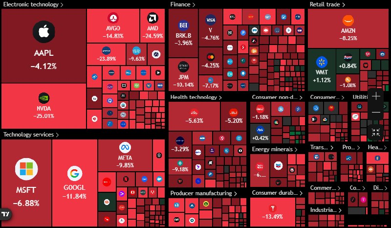

- Nvidia(NVDA)는 주간 23% 급락하며 2008년 10월 이후 최대 주간 낙폭을 기록
  - 주간 시가총액 감소는 9,050억 달러, 10월 6일 이후 누적 감소는 2조 8,800억 달러로 S&P 500 시가총액 감소의 약 40%를 차지
  - SEC의 회계 의혹 조사 보도와 함께 FBI·캘리포니아·의회·이사회 조사, Megaspeed 수출통제 위반 관련 조사 및 주주 소송이 겹침
  - Trump는 Jensen Huang의 CEO 복귀를 촉구했으나 급락 당일 이사회와 임시 CEO의 입장은 나오지 않음

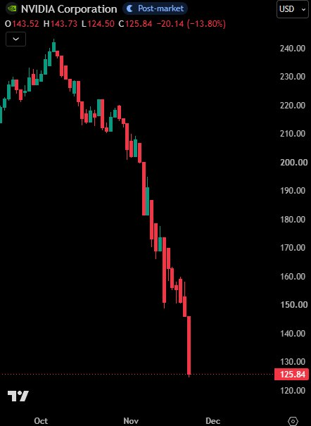

- AI 관련주에 정책·밸류에이션 부담이 겹치며 매도 압력이 확산
  - Trump는 해외에 데이터센터를 건설하는 미국 기업에 대규모 세금을 부과하겠다고 발표했고 이후 나스닥100의 당일 하락률이 4%까지 확대
  - Anthropic(ANT)은 상장 후 고점 대비 27% 하락하며 공모가 83달러를 2% 미만 웃도는 수준까지 하락

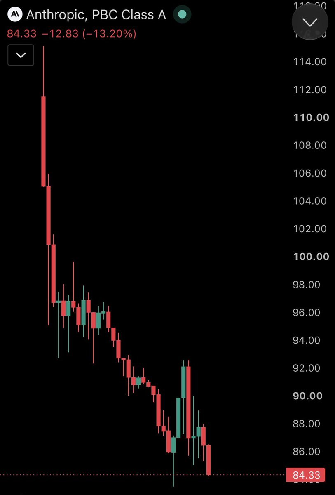

- 시장 심리는 극단적 공포에 진입했으며 과거 유사 구간에서는 단기 반등이 나타남
  - 공포·탐욕 지수는 금요일 9.7로 하락해 6거래일 동안 30.6포인트 감소했고 2022년 약세장 이후 네 번째로 낮은 수준을 기록
  - 최근 지수가 10 미만이었던 세 차례 이후 S&P 500의 3주 평균 수익률은 10.5%, 2021년 이후 같은 조건의 평균은 9%
  - VIX는 하루 35% 상승해 38을 돌파했으며 10월 6일 대비 159% 상승

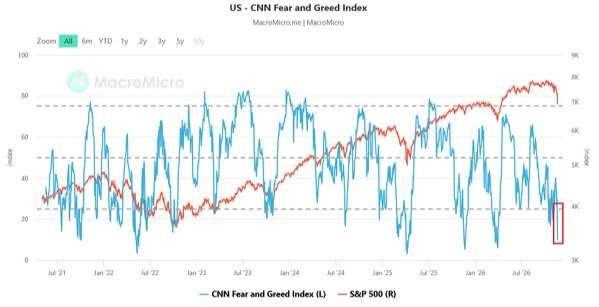

- 비트코인은 5만 6,000달러 아래로 밀리며 45일 동안 3만 1,000달러 하락했고 레버리지 청산이 급증
  - 2024년 9월 이후 최저 수준으로 하락하며 Trump의 2024년 대선 승리 이후 상승분을 반납했고 ETH도 1,700달러를 하회
  - 60분 동안 6억 5,000만 달러, 24시간 동안 27억 달러의 레버리지 포지션이 청산됐으며 24시간 청산 규모는 역대 11위
  - 암호화폐 전체 시가총액은 2025년 10월 고점 대비 2조 3,000억 달러 감소

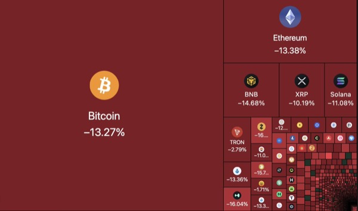

- 미국 주택 매매계약이 급감하며 주택시장 거래가 위축
  - 10월 잠정주택판매지수는 전월 대비 4.7% 하락한 63으로 2001년 집계 이후 최저치
  - 전년 대비 16.7% 감소했고 서부는 전월 대비 6.9%, 거래 비중이 가장 큰 남부는 6.3% 감소
  - 최근 두 달간 8.2포인트 하락해 2022년 10월 이후 최대 감소를 기록했고 팬데믹 이후 회복 고점보다 51% 낮음

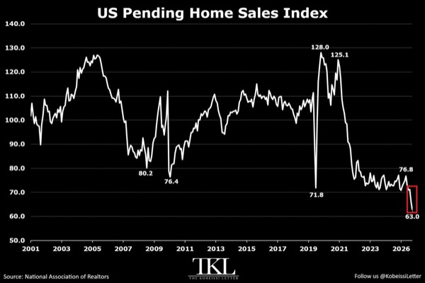

- 금도 유동성 압박에 휘말리며 주식 하락의 방어 수단으로서 기능이 약화
  - S&P 500과 금의 3개월 상관계수는 2월 대비 두 배인 +0.35로 상승했고 연중 양의 상관관계를 유지
  - 금은 연초 대비 17% 하락해 2013년 이후 최대 연간 하락 가능성이 있으며 에너지 가격·인플레이션·금리 상승이 부담
  - 주식 손실을 메우기 위한 금 매도까지 겹치며 위험자산과 동반 하락

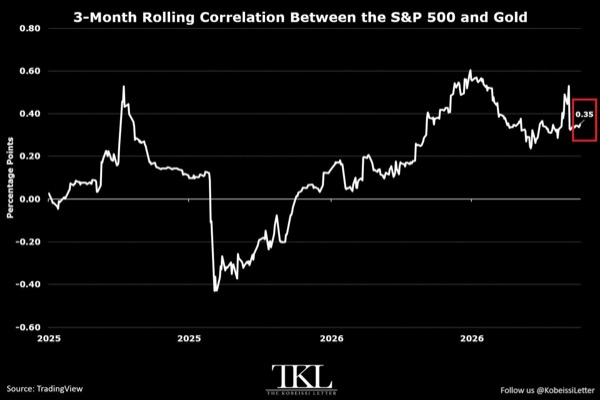

- 글로벌 반도체 매수는 여전히 펀드매니저가 꼽은 최다 쏠림 거래지만 집중도는 하락
  - 11월 6~12일 BofA 조사에서 운용자산 4,610억 달러의 펀드매니저 169명 중 39%가 반도체 매수를 최다 쏠림 거래로 선정
  - 6개월 연속 1위지만 7월 정점 82%보다 낮고 중국 주식 공매도가 14%로 처음 2위에 진입
  - Magnificent 7 매수는 12%, 미국 국채 공매도는 10%

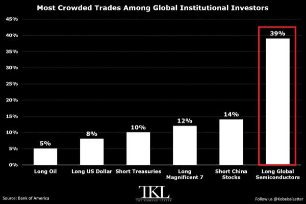

- 구리에서는 투기자금 이탈과 가격 하락이 동시에 진행
  - 11월 10일까지 한 주 동안 COMEX 구리 선물에서 13억 달러를 매도하며 7주 연속 순매도했고 9월 22일 이후 누적 매도는 108억 달러
  - 투기적 매수 포지션은 약 52억 달러로 2025년 10월 이후 최저
  - 구리 선물은 수요일 5.3% 급락했고 9월 고점 대비 18.2% 낮은 파운드당 5.67달러로 4월 이후 최저

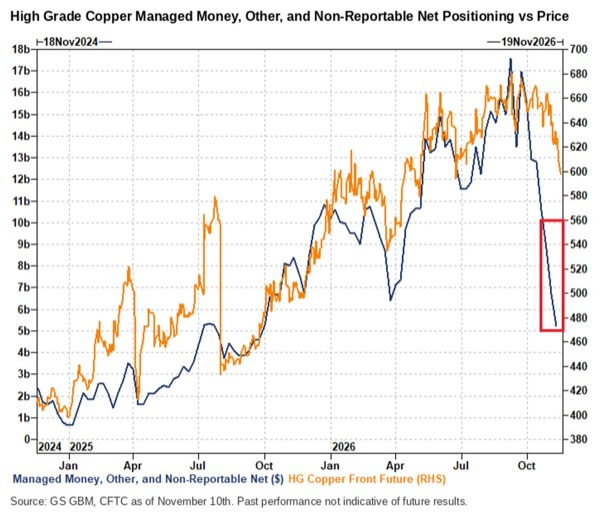

- 11월 원자재 가격의 광범위한 급락은 이후 원자재발 물가 압력을 낮출 요인
  - 월간 WTI·휘발유·브렌트유·난방유 가격은 각각 21.7%·21.4%·19.8%·15.3% 하락
  - 구리·은·설탕은 각각 14.1%·13%·11%, 백금·알루미늄·팔라듐은 9%·7.1%·7.1% 하락
  - 금은 월간 7.6% 하락해 2025년 9월 이후 최저이며 밀과 커피도 각각 4.2%·4.1% 하락

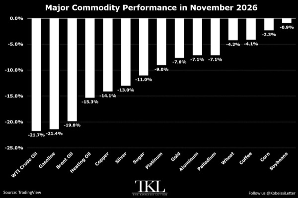

- 미국 경제지표의 시장 예상 상회가 확대되며 경제서프라이즈지수가 71로 상승
  - 8월 이후 56포인트 상승했고 2023년 8월 이후 두 번째로 높은 수준
  - 최근 23년 동안 현재 수준을 웃돈 기간은 5%에 불과하며 지수 상승은 실제 지표가 예상치를 웃돌았음을 의미

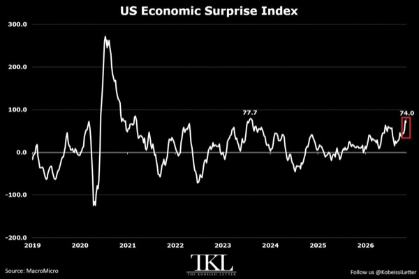

- 일본은 수입 식품·에너지 부담 속에 물가 상승 압력이 다시 확산
  - 9월 신선식품 제외 CPI는 전년 대비 2.1% 상승해 2025년 12월 이후 최고였고 5월보다 상승률이 0.6%포인트 확대
  - 신선식품·에너지 제외 CPI는 2.4% 상승해 1월 이후 최고였으며 전체 CPI는 전월 2.1% 상승으로 2025년 11월 이후 최고
  - 주요 식음료 업체의 10월 가격 인상 예정 품목은 3,153개로 2023년 7월 이후 처음 두 달 연속 3,000개를 상회

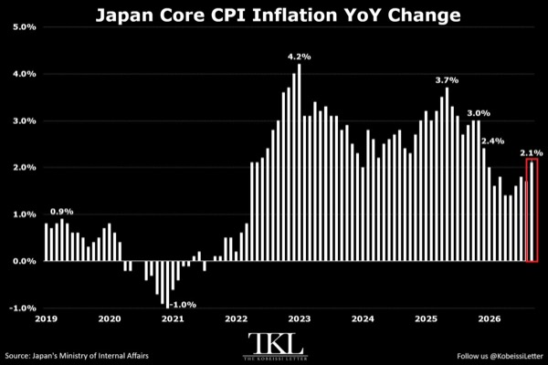

# MKevin

### 급락장을 버티는 현금과 부채 관리

- 급락장에서는 현금 확보와 부채 축소가 핵심 방어 수단이며, 바닥을 맞히기보다 추가 하락에도 버틸 여력을 확보해야 함
  - 현금은 옵션처럼 만기와 변동성에 따른 가치 감소가 없고, 공포가 커질 때 분할 매수할 선택권을 제공
  - 회사 자산은 현금 약 15%, 주식 약 3%, 부동산 약 82~83%이며, 현금 대부분도 부동산에 투입할 계획
- 연준의 유동성 회수와 대차대조표 축소가 이어지면 금의 방어력이 약해질 수 있음
  - 케빈 워시 체제의 통화 긴축이 관세·이란·에너지·AI발 물가 충격을 넘어 중장기 디스인플레이션 압력으로 작용한다는 전망
  - 금은 5,000달러에서 3,500달러로 하락했으며, 반등해도 4,000달러 부근이 저항이고 5,000달러 회복보다 2,000달러대 진입 가능성을 높게 평가
- 공포가 커진 뒤 풋옵션을 매수하면 주가 방향을 맞혀도 내재변동성 하락으로 손실이 날 수 있음
  - VIX가 연중 3월 27일 이후 최고 수준에 가까워 옵션 프리미엄이 비싼 구간
  - 높은 변동성에서는 옵션 매도가 유리할 수 있지만, 풋 매도는 추가 주식 매수 의무를 만들고 콜 매도는 보유 주식의 상승 여력을 제한할 수 있음
- 국채는 만기 보유와 중도 매도를 구분해야 하며, 대기자금은 단기물 만기 분산이 유용
  - 미국 10년물 금리 5.27% 부근을 고점으로 평가하며, 현재 약 5% 수익률에 관심
  - 10년물은 만기 전에 팔 때 금리가 오르면 가격 손실이 발생하므로 6개월·1년·2년물을 나눠 보유하는 방식 제시
  - 6개월물 수익률은 약 4.4%이며, 만기 보유 시 원금 회수가 가능하다는 장점과 미국 정부의 채무불이행 위험을 함께 언급
- 부동산은 공급 과잉 지역과 공급 제약 지역의 전망이 크게 다름
  - 올랜도·중부 플로리다·탬파는 신규 공급과 높은 금리로 가격 하락이 이어져 성급한 저가 매수에 주의
  - 캘리포니아처럼 신규 주택 공급이 어려운 지역은 공급 부족이 자산가치 방어 요인
  - AI 거품 붕괴나 고용 침체가 국채금리 하락으로 이어지면 금리 민감 부동산에 유리하다는 투자 논리로 비중 확대
- 비상장 벤처투자는 일별 시세 확인과 충동 매매를 줄이는 심리적 완충 수단
  - 매일 가격이 표시되지 않는 특성이 장점이며, 기술·AI·로봇 분야의 장기 노출을 유지하는 방식으로 활용
- AI 설비투자가 적은 소비재와 헬스케어로 자금이 이동했지만, 이미 오른 방어주를 추격하면 가격 부담이 커짐
  - Apple·Disney·Etsy는 AI 반도체와 메모리 투자 부담이 상대적으로 작은 사례
  - Apple의 기기 제어형 AI 에이전트는 2027년 말 출시 예상 보도가 재료
  - Cheesecake Factory처럼 이익률이 약 3%인 외식업체는 저소득층 소비 둔화에 취약하며, Eli Lilly 등 헬스케어도 최근 상승으로 매력 감소
- 당장 경기침체와 금리 급락을 기본 시나리오로 삼지는 않으며, AI 투자 사이클의 큰 거품은 아직 앞에 있다는 관점
  - Rocket Mortgage는 침체와 급격한 금리 하락 때 유리할 수 있지만 현재 최선의 방어 수단으로 보지 않음
- 비트코인은 유동성과 위험 선호에 민감한 위험자산이며, 주식 급락을 방어하는 수단으로 보기 어려움
  - 다음 AI 하드웨어 상승 사이클에서는 10만2,000달러 이상 가능성을 제시하지만, 주식과 동반 하락할 수 있다는 점이 핵심
- 손실 실현을 통한 절세는 현금으로 이탈하기보다 대체 종목으로 노출을 이어가는 방식에 초점
  - Nvidia를 매도하고 AMD나 Cerebras로 교체하면 반등 참여 가능성을 유지하면서 손실을 확정할 수 있음
  - Cerebras는 공급 확대까지 시간이 필요하며 2027년을 긍정적으로 평가하지만, 교체 과정에서 개별 종목 위험이 더 커질 수 있음
- 한 종목이나 업종에 집중하지 말고 가치평가가 낮아진 기업들을 분산해 점진적으로 매수
  - Nvidia·Microsoft·Amazon·Robinhood 등을 포함한 30~35개 관심 종목에서 기회를 탐색하며, 당일 저가 매수도 바닥 확신에 따른 행동은 아님
  - AI 기업 중 생존 기업과 초과수익을 낼 기업은 다를 수 있어 집중 베팅의 위험이 큼
- 신용거래는 평가손실에 강제 청산 위험을 더해 공포와 바닥 매도를 증폭
  - 헤지펀드의 총노출 축소 이후 개인의 증거금 압박과 투매가 이어질 수 있으므로 차입을 줄여 버틸 수 있는 구조가 우선
  - 보유 부동산도 현금으로 매입해 가격 조정이 곧바로 강제 매각으로 연결되지 않도록 관리
- 방어 자산은 이름보다 손실을 줄이는 경로로 구분해야 함
  - 현금은 매수 여력, 단기 국채는 대기자금 수익, 부채 축소는 강제 매각 방지, 비상장 투자는 시세 변동에 대한 심리적 부담 완화에 각각 기여
- 금리 하락에 기대는 부동산과 소비 둔화에 민감한 주식은 경기침체 때 효과가 엇갈릴 수 있어, 하나의 거시 전망에 방어 수단을 집중하지 않는 편이 유리
- 절세와 종목 교체를 동시에 진행할 때는 세금 절감액뿐 아니라 새 종목의 위험과 기존 포트폴리오의 업종 집중도까지 함께 비교해야 함

### 엔비디아 급락과 반도체 투자 재편

- 엔비디아 급락의 추가 악재는 젠슨 황의 500억 달러 규모 반도체 신사업 설립설
  - 출처는 Semafor 기자의 팟캐스트 전망이며 실제 창업이나 자금 조달을 입증하는 자료는 없음
  - 영상 기준 엔비디아 시가총액은 5조 달러 이상에서 약 3조 3,000억 달러로 약 34% 감소했고 당일 낙폭도 장중 5~7%까지 확대
  - 창업자의 이탈과 경쟁사 설립 가능성이 핵심 인재·투자금 유출 우려를 자극
- 구글의 2027년 브로드컴 TPU 8i 물량 약 100만 개 축소는 AI 투자 총량 감소와 구분할 필요
  - 궈밍치 분석의 핵심은 추론용 연산에서 학습용 연산으로의 구성 변화
  - Gemini 경쟁력 강화를 위해 학습 투자를 늘리는 시나리오라면 학습용 칩의 강자인 엔비디아에는 기회
  - AMD Instinct는 학습용 칩 경쟁에서 추격 단계
- 젠슨 황 복귀 가능성을 둘러싼 핵심 변수는 주가 하락에 따른 이사회 압박과 조사 결과
  - 팟캐스트 출연자는 복귀 가능성을 0%로 보고 신사업 창업을 예상했지만, 영상의 투자 논리는 주가가 하락할수록 복귀 압력이 커진다는 쪽
  - 실적 발표 직후 164달러까지 오른 주가는 상승분을 반납하고 해당 수준에서 약 16.5% 하락
  - Watchtower 조사 종료 예상 시점인 2~4월과 유리한 조사 결과를 전제로 한 복귀는 모두 화자의 시나리오이며 확정 일정이나 결론이 아님
- 중국향 반도체 수출 승인은 엔비디아 매출 회복의 정책 변수
  - 영상이 인용한 수치상 2026년 5월 이후 중국 기업 대상 반도체 340만 개의 선적 신청이 접수됐으며 알리바바가 신청을 주도
  - 텐센트향 H200 44만 5,000개 선적 시도와 전체 승인 물량 88만 개가 언급됨
  - 미국의 수출 승인 확대는 매출 촉매가 될 수 있지만 실제 판매 확대나 정부의 증시 지원을 전제로 투자하기는 어려움
- 기술주 급락에 따른 금융 여건 긴축과 유가 하락은 12월 9일 연준 회의의 금리 인상 부담을 낮출 가능성
  - 영상 기준 유가는 약 1.5% 하락했고 안전자산 선호로 미국 10년물 국채금리는 약 10.6bp 하락
  - 베선트의 호르무즈 해협 원유 통과량 최대치 발언을 근거로 공급 회복 가능성을 제시
  - 하루 2,400만 배럴 초과 통과량은 과거 수치와 최대치 발언을 연결한 화자의 추정
- 긴축·고물가·이란 전쟁 장기화 우려가 가격에 상당 부분 반영됐다는 전제에서 공포 구간의 매수 기회에 주목
  - 향후 2~3주는 예산 갈등과 12월 초 이스라엘 연정 문제 등으로 변동성 확대 가능
  - 생화학무기 우려에 따른 추가 군사 충돌은 상황을 더 악화시킬 위험
  - 중국 반도체 우려와 AMD 공매도 보고서도 투자심리 부담
- 영상 기준 앤트로픽 주가는 약 87달러로 10% 하락 구간에 진입
  - IPO 직후 매수를 피하고 10~20% 조정을 기다리는 전략을 제시했으며 실제 추가 하락 폭은 미확정
- 저가 매수의 전제는 신용·마진 배제와 투자 여력 확보
  - 화자의 자산은 부동산 비중이 높고 주식 비중은 약 4~5%이며 최근 약 60일간 하락 시 매수를 시작
  - 주식 비중이 낮아야 공포 구간에서 비중을 늘릴 수 있고, 전액 투자나 레버리지 상태에서는 추가 하락 대응이 어려움
- 반도체 투자에서는 주문 감소의 규모보다 추론·학습 간 투자 배분과 최종 공급사 변화를 함께 확인할 필요
  - 특정 TPU 물량 축소만으로 AI 수요 전체의 붕괴를 단정하기 어려움
- 창업자 복귀·신사업 설립·수출 승인 같은 사건은 확인 전까지 투자 시나리오로 관리할 필요
  - 미확인 소문만으로도 대형주의 낙폭이 커질 수 있어 포지션 규모와 현금 여력이 중요
- 주가 급락과 유가 하락이 통화정책 부담을 완화하더라도 지정학적 충격과 개별 기업 위험까지 해소되는 것은 아님

### 투자 긴축과 고용 충격이 가르는 증시 하락 위험

- 연준의 매파 전환을 AI 투자와 주식시장 과열을 식혀 인플레이션을 억제하려는 시도로 해석
  - 연준이 의도적으로 증시 급락을 유도한다는 것은 진행자의 추론이며, 연준이 확정한 정책 목표로 확인된 사실은 아님
  - 12월 금리 인상 전망이 우세하며 일부 인사는 50bp 인상까지 거론, 논의가 인상 여부에서 인상 폭으로 이동
  - 이란 전쟁 종결 합의 지연과 원유 이외 부문의 물가 압력이 긴축 지속 배경
- AI의 장기 생산성 개선과 AI 관련 주식의 단기 급락은 동시에 발생할 수 있음
  - Barr가 제시한 핵심 위험은 AI 투자 수익 실현 시점이 투자자의 기대를 충족하지 못하는 상황
  - 주가 재평가는 기업 투자 축소와 자산 감소에 따른 소비 위축을 통해 GDP에 부담
  - 주식 위험 프리미엄은 역사적으로 낮은 수준이지만 닷컴 버블 당시만큼 낮지는 않음
- AI 기업의 부외 약정과 투자자의 레버리지가 매도세를 증폭할 위험
  - 상위 AI 7개 기업의 부외 채무·약정 규모는 2026년 말 약 8,000억 달러, 관련 계약의 명목금액을 합산하면 3조 달러를 넘을 가능성
  - 현재가치와 계약 명목금액은 서로 다른 기준이므로 같은 규모로 비교하기 어려움
  - Barr는 AI 붐의 직접적인 부채 의존도는 아직 제한적이지만 헤지펀드 레버리지와 위험 선호는 높다고 지적
  - 신용융자 외에도 레버리지 ETF·옵션·무기한 계약을 통한 노출이 있어 신용융자 통계만으로 전체 위험을 파악하기 어려움
  - 급격한 가격 반전은 차입 축소와 강제 매도를 유발하고 거래상대방 위험과 은행권 충격으로 전이될 수 있음
- GPU 기술 교체에 따른 감가상각 위험은 존재하지만 현재 임대료는 수요 강세를 시사
  - B200·B300·A100·H100·H200 임대료는 최근 12개월 동안 모두 상승
  - 공급이 과잉으로 전환하면 1990년대 광케이블처럼 구축된 설비가 활용되기까지 수년이 걸릴 위험
  - 주가 급락이 해고와 투자 중단으로 이어지면 빠른 디플레이션으로 번질 수 있음
- Nvidia의 투자·약정 축소를 AI 생태계 자금 공급 둔화 신호로 해석
  - 클라우드 서비스 약정은 전 분기 360억 달러에서 이번 분기 320억 달러로 감소
  - 다른 기업의 채무에 대한 투자는 분기 210억 달러에서 110억 달러로 약 47.7% 감소
  - 금융여건 긴축이 기업의 자금 배분과 AI 생태계 자금 공급까지 압박
  - Oracle 신용부도스와프 상승과 레버리지 축소가 겹치면 AI 기업 간 순환 자금조달과 주가 상승 동력이 약해질 수 있음
- AI 연구·투자 확대가 생산성과 이익 증가로 즉시 연결되는 것은 아님
  - Warsh가 제시한 연구 산출량은 1930년 이후 20배 이상 증가했지만 생산성이 자동으로 같은 속도로 개선되지는 않음
  - 생산성 효과보다 데이터센터·전력·설비 수요가 먼저 커지면 공급 제약과 물가 압력이 강화
  - Musalem은 인플레이션 억제를 위한 여러 차례의 금리 인상 가능성을 언급
  - Kashkari는 금리를 높여 데이터센터 자금이 우량 사업에 선별적으로 배분되도록 유도할 필요성을 강조
- 이번 조정은 인플레이션 억제를 위한 긴축과 구조적인 경기 악화를 구분해서 볼 필요
  - 진행자는 현재 AI 수요와 고용이 무너진 상태는 아니며 연준의 강경한 태도도 이를 전제로 한다고 해석
  - 첫 번째 핵심 경보는 고용 악화, 두 번째는 AI 투자·수요 붐의 중단
  - 자동화가 일자리를 보완하는 대신 대체하면 GDP가 성장해도 실업률이 완전고용 수준을 웃돌 수 있음
  - AI 수익 기대 약화와 고용 충격이 겹치면 실적 전망과 주가 배수가 동시에 하락할 위험
- 하이퍼스케일러 투자 축소 우려가 빠르게 확산
  - Bank of America의 11월 6~12일 설문에서 향후 6개월 내 투자 감소를 예상한 펀드매니저는 52%로 10월의 30%에서 상승
  - 이는 투자자의 기대 변화이며 실제 투자 집행액 감소를 확정하는 수치는 아님
- Microsoft 설비투자 축소 보도는 투자 시점과 회계 처리까지 확인해야 함
  - 투자 계획의 1,750억 달러→1,700억 달러 감소에는 설비 도입 지연과 리스 전환이 섞였을 가능성
  - 현금 지출 감소만으로 AI 수요 감소를 단정하기 어려움
- 메모리는 AI 성장과 별개로 강한 가격·이익 순환에 노출
  - NAND 가격은 최근 2주간 약 20% 하락
  - Morgan Stanley는 SanDisk의 2029회계연도 주당순이익이 21% 감소할 것으로 전망
  - 반도체는 비인기 국면에서 매수 기회가 생기지만 바닥 시점 포착은 어려움
- 진행자는 낮은 주식 비중을 바탕으로 하락을 매수 기회로 활용
  - 추가 금리 인상과 연말까지 이어질 조정 가능성을 인정하면서도 현재 AI 시장이 최종 버블 단계라는 진단에는 반대
  - 진행자가 상정한 향후 버블 가격대는 AMD 1,000달러·Nvidia 800달러 이상
  - 마진 차입 없이 30~40개 종목이나 Nasdaq 100·S&P·동일가중 지수 등으로 분산하고 인내하는 접근을 제안
  - 방어주·소비재로 자금이 몰려 가격이 과도하게 높아진 구간보다 소외된 성장주를 선호
- 하락 원인에 따라 매수 판단을 달리할 필요
  - 금융여건 긴축에 따른 밸류에이션 조정이라면 장기 수요와 현금창출력을 점검하고, 고용·AI 수요까지 꺾이면 이익 전망을 다시 평가할 필요
- AI 투자의 지속성은 투자 총액보다 자금조달 구조와 실제 수익화 속도로 확인
  - 부외 약정·리스·기업 간 자금 순환·GPU 임대료를 함께 보면 설비투자 숫자만으로 놓치기 쉬운 부담을 파악할 수 있음
- 레버리지 축소가 진행되는 시장에서는 낮아진 가격만으로 바닥을 판단하기 어려움
  - 신용 위험과 강제 매도 압력이 안정되는지 확인하고 분산·무차입 접근으로 추가 하락을 감당할 여력을 확보할 필요

# PBoyle

### 의 거액 개발비를 지탱하는 반복 결제와 가상경제

- GTA 6의 개발비 10억~15억 달러는 애널리스트 추정치이며 Rockstar는 공식 비용을 공개하지 않음
  - 회사 측은 약 15억 달러가 든 부르즈 할리파보다 비싸지 않았다는 수준만 언급
  - 직원은 2018년 Red Dead Redemption 2 출시 당시 2,441명에서 12개 사무소의 4,711명으로 늘었으며 개발비의 핵심은 인건비
- 출시일 미국 생산성 손실 10억 달러라는 수치는 실제 산출 감소를 측정한 결과가 아닌 휴무 인원과 임금을 곱한 추산
  - PCMag·YouGov 설문에서는 게이머 8%가 휴가나 결석을 계획했으며 미국 전체로 확대하면 1,250만 명이지만, 유급휴가와 허위 병가는 서로 다른 범주
  - 2022년 영국 희년 추가 공휴일 당시 GDP는 6월 0.7% 감소한 뒤 7월 0.5% 증가해 일부 생산이 뒤로 이동했을 가능성
  - 2021년 학술 연구는 게임·여가용 컴퓨터 활동 개선이 2000년대 중반 이후 21~30세 남성 근로시간을 약 2% 줄였다고 추정했지만 조사상 카드·보드게임도 포함
- GTA 6 예약판매액은 10억~약 16억5,000만 달러, 판매량 전망은 2,000만~8,500만 장으로 편차가 매우 큼
  - Piper Sandler의 커뮤니티 트래픽 기반 계산은 출시 판매량 4,600만 장에 달했지만 공식 전망은 약 3,000만 장
  - 예약판매만으로 개발비를 회수했다는 추정은 매출과 이익을 혼동할 위험이 있으며 Sony·Microsoft의 플랫폼 수수료도 차감해야 함
- 초대형 게임은 디지털 복제본의 추가 판매비용이 거의 없어 흥행 규모가 비용 초과를 상쇄할 수 있음
  - 교량처럼 처리 용량에 묶인 사업보다 매출 확장성이 크며 거액의 개발비는 손실이 투자액으로 제한되고 상승 여력이 큰 콜옵션에 비유 가능
  - 장기간 협업한 경영진, 2015년부터 시작한 현지 조사, GTA 4부터 개선해 온 자체 엔진이 개발 위험을 줄이는 기반
- 출시 연기는 인건비를 늘려도 미완성 제품의 평판 손실과 환불 위험을 줄일 수 있음
  - GTA 6는 두 차례 연기됐고 두 번째 연기로 출시 일정이 2026년 5월에서 11월로 이동
  - Cyberpunk 2077은 2020년 출시 품질 문제로 PlayStation 스토어에서 판매가 중단되고 환불이 시행됨
  - GTA 6는 출시 직전 Metacritic 99점을 기록했고 Take-Two 주가는 장중 최대 8.4% 상승
- 검증된 소수 프랜차이즈에 집중한 Take-Two의 전략은 인수와 구독 확장에 베팅한 경쟁사들과 대비됨
  - Microsoft는 Activision Blizzard 인수에 약 750억 달러를 투입했으나 Game Pass의 성장 속도가 기대에 미달
  - Embracer는 900개 이상 프랜차이즈를 확보한 뒤 분할됐고, Sony의 Concord는 추정 판매량 2만5,000장에 그쳐 출시 2주 만에 종료·환불
  - 게임업계는 2022~2025년 약 4만4,000명을 해고했으며 막대한 제작비 자체가 흥행을 보장하지 않음
- GTA 5는 약 13년간 2억3,500만 장 판매와 100억 달러 이상 매출을 기록했지만 장기 수익의 핵심은 GTA Online의 반복 결제
  - 전년도 Take-Two 매출의 78%가 반복 고객 지출에서 발생했으며 GTA 6 출시 매출이 급증하면 이 비중은 일시적으로 낮아질 수 있음
  - 여러 세대 콘솔에 재출시해 동일 이용자의 재구매도 유도
- 유출된 내부 자료상 GTA Online은 2025년 9월~2026년 4월 주평균 959만 달러, 연환산 약 5억 달러의 매출을 창출
  - 2014~2024년 가상화폐 판매액은 50억 달러 이상이며 주간 이용자의 약 4%만 결제
  - 유출 자료에 의존한 수치로, 연환산 매출을 실제 연간 이익으로 해석하면 안 됨
  - 기존 서비스의 현금흐름을 잠식할 수 있어 후속작을 서둘러 출시할 유인이 약하며 GTA 6 온라인 모드는 2027년 출시가 예상됨
- Rockstar는 발행비용이 사실상 없는 GTA 달러를 Shark Card로 판매하고 게임 내 물가·보상·이동 규칙을 통제
  - 2013년 약 100만 GTA 달러였던 최고가 차량과 비교해 신형 차량 가격이 크게 올랐으며 Oppressor Mk II는 약 800만 GTA 달러
  - 이를 살 수 있는 최대 Shark Card의 현금 가격은 99.99달러로, 반복 플레이에 드는 시간의 기회비용이 현금 결제를 유도
  - 임무 보상도 올랐지만 물가 상승을 따라잡았는지는 공식 소비자물가지수 없이 판단하기 어려움
- 가상경제의 규칙은 이용자 자산과 사업자의 매출을 동시에 좌우
  - 플레이로 얻은 돈은 캐릭터와 함께 다른 콘솔로 옮길 수 있지만 구매한 GTA 달러는 동일 콘솔 계열 안에서만 이전 가능
  - 9월에는 이용자 제작 모드의 암호화폐·NFT 광고를 금지
  - GTA 6 온라인으로 기존 잔액을 넘기면 초기 인플레이션과 신규 결제 감소, 잔액을 없애면 핵심 유료 이용자 반발이 발생할 수 있으며 이전 정책은 미공개
- 가상자산의 가치는 운영사가 바꾸는 규칙에 취약
  - Second Life의 Ginko Financial은 2007년 폰지 사기와 뱅크런으로 붕괴해 약 75만 달러 상당의 채무를 남김
  - RuneScape는 거래 제한에 대한 반발로 2011년 투표를 실시했고 120만 명 이상 중 91% 이상이 자유거래 복원에 찬성
  - 2025년 10월 Counter-Strike 2의 아이템 교환 규칙 변경은 희귀 아이템 공급을 늘려 스킨 시장 가치 약 20억 달러를 단기간에 감소시킴
- 영국의 게임 세제지원도 Rockstar 개발 재원의 일부를 부담
  - GTA 5는 2015년 문화적으로 영국적인 게임 인증을 받았고 Rockstar North는 이후 8년간 3억6,030만 파운드의 지원을 청구
  - 해당 기간 영업이익은 약 6,900만 파운드였으며 영국 법인세 납부는 없었다는 조사 결과
  - 후속 보도상 누적 지원은 5억 파운드를 넘었고 관련 기간 배당금은 4억 파운드 이상
  - 위법 의혹이 아니라 상한 없는 제도 설계의 문제이며 Rockstar는 영국 내 1,500명 이상 고용과 연간 3억1,630만 파운드의 급여 지출을 제시
- GTA 6는 강력한 지식재산과 대규모 이용자 공동체를 활용해 출시를 하나의 문화 행사로 확장
  - Rockstar는 마이애미데이드 카운티의 공항·항만·경기장 등을 활용한 홍보에 약 400만 달러를 지불했으며 출시 전날 Twitch 동시 시청자는 330만 명을 기록
  - 범죄를 소재로 한 게임의 공공시설 광고에 지역 반대도 있었지만 관련 표결은 승인으로 귀결
- AI 데이터센터의 메모리 수요가 콘솔 가격을 밀어 올리면 게임 이용자 기반 확대에 제약이 생길 수 있음
  - 차세대 콘솔 가격이 1,000달러를 넘을 수 있다는 전망은 확정 가격이 아닌 애널리스트 추정
  - AI로 저비용 게임 공급이 늘어날수록 인지도·차별성·공동체가 강한 대작의 희소성이 높아질 수 있지만 향후 흥행을 보장하지는 않음
- Take-Two의 가치를 평가할 때 출시 판매량뿐 아니라 온라인 모드의 결제 전환율·이용자 유지·기존 서비스 잠식 여부를 함께 봐야 함
- 소수 결제자가 매출을 지탱하는 구조에서는 신규 유입보다 핵심 이용자의 신뢰와 가상자산 이전 정책이 현금흐름의 지속성을 좌우할 수 있음
- GTA의 성공 사례를 업계 전체의 대규모 투자 근거로 일반화하기 어려우며 축적된 브랜드·개발 역량·유통 기반이 없는 기업은 같은 비용을 감수해도 같은 수익 구조를 만들기 어려움

# Slav

- 한국에서 시작된 급락이 대만과 미국으로 확산되며 국가 간 차별화보다 글로벌 동반 매도가 지배
  - 미국까지 조정에 합류한 것은 투매가 후반부로 향할 가능성을 시사하며 반등은 먼저 하락한 한국에서 시작될 것으로 기대
- 급락장에서는 실적 컨센서스와 밸류에이션만으로 매수 시점이나 바닥을 특정하기 어려움
  - PBR 1배에서 0.9배·0.8배로 추가 하락할 수 있으며 이 과정에서 종목별 두 자릿수 손실이 발생 가능
  - 낮아진 PBR은 추가 하락 위험이 줄어드는 단서지만 바닥 시점을 알려주지는 않음
- 당장의 매수 판단에는 금리 하락이나 전쟁 종료 기대보다 투자심리와 실제 수급의 전환이 중요
  - 헤지펀드 매도·반대매매·레버리지 청산이 발생했어도 최근 장세는 매도 주체의 완전한 항복이 아직 끝나지 않았음을 시사
- 금요일 미국장과 다음 주 아시아장을 거치며 매물 부담이 완화될 가능성
  - 국가별 롱숏 전략까지 어려워진 동반 급락 이후 수급이 가벼워지는지가 반등의 핵심 확인 지점
- 미국 증시 급락이 가계 가용자산을 훼손하면서 위기 확산 전 증시 부양 정책과 우호적 발언이 나올 가능성

# Stockbot

- Trump가 해외 데이터센터를 건설하는 미국 기업에 대규모 세금을 부과하겠다고 발표하며 기술주 매도 압력이 확대
  - 중국이 데이터센터를 모두 가져갈 것이라며 해외 건설을 견제했고 나스닥100은 당일 하락률이 4%까지 확대
- Trump가 Jensen Huang의 Nvidia CEO 복귀를 촉구
  - 사과 후 복귀해야 한다고 발언했고 중국 Xi와도 관련 상황을 논의했다고 언급
- FTX 파산 과정에서 13억 4,000만 달러에 매각한 Anthropic 지분의 현재 환산가치는 480억 달러로 약 36배
  - 파산 당시 지분 처분과 이후 Anthropic 가치 상승 사이의 격차가 확대

# YDental

### 비트코인 바닥 확인의 조건과 핵심 가격대

- 비트코인 바닥 확인은 저점 재시험 때 매도 압력 감소, 61,900달러 회복, 재차 눌림에서 해당 가격 유지의 순서
  - 60,000달러 이탈이나 강한 반등만으로 하락 종료를 확정할 수 없음
  - 회복한 가격을 곧바로 내주면 지지 형성 판단 보류
- 11월 20일 차트와 밤 브리핑 기준 하락 구조가 이어졌으며, 반복된 반등도 추세를 바꾸지 못함
  - 수요일 밤 월요일 가격 범위를 이탈했고, 목요일 62,000달러 부근에서 64,000달러까지 반등한 뒤 재하락
  - 밤 브리핑에서 61,100달러까지 하락했으며 원본 차트는 그보다 앞선 오후 자료
- 일봉 관심 구간은 60,800~62,500달러이며 되돌림 비율도 61,100달러 부근에 겹침
  - 여러 기술적 기준의 중첩은 관찰할 이유이며, 실제 매수세와 지지 형성을 보장하지 않음
  - 단기 하단 관심 범위는 59,500~61,300달러로, 진입 후 빠른 회복과 매도 지속 여부가 핵심
- 청산 히트맵의 밝은 띠는 레버리지 가정에 따른 청산 집중 추정 구간
  - 확정된 매수벽이나 필수 도달 가격이 아니며, 도착 후 반등도 보장되지 않음
  - 관찰 가격대를 정하는 데 활용하고 방향은 실제 가격과 거래량으로 확인
- 매도 클라이맥스 이후 저점 재시험에서 매도세가 약해져야 하락 소진의 신뢰도가 높아짐
  - 첫 급락에서는 거래량이 폭증할 수 있지만, 이후에도 가격이 밀리면 매도 소진 근거 부족
  - 급락 후 원래 범위로 복귀하고 다음 눌림에서 매도 거래량 감소와 지지 유지가 나타나는지 확인
  - 현물 매수가 이어지면 회복 근거가 강화되며, 반등 후 저점 갱신 시 시험 지속
- 거래 규모별 누적 매수·매도 차이인 CVD는 일부 고액 체결 구간에서 최근 개선됐지만 중기 흐름은 여전히 약함
  - 한 달·석 달 범위에는 약세가 남아 있어 고래의 전면 복귀로 확대 해석하기 어려움
  - 체결 규모만으로 투자자 신분을 알 수 없으며, 매수 지속과 실제 하락 방어 여부가 중요
- 가격 약세 속 미결제약정 증가로 포지션 청산에 따른 변동성 확대 가능성
  - 계약마다 매수자와 매도자가 함께 존재하므로 미결제약정 증가만으로 롱·숏 방향을 단정할 수 없음
  - 현물 수급도 약해 포지션 증가 자체를 상승 근거로 삼기 어려움
  - 순롱·순숏 추정치는 실제 전체 계좌와 다르며 거래소·집계 범위가 다른 수치를 합쳐 시장 전체로 해석하면 안 됨
- 주봉은 큰 가격 범위의 하단을 시험하는 중장기 관심 구간이지만 매집 확정이나 비중 확대의 근거는 부족
  - 진행 중인 주봉 한 개로 매집 단계를 확정할 수 없으며 넓은 지지 범위 안에서도 단기 손절이 반복될 수 있음
- 상방 전환의 첫 관문은 61,900달러 회복과 재시험 지지이며, 통과 후 64,400~65,800달러 저항 관찰
  - 매도 압력 감소와 현물 매수 지속이 함께 확인돼야 회복 시나리오 강화
  - 상단 범위는 조건부 저항 구간이며 도달이 보장된 목표가가 아님
- 매도 거래량 증가와 저점 하락이 이어지고 반등도 회복에 실패하면 마지막 하락 기대를 낮춰야 함
  - 하단 관찰 가격은 59,800달러, 더 넓게는 57,500~57,800달러
  - 해당 구간 아래에서도 매도가 지속되고 회복하지 못하면 중기 시나리오 재점검
- 반등의 지속성은 상승 폭보다 수급의 성격과 다음 눌림에서의 방어력으로 판단
  - 숏 청산이 만든 일시적 반등과 현물 매수가 이어지는 회복을 구분해야 함
- 바닥 선점보다 확인 조건 충족 후 대응할 여유를 확보하는 것이 중요
  - 큰 방향성 베팅과 급락 후 추격 숏을 피하고, 거래 전 실패 기준과 감당할 손실을 설정
  - 손실 기준을 정할 수 없으면 거래를 건너뛰는 선택도 유효
