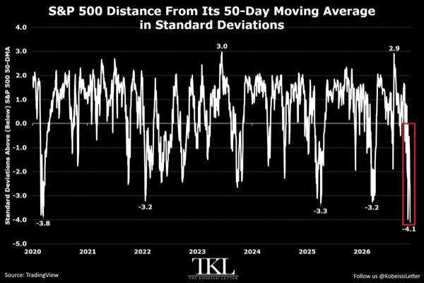
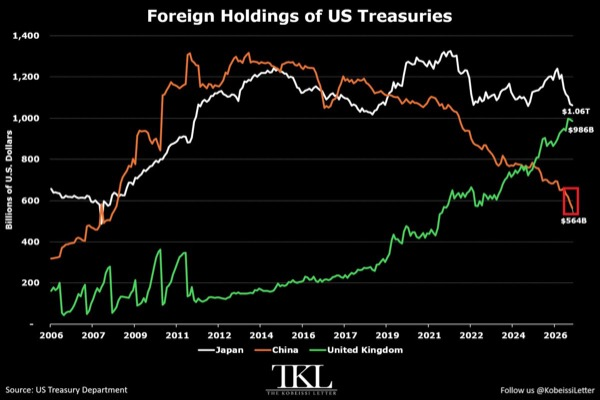
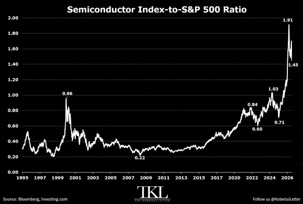
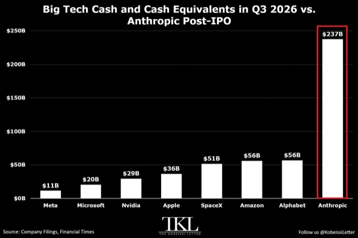
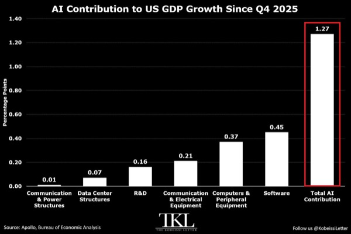
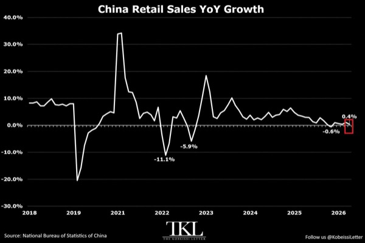
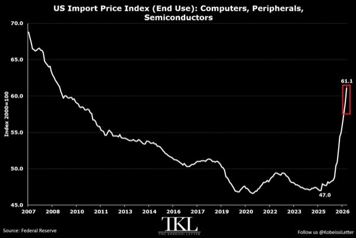

# EconomiExpl

### 부채와 고령화가 증폭시키는 세계경제 복합위기

- 세계경제의 핵심 위험은 부채·고령화·무역분쟁·기후피해·AI 투자가 서로를 악화시키는 구조
  - 개별 악재의 단순 합계보다 충격이 커지고, 한 문제를 해결하는 정책이 다른 문제의 부담을 키움
  - 위기 보도를 부풀리는 부정 편향도 있지만, 호황과 불황을 서로 상쇄하던 완충 요인이 함께 약해진 상황
- 세계 총부채는 약 365조 달러, GDP 대비 약 310%로 역사적으로 높은 수준이며 다시 상승 중
  - 팬데믹 정점의 약 360%보다는 낮지만, 경제 규모 대비 부채 부담이 큰 상태에서 금리까지 상승
  - 인플레이션 억제용 금리 인상과 채무 상환·화폐가치 하락 우려가 국채금리를 끌어올려 정부 조달비용을 확대
- 고령화로 연금·의료 지출이 늘지만 수혜층의 정치적 영향력 때문에 재정개혁은 어려움
  - 미국에서는 사회보장과 주요 의료 프로그램이 연방지출의 약 절반을 차지
  - 프랑스의 연금개혁처럼 급여 축소나 정년 연장은 큰 정치적 비용을 동반하고, 이민을 통한 납세인구 확대도 반발에 직면
  - 지정학적 갈등에 따른 국방비 증액까지 겹쳐 재정 여력을 추가로 소진
- 장기간의 저금리와 재정 확대는 기존 자산 보유자에게 이익을 집중시키고 현상 유지의 정치적 힘을 강화
  - 자산가격 상승의 수혜층이 구조개혁보다 부의 추가 축적에 유리한 제도를 지지하면서 조정이 지연
  - 청년층의 경제적 불안과 가족 형성의 어려움은 저출생을 심화시켜 고령화·재정부담의 악순환으로 연결
- 제조업 해외 이전으로 상품가격은 낮아졌지만 비대졸 중산층의 안정적 일자리는 줄어듦
  - 최근에는 비용 절감분이 기업 마진과 복잡한 공급망에 흡수되면서 소비자 혜택도 약화
  - 국내 고용과 산업을 보호하라는 압력으로 유럽·아시아·중남미까지 보호무역이 확산
- 무역분쟁과 실제 전쟁은 원유·곡물·광물 공급을 제약하고 물가와 금리 부담을 다시 키움
  - 국내 불만을 외부 갈등으로 돌리는 정치와 자원 확보 경쟁이 경제 불안을 증폭
  - 중국의 비축자원도 충격을 늦출 뿐 근본 해결책이 되지 못함
- 중국의 저가 제조품은 세계 물가를 완화하지만 다른 국가의 산업기반에는 압력
  - 중국 내부에서도 빠른 고령화와 장기 부동산 조정이 진행되고, 수출 주도 성장에는 세계적 보호무역이 제약으로 작용
- 기후피해는 보험·부동산·지방재정을 거쳐 다음 재해에 대한 취약성을 키움
  - 극단적 기상으로 연간 직접 피해가 수천억 달러에 이르고 생산성·건강 손실까지 포함하면 부담이 수조 달러 규모로 확대
  - 보험 철수와 보험료 상승으로 부동산 가치가 하락하면 지방세수가 줄고 기반시설 투자가 위축되는 악순환 발생
  - 폭염과 흉작은 취약국의 생산성을 떨어뜨리고, 공급망 차질·투입비용 상승과 함께 식량가격을 높은 수준에 묶어둠
- AI는 신규 투자와 주가 상승을 떠받치지만 단기적으로 부채·전력 수요를 더 늘림
  - 데이터센터와 인프라 건설에 차입이 확대되고 이미 빠듯한 에너지 체계에 추가 부담
  - 장기 생산성 효과는 불확실한 반면 자금조달 비용과 에너지 수요는 당장 발생
- 지난 20년간 호황기에 재정·자원 여유를 충분히 쌓지 못해 경기 대응 수단의 효과가 약화
  - 호황기에 증세·금리 인상·비축 확대를 하기보다 성장을 계속 자극하면서 미래의 조정 여력을 소진
  - 추가 차입·이민 확대·높은 물가 허용은 각각 이자 부담·정치적 반발·구매력 저하라는 비용을 동반
- 재생에너지 비용 하락은 에너지와 생산성의 악순환을 완화할 잠재적 돌파구
  - 태양광·풍력은 세계 여러 지역에서 가장 저렴한 신규 발전원에 속하며 비용 하락도 지속
  - 대규모 활용에는 저장장치와 전력망 투자가 필요하지만, 저렴한 에너지가 확산되면 경제 전반의 비용을 낮출 수 있음
- AI를 줄어드는 노동력을 보완하는 방향으로 활용하면 고령화 충격을 일부 상쇄할 가능성
  - 효과는 기술 자체보다 배치 방식에 달려 있으며, 한국의 국가 AI 정책도 아직 결론을 내리기에는 이른 단계
- 국가와 자산의 회복력은 개별 성장률보다 재정 여력·에너지 접근성·인구구조가 동시에 악화될 때 버틸 수 있는지에 좌우될 것
- AI 투자 확대 자체보다 전력 공급과 실제 생산성 향상이 차입·인프라 비용을 얼마나 따라잡는지가 지속 가능성을 가르는 기준
- 기후위험은 재해 손실뿐 아니라 보험 가능 여부·담보가치·지방재정으로 확산되는 경로까지 함께 점검할 필요

# Kobeissi

- S&P 500의 50일 이동평균 대비 낙폭이 4.1표준편차에 달해 2015년 8월 이후 최대 과매도 구간에 진입
  - 최근 20년 이상 기간 중 세 번째로 큰 괴리이며, 2008년 금융위기 3.6표준편차·2020년 급락 3.8표준편차를 상회

- 외국인의 미국 국채 보유액이 9월 760억 달러 감소한 9조 2,400억 달러로 줄며 해외 수요 약화
  - 최근 4개월 중 3개월 감소했고 2월 대비 2,460억 달러 축소
  - 일본은 50억 달러 줄인 1조 600억 달러, 영국은 90억 달러 줄인 9,860억 달러, 중국은 270억 달러 줄인 5,640억 달러 보유
  - 중국 보유액은 2008년 7월 이후 최저

- 대만 증시가 한 주간 18% 급락하자 공매도 규제와 증시안정기금 매수로 대응
  - 주간 낙폭은 35년 만에 최대이며, 월요일부터 전일 종가 아래 공매도를 금지하고 증거금 요건을 150%로 상향
  - 150억 달러 규모 증시안정기금도 주식 매수로 시장 방어

- 반도체의 시장 대비 상대강도가 급락하며 SOX/S&P 500 비율이 4월 이후 최저인 1.45까지 하락
  - 6월 중순 고점 대비 비율이 0.46포인트·24% 하락했고, 같은 기간 SOX는 24% 하락한 반면 S&P 500은 2% 상승
  - 상대 낙폭은 닷컴버블 붕괴 이후와 유사하지만 비율은 여전히 2022년 저점보다 142% 높은 수준

- Anthropic의 IPO 이후 현금 및 현금성자산이 2,370억 달러로 늘어 대규모 투자 여력 확보
  - IPO로 810억 달러, 별도 사모배정으로 260억 달러 조달
  - Alphabet·Amazon·SpaceX·Apple의 현금 합계를 웃돌며, Nvidia의 8배·Microsoft의 12배·Meta의 22배 규모
  - Berkshire Hathaway의 현금 3,770억 달러와 비교되는 수준

- AI 관련 투자가 2026년 1~3분기 미국 실질 GDP 성장의 약 65%를 차지
  - 누적 성장률 약 2% 중 1.27%포인트를 기여하며 미국 경제의 핵심 성장 동력으로 부상
  - 소프트웨어 0.45%포인트, 컴퓨터·주변기기 0.37%포인트, 통신·전기장비 0.21%포인트, 연구개발 0.16%포인트, 데이터센터 건물 0.07%포인트 기여

- 중국의 소비·생산·투자가 동반 둔화하며 내수 부진 심화
  - 10월 소매판매는 전년 대비 0.4% 증가에 그쳐 예상 0.8%와 9월 1.1%를 하회했고, 연간 증가율은 2020년 이후 최저 수준으로 향하는 흐름
  - 산업생산 증가율은 9월 5.5%에서 10월 4.8%로 둔화
  - 1~10월 고정자산투자는 전년 대비 8.1% 감소했고, 10월 단월 감소율 16.9%는 팬데믹을 제외하면 최대

- AI 투자 붐으로 컴퓨터·주변기기·반도체 수입가격이 급등하며 장기적인 전자제품 가격 하락 추세가 역전
  - 미국의 해당 품목 수입가격은 10월 전년 대비 26.5% 상승해 1990년대 통계 시작 이후 최대 상승률 기록
  - 전년 대비 두 자릿수 상승이 7개월 연속 이어졌고, 전월 대비로도 3.6% 상승
  - 수입물가지수는 61.1로 2008년 12월 이후 최고이며 2025년 3월 대비 30% 상승

# PBoyle

### 의 거액 개발비를 지탱하는 반복 결제와 가상경제

- GTA 6의 개발비 10억~15억 달러는 애널리스트 추정치이며 Rockstar는 공식 비용을 공개하지 않음
  - 회사 측은 약 15억 달러가 든 부르즈 할리파보다 비싸지 않았다는 수준만 언급
  - 직원은 2018년 Red Dead Redemption 2 출시 당시 2,441명에서 12개 사무소의 4,711명으로 늘었으며 개발비의 핵심은 인건비
- 출시일 미국 생산성 손실 10억 달러라는 수치는 실제 산출 감소를 측정한 결과가 아닌 휴무 인원과 임금을 곱한 추산
  - PCMag·YouGov 설문에서는 게이머 8%가 휴가나 결석을 계획했으며 미국 전체로 확대하면 1,250만 명이지만, 유급휴가와 허위 병가는 서로 다른 범주
  - 2022년 영국 희년 추가 공휴일 당시 GDP는 6월 0.7% 감소한 뒤 7월 0.5% 증가해 일부 생산이 뒤로 이동했을 가능성
  - 2021년 학술 연구는 게임·여가용 컴퓨터 활동 개선이 2000년대 중반 이후 21~30세 남성 근로시간을 약 2% 줄였다고 추정했지만 조사상 카드·보드게임도 포함
- GTA 6 예약판매액은 10억~약 16억5,000만 달러, 판매량 전망은 2,000만~8,500만 장으로 편차가 매우 큼
  - Piper Sandler의 커뮤니티 트래픽 기반 계산은 출시 판매량 4,600만 장에 달했지만 공식 전망은 약 3,000만 장
  - 예약판매만으로 개발비를 회수했다는 추정은 매출과 이익을 혼동할 위험이 있으며 Sony·Microsoft의 플랫폼 수수료도 차감해야 함
- 초대형 게임은 디지털 복제본의 추가 판매비용이 거의 없어 흥행 규모가 비용 초과를 상쇄할 수 있음
  - 교량처럼 처리 용량에 묶인 사업보다 매출 확장성이 크며 거액의 개발비는 손실이 투자액으로 제한되고 상승 여력이 큰 콜옵션에 비유 가능
  - 장기간 협업한 경영진, 2015년부터 시작한 현지 조사, GTA 4부터 개선해 온 자체 엔진이 개발 위험을 줄이는 기반
- 출시 연기는 인건비를 늘려도 미완성 제품의 평판 손실과 환불 위험을 줄일 수 있음
  - GTA 6는 두 차례 연기됐고 두 번째 연기로 출시 일정이 2026년 5월에서 11월로 이동
  - Cyberpunk 2077은 2020년 출시 품질 문제로 PlayStation 스토어에서 판매가 중단되고 환불이 시행됨
  - GTA 6는 출시 직전 Metacritic 99점을 기록했고 Take-Two 주가는 장중 최대 8.4% 상승
- 검증된 소수 프랜차이즈에 집중한 Take-Two의 전략은 인수와 구독 확장에 베팅한 경쟁사들과 대비됨
  - Microsoft는 Activision Blizzard 인수에 약 750억 달러를 투입했으나 Game Pass의 성장 속도가 기대에 미달
  - Embracer는 900개 이상 프랜차이즈를 확보한 뒤 분할됐고, Sony의 Concord는 추정 판매량 2만5,000장에 그쳐 출시 2주 만에 종료·환불
  - 게임업계는 2022~2025년 약 4만4,000명을 해고했으며 막대한 제작비 자체가 흥행을 보장하지 않음
- GTA 5는 약 13년간 2억3,500만 장 판매와 100억 달러 이상 매출을 기록했지만 장기 수익의 핵심은 GTA Online의 반복 결제
  - 전년도 Take-Two 매출의 78%가 반복 고객 지출에서 발생했으며 GTA 6 출시 매출이 급증하면 이 비중은 일시적으로 낮아질 수 있음
  - 여러 세대 콘솔에 재출시해 동일 이용자의 재구매도 유도
- 유출된 내부 자료상 GTA Online은 2025년 9월~2026년 4월 주평균 959만 달러, 연환산 약 5억 달러의 매출을 창출
  - 2014~2024년 가상화폐 판매액은 50억 달러 이상이며 주간 이용자의 약 4%만 결제
  - 유출 자료에 의존한 수치로, 연환산 매출을 실제 연간 이익으로 해석하면 안 됨
  - 기존 서비스의 현금흐름을 잠식할 수 있어 후속작을 서둘러 출시할 유인이 약하며 GTA 6 온라인 모드는 2027년 출시가 예상됨
- Rockstar는 발행비용이 사실상 없는 GTA 달러를 Shark Card로 판매하고 게임 내 물가·보상·이동 규칙을 통제
  - 2013년 약 100만 GTA 달러였던 최고가 차량과 비교해 신형 차량 가격이 크게 올랐으며 Oppressor Mk II는 약 800만 GTA 달러
  - 이를 살 수 있는 최대 Shark Card의 현금 가격은 99.99달러로, 반복 플레이에 드는 시간의 기회비용이 현금 결제를 유도
  - 임무 보상도 올랐지만 물가 상승을 따라잡았는지는 공식 소비자물가지수 없이 판단하기 어려움
- 가상경제의 규칙은 이용자 자산과 사업자의 매출을 동시에 좌우
  - 플레이로 얻은 돈은 캐릭터와 함께 다른 콘솔로 옮길 수 있지만 구매한 GTA 달러는 동일 콘솔 계열 안에서만 이전 가능
  - 9월에는 이용자 제작 모드의 암호화폐·NFT 광고를 금지
  - GTA 6 온라인으로 기존 잔액을 넘기면 초기 인플레이션과 신규 결제 감소, 잔액을 없애면 핵심 유료 이용자 반발이 발생할 수 있으며 이전 정책은 미공개
- 가상자산의 가치는 운영사가 바꾸는 규칙에 취약
  - Second Life의 Ginko Financial은 2007년 폰지 사기와 뱅크런으로 붕괴해 약 75만 달러 상당의 채무를 남김
  - RuneScape는 거래 제한에 대한 반발로 2011년 투표를 실시했고 120만 명 이상 중 91% 이상이 자유거래 복원에 찬성
  - 2025년 10월 Counter-Strike 2의 아이템 교환 규칙 변경은 희귀 아이템 공급을 늘려 스킨 시장 가치 약 20억 달러를 단기간에 감소시킴
- 영국의 게임 세제지원도 Rockstar 개발 재원의 일부를 부담
  - GTA 5는 2015년 문화적으로 영국적인 게임 인증을 받았고 Rockstar North는 이후 8년간 3억6,030만 파운드의 지원을 청구
  - 해당 기간 영업이익은 약 6,900만 파운드였으며 영국 법인세 납부는 없었다는 조사 결과
  - 후속 보도상 누적 지원은 5억 파운드를 넘었고 관련 기간 배당금은 4억 파운드 이상
  - 위법 의혹이 아니라 상한 없는 제도 설계의 문제이며 Rockstar는 영국 내 1,500명 이상 고용과 연간 3억1,630만 파운드의 급여 지출을 제시
- GTA 6는 강력한 지식재산과 대규모 이용자 공동체를 활용해 출시를 하나의 문화 행사로 확장
  - Rockstar는 마이애미데이드 카운티의 공항·항만·경기장 등을 활용한 홍보에 약 400만 달러를 지불했으며 출시 전날 Twitch 동시 시청자는 330만 명을 기록
  - 범죄를 소재로 한 게임의 공공시설 광고에 지역 반대도 있었지만 관련 표결은 승인으로 귀결
- AI 데이터센터의 메모리 수요가 콘솔 가격을 밀어 올리면 게임 이용자 기반 확대에 제약이 생길 수 있음
  - 차세대 콘솔 가격이 1,000달러를 넘을 수 있다는 전망은 확정 가격이 아닌 애널리스트 추정
  - AI로 저비용 게임 공급이 늘어날수록 인지도·차별성·공동체가 강한 대작의 희소성이 높아질 수 있지만 향후 흥행을 보장하지는 않음
- Take-Two의 가치를 평가할 때 출시 판매량뿐 아니라 온라인 모드의 결제 전환율·이용자 유지·기존 서비스 잠식 여부를 함께 봐야 함
- 소수 결제자가 매출을 지탱하는 구조에서는 신규 유입보다 핵심 이용자의 신뢰와 가상자산 이전 정책이 현금흐름의 지속성을 좌우할 수 있음
- GTA의 성공 사례를 업계 전체의 대규모 투자 근거로 일반화하기 어려우며 축적된 브랜드·개발 역량·유통 기반이 없는 기업은 같은 비용을 감수해도 같은 수익 구조를 만들기 어려움

# Slav

- 국내 증시 안정 대책은 불법 공매도 특별감시에 더해 추가 조치가 필요한 상황
  - 증시안정펀드는 가동 준비 착수 단계이며, 실제 투입은 시장이 더 급락할 때 이뤄질 가능성
  - 외국인 매도 물량을 받아내는 부담이 있지만 급락 시 시장 방어 수단으로 활용할 여지
  - 대만의 전 종목 공매도 제한과 비교하면 국내 공매도 대책은 아쉬운 수준

- 케이엠에프·에이엔에이치스트럭쳐 공모주 청약은 수요예측 결과 확인 후 판단
  - 케이엠에프는 화~수요일 IBK, 에이엔에이치스트럭쳐는 금요일 NH에서 청약 예정

# Stockbot

- 대만 증시가 한 주간 18% 급락하자 공매도 규제를 강화하고 증시안정기금 매수로 대응
  - 주간 낙폭은 35년 만에 최대이며, 월요일부터 전일 종가 아래 공매도를 금지하고 증거금 요건을 150%로 상향
  - 150억 달러 규모 증시안정기금도 주식을 매수하며 시장 방어

# YDental

### 비트코인 바닥 확인의 조건과 핵심 가격대

- 비트코인 바닥 확인은 저점 재시험 때 매도 압력 감소, 61,900달러 회복, 재차 눌림에서 해당 가격 유지의 순서
  - 60,000달러 이탈이나 강한 반등만으로 하락 종료를 확정할 수 없음
  - 회복한 가격을 곧바로 내주면 지지 형성 판단 보류
- 11월 20일 차트와 밤 브리핑 기준 하락 구조가 이어졌으며, 반복된 반등도 추세를 바꾸지 못함
  - 수요일 밤 월요일 가격 범위를 이탈했고, 목요일 62,000달러 부근에서 64,000달러까지 반등한 뒤 재하락
  - 밤 브리핑에서 61,100달러까지 하락했으며 원본 차트는 그보다 앞선 오후 자료
- 일봉 관심 구간은 60,800~62,500달러이며 되돌림 비율도 61,100달러 부근에 겹침
  - 여러 기술적 기준의 중첩은 관찰할 이유이며, 실제 매수세와 지지 형성을 보장하지 않음
  - 단기 하단 관심 범위는 59,500~61,300달러로, 진입 후 빠른 회복과 매도 지속 여부가 핵심
- 청산 히트맵의 밝은 띠는 레버리지 가정에 따른 청산 집중 추정 구간
  - 확정된 매수벽이나 필수 도달 가격이 아니며, 도착 후 반등도 보장되지 않음
  - 관찰 가격대를 정하는 데 활용하고 방향은 실제 가격과 거래량으로 확인
- 매도 클라이맥스 이후 저점 재시험에서 매도세가 약해져야 하락 소진의 신뢰도가 높아짐
  - 첫 급락에서는 거래량이 폭증할 수 있지만, 이후에도 가격이 밀리면 매도 소진 근거 부족
  - 급락 후 원래 범위로 복귀하고 다음 눌림에서 매도 거래량 감소와 지지 유지가 나타나는지 확인
  - 현물 매수가 이어지면 회복 근거가 강화되며, 반등 후 저점 갱신 시 시험 지속
- 거래 규모별 누적 매수·매도 차이인 CVD는 일부 고액 체결 구간에서 최근 개선됐지만 중기 흐름은 여전히 약함
  - 한 달·석 달 범위에는 약세가 남아 있어 고래의 전면 복귀로 확대 해석하기 어려움
  - 체결 규모만으로 투자자 신분을 알 수 없으며, 매수 지속과 실제 하락 방어 여부가 중요
- 가격 약세 속 미결제약정 증가로 포지션 청산에 따른 변동성 확대 가능성
  - 계약마다 매수자와 매도자가 함께 존재하므로 미결제약정 증가만으로 롱·숏 방향을 단정할 수 없음
  - 현물 수급도 약해 포지션 증가 자체를 상승 근거로 삼기 어려움
  - 순롱·순숏 추정치는 실제 전체 계좌와 다르며 거래소·집계 범위가 다른 수치를 합쳐 시장 전체로 해석하면 안 됨
- 주봉은 큰 가격 범위의 하단을 시험하는 중장기 관심 구간이지만 매집 확정이나 비중 확대의 근거는 부족
  - 진행 중인 주봉 한 개로 매집 단계를 확정할 수 없으며 넓은 지지 범위 안에서도 단기 손절이 반복될 수 있음
- 상방 전환의 첫 관문은 61,900달러 회복과 재시험 지지이며, 통과 후 64,400~65,800달러 저항 관찰
  - 매도 압력 감소와 현물 매수 지속이 함께 확인돼야 회복 시나리오 강화
  - 상단 범위는 조건부 저항 구간이며 도달이 보장된 목표가가 아님
- 매도 거래량 증가와 저점 하락이 이어지고 반등도 회복에 실패하면 마지막 하락 기대를 낮춰야 함
  - 하단 관찰 가격은 59,800달러, 더 넓게는 57,500~57,800달러
  - 해당 구간 아래에서도 매도가 지속되고 회복하지 못하면 중기 시나리오 재점검
- 반등의 지속성은 상승 폭보다 수급의 성격과 다음 눌림에서의 방어력으로 판단
  - 숏 청산이 만든 일시적 반등과 현물 매수가 이어지는 회복을 구분해야 함
- 바닥 선점보다 확인 조건 충족 후 대응할 여유를 확보하는 것이 중요
  - 큰 방향성 베팅과 급락 후 추격 숏을 피하고, 거래 전 실패 기준과 감당할 손실을 설정
  - 손실 기준을 정할 수 없으면 거래를 건너뛰는 선택도 유효
