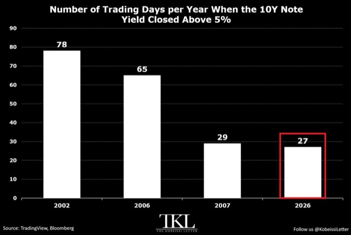
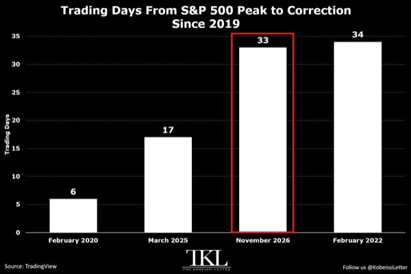
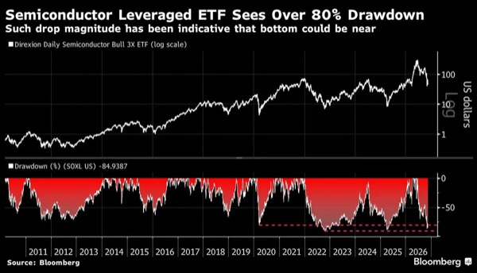
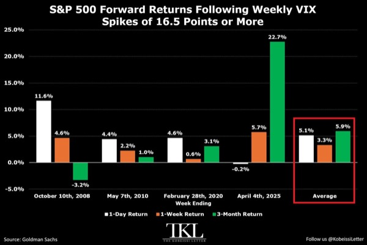
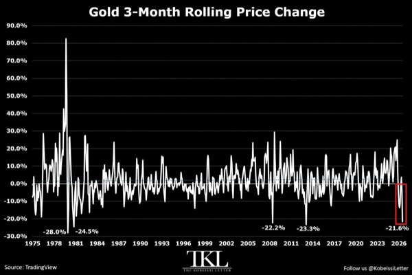
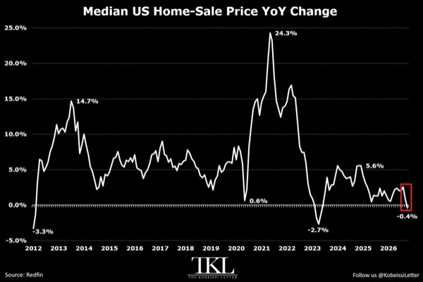
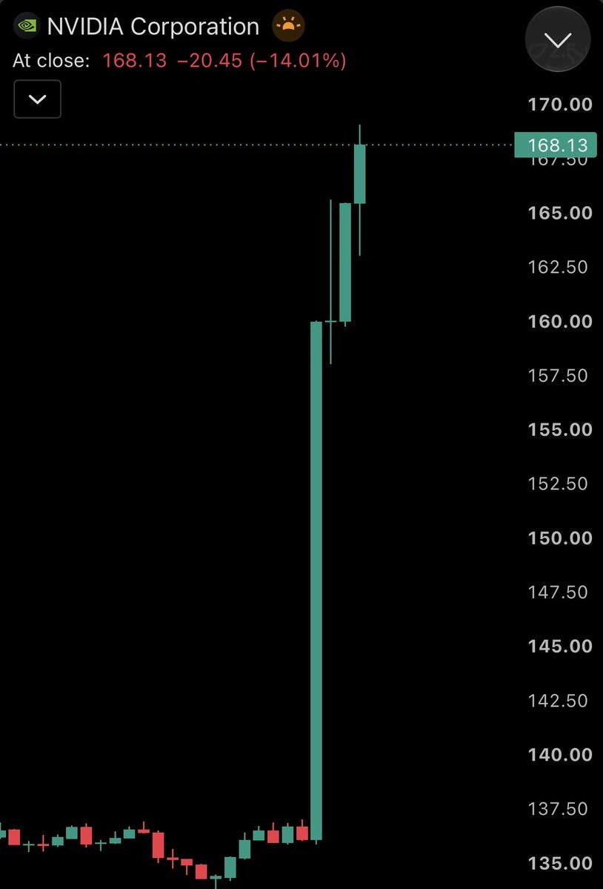
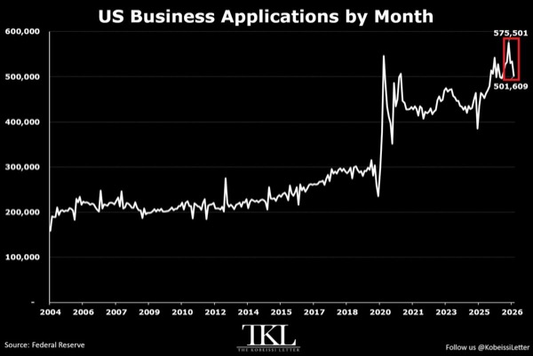
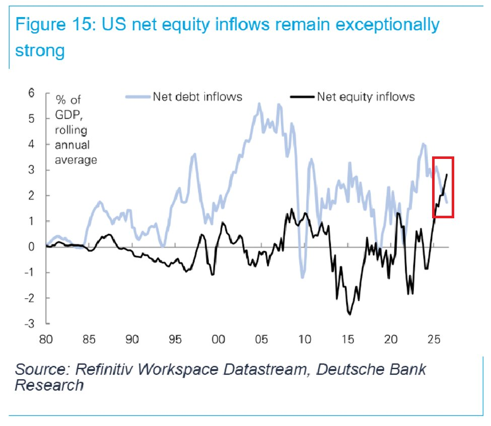
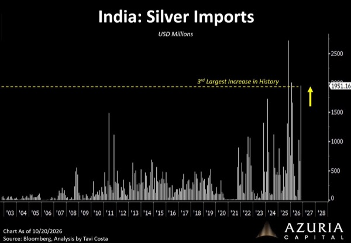

# Harvey

- 버크셔가 미쓰비시상사·미쓰이물산·마루베니·스미토모상사의 보유 주식 수를 직전 공시보다 확대
  - 일본 종합상사도 자원 노출, 비자원 사업 수익성, 투자자산의 질과 재투자 기회가 달라 개별 기업별 평가가 필요
- 장기 외국인 자본 유치에는 낮은 밸류에이션과 함께 현금 사용처, 소수주주 몫, 예측 가능한 자본배분 원칙이 중요
  - 버크셔의 일본 투자는 현금창출력·매입가격·조달 구조·보유기간을 하나의 투자 판단으로 연결한 사례
- 일본 투자 기회가 상장주식에서 기업 인수와 실물자산으로 확장
  - 블랙스톤은 2025년 약 5,070억 엔 규모 테크노프로 공개매수 계획과 1,000억 엔 초과 도쿄 물류시설 인수 계약을 발표
  - GIC도 2024년 요코하마 물류시설을 인수
- 도쿄증권거래소가 자본비용과 주가를 의식한 경영을 요구하며 기업의 자본 사용에 대한 평가 기준 강화
  - 2026년에도 관련 요청 갱신과 후속 점검 지속

# KHwanK

### 반도체 이익과 저평가로 본 코스피 반등 가능성

- 2027년 코스피 기본 시나리오는 상승이며, 강환국이 제시한 상승 확률은 70~80%, 5,000 아래 장기 정체 확률은 20~30%
  - 2027년까지 1만 돌파 가능성은 열어두되 달성 여부는 불확실
  - 상승 근거는 홀수 해 강세, 미국 대통령 집권 7년차 효과, 낮은 밸류에이션
- 영상 기준 코스피는 2026년 1월 27일 5,000을 돌파하고 최고 9,400까지 상승한 뒤, 11월 20일 4,870으로 고점 대비 거의 반토막
  - 2025년 11월 제시한 5,000 돌파 전망은 조기에 달성했지만, 2026년 2월 제시한 2027년까지 1만 전망은 미달 상태
- 증권사 전망 범위 바깥의 가능성을 검토하는 역발상 접근
  - 전년도 증권사 전망은 대략 3,300~5,000이었지만 실제 고점은 이를 크게 초과
  - 2027년 전망 범위는 5,000~10,500이며, 하단은 이미 2026년 11월에 이탈
  - 다수 애널리스트의 상승 전망은 과거 경험상 오히려 경계 신호로 평가
- 전년 11월부터 해당 연도 10월까지를 한 해로 계산하면, 외환위기 이후 홀수 해 코스피 수익률은 14전 14승
  - 1999년 약 116~117%, 2025년 약 60%, 2007년 약 51%, 2009년 약 42% 상승
  - 가장 낮았던 2011년도 약 1.4% 상승했으며, 일반적인 1~12월 연간 수익률과는 구분 필요
- 홀수 해 강세의 배경은 미국 선거에 따른 정치적 불확실성의 완화
  - 짝수 해에는 대선이나 중간선거가 있어 아시아 증시에 정치적 위험이 전파
  - 미국의 경기부양 자금은 주로 미국에 머물러 아시아는 유동성 혜택보다 불확실성의 영향을 더 크게 받을 수 있음
- 2027년은 미국 대통령 집권 7년차에 해당해 아시아 증시에 유리한 국면으로 평가
  - 임기 후반에는 대외 갈등을 완화하고 외교적 성과를 추구할 유인이 커짐
  - 미중 갈등 등 국제 긴장이 완화되면 코스피 재평가의 촉매가 될 수 있음
- 반도체 이익 증가와 주가 급락이 겹치며 코스피 밸류에이션이 극단적으로 낮아졌다는 평가
  - 영상에서 제시한 선행 주가수익비율은 약 3배로, 최근 10년 분포 8.6~12.2배를 크게 하회
  - 낮은 밸류에이션이 단기 반등을 보장하지는 않지만, 이익 증가가 유지되면 가격과 실적의 괴리가 축소될 여지
- 메모리 반도체 호황은 2027년까지 이어지고, 증설에 따른 공급 부담은 2028년부터 본격화될 가능성
  - 인공지능과 반도체 업황 우려가 주가에 먼저 반영됐지만, 당장 기업의 이익 창출력은 강하다는 판단
  - 2028년 메모리 가격과 이익 감소 가능성은 별도 위험으로 점검 필요
- 현재 시장은 과열보다 급락 이후의 공포 국면에 가깝다는 평가
  - 1998년 11월~1999년 10월 급반등 사례를 참고하되, 외환위기 당시 기업 이익 상황과 현재는 다름
  - 투자심리 악화와 낮은 밸류에이션이 겹친 상태에서 악재 완화가 반등 계기가 될 수 있음
- 금리·물가, 대규모 기업공개에 따른 자금 흡수, 인공지능 투자 신뢰 약화는 상승 시나리오의 위험 요인
  - 엔비디아 회계 관련 의혹도 영상에서 악재로 언급됐으며, 사실 확정과는 구분 필요
  - 러시아·우크라이나 전쟁과 이란 관련 갈등이 진정되면 성장주와 인공지능 투자 기대가 되살아날 가능성
- 2027년에는 5,000 아래와 10,500 위를 모두 경험하는 큰 변동성도 가능
  - 연간 상승 전망과 연중 추가 급락은 동시에 성립할 수 있음
- 홀수 해와 대통령 임기 통계는 방향을 가늠하는 참고 자료이며, 반도체 이익 전망이 유지되는지가 상승 논리의 핵심
  - 과거 승률만으로 상승을 확정하기보다 실제 이익과 공급 증가 시점을 함께 점검할 필요
- 지수 목표보다 이익 전망과 밸류에이션의 조합이 중요
  - 이익 추정치가 하향되면 저평가 폭도 줄어들므로, 낮은 선행 주가수익비율을 고정된 안전판으로 해석하기 어려움

# Kobeissi

- 미국 10년물 국채금리가 5.10%로 연초 대비 94bp 상승하며 고금리 장기화
  - 올해 5%를 웃돈 거래일은 27일로 2007년 이후 최다이며 지난주 29bp 상승은 2025년 4월 이후 최대 주간 상승폭
  - 10월 초 고점은 5.36%로 2002년 이후 최고치였고 연간으로는 6년 연속 상승할 흐름

- S&P 500이 10월 6일 고점에서 33거래일 만에 11.6% 하락하며 1928년 이후 가장 빠른 조정 15건에 포함
  - 지난주 구성 종목의 94%가 하락했고 111개는 10% 이상, 11개는 20% 이상 하락
  - 최근 6년간 역사상 가장 빠른 조정 15건 중 4건이 발생하며 투매와 비관 심리가 극단적으로 확대

- 기술주 레버리지 ETF에서 대규모 디레버리징 진행
  - 반도체 3배 롱 ETF SOXL은 6월 고점 대비 90% 하락해 설정 이후 두 번째로 큰 낙폭 기록
  - 나스닥100 3배 롱 ETF TQQQ는 6월 고점 대비 53%, 10월 5일 이후로만 51% 하락

- VIX 급등 이후의 과거 사례는 단기 안도 랠리 가능성을 시사
  - VIX는 주간 16.6포인트 오른 35.9로 마감해 역대 다섯 번째 주간 상승폭 기록
  - 1990년 이후 주간 16.5포인트 이상 급등한 과거 4회에서 S&P 500은 다음 거래일 평균 5.1%, 다음 주 평균 3.3%, 3개월 평균 5.9% 상승
  - 표본 4회 모두 다음 주 수익률이 플러스였으며 2025년 4월 사례에서는 이후 3개월간 22.7% 상승

- AI 투자 확대와 기업 실적 성장이 지속돼 이번 하락은 3~6개월 뒤 조정으로 평가될 가능성
  - S&P 500 이익은 3분기 연속 25% 초과 성장, 8분기 연속 두 자릿수 성장
  - S&P 500이 금요일 50일 이동평균보다 4.1표준편차 낮게 마감할 만큼 심리가 급격히 악화
  - NVDA가 다음 회계연도 가이던스의 절반만 달성해도 연매출 약 4,000억 달러를 창출한다는 강세 논리
- 금·은이 9월 초 이후 각각 21.6%, 38.7% 하락하며 강한 매도 압력에 직면
  - 금의 3개월 하락률은 2013년 이후 최악 수준이고 은은 2008년 이후 최대 3개월 하락률을 기록할 흐름

- 미국 10월 주택 중위 매매가격이 38만8,634달러로 전년 대비 0.4% 하락하며 2023년 5월 이후 첫 역성장
  - 8월의 전년 대비 2.5% 상승에서 빠르게 둔화
  - 매물은 전월 대비 0.9% 늘어난 152만6,984채로 2020년 초 이후 최대치에 도달하며 수요 약화 반영

- 젠슨 황의 NVDA CEO·사장·이사 즉시 복귀 소식에 반도체주와 미국 주식시장이 급반등
  - 트럼프와 베센트가 황의 복귀를 지지하는 방향으로 선회한 뒤 이사회가 복귀를 결정
  - 유력 후임 후보였던 ARM CEO 르네 하스는 12월 1일 소프트뱅크 부회장 취임과 ARM 장기 경영 의지를 재확인
  - NVDA는 장중 35% 넘게 상승해 시가총액 약 1조 달러 증가, 미국 증시 전체 시가총액은 약 3조 달러 증가
  - 나스닥100 선물은 초기 반등을 확대해 7% 상승 후 거래 중단

- 미국 신규 사업 신청이 10월 50만1,609건으로 7개월 연속 50만 건 상회
  - 2025년 1월 이후 월평균 49만5,666건으로 팬데믹 이전인 2018~2019년 평균 29만2,344건을 크게 상회
  - AI 도입이 창업 비용과 진입 장벽을 낮추는 요인

- 미국 주식 순유입이 GDP의 약 3.0%로 1980년대 이후 최고치에 도달하며 해외 자금이 미국 주식으로 집중
  - 주식 순유입은 외국인의 미국 주식 매입에서 미국 투자자의 해외 주식 매입을 뺀 값이며 2022년 저점 이후 약 5%포인트 상승
  - 채권 순유입은 GDP의 약 1.8%로 2022년 이후 최저치이며 주식과 채권 순유입 격차는 2008년 금융위기 이후 최대

# MKevin

### 급락장의 반전 조건과 연준의 금리 인상 중단

- 급락장의 핵심 반전 조건은 연준의 금리 인상 중단이며, 과매도만으로 지속적인 상승 전환을 확신하기 어려움
  - 영상 제시 주간 낙폭은 나스닥 10.02%, S&P 500 8.6%, 반도체 지수 17%이며 반도체는 10월 이후 33% 하락
  - 나스닥100 RSI는 26.64까지 하락하고 200일 이동평균선을 이탈해 기술적 반등 가능성과 추세 훼손이 공존
- 이번 매도는 개별 종목보다 시장 전체 위험 축소와 헤지펀드 포지션 청산의 영향이 큼
  - JP모건은 손실을 종목 선택보다 시장 민감도 문제로 해석하며, 매도 규모는 반등 가능성을 시사하지만 자체 투매 지표는 아직 충족되지 않은 상태
  - 골드만삭스 집계에서는 미국 주식 순매도가 3주 연속, 최근 7주 중 6주 발생하고 개별 종목 공매도는 2022년 6월 이후 최고 수준
- 반도체에 집중된 이익 기대가 시장 전체의 취약성을 키움
  - 바클레이스 전망에서는 2027~2028년 S&P 500 이익의 약 50%를 반도체가 차지해 반도체 투자 사이클 유지와 연준 정책 전환이 중요
  - 중국 수출 규제와 AI 투자 둔화 우려가 반도체 밸류에이션을 동시에 압박
- AI 도입 초기라는 점은 장기 성장 기대를 지지하지만 당장의 자금 조달 둔화는 별도 위험
  - UBS 추정상 전 세계 기업 중 AI 에이전트를 대규모로 도입한 비율은 8%에 불과하며, 이미 수익화가 진행돼 추가 매출과 생산성 개선 여지가 큼
  - 엔비디아가 순환 금융에 더 신중해지면 AI 투자 자금의 회전 속도가 낮아질 수 있음
- 좋은 실적만으로 수급과 신뢰 훼손을 방어하기 어려운 구간
  - 영상 제시 엔비디아 매출은 1,158억 달러로 예상 1,090억 달러를 상회하고 다음 분기 가이던스도 1,300억 달러였지만 주가 하락은 지속
  - 저가 매수 후 추가 손실이 누적되면서 개인투자자의 후속 매수 여력과 의지가 약화
- 앤트로픽 IPO로의 자금 이동도 기존 기술주의 수급 부담
  - 신규 투자 자금을 마련하기 위한 AMD 등 기존 종목 매도와 엔비디아 추가 매수 중단이 동반될 수 있음
  - 반복된 저가 매수 실패와 신규 상장주 거래 수요가 겹치며 시장의 매수 기반이 약화
- 연준의 긴축 의지, 높은 물가, 중국과의 무역 갈등, 이란 관련 에너지 위험이 동시에 위험자산을 압박
  - 주가 하락 자체가 자산 효과를 약화하고 금융 여건을 긴축시켜 연준의 물가 억제를 일부 대신 수행
  - 영상에서 인용한 예측시장 경기침체 확률은 23%로 상승했지만, 기본 투자 관점은 침체보다 정책 전환 이후 회복에 무게
- 1996년 사례의 핵심은 생산성 개선을 고려한 선제 긴축 자제
  - 그린스펀은 IT 발전이 생산능력을 높여 경기 확장에도 물가 상승을 억제할 수 있다고 판단해 추가 인상 요구를 제어
  - AI도 비슷한 생산성 효과를 낼 수 있지만 현재의 이란 관련 에너지 충격 때문에 당시와 직접 비교하는 데 한계
- 2018년 사례에서도 하락장과 무역 갈등 속 금리 인상이 멈춘 뒤 성장주 회복이 나타남
  - 당시 상대적으로 강했던 경기민감 업종도 이후 하락해 단기 상대 강세만으로 방어력을 판단하기 어려움
  - 두 사례의 공통 관찰 대상은 연준이 추가 긴축을 멈추는 시점과 신호
- 정책 전환까지의 대기 기간은 여전히 불확실
  - 영상에서 인용한 뱅크오브아메리카의 최종금리 도달 예상 시점은 이르면 다음 해 3월 18일 또는 4월 28일
  - 다음 물가 확인 일정으로 12월 10일 발표될 11월 CPI를 제시하며, 그 전까지 뚜렷한 상승 촉매가 부족할 가능성
- 급락 직후 반등과 중장기 상승 추세 복귀를 구분할 필요
  - 영상 인용 통계상 1985년 이후 유사한 나스닥 급락 30차례에서 이후 5거래일 수익률 중앙값은 4.6%
  - 긴축 기조가 유지되면 반등이 일시적 회복에 그칠 수 있어 단기 통계만으로 바닥을 확정하기 어려움
- 매수는 현금 여력을 남긴 분할 접근이 핵심이며 신용·레버리지 사용은 손실 회복을 어렵게 만들 수 있음
  - 영상의 실제 접근은 하이퍼스케일러·반도체·데이터센터를 포함한 30~35개 종목 분산과 소프트웨어 비중 축소
  - 엔비디아 2배 레버리지 ETF의 연간 76% 하락 사례는 기초자산 회복 기대와 레버리지 상품 손실 위험을 구분할 필요성을 보여줌
- AI 장기 성장성, 기업 실적, 투자 자금 조달 여건을 따로 점검해야 저가 매수의 근거가 선명해짐
- 매수 속도는 낙폭보다 연준의 인상 중단 신호와 실제 수급 안정 여부에 맞추는 편이 유리
- 반등에 참여할 자금과 추가 하락을 견딜 자금을 함께 확보해야 정책 전환이 늦어져도 투자 판단을 유지할 수 있음

### 엔비디아 경영 복귀와 반등의 지속 조건

- 영상의 투자 논리는 젠슨 황의 엔비디아 경영 복귀가 주가 급락을 되돌릴 핵심 촉매라는 데 있음
  - 영상은 이사회 만장일치로 황이 즉시 이사회 의장과 최고경영자에 복귀했다는 발표를 인용하며 전개되며, 해당 발표와 수치는 원문 밖에서 확인되지 않음
  - 금요일 약 14% 급락 이후 복귀 소식에 약 30% 상승했다는 수치를 제시
- 실적과 사업 전망의 중심에 황의 리더십이 있어 대체 경영진만으로 투자자 신뢰를 유지하기 어려움
  - 실적 예상치 상회와 매출 가이던스 1,300억 달러 ±3%를 강세 논거로 제시
  - AI 생태계 내 순환 자금 지원을 더 선별적으로 운용하더라도 기존 성장 성과는 황이 구축한 사업에 의존
- 주가 하락, 후임자 확보 난항, 정치권 압력이 조기 복귀를 재촉했을 가능성
  - 영상은 트럼프의 재고용 촉구와 미국 정부 고위 인사들의 의견 수렴을 언급
  - Arm 최고경영자 르네 하스의 제안 거절 보도를 후임 확보의 어려움과 연결
  - 이사회의 주가 방어 동기, 트럼프의 직접 전화, 다른 후보들의 거절 여부는 화자의 추정
- 경영 복귀와 별개로 국가안보·수출통제 관련 감독 체계를 강화하는 구도
  - 독립 이사들로만 구성된 국가안보·수출통제위원회 신설과 관련 전문 변호사 참여를 언급
  - 새 최고준법책임자 채용 추진, 임시 최고경영자였던 콜레트는 최고재무책임자 역할을 지속
  - 조사 조기 결론이나 의혹 해소 여부는 확인되지 않았으며 복귀 자체가 규제 위험 해소를 뜻하지는 않음
- Arm의 자체 칩 설계 추진은 엔비디아와의 경쟁 확대 가능성을 높임
  - 엔비디아 출신인 하스의 경력만으로 후임 최고경영자 영입을 낙관하기 어려운 사업적 배경
- 샘 올트먼의 오픈AI 복귀 사례는 조사 종료 전에도 경영 복귀가 가능하다는 비교 근거
  - 영상은 올트먼이 최고경영자로 먼저 복귀하고 조사 이후 이사회에 복귀한 순서를 강조
  - 황의 최고경영자·이사회 동시 복귀와는 차이가 있어 동일한 절차로 해석하기 어려움
- 화자는 급등 이후에도 엔비디아 매수 기회가 남아 있다는 강세 입장을 유지
  - 자체 약세·강세 지표가 7~9 범위였다는 점으로 지속적인 강세 성향을 뒷받침
  - 구체적인 적정가, 목표가, 손절 기준은 제시하지 않음
- 경영자 복귀에 따른 신뢰 회복과 실적에 기반한 기업가치 회복을 구분할 필요
  - 약 30% 반등 이후의 추가 상승 여력은 복귀 소식만으로 계산할 수 없으며 실적·밸류에이션 검토가 필요
- 수출통제 준수 체계의 실효성과 조사 결과가 반등의 지속성을 좌우할 변수
  - 영상이 인용한 발표·주가 변동·가이던스를 확인한 뒤 투자 논리를 평가할 필요

# Slav

- 주말 국내 증시 대책은 대부분 구두개입으로 효과가 짧거나 제한적일 가능성
  - 글로벌 AI 밸류체인 위험과 국내 증시 주도 업종이 겹쳐 단순히 낙폭이 크다는 이유로 매수하기보다 관망이 유리
  - 강한 반등이 나와도 근본 문제가 해결되기 전까지 추가 매수 기회가 생길 수 있음
- 케이엠에프가 공모 철회
- 엔비디아 이사회가 젠슨 황을 사장 겸 CEO로 복귀시키기로 결정
  - 미국 정부는 황의 복귀가 국가안보 위험을 초래한다고 볼 이유가 없고 불법행위 관여 증거도 보유하지 않았다는 입장
  - 엔비디아의 미국 수출통제 규정 준수 여부에 대한 내부 조사는 계속 필요
- 나스닥100 선물이 7% 급등한 뒤 변동성에 따른 거래 일시 중단

# Stockbot

- 젠슨 황이 NVDA CEO·사장·이사로 즉시 복귀
  - 트럼프가 황의 재선임을 공개 지지한 뒤 이사회가 복귀를 결정
  - 유력 후임 후보였던 ARM CEO 르네 하스는 12월 1일 소프트뱅크 부회장 취임과 ARM 장기 경영 의지를 재확인
- 반도체주로 저가 매수세가 유입되며 나스닥100 선물이 장전 약 4% 급등
  - 2025년 5월 이후 최대 일일 상승폭을 기록할 흐름이며 황 복귀 기대 속 NVDA도 8% 이상 상승
- 이번 주 미국 지표 중 수요일 PCE 물가·3분기 GDP·신규주택 판매가 금리와 성장 전망의 핵심 변수
  - 월요일 11월 서비스·제조업 PMI, 화요일 소비자신뢰지수도 성장과 소비 전망에 영향
  - 목요일 추수감사절 휴장으로 유동성이 줄고 미국 시장의 반응이 지연될 수 있음
- 인도의 은 수입액이 역대 세 번째로 높은 수준을 기록
  - 레버리지 거래자에서 장기 보유자로 은 수요가 이동하는 흐름

