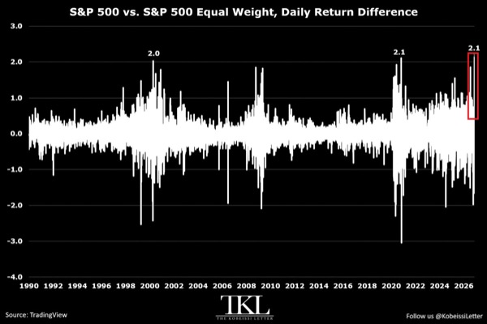
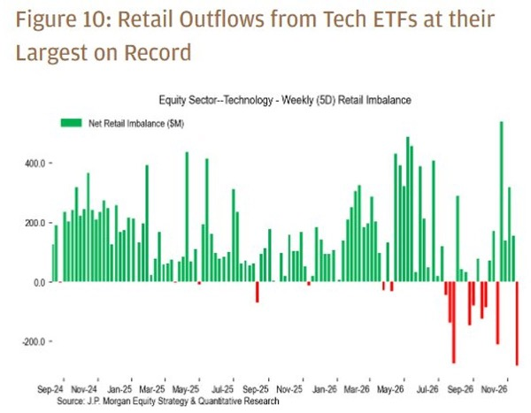
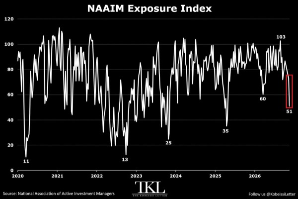
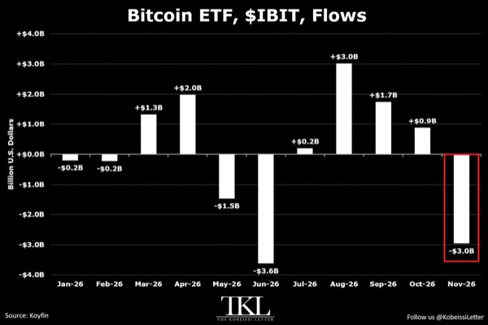
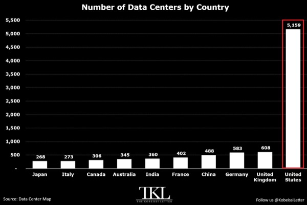
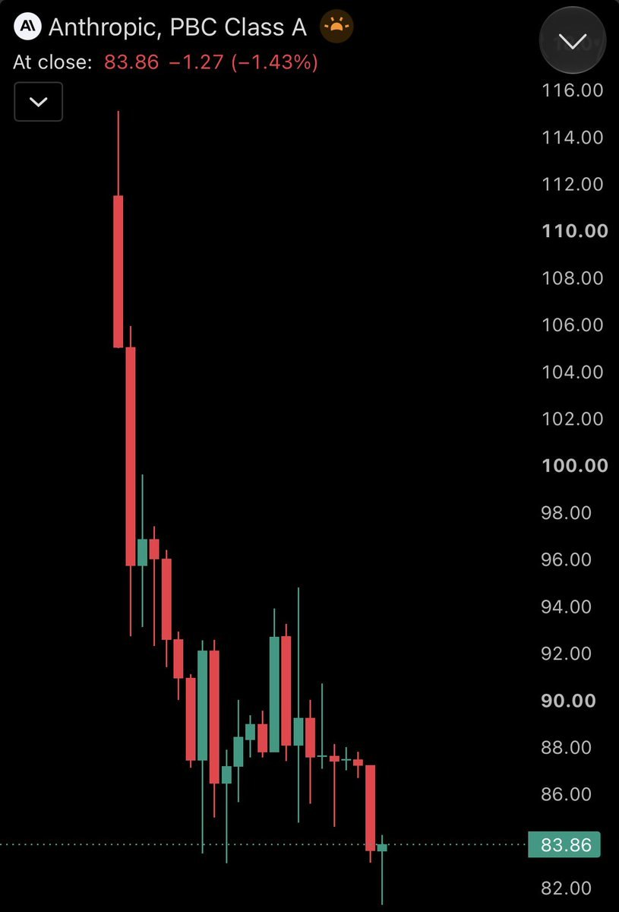
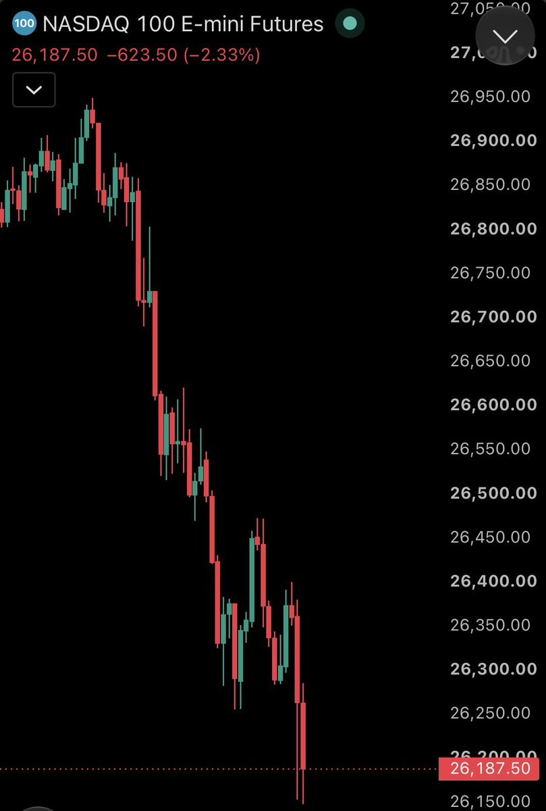
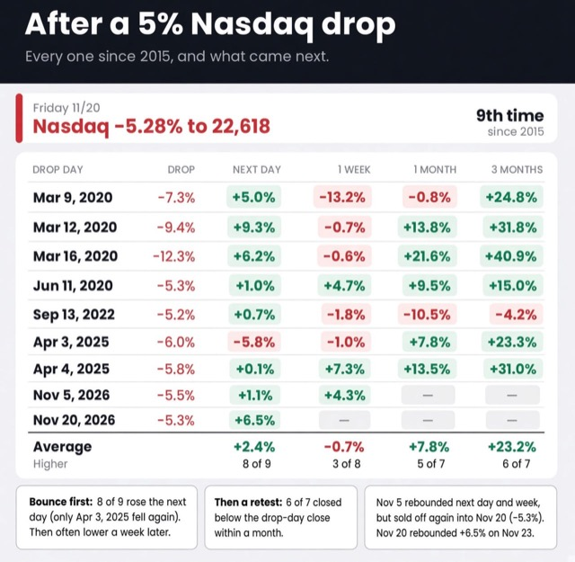
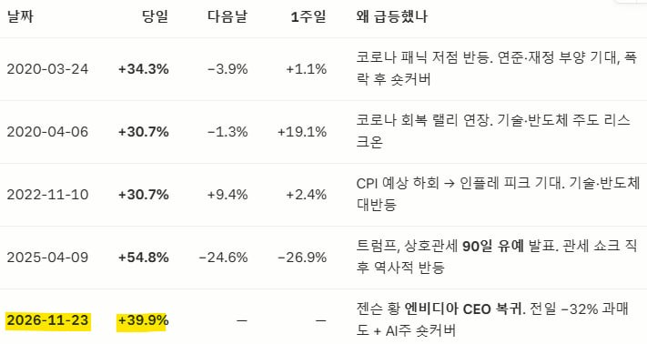

# GStephan

### 투자 거품과 급락장 속 장기투자 전략

- 급락 직후의 폭등만으로 상승장 재개를 판단하기 어려우며, 약세장에서도 대규모 반등과 추가 하락이 반복될 수 있음
  - 하루 반등이 AI 투자 수익성, 높은 금리, 고평가와 레버리지 부담을 해소하지는 못함
  - 최근의 빠른 회복에 익숙해져 모든 조정을 단기 매수 기회로 단정하면 장기 하락에 취약해짐
- 영상에 인용된 시장 수치는 주식과 대체자산이 동시에 흔들리는 극심한 유동성 압박을 가리킴
  - S&P 500은 50일 이동평균보다 4.1표준편차 아래로 하락했고, 1950년 이후 유사 사례로 1987년·2011년·2015년이 제시됨
  - Oracle은 고점 대비 70%, SanDisk는 68% 하락했으며 QQQ도 20% 하락해 약세장에 진입
  - 최근 한 달 주식·금·은·비트코인·채권이 함께 약세를 보이며 현금의 방어력이 부각됨
- AI에 투입되는 수천억 달러가 언제 이익으로 전환될지가 기술주 가치평가의 핵심 변수
  - 투자 확대 속도가 수익화 속도를 앞서면 높은 주가를 정당화하기 어려워짐
  - AI 관련 자금 쏠림과 사상 최대 수준의 신용융자는 신규 매수 여력을 줄이고 상승과 하락의 진폭을 확대
  - 잇따른 사이버 공격과 AI의 연관성에 대한 우려도 투자심리를 압박
- 영상은 금리 인상과 정치적 불확실성을 AI 투자 부담을 키우는 요인으로 제시
  - 인플레이션이 진정되지 않아 연준이 3년 만에 금리를 인상했고, 2주 뒤 추가 인상 확률이 90%까지 반영된 상황
  - 민주당의 상·하원 장악 이후 첨단 AI 개발 중단과 초지능 금지 요구가 등장하면서 규제 우려가 확대됨
  - Nvidia 경영진 관련 논란과 Jensen Huang 복귀는 단기 주가 변동의 촉매로 다뤄짐
- 최근 16년의 높은 수익률을 장기 투자 계획의 기본값으로 삼기 어려움
  - 영상 기준 배당 재투자 연환산 수익률은 14%를 웃돌아 장기 평균으로 제시된 연 7~10%를 크게 상회
  - 연 20% 이상의 상승과 빠른 반등이 계속된다는 기대보다 평균 회귀와 수년간의 손실 가능성을 반영해야 함
  - 40% 하락이 1년 넘게 이어지거나 2000년대 초처럼 여러 해 연속 두 자릿수 손실이 발생하는 경로도 고려할 필요
- 과거 조정 통계는 추가 폭락이 필연적이지 않음을 보여주지만, 현재 시장의 회복을 보장하지는 않음
  - Ryan Detrick의 인용 자료에서는 1920년대 이후 10% 이상 조정 중 약 60%가 20% 하락 전에 멈췄고, 약 35~40%가 약세장으로 확대됨
  - 빠르게 진행된 조정일수록 더 큰 하락으로 번질 가능성이 낮았다는 분석도 제시됨
  - 과거 빈도를 현재 상황의 확정적 확률로 받아들이기보다 추가 하락과 회복 가능성을 함께 열어둘 필요
- 전고점 회복까지 오래 걸리는 시장에서도 저점 이후의 투자 성과는 달라질 수 있음
  - 영상의 닷컴 붕괴 사례는 전고점 회복에 15년, 저점 도달에는 약 2년 반이 걸린 경로를 제시
  - 기존 보유분의 회복 기간과 하락 중 새로 매수한 자금의 수익률은 구분해야 함
  - 하락·반등을 반복하는 동안 일정한 간격으로 매수하면 낮아진 가격에서 보유 수량을 늘릴 수 있음
- AI 투자 확대는 단기 수익성 부담인 동시에 장기 인프라 구축의 기반
  - The Kobeissi Letter의 낙관 시나리오는 AI의 경제적 효과가 실현되려면 선행 인프라 투자가 필요하다는 데 초점
  - 미국의 AI 전면 금지보다 세금과 규제의 일부 강화에 그치면 시장의 최악 가정보다 결과가 양호할 수 있음
  - 주가 하락이 소비를 위축시켜 물가 압력을 낮추면 추가 금리 인상 필요성도 줄어들 수 있음
- 2027년의 상승 여지는 현재 가격에 반영된 악재가 얼마나 완화되는지에 달림
  - 고금리 장기화, 강력한 AI 규제, 인프라 투자 수익 부진, 핵심 기술기업의 불확실성이 동시에 반영됐다면 작은 개선도 반등 촉매가 될 수 있음
  - 사이버 보안 사고, 국제 분쟁, 높은 가치평가는 추가 하락을 유발할 수 있어 낙관 시나리오만 전제하기 어려움
- 투자 계획은 반등 시점 예측보다 장기 하락에도 매수를 지속할 수 있는 자금 구조에 맞춰야 함
  - 생활비와 투자금을 구분하고 과도한 레버리지를 줄여 강제 매도 가능성을 낮추는 것이 핵심
  - 가격 확인이 감정적 매매로 이어진다면 확인 빈도를 줄이고 정기 자동매수로 실행을 단순화
- AI 산업의 성장 가능성과 현재 주가의 매력은 별개의 판단이며, 투자 규모보다 실제 현금흐름과 수익화 속도를 확인해야 함
  - 우량기업도 매수가격이 지나치게 높으면 장기간 부진할 수 있어 가격 하락만으로 저평가를 단정하기 어려움

# Harvey

- 젠슨 황 복귀 후 엔비디아 주가가 하루 약 30% 급등한 것은 창업자의 AI 생태계 조율 능력과 미래 이익 실현 가능성에 대한 신뢰 회복을 반영
  - 반도체 판매뿐 아니라 여러 기업의 투자 결정을 연결하고 같은 미래를 전제로 움직이게 하는 역량이 기업가치의 핵심
- 단기적으로 경영 공백에 따른 할인은 줄지만, 특정 인물에 대한 의존도와 장기 승계 위험은 남아 있음
  - 승계 체계와 조직의 자립성을 더 엄격하게 평가할 필요
- 다음 투자 기회는 복귀 뉴스의 크기보다 회복된 신뢰가 실제 이익으로 전환되는 속도에 달려 있음

# KHwanK

### 반도체 이익과 저평가로 본 코스피 반등 가능성

- 2027년 코스피 기본 시나리오는 상승이며, 강환국이 제시한 상승 확률은 70~80%, 5,000 아래 장기 정체 확률은 20~30%
  - 2027년까지 1만 돌파 가능성은 열어두되 달성 여부는 불확실
  - 상승 근거는 홀수 해 강세, 미국 대통령 집권 7년차 효과, 낮은 밸류에이션
- 영상 기준 코스피는 2026년 1월 27일 5,000을 돌파하고 최고 9,400까지 상승한 뒤, 11월 20일 4,870으로 고점 대비 거의 반토막
  - 2025년 11월 제시한 5,000 돌파 전망은 조기에 달성했지만, 2026년 2월 제시한 2027년까지 1만 전망은 미달 상태
- 증권사 전망 범위 바깥의 가능성을 검토하는 역발상 접근
  - 전년도 증권사 전망은 대략 3,300~5,000이었지만 실제 고점은 이를 크게 초과
  - 2027년 전망 범위는 5,000~10,500이며, 하단은 이미 2026년 11월에 이탈
  - 다수 애널리스트의 상승 전망은 과거 경험상 오히려 경계 신호로 평가
- 전년 11월부터 해당 연도 10월까지를 한 해로 계산하면, 외환위기 이후 홀수 해 코스피 수익률은 14전 14승
  - 1999년 약 116~117%, 2025년 약 60%, 2007년 약 51%, 2009년 약 42% 상승
  - 가장 낮았던 2011년도 약 1.4% 상승했으며, 일반적인 1~12월 연간 수익률과는 구분 필요
- 홀수 해 강세의 배경은 미국 선거에 따른 정치적 불확실성의 완화
  - 짝수 해에는 대선이나 중간선거가 있어 아시아 증시에 정치적 위험이 전파
  - 미국의 경기부양 자금은 주로 미국에 머물러 아시아는 유동성 혜택보다 불확실성의 영향을 더 크게 받을 수 있음
- 2027년은 미국 대통령 집권 7년차에 해당해 아시아 증시에 유리한 국면으로 평가
  - 임기 후반에는 대외 갈등을 완화하고 외교적 성과를 추구할 유인이 커짐
  - 미중 갈등 등 국제 긴장이 완화되면 코스피 재평가의 촉매가 될 수 있음
- 반도체 이익 증가와 주가 급락이 겹치며 코스피 밸류에이션이 극단적으로 낮아졌다는 평가
  - 영상에서 제시한 선행 주가수익비율은 약 3배로, 최근 10년 분포 8.6~12.2배를 크게 하회
  - 낮은 밸류에이션이 단기 반등을 보장하지는 않지만, 이익 증가가 유지되면 가격과 실적의 괴리가 축소될 여지
- 메모리 반도체 호황은 2027년까지 이어지고, 증설에 따른 공급 부담은 2028년부터 본격화될 가능성
  - 인공지능과 반도체 업황 우려가 주가에 먼저 반영됐지만, 당장 기업의 이익 창출력은 강하다는 판단
  - 2028년 메모리 가격과 이익 감소 가능성은 별도 위험으로 점검 필요
- 현재 시장은 과열보다 급락 이후의 공포 국면에 가깝다는 평가
  - 1998년 11월~1999년 10월 급반등 사례를 참고하되, 외환위기 당시 기업 이익 상황과 현재는 다름
  - 투자심리 악화와 낮은 밸류에이션이 겹친 상태에서 악재 완화가 반등 계기가 될 수 있음
- 금리·물가, 대규모 기업공개에 따른 자금 흡수, 인공지능 투자 신뢰 약화는 상승 시나리오의 위험 요인
  - 엔비디아 회계 관련 의혹도 영상에서 악재로 언급됐으며, 사실 확정과는 구분 필요
  - 러시아·우크라이나 전쟁과 이란 관련 갈등이 진정되면 성장주와 인공지능 투자 기대가 되살아날 가능성
- 2027년에는 5,000 아래와 10,500 위를 모두 경험하는 큰 변동성도 가능
  - 연간 상승 전망과 연중 추가 급락은 동시에 성립할 수 있음
- 홀수 해와 대통령 임기 통계는 방향을 가늠하는 참고 자료이며, 반도체 이익 전망이 유지되는지가 상승 논리의 핵심
  - 과거 승률만으로 상승을 확정하기보다 실제 이익과 공급 증가 시점을 함께 점검할 필요
- 지수 목표보다 이익 전망과 밸류에이션의 조합이 중요
  - 이익 추정치가 하향되면 저평가 폭도 줄어들므로, 낮은 선행 주가수익비율을 고정된 안전판으로 해석하기 어려움

### 드러켄밀러의 반도체 매도와 씨게이트 금광주 투자

- 드러켄밀러의 3분기 포트폴리오는 반도체 비중을 줄이고 씨게이트·금광주·아마존을 늘리는 방향으로 재편
  - AMD·ARM·램리서치·샌디스크·구글을 전량 매도하고 TSMC 보유분의 94% 정리
  - 나테라는 추가 매수 없이 다른 자산 매도로 비중이 30%를 넘었으며, 이후 추세 약화에 따른 4분기 매도 가능성은 미확인
  - 포트폴리오는 9월 30일 기준이며 영상의 이후 주가 비교는 11월 19일 기준
- 강환국의 과거 분석에서 드러켄밀러 신규 편입 종목은 1년 보유 시 S&P 500 대비 약 10%포인트 초과수익, 2년 보유 시 평균 70% 수익률 기록
  - 같은 2년간 S&P 500 수익률은 33%로, 성과 격차가 2년 차에 확대
  - 분기 말에서 공개까지 약 45일의 시차가 있어도 중장기 투자 후보를 찾는 자료로 활용 가능
- 반도체 매도는 큰 폭의 상승 이후 추세 약화에 대응한 차익 실현과 2028년 공급 과잉 위험을 함께 점검할 신호
  - 메모리는 삼성전자·SK하이닉스·마이크론뿐 아니라 중국·대만 업체의 증설까지 겹치면 공급 과잉에 진입할 가능성
  - 강환국은 메모리 호황이 2027년 이후에도 이어질 것으로 봤지만, 이번 매도를 계기로 2028년 공급 과잉 가능성을 상향 평가
- 씨게이트는 AI 데이터 저장 수요를 가져가면서 메모리 증설 위험을 피하는 투자처
  - HDD 시장은 씨게이트·웨스턴디지털·도시바 3사가 과점하며, 공장 증설보다 같은 디스크의 저장 용량을 높이는 기술 개발에 집중
  - 보유량을 0주에서 5만 주·12만 주·34만 주로 늘려 포트폴리오 비중 7.6%, 나테라 다음 2위로 확대
  - AI 데이터센터 수요로 HDD 가격이 상승하고, 영업이익률은 26%에서 49%로 확대됐으며 잉여현금흐름은 사상 최대 수준
  - 2027년까지 가격이 묶여 있어 계약 조건과 수익 반영 시점이 중요하며, 4분기 주가 하락으로 매수 가격 부담은 완화
- 뉴몬트·배릭·애그니코 금광주에 각각 약 4,400만·4,300만·4,200만 달러를 투자해 합계 약 1억 2,900만 달러 편입
  - 영상 기준 금값은 1월 말 온스당 5,400달러 고점에서 4,000달러 아래로 하락했지만, 제시된 채굴 비용 약 1,500달러보다 높아 수익 여력 유지
  - 뉴몬트는 현금 창출을 바탕으로 자사주 매입을 진행하며, 신규 금광 개발에 10~15년이 걸려 단기간 공급 확대가 어려움
  - 달러 약세·금 강세·채권 약세가 큰 투자 방향이며, 금값 회복 시 금광주의 이익과 주가 회복 기대
- 구글은 34만 주를 전량 매도하고 아마존은 54만 주에서 77만 주로 확대
  - 구글은 AI 설비투자로 현금흐름 부담이 커지는 동시에 AI가 기존 검색 사업을 잠식할 위험에 노출
  - 아마존은 AWS의 AI 수요 증가와 물류·배송 자동화에 따른 비용 절감이 함께 작동해 본업의 이익률 개선 가능
  - 두 기업 모두 투자 지출 부담이 있지만, AI 투자가 기존 사업의 수익으로 연결되는 경로에 차이
- 강환국은 2028년 이후 삼성전자·SK하이닉스 이익이 둔화하더라도 급격한 이익 붕괴나 적자 전환 가능성은 낮게 평가
  - 이 전제에서 코스피 5,000 수준은 여전히 저평가 영역
- AI 투자에서는 수요 성장뿐 아니라 증설 속도와 공급 제약을 함께 비교할 필요
  - 같은 AI 수혜라도 공급 확대가 빠른 메모리와 증설이 제한적인 HDD는 이익 지속성이 달라질 수 있음
- 금광주는 금값 방향과 채굴 원가의 차이가 핵심이며, 빅테크는 AI 투자 규모보다 현금 회수와 본업 이익 개선 여부가 중요
- 공개 포트폴리오는 투자 후보를 좁히는 출발점이며, 현재 보유 여부·매수 가격·실적 변화를 추가로 확인해야 함
  - 공개 이후 거래가 반영되지 않으므로 3분기 편입을 현재 보유나 향후 상승의 보장으로 연결하기는 어려움

# Kobeissi

- 젠슨 황의 엔비디아 CEO 복귀에는 트럼프 행정부의 직접 개입과 국가안보 우려 완화가 촉매로 작용
  - 백악관은 트럼프가 이사회에 참여해 복귀를 지지했다고 밝혔으며, 트럼프는 관련 조사 결과 국가안보 문제가 없다고 언급
  - 공식 발표 29분 전 복귀를 시사한 발언이 나오는 등 정책 발언이 주요 가격 촉매로 부상
- 엔비디아(NVDA)는 31.6% 상승 마감하며 시가총액이 9,550억 달러 증가해 단일 종목 하루 증가액 사상 최대 기록
  - 장중 공매도 손실은 122억 달러로 최소 7년 내 최대 수준에 접근
  - Dell 22%, Nebius·CoreWeave 21%, Micron 19%, Marvell 18% 등 AI 관련주로 매수세 확산
- S&P 500은 4.7% 상승하며 2025년 4월 이후 최고 일간 수익률을 기록했지만 상승 기여는 대형 기술주에 집중
  - 미국 증시 시가총액은 3조 달러 넘게 증가했고, 동일가중지수는 2.6% 상승에 그쳐 격차가 2.1%포인트까지 확대
  - IT 업종은 9.0% 상승했으며 엔비디아 단독으로 S&P 500 상승분의 34%를 기여

- 엔비디아 급반등에도 논란 발생 전 대비 12%, 사상 최고가 대비 33% 낮아 추가 정치 뉴스와 변동성에 대비할 필요
  - AI 관련 이익 증가율이 전년 대비 32% 이상이고 밸류에이션이 낮아진 점을 감안하면 장기 약세장 진입보다는 조정 국면에 무게
- 개인과 기관 모두 직전 주 주식 노출을 크게 줄여 반등 직전 투자심리가 급격히 위축
  - 개인은 기술주 ETF를 2억5,000만 달러 순매도해 최소 2년 내 최대 매도 기록, 전체 주식 ETF 순매수도 25억 달러로 연초 주간 평균 80억 달러보다 축소
  - NAAIM 주식 노출지수는 2주간 36포인트 하락한 51로 2025년 4월 이후 최저, 2주 하락폭은 2023년 11월 이후 최대

- 비트코인 ETF 자금 유출과 레버리지 청산이 겹치며 암호화폐 투자심리 악화
  - IBIT의 11월 누적 순유출은 30억 달러로 월간 역대 두 번째 규모를 향하고 있으며, 직전 주 8억2,900만 달러 유출로 3주 연속 순유출
  - 목요일 하루 유출액은 5억4,500만 달러로 역대 최대, 미국 현물 ETF는 최근 14거래일 중 12일 순유출
  - 비트코인은 6만 달러 아래로 하락했고 24시간 레버리지 청산액은 8억5,000만 달러로 확대

- 미국은 데이터센터 5,159개로 전 세계 1만3,384개의 38.5%를 차지하며 AI 인프라 확장을 주도
  - 운영 시설뿐 아니라 계획·건설·부지 확보 단계까지 포함한 수치로, 뒤이은 9개국 합계보다 많음
  - 미국 내 버지니아 728개, 텍사스 605개, 조지아 308개 순

- Anthropic 주가는 공모가 83달러 아래로 내려갔고 상장 후 고점 대비 28% 하락

- 중국·EU 등 16개 경제권 대상 신규 광범위 관세 추진 보도로 나스닥100 선물이 2.5% 하락
  - WSJ 보도상 대부분 수입품이 대상이며 EU·일본·한국은 15% 이하, 중국·베트남·인도는 더 높은 세율이 적용될 가능성

# MKevin

### 엔비디아 경영 복귀와 반등의 지속 조건

- 영상의 투자 논리는 젠슨 황의 엔비디아 경영 복귀가 주가 급락을 되돌릴 핵심 촉매라는 데 있음
  - 영상은 이사회 만장일치로 황이 즉시 이사회 의장과 최고경영자에 복귀했다는 발표를 인용하며 전개되며, 해당 발표와 수치는 원문 밖에서 확인되지 않음
  - 금요일 약 14% 급락 이후 복귀 소식에 약 30% 상승했다는 수치를 제시
- 실적과 사업 전망의 중심에 황의 리더십이 있어 대체 경영진만으로 투자자 신뢰를 유지하기 어려움
  - 실적 예상치 상회와 매출 가이던스 1,300억 달러 ±3%를 강세 논거로 제시
  - AI 생태계 내 순환 자금 지원을 더 선별적으로 운용하더라도 기존 성장 성과는 황이 구축한 사업에 의존
- 주가 하락, 후임자 확보 난항, 정치권 압력이 조기 복귀를 재촉했을 가능성
  - 영상은 트럼프의 재고용 촉구와 미국 정부 고위 인사들의 의견 수렴을 언급
  - Arm 최고경영자 르네 하스의 제안 거절 보도를 후임 확보의 어려움과 연결
  - 이사회의 주가 방어 동기, 트럼프의 직접 전화, 다른 후보들의 거절 여부는 화자의 추정
- 경영 복귀와 별개로 국가안보·수출통제 관련 감독 체계를 강화하는 구도
  - 독립 이사들로만 구성된 국가안보·수출통제위원회 신설과 관련 전문 변호사 참여를 언급
  - 새 최고준법책임자 채용 추진, 임시 최고경영자였던 콜레트는 최고재무책임자 역할을 지속
  - 조사 조기 결론이나 의혹 해소 여부는 확인되지 않았으며 복귀 자체가 규제 위험 해소를 뜻하지는 않음
- Arm의 자체 칩 설계 추진은 엔비디아와의 경쟁 확대 가능성을 높임
  - 엔비디아 출신인 하스의 경력만으로 후임 최고경영자 영입을 낙관하기 어려운 사업적 배경
- 샘 올트먼의 오픈AI 복귀 사례는 조사 종료 전에도 경영 복귀가 가능하다는 비교 근거
  - 영상은 올트먼이 최고경영자로 먼저 복귀하고 조사 이후 이사회에 복귀한 순서를 강조
  - 황의 최고경영자·이사회 동시 복귀와는 차이가 있어 동일한 절차로 해석하기 어려움
- 화자는 급등 이후에도 엔비디아 매수 기회가 남아 있다는 강세 입장을 유지
  - 자체 약세·강세 지표가 7~9 범위였다는 점으로 지속적인 강세 성향을 뒷받침
  - 구체적인 적정가, 목표가, 손절 기준은 제시하지 않음
- 경영자 복귀에 따른 신뢰 회복과 실적에 기반한 기업가치 회복을 구분할 필요
  - 약 30% 반등 이후의 추가 상승 여력은 복귀 소식만으로 계산할 수 없으며 실적·밸류에이션 검토가 필요
- 수출통제 준수 체계의 실효성과 조사 결과가 반등의 지속성을 좌우할 변수
  - 영상이 인용한 발표·주가 변동·가이던스를 확인한 뒤 투자 논리를 평가할 필요

### 엔비디아 복귀와 경기침체 없는 급락장

- 트럼프의 엔비디아 경영 개입과 이란 공격 연기가 급락장 반전의 핵심 촉매
  - 영상 속 트럼프 인터뷰에 따르면 주가가 약 50% 하락한 뒤 이사회에 직접 연락해 젠슨 황 복귀에 개입
  - 젠슨 황의 국가안보 위험이 없다는 확신을 이사회에 전달했으며, 자진 사임보다 이사회의 퇴진 압박에 무게
  - 중국 기업으로의 인재 유출을 우려했지만 실제 중국행 징후는 없었다고 언급
- 대통령의 상장사 최고경영자 인선 개입은 엔비디아를 사실상 구제 대상으로 취급한 이례적 조치
  - 시장 안정과 핵심 인재 확보 효과와 함께 정부 권력과 기업 지배구조의 결합 논란 확대
  - 트럼프 측의 내부자거래 의혹은 진행자의 추측이며 확인된 증거는 제시되지 않음
- 이란 공격 가능 시점을 선거 직후에서 새해 이후로 미루면서 단기 전쟁 위험 완화
  - 합의가 없으면 공격을 재개할 수 있다는 조건부 압박과 간접 협상 병행
  - 영상은 호르무즈·카스피해·육상 국경의 삼중 봉쇄를 언급하며 군사 공격 연기를 위험자산 반등 요인으로 해석
- 경기침체 판단의 핵심은 주가 하락보다 해고 증가와 고용시장 악화 여부
  - 제시된 고용지표에서는 노동력과 경제활동참가율이 회복되는 동시에 실업률 하락
  - 흑인 실업률은 8~9월 급등분의 약 40%를 다음 달 반납했고, 27주 이상 장기실업 규모도 대체로 안정
  - 고용은 후행할 수 있어 신규 채용과 기업 설문을 함께 확인할 필요
- 11월 S&P 글로벌 잠정 구매관리자지수는 경기 수축보다 확장 속도 둔화를 시사
  - 생산과 신규 주문 증가세가 7월 이후 가장 느려졌지만 제조업·서비스업 모두 성장과 추가 채용 유지
  - 설문상 4분기 국내총생산 성장 속도는 연율 약 3%이며, 11월 고용 증가에도 긍정적 신호
  - 기업 이익 전망과 실질 국내 수요 전망에서도 깊은 경기침체를 뒷받침할 증거가 부족하다는 블룸버그 분석 인용
- 성장 둔화의 일부는 수요 붕괴보다 공급능력 부족과 정치적 불확실성에서 발생
  - 밀린 주문과 투입재 부족으로 생산이 제약되고, 공급업체 납기는 2022년 8월 이후 가장 길어짐
  - 중간선거 전후 주문 지연이 나타났지만 선거 이후 사업환경 안정 기대와 서비스업 전망 회복
  - 판매가격·투입비용 상승 압력은 완화됐으나 제조업의 비용·공급 부담은 잔존
- 대형 기술기업의 인공지능·보안 인수는 장기 투자 수요가 유지된다는 근거
  - 영상은 아마존의 인공지능 소프트웨어 기업 75억 달러 인수와 팔로알토 네트웍스·크라우드스트라이크 등의 인수 사례 제시
  - 엔비디아는 직원 약 30명의 확산형 언어모델 기업 인셉션을 5억 달러 이상에 인수하는 협상을 진행 중이라고 소개
  - 인수 활동을 급락 구간의 저가 매수로 해석하지만 개별 거래와 전체 경기의 방향을 동일시할 수는 없음
- 인공지능 노출은 단일 종목 집중보다 저평가된 반도체·금융 관련 종목으로 분산
  - 진행자는 30~40개, 많게는 50개 종목 바스켓을 선호하며 최근 일주일간 50만 달러 이상 매수했다고 공개
  - 경기소비재는 주가 대비 이익과 마진이 매력적이지 않다고 평가
  - 비상장 기술기업 투자도 대안으로 소개했지만 해당 벤처펀드 홍보에는 유료 제휴 관계가 있음
- 인공지능 설비투자는 자금·전력·건설 인력을 흡수해 주택 공급을 압박
  - 월스트리트저널 인용 수치로 인공지능 인프라 기업의 연초~10월 주식 발행액은 2,120억 달러
  - 데이터센터와 주택이 자재·장비·인력을 두고 경쟁하면서 기존 주택 부족이 심해지고 주택 가치에 지지 요인 형성
  - 반도체와 부동산을 함께 보유하는 바벨 구성을 선호하지만 공급 부족이 투자수익을 보장하지는 않음
- 금융여건 긴축과 높은 자본조달 비용은 경기 낙관론의 주요 제약
  - 빌 애크먼은 스페이스엑스의 담보부 차입금리 약 8.25%를 제시하며 상장 당시 무담보 차입금리 6% 미만과 비교
  - 지정학·탈세계화·관세·에너지 투자를 이유로 물가 목표 3%가 더 현실적이라는 견해 제시
  - 진행자는 변동성이 큰 시기의 차입을 경계하며 개인 부채와 회사 은행 차입이 없다고 공개
- 12월 금리 인상 이후 동결 전환은 2027년 반등의 조건부 촉매
  - 이란 공격 연기, 젠슨 황 복귀, 중간선거 불확실성 해소에 통화정책 동결이 더해지면 투자심리 회복 여지 확대
  - 고용·기업이익의 침체 신호가 뚜렷하지 않다는 전제에 기반한 낙관 시나리오
- 보유 증권의 평가손실이 향후 실적의 주당순이익을 압박할 가능성
  - 엔비디아·AMD·구글 등 투자자산 노출이 있는 기업은 관련 회계처리에 따라 손익 변동성이 커질 수 있음
  - 비현금 평가손익과 영업 현금창출력을 구분해야 실적 악화의 성격을 판단할 수 있음
- 반등의 지속성은 정치적 호재보다 고용 유지·주문 증가·금융비용 안정으로 확인
  - 해고 급증이나 신규 채용 둔화가 나타나면 현재의 경기 확장 해석을 재검토할 필요
- 인공지능 투자 확대는 기술주 성장과 주택 공급 제약을 동시에 강화할 수 있음
  - 산업 간 자원 이동을 함께 살피되 반도체와 부동산 모두 금리·신용 긴축에 노출된다는 점을 분산 판단에 반영

### 관세 재인상과 긴축에 흔들리는 증시

- 고용과 소비심리는 개선됐지만 관세 재인상과 연준 긴축 우려가 증시 반등을 압박
  - 나스닥은 전날 약 7% 급등한 뒤 약 3% 하락하며 반등의 지속성을 시험
  - 국채금리·기대인플레이션 하락과 안정적인 10년물·2년물 금리차는 완충 요인
- 미국이 중국·유럽연합과 최대 12개 다른 경제권에 국가별 관세를 다시 올릴 가능성
  - 월스트리트저널·블룸버그 보도상 무역대표부의 301조 조사 결과와 새 관세 발표가 임박했으며 당일 발표 여부는 미확인
  - 대법원의 IEEPA 관세 제동 이후 적용 중인 10% 관세를 국가별로 올려 해방의 날 당시 수준에 접근할 위험
  - 기존 무역가중 평균 관세 약 2.2%에 비해 이미 부담이 커진 상태에서 추가 인상이 물가 안정과 금융여건 개선을 훼손할 수 있음
- 관세의 법적 근거가 바뀌어도 기업과 소비자의 비용 부담은 재확대될 수 있음
  - 301조 조사·행정기록·공개 의견 수렴을 거쳐 관세를 재도입하고 122조·232조를 함께 활용하는 경로가 거론됨
  - 국가별 협상과 세율 변경이 반복되면서 투자·재고·가격 결정의 불확실성 확대
- 11월 콘퍼런스보드 소비자신뢰지수는 103.3으로 예상 92.4와 10월 약 91을 크게 상회
  - 현재상황지수 132.8로 예상 121.1 상회, 기대지수 83.6으로 예상 74 상회
  - 일자리가 풍부하다는 응답과 구하기 어렵다는 응답의 차이가 12.4%포인트 개선
  - 기업여건에 대한 순기대가 다시 플러스로 전환되고 모든 연령대에서 신뢰 개선
- 고용지표 전반에서 대량해고형 침체 신호가 아직 뚜렷하지 않음
  - 주간 ADP 고용 증가는 2만1천 명으로 전주 2만3천 명보다 소폭 둔화했지만 증가세 유지
  - S&P 서비스업·제조업 PMI에서도 고용과 기업여건 개선이 나타났으며 일부 활동 제약은 수요 위축보다 공급 부족과 연결
  - 양호한 실물경제가 조정 시 분할매수의 전제이며 한 번에 전액 투자하는 접근은 경계
- 전날 급등은 신규 자금 유입보다 대규모 숏커버링의 영향이 컸을 가능성
  - 골드만삭스는 강한 숏스퀴즈로 해석했으며 장중 상승분은 유지됐지만 종가로 갈수록 추가 상승은 부재
  - 숏커버링 이후 실제 매수 수요가 이어지는지 확인해야 반등의 지속성을 판단할 수 있음
- 단기 피난처로 타깃·애플·일라이릴리가 부각됐지만 장기 주도주로 단정하기는 어려움
  - 영상에서 제시한 당일 상승률은 타깃 약 4%, 일라이릴리 약 3%이며 애플도 상승
  - 2018년 사례에서는 방어적 쏠림이 과도해진 뒤 다음 해 성과가 약해졌다는 점을 경계
  - 향후 소비 관련 종목이 부진해지고 반도체·하드웨어로 주도권이 돌아가는 역전 가능성
- 앤트로픽은 공모가 대비 약 20% 하락 구간마저 이탈하며 기술주 심리 악화
  - 공모 직후 추격매수보다 공모가 대비 10~20% 할인 구간에서 지지 확인이 우선
  - 낙폭이 커졌다는 사실만으로 바닥을 확인할 수 없으며 지지선 이탈은 추가 변동성 신호
- 중동 위험이 남아 있지만 원유 공급 우회가 유가와 인플레이션 압력을 완화
  - 브렌트유는 배럴당 90달러 아래로 하락했고 오만·홍해·지중해를 통한 공급이 호르무즈 해협 차질을 일부 상쇄
  - 후티의 사우디 금융지구 공격과 미국의 이란 지도부 타격 검토 보도는 확전 위험을 유지
  - 유가 하락이 지지 요인이어도 새 관세가 물가 개선 효과를 약화시킬 수 있음
- 12월 9일 연준 회의와 새 관세의 구체적 내용이 단기 변동성의 핵심 변수
  - 시장은 25bp 인상과 추가 인상 가능성을 반영하고 있으며 금융여건이 지나치게 긴축되면 인상 종료 신호가 나올 여지
  - 한 차례 25bp 인상 후 종료하거나 총 50bp를 두 차례에 나눠 인상하는 경로가 거론됨
- 금과 기술주의 동반 하락은 긴축에 따른 유동성 압박을 반영할 가능성
  - 배런스는 금 조정이 끝나야 나스닥도 바닥을 형성할 수 있다는 관점을 제시
  - 금 바닥은 보조 신호이며 주식은 기업이익의 지지를 받는다는 차이가 있음
- 실물경제 개선과 주가 하락이 동시에 나타나는 구간에서는 경기침체 위험과 정책 충격을 구분할 필요
  - 고용·소비 개선이 유지되는지와 관세가 기업이익·물가에 미치는 영향을 함께 확인
- 차입과 신용거래 부담이 낮고 여유 현금이 있다면 변동성이 분할매수 기회를 만들 수 있음
  - 관세 세율·발효 시점, 연준의 최종금리 경로, 기술주의 지지 회복을 확인하며 매수 속도 조절

### 테슬라 로보택시 확장과 스페이스엑스 합병 기대

- 테슬라 주가는 347~433달러 박스권에 머물지만 로보택시 확대, AI 연산 투자, 스페이스X 합병 가능성이 장기 성장 동력
  - 투자 논리는 현재 자동차 실적보다 로보택시·스타링크·스타십·옵티머스·연산 인프라의 미래 가치에 집중
- 11월 17일 기준 댈러스의 테슬라 등록 로보택시는 1,507대로 전날 1,306대에서 하루 201대 증가
  - 텍사스 전체 웨이모 등록 차량 1,321대보다 186대 많다는 비교이나 등록 대수와 실제 무인 영업 대수는 구분 필요
- 댈러스는 4월 26일 모델 Y 무인 운행을 시작해 11월 무인 사이버캡까지 약 7개월 소요
  - 오스틴의 초기 검증부터 무인 사이버캡까지 약 14개월과 비교하면 도입 기간이 절반으로 단축
  - 오스틴·댈러스·포트워스·휴스턴·샌안토니오·마이애미·올랜도·탬파에서 무인 서비스를 운영하며 샌프란시스코는 규제로 안전 운전자 유지라는 내용
  - 운행은 검증된 지오펜스 구역에 한정되며 원격 감독이 남아 있어 어디서나 가능한 완전 자율주행과는 차이
- 로보택시 주간 주행거리는 8월 10만2,000→11만5,000→13만2,000→17만2,000마일로 증가했고 최근에는 17만2,000마일의 5.5배 이상으로 확대됐다는 수치
- 로보택시의 마일당 순이익 추정 범위는 0.20~0.50달러지만 개인 소유 사이버캡과 구독료의 반복 매출이 더 큰 투자 초점
  - 약 3만 달러 차량과 월 299달러 구독을 결합하는 구상으로 기존 월 99달러보다 높은 반복 매출 기대
  - 타이어·워셔액 등 기본 관리까지 서비스에 포함하면 사고 위험을 낮추고 고객 유지와 고마진 매출 확보에 유리
- 텍사스의 연 12만5,000대 사이버트럭 생산 공간을 재배치하면 차량 생산능력을 연 30만~40만 대로 확대할 수 있다는 Barclays 추산
  - 사이버트럭 수요 부진에 대응해 사이버캡 중심으로 생산 자원을 전환하는 방향
- 11월 16일 발표한 베를린 33억 달러 증설은 2029년부터 연 100만 대 생산능력을 갖춘 사이버캡 전용 시설을 구축한다는 내용
  - 기존 직원 약 1만2,000명에서 고용 확대와 언박스드 제조 방식 도입을 연결하는 구상
  - 유럽의 자율주행 승인과 로보택시 영업 허가가 확보되지 않은 상황에서 투자 회수 시점은 불확실
  - 현지 일자리 창출을 앞세워 유럽 규제 승인을 유도하려는 전략이라는 해석이며 원문에는 사이버캡과 사이버트럭 명칭 혼용 존재
- 테슬라·스페이스엑스 합병은 2028년 미국 대선 국면 이전인 2027년이 유력하다는 전망
  - 민주당의 정치·조사 압력이 커지기 전에 거래를 추진할 유인이 있다는 논리
  - 예측시장의 2028년 이전 합병 확률은 약 87%로 제시되지만 실제 합병이나 조건은 확정되지 않음
- 테슬라 단독 실적은 매출 약 280억 달러로 전년 대비 정체되고 순이익 43%, 영업이익 56% 감소, 이익률 2.6%로 취약
  - PEG 약 5배의 높은 가격을 정당화하려면 자동차 이외 사업의 성장이나 합병 프리미엄이 필요
  - HSBC 목표주가는 157→359달러로 상향됐고 Barclays 450달러, JP모건 415달러 제시
- 스페이스엑스 PEG 0.79배와 테슬라 PEG 5배의 차이를 활용하는 합병 시나리오가 핵심 매수 논리
  - 테슬라에 20% 프리미엄을 지급하고 스페이스엑스 주식으로 교환하면 통합 PEG가 약 2배가 될 수 있다는 가정
  - 합병비율·실제 성장률·거래 구조가 미정이므로 PEG 수치만으로 통합 기업 가치를 확정할 수 없음
- 스페이스엑스 연산 인프라 투자는 3분기 196억 달러에서 4분기 350억~450억 달러로 확대되고 연말 2.5~3GW 확보를 목표로 한다는 전망
  - 연산 수요의 수주잔고 630억 달러와 이미 투입한 420억 달러의 설비투자가 향후 1년 내 매출로 연결된다는 기대
  - 조달금리는 상장 당시 약 8%에서 8.26~8.3%로 상승해 대규모 투자 수익률과 현금흐름 검증이 중요
- 자체 AI 모델의 경쟁력 열세에 대응해 GPU를 내부 개발에만 쓰기보다 경쟁사에 임대하는 전략으로 전환
  - 앤스로픽 등 외부 고객의 연산 수요로 설비 수익화를 앞당기면서 Grok 개발은 지속하는 구상
  - GPU 사용을 정당화하도록 엔지니어 업무를 매주 점검하고 xAI 학습·추론 소프트웨어를 6~8개월에 걸쳐 재작성했다는 내용
- AI 연산능력 증설 속도는 현재 월 약 500MW, 연환산 6GW에서 2027년 말 월 1GW 이상, 연환산 12GW로 확대될 전망
  - 시설을 24시간 가동하고 테슬라 메가팩으로 GPU 전력 사용의 변동을 완화
  - 연산 투자 연 7,200억 달러 추정도 등장하지만 함께 제시된 GW당 약 10억 달러 및 연 12GW와 산술적으로 맞지 않아 그대로 적용하기 어려움
- 테라팹은 2027년 6월 첫 반도체 테스트, 2028년 말 양산을 목표로 하며 인텔과의 협력으로 개발 위험을 낮추려는 구상
  - 도조의 부진 전력이 있어 일정·수율·양산 성과는 별도 검증 필요
- 스타십 재사용으로 궤도 운송비가 장기적으로 최대 100분의 1까지 하락할 수 있다는 기대가 우주 연산 인프라의 기반
  - ARK 전망은 현재 kg당 약 1,000달러에서 2027년 358달러, 2030년 무렵 50달러 미만으로 하락하는 경로
  - 비용 하락 방향과 실제 도달 시점은 구분해야 하며 제시된 도표의 축척도 일정하지 않음
- 테슬라는 텍사스에서 연 200GW 태양광 패널 제조능력과 31억 달러 규모 폴리실리콘 공장을 추진한다는 내용
  - 민주당 집권 확대 시 전기차·태양광·배터리 세액공제가 회복될 수 있다는 전망과 현지 고용 창출을 결합한 전략
  - 정책 변화와 세제 지원 복귀는 확정 사항이 아니며 단기에는 기존 에너지 크레딧 축소가 전년 대비 실적 비교에 부담
- 옵티머스는 프리몬트 생산을 시작했지만 손의 구현이 병목으로 외부 고객 공급은 2027년 말까지 지연
- 장기적으로 사이버캡 1,000만 대가 보급되면 해당 사업만으로 주당 1,100달러 가치가 가능하다는 낙관적 시나리오
  - 보급 시점·이익률·할인율이 제시되지 않은 장기 가정이며 현재 실적 기반 목표주가와 직접 비교하기 어려움
- 로보택시 투자 가치는 등록 대수보다 유료 무인 주행거리, 차량당 가동률, 사고·정비 비용, 구독 유지율의 동반 개선에 좌우될 가능성
- 합병 기대와 자체 사업 가치를 분리해 평가할 필요가 있으며 합병 지연이나 프리미엄 축소 시 높은 테슬라 밸류에이션이 조정 위험으로 전환
- AI 연산 투자 확대는 반도체·전력저장 수요에 기회지만 차입비용을 웃도는 실제 임대 수익과 설비 가동률이 확보돼야 주주 가치로 연결

# Slav

- 포트폴리오는 미국주식 40%, 부동산 30%, 국내주식 10%, 비트코인 10%, 현금 10%로 배분
  - 미국주식은 QLD·TSLA·GOOGL을 장기 보유하며 혼란한 장세에서는 보유 종목을 간소화하고 선택과 집중
- 현시점 개별주는 M7 중심으로 접근하고 섹터·지수 ETF를 활용하는 전략이 유리
  - 텐배거 후보는 기준금리 인하 조짐과 흑자전환을 확인한 뒤 발굴해도 늦지 않으며, 최근 악재 해소만으로 추세전환을 확정하기에는 이름
- 젠슨 황 복귀로 엔비디아의 창업자 지배력이 강화되고 미국 정부와의 전략적 연계가 깊어질 전망
  - 복귀에 반대했던 이사들의 퇴출, 준법·수출 감독 강화, 동남아 경유 우회 수출 차단 가능성
  - 미국 소버린 AI·국방 프로젝트에 Blackwell·Rubin 공급 우선권을 부여할 가능성
- 엔비디아의 투자 집행 정상화는 AI 연구소 투자 재개와 2028년까지 TSMC 생산능력·HBM 물량 선점으로 이어질 전망
  - 고객사 데이터센터 자금조달 지원에 대한 기대가 엔비디아와 CoreWeave 주가 급반등을 뒷받침
- 엔비디아의 창업자 의존과 시장 지배력은 하이퍼스케일러·커스텀 ASIC 업체의 자체 AI 반도체 개발을 자극
  - 장기적으로 미국 정부와 연계된 엔비디아 생태계와 머스크의 독립적 Terafab·우주 궤도 컴퓨팅 생태계로 양분될 가능성
- 엔비디아의 다음 정책 변수는 미국 의회 면담과 첨단 반도체 수출통제 청문회
  - 12월 1일 하원 비공개 면담, 미국시간 12월 3일 상원 은행위원회 공개 청문회 예정이며 한국시간으로는 12월 4일 0시
  - 백악관의 개입과 국가안보 우려 완화가 복귀를 이끈 만큼 기술기업의 정치권 의존도가 커질 수 있음
- 나스닥의 5% 이상 급락 뒤 반등은 과거 사례에서 빈번했지만 표본이 제한적
  - 11월 20일 5.3% 하락은 2015년 이후 아홉 번째 5% 이상 급락이며, 기존 사례는 2025년 4월 3일을 제외하고 모두 다음 거래일 반등

- SOXL의 하루 40% 급등 이후에는 단기 되돌림에 주의
  - 일간 30% 이상 상승은 이번을 포함해 다섯 차례이며, 앞선 네 차례 중 세 차례는 다음 거래일 하락

# Stockbot

- 트럼프의 직접 개입과 국가안보 우려 해소가 젠슨 황의 엔비디아 CEO 복귀를 뒷받침
  - 백악관은 트럼프가 엔비디아 이사회에 참여해 복귀를 지지했다고 밝혔고, 트럼프는 조사 결과 국가안보 위협이 없다고 언급
  - 황은 X 프로필에도 엔비디아 CEO 직함을 다시 추가
- 엔비디아(NVDA)는 31.6% 상승 마감하며 하루 시가총액이 9,550억 달러 증가해 단일 종목 사상 최대 증가액 기록
  - 증가액만으로도 전 세계 시가총액 상위 15개 기업을 제외한 모든 기업의 전체 시가총액을 상회
  - 장중 집계된 공매도 손실은 122억 달러로 최소 7년 내 최대 수준
- Tesla는 신경망을 활용해 안개와 비를 제거한 주행 화면을 구현하는 기술 시연

# WUncle

### 인프라 집중투자의 균열과 드러켄밀러의 방어 전환

- 3분기 13F는 9월 30일 보유 내역으로, 급락 이후의 실제 포지션과 펀드 수익률까지 보여주지는 않음
  - 분기 중 매매 시점과 공시까지 약 45일 동안의 변화는 알 수 없어 지분 공시·실적·운용자 발언을 함께 확인해야 함
  - 옵션 기재액은 실제 지출한 프리미엄이 아니라 기초주식의 분기 말 명목가치이므로 현물 평가액과 단순 합산해 투자 규모를 해석하기 어려움
- 레오폴드 아센브레너의 시츄에이셔널 어웨어니스는 레버리지 AI 인프라 투자 실패 후 규모가 크게 축소됨
  - 2분기에는 샌디스크·마이크론이 공시 총액의 절반 이상을 차지했고 블룸에너지·TSMC·네비우스에도 집중 투자
  - 자기자본 대비 3~4배 레버리지를 사용하다 7월 급락으로 마진콜을 받고 상장주식 대부분을 시타델에 블록딜로 넘겼으며, 투자자에게 공개한 7월 손실은 67%
  - 3분기 13F 총액은 15억 8,000만 달러로 전 분기 대비 92% 감소했지만, 블록딜과 자금 유출 등이 섞일 수 있어 감소율 전체를 손실률로 볼 수 없음
- AI 재투자는 대규모 현물 매수보다 작은 규모의 콜옵션과 기존 집중 포지션 유지에 가까움
  - 신규 콜옵션 명목가치는 약 10억 4,500만 달러이며 블룸에너지 3억 9,000만 달러, 네비우스 3억 3,000만 달러, 샌디스크 1억 8,000만 달러, 메모리 반도체 ETF DRAM 1억 4,000만 달러 수준
  - 매수 콜옵션은 손실이 납입 프리미엄으로 제한돼 차입 현물투자와 같은 주가 하락 마진콜은 피할 수 있지만 만기까지 조건을 충족하지 못하면 프리미엄 전액 손실 가능
  - 현물은 약 5억 3,300만 달러이며 약 80%가 샤론 AI에 집중됐고 클린스파크·아이리스에너지·비트디어 주식 수는 오히려 감소
- 샤론 AI 보유 주식 증가분은 7월 위기 이후 신규 매수보다 6월 선납 워런트의 주식 전환에서 발생
  - 2월 상장 무렵 80만 주를 약 2,400만 달러에 매입하고 6월 17일 주당 68.73달러로 5억 달러를 추가 투자해 총 투입액은 5억 2,400만 달러
  - 6월 자금조달은 주식 9억 달러와 전환사채 7억 달러로 구성됐으며, 펀드는 주식 조달액 중 5억 달러를 부담
  - 추가 투자 때 약 90만 주는 현물, 약 637만 주는 선납 워런트로 받았으며 주주 승인 전 19.99% 지분 한도 때문에 단계적으로 전환
  - 13F 주식 수는 539만 주에서 807만 주로 늘었지만 9월 17일 지분 공시에 워런트 전환이 확인돼 신규 자금 투입과 구별해야 함
- 샤론 AI의 핵심 투자 논리는 엔비디아의 유휴 연산용량 매입 약정이지만 설비 구축 자금은 별도로 필요함
  - 호주 네오클라우드 업체로 3분기 매출은 990만 달러이며, 6월 8일 엔비디아와 6년 동안 최신 GPU 최대 4만 개를 설치하는 계약 체결
  - 고객을 확보하지 못한 용량은 엔비디아가 최대 48억 8,000만 달러까지 빌리고 임대 매출 일부를 배분받는 구조
  - 전체 계약 약 96억 달러 중 엔비디아 약정이 절반가량이며 향후 GPU 차입의 75% 이상을 이 계약에 근거해 조달할 계획
  - 엔비디아는 가동 후 매출을 뒷받침할 뿐 GPU 매입 대금을 직접 지원하지 않아, 설비 가동 전 차입 실행이 가장 큰 관건
- 샤론 AI는 장기 계약 규모보다 자금조달과 실제 이익 전환 가능성에 큰 할인을 받고 있음
  - 9월 말 현금 13억 4,000만 달러에 비해 데이터센터 구축 약정은 53억 달러이며, 10월 첫 GPU 담보대출로 확보한 금액은 3억 5,600만 달러
  - 엔비디아 지원 약정 총액은 8월 360억 달러에서 11월 320억 달러로 감소했고 지원 대상을 선별하겠다는 방침도 부담
  - 주가는 9월 말 이후 약 70% 하락해 16달러대로 내려왔고, 6월 매입가 68.73달러 대비 손실은 70% 이상
  - 시가총액 약 6억 5,000만 달러에서 9월 말 순현금 약 3억 3,000만 달러를 차감한 단순 사업가치는 약 3억 달러로, 시점 차이가 있는 거친 추정치
  - 펀드는 지분 약 21%를 보유한 대주주여서 대규모 매각도 쉽지 않은 상태
- 펀드 재청산설은 확인되지 않았고 앤트로픽 지분이 전체 자산과 향후 차입에서 더 중요한 변수임
  - 11월 20일까지 샤론 AI 매각 공시는 확인되지 않았지만 최근 거래의 공시 시차가 있어 이후 확인 필요
  - 파이낸셜타임스 보도상 새해 외부자금 유치와 차입 재개를 통한 펀드 재확대가 논의 중이며 아직 확정된 계획은 아님
  - 9월 말 비상장 상태여서 13F에 없던 앤트로픽 지분은 7월 약 50억 달러로 보도됐고, 상장 후 금요일 종가를 적용한 추정치는 약 80억 달러로 보유 주식 수는 비공개
  - 상장 공모가 83달러, 첫 거래 111.5달러, 첫날 종가 97달러였으며 기존 주주 최대 180일·대주주 1년 매각 제한과 옵션 헤지 제한이 적용되는 구조
  - 지분 담보 차입은 허용돼 재차입에 활용할 가능성이 있지만 실제 실행 여부는 미확인이고, 실행 시 단일 담보자산 가격에 대한 의존도 확대
- 드러켄밀러의 듀케인은 3분기에 전체 규모와 종목 수를 줄이며 방어적으로 전환
  - 옵션 포함 13F 총액은 52억 1,000만 달러에서 44억 7,000만 달러, 항목 수는 99개에서 65개로 감소했으며 신규 16종목과 전량 매도 42종목 발생
  - 현물 평가액은 43억 5,000만 달러에서 41억 5,000만 달러로 소폭 줄었지만 나테라를 제외하면 약 35억 달러에서 28억 달러로 약 20% 축소
  - IT 비중은 26.85%로 낮아지고 나테라 중심의 헬스케어 비중 확대
- AI 축소는 반도체·장비에 집중됐고 경기민감주와 시장 상승 베팅도 함께 정리됨
  - TSMC는 약 59만 주에서 약 3만 3,000주로 94.45% 축소했으며 AMD·샌디스크·램리서치·Arm·램버스·인테그리스는 전량 매도, ST마이크로는 거의 절반 축소
  - 알파벳과 클리블랜드클리프스·사우던코퍼·유나이티드항공·델타항공·DR호튼도 전량 매도
  - 2분기 보유했던 RSP·IWM·SPY·EWZ 콜옵션은 모두 사라졌으며 매도인지 만기인지 알 수 없고 EWZ 현물은 유지
  - DR호튼은 한 분기 만에 정리했지만 챔피언홈즈·캡코는 소액 증액해 주택 관련 투자를 완전히 철수한 것은 아님
- AI 인프라 안에서는 저장장치를 늘리고 AI 활용 기업과 금광주를 새로 편입
  - 시게이트는 12만 2,000주에서 34만 2,000주로 약 2.8배 늘어 평가액 3억 1,500만 달러의 2위 종목이 됐고 명목가치 9,000만 달러 콜옵션도 신규 편입
  - 웨스턴디지털 8만 주를 새로 매입했으며, 2027년까지 물량과 가격이 계약으로 정해진 시게이트의 이익 가시성을 선호했을 가능성은 있으나 직접 밝힌 매수 이유는 아님
  - 유니티는 74만 주에서 396만 주로 약 5.4배 늘어 비중 3.9%가 됐으며, 이후 11월 5일 첫 분기 흑자와 AI 광고 시스템 벡터 사업의 전년 대비 126% 성장 발표
  - 앱러빈 3,200만 달러와 금광주 3종목 합계 1억 2,900만 달러를 신규 편입했으며 아마존 비중은 4.64%, 폭스는 약 4.6%로 확대
  - 스페이스X 약 3,000만 달러와 팔란티어 약 1,500만 달러도 신규 편입했으나 각각 총액의 1% 미만
- 최대 보유 종목 나테라는 AI를 신약개발·진단·환자 모니터링에 활용하는 투자 방향과 연결됨
  - 암 재발 검사와 태아 이상 위험 선별을 하는 유전자 검사 기업으로 9월 말 평가액 13억 1,000만 달러, 현물 비중 31.49%
  - 주식 수는 거의 유지됐고 주가 상승으로 비중이 확대돼 추가 매수에 따른 비중 증가와 구별 필요
  - 드러켄밀러는 장기간 부진했던 바이오와 AI 활용 영역으로 주도주가 이동할 가능성에 주목
- 드러켄밀러는 AI 인프라의 현재 이익이 영구적이지 않을 위험과 금리 상승에 따른 경기 둔화를 함께 경계
  - 9월 10일 발언에서는 AI 인프라 구축이 후반부에 접어들었고 일시적인 설비투자 호황이 반도체 이익을 부풀릴 수 있다는 점을 우려
  - AI 투자를 이전의 약 20%로 축소했다는 발언은 13F상 반도체·장비 노출 축소와 대체로 부합하지만 저장장치와 AI 활용 기업까지 모두 줄인 것은 아님
  - 9월에는 AI 설비투자와 정부가 자금을 놓고 경쟁해 금리가 더 높아야 한다는 입장이었고, 11월에는 금리 상승이 2027년 하반기 경기를 기대 이하로 만들 가능성을 경계
  - 항공주 매도에는 7월 유가가 30% 이상 반등한 점, 주택건설주 매도에는 금리 전망 변화가 영향을 줬을 가능성
- 11월 17일 발언의 중심은 공격적 방향 베팅보다 자본 보전과 관망
  - 1월의 주식 매수·국채 공매도·구리 매수 포지션은 거의 남지 않았으며 주식 롱·숏 모두 작게 유지
  - 등락주선은 8월 14일 고점을 기록해 10월 주가지수 고점보다 먼저 시장 내부의 상승 폭이 약해짐
  - AI 혁신이 진행 중이고 관련주도 이미 많이 하락해 주식 공매도에는 신중하며, 향후 12개월 전망의 불확실성이 매우 높은 상태
  - AI 인프라는 단기 거래 대상은 될 수 있어도 지난 4년과 같은 수익의 엔진으로 기대하기 어렵고 AI를 실제로 활용해 돈을 버는 기업에 관심
- 반도체를 미리 줄였더라도 남은 집중 포지션의 하락까지 피한 것은 아님
  - 9월 말 이후 반도체지수 약 33%, TSMC 약 30% 하락에 비해 시게이트는 약 50%, 나테라는 약 34% 하락
  - 나테라는 11월 초 실적 부진과 갑작스러운 CEO 교체가 부담이 됐으며 30% 넘는 비중 때문에 전체 성과에 큰 영향
  - 9월 말 보유량을 유지했다고 가정한 분기 말 이후 추정 수익률은 약 -20%이며 실제 후속 매매를 반영한 운용 성과는 아님
- 시게이트의 장기 계약은 단기 이익을 지지해도 계약 종료 이후의 공급 증가 위험까지 제거하지 못함
  - 10월 2일 도시바의 AI 데이터센터용 하드디스크 생산능력 2배 확대 보도와 함께 시게이트 주가 약 10% 하락
  - 도시바 증설 완료 시점은 2027년 4월~2028년 3월로 시게이트 기존 계약이 끝나는 시기와 겹쳐 이후 가격 하락 우려 확대
  - 공급 부족과 과점 구조에 따른 높은 이익도 경쟁사 증설이 현실화되면 지속성이 약해질 수 있음
- AI 기업은 계약 총액보다 설비 가동 전 자금 확보, 보증 조건, 실제 현금흐름을 함께 비교해야 함
- 거장 포트폴리오는 관심 종목을 찾는 자료로 활용하되 옵션 명목가치·워런트 전환·주가 상승에 따른 비중 변화를 신규 투자와 구별해야 함
- 확신이 큰 장기 계약이나 핵심 종목도 집중도와 미래 공급 변화를 점검해야 하며, 불확실성이 높을 때 포지션 축소 자체가 유효한 운용 선택이 될 수 있음

# YDental

### 동반 급락의 원인과 시장 바닥을 가를 네 가지 신호

- 주식·금·은·비트코인·구리의 동반 급락은 금리 부담, AI 신뢰 약화, 강제 청산이 겹친 결과
  - 금은 온스당 약 3,500달러로 열흘간 약 15%, 1월 고점 대비 약 37% 하락
  - 은은 11월에만 20% 이상 하락했고 비트코인은 주말 한때 55,000달러대까지 밀리며 고점 대비 절반 이상 하락
  - 11월 9~18일 관찰한 39개 시장 중 36개가 하락하며 현금 확보 압력이 여러 자산으로 확산
- 높은 금리와 강달러가 자산 가격을 압박하고 마진콜이 매도를 증폭
  - 10월 CPI의 예상 상회와 연준의 추가 인상 기조로 12월 금리 인상 부담 확대
  - 국채·예금 금리가 5%에 가까워지면서 이자가 없는 금·비트코인의 보유 기회비용 증가
  - AI 관련 불확실성으로 엔비디아의 예상을 웃돈 실적도 주가 반등으로 연결되지 못함
  - 레버리지 투자자의 현금 마련 과정에서 금·비트코인까지 매도되며 안전자산 분산 효과 약화
- 금리 인상기의 낙폭과 회복 속도는 물가와 연준의 정책 전환 신호에 좌우
  - 1994년 기준금리가 3%에서 6%로 오르는 동안 S&P 500은 약 두 달간 9% 하락했고 고점 회복에 약 1년 소요
  - 당시 10년물 금리는 8%까지 상승하며 채권시장 충격 확대
  - 2018년 4분기 S&P 500은 3개월간 19.8% 하락했으나 연준의 속도 조절 신호 이후 약 4개월 만에 고점 회복
  - 2022년 S&P 500은 9개월간 25.4%, 비트코인은 77%, 금은 약 22% 하락했고 S&P 500의 고점 회복에는 저점 이후 약 15개월 소요
- 기술주 거품 붕괴가 겹치면 통상적인 금리 인상기보다 하락이 깊어질 수 있음
  - 2000년에는 금리 인상과 인터넷 거품 붕괴가 겹쳐 나스닥이 고점 대비 약 78%, S&P 500이 약 50% 하락
  - AI 기대 약화가 실적·투자 축소로 이어지는지 별도 점검 필요
- S&P 500의 고점 대비 약 11.6% 하락은 과거 조정 범위의 초반에 해당
  - 9월 첫 인상 이후 12월 두 번째 인상을 앞둔 국면이며 최근 3개월 근원 물가의 연율은 3.7%
  - 물가 둔화와 연준의 속도 조절이 나타나는 2018년형은 고점 대비 약 20% 하락한 6,250 부근과 반년 안팎의 회복을 가정
  - 높은 물가와 추가 인상이 이어지는 2022년형은 약 25% 하락한 5,860 부근과 2년 가까운 회복을 가정
  - 두 경로는 과거 낙폭을 대입한 조건부 계산이며 확정적인 바닥 가격이나 회복 시점이 아님
- 바닥 판단에는 물가, 연준, 금리·달러, 강제 매도 완화의 네 가지 신호를 함께 확인
  - 물가는 아직 뚜렷한 둔화가 없지만 유가가 10월 말 118달러대에서 92달러 안팎으로 하락한 점은 우호적
  - 뉴욕 연준 윌리엄스 총재의 0.5%포인트 인상 부정은 인상 가속에 제동을 거는 신호
  - 10년물 금리는 한 주간 0.2%포인트 내려 5% 아래로 하락했으나 달러는 19개월 고점 부근 유지
  - 월요일 주가지수 선물 반등과 함께 금은 3,600달러 위, 비트코인은 61,000달러대로 반등하고 국채 선물은 하락
  - 주식과 국채의 반대 움직임은 정상화 조짐이지만 금·비트코인의 주식 동조와 강달러가 남아 있어 바닥 확인은 이름
- 단기 분기점은 수요일 한국 시간 밤 10시 30분 발표되는 10월 PCE 물가
  - 예상 상회 시 12월 0.5%포인트 인상 우려가 재점화되고 예상 하회 시 물가 둔화 기대와 반등 동력 강화 가능
  - 호르무즈 해협 유조선 피격과 미국·이란 충돌이 유가 반등으로 이어지는지도 확인 필요
  - 추수감사절 목요일 휴장과 금요일 단축 거래로 거래량이 줄어 작은 뉴스에도 변동성이 커질 수 있음
  - 12월 FOMC 결정은 한국 시간 12월 10일 새벽 예정
- 하루의 동반 반등보다 물가 둔화와 연준의 인상 종료 신호가 이어지는지가 추세 전환의 핵심
  - 과거 바닥은 마지막 금리 인상 자체보다 인상이 끝나간다는 기대가 형성될 때 출현
- 현금 확보가 우선인 국면에서는 자산 종류를 늘려도 손실 분산이 약해질 수 있어 레버리지와 유동성 부담을 함께 점검할 필요
- 유가 하락이 물가 둔화로 연결되는지, AI 불신이 실제 이익 전망 악화로 번지는지가 회복 속도를 가를 변수
