# EconomiExpl

### 로봇 학습 데이터와 흔들리는 저임금 성장 사다리

- 저임금 노동을 발판으로 공장을 유치하고 임금과 산업 수준을 높이던 개발 경로가 AI·로봇 자동화로 약화될 위험
  - 인도·방글라데시·필리핀 노동자가 제공하는 학습 데이터가 선진국의 해외 노동 의존도를 낮추는 자산으로 전환
  - 개인에게 유리한 데이터 수집 일자리가 국가 전체의 장기 고용 기반을 약화시키는 이해 충돌
- 로봇 학습의 병목은 현실의 동작 데이터 부족
  - 챗봇은 인터넷의 방대한 텍스트를 활용하지만 청소·포장·옷 개기 같은 육체노동에는 이에 상응하는 학습 자료가 부족
  - 노동자 머리에 카메라를 달아 작업을 촬영하는 1인칭 시점 데이터 산업이 등장
  - Appen은 인도·필리핀·브라질 등에서 매월 약 6만 시간의 영상을 수집
  - 고도의 추론보다 인간의 감각·운동 능력을 구현하기 어려운 모라벡의 역설 때문에 단순해 보이는 작업에도 막대한 실제 사례가 필요
- 촬영 노동은 현지 임금보다 높은 보수로 빠르게 확산
  - 인도 카루르의 앞치마 포장 노동자는 주 6일 근무로 월 약 90달러, 시간당 약 0.40달러를 받지만 Object Ways의 작업 촬영 보수는 시간당 약 2.60달러로 약 6배
  - 인도 노동인구는 취업자와 구직자를 합쳐 약 6억 명이며 대다수는 계약·복지·보호가 취약한 비공식 부문에 종사
  - 대체 인력이 많고 협상력이 약해 영상의 최종 용도를 충분히 이해하거나 데이터 제공 조건을 바꾸기 어려움
- 로봇의 초기 수익성은 인도 저임금 노동의 직접 대체보다 선진국의 고임금 노동 대체와 생산 복귀에서 발생
  - 약 2만 달러인 Neo 가정용 로봇 가격은 카루르 노동자 소득의 약 18년치지만 미국 청소 노동자의 연간 중위임금 약 3만 7,000달러 기준으로는 약 6~7개월치
  - 전력·유지보수·원격 지원 비용을 제외한 단순 비교지만 국가별 임금 격차가 도입 순서를 좌우
  - 인도에서는 낮은 인건비와 일부 지역의 불안정하고 비싼 전력 때문에 로봇 도입의 경제성이 아직 제한적
- 공급망 위험과 고령화가 선진국의 로봇 도입을 촉진
  - 코로나19, 지정학적 긴장, 관세가 생산의 본국 복귀와 인접국·우방국 이전 유인을 확대
  - 미국 위탁 제조업체 조사에서 생산 복귀 이유로 지정학적 위험을 든 비율은 2022년 24%에서 2023년 53%로 상승
  - 미국은 2030년 인구 약 5명 중 1명이 65세 이상이 되며 2033년까지 필요한 제조업 신규 인력 최대 380만 명 중 약 190만 명이 충원되지 못할 가능성
- 로봇은 환경이 일정하고 작업이 반복되는 공장·창고·물류에서 먼저 확산될 가능성
  - BMW는 미국 사우스캐롤라이나 공장에서 판금 부품 장착용 휴머노이드를 시험했고 GXO는 Digit으로 상자를 컨베이어에 옮기는 작업을 도입
  - Tesla는 Optimus를 외부에 판매하기 전에 자사 공장 작업을 학습시키는 중
  - 촬영으로 확보한 숙련을 미국 공장의 로봇에 적용하면 저렴한 노동의 이점과 짧은 공급망을 결합할 수 있음
- 개발도상국의 첫 충격은 자국 내 로봇 보급보다 수출 주문과 신규 공장 유치 감소에서 시작될 수 있음
  - 선진국이 자국 로봇으로 생산하면 인도·방글라데시에 로봇이 없어도 저임금 수출 일자리가 감소
  - 방글라데시는 6월 종료 회계연도 총수출 약 480억 달러 중 의류가 약 390억 달러로 약 81%를 차지해 생산지 이동에 취약
  - 미국 제조업은 1979년 이후 실질 생산량이 거의 두 배로 늘었지만 고용은 약 2,000만 명에서 1,300만 명 미만으로 감소해 생산 확대가 고용 회복을 보장하지 않음
- 두 번째 충격은 로봇 가격 하락에 따른 현지 공장의 직접 자동화
  - 중국은 고령화와 정책 지원 속에 전년도 산업용 로봇 약 35만 4,000대를 설치해 세계 신규 설치의 59%를 차지했고 인도는 약 1만 500대를 설치
  - 로봇의 총비용이 현지 인건비보다 낮아지면 자동화가 확산되며 품질·정밀도가 중요한 산업에서는 임금 격차가 남아 있어도 도입 가능
- 사무직 아웃소싱은 물리적 로봇보다 빠르게 자동화될 수 있음
  - 업무 데이터가 이미 기업 서버에 쌓여 있어 별도의 동작 촬영과 하드웨어 개발 부담이 작음
  - 인도 기술산업은 직전 회계연도 매출이 약 6% 증가했지만 고용 증가는 2%를 조금 웃도는 수준
  - 약 190만 명을 고용하고 경제의 약 8%를 차지하는 필리핀 아웃소싱 산업은 AI와 국제 경쟁 등을 이유로 2028년 고용 전망을 300만 명에서 185만~210만 명으로 하향
- AI는 학습·검수·원격 지원 일자리도 만들지만 자동화와 해외 이전의 경계가 불분명
  - Amazon의 Just Walk Out에는 인도 인력 약 1,000명이 영상 검수에 관여했으며 Amazon은 이들의 역할을 시스템 개선을 위한 영상 라벨링으로 설명
  - Commonwealth Bank는 2025년 7월 음성 AI 도입을 이유로 고객서비스 45개 일자리를 줄였지만 노조 집계상 같은 회계연도 인도 인력은 21% 늘어 약 6,800명에 도달
  - National Australia Bank의 최대 2,500명 감원 계획 중 약 180개 직무는 인도·베트남으로 이전된다는 노조 설명
  - Waymo의 일부 원격 지원 인력과 일본 매장의 진열 로봇 감시 인력이 필리핀에서 근무하는 등 로봇 지원 업무가 새로운 아웃소싱 시장으로 형성
- 저임금 경쟁력의 수명은 현지 로봇 보급률보다 수출 고객국의 자동화 속도에 좌우될 수 있음
  - 현지 인건비가 여전히 싸더라도 선진국의 공급망 안정·운송·관세 절감 효과까지 합치면 해외 생산의 매력이 먼저 약화될 수 있음
- AI 관련 일자리의 질은 보수뿐 아니라 데이터 통제권과 협상력에 달려 있음
  - 촬영·검수·원격 조작의 단기 소득 증가가 장기 고용 안정이나 기술 소유권 확보로 이어지는 것은 아님
- 인도·방글라데시·필리핀은 제조업이 충분한 고용과 소득 상승을 만들기 전에 성장 사다리가 약해지는 조기 탈산업화 위험에 노출
  - 최종 결과는 로봇 성능·비용의 개선 속도와 각국이 대체 성장 경로를 확보하는 속도에 달려 있음

# Harvey

- 신용시장이 우량기업의 AI 투자 자금조달 부담과 취약기업의 차환 위험으로 양극화
  - 투자등급 BBB·AA 간 스프레드 차이는 역사적으로 좁아졌지만 투기등급 CCC·BB 간 차이는 경기침체기에 가까운 수준까지 확대
  - 하이퍼스케일러의 외부 조달 확대는 높은 신용등급과 별개로 신규 채권 물량을 흡수할 가격 보상을 요구

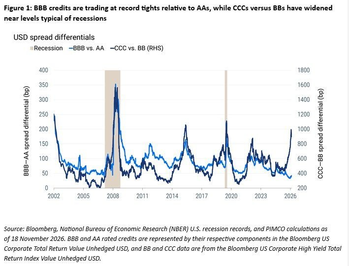

- 취약기업은 EBITDA 유지보다 현재 조달금리로 차환한 뒤에도 현금이 남는지가 핵심
  - 스프레드 확대 자체보다 할인 원인이 공급 부담인지 자본구조의 취약성인지 구분해야 투자 기회를 찾을 수 있음

# KHwanK

### 드러켄밀러의 반도체 매도와 씨게이트 금광주 투자

- 드러켄밀러의 3분기 포트폴리오는 반도체 비중을 줄이고 씨게이트·금광주·아마존을 늘리는 방향으로 재편
  - AMD·ARM·램리서치·샌디스크·구글을 전량 매도하고 TSMC 보유분의 94% 정리
  - 나테라는 추가 매수 없이 다른 자산 매도로 비중이 30%를 넘었으며, 이후 추세 약화에 따른 4분기 매도 가능성은 미확인
  - 포트폴리오는 9월 30일 기준이며 영상의 이후 주가 비교는 11월 19일 기준
- 강환국의 과거 분석에서 드러켄밀러 신규 편입 종목은 1년 보유 시 S&P 500 대비 약 10%포인트 초과수익, 2년 보유 시 평균 70% 수익률 기록
  - 같은 2년간 S&P 500 수익률은 33%로, 성과 격차가 2년 차에 확대
  - 분기 말에서 공개까지 약 45일의 시차가 있어도 중장기 투자 후보를 찾는 자료로 활용 가능
- 반도체 매도는 큰 폭의 상승 이후 추세 약화에 대응한 차익 실현과 2028년 공급 과잉 위험을 함께 점검할 신호
  - 메모리는 삼성전자·SK하이닉스·마이크론뿐 아니라 중국·대만 업체의 증설까지 겹치면 공급 과잉에 진입할 가능성
  - 강환국은 메모리 호황이 2027년 이후에도 이어질 것으로 봤지만, 이번 매도를 계기로 2028년 공급 과잉 가능성을 상향 평가
- 씨게이트는 AI 데이터 저장 수요를 가져가면서 메모리 증설 위험을 피하는 투자처
  - HDD 시장은 씨게이트·웨스턴디지털·도시바 3사가 과점하며, 공장 증설보다 같은 디스크의 저장 용량을 높이는 기술 개발에 집중
  - 보유량을 0주에서 5만 주·12만 주·34만 주로 늘려 포트폴리오 비중 7.6%, 나테라 다음 2위로 확대
  - AI 데이터센터 수요로 HDD 가격이 상승하고, 영업이익률은 26%에서 49%로 확대됐으며 잉여현금흐름은 사상 최대 수준
  - 2027년까지 가격이 묶여 있어 계약 조건과 수익 반영 시점이 중요하며, 4분기 주가 하락으로 매수 가격 부담은 완화
- 뉴몬트·배릭·애그니코 금광주에 각각 약 4,400만·4,300만·4,200만 달러를 투자해 합계 약 1억 2,900만 달러 편입
  - 영상 기준 금값은 1월 말 온스당 5,400달러 고점에서 4,000달러 아래로 하락했지만, 제시된 채굴 비용 약 1,500달러보다 높아 수익 여력 유지
  - 뉴몬트는 현금 창출을 바탕으로 자사주 매입을 진행하며, 신규 금광 개발에 10~15년이 걸려 단기간 공급 확대가 어려움
  - 달러 약세·금 강세·채권 약세가 큰 투자 방향이며, 금값 회복 시 금광주의 이익과 주가 회복 기대
- 구글은 34만 주를 전량 매도하고 아마존은 54만 주에서 77만 주로 확대
  - 구글은 AI 설비투자로 현금흐름 부담이 커지는 동시에 AI가 기존 검색 사업을 잠식할 위험에 노출
  - 아마존은 AWS의 AI 수요 증가와 물류·배송 자동화에 따른 비용 절감이 함께 작동해 본업의 이익률 개선 가능
  - 두 기업 모두 투자 지출 부담이 있지만, AI 투자가 기존 사업의 수익으로 연결되는 경로에 차이
- 강환국은 2028년 이후 삼성전자·SK하이닉스 이익이 둔화하더라도 급격한 이익 붕괴나 적자 전환 가능성은 낮게 평가
  - 이 전제에서 코스피 5,000 수준은 여전히 저평가 영역
- AI 투자에서는 수요 성장뿐 아니라 증설 속도와 공급 제약을 함께 비교할 필요
  - 같은 AI 수혜라도 공급 확대가 빠른 메모리와 증설이 제한적인 HDD는 이익 지속성이 달라질 수 있음
- 금광주는 금값 방향과 채굴 원가의 차이가 핵심이며, 빅테크는 AI 투자 규모보다 현금 회수와 본업 이익 개선 여부가 중요
- 공개 포트폴리오는 투자 후보를 좁히는 출발점이며, 현재 보유 여부·매수 가격·실적 변화를 추가로 확인해야 함
  - 공개 이후 거래가 반영되지 않으므로 3분기 편입을 현재 보유나 향후 상승의 보장으로 연결하기는 어려움

# Kobeissi

- 미국 주식 ETF에 11월 20일까지 33거래일간 2,200억 달러가 유입되며 저가 매수 지속
  - 역대 네 번째 규모로 4개월 전의 3배 이상이며 올해 두 번째로 2,000억 달러 돌파
  - 1930년 이후 미국 증시는 연평균 10% 이상 조정 1회, 5% 이상 하락 3.4회 발생

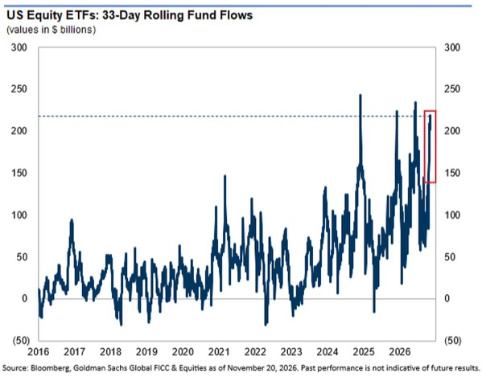

- Solana의 토큰화 주식이 DeFi 대출 담보로 쓰이며 보유 자산을 팔지 않고 유동성을 확보하는 구조 확대
  - Ondo의 토큰화 Tesla 주식이 담보로 활용되며 JPMorgan·BNY Mellon·State Street도 관련 인프라 활용
  - 토큰화 주식 공급은 연초 대비 210% 늘어난 6억 달러 이상, Jupiter의 해당 자산 거래량은 전분기 대비 72% 증가

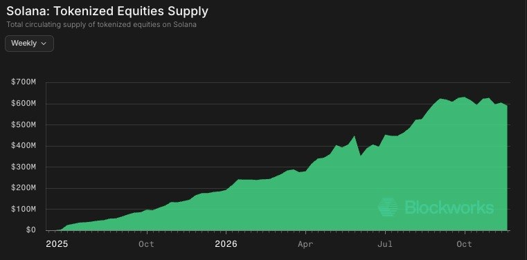

- AI 관련주 매도 확산으로 AMD·Anthropic·SoftBank 급락
  - AMD는 하루 12% 넘게 하락해 5월 이후 처음 400달러를 하회했고, Hunterbrook의 대중국 불법 칩 판매 의혹 제기 이후 30% 하락
  - Hunterbrook Capital은 AMD 공매도 포지션도 공개
  - Anthropic(ANT)은 80달러 아래로 내려가 공모가 대비 5%, 상장 후 고점 대비 31% 하락했고 SoftBank도 10% 이상 하락

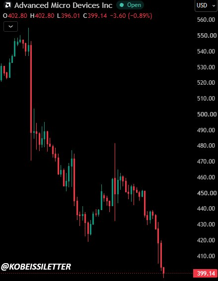

- Nvidia는 미국 정부의 지분 인수 가능성과 Jensen Huang에 대한 정치적 지원에도 아시아 기술주 매도 여파로 프리마켓에서 5% 이상 하락
  - 트럼프는 정부의 Nvidia 지분 취득 가능성을 언급하고 필요하면 Huang을 사면할 의향을 표명

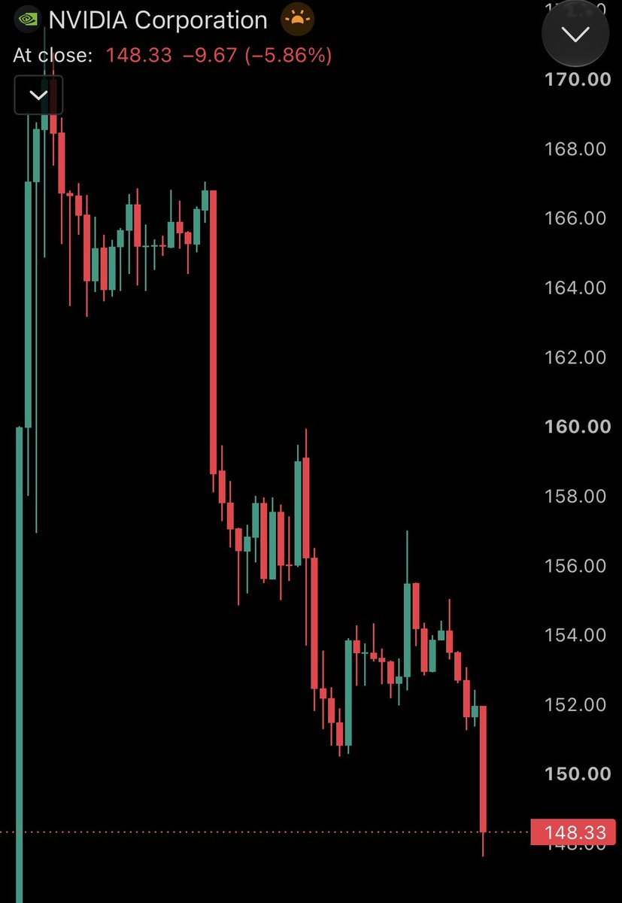

- 실물 금 ETF에서 지난주 20톤이 순유출되며 6월 이후 최대 주간 유출 기록
  - 최근 5주 중 3주간 유출돼 누적 순유출 30톤, 지난주 GLD에서만 10톤 유출
  - 미국 12톤, 중국·영국 각각 3톤 유출로 글로벌 금 ETF는 5개월 만의 월간 순유출 가능성

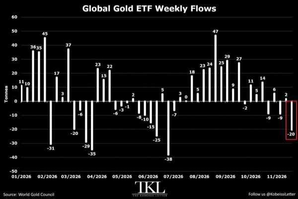

- 미국 10월 PCE 물가상승률 3.8%, 근원 PCE 3.3%로 물가 압력 확대
  - 근원 PCE는 예상치 3.2%를 웃돌았으며 12월 금리 인상 기대 확률은 97%를 상회
  - 1년 전의 올해 3회 인하 기대와 달리 올해 두 번째 인상 가능성이 부각

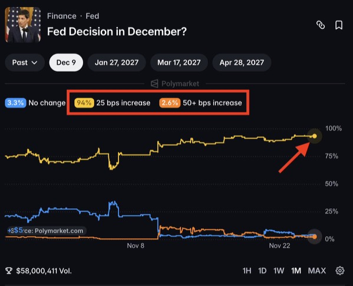

- 미국 소비자의 57%가 전년 대비 가계 재정 악화 원인으로 물가 상승을 지목하며 역대 최고 기록
  - 2024년 3월보다 24%포인트 높고 2008년 금융위기·1970년대 고물가 당시 고점 48%도 상회
  - 향후 12개월 재정 악화를 예상하는 비중도 40%로 역대 두 번째 수준

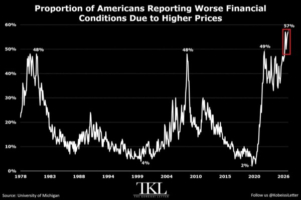

- 중국 주택 가격·투자·판매 동반 위축으로 부동산 침체 지속
  - 10월 신규 주택 가격은 전년 대비 2.4% 하락해 40개월 연속 하락, 70개 도시 신규·중고 주택 가격 모두 전월 대비 0.2% 하락
  - 1~10월 부동산 투자는 22% 감소해 같은 기간 역대 최대 감소폭, 주거용 부동산 판매는 14% 감소
  - 높은 재고와 약한 수요에 따른 가격 인하 압력으로 향후 3년간 신규 주택 판매 감소 전망

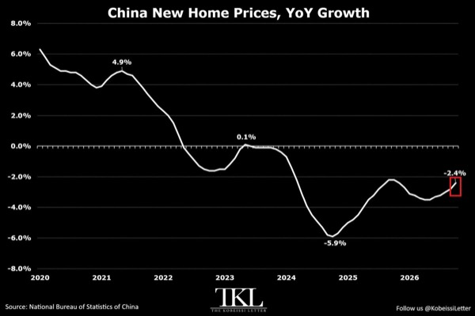

- 미국의 추가 관세 제안과 예상보다 높은 PCE 발표가 겹치며 Nasdaq 100 낙폭이 장중 4.5% 이상으로 확대
  - 14개 주요 교역 상대국에 신규 관세 제안, 중국 20%에서 최대 40%, 베트남 최대 35%, 한국·대만·인도·동남아 주요국 최대 25%, EU 최대 20%
  - 관세는 제안 단계이며 한국 등 수출국의 정책 불확실성 확대

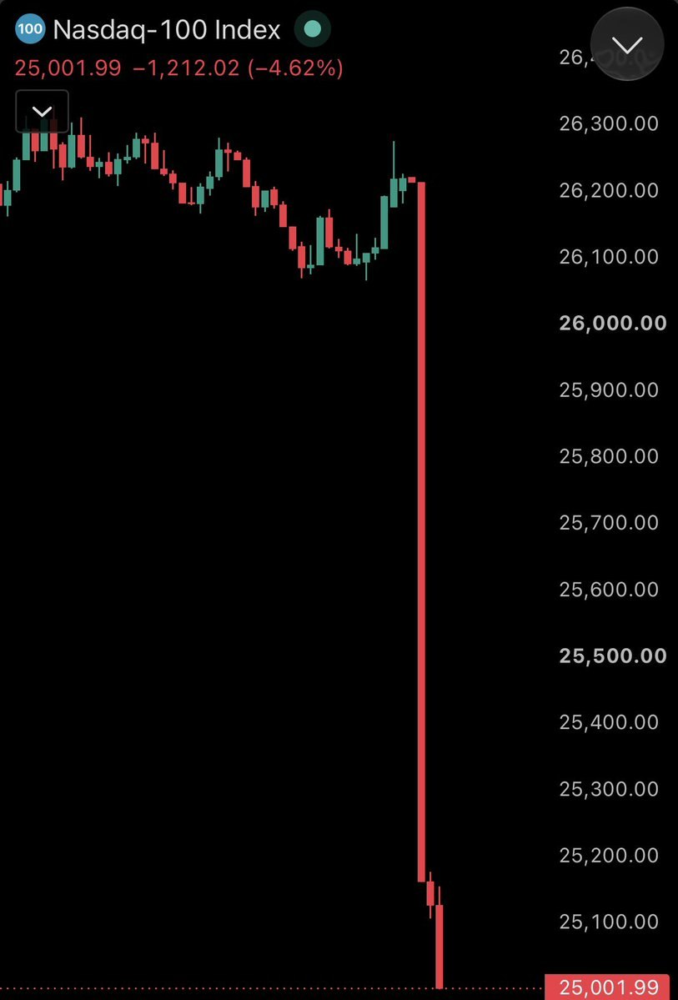

- 미국 금융범죄단속네트워크 FinCEN의 일부 시스템에 비인가 접근이 발생하며 금융정보 보안 위험 부각
  - FinCEN은 은행의 의심거래 보고 등 민감한 금융정보를 다루며 이번 침해 범위는 일부 시스템으로 발표

# MKevin

### 관세 재인상과 긴축에 흔들리는 증시

- 고용과 소비심리는 개선됐지만 관세 재인상과 연준 긴축 우려가 증시 반등을 압박
  - 나스닥은 전날 약 7% 급등한 뒤 약 3% 하락하며 반등의 지속성을 시험
  - 국채금리·기대인플레이션 하락과 안정적인 10년물·2년물 금리차는 완충 요인
- 미국이 중국·유럽연합과 최대 12개 다른 경제권에 국가별 관세를 다시 올릴 가능성
  - 월스트리트저널·블룸버그 보도상 무역대표부의 301조 조사 결과와 새 관세 발표가 임박했으며 당일 발표 여부는 미확인
  - 대법원의 IEEPA 관세 제동 이후 적용 중인 10% 관세를 국가별로 올려 해방의 날 당시 수준에 접근할 위험
  - 기존 무역가중 평균 관세 약 2.2%에 비해 이미 부담이 커진 상태에서 추가 인상이 물가 안정과 금융여건 개선을 훼손할 수 있음
- 관세의 법적 근거가 바뀌어도 기업과 소비자의 비용 부담은 재확대될 수 있음
  - 301조 조사·행정기록·공개 의견 수렴을 거쳐 관세를 재도입하고 122조·232조를 함께 활용하는 경로가 거론됨
  - 국가별 협상과 세율 변경이 반복되면서 투자·재고·가격 결정의 불확실성 확대
- 11월 콘퍼런스보드 소비자신뢰지수는 103.3으로 예상 92.4와 10월 약 91을 크게 상회
  - 현재상황지수 132.8로 예상 121.1 상회, 기대지수 83.6으로 예상 74 상회
  - 일자리가 풍부하다는 응답과 구하기 어렵다는 응답의 차이가 12.4%포인트 개선
  - 기업여건에 대한 순기대가 다시 플러스로 전환되고 모든 연령대에서 신뢰 개선
- 고용지표 전반에서 대량해고형 침체 신호가 아직 뚜렷하지 않음
  - 주간 ADP 고용 증가는 2만1천 명으로 전주 2만3천 명보다 소폭 둔화했지만 증가세 유지
  - S&P 서비스업·제조업 PMI에서도 고용과 기업여건 개선이 나타났으며 일부 활동 제약은 수요 위축보다 공급 부족과 연결
  - 양호한 실물경제가 조정 시 분할매수의 전제이며 한 번에 전액 투자하는 접근은 경계
- 전날 급등은 신규 자금 유입보다 대규모 숏커버링의 영향이 컸을 가능성
  - 골드만삭스는 강한 숏스퀴즈로 해석했으며 장중 상승분은 유지됐지만 종가로 갈수록 추가 상승은 부재
  - 숏커버링 이후 실제 매수 수요가 이어지는지 확인해야 반등의 지속성을 판단할 수 있음
- 단기 피난처로 타깃·애플·일라이릴리가 부각됐지만 장기 주도주로 단정하기는 어려움
  - 영상에서 제시한 당일 상승률은 타깃 약 4%, 일라이릴리 약 3%이며 애플도 상승
  - 2018년 사례에서는 방어적 쏠림이 과도해진 뒤 다음 해 성과가 약해졌다는 점을 경계
  - 향후 소비 관련 종목이 부진해지고 반도체·하드웨어로 주도권이 돌아가는 역전 가능성
- 앤트로픽은 공모가 대비 약 20% 하락 구간마저 이탈하며 기술주 심리 악화
  - 공모 직후 추격매수보다 공모가 대비 10~20% 할인 구간에서 지지 확인이 우선
  - 낙폭이 커졌다는 사실만으로 바닥을 확인할 수 없으며 지지선 이탈은 추가 변동성 신호
- 중동 위험이 남아 있지만 원유 공급 우회가 유가와 인플레이션 압력을 완화
  - 브렌트유는 배럴당 90달러 아래로 하락했고 오만·홍해·지중해를 통한 공급이 호르무즈 해협 차질을 일부 상쇄
  - 후티의 사우디 금융지구 공격과 미국의 이란 지도부 타격 검토 보도는 확전 위험을 유지
  - 유가 하락이 지지 요인이어도 새 관세가 물가 개선 효과를 약화시킬 수 있음
- 12월 9일 연준 회의와 새 관세의 구체적 내용이 단기 변동성의 핵심 변수
  - 시장은 25bp 인상과 추가 인상 가능성을 반영하고 있으며 금융여건이 지나치게 긴축되면 인상 종료 신호가 나올 여지
  - 한 차례 25bp 인상 후 종료하거나 총 50bp를 두 차례에 나눠 인상하는 경로가 거론됨
- 금과 기술주의 동반 하락은 긴축에 따른 유동성 압박을 반영할 가능성
  - 배런스는 금 조정이 끝나야 나스닥도 바닥을 형성할 수 있다는 관점을 제시
  - 금 바닥은 보조 신호이며 주식은 기업이익의 지지를 받는다는 차이가 있음
- 실물경제 개선과 주가 하락이 동시에 나타나는 구간에서는 경기침체 위험과 정책 충격을 구분할 필요
  - 고용·소비 개선이 유지되는지와 관세가 기업이익·물가에 미치는 영향을 함께 확인
- 차입과 신용거래 부담이 낮고 여유 현금이 있다면 변동성이 분할매수 기회를 만들 수 있음
  - 관세 세율·발효 시점, 연준의 최종금리 경로, 기술주의 지지 회복을 확인하며 매수 속도 조절

### 수요 확대 속 금리 충격과 증시 바닥 점검

- 주가 하락의 중심은 실적 붕괴보다 금리 인상 우려와 밸류에이션 축소이며, 저가 매력만으로 바닥을 확정하기는 어려움
  - 영상에서 인용한 Bloomberg 진단은 전형적인 경기침체 신호가 아직 없다는 것
  - 기업 이익이 증가해도 연준의 긴축 기대와 기관 포지셔닝이 주가를 압박할 수 있음
- 구형 GPU 임대료 상승은 AI 수요가 최신 칩에만 집중되지 않는다는 신호
  - 영상에 제시된 H100 임대료는 전년 대비 29% 상승했으며, 11월 첫 10일 기준 상승률은 47%로 확대
  - 오픈웨이트 모델 확산으로 이미 설치돼 있고 저렴한 구형 GPU의 활용도가 높아짐
  - 270억 매개변수급 모델 일부는 RTX 5090이나 3090에서도 구동 가능하다는 사례 제시
  - AI를 충분히 활용하는 미국 기업 비중이 5% 미만이라는 추정에 비춰 도입 확대 여지가 큼
- AI 사용량과 지출액의 분포가 달라 오픈웨이트 확산만으로 폐쇄형 모델 사업자의 수익 감소를 단정하기 어려움
  - 영상에서 인용한 Goldman 자료상 토큰 사용량의 68%는 오픈웨이트 모델이지만, 지출의 70% 이상은 폐쇄형 모델에 집중
  - 기업 고객의 유료 서비스 수요와 자체 모델 운영 수요가 동시에 커질 수 있음
- 영상에서 소개한 Canaccord Genuity의 Anthropic 투자 논리는 대기업의 AI 지출 확대와 클라우드에 준하는 성장 가능성
  - 매수 의견과 목표주가 135달러를 제시했으며, 법률·의료·회계·영상 편집 등 지식노동 영역을 적용 사례로 제시
  - 경쟁우위 유지와 수익성 확대는 아직 입증이 필요해 매출 성장만으로 마진 개선을 낙관하기 어려움
  - Amodei 남매의 지분 1.4% 매각은 약 330만 주, 주당 83달러 기준 약 2억 8,000만 달러 규모로 소개
- 기업용 AI 매출은 대형 고객의 지출 유지 여부가 핵심 변수
  - Snowflake 사업의 약 3분의 2가 100만 달러 이상을 지출하는 고객에서 발생한다는 사례 제시
  - 큰 고객의 소비 변화가 전체 성장률에 미치는 영향이 커 신규 AI 도입과 기존 고객의 실제 지출을 함께 확인해야 함
- Bernstein은 최근 급락이 과도하다는 관점에서 여러 기술·전력 관련 종목에 시장수익률 상회 의견 제시
  - 영상에 소개된 목표주가는 Bloom Energy 306달러, Apple 380달러, Western Digital 600달러, Seagate 1,100달러, Dell 650달러, SanDisk 375달러
  - SanDisk 목표주가의 주식분할 반영 여부는 영상에서도 불확실하게 언급돼 단순한 상승여력 계산에 주의 필요
  - 높은 목표주가와 실제 시장 바닥 형성은 별개의 문제
- AI 설비투자 우려가 상당 부분 반영됐더라도 경기 둔화 우려와 연준의 금리 인상이 겹치면 추가 하락 가능
  - Wells Fargo는 설비투자 우려가 대체로 가격에 반영됐다고 평가
  - 작은 가격 변화도 크게 증폭되는 기관 포지셔닝과 딜러 감마 노출이 변동성을 키움
- S&P 500 하락은 영상 기준으로 아직 통상적인 조정 범위이며, 성장 우려 구간으로 제시한 6,700에도 도달하지 않음
  - 경기침체나 중대한 충격을 반영하는 수준까지 내려온 것은 아니라는 진단
  - 현재 낙폭을 2015년 산업 경기침체와 비슷한 정도로 비교하고, 코로나19나 2022년 긴축기보다 충격이 작다고 평가
  - 현 수준이 위기 가격이 아니라는 점은 추가 악화 시 하락 여력도 남아 있다는 의미
- 중간선거 해의 변동성은 이후 회복 가능성과 함께 봐야 함
  - 대통령 임기 2년 차는 부진하고 3년 차는 상대적으로 강한 역사적 경향 제시
  - JPMorgan 자료를 인용해 1950년 이후 중간선거 뒤 6~12개월의 주식시장 수익률이 모두 플러스였다고 소개
  - 과거의 선거 주기 패턴은 이번 조정의 즉각적인 종료를 보장하지 않음
- 바닥 확인에는 시간이 필요하며 연내 사상 최고치 회복 기대도 낮아진 상태
  - Deutsche Bank는 변동성 충격 이후 바닥 형성까지 통상 6~8주가 걸린다고 분석
  - RBC는 바닥 통과 여부를 확정하기 어렵다고 평가하며, 회복 기대가 사실상 2027년으로 밀린다는 관점 제시
- 나스닥 밸류에이션은 장기 평균 아래로 내려왔지만 과거 긴축기 저점보다는 높음
  - 영상에 제시된 배수는 현재 23.3배, 장기 평균 24배
  - 비교 수치는 이란 전쟁 당시 23.8배, 해방의 날 당시 23.4배, 2022년 연준 금리 인상기 20.4배
  - 실적 증가와 주가 하락의 조합은 밸류에이션 부담을 낮추지만, 추가 할인 가능성을 없애지는 않음
- 숏스퀴즈가 나와도 극단적 공포와 높은 풋콜 비율이 유지되면 추세 전환 확인이 필요
  - 풋옵션 매수와 헤지가 이어져 반등 이후에도 불안정한 가격 흐름이 지속될 수 있음
  - Anthropic은 IPO 당시 즉시 매수보다 10~20% 조정을 기다리는 접근을 제시했고, 약 20% 하락선 위에서 종가가 유지되는지를 관찰
  - 해당 가격선은 대략적인 기술적 기준이며 Anthropic과 QQQ의 바닥 확인을 계속 기다리는 상태
- 기술주에서 다른 업종으로 옮긴다고 자동으로 저평가 자산을 사는 것은 아님
  - Target·Apple·Eli Lilly를 대안으로 거론했지만, RBC는 임의소비재 밸류에이션이 높다고 경고
  - Target은 시장 전반의 매도 속에서도 하루 4% 상승해 방어적 자금 이동이 가격 부담을 키울 수 있음
  - Eli Lilly는 AI를 통한 의료 개선 가능성이 별도 성장 동력
- RBC는 단기적으로 대형주, 헬스케어, 금융을 선호하고 장기적으로 소형주와 채권을 검토
  - 영상에서는 Amazon 250달러, Microsoft 500달러 부근을 상대적으로 안정적인 가격대로 관찰
  - 대형 기술주도 매도 압력에서 자유롭지 않아 규모만으로 안전성을 판단하기 어려움
- 연준의 금리 경로가 시장 반등의 가장 중요한 제약
  - 금리 인상 기대가 커지는 시기와 주가 하락이 겹치며, 새 연준 의장 취임 초기의 정책 불확실성도 변동성을 높임
  - 이란 관련 합의 지연 등 지정학적 요인까지 겹쳐 통화정책 부담이 쉽게 해소되지 않을 수 있음
- 기술주 외 투자처를 찾는 과정에서도 부채 상환은 유효한 선택지
  - 부채를 줄이면 이자 부담과 강제 매도 위험이 낮아지고, 향후 투자 기회를 활용할 여력이 커짐
- AI 투자 판단은 모델 사용량, 기업 고객의 유료 지출, GPU 임대 수익을 나눠 확인해야 함
  - 오픈웨이트 채택 확대는 구형 장비 수요를 지지하면서도 폐쇄형 서비스의 가격 결정력에는 부담을 줄 수 있어 수혜가 기업마다 다름
- 저평가 여부와 매수 시점은 분리해서 판단할 필요
  - 이익 전망이 유지되는지 확인하면서 금리 기대, 헤지 수요, 지지선 위 종가 유지가 함께 개선되는지 관찰
- 선거 이후 회복이라는 장기 논리를 활용하려면 단기 추가 하락을 견딜 자금 구조가 먼저 필요
  - 부채 축소와 투자 여력 확보는 바닥을 맞히지 못하더라도 이후 회복에 참여할 가능성을 높임

### 테슬라 로보택시 확장과 스페이스엑스 합병 기대

- 테슬라 주가는 347~433달러 박스권에 머물지만 로보택시 확대, AI 연산 투자, 스페이스X 합병 가능성이 장기 성장 동력
  - 투자 논리는 현재 자동차 실적보다 로보택시·스타링크·스타십·옵티머스·연산 인프라의 미래 가치에 집중
- 11월 17일 기준 댈러스의 테슬라 등록 로보택시는 1,507대로 전날 1,306대에서 하루 201대 증가
  - 텍사스 전체 웨이모 등록 차량 1,321대보다 186대 많다는 비교이나 등록 대수와 실제 무인 영업 대수는 구분 필요
- 댈러스는 4월 26일 모델 Y 무인 운행을 시작해 11월 무인 사이버캡까지 약 7개월 소요
  - 오스틴의 초기 검증부터 무인 사이버캡까지 약 14개월과 비교하면 도입 기간이 절반으로 단축
  - 오스틴·댈러스·포트워스·휴스턴·샌안토니오·마이애미·올랜도·탬파에서 무인 서비스를 운영하며 샌프란시스코는 규제로 안전 운전자 유지라는 내용
  - 운행은 검증된 지오펜스 구역에 한정되며 원격 감독이 남아 있어 어디서나 가능한 완전 자율주행과는 차이
- 로보택시 주간 주행거리는 8월 10만2,000→11만5,000→13만2,000→17만2,000마일로 증가했고 최근에는 17만2,000마일의 5.5배 이상으로 확대됐다는 수치
- 로보택시의 마일당 순이익 추정 범위는 0.20~0.50달러지만 개인 소유 사이버캡과 구독료의 반복 매출이 더 큰 투자 초점
  - 약 3만 달러 차량과 월 299달러 구독을 결합하는 구상으로 기존 월 99달러보다 높은 반복 매출 기대
  - 타이어·워셔액 등 기본 관리까지 서비스에 포함하면 사고 위험을 낮추고 고객 유지와 고마진 매출 확보에 유리
- 텍사스의 연 12만5,000대 사이버트럭 생산 공간을 재배치하면 차량 생산능력을 연 30만~40만 대로 확대할 수 있다는 Barclays 추산
  - 사이버트럭 수요 부진에 대응해 사이버캡 중심으로 생산 자원을 전환하는 방향
- 11월 16일 발표한 베를린 33억 달러 증설은 2029년부터 연 100만 대 생산능력을 갖춘 사이버캡 전용 시설을 구축한다는 내용
  - 기존 직원 약 1만2,000명에서 고용 확대와 언박스드 제조 방식 도입을 연결하는 구상
  - 유럽의 자율주행 승인과 로보택시 영업 허가가 확보되지 않은 상황에서 투자 회수 시점은 불확실
  - 현지 일자리 창출을 앞세워 유럽 규제 승인을 유도하려는 전략이라는 해석이며 원문에는 사이버캡과 사이버트럭 명칭 혼용 존재
- 테슬라·스페이스엑스 합병은 2028년 미국 대선 국면 이전인 2027년이 유력하다는 전망
  - 민주당의 정치·조사 압력이 커지기 전에 거래를 추진할 유인이 있다는 논리
  - 예측시장의 2028년 이전 합병 확률은 약 87%로 제시되지만 실제 합병이나 조건은 확정되지 않음
- 테슬라 단독 실적은 매출 약 280억 달러로 전년 대비 정체되고 순이익 43%, 영업이익 56% 감소, 이익률 2.6%로 취약
  - PEG 약 5배의 높은 가격을 정당화하려면 자동차 이외 사업의 성장이나 합병 프리미엄이 필요
  - HSBC 목표주가는 157→359달러로 상향됐고 Barclays 450달러, JP모건 415달러 제시
- 스페이스엑스 PEG 0.79배와 테슬라 PEG 5배의 차이를 활용하는 합병 시나리오가 핵심 매수 논리
  - 테슬라에 20% 프리미엄을 지급하고 스페이스엑스 주식으로 교환하면 통합 PEG가 약 2배가 될 수 있다는 가정
  - 합병비율·실제 성장률·거래 구조가 미정이므로 PEG 수치만으로 통합 기업 가치를 확정할 수 없음
- 스페이스엑스 연산 인프라 투자는 3분기 196억 달러에서 4분기 350억~450억 달러로 확대되고 연말 2.5~3GW 확보를 목표로 한다는 전망
  - 연산 수요의 수주잔고 630억 달러와 이미 투입한 420억 달러의 설비투자가 향후 1년 내 매출로 연결된다는 기대
  - 조달금리는 상장 당시 약 8%에서 8.26~8.3%로 상승해 대규모 투자 수익률과 현금흐름 검증이 중요
- 자체 AI 모델의 경쟁력 열세에 대응해 GPU를 내부 개발에만 쓰기보다 경쟁사에 임대하는 전략으로 전환
  - 앤스로픽 등 외부 고객의 연산 수요로 설비 수익화를 앞당기면서 Grok 개발은 지속하는 구상
  - GPU 사용을 정당화하도록 엔지니어 업무를 매주 점검하고 xAI 학습·추론 소프트웨어를 6~8개월에 걸쳐 재작성했다는 내용
- AI 연산능력 증설 속도는 현재 월 약 500MW, 연환산 6GW에서 2027년 말 월 1GW 이상, 연환산 12GW로 확대될 전망
  - 시설을 24시간 가동하고 테슬라 메가팩으로 GPU 전력 사용의 변동을 완화
  - 연산 투자 연 7,200억 달러 추정도 등장하지만 함께 제시된 GW당 약 10억 달러 및 연 12GW와 산술적으로 맞지 않아 그대로 적용하기 어려움
- 테라팹은 2027년 6월 첫 반도체 테스트, 2028년 말 양산을 목표로 하며 인텔과의 협력으로 개발 위험을 낮추려는 구상
  - 도조의 부진 전력이 있어 일정·수율·양산 성과는 별도 검증 필요
- 스타십 재사용으로 궤도 운송비가 장기적으로 최대 100분의 1까지 하락할 수 있다는 기대가 우주 연산 인프라의 기반
  - ARK 전망은 현재 kg당 약 1,000달러에서 2027년 358달러, 2030년 무렵 50달러 미만으로 하락하는 경로
  - 비용 하락 방향과 실제 도달 시점은 구분해야 하며 제시된 도표의 축척도 일정하지 않음
- 테슬라는 텍사스에서 연 200GW 태양광 패널 제조능력과 31억 달러 규모 폴리실리콘 공장을 추진한다는 내용
  - 민주당 집권 확대 시 전기차·태양광·배터리 세액공제가 회복될 수 있다는 전망과 현지 고용 창출을 결합한 전략
  - 정책 변화와 세제 지원 복귀는 확정 사항이 아니며 단기에는 기존 에너지 크레딧 축소가 전년 대비 실적 비교에 부담
- 옵티머스는 프리몬트 생산을 시작했지만 손의 구현이 병목으로 외부 고객 공급은 2027년 말까지 지연
- 장기적으로 사이버캡 1,000만 대가 보급되면 해당 사업만으로 주당 1,100달러 가치가 가능하다는 낙관적 시나리오
  - 보급 시점·이익률·할인율이 제시되지 않은 장기 가정이며 현재 실적 기반 목표주가와 직접 비교하기 어려움
- 로보택시 투자 가치는 등록 대수보다 유료 무인 주행거리, 차량당 가동률, 사고·정비 비용, 구독 유지율의 동반 개선에 좌우될 가능성
- 합병 기대와 자체 사업 가치를 분리해 평가할 필요가 있으며 합병 지연이나 프리미엄 축소 시 높은 테슬라 밸류에이션이 조정 위험으로 전환
- AI 연산 투자 확대는 반도체·전력저장 수요에 기회지만 차입비용을 웃도는 실제 임대 수익과 설비 가동률이 확보돼야 주주 가치로 연결

# Slav

- 코스피가 5개월 만에 반토막 나며 시가총액 약 3,600조 원 증발
  - 주가 급락에 따른 국민연금 수익 훼손과 개인투자자 손실 확대 우려

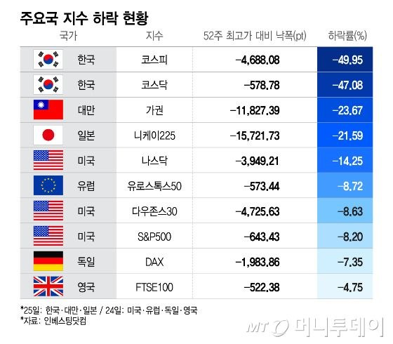

- 디지털자산조언업 신설안은 코인 레퍼럴 등에 금융위원회 신고 의무를 부과하는 방향
  - 금융위가 정하는 교육을 받아야 하며 신고 유효기간은 수리일로부터 5년
  - 기존 사업자는 법 시행 후 3개월 이내 신고하도록 규정

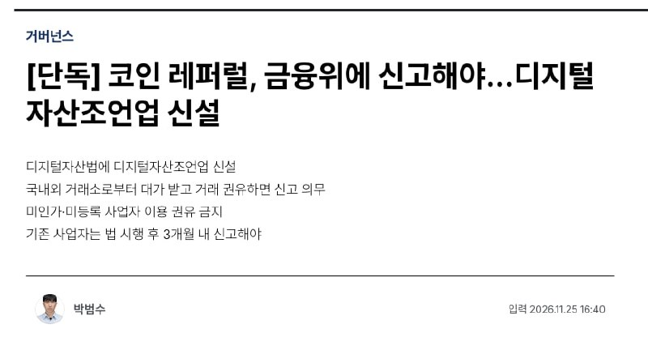

- 디지털자산기본법 정부안은 중개인 없이 스마트계약으로 거래하는 DeFi를 디지털자산업 규제 대상에서 원칙적으로 제외
  - 중앙화 거래소와 DeFi의 규제 적용 차이가 레퍼럴 사업 구조에 영향을 줄 수 있음

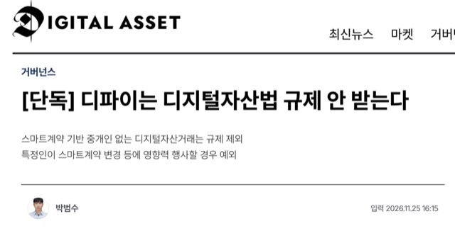

# Stockbot

- 미국이 해외 보조금과 산업 과잉생산을 이유로 중국·EU·일본·한국 등 주요 교역국에 추가 관세를 준비
  - WSJ 보도 기준 EU·일본·한국은 최대 15%, 중국·인도·베트남은 더 높은 세율 가능성
  - 7월 도입한 기존 10~12.5% 관세에 추가 부과할 예정이며 최종 세율은 미발표

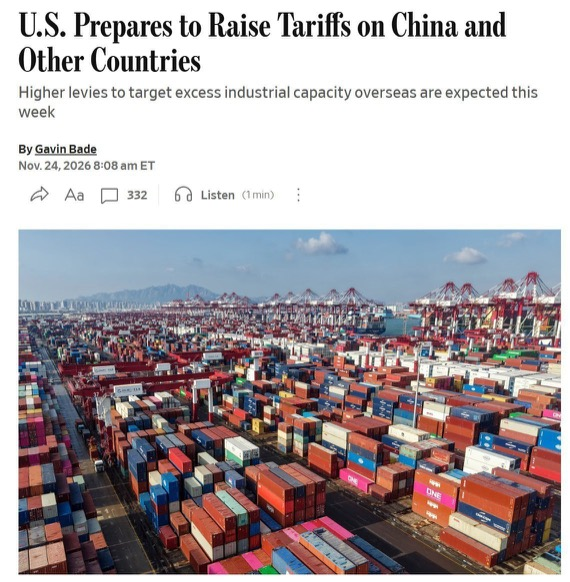

- Anthropic(ANT)이 공모가를 하회한 가운데 공동창업자들의 IPO 현금화 규모 부각
  - CEO Dario Amodei는 주당 83달러에 3,723,389주를 매각해 약 3억 900만 달러 확보
  - 공동창업자 7명 모두 매각에 참여했으며 합산 규모는 약 20억 달러
- 미국 정부의 Nvidia(NVDA) 지분 인수 가능성과 Jensen Huang 지원 발언이 동시 부각
  - 트럼프는 지분 취득이 아직 늦지 않았다고 언급하고 필요하면 Huang을 사면할 의향을 표명
  - 다음 주 의회 증언에서 수정헌법 5조에 따른 진술거부권을 행사하지 말라고 요구
- 미국 10월 PCE 물가상승률이 3.8%로 올라 2023년 4월 이후 두 번째로 높은 수준 기록
  - 근원 PCE는 3.3%로 예상치 3.2%를 상회하며 12월 금리 인상 가능성 확대

# WUncle

### 인프라 집중투자의 균열과 드러켄밀러의 방어 전환

- 3분기 13F는 9월 30일 보유 내역으로, 급락 이후의 실제 포지션과 펀드 수익률까지 보여주지는 않음
  - 분기 중 매매 시점과 공시까지 약 45일 동안의 변화는 알 수 없어 지분 공시·실적·운용자 발언을 함께 확인해야 함
  - 옵션 기재액은 실제 지출한 프리미엄이 아니라 기초주식의 분기 말 명목가치이므로 현물 평가액과 단순 합산해 투자 규모를 해석하기 어려움
- 레오폴드 아센브레너의 시츄에이셔널 어웨어니스는 레버리지 AI 인프라 투자 실패 후 규모가 크게 축소됨
  - 2분기에는 샌디스크·마이크론이 공시 총액의 절반 이상을 차지했고 블룸에너지·TSMC·네비우스에도 집중 투자
  - 자기자본 대비 3~4배 레버리지를 사용하다 7월 급락으로 마진콜을 받고 상장주식 대부분을 시타델에 블록딜로 넘겼으며, 투자자에게 공개한 7월 손실은 67%
  - 3분기 13F 총액은 15억 8,000만 달러로 전 분기 대비 92% 감소했지만, 블록딜과 자금 유출 등이 섞일 수 있어 감소율 전체를 손실률로 볼 수 없음
- AI 재투자는 대규모 현물 매수보다 작은 규모의 콜옵션과 기존 집중 포지션 유지에 가까움
  - 신규 콜옵션 명목가치는 약 10억 4,500만 달러이며 블룸에너지 3억 9,000만 달러, 네비우스 3억 3,000만 달러, 샌디스크 1억 8,000만 달러, 메모리 반도체 ETF DRAM 1억 4,000만 달러 수준
  - 매수 콜옵션은 손실이 납입 프리미엄으로 제한돼 차입 현물투자와 같은 주가 하락 마진콜은 피할 수 있지만 만기까지 조건을 충족하지 못하면 프리미엄 전액 손실 가능
  - 현물은 약 5억 3,300만 달러이며 약 80%가 샤론 AI에 집중됐고 클린스파크·아이리스에너지·비트디어 주식 수는 오히려 감소
- 샤론 AI 보유 주식 증가분은 7월 위기 이후 신규 매수보다 6월 선납 워런트의 주식 전환에서 발생
  - 2월 상장 무렵 80만 주를 약 2,400만 달러에 매입하고 6월 17일 주당 68.73달러로 5억 달러를 추가 투자해 총 투입액은 5억 2,400만 달러
  - 6월 자금조달은 주식 9억 달러와 전환사채 7억 달러로 구성됐으며, 펀드는 주식 조달액 중 5억 달러를 부담
  - 추가 투자 때 약 90만 주는 현물, 약 637만 주는 선납 워런트로 받았으며 주주 승인 전 19.99% 지분 한도 때문에 단계적으로 전환
  - 13F 주식 수는 539만 주에서 807만 주로 늘었지만 9월 17일 지분 공시에 워런트 전환이 확인돼 신규 자금 투입과 구별해야 함
- 샤론 AI의 핵심 투자 논리는 엔비디아의 유휴 연산용량 매입 약정이지만 설비 구축 자금은 별도로 필요함
  - 호주 네오클라우드 업체로 3분기 매출은 990만 달러이며, 6월 8일 엔비디아와 6년 동안 최신 GPU 최대 4만 개를 설치하는 계약 체결
  - 고객을 확보하지 못한 용량은 엔비디아가 최대 48억 8,000만 달러까지 빌리고 임대 매출 일부를 배분받는 구조
  - 전체 계약 약 96억 달러 중 엔비디아 약정이 절반가량이며 향후 GPU 차입의 75% 이상을 이 계약에 근거해 조달할 계획
  - 엔비디아는 가동 후 매출을 뒷받침할 뿐 GPU 매입 대금을 직접 지원하지 않아, 설비 가동 전 차입 실행이 가장 큰 관건
- 샤론 AI는 장기 계약 규모보다 자금조달과 실제 이익 전환 가능성에 큰 할인을 받고 있음
  - 9월 말 현금 13억 4,000만 달러에 비해 데이터센터 구축 약정은 53억 달러이며, 10월 첫 GPU 담보대출로 확보한 금액은 3억 5,600만 달러
  - 엔비디아 지원 약정 총액은 8월 360억 달러에서 11월 320억 달러로 감소했고 지원 대상을 선별하겠다는 방침도 부담
  - 주가는 9월 말 이후 약 70% 하락해 16달러대로 내려왔고, 6월 매입가 68.73달러 대비 손실은 70% 이상
  - 시가총액 약 6억 5,000만 달러에서 9월 말 순현금 약 3억 3,000만 달러를 차감한 단순 사업가치는 약 3억 달러로, 시점 차이가 있는 거친 추정치
  - 펀드는 지분 약 21%를 보유한 대주주여서 대규모 매각도 쉽지 않은 상태
- 펀드 재청산설은 확인되지 않았고 앤트로픽 지분이 전체 자산과 향후 차입에서 더 중요한 변수임
  - 11월 20일까지 샤론 AI 매각 공시는 확인되지 않았지만 최근 거래의 공시 시차가 있어 이후 확인 필요
  - 파이낸셜타임스 보도상 새해 외부자금 유치와 차입 재개를 통한 펀드 재확대가 논의 중이며 아직 확정된 계획은 아님
  - 9월 말 비상장 상태여서 13F에 없던 앤트로픽 지분은 7월 약 50억 달러로 보도됐고, 상장 후 금요일 종가를 적용한 추정치는 약 80억 달러로 보유 주식 수는 비공개
  - 상장 공모가 83달러, 첫 거래 111.5달러, 첫날 종가 97달러였으며 기존 주주 최대 180일·대주주 1년 매각 제한과 옵션 헤지 제한이 적용되는 구조
  - 지분 담보 차입은 허용돼 재차입에 활용할 가능성이 있지만 실제 실행 여부는 미확인이고, 실행 시 단일 담보자산 가격에 대한 의존도 확대
- 드러켄밀러의 듀케인은 3분기에 전체 규모와 종목 수를 줄이며 방어적으로 전환
  - 옵션 포함 13F 총액은 52억 1,000만 달러에서 44억 7,000만 달러, 항목 수는 99개에서 65개로 감소했으며 신규 16종목과 전량 매도 42종목 발생
  - 현물 평가액은 43억 5,000만 달러에서 41억 5,000만 달러로 소폭 줄었지만 나테라를 제외하면 약 35억 달러에서 28억 달러로 약 20% 축소
  - IT 비중은 26.85%로 낮아지고 나테라 중심의 헬스케어 비중 확대
- AI 축소는 반도체·장비에 집중됐고 경기민감주와 시장 상승 베팅도 함께 정리됨
  - TSMC는 약 59만 주에서 약 3만 3,000주로 94.45% 축소했으며 AMD·샌디스크·램리서치·Arm·램버스·인테그리스는 전량 매도, ST마이크로는 거의 절반 축소
  - 알파벳과 클리블랜드클리프스·사우던코퍼·유나이티드항공·델타항공·DR호튼도 전량 매도
  - 2분기 보유했던 RSP·IWM·SPY·EWZ 콜옵션은 모두 사라졌으며 매도인지 만기인지 알 수 없고 EWZ 현물은 유지
  - DR호튼은 한 분기 만에 정리했지만 챔피언홈즈·캡코는 소액 증액해 주택 관련 투자를 완전히 철수한 것은 아님
- AI 인프라 안에서는 저장장치를 늘리고 AI 활용 기업과 금광주를 새로 편입
  - 시게이트는 12만 2,000주에서 34만 2,000주로 약 2.8배 늘어 평가액 3억 1,500만 달러의 2위 종목이 됐고 명목가치 9,000만 달러 콜옵션도 신규 편입
  - 웨스턴디지털 8만 주를 새로 매입했으며, 2027년까지 물량과 가격이 계약으로 정해진 시게이트의 이익 가시성을 선호했을 가능성은 있으나 직접 밝힌 매수 이유는 아님
  - 유니티는 74만 주에서 396만 주로 약 5.4배 늘어 비중 3.9%가 됐으며, 이후 11월 5일 첫 분기 흑자와 AI 광고 시스템 벡터 사업의 전년 대비 126% 성장 발표
  - 앱러빈 3,200만 달러와 금광주 3종목 합계 1억 2,900만 달러를 신규 편입했으며 아마존 비중은 4.64%, 폭스는 약 4.6%로 확대
  - 스페이스X 약 3,000만 달러와 팔란티어 약 1,500만 달러도 신규 편입했으나 각각 총액의 1% 미만
- 최대 보유 종목 나테라는 AI를 신약개발·진단·환자 모니터링에 활용하는 투자 방향과 연결됨
  - 암 재발 검사와 태아 이상 위험 선별을 하는 유전자 검사 기업으로 9월 말 평가액 13억 1,000만 달러, 현물 비중 31.49%
  - 주식 수는 거의 유지됐고 주가 상승으로 비중이 확대돼 추가 매수에 따른 비중 증가와 구별 필요
  - 드러켄밀러는 장기간 부진했던 바이오와 AI 활용 영역으로 주도주가 이동할 가능성에 주목
- 드러켄밀러는 AI 인프라의 현재 이익이 영구적이지 않을 위험과 금리 상승에 따른 경기 둔화를 함께 경계
  - 9월 10일 발언에서는 AI 인프라 구축이 후반부에 접어들었고 일시적인 설비투자 호황이 반도체 이익을 부풀릴 수 있다는 점을 우려
  - AI 투자를 이전의 약 20%로 축소했다는 발언은 13F상 반도체·장비 노출 축소와 대체로 부합하지만 저장장치와 AI 활용 기업까지 모두 줄인 것은 아님
  - 9월에는 AI 설비투자와 정부가 자금을 놓고 경쟁해 금리가 더 높아야 한다는 입장이었고, 11월에는 금리 상승이 2027년 하반기 경기를 기대 이하로 만들 가능성을 경계
  - 항공주 매도에는 7월 유가가 30% 이상 반등한 점, 주택건설주 매도에는 금리 전망 변화가 영향을 줬을 가능성
- 11월 17일 발언의 중심은 공격적 방향 베팅보다 자본 보전과 관망
  - 1월의 주식 매수·국채 공매도·구리 매수 포지션은 거의 남지 않았으며 주식 롱·숏 모두 작게 유지
  - 등락주선은 8월 14일 고점을 기록해 10월 주가지수 고점보다 먼저 시장 내부의 상승 폭이 약해짐
  - AI 혁신이 진행 중이고 관련주도 이미 많이 하락해 주식 공매도에는 신중하며, 향후 12개월 전망의 불확실성이 매우 높은 상태
  - AI 인프라는 단기 거래 대상은 될 수 있어도 지난 4년과 같은 수익의 엔진으로 기대하기 어렵고 AI를 실제로 활용해 돈을 버는 기업에 관심
- 반도체를 미리 줄였더라도 남은 집중 포지션의 하락까지 피한 것은 아님
  - 9월 말 이후 반도체지수 약 33%, TSMC 약 30% 하락에 비해 시게이트는 약 50%, 나테라는 약 34% 하락
  - 나테라는 11월 초 실적 부진과 갑작스러운 CEO 교체가 부담이 됐으며 30% 넘는 비중 때문에 전체 성과에 큰 영향
  - 9월 말 보유량을 유지했다고 가정한 분기 말 이후 추정 수익률은 약 -20%이며 실제 후속 매매를 반영한 운용 성과는 아님
- 시게이트의 장기 계약은 단기 이익을 지지해도 계약 종료 이후의 공급 증가 위험까지 제거하지 못함
  - 10월 2일 도시바의 AI 데이터센터용 하드디스크 생산능력 2배 확대 보도와 함께 시게이트 주가 약 10% 하락
  - 도시바 증설 완료 시점은 2027년 4월~2028년 3월로 시게이트 기존 계약이 끝나는 시기와 겹쳐 이후 가격 하락 우려 확대
  - 공급 부족과 과점 구조에 따른 높은 이익도 경쟁사 증설이 현실화되면 지속성이 약해질 수 있음
- AI 기업은 계약 총액보다 설비 가동 전 자금 확보, 보증 조건, 실제 현금흐름을 함께 비교해야 함
- 거장 포트폴리오는 관심 종목을 찾는 자료로 활용하되 옵션 명목가치·워런트 전환·주가 상승에 따른 비중 변화를 신규 투자와 구별해야 함
- 확신이 큰 장기 계약이나 핵심 종목도 집중도와 미래 공급 변화를 점검해야 하며, 불확실성이 높을 때 포지션 축소 자체가 유효한 운용 선택이 될 수 있음

# YDental

### 동반 급락의 원인과 시장 바닥을 가를 네 가지 신호

- 주식·금·은·비트코인·구리의 동반 급락은 금리 부담, AI 신뢰 약화, 강제 청산이 겹친 결과
  - 금은 온스당 약 3,500달러로 열흘간 약 15%, 1월 고점 대비 약 37% 하락
  - 은은 11월에만 20% 이상 하락했고 비트코인은 주말 한때 55,000달러대까지 밀리며 고점 대비 절반 이상 하락
  - 11월 9~18일 관찰한 39개 시장 중 36개가 하락하며 현금 확보 압력이 여러 자산으로 확산
- 높은 금리와 강달러가 자산 가격을 압박하고 마진콜이 매도를 증폭
  - 10월 CPI의 예상 상회와 연준의 추가 인상 기조로 12월 금리 인상 부담 확대
  - 국채·예금 금리가 5%에 가까워지면서 이자가 없는 금·비트코인의 보유 기회비용 증가
  - AI 관련 불확실성으로 엔비디아의 예상을 웃돈 실적도 주가 반등으로 연결되지 못함
  - 레버리지 투자자의 현금 마련 과정에서 금·비트코인까지 매도되며 안전자산 분산 효과 약화
- 금리 인상기의 낙폭과 회복 속도는 물가와 연준의 정책 전환 신호에 좌우
  - 1994년 기준금리가 3%에서 6%로 오르는 동안 S&P 500은 약 두 달간 9% 하락했고 고점 회복에 약 1년 소요
  - 당시 10년물 금리는 8%까지 상승하며 채권시장 충격 확대
  - 2018년 4분기 S&P 500은 3개월간 19.8% 하락했으나 연준의 속도 조절 신호 이후 약 4개월 만에 고점 회복
  - 2022년 S&P 500은 9개월간 25.4%, 비트코인은 77%, 금은 약 22% 하락했고 S&P 500의 고점 회복에는 저점 이후 약 15개월 소요
- 기술주 거품 붕괴가 겹치면 통상적인 금리 인상기보다 하락이 깊어질 수 있음
  - 2000년에는 금리 인상과 인터넷 거품 붕괴가 겹쳐 나스닥이 고점 대비 약 78%, S&P 500이 약 50% 하락
  - AI 기대 약화가 실적·투자 축소로 이어지는지 별도 점검 필요
- S&P 500의 고점 대비 약 11.6% 하락은 과거 조정 범위의 초반에 해당
  - 9월 첫 인상 이후 12월 두 번째 인상을 앞둔 국면이며 최근 3개월 근원 물가의 연율은 3.7%
  - 물가 둔화와 연준의 속도 조절이 나타나는 2018년형은 고점 대비 약 20% 하락한 6,250 부근과 반년 안팎의 회복을 가정
  - 높은 물가와 추가 인상이 이어지는 2022년형은 약 25% 하락한 5,860 부근과 2년 가까운 회복을 가정
  - 두 경로는 과거 낙폭을 대입한 조건부 계산이며 확정적인 바닥 가격이나 회복 시점이 아님
- 바닥 판단에는 물가, 연준, 금리·달러, 강제 매도 완화의 네 가지 신호를 함께 확인
  - 물가는 아직 뚜렷한 둔화가 없지만 유가가 10월 말 118달러대에서 92달러 안팎으로 하락한 점은 우호적
  - 뉴욕 연준 윌리엄스 총재의 0.5%포인트 인상 부정은 인상 가속에 제동을 거는 신호
  - 10년물 금리는 한 주간 0.2%포인트 내려 5% 아래로 하락했으나 달러는 19개월 고점 부근 유지
  - 월요일 주가지수 선물 반등과 함께 금은 3,600달러 위, 비트코인은 61,000달러대로 반등하고 국채 선물은 하락
  - 주식과 국채의 반대 움직임은 정상화 조짐이지만 금·비트코인의 주식 동조와 강달러가 남아 있어 바닥 확인은 이름
- 단기 분기점은 수요일 한국 시간 밤 10시 30분 발표되는 10월 PCE 물가
  - 예상 상회 시 12월 0.5%포인트 인상 우려가 재점화되고 예상 하회 시 물가 둔화 기대와 반등 동력 강화 가능
  - 호르무즈 해협 유조선 피격과 미국·이란 충돌이 유가 반등으로 이어지는지도 확인 필요
  - 추수감사절 목요일 휴장과 금요일 단축 거래로 거래량이 줄어 작은 뉴스에도 변동성이 커질 수 있음
  - 12월 FOMC 결정은 한국 시간 12월 10일 새벽 예정
- 하루의 동반 반등보다 물가 둔화와 연준의 인상 종료 신호가 이어지는지가 추세 전환의 핵심
  - 과거 바닥은 마지막 금리 인상 자체보다 인상이 끝나간다는 기대가 형성될 때 출현
- 현금 확보가 우선인 국면에서는 자산 종류를 늘려도 손실 분산이 약해질 수 있어 레버리지와 유동성 부담을 함께 점검할 필요
- 유가 하락이 물가 둔화로 연결되는지, AI 불신이 실제 이익 전망 악화로 번지는지가 회복 속도를 가를 변수

### 비트코인 급등 반납과 핵심 지지선 점검

- 비트코인은 64,600달러 급등 후 이틀 만에 58,900달러로 되밀리며 돌파 후 안착에 실패
  - 61,500달러 돌파 후 유지가 관건이었으나 거래량을 동반한 급등도 가격 지지로 이어지지 못함
  - 큰 거래량은 거래가 활발했다는 뜻이며 돌파 가격의 유지를 보장하지 않음
- 반등 당시 미결제약정이 뚜렷하게 늘지 않아 신규 매수 포지션보다 숏 청산 매수가 섞였을 가능성
  - 미결제약정만으로 반등 원인을 확정할 수 없으며 현물 매수 지속과 회복한 가격대 유지가 필요
- 화요일 현물 체결에서는 큰 금액 구간에 매도가 재등장하고 일부 작은 금액 구간에는 매수 유입
  - 체결 금액만으로 기관 매도와 개인 매수를 구분할 수 없음
  - 반등을 지탱할 고액 매수의 지속성은 아직 부족
- 원문에 인용된 파사이드 집계상 11월 23일 미국 비트코인 현물 ETF에서 약 5억 7천만 달러 순유출
  - 11월 26일 미국 추수감사절 연휴로 거래 참여가 줄면 작은 주문에도 가격 변동이 커질 수 있음
  - 연휴를 급락 원인으로 단정할 수 없지만 돌파 후 지지 여부를 더 신중히 확인할 환경
- 반등 재평가 조건은 월요일 박스 하단이었던 저항 구간 회복과 눌림에서의 지지 확인
  - 해당 저항 가격은 녹취에서 숫자가 불명확해 정확한 수치 확인 필요
  - 회복 후 지지가 형성되면 62,000달러대 반등을 재평가하며 이후 62,600~63,700달러에도 저항 존재
- 58,800달러가 단기 핵심 지지선이며 원고 기준 현재가 58,900달러와 근접
  - 이탈 후 반등에서도 회복하지 못하면 지난 주말 저점 55,100달러 부근 재시험 가능
  - 아래에서 매도가 줄고 지지선을 빠르게 되찾으면 하락 판단 수정
- 큰 흐름은 55,100~64,600달러 박스권이며 가격 도달 자체보다 이후 반응이 중요
  - 상단 회복 시 눌림의 지지 여부, 하단 이탈 시 회복 실패의 지속 여부 확인
- 진입 전 판단이 틀리는 조건과 감당할 손실을 정하고 큰 양봉만으로 레버리지를 높이지 말 것
- 추격 매수의 기준은 양봉 크기보다 돌파 후 눌림을 버티는 힘
  - 거래량·미결제약정·현물 수급을 가격 유지 여부와 함께 확인해야 반등의 지속성 판단 가능
- 58,800달러를 지키면 하락 확신을 낮추고 상단 저항 회복에 실패하면 반등 기대를 낮추는 조건부 대응이 핵심
