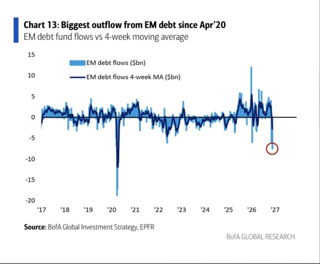
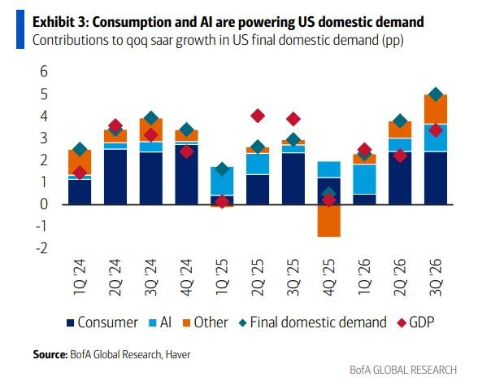
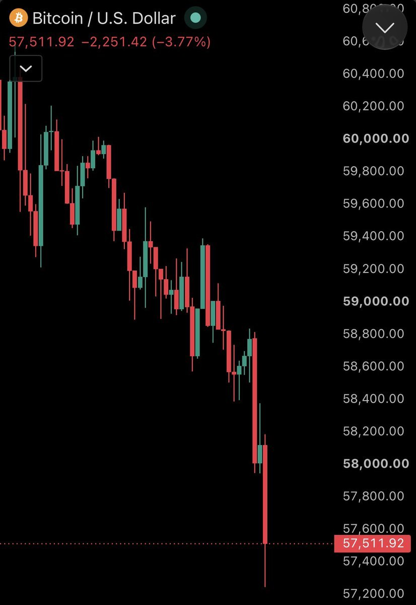
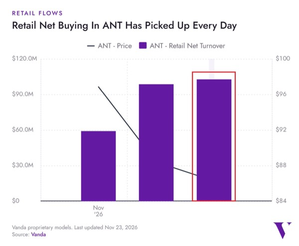
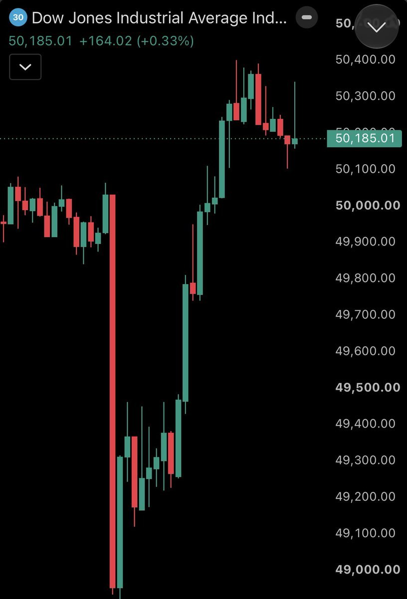
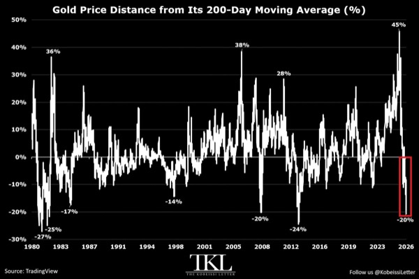
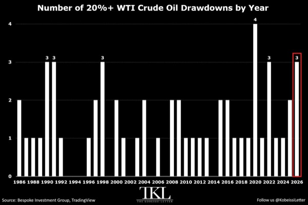
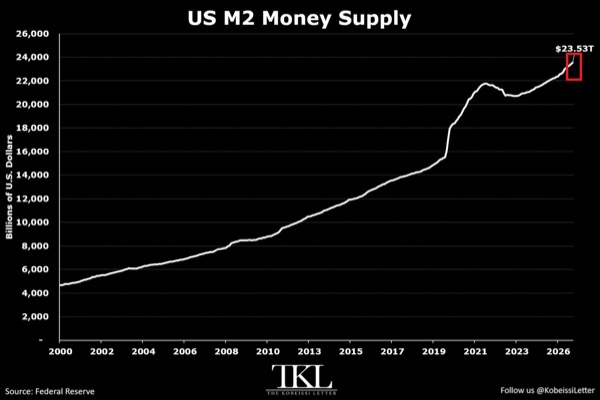

# EconomiExpl

### 로봇 학습 데이터와 흔들리는 저임금 성장 사다리

- 저임금 노동을 발판으로 공장을 유치하고 임금과 산업 수준을 높이던 개발 경로가 AI·로봇 자동화로 약화될 위험
  - 인도·방글라데시·필리핀 노동자가 제공하는 학습 데이터가 선진국의 해외 노동 의존도를 낮추는 자산으로 전환
  - 개인에게 유리한 데이터 수집 일자리가 국가 전체의 장기 고용 기반을 약화시키는 이해 충돌
- 로봇 학습의 병목은 현실의 동작 데이터 부족
  - 챗봇은 인터넷의 방대한 텍스트를 활용하지만 청소·포장·옷 개기 같은 육체노동에는 이에 상응하는 학습 자료가 부족
  - 노동자 머리에 카메라를 달아 작업을 촬영하는 1인칭 시점 데이터 산업이 등장
  - Appen은 인도·필리핀·브라질 등에서 매월 약 6만 시간의 영상을 수집
  - 고도의 추론보다 인간의 감각·운동 능력을 구현하기 어려운 모라벡의 역설 때문에 단순해 보이는 작업에도 막대한 실제 사례가 필요
- 촬영 노동은 현지 임금보다 높은 보수로 빠르게 확산
  - 인도 카루르의 앞치마 포장 노동자는 주 6일 근무로 월 약 90달러, 시간당 약 0.40달러를 받지만 Object Ways의 작업 촬영 보수는 시간당 약 2.60달러로 약 6배
  - 인도 노동인구는 취업자와 구직자를 합쳐 약 6억 명이며 대다수는 계약·복지·보호가 취약한 비공식 부문에 종사
  - 대체 인력이 많고 협상력이 약해 영상의 최종 용도를 충분히 이해하거나 데이터 제공 조건을 바꾸기 어려움
- 로봇의 초기 수익성은 인도 저임금 노동의 직접 대체보다 선진국의 고임금 노동 대체와 생산 복귀에서 발생
  - 약 2만 달러인 Neo 가정용 로봇 가격은 카루르 노동자 소득의 약 18년치지만 미국 청소 노동자의 연간 중위임금 약 3만 7,000달러 기준으로는 약 6~7개월치
  - 전력·유지보수·원격 지원 비용을 제외한 단순 비교지만 국가별 임금 격차가 도입 순서를 좌우
  - 인도에서는 낮은 인건비와 일부 지역의 불안정하고 비싼 전력 때문에 로봇 도입의 경제성이 아직 제한적
- 공급망 위험과 고령화가 선진국의 로봇 도입을 촉진
  - 코로나19, 지정학적 긴장, 관세가 생산의 본국 복귀와 인접국·우방국 이전 유인을 확대
  - 미국 위탁 제조업체 조사에서 생산 복귀 이유로 지정학적 위험을 든 비율은 2022년 24%에서 2023년 53%로 상승
  - 미국은 2030년 인구 약 5명 중 1명이 65세 이상이 되며 2033년까지 필요한 제조업 신규 인력 최대 380만 명 중 약 190만 명이 충원되지 못할 가능성
- 로봇은 환경이 일정하고 작업이 반복되는 공장·창고·물류에서 먼저 확산될 가능성
  - BMW는 미국 사우스캐롤라이나 공장에서 판금 부품 장착용 휴머노이드를 시험했고 GXO는 Digit으로 상자를 컨베이어에 옮기는 작업을 도입
  - Tesla는 Optimus를 외부에 판매하기 전에 자사 공장 작업을 학습시키는 중
  - 촬영으로 확보한 숙련을 미국 공장의 로봇에 적용하면 저렴한 노동의 이점과 짧은 공급망을 결합할 수 있음
- 개발도상국의 첫 충격은 자국 내 로봇 보급보다 수출 주문과 신규 공장 유치 감소에서 시작될 수 있음
  - 선진국이 자국 로봇으로 생산하면 인도·방글라데시에 로봇이 없어도 저임금 수출 일자리가 감소
  - 방글라데시는 6월 종료 회계연도 총수출 약 480억 달러 중 의류가 약 390억 달러로 약 81%를 차지해 생산지 이동에 취약
  - 미국 제조업은 1979년 이후 실질 생산량이 거의 두 배로 늘었지만 고용은 약 2,000만 명에서 1,300만 명 미만으로 감소해 생산 확대가 고용 회복을 보장하지 않음
- 두 번째 충격은 로봇 가격 하락에 따른 현지 공장의 직접 자동화
  - 중국은 고령화와 정책 지원 속에 전년도 산업용 로봇 약 35만 4,000대를 설치해 세계 신규 설치의 59%를 차지했고 인도는 약 1만 500대를 설치
  - 로봇의 총비용이 현지 인건비보다 낮아지면 자동화가 확산되며 품질·정밀도가 중요한 산업에서는 임금 격차가 남아 있어도 도입 가능
- 사무직 아웃소싱은 물리적 로봇보다 빠르게 자동화될 수 있음
  - 업무 데이터가 이미 기업 서버에 쌓여 있어 별도의 동작 촬영과 하드웨어 개발 부담이 작음
  - 인도 기술산업은 직전 회계연도 매출이 약 6% 증가했지만 고용 증가는 2%를 조금 웃도는 수준
  - 약 190만 명을 고용하고 경제의 약 8%를 차지하는 필리핀 아웃소싱 산업은 AI와 국제 경쟁 등을 이유로 2028년 고용 전망을 300만 명에서 185만~210만 명으로 하향
- AI는 학습·검수·원격 지원 일자리도 만들지만 자동화와 해외 이전의 경계가 불분명
  - Amazon의 Just Walk Out에는 인도 인력 약 1,000명이 영상 검수에 관여했으며 Amazon은 이들의 역할을 시스템 개선을 위한 영상 라벨링으로 설명
  - Commonwealth Bank는 2025년 7월 음성 AI 도입을 이유로 고객서비스 45개 일자리를 줄였지만 노조 집계상 같은 회계연도 인도 인력은 21% 늘어 약 6,800명에 도달
  - National Australia Bank의 최대 2,500명 감원 계획 중 약 180개 직무는 인도·베트남으로 이전된다는 노조 설명
  - Waymo의 일부 원격 지원 인력과 일본 매장의 진열 로봇 감시 인력이 필리핀에서 근무하는 등 로봇 지원 업무가 새로운 아웃소싱 시장으로 형성
- 저임금 경쟁력의 수명은 현지 로봇 보급률보다 수출 고객국의 자동화 속도에 좌우될 수 있음
  - 현지 인건비가 여전히 싸더라도 선진국의 공급망 안정·운송·관세 절감 효과까지 합치면 해외 생산의 매력이 먼저 약화될 수 있음
- AI 관련 일자리의 질은 보수뿐 아니라 데이터 통제권과 협상력에 달려 있음
  - 촬영·검수·원격 조작의 단기 소득 증가가 장기 고용 안정이나 기술 소유권 확보로 이어지는 것은 아님
- 인도·방글라데시·필리핀은 제조업이 충분한 고용과 소득 상승을 만들기 전에 성장 사다리가 약해지는 조기 탈산업화 위험에 노출
  - 최종 결과는 로봇 성능·비용의 개선 속도와 각국이 대체 성장 경로를 확보하는 속도에 달려 있음

# Harvey

- 신흥국 채권에서 약 75억 달러가 유출되며 2020년 4월 이후 최대 규모 기록
  - 최근 유입이 단기 성과에 민감한 자금에 치우쳤다면 작은 가격 충격도 대규모 환매로 이어질 수 있음

- 글로벌 위험 축소는 한국 기업의 실적과 주식 평가 배수에 서로 다른 영향을 미침
  - 원화 약세는 기업의 달러 매출에 유리하지만 외국인 투자자의 달러 환산 수익률에는 불리함
  - 반도체 이익 추정치가 메모리 가격·출하량에 힘입어 유지돼도 환율 변동성과 위험 회피가 커지면 평가 배수는 낮아질 수 있음
- 달러표시 신흥국 채권은 미국 국채금리 상승과 신용스프레드 확대를 구분해 접근해야 함
  - 상환위험 악화보다 가격 하락이 크고 매물을 받아줄 자금이 확인되는 곳에 투자 기회가 생김
- 미국 내수는 소비가 중심이고 AI 투자가 추가 동력을 제공하며, 최근 가속에는 기타 부문 개선도 상당 부분 기여
  - 미국 성장률을 한국 종목 전망에 그대로 대입하기보다 미국 지출에서 한국 기업이 확보하는 부가가치를 추적해야 함

- AI 수요 확대 자체보다 시장의 이익·가치평가 추정 오류가 초과수익의 원천
  - 실적 수혜와 가치평가 부담이 동시에 나타날 수 있어 기업별 수익성과 자본조달 구조를 구분해야 함
  - 지출 증가를 현금으로 남기는 기업과 성장 비용을 부담하는 기업의 차이가 수익률을 가를 것

# Kobeissi

- 암호화폐 매도세가 확대되며 비트코인 57,500달러 하회, 이더리움 1,600달러 부근까지 하락
  - 최근 24시간 레버리지 포지션 5억 달러가 추가 청산됨

- Bloomberg 원자재지수는 6주 연속 하락할 전망으로 2023년 5월 이후 최장 하락세
  - 에너지·금속·농산물 25개 선물계약으로 구성된 지수는 9월 고점 대비 14% 하락
  - 연초 대비 상승률은 9월 34%에서 15%로 축소

- 개인투자자의 Anthropic($ANT) 매수가 확대되는 가운데 주가는 장중 낙폭을 만회하고 공모가 83달러 상회
  - 월요일 매수액은 1억 달러로 2거래일 연속 증가했으며 당일 개인 순매수 2위 기록
  - IPO 당일 매수액 6,000만 달러는 2018년 이후 신규 상장 첫날 개인 매수 규모 3위였고, 월요일까지 3거래일 누적 매수액은 2억 5,200만 달러

- 다우지수는 장중 1,100포인트 하락을 모두 회복하고 상승 마감
  - 이후 S&P 500 선물은 0.8%, Nasdaq 100 선물은 약 1% 상승하며 반등 지속

- 미국 재정수입의 약 20%가 이자비용으로 지출되는 구조는 재정 지속가능성의 부담
  - TKL의 Adam은 현 재정 경로를 유지할 경우 파산이 불가피하다며 정책 변화 필요성 강조
- 금 가격은 200일 이동평균을 20% 하회하며 2013년 6월 이후 최대 하방 괴리 기록
  - 1월에는 200일선 대비 45% 높았으나 이후 장중 고점 대비 37% 하락해 1980년대 초 이후 가장 큰 12개월 내 낙폭 기록
  - 2008년 금융위기 당시에도 200일선을 20% 하회했으며 1981년 최대 하방 괴리는 27%

- 미국 유가는 연초 대비 42% 상승했지만 반복적인 급락으로 변동성 확대
  - 올해 20% 이상 조정은 세 차례이며 장중 가격 기준으로는 네 차례 발생
  - 10% 이상 조정은 여덟 차례로 1986년 이후 최다 수준

- 미국 10월 M2는 1,190억 달러 늘어난 23조 5,300억 달러로 사상 최대 기록
  - 전년 대비 증가율은 5.9%로 2022년 5월 이후 최고이며 32개월 연속 증가
  - 2023년 10월 이후 2조 8,200억 달러 증가했고 팬데믹 이전인 2019년보다 8조 1,800억 달러 높은 수준

# MKevin

### 급락과 레버리지 청산 속 분할매수 조건

- 기술주 급락의 핵심은 AI 경기침체보다 과도한 레버리지 청산이며, 차입 없이 10년을 내다보는 분할매수 구간
  - 고평가 때 주식 비중을 약 1%로 낮췄다가 조정 이후 3~5%로 확대했고, 하락할수록 매수 규모를 늘리는 중
  - 매수 직후 반등을 기대하거나 급락 때 매도하고 급등 때 재진입하면 변동성에 반복적으로 손실
  - 바닥을 정확히 맞히기보다 추가 하락을 견딜 자금 구조와 보유 기간이 우선
- 관세 인상, 매파적 연준, 이란 충돌, 반도체 수출규제가 기술주에 동시에 압력
  - 대중 관세는 10%에서 20%, 최대 40%까지 인상 가능성이 거론되고 베트남은 35%, 한국·대만 등은 25% 관세 위협
  - 협상용 압박이어도 기업의 판매와 비용 구조를 훼손하며, 첨단 반도체 생산이 집중된 대만까지 대상에 포함
  - 이란과의 합의 부재와 유조선 공격도 불확실성을 확대
- 추가 하락 가능성과 극단적 공포가 공존
  - 배런스는 S&P 500 종목의 약 절반이 여전히 50일·200일 이동평균선 위에 있어 하락이 다른 업종으로 확산할 수 있다고 경고
  - 하방 시나리오는 QQQ 550~570, S&P 500 6,400~6,500으로 약 10% 추가 조정
  - 공포·탐욕지수는 9, 풋콜비율은 0.94로 공포가 극심하지만 바닥 확정을 의미하지는 않음
  - 딜러 포지셔닝은 6.7백분위 수준이며 음의 감마가 가격 움직임과 매매 압력을 증폭
- 고용과 국채금리는 아직 경기침체보다 긴축 지속을 가리킴
  - ISM·S&P PMI에서 제조업과 서비스업 고용이 늘고, ADP 주간 고용 증가도 2만 명을 상회
  - 2년물 금리는 과거 고용침체 우려 때의 약 3.5%보다 약 100bp 높아 연준의 추가 인상 가능성을 반영
  - 고용이 실제로 꺾이면 침체 판단을 바꿔야 하며, 현재 금리 수준만으로 미래 침체 가능성까지 배제할 수는 없음
- 유가 안정은 고금리의 원인을 에너지 충격만으로 설명하기 어렵게 만듦
  - 유가는 최근 4주 내 고점인 배럴당 117달러에서 약 25달러 하락
  - 이란 외 산유국과 미주 지역의 증산, 수출 경로 우회, 중국 수요 약화가 공급 부족을 완화
  - 대본에 제시된 공급 전망은 2026년 4분기 하루 170만 배럴, 2027년 평균 380만 배럴의 초과 공급 가능성
- 고점에서 빚으로 AI 노출을 늘린 투자자가 청산 압력의 중심
  - 레오폴드 관련 추적 계정은 9월 말 보유 내역을 기준으로 주요 종목이 약 36~61% 하락했다고 제시
  - 실제 강제청산 여부는 확인되지 않았고, 공시 이후 포트폴리오가 달라졌을 가능성도 존재
  - 신용과 레버리지 상품은 장기 투자 논리가 유지돼도 보유를 강제로 끝낼 수 있음
- AI 기업은 주가 낙폭보다 유동성과 차입 부담을 구분해야 함
  - 오라클은 현금 363억 달러와 매출채권 110억 달러를 합쳐 약 470억 달러의 자금 여력이 있지만, 지급 부담 330억 달러와 설비투자가 이를 소진
  - 최근 3개월 현금흐름은 약 마이너스 50억 달러로 향후 1년을 버틸 여력은 있어도 재무 부담이 큼
  - 코어위브 채권은 액면가의 약 74~76센트, 수익률 약 18%에 거래돼 높은 차입 부담과 부도 우려를 반영
- 앤트로픽의 계약 갱신 불확실성이 SpaceX 연산 사업의 공급 과잉 우려를 확대
  - SemiAnalysis 보도상 H200 5만 개 규모 계약이 2027년 중반 이후 연장되지 않을 가능성
  - 앤트로픽이 SpaceX 매출의 약 3분의 1을 차지한다는 추정이 맞으면 고객 집중 위험도 큼
  - 블랙웰 소규모 클러스터 현물 임대료는 GPU 시간당 15달러에서 최저 10달러로 약 3분의 1 하락했다는 보도
  - 계약과 매출 비중은 확정 사실이 아닌 보도·추정에 근거
- 수출규제와 설비 증설이 겹치면 단기 연산 임대료가 더 하락할 수 있음
  - 싱가포르·말레이시아·인도네시아·태국·브라질향 첨단 칩과 서버의 허가 요건 강화로 중국 관련 수요가 사용하던 연산 자원이 시장에 재유입될 가능성
  - 여기에 앤트로픽 계약 물량까지 반환되면 가용 공급이 추가로 증가
  - SpaceX가 제시한 신규 연산 인프라 가동 속도는 현재 월 500MW에서 2027년 말 월 1GW로 확대
  - 우주 데이터센터 구상도 장기 수요를 만들 수 있지만 당장의 임대료 하락과 투자 회수 문제를 해소하지는 못함
- 메모리 가격 붕괴 우려와 실제 고객사의 가격 신호는 아직 일치하지 않음
  - 델은 가격 상승 속도가 둔화했어도 서버용 NAND·DRAM 가격 하락을 예상할 근거는 없다고 언급
  - 엔비디아 Rubin Ultra의 HBM 사양이 1TB 기대치에서 192GB로 낮아진다는 우려가 메모리주 하락을 자극
  - 대역폭 개선과 여러 GPU 연결로 필요한 성능을 확보하면 칩당 메모리 탑재량 증가 기대가 낮아질 수 있음
  - BNP파리바는 마이크론을 중립으로 낮추고 목표가를 1,700달러에서 775달러로 하향
- 먼 미래의 메모리 실적 추정치는 정밀한 예측보다 시장의 비관 정도를 보여주는 자료
  - 마이크론의 장기 성장 전망에는 큰 폭의 역성장이 반영돼 있지만, 먼 연도로 갈수록 참여 애널리스트 수가 급감
  - 비관이 과도하면 매수 기회가 생기지만 가격 하락만으로 수익성과 공급 과잉 위험이 사라지는 것은 아님
  - 마이크론은 현재 미보유이며, 추가 조정으로 일부 메모리주의 매력도가 높아지는 단계
- 앤트로픽의 상대적 주가 안정은 레버리지 청산 해석을 뒷받침하는 단서
  - 상장 후 예상했던 10~20% 조정 범위 중 20% 하락선에서 두 차례 반등
  - 당일 앤트로픽 약 1% 하락에 비해 나스닥 약 3%, 아마존 약 4%, 엔비디아 약 8% 하락
  - 신규 상장주는 신용과 레버리지 상품 노출이 덜 쌓였다는 해석이며, 상대 강도만으로 경기침체 여부를 확정할 수는 없음
- 단기 금리 하락 수혜주와 장기 성장주 매수는 투자 기간을 구분해야 함
  - 당일 방어 후보로 로켓모기지, 레나, 월마트를 제시했고 주택·금리 민감주는 국채금리 하락의 수혜
  - 장기 기술주 저가매수는 추가 급락을 감수할 수 있는 10년 시계가 전제
- 연준의 긴축과 주가 하락이 금융여건을 동시에 조이면 정책 실수와 급격한 금리 인하 위험이 커짐
  - AI 생산성 향상이 장기 국채금리와 기대 실질금리를 낮출 수 있다는 연준 연구를 부동산 투자 근거로 활용
  - 2030년대 30년 모기지 금리 1.8% 전망은 개인의 장기 시나리오이며 확정 경로가 아님
  - 현재 부동산 투입액은 주식의 약 10배이고, 추가 80만 달러 투자와 1,500만 달러 개발사업을 진행
- 저가매수의 우선순위는 큰 낙폭보다 현금 여력, 부채 만기, 고객 집중도, 계약 지속성
  - 연산 수요가 늘어도 임대 단가와 가동률이 떨어지면 차입이 큰 공급업체의 주주 수익은 악화 가능
- 매수 확대의 전제는 고용 유지와 실적 훼손 제한이며, 확인 지표는 고용·2년물 금리·신용 스프레드·연산 임대료
  - 공포가 극심하다는 이유만으로 일괄 매수하기보다 전제가 유지되는 기업에 차입 없이 나눠 진입

### 주택 공급 위축과 금리 하락이 부를 주거비 급등

- 주택시장의 핵심 위험은 당장의 전국 가격 폭락보다 신규 공급 축소 이후 금리 하락과 수요 복귀가 겹치는 주거비 급등
  - 건축허가에서 입주까지 약 2년이 걸린다는 전제에서 2026년 허가 감소가 2028년 말 공급 부족으로 이어질 가능성
  - 향후 5~10년의 금리 하락과 부동산 회복을 예상하며 2032년 금리가 2022년보다 낮아지는 장기 시나리오 제시
- 고금리는 전국 주택가격보다 거래량을 먼저 위축
  - 30년 고정 모기지 금리는 1년 전 6.23%에서 7.21%로 약 1%포인트 상승
  - Redfin 기준 전국 중위 매매가격은 2022년 5~6월 약 38만 달러에서 약 38만8,634달러로 소폭 상승했고 전년 대비 상승률은 0.7%
  - 잠정 주택매매지수는 약 63으로 2001년 집계 이후 최저 수준이며 기존주택 연간 거래량은 1990년대 중반 이후 최저 수준에 근접
  - 지난 30년간 인구가 약 7,500만 명 늘었는데도 거래량이 후퇴해 잠재 수요 누적과 구매력 악화가 동시에 드러남
- 단독주택 건축허가 감소가 미래 공급의 병목
  - 영상에 제시된 2026년 10월 전년 대비 허가 감소율은 남부 9.7%, 중서부 9.8%, 북동부 19%, 서부 21.7%
  - 1월에도 전 지역에서 허가가 감소했고 금리 인상 우려·관세·지정학적 불확실성이 건설사의 투자 위축으로 연결
- AI 데이터센터 투자가 주택 건설에 필요한 토지·인력·자재·설비를 흡수
  - 영상에 인용된 데이터센터 건설은 최근 1년간 90% 증가한 반면 주거용 건설은 8.9% 감소
  - 냉각설비와 건설 인력 수요가 겹치며 북버지니아에서는 데이터센터 사업자가 주택 개발사보다 높은 토지가격을 제시
  - Oxford Economics 자료상 최대 4만5,000개 개발업체의 시장 이탈도 공급 위축 요인으로 제시
- 금리 하락이 주택 구매 가능성을 개선해도 공급이 따라오지 않으면 가격 상승으로 효과가 상쇄될 수 있음
  - 원유 공급 확대에 따른 에너지가격 하락과 AI 생산성 향상이 장기 디스인플레이션의 촉매라는 시나리오
  - 영상에 인용된 연준 연구는 지속적인 총요소생산성 상승 충격 이후 10년물 국채금리와 단기금리가 하락하는 결과를 제시
  - 금리 정점과 향후 하락은 전망이며 단기 추가 인상 가능성과 실현 시점의 불확실성은 남아 있음
- 지역별 가격 차이는 전국 공통 금리보다 공급 확대 능력에 크게 좌우
  - 2025년 인구조사 자료를 바탕으로 제시한 인구 1,000명당 허가 중앙값은 민주당 통제 지역 약 2.6건, 공화당 통제 지역 약 4.2건으로 약 58% 차이
  - 정당 구분만으로 원인을 단정할 수 없으며 지방 규제·소송 위험·지형적 제약이 함께 작용
  - 2022년 고점 대비 하트퍼드 가격은 28% 상승하고 오스틴은 28.8% 하락했으며 오스틴의 허가 규모는 하트퍼드의 약 8배로 제시
- 개발 가능한 토지가 제한된 지역은 공급 반응이 느려 가격 방어력이 높아질 수 있음
  - 맨해튼과 남부 캘리포니아는 바다·산맥 등 지형적 제약에 농지보호와 개발 규제가 추가
  - 맨해튼비치 중위 주택가격은 약 350만 달러로 2024년 말 대비 16% 상승한 사례로 제시
  - 캘리포니아 부속주거시설인 ADU는 법상 60일 승인과 실제 사업 소요기간의 차이가 크며 현장 경험상 완공까지 약 2년을 잡는 접근
- 직접투자의 첫 번째 방식은 수리가 필요한 주택을 할인 매수해 개보수로 가치를 높이는 전략
  - 공개 매물과 비공개 거래 모두 검토하고 매입가·보수비·완료 후 가치를 함께 계산
  - 약 72만 달러 매수 예정 주택과 누수·장기 공실 문제가 있는 비공개 매입 사례를 제시
  - 지역별 비교 매물과 실제 건물 상태를 현장에서 확인해야 하며 데이터 표와 자동 가격평가만으로 투자 결정을 내리기 어려움
- 두 번째 방식은 공급이 부족한 지역의 기존 주택에 ADU를 추가해 임대 가능한 주거 수를 확대
  - 인허가 지연을 감안해 약 2년의 시간과 그동안의 자금 소요를 계획에 반영
- 세 번째 방식은 대체 공급이 어려운 입지와 이용권을 가진 고가 부동산에 투자
  - 유타 파크시티 Marcella의 토지 2필지 매입 사례와 Deer Valley 스키장 접근성의 희소성 제시
  - 주변 지역 전체에 신축이 많아도 특정 입지와 시설 접근권의 공급은 제한적일 수 있으며 높은 자본과 장기 보유 여력이 필요
- 간접투자는 주택 건설사·모기지 회사·관련 비상장 기업 등으로 접근 가능
  - Lennar는 주택 건설 회복, Rocket Mortgage는 금리 하락과 모기지 거래 회복에 노출되는 사례
  - 모기지 금리가 다시 상승하면 관련 기업의 실적 회복도 제약될 수 있음
  - 부동산 펀드와 REIT 상품은 표시 수수료 외에 자산운용·주택관리·수선 비용까지 합산해 실제 비용을 비교
- 장기 회복에 대비하되 부채를 제한하고 보유 여력을 확보하는 접근
  - 자가·임대주택 매입뿐 아니라 중개사나 모기지 자격 취득을 통한 업계 진입도 선택지
  - 캘리포니아 모기지 사업 면허 취득에 약 9개월이 걸린 경험처럼 사업 준비에도 상당한 시간이 필요
  - 텍사스·플로리다처럼 공급 부담이 컸던 지역도 허가 감소가 이어지면 중기 수급이 달라질 수 있음
- 매입 지역의 현재 재고와 함께 건축허가·착공·준공 흐름을 추적해야 공급 과잉 해소와 다음 부족 국면을 구분할 수 있음
- 금리 하락 시나리오에만 의존하지 않고 현재 금리에서도 수선비·공실·인허가 지연을 감당할 수 있는 현금흐름을 확보하는 것이 핵심
- 공급 제약은 기존 소유자에게 가격 지지 요인이지만 신규 구매자에게는 부담 증가 요인이므로 투자 수익성과 실거주 접근성은 다른 방향으로 움직일 수 있음

### 주 레버리지 청산과 견조한 고용 사이의 증시 바닥 탐색

- 증시 하락은 아직 경기침체 확정보다 AI 관련주 레버리지 청산에 가까우며, 바닥 확정에는 이른 구간
  - 이란 전쟁, 민주당 선거 승리, 데이터센터 둔화, 매파적 연준과 50bp 긴축 우려, 중국 반도체 수출 문제, 관세가 동시에 부담
  - Anthropic 주가와 고용시장이 AI 투자심리·실물경기 악화를 구분할 핵심 관찰 대상
- Anthropic은 상장 직후라 기존 AI 인기주보다 누적 레버리지 노출이 작아 시장 유동성의 시험대 역할
  - 옵션과 레버리지 ETF는 이미 출시됐지만, 장기간 매수세가 쌓인 Micron·SanDisk·Amazon·Meta·Microsoft보다 노출이 작다는 전제
  - 공모가 83달러, 상장 후 고점 115달러, 저점 약 73달러, 당일 종가 약 84달러
  - 영상에서 제시한 상장 대비 -10~20% 구간에서 등락하며 이틀 연속 -20% 선을 장중 이탈했다가 회복
  - 이 지지력이 유지되는 동안에는 전면적인 경기침체 공포 매도로 단정하기 어려우나, 추가 하락 가능성은 열려 있음
- Anthropic 목표가 135달러는 약 84달러 대비 60.7% 상승 여력에 해당하지만 수익성 검증은 미완성
  - AI가 토큰 판매를 넘어 에이전트와 업무를 실행하는 기반 소프트웨어로 발전하면 기존 소프트웨어 예산보다 큰 시장에 진입 가능
  - 직원 생산성 보조에서 업무 자체 수행으로 넘어가면 인건비와 광범위한 운영예산까지 잠재시장에 포함
  - 막대한 인프라 지출, 경쟁사의 추격, 차별화 지속성, 2030년 이전 흑자 전환 여부가 주요 불확실성
- AI 가격 하락이 지출 급증으로 이어진다는 제번스 역설은 최근 지출 증가율 둔화로 시험받는 중
  - 2023년 초기 사용과 환각 실망, 2024~2025년 정체, 2026년 초 Claude Code 확산에 따른 급성장 이후 기저효과가 커진 흐름
  - Google 등 경쟁사의 모델 훈련 재투자는 기술 경쟁과 자본지출 부담이 계속된다는 신호
- 실물경기 지표는 현재 광범위한 침체보다 견조한 성장에 가까움
  - 3분기 GDP 2차 추정치는 4.3%, 개인소비 증가율은 직전 3.9%에서 4.2%로 상승
  - 실업급여 계속청구는 선거 전후 일시 급등을 평탄화해도 낮은 수준이며, 비슷한 저점은 2024년 초 일부 구간
  - 자발적 퇴사율이 안정적이거나 상승하는 흐름은 재취업 자신감이 유지된다는 해석에 부합
  - 실업급여 청구는 후행성이 있어 해고 인력의 재취업 흡수, ISM·PMI 고용지표도 함께 확인할 필요
- GDP 성장과 가계 체감경기는 크게 엇갈리며, 성장 산업과 비수혜 업종 간 격차가 확대
  - 경유·휘발유·식료품 부담이 지속되는 가운데 학교 유지보수 같은 분야는 데이터센터 건설만큼 수혜를 받기 어려움
  - 냉난방·전기 등 기존 기술을 데이터센터 투자와 연결할 수 있는지가 소득 기회를 좌우
  - 건축허가는 전년 대비 7.2% 감소해 예상 감소폭의 약 두 배로 악화, 주택 부문은 별도 약세 신호
- 관세 인상은 물가와 기업 생산성에 추가 부담
  - 아시아·유럽 주요 교역 상대에 대한 관세율이 2~3배로 상승하는 상황을 전제로 비용 전가와 경제적 순손실 우려
  - 관세 철회는 수입물가 하락을 통해 생활비 부담을 낮출 잠재적 정책 촉매
- 사우디 Aramco의 Ras Tanura 시설 공격으로 원유 공급 불안이 재확대
  - 공격 주체는 영상 내 정정 기준으로 이란의 지원을 받는 후티 반군
  - 유가는 공격 소식 이후 약 3.6% 상승해 94달러 수준, 정유·선적 시설 손상과 호르무즈 해협 운송 위험이 부담
  - 2년물 국채금리 하락폭이 장중 약 6bp에서 약 2.3bp로 축소된 움직임은 일방적인 침체 베팅과는 다른 신호이나, 유가 상승 영향도 고려할 필요
- Nvidia는 신용과 지배구조 불확실성이 주가 부담으로 확대
  - 영상 기준 AA 신용등급에 부정적 관찰이 붙어 향후 90일 안에 강등될 가능성
  - 신용부도스와프 지표는 Nvidia 142, Meta 118로 Nvidia가 더 높은 수준이며 Nvidia 수치는 최근 고점 부근
  - 경영진 관련 의혹과 정부 대응은 사실관계가 불분명해 확정된 결론보다 불확실성 자체가 위험요인
- SpaceX·Tesla 합병 기대는 자금조달 능력 강화 가능성과 연결되지만 아직 확정되지 않은 시나리오
  - SpaceX가 활성 Trump 계좌마다 1주를 지급하고 Elon Musk가 이를 추가 매칭하려는 계획이 소개됨
  - Kalshi의 다음 해 1월 이전 합병 확률은 약 3분의 1 수준으로 상승
  - 합병이 성사되면 Musk의 Tesla 지배력과 통합 신용 접근성이 강화될 수 있다는 기대
  - FCC의 위성 100만 기 승인도 궤도 컴퓨팅 확대 기대의 배경
- 애틀랜타 연은의 4분기 GDP 추정치 2.9%는 3분기 4.3%보다 둔화했지만 침체와는 거리가 있는 성장률
  - 선거 이후 약 2주부터 추정치가 약해진 흐름에는 정책 불확실성에 따른 지출·투자 관망이 반영됐을 가능성
- 금리 움직임에 따른 업종 반응과 시장 전체 바닥 예측은 구분할 필요
  - 국채금리 하락에 민감한 Rocket Mortgage가 당일 7% 상승한 사례는 개별 촉매를 활용할 여지가 있음을 보여줌
  - 하루 뒤 주가나 정확한 저점을 맞힐 수 없으며, 추가 하락을 감당할 자금과 장기 보유 여력이 분할 접근의 전제
- AI 노출은 단일 승자보다 하이퍼스케일러·반도체 설계·광섬유·광학을 아우르는 분산 구성이 중심
  - 약 34개 종목의 바스켓을 활용하고 일부 기존 보유 종목에는 신규 배분을 중단하는 방식
  - Anthropic 직접 노출은 협찬사가 제공한 자금으로 매수한 무기한 파생상품에 한정하며, 별도로 Broadcom을 통한 간접 노출 선호
  - Corning은 관찰 중이나 미편입 상태이며, 사업의 약 절반이 부진하다는 점이 부담
- 주가의 유동성 회복과 AI 기업의 장기 수익성은 별도로 검증할 과제
  - Anthropic의 지지선 유지가 시장 청산 압력 완화를 시사해도 흑자 전환과 투자수익률을 입증하지는 못함
- 고용·소비의 견조함은 경기침체 위험을 낮추지만, 유가·관세발 물가 상승은 연준 완화 여력을 제한할 수 있음
  - 성장률만으로 증시 바닥을 확정하기보다 고용 둔화와 비용 충격이 동시에 나타나는지 확인할 필요
- AI 장기 확산에 참여하더라도 누적 레버리지를 줄이고 사업별 실적 차이를 반영해야 하락장에서 투자 지속 가능성을 높일 수 있음

# Slav

- 마이클 버리는 Nasdaq 100 풋옵션 잔여 물량을 모두 청산하고 일시적으로 거의 전면 롱 포지션으로 전환
  - 현금 비중은 약 25%이며 추가 매수 기회를 모색 중
  - 시장 매도세로 생긴 저평가 기회에 기존 숏 포지션 수익을 재투자했으며, 지난 금요일 매수한 엔비디아 콜옵션은 두 배 상승
- 머스크가 젠슨 황의 엔비디아 CEO 복귀를 추진하는 데 핵심 역할을 했다는 소식
  - 트럼프와 대화하며 젠슨 황과 엔비디아의 중요성을 전달했고, 이후 트럼프가 엔비디아에 복귀를 촉구했다는 내용에 머스크가 사실이라고 응답

# Stockbot

- 수익 중인 거래를 두려움 때문에 반복적으로 조기 청산하면 평균 이익이 평균 손실과 비슷하거나 작아져 지속적인 수익 확보가 어려워짐
  - 진입 전에 보유·청산 결정을 미리 점검하고, 목표 포지션을 두 부분으로 나눠 일부만 청산하는 방식으로 수익 포지션 보유 훈련 가능
- 트럼프는 민주당의 선거 승리를 주가 하락의 원인으로 지목
- 미국 전략적 비트코인 준비금 법안이 하원 금융서비스위원회를 통과해 하원 본회의 표결을 앞둠
  - 법안은 준비금으로 보유하는 BTC를 최소 20년간 매각하지 못하도록 규정

# WUncle

### 2027년 방어적 운용과 2028년 버블의 전환점

- 투자 성과는 전망의 적중률보다 승률과 손익비를 결합한 기대값에 좌우됨
  - 전문가도 승률 60%를 넘기기 어렵고 이번 시장 전망의 자체 확신도 55~60% 수준
  - 공개 전망은 적중 여부로 평가받아 매수 편향이 커지기 쉬우며 개인의 생애 주기·위험 성향·기존 포트폴리오에 따라 적합한 대응이 달라짐
  - 새로운 정보가 나오면 기존 전망과 포지션을 바꾸는 유연성이 필요
- 2020년대 시장을 읽는 핵심은 연준의 통화정책에 더해 정부의 재정정책과 선거를 둘러싼 이해관계를 추적하는 것
  - 금융위기 이후 제로금리와 양적완화는 자산 가격과 부의 양극화를 확대했고 코로나 이후 정부의 직접 지원과 재정 지출이 중요해짐
  - 미중 패권 경쟁과 정치 양극화로 장기 경제 효율보다 단기 선거 승리를 위한 정책의 영향력이 확대
  - 옐런과 베센트의 단기국채 중심 발행처럼 정권이 바뀌어도 선거를 앞둔 정책 유인은 유사하게 작동
- 2026년 중간선거 이후부터 2027년 2~3분기까지는 부양 동력 약화와 정책 변동성에 대비하는 구간
  - 2026년 1월 전망은 상반기 조정 폭을 5~10%로 제한하고 중간선거 이후를 부정적으로 설정
  - 현재 하락을 AI 버블의 본격 붕괴로 보는 기존 가능성은 수정했지만 단기 주식시장에는 보수적 대응 유지
  - S&P 500의 본격 조정이 이어지면 AI 성장주와 코스피는 더 큰 타격을 받을 가능성
  - 반도체·AI에 집중된 포트폴리오는 지수보다 체감 손실이 커질 수 있고 나스닥에서 러셀로의 순환매만으로 시장 위험 해소를 단정하기 어려움
- 2027년 4분기부터는 한국과 미국의 선거 일정이 동시에 주가 부양 유인을 강화하는 시나리오
  - 미국은 2028년 11월 대선을 약 12개월 앞둔 시점부터 주가 관리 유인이 커짐
  - 한국은 2028년 4월 총선을 약 6개월 앞둔 시점부터 증시 부양 유인이 커질 가능성
  - 2027년 상반기 하락이나 횡보가 이어지면 2~3분기를 다음 상승 구간에 대비한 매수 기회로 검토
- 한국에서는 2027년 하반기 코스닥의 체질 개선과 지수 부양 가능성에 주목
  - 정부의 스타트업 지원과 국민성장펀드 자금 투입이 성과로 연결되려면 벤처캐피탈과 투자처의 회수 시장이 필요
  - 코스닥 부진은 스타트업 상장과 투자금 회수를 막아 정부 정책과 충돌
  - 우량 기업의 상장 성공 사례를 만들려는 지원과 부실 기업 퇴출이 동시에 진행될 수 있어 개별 기업 선별이 중요
- AI 버블의 본격 붕괴 위험이 커지는 시점은 2028년 말~2029년으로 설정
  - 앤트로픽의 1조 달러 규모 상장과 오픈AI의 비슷한 규모 상장 준비를 전제로 미국 벤처캐피탈·AI 업계·연관 기업의 지분 회수 이해관계가 집중
  - 앤트로픽은 향후 약 1년, 오픈AI는 2027년 상장 이후 약 1년간 주요 투자자의 지분 회수가 이어지는 일정에 주목
  - 미중 AI 경쟁에서 미국 정부가 산업의 급격한 위축을 방치하기 어렵고 실제 생산성 향상도 산업을 지탱
  - 상장·지분 회수 일정과 2028년 대선 전 부양 동력이 겹친 뒤 약해지는 구간이 위험 시점
- 케빈 워시의 연준 운영 구상은 2027년 유동성 변동성을 키울 수 있는 변수
  - 연준 대차대조표 축소와 민간은행 규제 완화를 병행해 신용 창조의 중심을 민간은행으로 되돌리는 방향
  - 양적긴축과 은행 신용 확대의 균형을 맞추기 어려워 정책 집행 과정에서 시중 유동성이 크게 흔들릴 가능성
  - 2027년 상반기에는 자체 정책 과제를 적극 추진하고 4분기부터 선거를 의식할 유인이 커지는 시나리오
- 추가 하락의 촉매는 금리 인상·장기국채 발행 재개·전쟁 확대·데이터센터 규제
  - 단기국채 발행으로 미뤘던 장기국채 공급이 늘면 장기금리 부담이 확대될 수 있음
  - 레임덕에 접어든 트럼프의 확전 가능성과 민주당의 데이터센터 제동에 주목
  - AI 투자에 의존한 GDP 성장세가 급격히 꺾이면 침체 위험이 커짐
- 향후 6~9개월은 현금 비중을 높이고 투자 규모를 줄이는 보수적 운용 구간
  - 연말 산타랠리나 단기 수% 반등이 나올 수 있지만 반등을 현금 확보 기회로 활용
  - 손실 상태에서 현금화하기 어렵다는 심리를 인지하고 원금 회복 집착보다 향후 위험을 기준으로 대응
  - 전망과 달리 시장이 상승하더라도 모든 수익 기회를 가져가려는 욕심을 줄이는 접근
- 금은 재정부채 확대와 성장 둔화가 겹치는 스태그플레이션에 대비할 포트폴리오 자산
  - 과도한 재정부채 아래에서는 성장 둔화가 곧바로 디플레이션으로 이어지기보다 물가 부담이 남는 환경으로 전환될 가능성
  - 주식 급락 시 마진콜과 강제청산을 충당하려는 매도로 금도 동반 하락할 수 있음
  - 펀더멘털보다 유동성 수요 때문에 하락한 구간은 편입 기회가 될 수 있고 이후 수급 정상화 시 빠른 반등 가능
  - 실제 인플레이션 하락과 디플레이션이 나타나면 금에 우호적인 전제를 재검토
- 향후 5~10년과 다음 상승 사이클에서는 원자재의 주식 대비 초과수익 가능성에 주목
  - 2027년 선호 순서는 귀금속·에너지·농산물·산업금속
  - 상반기 침체 우려가 커지면 경기 민감도가 높은 비철금속과 산업금속은 더 큰 하락 가능
  - 원당·코코아 등 일부 농산물의 급등 가능성과 2027~2028년 계단식 화폐가치 하락에 대비한 실물자산 편입을 검토
- 데이터가 부족한 사건을 예측하려면 통계적 추론에 명제·인과관계 기반 추론과 인간 행동에 대한 이해를 결합해야 함
  - 팬데믹이나 새로운 관세정책처럼 반복 사례가 적은 사건은 과거 데이터만으로 추정하기 어려움
  - 금융시장에서는 인플레이션 기대가 사재기를 낳거나 게임스탑의 집단적 매수가 가격을 밀어 올리는 재귀성 때문에 인과관계가 고정되지 않음
  - 집단지성 기반 예측의 활용 범위는 매매를 넘어 기업의 영업 재개·임직원 철수·원자재 구매와 헤지 같은 의사결정까지 확장
- 집단지성의 성과는 참여자 수보다 반복 학습·상호 신뢰·토론의 밀도에 좌우됨
  - 기업 분석 대회에 두 번째·세 번째 참여할수록 목표주가 예측력이 개선되는 내부 신호를 관찰
  - 참여자가 많아질수록 AI가 생성한 피상적 분석의 유입과 공개 발언 부담이 커져 지식 교류의 질이 떨어질 수 있음
  - 밸리 엑스퍼트는 2026년 12월 31일 신규 가입을 종료하고 기존 회원의 학습과 토론에 자원을 집중할 계획
- 2027년에는 금융 특화 능동형 AI 에이전트와 가설 기반 스윙 트레이딩 프로그램인 프로젝트 엡실론을 출시할 계획
  - 엡실론은 수주~수개월에 걸쳐 시장 내재 확률과 투자 가설을 비교하고 손익비·포지션·위험을 관리하는 방식
  - 82가지 매매 기회에 대한 전략 교육, 확률 계산 플랫폼, 감정과 인지 편향을 측정·교정하는 뇌과학 기반 하드웨어를 결합
- 선거 일정은 매매 날짜를 확정하는 신호보다 정책 유인이 바뀌는 구간을 좁히는 기준으로 활용할 필요
  - 실제 재정 집행·국채 공급·은행 신용·AI 투자 흐름이 예상과 다르면 진입 시점과 위험 노출을 함께 조정
- 금과 원자재의 장기 투자 논리가 유지돼도 단기 유동성 충격에서는 동반 하락할 수 있어 현금과 분할 편입을 함께 설계할 필요
- AI 산업의 성장과 AI 주식의 투자 매력은 구분하고 상장 후 지분 회수·정치적 지원·밸류에이션이 함께 바뀌는 시점을 점검

# YDental

### 비트코인 급등 반납과 핵심 지지선 점검

- 비트코인은 64,600달러 급등 후 이틀 만에 58,900달러로 되밀리며 돌파 후 안착에 실패
  - 61,500달러 돌파 후 유지가 관건이었으나 거래량을 동반한 급등도 가격 지지로 이어지지 못함
  - 큰 거래량은 거래가 활발했다는 뜻이며 돌파 가격의 유지를 보장하지 않음
- 반등 당시 미결제약정이 뚜렷하게 늘지 않아 신규 매수 포지션보다 숏 청산 매수가 섞였을 가능성
  - 미결제약정만으로 반등 원인을 확정할 수 없으며 현물 매수 지속과 회복한 가격대 유지가 필요
- 화요일 현물 체결에서는 큰 금액 구간에 매도가 재등장하고 일부 작은 금액 구간에는 매수 유입
  - 체결 금액만으로 기관 매도와 개인 매수를 구분할 수 없음
  - 반등을 지탱할 고액 매수의 지속성은 아직 부족
- 원문에 인용된 파사이드 집계상 11월 23일 미국 비트코인 현물 ETF에서 약 5억 7천만 달러 순유출
  - 11월 26일 미국 추수감사절 연휴로 거래 참여가 줄면 작은 주문에도 가격 변동이 커질 수 있음
  - 연휴를 급락 원인으로 단정할 수 없지만 돌파 후 지지 여부를 더 신중히 확인할 환경
- 반등 재평가 조건은 월요일 박스 하단이었던 저항 구간 회복과 눌림에서의 지지 확인
  - 해당 저항 가격은 녹취에서 숫자가 불명확해 정확한 수치 확인 필요
  - 회복 후 지지가 형성되면 62,000달러대 반등을 재평가하며 이후 62,600~63,700달러에도 저항 존재
- 58,800달러가 단기 핵심 지지선이며 원고 기준 현재가 58,900달러와 근접
  - 이탈 후 반등에서도 회복하지 못하면 지난 주말 저점 55,100달러 부근 재시험 가능
  - 아래에서 매도가 줄고 지지선을 빠르게 되찾으면 하락 판단 수정
- 큰 흐름은 55,100~64,600달러 박스권이며 가격 도달 자체보다 이후 반응이 중요
  - 상단 회복 시 눌림의 지지 여부, 하단 이탈 시 회복 실패의 지속 여부 확인
- 진입 전 판단이 틀리는 조건과 감당할 손실을 정하고 큰 양봉만으로 레버리지를 높이지 말 것
- 추격 매수의 기준은 양봉 크기보다 돌파 후 눌림을 버티는 힘
  - 거래량·미결제약정·현물 수급을 가격 유지 여부와 함께 확인해야 반등의 지속성 판단 가능
- 58,800달러를 지키면 하락 확신을 낮추고 상단 저항 회복에 실패하면 반등 기대를 낮추는 조건부 대응이 핵심
