# Harvey

- 한국 레버리지 ETF 운용자산이 6월 말 전후 약 500억 달러에서 최근 약 120억 달러로 급감하며 주가 움직임을 증폭시키던 자금 기반이 축소
  - 투자자 자본 훼손을 보여주지만 투자자의 시장 포기 여부까지 확인할 수는 없음
  - 향후 하락을 증폭시킬 레버리지 자금도 줄어든 만큼 추가 매도와 신규 매수 유입의 균형이 중요
  - 한국 증시의 다음 재평가는 레버리지 잔고 감소 자체보다 기업 이익을 믿고 장기 보유할 자본의 유입에 달림

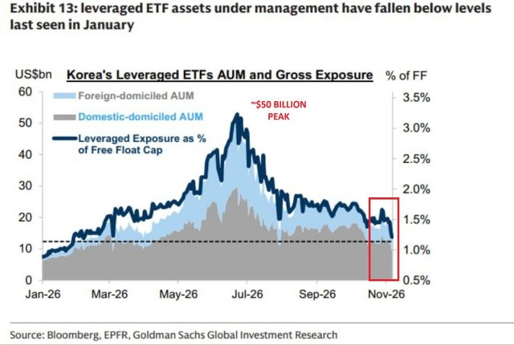

# KHwanK

### 전면 허용 시험과 전문성 중심 교육 개편

- AI 부정행위 확산은 기존 시험의 한계를 드러내며, AI 사용 전면 허용과 평가 방식 개편을 추진할 계기
  - AI가 짧은 시간에 풀 수 있는 정답형 문제를 장기간 준비하는 교육은 실제 업무 역량과 괴리
  - 시험 점수의 신뢰가 약해지면 학벌·자격증과 초등학교부터 대학까지 16년 교육에 투자하는 근거도 흔들림
  - 안경 반입 금지나 전파 탐지 등 단속 중심 대응은 기술 발전 속도를 따라가기 어려움
- 앞으로의 경쟁력은 AI에 일을 맡기고 결과를 검증하며 최종 판단과 책임을 지는 능력
  - 단순히 질문하고 답을 받는 수준을 넘어 여러 AI를 지휘해 생산성을 높이는 역량이 중요
  - 실제 업무에서 AI 협업이 필수라면 시험에서도 같은 도구를 사용할 수 있어야 함
- AI를 전면 허용하는 대신 실무에서 마주칠 고난도 문제를 내고 충분한 작업 시간을 제공하는 시험으로 전환
  - 세무사 시험은 고객 장부를 분석해 절세 방안을 설계하고 신고서까지 완성하는 과제로 구성
  - 입시 문제는 예산 5,000만 원으로 전기차와 휘발유차 중 무엇을 살지 판단하게 해 수학·물리·사회 지식을 함께 평가
- 하이닉스 매수 여부를 묻는 투자 과제는 같은 결론이라도 분석 과정에 따라 전문성 차이를 드러낼 수 있음
  - 가치 투자·기술적 분석·매크로 중 접근법을 정하고 반도체 산업 지식을 적용
  - 필립 피셔의 15개 체크리스트, 피터 린치의 6개 주식 유형, 워런 버핏의 투자 기준을 비교해 적합성과 견해 차이를 설명
  - DCF·PER·PSR·PBR 중 적절한 평가 방법을 선택하고 수치와 가정의 근거를 제시
  - 미래 실적과 시장 컨센서스를 검토하고 내재가치와 주가 차트가 충돌할 때도 추천 여부를 판단
- 최종 보고서와 함께 AI에 던진 질문, 검증, 판단 등 풀이 과정 전체를 제출해 평가
  - 단순히 매수 여부만 묻는 질문과 투자 기준·실적 가정·평가 방법을 검토하는 질문은 전문성 차이를 보여 줌
  - 결론이 같더라도 중요한 쟁점을 얼마나 다루고 근거를 얼마나 설득력 있게 연결했는지로 점수를 구분
- 채점은 AI 5개가 답안과 과정을 각각 평가한 뒤 평균 점수로 결정하는 방안 제안
  - 여러 모델을 사용하면 개별 모델의 오류·편향을 줄이고 대량 채점을 빠르게 처리할 수 있다는 기대
  - 채점 근거를 공개해 수험생이 부족한 부분을 확인하고 학습에 활용
  - 독일의 과정 중심 시험처럼 단일 정답보다 결론을 도출하고 방어하는 논리의 질에 비중
- 전문 지식과 AI 활용 능력은 서로 대체하는 요소가 아니라 함께 필요한 핵심 역량
  - 전문 지식이 부족하면 적절한 질문을 만들거나 AI의 그럴듯한 오답과 낮은 수준의 답변을 구분하기 어려움
  - AI 활용 능력이 부족하면 제한 시간 안에 복잡한 실무 과제를 완수하기 어려움
- 시험이 바뀌면 학교 교육도 암기와 문제 풀이에서 AI를 활용한 문제 해결 연습으로 이동
  - 교사는 핵심 개념과 큰 학습 방향을 제시하고 새로운 AI 기능과 도구를 안내
  - 학생은 각자의 이해도와 속도에 맞춰 AI에 반복 질문하며 지식을 습득
  - 이런 변화가 확산되면 영상에서 언급한 28조 원 사교육 시장의 상당 부분도 효용이 줄어들 가능성
- 개인의 학습 전략은 정답을 빨리 얻는 연습보다 질문 설계·가정 검증·결과 설명 능력을 쌓는 방향이 유효
  - 익숙한 전공이나 업무에서 실제 과제를 정하고 AI와 해결한 전 과정을 기록하면 지식과 도구 활용 능력을 함께 점검 가능
- AI 채점 모델 수를 늘리는 것만으로 공정성이 보장되지는 않으므로 평가 기준과 채점 근거의 공개가 제도 설계의 핵심
  - 여러 모델이 같은 오류를 공유할 가능성까지 고려해 전문 지식과 논리 전개를 확인할 수 있는 기준이 필요

# Kobeissi

- 미국 10월 신규주택 판매가 전월 대비 14.2% 증가한 연율 70만1,000채로 반등했지만 가격 하락은 지속
  - 시장 예상은 3.8% 감소였으며 9월에는 9.7% 감소
  - 남부 판매가 36.2% 증가한 연율 51만5,000채로 전체 반등을 견인
  - 중위가격은 39만1,300달러로 전월 대비 0.3%, 전년 대비 3.2% 하락했으며 2022년 10월 고점보다 6만9,000달러·15% 낮음

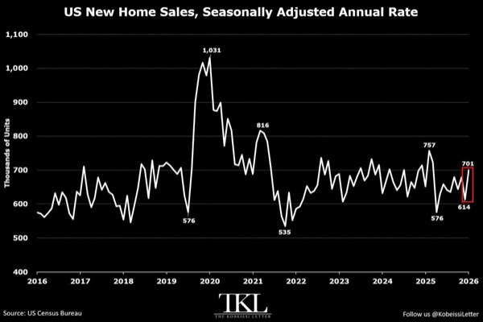

- 반도체 조정에 레버리지 저가매수 자금이 집중
  - 3배 롱 ETF SOXL에 이번 주 19억 달러, 월요일 하루 17억 달러가 유입됐으며 직전 주에도 27억 달러 유입
  - 금요일까지 20거래일 개인 순매수는 13억 달러로 최소 2024년 12월 이후 최대
  - SMH의 11월 유입액은 29억 달러로 7월 이후 최대 월간 유입을 향하는 중

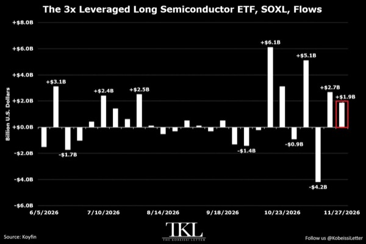

- AI 부채 위험을 방어하려는 수요가 늘며 미국 기업 CDS 지수의 2026년 누적 거래액이 사상 최대 9조6,000억 달러에 도달
  - 2025년 연간 9조 달러를 이미 웃돌고 2024년 연간 거래액보다 66% 증가
  - 9월에는 단 7개 종목 관련 CDS의 주간 평균 거래액이 95억 달러로 6~7월보다 425% 증가

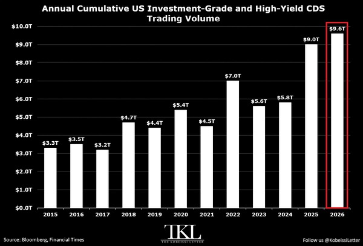

- 달러지수가 9개월간 7% 상승하며 2022년 11월 이후 가장 강한 9개월 상승률 기록
  - 최근 3개월 상승률은 4.8%, 2026년 1월 저점 대비로는 8.8% 상승해 2024년 4월 이후 최고 수준
  - EUR/USD는 1월 고점 대비 9.1% 하락한 1.1 부근
  - 연준 금리 인상 기대, 견조한 미국 지표, 기록적인 외국인의 미국 주식 수요가 달러 강세를 견인

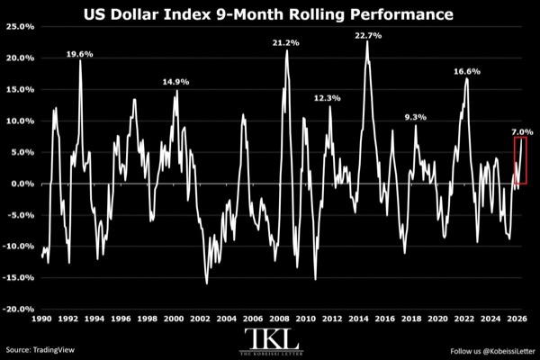

- 기술주 일중 변동폭과 S&P 500 주간 등락이 동시에 확대돼 단기 매매 기회와 위험이 커짐
  - 나스닥100의 최근 5거래일 평균 일중 변동폭은 3.8%로 2025년 4월 이후 최고이며 지난 금요일에는 5.7% 기록
  - S&P 500은 주간 절대 등락률 2.5% 이상을 4주 연속 기록할 가능성이 있으며 이는 2022년 약세장 이후 최장
  - 최근 주간 수익률은 -2.7%, +2.5%, -8.6%에 이어 이번 주 현재 +3.9%로 방향 전환이 반복

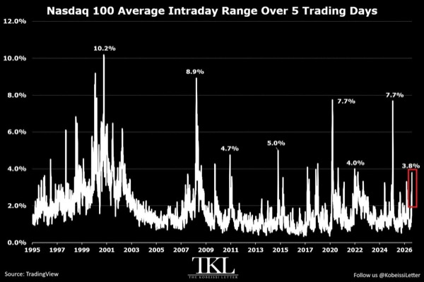

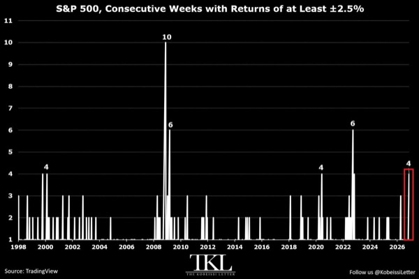

- 추수감사절 반등으로 S&P 500 선물이 11월 19일 이후 처음 7,300을 돌파하며 지난 금요일 저점 대비 6% 상승
  - 나스닥100 선물도 장중 2.5% 상승했고 S&P 500과 다우는 조정 구간에서 더 멀어짐

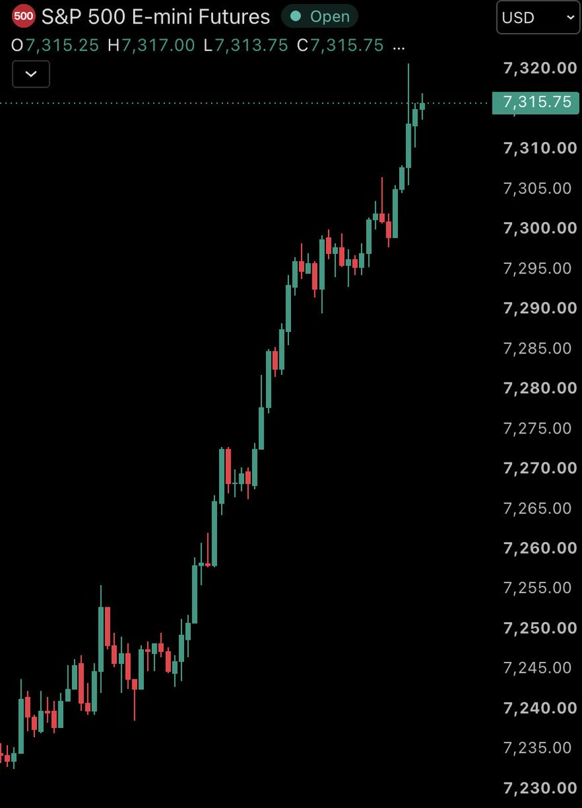

- 귀금속 저가매수가 유입되며 금과 은의 상승폭이 장중 확대
  - 금은 온스당 3,600달러를 넘은 뒤 상승률이 4% 이상으로 확대
  - 은 상승률도 5% 이상에서 10%로 확대

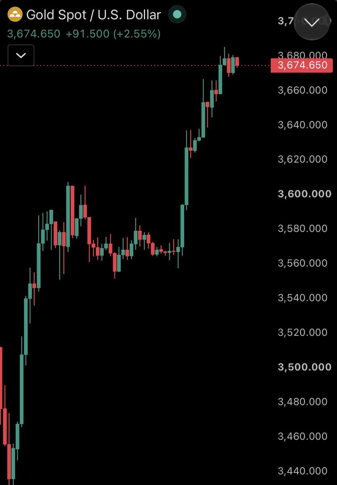

- 미국 추수감사절 온라인 소비가 71억 달러로 전년 대비 10.4% 늘며 예상치를 상회
  - Adobe는 블랙프라이데이 온라인 소비를 전년 대비 9.2% 증가한 사상 최대 129억 달러로 전망
  - 선구매 후결제인 BNPL 지출도 사상 최대에 이를 가능성

- 엔비디아 NVDA가 블랙웰 칩의 중국 소재지 발견 보도 이후 상승분을 반납하고 하락 전환
  - Bloomberg는 Alice Huang과 연관된 중국 시설에서 해당 칩이 발견됐다고 보도

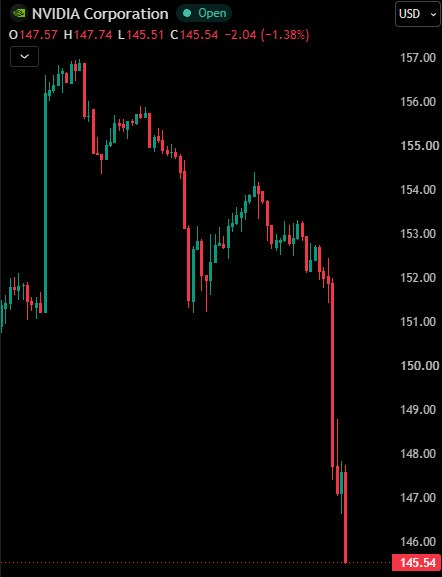

- 트럼프가 중간선거 이전에 발표된 미국 경제지표가 조작됐다고 주장하며 즉각적인 조사를 요구

# MKevin

### 인공지능 채용 둔화와 미국 고용시장의 경고 신호

- 미국 경기 낙관론의 핵심 위험은 고용 둔화와 AI 투자 호황의 반전이며, AI 투자 위축은 해고를 늘려 노동시장 악화를 가속할 수 있음
  - ISM·PMI·기업 실적·GDP·소매판매의 강세와 달리, 베이지북의 기업 현장 반응에는 신규 채용과 소비 둔화 신호가 누적
  - 당장 침체나 주가 급락을 뜻하지는 않지만, 향후 2년의 경기 위험을 높이는 조기 경고
- 베이지북상 12개 연은 관할 지역 중 8곳은 소폭~완만한 성장, 4곳은 정체
  - 소비자는 가격에 더 민감해지고 구매를 선별하며, 관광 수요는 견조하지만 엔터테인먼트·숙박은 혼조
  - 연료비·금리 부담으로 자동차 판매가 둔화하고, 주택 구매 여력 악화와 높은 차입 비용으로 주거용 부동산·건설 활동이 약화
  - 제조업은 일부 산업의 강한 수요로 완만하게 성장하지만 가계와 소비 부문의 약세를 모두 상쇄하기는 어려움
- 고용 인원 유지가 노동시장 건전성을 보장하지는 않음
  - 다수 기업은 퇴사자 충원에 집중하고, 의미 있게 인력을 늘리는 기업은 소수에 그침
  - 기존 직원의 효율을 높이고 채용 기준을 강화하면 신규 졸업자와 실직자를 흡수할 여력이 줄어듦
  - 대규모 해고가 발생한 뒤에도 신규 채용이 회복되지 않으면 실업 증가가 빨라질 수 있음
- AI의 고용 충격은 대량 해고보다 신규 채용 축소에서 먼저 나타날 수 있음
  - 회계·광고 운영·성과 측정·영상 편집 등을 AI로 처리하면 퇴사자를 충원하거나 추가 인력을 뽑을 필요가 감소
  - 현재 고용에 미친 영향이 작다는 응답과 향후 채용 수요가 약해지는 현상은 동시에 성립
  - 모델 성능 향상이 생산성 증가와 채용 축소로 이어질 가능성이 핵심 위험
- OpenRouter 자료에서는 토큰 단가가 급락하는 가운데 지출은 높은 수준을 유지하지만 10월 이후 증가세가 정체
  - 토큰 사용량 확대가 지출 증가로 충분히 연결되지 않으면 Anthropic 등 주요 AI 기업의 매출 성장에 부담
  - AI 사용 확대가 AI 기업의 매출 성장이나 전체 고용 증가로 자동 연결되지는 않음
- 보스턴·클리블랜드·샌프란시스코에서는 AI를 통한 채용 억제 사례가 직접 확인됨
  - 보스턴은 AI 영향이 제한적인 기업부터 직원 재교육, AI 도입에 따른 채용 축소까지 반응이 다양
  - 클리블랜드는 은행·법률·제조업의 채용으로 순고용이 소폭 증가했지만, 일부 기업은 수요 부진과 비용 상승에 대응해 AI로 채용을 제한
  - 샌프란시스코는 AI·자동화를 활용해 인원 증가 없이 수요를 충족하는 사례가 나타남
- 리치먼드·댈러스는 인력 확장보다 확정 수요와 기존 직원 활용에 집중
  - 리치먼드는 고용이 정체되고, IT 기업은 계약 체결 후에만 채용하며 운송·가금류 기업은 마진 축소로 채용을 중단
  - 댈러스는 제조업이 상대적으로 강하지만 채용 결정이 늦어지고 기존 인력 활용을 우선
  - 가격 전가가 어려운 상황에서 비용 상승은 마진과 채용 여력을 동시에 압박
- 애틀랜타·시카고에서도 고용 증가의 폭과 지속성에 제약
  - 애틀랜타는 해고가 적고 고용이 안정적이지만 채용 확대 기업은 소수이며, 산업시설·데이터센터 관련 숙련 인력은 부족
  - 다수 기업은 단기적으로 AI를 인력 대체보다 효율 개선에 활용하지만, 장기 고용 효과까지 확정된 것은 아님
  - 시카고는 고용이 소폭 늘었으나 구인당 지원자가 증가하고 일부 기업의 채용 중단·해고가 발생
- 세인트루이스·캔자스시티는 지원자 증가와 직무 역량 불일치가 동시에 나타남
  - 세인트루이스는 고용이 정체된 가운데 전문직·IT 구인이 늘고, AI 발전에 따라 직무 요건이 변화
  - 캔자스시티는 AI 관련 역량과 지원자 기술의 격차가 커지고, 다수 기업은 기존 직원 재교육과 향후 1년 인원 유지를 예상
  - 채용 공고가 있어도 요구 역량을 충족하지 못하면 취업으로 연결되기 어려움
- 필라델피아는 전체 고용과 주택·건설업의 방향이 엇갈림
  - 고용은 소폭 증가했지만 조사 기업의 약 3분의 2는 인원 변화가 없었음
  - 신규 주택 판매 둔화로 건설업체는 2027년 착공 감소와 해고를 예상
  - 건축설계 업체는 감원을 검토하고, 한 대형 아파트 시공사는 진행 사업 마무리 후 영업 중단을 고려
- 뉴욕·미니애폴리스는 상대적으로 양호한 고용 흐름을 유지
  - 뉴욕은 제조업·창고업·의료·금융에서 고용이 늘고 근로시간도 증가했으며, 해고는 제한적
  - 미니애폴리스는 채용 전망이 완만하게 긍정적이고 건설업 채용이 전년보다 늘었으며, 신규 실업수당 청구도 전년보다 적음
  - 다만 미니애폴리스에서도 고용 안정에 대한 자신감이 약해지고 저소득층의 만족도가 상대적으로 낮아짐
- 고용 증가 총량과 함께 근로시간·고용 형태·입퇴직 흐름을 확인해야 함
  - 영상은 지난달 일자리 16만 5,000개 증가와 별개로 가계조사의 시간제 고용 약 35만 6,000명 증가를 제시
  - 평소 전일제로 일하지만 조사 시점에 시간제로 일한 인원이 71만 4,000명 늘어난 점은 근무시간 축소 가능성을 시사
  - JOLTS 채용 약 540만 명과 이직·퇴직 등 고용 이탈 약 530만 명의 격차는 영상에서 약 8만 3,000명으로 제시돼 완충 여력이 작음
- 지역별 경고 신호를 반영한 영상의 자체 평가는 부정적 10곳, 긍정적 2곳
  - 연준의 공식 경기 분류가 아니라 신규 채용 둔화·AI 대체 가능성·건설 약세에 가중치를 둔 평가
  - 순고용이 증가한 지역도 향후 위험 때문에 부정적으로 분류했으며, 뉴욕과 미니애폴리스만 긍정적으로 유지
- 소비와 채용이 이미 약해지는 상황에서 추가 금리 인상은 고용 악화 위험을 키울 수 있음
  - 높은 금리는 주택 거래와 건설을 억제하고, 생활비 상승은 임금 인상 요구와 기업 비용 부담을 높임
  - 기업이 가격을 충분히 올리지 못하면 채용 축소와 자동화로 대응할 유인이 커짐
- 주택시장은 단기 건설 고용 악화와 중기 공급 부족을 함께 봐야 함
  - 높은 건축·금융 비용으로 신규 공급이 줄면 임대료와 기존 부동산 가격의 상승 압력이 커질 수 있음
  - 건설업 부진이 곧바로 기존 주택 가격 하락으로 이어지는 것은 아니며, 가격 상승도 보장되지 않음
- 노동시장 경고는 실업률 상승 이전의 채용·근로시간·충원 방식 변화에서 먼저 드러날 수 있음
  - 고용 인원 유지와 낮은 해고율만으로 안심하기보다 구인당 지원자 수, 채용 소요 기간, 퇴사자 충원 여부를 함께 추적할 필요
- 개인의 취업 경쟁력은 AI를 실제 업무에 적용하는 능력과 산업별 숙련도에 더 크게 좌우될 수 있음
  - 단순 프롬프트 작성보다 업무 지침·프로젝트·자동화 도구를 활용하는 역량이 중요해지고, 제조·데이터센터·기술 전문직 수요와 일반직 채용 둔화가 공존할 수 있음

### 주 레버리지 청산과 견조한 고용 사이의 증시 바닥 탐색

- 증시 하락은 아직 경기침체 확정보다 AI 관련주 레버리지 청산에 가까우며, 바닥 확정에는 이른 구간
  - 이란 전쟁, 민주당 선거 승리, 데이터센터 둔화, 매파적 연준과 50bp 긴축 우려, 중국 반도체 수출 문제, 관세가 동시에 부담
  - Anthropic 주가와 고용시장이 AI 투자심리·실물경기 악화를 구분할 핵심 관찰 대상
- Anthropic은 상장 직후라 기존 AI 인기주보다 누적 레버리지 노출이 작아 시장 유동성의 시험대 역할
  - 옵션과 레버리지 ETF는 이미 출시됐지만, 장기간 매수세가 쌓인 Micron·SanDisk·Amazon·Meta·Microsoft보다 노출이 작다는 전제
  - 공모가 83달러, 상장 후 고점 115달러, 저점 약 73달러, 당일 종가 약 84달러
  - 영상에서 제시한 상장 대비 -10~20% 구간에서 등락하며 이틀 연속 -20% 선을 장중 이탈했다가 회복
  - 이 지지력이 유지되는 동안에는 전면적인 경기침체 공포 매도로 단정하기 어려우나, 추가 하락 가능성은 열려 있음
- Anthropic 목표가 135달러는 약 84달러 대비 60.7% 상승 여력에 해당하지만 수익성 검증은 미완성
  - AI가 토큰 판매를 넘어 에이전트와 업무를 실행하는 기반 소프트웨어로 발전하면 기존 소프트웨어 예산보다 큰 시장에 진입 가능
  - 직원 생산성 보조에서 업무 자체 수행으로 넘어가면 인건비와 광범위한 운영예산까지 잠재시장에 포함
  - 막대한 인프라 지출, 경쟁사의 추격, 차별화 지속성, 2030년 이전 흑자 전환 여부가 주요 불확실성
- AI 가격 하락이 지출 급증으로 이어진다는 제번스 역설은 최근 지출 증가율 둔화로 시험받는 중
  - 2023년 초기 사용과 환각 실망, 2024~2025년 정체, 2026년 초 Claude Code 확산에 따른 급성장 이후 기저효과가 커진 흐름
  - Google 등 경쟁사의 모델 훈련 재투자는 기술 경쟁과 자본지출 부담이 계속된다는 신호
- 실물경기 지표는 현재 광범위한 침체보다 견조한 성장에 가까움
  - 3분기 GDP 2차 추정치는 4.3%, 개인소비 증가율은 직전 3.9%에서 4.2%로 상승
  - 실업급여 계속청구는 선거 전후 일시 급등을 평탄화해도 낮은 수준이며, 비슷한 저점은 2024년 초 일부 구간
  - 자발적 퇴사율이 안정적이거나 상승하는 흐름은 재취업 자신감이 유지된다는 해석에 부합
  - 실업급여 청구는 후행성이 있어 해고 인력의 재취업 흡수, ISM·PMI 고용지표도 함께 확인할 필요
- GDP 성장과 가계 체감경기는 크게 엇갈리며, 성장 산업과 비수혜 업종 간 격차가 확대
  - 경유·휘발유·식료품 부담이 지속되는 가운데 학교 유지보수 같은 분야는 데이터센터 건설만큼 수혜를 받기 어려움
  - 냉난방·전기 등 기존 기술을 데이터센터 투자와 연결할 수 있는지가 소득 기회를 좌우
  - 건축허가는 전년 대비 7.2% 감소해 예상 감소폭의 약 두 배로 악화, 주택 부문은 별도 약세 신호
- 관세 인상은 물가와 기업 생산성에 추가 부담
  - 아시아·유럽 주요 교역 상대에 대한 관세율이 2~3배로 상승하는 상황을 전제로 비용 전가와 경제적 순손실 우려
  - 관세 철회는 수입물가 하락을 통해 생활비 부담을 낮출 잠재적 정책 촉매
- 사우디 Aramco의 Ras Tanura 시설 공격으로 원유 공급 불안이 재확대
  - 공격 주체는 영상 내 정정 기준으로 이란의 지원을 받는 후티 반군
  - 유가는 공격 소식 이후 약 3.6% 상승해 94달러 수준, 정유·선적 시설 손상과 호르무즈 해협 운송 위험이 부담
  - 2년물 국채금리 하락폭이 장중 약 6bp에서 약 2.3bp로 축소된 움직임은 일방적인 침체 베팅과는 다른 신호이나, 유가 상승 영향도 고려할 필요
- Nvidia는 신용과 지배구조 불확실성이 주가 부담으로 확대
  - 영상 기준 AA 신용등급에 부정적 관찰이 붙어 향후 90일 안에 강등될 가능성
  - 신용부도스와프 지표는 Nvidia 142, Meta 118로 Nvidia가 더 높은 수준이며 Nvidia 수치는 최근 고점 부근
  - 경영진 관련 의혹과 정부 대응은 사실관계가 불분명해 확정된 결론보다 불확실성 자체가 위험요인
- SpaceX·Tesla 합병 기대는 자금조달 능력 강화 가능성과 연결되지만 아직 확정되지 않은 시나리오
  - SpaceX가 활성 Trump 계좌마다 1주를 지급하고 Elon Musk가 이를 추가 매칭하려는 계획이 소개됨
  - Kalshi의 다음 해 1월 이전 합병 확률은 약 3분의 1 수준으로 상승
  - 합병이 성사되면 Musk의 Tesla 지배력과 통합 신용 접근성이 강화될 수 있다는 기대
  - FCC의 위성 100만 기 승인도 궤도 컴퓨팅 확대 기대의 배경
- 애틀랜타 연은의 4분기 GDP 추정치 2.9%는 3분기 4.3%보다 둔화했지만 침체와는 거리가 있는 성장률
  - 선거 이후 약 2주부터 추정치가 약해진 흐름에는 정책 불확실성에 따른 지출·투자 관망이 반영됐을 가능성
- 금리 움직임에 따른 업종 반응과 시장 전체 바닥 예측은 구분할 필요
  - 국채금리 하락에 민감한 Rocket Mortgage가 당일 7% 상승한 사례는 개별 촉매를 활용할 여지가 있음을 보여줌
  - 하루 뒤 주가나 정확한 저점을 맞힐 수 없으며, 추가 하락을 감당할 자금과 장기 보유 여력이 분할 접근의 전제
- AI 노출은 단일 승자보다 하이퍼스케일러·반도체 설계·광섬유·광학을 아우르는 분산 구성이 중심
  - 약 34개 종목의 바스켓을 활용하고 일부 기존 보유 종목에는 신규 배분을 중단하는 방식
  - Anthropic 직접 노출은 협찬사가 제공한 자금으로 매수한 무기한 파생상품에 한정하며, 별도로 Broadcom을 통한 간접 노출 선호
  - Corning은 관찰 중이나 미편입 상태이며, 사업의 약 절반이 부진하다는 점이 부담
- 주가의 유동성 회복과 AI 기업의 장기 수익성은 별도로 검증할 과제
  - Anthropic의 지지선 유지가 시장 청산 압력 완화를 시사해도 흑자 전환과 투자수익률을 입증하지는 못함
- 고용·소비의 견조함은 경기침체 위험을 낮추지만, 유가·관세발 물가 상승은 연준 완화 여력을 제한할 수 있음
  - 성장률만으로 증시 바닥을 확정하기보다 고용 둔화와 비용 충격이 동시에 나타나는지 확인할 필요
- AI 장기 확산에 참여하더라도 누적 레버리지를 줄이고 사업별 실적 차이를 반영해야 하락장에서 투자 지속 가능성을 높일 수 있음

### 투자 도구 통합과 평생 이용권 종료

- Reinvest One은 투자 정보·분석 도구·교육을 한 번의 결제로 묶는 평생 이용 상품
  - 알파 리포트, 투자 기회 알림, 포트폴리오 공개, 비공개 방송, 주식·리서치·부동산 터미널, 개인·기업용 인공지능 교육, 9개 강좌 포함
  - 주식과 돈의 심리, 부동산 투자·영업·관리·수리, 유튜브 수익화, 인공지능 활용 등 기존 개별 판매 콘텐츠 통합
- 평생 이용권은 2026년까지 확보할 수 있으며, 2027년부터 신규 가입은 월간·연간 구독으로 전환 예정
  - 기존 수강생은 구매 이력에 따른 업그레이드 조건을 별도로 문의할 수 있으며, 이 혜택도 2026년 내 결정하도록 안내
  - 2018년 이후 관련 상품 구매자는 5만 8,000명, 여러 상품 구매·업그레이드 경험자는 1만 1,000명으로 제시
- 주식 터미널은 2026년 12월 출시 예정이며, 촬영 시점에는 개발 중으로 시험 사용이나 실제 화면 공개가 불가능한 상태
  - 여러 정보원을 오가는 대신 기업 재무·가격·모멘텀·가치평가·목표주가 근거·기관 의견을 한곳에서 확인하는 구조
  - Tesla, SpaceX, 나스닥 기업 등을 둘러싼 방대한 정보에서 투자 판단에 필요한 핵심만 추리는 데 초점
- 터미널은 자체 데이터와 유료 라이선스 데이터, 인공지능, 분석 인력의 판단을 결합한 맞춤형 대시보드 지향
  - Bloomberg의 방대한 기능보다 개인 투자자가 자주 쓰는 정보와 편의성에 집중
  - 회사가 밝힌 연산 자원·데이터 라이선스 비용은 월 수만 달러에서 10만 달러 이상 수준
- 리서치 터미널은 기관 의견과 기업의 펀더멘털 모델링을 정리하고, 부동산 터미널은 지도에서 저평가 매물과 수리 후 가치 상승 가능성을 탐색하는 도구로 개발
  - 기존 부동산 상품을 전면 개편하고 단독주택 중심의 지도 기능 추가
- 개인·기업용 인공지능 교육과 에이전트 기반 프로젝트는 2027년 상반기 공개 예정
  - 일상과 사업에서 인공지능을 활용해 생산성을 높이는 실무 사례 제공
- 알파 리포트는 매일 단기·중기·장기 전망을 기술적 분석과 펀더멘털 분석으로 점검
  - 포트폴리오 공개·알림·비공개 방송과 함께 위험을 줄일 시점과 적극적으로 투자할 시점에 대한 판단 자료 제공
  - 개인별 맞춤 금융 자문은 제공하지 않으며, 최종 투자 결정은 이용자 몫
- 평생 이용권의 가치는 기존 강좌를 실제로 활용할 정도와 출시 예정 터미널의 완성도에 달림
  - 주식 터미널은 시연 전이고 인공지능 교육은 2027년 공개 예정이므로, 현재 제공 기능과 향후 제공 약속을 구분해 평가할 필요
- 2027년 구독 전환은 데이터·연산 비용을 지속적으로 충당하려는 사업 구조 변화
  - 선결제 평생 이용권은 초기 자금 확보에 유리하지만, 장기 서비스 품질과 운영 지속성이 이용 가치의 핵심

### 엔비디아 중국 우회 수출 의혹과 동남아 출하 중단

- 엔비디아 첨단칩의 중국 우회 반입 의혹이 동남아 유통망과 서버 제조사까지 확산
  - 영상이 인용한 블룸버그 보도에 따르면 2025년 3월 출시된 GB300이 앨리스 왕의 중국 메가스피드 시설에 반입됐으며 해당 장비를 담보로 대출까지 실행
  - 장비 담보 평가·실사가 있었다면 금융기관과 유통망도 실물을 확인했을 가능성이 있으나 생태계 전체의 사전 인지는 진행자의 추정
  - 블룸버그는 기가바이트가 조립·판매한 랙의 일련번호를 확보했으며 기가바이트는 법을 준수한다는 입장 외 구체적 답변을 거부
- 미국 법무부의 밀수 혐의는 동남아 경유 재포장과 가짜 서버·라벨을 이용한 수출검사 기만
  - 동남아 소재 업체가 슈퍼마이크로에서 서버를 주문한 뒤 중국으로 재수출했다는 혐의
  - 헤어드라이어로 라벨을 떼어 비작동 복제품에 붙였다는 혐의가 있으며 관련 감시카메라 영상도 거론
  - 관련 사건의 피고인은 3명이며 슈퍼마이크로 공동창업자는 이사회에서 사임, 일부 기소 대상 서버 규모는 5억 달러
- 엔비디아가 델·슈퍼마이크로 등 제조사에 말레이시아·싱가포르·태국·인도네시아행 출하를 기한 없이 중단하도록 지시했다는 보도
  - 대만은 중단 대상인 동남아에 포함되지 않음
  - 중국 기업들이 해당 국가의 엔비디아 장비에 원격 접속해 연산능력을 확보해 왔으며 미국 상무부 규제로 이런 접근도 제약
- 영상에 제시된 엔비디아 지역별 매출은 미국 약 730억 달러, 대만 약 300억 달러, 중국·홍콩 약 110억 달러, 기타 약 16억 달러
  - 집계 기간은 대본에 명시되지 않았으며 향후 중국 매출 전망은 0으로 축소
  - 지역별 매출 집계 기준이 칩의 최종 도착지에서 고객 본사 위치로 변경
  - 본사 기준 매출만으로 동남아 경유 물량과 중국의 최종 수요를 파악하기 어려움
- 진행자는 동남아 출하 중단을 향후 의회 증언과 조사에 대비한 엔비디아의 대응으로 해석
  - 직접 중국에 팔지 않았고 우회 반입 방지를 위해 매출까지 포기했다는 논리를 강화할 수 있다는 예상
  - 트럼프의 젠슨 황 사면 가능성과 정부의 엔비디아 지분 취득 가능성도 언급하지만 확정된 조치로 제시된 내용은 아님
- 진행자는 기업들이 준법을 주장하면서 최종 책임이 수출통제를 집행한 하워드 러트닉 상무장관에게 돌아갈 가능성을 예상
  - 영상 속 예측시장에서는 2028년 1월 이전 퇴임 확률 63%, 7월 이전 퇴임 확률 49%, 거래량 약 64만 2,000달러가 제시됨
  - 예측시장 가격과 진행자의 책임 전가 시나리오는 실제 해임 결정이나 조사 결과와 구분 필요
- 엔비디아 실적을 판단할 때 고객 본사 기준 지역 매출과 실제 장비 설치·사용 지역을 함께 확인해야 중국 노출과 출하 중단 영향을 가늠할 수 있음
- 수사 확대의 핵심 변수는 공급망 관계자들이 최종 사용처를 인지했는지와 허위 라벨·검사 회피에 직접 관여했는지 여부
- 동남아 출하 중단의 실적 충격은 중단 기간과 대체 판매처에 달려 있으며 영상의 매출 수치만으로 손실 규모를 산정하기 어려움

# Slav

- 국내 증시 반등을 추격하기보다 변동성 속에서 종목을 선별해 분할 접근할 필요
  - 추가 매수 기회가 반복될 수 있어 서둘러 따라붙을 이유가 적음
- 증안펀드는 규모가 제한적이며 집행 후 남을 정책 대응 카드 부족이 투입을 망설이는 요인
  - 연기금도 선거 당시 국내 주식 비중을 줄이지 못해 최근 하락장에서 매수 여력이 제약됐다는 해석

# Stockbot

- 트럼프가 중간선거 이전 미국 경제지표의 조작 의혹을 제기하며 즉각적인 조사를 요구

- Anthropic ANT에 개인 매수세가 집중되며 월요일 순매수액이 1억 달러로 이틀 연속 증가
  - 당일 개인 순매수 2위였으며 월요일까지 3거래일 누적 매수액은 2억5,200만 달러
  - 목요일 상장 당일 개인 매수액은 6,000만 달러로 2018년 이후 IPO 첫날 기준 세 번째 규모
  - 더 큰 IPO 첫날 개인 매수는 SpaceX SPCX의 1억1,800만 달러와 Coinbase COIN의 9,200만 달러

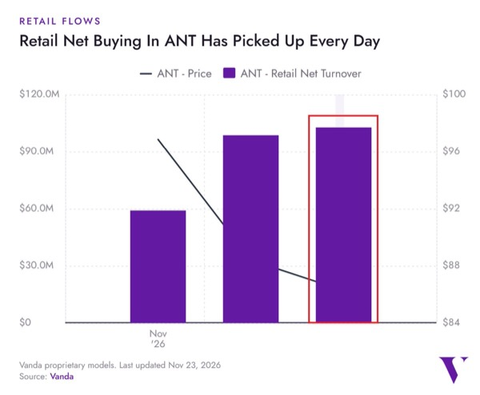

- 은의 연초 이후 성과가 30여 년 만에 최악의 수준

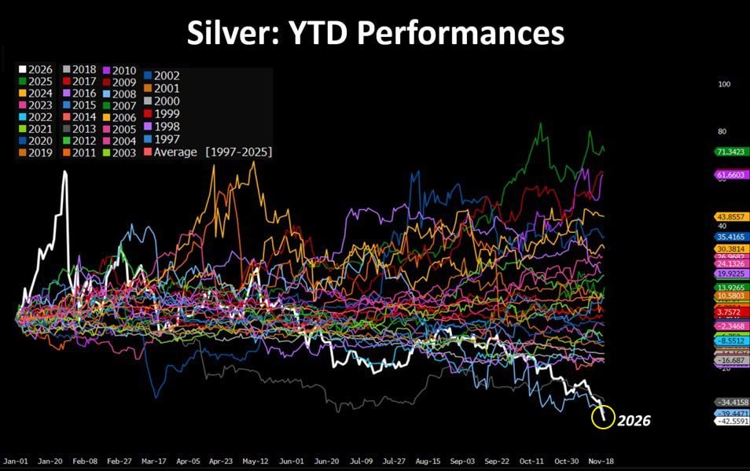

- SpaceX의 미국 아동 대상 주식 지급은 다음 달부터 이전할 예정
  - 미국의 모든 아동에게 2주씩 지급하는 계획이며 머스크 개인이 직접 이전하는 주식은 내년 6월 매각 제한 종료 이후 처리

- 미국 추수감사절 온라인 소비가 전년 대비 10.4% 증가한 71억 달러로 예상치를 상회
  - Adobe는 블랙프라이데이 온라인 소비를 전년 대비 9.2% 증가한 사상 최대 129억 달러로 전망
  - BNPL 지출도 사상 최대를 기록할 가능성

- 이번 금 가격 조정에서는 금광주가 금보다 강해 2011년 고점 이후 약세장과 다른 상대성과가 나타남
  - 2011년 이후 약세장에서는 금광주·금 비율이 지속 하락했지만 현재는 조정 중에도 금광주가 초과수익

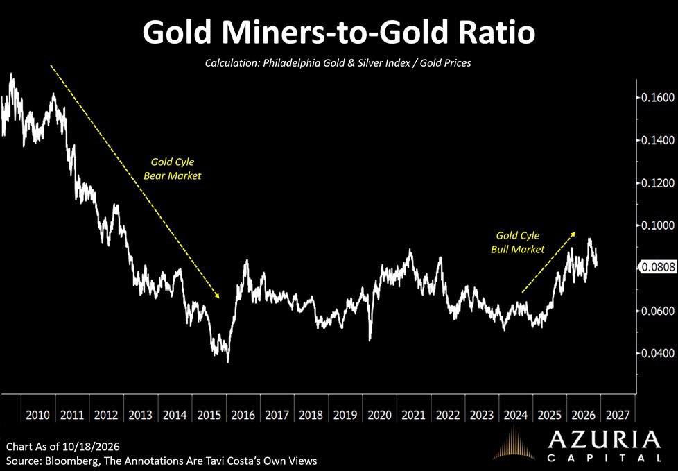

# WUncle

### 2027년 방어적 운용과 2028년 버블의 전환점

- 투자 성과는 전망의 적중률보다 승률과 손익비를 결합한 기대값에 좌우됨
  - 전문가도 승률 60%를 넘기기 어렵고 이번 시장 전망의 자체 확신도 55~60% 수준
  - 공개 전망은 적중 여부로 평가받아 매수 편향이 커지기 쉬우며 개인의 생애 주기·위험 성향·기존 포트폴리오에 따라 적합한 대응이 달라짐
  - 새로운 정보가 나오면 기존 전망과 포지션을 바꾸는 유연성이 필요
- 2020년대 시장을 읽는 핵심은 연준의 통화정책에 더해 정부의 재정정책과 선거를 둘러싼 이해관계를 추적하는 것
  - 금융위기 이후 제로금리와 양적완화는 자산 가격과 부의 양극화를 확대했고 코로나 이후 정부의 직접 지원과 재정 지출이 중요해짐
  - 미중 패권 경쟁과 정치 양극화로 장기 경제 효율보다 단기 선거 승리를 위한 정책의 영향력이 확대
  - 옐런과 베센트의 단기국채 중심 발행처럼 정권이 바뀌어도 선거를 앞둔 정책 유인은 유사하게 작동
- 2026년 중간선거 이후부터 2027년 2~3분기까지는 부양 동력 약화와 정책 변동성에 대비하는 구간
  - 2026년 1월 전망은 상반기 조정 폭을 5~10%로 제한하고 중간선거 이후를 부정적으로 설정
  - 현재 하락을 AI 버블의 본격 붕괴로 보는 기존 가능성은 수정했지만 단기 주식시장에는 보수적 대응 유지
  - S&P 500의 본격 조정이 이어지면 AI 성장주와 코스피는 더 큰 타격을 받을 가능성
  - 반도체·AI에 집중된 포트폴리오는 지수보다 체감 손실이 커질 수 있고 나스닥에서 러셀로의 순환매만으로 시장 위험 해소를 단정하기 어려움
- 2027년 4분기부터는 한국과 미국의 선거 일정이 동시에 주가 부양 유인을 강화하는 시나리오
  - 미국은 2028년 11월 대선을 약 12개월 앞둔 시점부터 주가 관리 유인이 커짐
  - 한국은 2028년 4월 총선을 약 6개월 앞둔 시점부터 증시 부양 유인이 커질 가능성
  - 2027년 상반기 하락이나 횡보가 이어지면 2~3분기를 다음 상승 구간에 대비한 매수 기회로 검토
- 한국에서는 2027년 하반기 코스닥의 체질 개선과 지수 부양 가능성에 주목
  - 정부의 스타트업 지원과 국민성장펀드 자금 투입이 성과로 연결되려면 벤처캐피탈과 투자처의 회수 시장이 필요
  - 코스닥 부진은 스타트업 상장과 투자금 회수를 막아 정부 정책과 충돌
  - 우량 기업의 상장 성공 사례를 만들려는 지원과 부실 기업 퇴출이 동시에 진행될 수 있어 개별 기업 선별이 중요
- AI 버블의 본격 붕괴 위험이 커지는 시점은 2028년 말~2029년으로 설정
  - 앤트로픽의 1조 달러 규모 상장과 오픈AI의 비슷한 규모 상장 준비를 전제로 미국 벤처캐피탈·AI 업계·연관 기업의 지분 회수 이해관계가 집중
  - 앤트로픽은 향후 약 1년, 오픈AI는 2027년 상장 이후 약 1년간 주요 투자자의 지분 회수가 이어지는 일정에 주목
  - 미중 AI 경쟁에서 미국 정부가 산업의 급격한 위축을 방치하기 어렵고 실제 생산성 향상도 산업을 지탱
  - 상장·지분 회수 일정과 2028년 대선 전 부양 동력이 겹친 뒤 약해지는 구간이 위험 시점
- 케빈 워시의 연준 운영 구상은 2027년 유동성 변동성을 키울 수 있는 변수
  - 연준 대차대조표 축소와 민간은행 규제 완화를 병행해 신용 창조의 중심을 민간은행으로 되돌리는 방향
  - 양적긴축과 은행 신용 확대의 균형을 맞추기 어려워 정책 집행 과정에서 시중 유동성이 크게 흔들릴 가능성
  - 2027년 상반기에는 자체 정책 과제를 적극 추진하고 4분기부터 선거를 의식할 유인이 커지는 시나리오
- 추가 하락의 촉매는 금리 인상·장기국채 발행 재개·전쟁 확대·데이터센터 규제
  - 단기국채 발행으로 미뤘던 장기국채 공급이 늘면 장기금리 부담이 확대될 수 있음
  - 레임덕에 접어든 트럼프의 확전 가능성과 민주당의 데이터센터 제동에 주목
  - AI 투자에 의존한 GDP 성장세가 급격히 꺾이면 침체 위험이 커짐
- 향후 6~9개월은 현금 비중을 높이고 투자 규모를 줄이는 보수적 운용 구간
  - 연말 산타랠리나 단기 수% 반등이 나올 수 있지만 반등을 현금 확보 기회로 활용
  - 손실 상태에서 현금화하기 어렵다는 심리를 인지하고 원금 회복 집착보다 향후 위험을 기준으로 대응
  - 전망과 달리 시장이 상승하더라도 모든 수익 기회를 가져가려는 욕심을 줄이는 접근
- 금은 재정부채 확대와 성장 둔화가 겹치는 스태그플레이션에 대비할 포트폴리오 자산
  - 과도한 재정부채 아래에서는 성장 둔화가 곧바로 디플레이션으로 이어지기보다 물가 부담이 남는 환경으로 전환될 가능성
  - 주식 급락 시 마진콜과 강제청산을 충당하려는 매도로 금도 동반 하락할 수 있음
  - 펀더멘털보다 유동성 수요 때문에 하락한 구간은 편입 기회가 될 수 있고 이후 수급 정상화 시 빠른 반등 가능
  - 실제 인플레이션 하락과 디플레이션이 나타나면 금에 우호적인 전제를 재검토
- 향후 5~10년과 다음 상승 사이클에서는 원자재의 주식 대비 초과수익 가능성에 주목
  - 2027년 선호 순서는 귀금속·에너지·농산물·산업금속
  - 상반기 침체 우려가 커지면 경기 민감도가 높은 비철금속과 산업금속은 더 큰 하락 가능
  - 원당·코코아 등 일부 농산물의 급등 가능성과 2027~2028년 계단식 화폐가치 하락에 대비한 실물자산 편입을 검토
- 데이터가 부족한 사건을 예측하려면 통계적 추론에 명제·인과관계 기반 추론과 인간 행동에 대한 이해를 결합해야 함
  - 팬데믹이나 새로운 관세정책처럼 반복 사례가 적은 사건은 과거 데이터만으로 추정하기 어려움
  - 금융시장에서는 인플레이션 기대가 사재기를 낳거나 게임스탑의 집단적 매수가 가격을 밀어 올리는 재귀성 때문에 인과관계가 고정되지 않음
  - 집단지성 기반 예측의 활용 범위는 매매를 넘어 기업의 영업 재개·임직원 철수·원자재 구매와 헤지 같은 의사결정까지 확장
- 집단지성의 성과는 참여자 수보다 반복 학습·상호 신뢰·토론의 밀도에 좌우됨
  - 기업 분석 대회에 두 번째·세 번째 참여할수록 목표주가 예측력이 개선되는 내부 신호를 관찰
  - 참여자가 많아질수록 AI가 생성한 피상적 분석의 유입과 공개 발언 부담이 커져 지식 교류의 질이 떨어질 수 있음
  - 밸리 엑스퍼트는 2026년 12월 31일 신규 가입을 종료하고 기존 회원의 학습과 토론에 자원을 집중할 계획
- 2027년에는 금융 특화 능동형 AI 에이전트와 가설 기반 스윙 트레이딩 프로그램인 프로젝트 엡실론을 출시할 계획
  - 엡실론은 수주~수개월에 걸쳐 시장 내재 확률과 투자 가설을 비교하고 손익비·포지션·위험을 관리하는 방식
  - 82가지 매매 기회에 대한 전략 교육, 확률 계산 플랫폼, 감정과 인지 편향을 측정·교정하는 뇌과학 기반 하드웨어를 결합
- 선거 일정은 매매 날짜를 확정하는 신호보다 정책 유인이 바뀌는 구간을 좁히는 기준으로 활용할 필요
  - 실제 재정 집행·국채 공급·은행 신용·AI 투자 흐름이 예상과 다르면 진입 시점과 위험 노출을 함께 조정
- 금과 원자재의 장기 투자 논리가 유지돼도 단기 유동성 충격에서는 동반 하락할 수 있어 현금과 분할 편입을 함께 설계할 필요
- AI 산업의 성장과 AI 주식의 투자 매력은 구분하고 상장 후 지분 회수·정치적 지원·밸류에이션이 함께 바뀌는 시점을 점검
